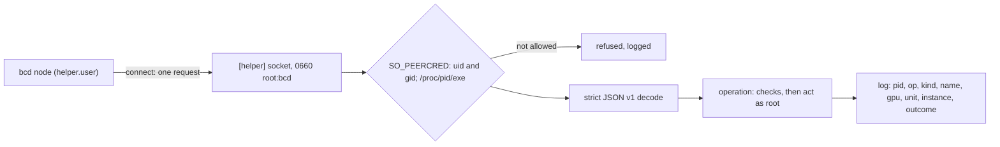

`bcd helper` is the root half of bcd's privilege separation (PLAN.md §6, v0.4; 28dc2ae). With `[helper] socket` and
`[helper] user` set in `config.toml`, `bcd node` runs as an unprivileged account and sends the few things that need
root to `bcd helper`, which runs as root beside it and serves typed operations over a local unix socket. The node
parses everything that comes from the network: the session, commands, specs, tunnels. The helper parses only its own
small requests, and trusts nothing in them.

This page is the reference for the helper itself: who it serves, the wire format, each operation family and the
checks root makes before it acts. The [daemon overview](/docs/daemon#privilege-separation) gives the summary, and
[running bcd node unprivileged](/docs/daemon/install#running-bcd-node-unprivileged) covers the install script that
sets it up.

<Callout type="warn" title="Tested end to end, not on a production host">
The helper is tested in three layers. Go unit tests in `internal/helper` run each operation against fakes (a fake
`virsh`, fake `systemd-run`, `tpmsim`, a fake host for config units). `tests/e2e/bcd.test.ts` runs an unprivileged
fakehw `bcd node` beside a real `bcd helper` binary, which writes and removes a GPU hold's CDI spec and swaps in a signed
self-update. The root end-to-end test (`node scripts/helper-e2e.mjs`, da8751e) runs the install script's `--unprivileged`
mode and a real `bcd helper` as root, inside private mount and network namespaces in WSL, and drives it as the `bcd`
user through `bcd helper-call`. Its steps cover signed host units, libvirt definitions against a fake `virsh`,
`cloud-hypervisor` taps on a real bridge (b9667d5) and self-update swap and rollback as root (035fc41). No hardware
TPM, real libvirtd or real VMM has run under the helper.
</Callout>

## Why a helper

Without `[helper]`, `bcd node` runs as root under systemd hardening (see
[the systemd unit](/docs/daemon/install#the-systemd-unit)). Everything the agent parses is then parsed by root: the
session protocol, desired state, signed commands, tunnel frames, plugin traffic. A parser bug there gives an attacker
root on the machine.

With the helper, root's attack surface is one socket that takes one JSON request per connection. Each operation is
small and typed: a file is named by a kind and an id rather than a path, a GPU by a UUID the host has, a config unit
by its name and settings, a domain by an instance id. Root rebuilds each privileged action from those values and
its own view of the host, so a compromised node can ask only for what the node could already legitimately ask for.

What the node keeps doing with its own rights: the journal, the identity and key record in `data_dir`, the status
socket, reading `/dev/kmsg` for XIDs, libvirt's read-only socket (`virsh -r` for `list`, `domstate`, `dumpxml` and
`domstats`), the `cloud-hypervisor` runtime's files (shared with each VMM's uid through ACL entries) and each VMM's
API socket.

An unprivileged `bcd node` without `[helper]` on a real host cannot write `/etc/cdi` or create hold slices. Its `Hello`
then claims no GPU binding capability, and a hold that arrives anyway fails at once with reason `node-unprivileged`
instead of retrying every 30 seconds (da60bbd).

## The socket and the peer check



For every connection, the helper reads the caller's pid, uid and gid from the kernel with `SO_PEERCRED`
(`peer_linux.go`). The helper is Linux only for this reason. A caller is served only when both of these hold:

| Check | Rule |
| --- | --- |
| Account | The uid and gid are both `[helper] user`'s (its uid and primary group), or the uid is 0 |
| Executable | `/proc/<pid>/exe` is the same file (`os.SameFile`) as an installed bcd: `[update] entrypoint`, `bcd-a` or `bcd-b` in the slots directory, or the helper's own binary |

A refused caller gets only `not allowed`. The helper logs `helper: connection refused` with the pid, uid and reason
(`uid <n> gid <n> is not <user>`, or `the peer does not run an installed bcd binary`). A copy of bcd run from
elsewhere by the `bcd` user is refused, and so is any other account.

The socket is created so that root never changes a path the node could swap for a symlink (2d67b25):

1. The socket's directory is created 0755 if missing. As root, the helper refuses to start unless that directory
   is root's and closed to group and other writes (`must be a directory root owns that no one else can write`).
2. It binds the socket inside a private `.bcd-helper-*` directory made with `mkdtemp`, chmods it 0660, chowns it to
   root and the node account's primary group, then renames it into place. A stale socket is replaced atomically by
   that rename.

The install script uses `/run/bcd-helper/helper.sock`, in the helper unit's own `RuntimeDirectory`. It never uses
`/run/bcd`, which the `bcd` user owns. The package default `helper.DefaultSocket` is `/run/bcd/helper.sock`, but the
configuration must name the socket explicitly: without `[helper] socket` the helper exits 1 (`[helper] socket and
user are not configured`).

## Requests

One connection carries one request and one answer, as newline-delimited JSON:

```json title="Request (host.unit)"
{"v":1,"op":"host.unit","unit":"sysctl","settings":{"net.ipv4.tcp_keepalive_time":600},"intent":{"body":"...","signature":"..."}}
```

```json title="Response"
{"v":1,"ok":false,"error":"host.unit: the settings of sysctl are not the signed spec's"}
```

| Rule | Value |
| --- | --- |
| Version | `v` is `helper.Version`, 1. A request of another version is answered `protocol version <n>; this helper speaks 1`, and the client refuses an answer of another version |
| Decoding | Strict: unknown fields are refused on both sides (`malformed request`), so a node and a helper of different builds refuse each other rather than guess |
| Size | A request is at most 4 MiB (`MaxRequest`), an answer at most 1 MiB, a written file at most 1 MiB (`MaxFile`) |
| Time | Each side gives a request 2 minutes; `host.unit`, `libvirt.*` and `ch.*` get 30 minutes plus one on the connection |
| Concurrency | At most 32 requests at once (`maxConns`); a connection over the cap is answered `busy: the helper is serving its maximum of requests; retry` |
| Terminal refusals | `refused: true` marks a self-update refusal no retry can fix (`selfupdate.Refusal`); the node then reports the update as failed instead of retrying |
| Results | `result` carries an operation's JSON answer (`update.*`, `dmi.read`, `hw.read`, `tpm.*`). `libvirt.console` answers with a file descriptor (`SCM_RIGHTS`) beside the JSON |

Every operation is logged as `helper: operation` with the peer's pid, `op`, the file `kind` and `name`, the `gpu`,
the update `version`, the config `unit`, the `instance` (for `ch.*`) and the `outcome`. The one exception is a
successful `tpm.sign`: every TLS handshake and node statement signs, so only its refusals are logged.

A self-update replaces only the node's binary. The helper keeps running the binary it started with until it restarts,
which works while both speak protocol version 1. A [rerun of the install
script](/docs/daemon/install#before-v04-rerun-the-script) restarts both units.

## Operations

The table lists every operation `Server.do` dispatches. Anything else is `unknown operation "<op>"`. An operation
whose backend this helper was not configured with answers `... not configured on this helper`.

| Family | Operations | Sent by the node for |
| --- | --- | --- |
| [Files](#files) | `file.write`, `file.remove` | CDI specs and allocation env files (`devices`), sshd files (`access`), the kubeadm bootstrap token |
| [Firewall](#firewall) | `firewall.apply`, `firewall.check` | The instances' nftables tables and their 5-second check |
| [Host actions](#gpureset-reboot-and-sshd) | `gpu.reset`, `reboot`, `ssh.reload` | `gpu.reset`, `node.reboot`, a changed sshd drop-in |
| [Config units](#hostunit) | `host.unit` | Each `NodeSpec.host` unit that is not converged |
| [Hold slices](#slices) | `slice.apply`, `slice.remove` | GPU holds with limits |
| [Self-update](#self-update) | `update.status`, `update.prepare`, `update.swap`, `update.confirm`, `update.rollback`, `update.settle` | The `daemon` section and `daemon.upgrade` |
| [libvirt](#libvirt) | `libvirt.define`, `.start`, `.shutdown`, `.destroy`, `.suspend`, `.resume`, `.undefine`, `.blockresize`, `.setmem`, `.attach-disk`, `.detach-disk`, `.save`, `.restore`, `.console` | The `libvirt-kvm` runtime |
| [cloud-hypervisor](#cloud-hypervisor) | `ch.taps`, `ch.untaps`, `ch.vfio`, `ch.unvfio`, `ch.launch`, `ch.stop` | The `cloud-hypervisor` runtime |
| [TPM](#tpm) | `tpm.nodekey`, `tpm.sign`, `tpm.ak`, `tpm.certify`, `tpm.release` | The node key in root's TPM |
| [Inventory reads](#inventory-reads) | `dmi.read`, `hw.read` | Root-only DMI values, DIMMs, NVMe health and the BMC |

PLAN.md also names `runtime.*` and `mig.apply` operations. They do not exist: runtimes go through `libvirt.*` and
`ch.*`, and a MIG layout is the `mig-layout` config unit, applied through `host.unit`.

### Files

The node never names a path. `helper.Client.WriteFile` maps the absolute path the node would have written to a kind
and an id (`Classify`) and refuses any path outside the table before it sends anything. The helper builds the path
again from its own table:

| Kind | Path | Id | Mode |
| --- | --- | --- | --- |
| `cdi` | `/etc/cdi/bcd-<id>.json` | `^[A-Za-z0-9_-]{1,128}$` | 0644 |
| `allocation-env` | `/run/bcd/allocations/<id>.env` | `^[A-Za-z0-9_-]{1,128}$` | 0644 |
| `ssh-dropin` | `/etc/ssh/sshd_config.d/10-better-compute.conf` | none | 0644 |
| `ssh-ca` | `/etc/ssh/bc_ca.pub` | none | 0644 |
| `ssh-krl` | `/etc/ssh/bc_krl` | none | 0644 |
| `ssh-principals` | `/etc/ssh/bc_principals/<id>` | `^[A-Za-z0-9._@-]{1,64}$` | 0644 |
| `k8s-token` | `/var/lib/bcd-hostconfig/k8s/bootstrap-token` | none | 0600 |

What root checks before it writes:

- **The kind and id.** An unknown kind is `"<kind>" is not a kind of file bcd owns`. An id that does not match is
  refused, and a kind without ids refuses any name (`<kind> takes no name`). Data over 1 MiB is refused.
- **The directory walk.** The helper opens `/` as an `os.Root` and walks each component of the kind's directory with
  `Lstat`. A symlink or anything that is not a directory is refused (`... is not a plain directory`), and a missing
  one is created 0755. Running as root on the real filesystem, every directory on the way must also be root's and
  closed to group and other writes (02485b3), or the write fails with `... is not a directory only root can write`.
- **The write.** It creates a temporary `.<name>.bcd-helper` exclusively (`O_EXCL`) in that directory, writes it,
  sets the mode and renames it over the target. A symlink planted at the target is replaced, never followed.
  `file.remove` removes the file and treats a missing one as done.

### Firewall

`firewall.apply` loads the ruleset the `instances` converger renders (`nft -f -`). Root accepts only that ruleset's
shape (`CheckRuleset`):

- at the top level, only `table`, `delete table` and `flush table` lines, and `table … {` blocks, of exactly three
  tables: `bridge bcd_instances`, `inet bcd_taps` (933c51b) and `arp bcd_taps` (b12c217). The same name in another
  family is refused;
- inside a block, no nested `table`;
- no line starting with `include` or `define`, and no line containing `ruleset`;
- balanced braces.

`firewall.check` takes a rule count from 0 to 1,000,000. Root lists the three tables with `nft -j` and compares; an
absent `inet` or `arp bcd_taps` counts as no rules. What the rules do is on
[instances](/docs/daemon/delivery#instances) and [bcd's nftables
tables](/docs/guides/vps/networking#bcds-nftables-tables).

### gpu.reset, reboot and sshd

| Operation | Root checks | Root does |
| --- | --- | --- |
| `gpu.reset` | The UUID matches `^GPU-[0-9A-Fa-f-]{8,64}$` and is a GPU in the host's own inventory, read at each request | `nvidia-smi --gpu-reset -i <uuid>` |
| `reboot` | The reason is cut to 200 bytes | The host's reboot through systemd |
| `ssh.reload` | Nothing: it takes no argument | `systemctl reload-or-restart ssh`, then `sshd` |

The node still refuses a `gpu.reset` command for a GPU with a live hold before it asks (see
[gpu.reset and live holds](/docs/daemon/delivery#gpureset-and-live-holds)). The helper's own check is only that the
GPU is the host's.

### host.unit

`host.unit` applies one `NodeSpec.host` config unit as root. The node plans every unit itself, unprivileged, and
sends only the units that are not converged: the unit name, its settings (none when the unit left the spec and
should be cleaned) and the signed spec that asks for it. The full rules are on [host configuration under bcd
helper](/docs/daemon/host-config#under-bcd-helper). In short, root checks:

| Check | Refusal |
| --- | --- |
| Root's own `[host] units` is not `false` (3fa9021) | `host.unit: this host's configuration is managed outside bcd ([host] units = false in root's config.toml)` |
| The unit name matches `^[a-z0-9-]{1,64}$` | `"<name>" is not a config unit name` |
| At most 1024 busy GPUs in the request | `too many busy GPUs` |
| The signed spec: pinned or recorded command-signing roots, a worker signature on a `DesiredStateBody`, this node, a generation not older than the last, settings byte for byte the signed ones (03c023d, 2d18327, a966cd4, 71ccf71) | `host.unit: ...`, see [signed specs](/docs/daemon/host-config#signed-specs) |
| The unit's own validation, run again as root (`PlanUnit`), and the sysctl denylist | The unit's own error |

Root ignores the node's list of busy GPUs (a894cd2) and works it out itself (`rootBusyGPUs`): the GPUs with compute
processes (`nvidia-smi --query-compute-apps=gpu_uuid`; a `MIG-` UUID marks every GPU busy) and the GPUs named by the
live holds' CDI specs in `/etc/cdi/bcd-*.json`. A `k8s-join` under the helper also needs root's own
`[kubernetes] allowed_clusters` (`RequireAllowed: true`).

Root keeps two records for this operation in `/var/lib/bcd-hostconfig`:

| File | Written by | Holds |
| --- | --- | --- |
| `join-response.pb` (0600) | `bcd join` run as root on a node with `[helper]`, before the identity is written | The verified `JoinResponse` as signed. The helper reads the node id and command-signing roots from it, re-verified against root's `join_signing_key_pin` |
| `helper-intent.json` | The helper | `nodeId`, the newest accepted `generation` and `bodySha256`, the newest `trustVersion`, and `signed` once a trust bundle with roots was accepted |

### Slices

`slice.apply` and `slice.remove` create and remove a GPU hold's cgroup slice (260e33c). Root checks the slice name
against `^bcd-alloc-[A-Za-z0-9_]{1,80}\.slice$` and every cpulist against the cpulist grammar (`slice.Check`), so only
such names and lists reach `systemctl` and cgroupfs. `slice.apply` needs limits. `slice.remove` stops a slice only
once its `cgroup.events` shows `populated 0`, and otherwise answers `the slice still runs processes`. Both are bounded
to 30 seconds (`SliceTimeout`). See [device assignments](/docs/daemon/delivery#device-assignments).

### Self-update

The `update.*` operations are self-update's privileged half, `selfupdate.Manager`, with the slots and records in
root's `[update] slots_dir` (default `/usr/local/lib/bcd` under the helper). The node only downloads into
`<data_dir>/staging` and restarts. Root decides from its own configuration and files, never from the node's claims:

| Operation | Root checks and does |
| --- | --- |
| `update.status` | Answers the pending update, the release record and the slots |
| `update.prepare` | Verifies the target: the manifest under root's `[update] release_pins` and threshold, the product, version, release floor and expiry, and the artifact for this platform. Answers the artifact to download, or nothing when the other slot already holds it |
| `update.swap` | Verifies again, opens `bcd-<version>` beneath the staging directory without following a symlink or blocking on a FIFO, takes only a regular file with one link owned by the node's uid (`StagedUID`), copies it into the other slot hashing as it writes, records `upgrade.json` and swaps `current` |
| `update.confirm` | Moves the release floor up, only while `current` is the pending slot |
| `update.rollback` | Swaps back a pending update to the version named |
| `update.settle` | Decides what a starting node's start means from where `current` points, never from the version the node claims (c139b9c) |

The helper arms its own watchdog after each swap, and again at start when an update is pending. An update still
unconfirmed 30 seconds after its deadline is swapped back by the helper, which then runs `systemctl restart
bcd.service`. [Self-update](/docs/daemon/self-update) has the whole flow.

### libvirt

Under the helper, the `bcd` user is not in the root-equivalent `libvirt` group (ed3c7d2, d418820). The
`libvirt-kvm` runtime sends every privileged `virsh` verb to the helper, which runs `virsh -c qemu:///system` as root:

| Operation | Root checks |
| --- | --- |
| `libvirt.define` | The XML passes the default-deny domain validator (`ValidateDomainXML`, c305a05, fea4d2e), and no domain of that name exists that bcd did not define. The definition is staged in root's own directory before `virsh define` |
| `start`, `shutdown`, `destroy`, `suspend`, `resume`, `undefine` | The domain name matches `^[a-z]{2,8}_[0-9a-z]{10,52}$` and its `dumpxml` carries bcd's metadata namespace naming it. `start` may add `--paused`; `undefine` adds `--nvram --managed-save` |
| `libvirt.blockresize` | A `^vd[a-z]{1,2}$` target and a non-zero size |
| `libvirt.setmem` | At least 1 MiB, applied `--live` (the balloon) |
| `libvirt.attach-disk`, `libvirt.detach-disk` | Only target `vdz` (the identity rebind disk), live; the attached file passes the same file checks as a domain's disks |
| `libvirt.save` | The destination is in the instances' state directories; root saves into its own staging directory first, then copies through an `os.Root` and hands the file to the node's uid |
| `libvirt.restore` | A definition is required (b6df6f1), checked like a `define` and for the same domain, and always passed as `--xml`; the state file is checked as the node's own regular file |
| `libvirt.console` | A bcd domain with a pty console; root opens it (`O_NOCTTY`) and passes the descriptor back |

Since 5bb9f22 the helper also turns NVIDIA persistence mode off for a domain's passthrough GPUs before
`libvirt.start` and back on after `libvirt.destroy`, because `nvidia-persistenced` holds the GPUs open and libvirt's
managed hostdevs cannot unbind them while it does. The validator's admitted elements are listed on [libvirt through
the helper](/docs/daemon#libvirt-through-the-helper).

### cloud-hypervisor

Since 7fe74a1 the `cloud-hypervisor` runtime runs under the helper too. Each `ch.*` request names an instance id
(the domain-name pattern above), and root reads everything else from its own checks:

| Operation | Root checks and does |
| --- | --- |
| `ch.taps` | At most 16 NICs; each bridge must be in root's `[helper] instance_bridges`; creates exactly `runtime.TapName(instance, i)`, owned by the node |
| `ch.untaps` | Deletes only those names, and refuses an interface of that name that is not a tap |
| `ch.vfio` | Takes the GPUs from the instance's `vm.json`; only this host's GPUs, none root sees holding work, none whose `/dev/vfio` group a running VMM unit's user owns (94843ec), and only groups whose other devices are functions of this host's GPUs or PCI bridges. Binds them to `vfio-pci` and gives `/dev/vfio/<group>` (0600) to the VMM's uid |
| `ch.unvfio` | Gives groups back to root and unbinds them, never a group a running VMM unit's user owns |
| `ch.launch` | Reads and checks the instance record as root (`runtime.CHRecord`), then runs `systemd-run` with the confined unit it builds itself (`runtime.CHLaunch`) and root's own `cloud-hypervisor` binary, one launch at a time |
| `ch.stop` | Stops `bcd-ch-<id>.service`, answers its state, and gives back exactly the VFIO groups its user owned |

Without a `cloud-hypervisor` binary on root's `PATH`, every `ch.*` is refused. The details are on
[cloud-hypervisor through the helper](/docs/daemon#cloud-hypervisor-through-the-helper).

### TPM

Since 8870b8d (security review 3) an unprivileged `bcd node` never opens `/dev/tpmrm0`. The kernel's resource manager
filters no command, so a user in the `tss` group could change the hierarchies' authorization, clear the TPM or trip
its lockout. The helper opens the TPM as root and serves five operations on node keys named by a 32-byte unique:

| Operation | Does | Refuses |
| --- | --- | --- |
| `tpm.nodekey` | Derives the node key from `tpm.NodeKeyTemplate` and answers its `TPMT_PUBLIC` | A unique that is not 32 bytes |
| `tpm.sign` | Signs a digest (ASN.1 ECDSA) | A digest that is not 32, 48 or 64 bytes |
| `tpm.ak` | Answers the AK's public area | |
| `tpm.certify` | `TPM2_Certify` of the key by the AK over 32 bytes of qualifying data (a renewal's `sha256(csr)`) | Qualifying data that is not 32 bytes |
| `tpm.release` | Unloads the key | A unique that is not 32 bytes |

Root builds every TPM command, always with the template's empty password. The node chooses no template, handle,
hierarchy or authorization. At most 8 node keys stay loaded; the least recently used is unloaded and derived again
on its next use. A helper on a host without a TPM refuses all five (`node keys in the TPM are not served by this
helper (the host has no TPM)`). The node checks every answer: the key's attributes must be `tpm.NodeKeyAttributes`,
every signature must verify against the key's public half, and a certification must come from the AK the helper
announced. See [node identity](/docs/daemon/identity#node-keys-in-the-tpm).

### Inventory reads

Two read-only operations give an unprivileged node the inventory details sysfs keeps root-only. Both take no
arguments: a request with any field besides `v` and `op` is refused (`dmi.read takes no arguments`).

| Operation | Reads | Bounds |
| --- | --- | --- |
| `dmi.read` (29ed48d) | `product_uuid`, `product_serial`, `board_serial`, `chassis_serial`, `board_asset_tag` and `chassis_asset_tag` under `/sys/class/dmi/id`, the values the hardware key is built from | Each file opened without following a symlink, regular files only, at most 128 bytes, printable ASCII only, trimmed; no SMBIOS answers an empty map |
| `hw.read` (32beca7, 45bc17f) | DIMMs parsed from SMBIOS type 17 entries (`/sys/firmware/dmi/entries/17-*/raw`; only parsed values go back, never the raw table), each NVMe controller's SMART / Health log page, and the BMC as it answers in-band IPMI | At most 64 entries and 64 controllers, 4 KiB per SMBIOS entry, 30 seconds overall; a read that overruns is left out, as for an unprivileged read |

The node asks for `dmi.read` with a 10-second timeout and `hw.read` with 45 seconds. Either failing reads as "no
values": the inventory then carries what the unprivileged read saw. The IPMI BMC read is inventory only, never an
attestation input, and its command set is allowlisted in the device layer.

## Starting the helper

`bcd helper --config /etc/bcd/config.toml` exits 1 unless all of these hold:

| Check | Error |
| --- | --- |
| `[helper] socket` is set | `[helper] socket and user are not configured` |
| It runs as root (a fakehw build excepted) | `runs as root` |
| `[helper] user` names an account | `helper.user: ...` |
| `[kubernetes] allowed_clusters` parses | The parse error |
| `command_root_sha256` parses (at most 16 pins) | The parse error |
| As root: `config.toml` is a regular file (not a symlink) root owns, writable by no one else, in directories only root can write (3fa9021) | `<file> must be a regular file root owns that no one else can write` |
| As root: every existing directory from `/` to the slots directory, the socket's directory and the entrypoint's directory is root's and closed to group and other writes (c139b9c, 9e71b1f) | `<dir> must be a directory root owns that no one else can write ...` |
| The self-update manager builds from `[update]` | The error |
| The socket binds | The error |

The configuration check (`config.Validate`) also refuses a relative socket path, a `user` of `root`, and, under the
helper, an `[update] slots_dir` or `[update] entrypoint` inside `data_dir`: the node owns that directory and could
plant the binary root trusts (9e71b1f).

That root-owned `config.toml` decides what root does for the node, so these keys are read from root's copy, never
from the node:

| Key | What root uses it for |
| --- | --- |
| `[helper] socket`, `user` | Where it listens and whom it serves |
| `[helper] instance_bridges` | The bridges `libvirt.define` and `ch.taps` admit; empty admits no NIC |
| `[host] units` | `false` refuses every `host.unit` |
| `command_root_sha256` | Pins for host units' signed specs |
| `join_signing_key_pin` | Verifies root's join record and presented trust bundles |
| `[kubernetes] allowed_clusters` | The only clusters `k8s-join` may join |
| `[update]` | Release pins, threshold, sequence, slots and entrypoint for `update.*` |

`bcd doctor`, run as root on a helper node, checks the same conditions: the `helper` check fails for each directory
on the way to the slots, socket or entrypoint that is not root's alone, says what host units bind to, and fails when
no command-signing roots are pinned or recorded. The `libvirt`, `cloud-hypervisor` and `tpm` checks cover the group
memberships (see [bcd doctor](/docs/daemon#modes)).

## Install layout

`daemon install-script --unprivileged` (169c459) sets up this layout; [running bcd node
unprivileged](/docs/daemon/install#running-bcd-node-unprivileged) shows the units and the steps.

| Path | Owner and mode | What |
| --- | --- | --- |
| `/etc/bcd` | `root:bcd` 0750 | The configuration directory |
| `/etc/bcd/config.toml` | `root:bcd` 0640 | Read by both processes; only root may write it |
| `/etc/systemd/system/bcd-helper.service` | root 0644 | `bcd helper --config /etc/bcd/config.toml`, `Before=bcd.service`, `UMask=0077`, `RuntimeDirectory=bcd-helper` (0755) |
| `/etc/systemd/system/bcd.service.d/unprivileged.conf` | root 0644 | `User=bcd`, `Group=bcd`, `SupplementaryGroups=systemd-journal adm`, `Requires=` and `After=bcd-helper.service` |
| `/run/bcd-helper/helper.sock` | `root:bcd` 0660 | The socket |
| `/usr/local/lib/bcd` | root 0755 | The self-update slots and records (`[update] slots_dir`) |
| `/var/lib/bcd` | `bcd:bcd` | `data_dir`: journal, identity, key record, staging, instance files |
| `/var/lib/bcd-hostconfig` | root | Root's records: `join-response.pb`, `helper-intent.json`, the config units' records, the libvirt staging directory |

The `bcd` account is in neither the `libvirt` group (since d418820) nor the `tss` group (since 8870b8d). On a host
with `/etc/libvirt/qemu.conf` the script sets `dynamic_ownership = 0` and puts QEMU's user in the `bcd` group, so QEMU
reaches the node's disk files through that group. `--unprivileged` with `--plugins` is a usage error, since bcx
plugins need root to start. Only `bcd node` uses the helper: `bcd site` ignores `[helper]`, and the ramdisk has no
configuration file.

## Testing the helper

| Test | Covers |
| --- | --- |
| `internal/helper` unit tests | The file table and walk, the ruleset check, `host.unit` re-planning and refusals (`TestHelperHostUnit`, `TestHostUnitNeedsTheSignedSpec`, `intent_bundle_test.go`), the domain validator (`domain_test.go`), libvirt against a fake `virsh`, `ch.*` (`ch_test.go`), `TestHelperTPMKeys` against `tpmsim`, `dmi.read` and `hw.read` |
| `tests/e2e/bcd.test.ts` | An unprivileged fakehw `bcd node` beside a real `bcd helper`: a GPU hold's CDI spec written and removed (the helper log shows `file.write` and `file.remove`), and a signed update delivered through `update.*` |
| `internal/helper/roote2e` (`node scripts/helper-e2e.mjs`, build tags `nonvml,helpere2e`) | As root in private namespaces: the install script moves a root-mode node under the helper; a copy of bcd and another user are refused; signed sysctls applied and unsigned, tampered, foreign, older or unpinned specs refused; libvirt definitions with foreign disks, root-owned disks, `qemu:commandline`, foreign PCI devices or bridges refused; real taps for `cloud-hypervisor`; self-update swap, rollback and failure record |

`bcd helper-call` exists only in `helpere2e` builds, never in a release: it reads one request from standard input
and sends it to `[helper] socket` as the installed bcd binary would.
