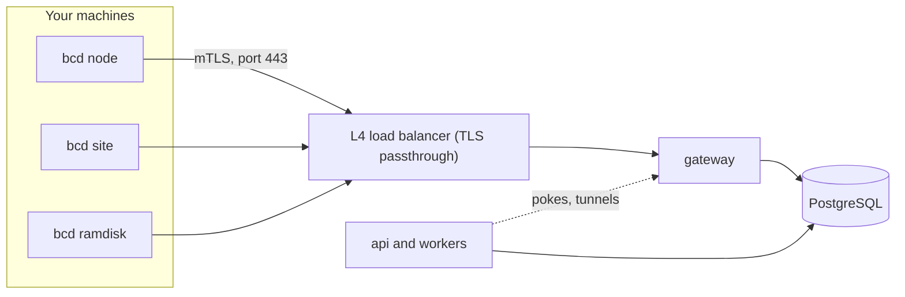

import { Braces, Install, OctagonAlert, RadioTower, Route, Loop } from '@/lib/icons';

<Term id="bcd">bcd</Term> is the Better Compute daemon. One Go binary runs on every server you manage, on the site
agents that boot bare metal, and inside the PXE ramdisk. It connects out to a regional
<Term id="gateway">gateway</Term>, reports what the machine is, runs the typed <Term id="command">commands</Term>
the control plane sends, and converges the machine toward its <Term id="nodespec">NodeSpec</Term>.

The daemon holds no policy. It never decides who gets a GPU or when a machine is wiped; the TypeScript control plane
does. What bcd decides on its own is about safety: refusing a command meant for another node or past its deadline,
never running a side effect twice, and never dropping a device assignment because it lost its connection.

<Callout type="warn" title="Written, not built">
bcd is written in `daemon/` as its own Go module, but it is not built or released yet: Go is not installed on the
build machine. In the current skeleton `bcd version` and `bcd doctor` work, and every other command parses its
flags and exits 2 with `NOT_IMPLEMENTED`, naming the phase it arrives in. The TypeScript `FakeDaemon` in
`@better-compute/testing` speaks the real protocol today. Tests, the fleet simulator and `better-compute dev --sim N`
all run it.
</Callout>

## Where bcd sits



Each daemon holds one long-lived gRPC <Term id="session">session</Term> to one gateway. The gateway keeps sessions,
heartbeats and lane counters in memory and writes what matters to PostgreSQL, which stays the only source of truth.
Losing a gateway loses open streams and nothing else: the daemon redials, the next gateway replays what was in
flight, and the daemon's <Term id="journal">journal</Term> makes sure nothing runs twice. See
[sessions](/docs/daemon/sessions) and [delivery](/docs/daemon/delivery).

## Modes

The same binary runs in several modes. The mode decides which command kinds the daemon accepts and which role its
certificate carries.

| Mode | Runs on | Does | Certificate | Arrives |
| --- | --- | --- | --- | --- |
| `node` | every server | the session, the journal, inventory (sysfs, netlink, NVML), health (NVML events, kernel XIDs, EDAC, SMART, from v0.2), NodeSpec convergence (CDI holds, MIG layout, host config, runtimes), commands, tunnels (v0.3), OTLP telemetry, self-update (v0.4) | `node`, 24 h | v0.1 |
| `site` | one or two per site, as a node with role `site` | proxy DHCP, TFTP and iPXE over HTTPS, and discovery vouching while it holds the site boot lease; the image cache and BMC access through bmclib at all times | `site`, 24 h | v0.2 |
| `ramdisk` | the PXE initramfs | inspection, DCGM diagnostics, wipes (`quick`, `secure-erase`, `crypto-erase`), image streaming, `boot.kexec` | `ramdisk`, at most 2 h | v0.2 |
| `sim` | test hosts | N daemons on fake hardware with real TLS and gRPC | a test CA | v0.4 |
| `helper` | beside `node`, as root | typed privileged operations over a local socket | none | v0.4 |

A <Term id="site-agent">site agent</Term> and the <Term id="ramdisk">ramdisk</Term> speak the same session protocol
as a node; only their command kinds differ. [Sites](/docs/guides/bare-metal/sites) and
[deploying](/docs/guides/bare-metal/deploying) cover what they do for bare metal.

Beside the modes, bcd has four local commands:

| Command | Does | State in the skeleton |
| --- | --- | --- |
| `bcd join` | joins the fleet with a join token read from `BCD_JOIN_TOKEN` or standard input, never from arguments | exits 2, arrives in v0.1 |
| `bcd status` | shows the running agent's state over its root-only unix socket (`--socket`, default `/run/bcd/bcd.sock`) | exits 2, arrives in v0.1 |
| `bcd doctor` | checks the configuration file, NVML and the hardware backend | works |
| `bcd version` | prints the version, platform, Go version and build tags | works |

Exit codes are 0 for success, 1 for a failure and 2 for a usage error or a command that is not implemented yet. bcd
never echoes a positional argument, so a join token pasted into the command line does not end up in logs:

```bash
$ bcd join bcjt_jt_01...
bcd join: takes no positional arguments
bcd join reads the join token from BCD_JOIN_TOKEN or stdin, never from arguments
```

`bcd doctor` prints one line per check, with a status of `ok`, `warn`, `fail` or `skip`:

```text
ok    config    /etc/bcd/config.toml: gateway https://gw.eu-1.example.com, site fsn1
warn  nvml      nvml: not available in this build
ok    hardware  fakehw: 8 GPUs, … inventory sections hashed
skip  host      IOMMU, KVM, clock and gateway reachability checks arrive in v0.1
```

It also warns when `config.toml` is readable by anyone but its owner, and exits 1 when any check fails.

## Outbound only

Nodes only dial out. A daemon connects to `gw.<region>:443` through an L4 load balancer that passes TLS through to
the gateway, so a server needs no inbound port, no public address and no firewall exception. Everything the control
plane wants from a node travels down the session the node opened: commands, desired state, requests to open a
[tunnel](/docs/guides/access/tunnels), revocation notices.

`bcd node` opens no TCP listeners. The only local endpoint is a root-only unix socket that serves `bcd status`
(and, as planned, `doctor` and `support-bundle` against the running agent).

## Privilege separation

Until v0.4, `bcd node` runs as root under systemd hardening: `ProtectSystem=strict`, `NoNewPrivileges`, a narrow
set of writable paths and a bounded capability set. [Installing bcd](/docs/daemon/install) shows the unit.

The v0.4 plan splits the daemon in two. A small `helper` process runs as root beside the node agent and performs
typed operations on a socket whose caller it checks with `SO_PEERCRED`: `runtime.*`, `gpu.reset`, `mig.apply`,
`cdi.write`, `reboot` and `update.swap`. Parsing of anything that comes from the network then never runs as root.

Other limits already hold in the design regardless of the split:

- **Keys.** The node key lives in the TPM when there is one, else in a 0600 file under `/var/lib/bcd`, and is never
  exported. It signs only statements of the form "this node says": the mTLS handshake, renewal proofs of possession,
  attested results and secret requests.
- **Allowlists.** Each role accepts only its own command kinds; anything else is rejected `UNSUPPORTED`.
- **Bounds.** A command body is at most 1 MiB and a desired-state body at most 4 MiB. The journal is capped at 64
  MiB and 10,000 unacked events.
- **Secrets.** Commands carry references, never values. The daemon fetches a value sealed to a fresh one-time key,
  keeps it in memory only, and zeroes it after use.

## Inside bcd

The Go module is laid out by concern. Each package holds a contract with unit tests; the pieces that need
third-party modules (connect-go, protobuf, go-nvml, bbolt) arrive once a Go toolchain can produce `go.sum`.

| Package | What | State |
| --- | --- | --- |
| `cmd/bcd` | subcommands and flags | skeleton |
| `internal/config` | `/etc/bcd/config.toml` in a strict TOML subset | done |
| `internal/journal` | the journal contract and the command rules (duplicates, crash recovery, self-terminating kinds), with an in-memory store | contract and memory store; bbolt in v0.1 |
| `internal/dispatch` | lanes with credits and worker pools, per-resource locks, the kind registry, the acceptance checks | contract and primitives |
| `internal/session` | Hello and Welcome, the epoch, resume, reconnect back-off | contract |
| `internal/converge` | the NodeSpec sections and the observed-generation rule | contract and runner |
| `internal/inventory` | NodeInventory v1, canonicalization, section encoding and hashes | done |
| `internal/fakehw` | a deterministic 8x H100 SXM5 80GB HGX node | done |
| `internal/nvml` | the NVML boundary | stub: `ErrNotBuilt` in every build |
| `gen/` | Go code generated from `proto/` | empty until Go is installed |

Two numbers shape everything the daemon runs. Commands go to one of three lanes, and each lane has a fixed worker
pool, never a goroutine per command: `control` 4 workers, `provision` 2, `bulk` 1. The converger runs NodeSpec
sections in a fixed order (`host`, `devices`, `instances`, `access`, `telemetry`, `daemon`), each as an idempotent
plan and apply, and advances its observed generation only when every section has converged or failed terminally.

Contributors build and test the module from `daemon/` with Go 1.24 or later:

```bash
go test -tags nonvml,fakehw ./...   # logic tests: no cgo, no NVIDIA driver, fake HGX H100 hardware
go vet -tags nonvml,fakehw ./...
go build -ldflags "-X main.version=0.1.0" -o bin/bcd ./cmd/bcd
```

The `nonvml` tag builds without cgo and never loads `libnvidia-ml`; `fakehw` reports the fake HGX node instead of
reading the host. bcd targets Linux on amd64 and arm64 (for Grace and GB200), but its logic tests run on any OS.

## The FakeDaemon

`FakeDaemon` in `@better-compute/testing` is the daemon side of the protocol in TypeScript. It mirrors the Go
packages above rule for rule: the same journal rules, the same acceptance checks, the same lane credits and worker
pools, the same converger order. Its fake hardware produces the same inventory section hashes as Go's `fakehw` for the
same seed. It runs over any frame transport: an in-memory link with fault injection, real HTTP/2 to a real gateway,
or the WebSocket fallback.

It is what runs today wherever a daemon is needed:

- `better-compute dev --sim N` joins N simulated machines through a loopback gateway, the way bcd will: a join token
  sealed to JoinService's key, the `Join` RPC, a session, `diag.nvml` acceptance and adoption. See
  [local development](/docs/operations/local-development).
- `better-compute sim` runs the deterministic fleet simulator with crashes, reboots, journal loss, partitions and
  gateway kills, then checks invariants I1, I2, I3, I4, I5 and I8.
- `createFleetSim`, `createControlPlaneSim` and the real-time harness drive fleets from tests and benchmarks. See
  [testing](/docs/operations/testing).

```bash
better-compute dev --memory --sim 8
better-compute sim --nodes 100 --chaos heavy --seed 7
```

Where the two differ, the FakeDaemon is ahead: it already verifies signed commands, answers `OpenTunnel`, and dials
the WebSocket fallback, all of which bcd must match when it is built.

<Cards>
  <Card title="Installing bcd" href="/docs/daemon/install" icon={<Install />}>The install script, the files it writes and upgrades.</Card>
  <Card title="Protocol" href="/docs/daemon/protocol" icon={<Braces />}>Transport, proto packages, frames and version skew.</Card>
  <Card title="Sessions" href="/docs/daemon/sessions" icon={<Loop />}>Hello, epochs, resume rules and liveness.</Card>
  <Card title="Delivery" href="/docs/daemon/delivery" icon={<Route />}>Desired state, commands, credits and the journal.</Card>
  <Card title="Gateway" href="/docs/daemon/gateway" icon={<RadioTower />}>The process that holds the sessions.</Card>
  <Card title="Failure modes" href="/docs/daemon/failure-modes" icon={<OctagonAlert />}>What happens when each piece fails.</Card>
</Cards>
