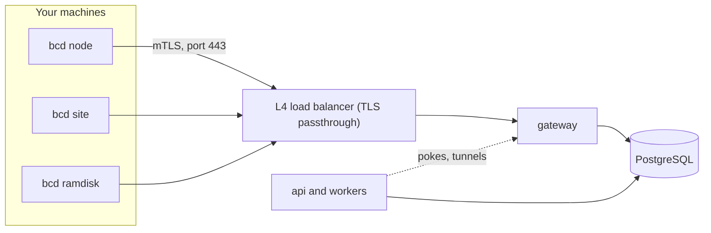

import { Braces, Install, OctagonAlert, RadioTower, Route, Loop } from '@/lib/icons';

<Term id="bcd">bcd</Term> is the Better Compute daemon. One Go binary runs on every server you manage, on the site
agents that boot bare metal, and inside the PXE ramdisk. It connects out to a regional
<Term id="gateway">gateway</Term>, reports what the machine is, runs the typed <Term id="command">commands</Term>
the control plane sends, and converges the machine toward its <Term id="nodespec">NodeSpec</Term>.

The daemon holds no policy. It never decides who gets a GPU or when a machine is wiped; the TypeScript control plane
does. What bcd decides on its own is about safety: refusing a command meant for another node or past its deadline,
never running a side effect twice, and never dropping a device assignment because it lost its connection.

<Callout type="warn" title="Built and tested, not released">
The v0.1 node agent is implemented: `bcd join`, `bcd node`, `bcd status`, `bcd doctor` and `bcd version` work, and
`tests/e2e/bcd.test.ts` runs the Linux binary (fake-hardware build) against a real control plane and gateway over
mTLS. `bcd site` and `bcd ramdisk` now run too, with their command kinds, the site's boot server (proxy DHCP, TFTP,
iPXE scripts, the image cache) and the ramdisk's discovery join, but only the Go unit tests exercise them: no test
runs them against the control plane or on a real machine. A node agent also runs VPS instances, instance tunnels
and the metadata service, and `tests/e2e/bcd-vps.test.ts` creates, starts and deletes an instance on it through the
control plane, but only fakehw builds
have a runtime (a file-backed stand-in), so no VM boots on a real host yet. bcd is not released: the release
pipeline exists but no tag has been cut, so the install script has nothing to download yet. `bcd sim` still exits 2
with `NOT_IMPLEMENTED`; real VM runtimes, NVML, self-update and the WebSocket fallback are missing (see
[what bcd does today](#what-bcd-does-today)). The TypeScript `FakeDaemon` covers those in tests, the simulator and
`better-compute dev --sim N`.
</Callout>

## Where bcd sits



Each daemon holds one long-lived gRPC <Term id="session">session</Term> to one gateway. The gateway keeps sessions,
heartbeats and lane counters in memory and writes what matters to PostgreSQL, which stays the only source of truth.
Losing a gateway loses open streams and nothing else: the daemon redials, the next gateway replays what was in
flight, and the daemon's <Term id="journal">journal</Term> makes sure nothing runs twice. See
[sessions](/docs/daemon/sessions) and [delivery](/docs/daemon/delivery).

## Modes

The same binary runs in several modes. The mode decides which command kinds the daemon accepts and which role its
certificate carries.

| Mode | Runs on | Does (PLAN.md) | Certificate | Planned | In the code |
| --- | --- | --- | --- | --- | --- |
| `node` | every server | the session, the journal, inventory, health (NVML events, kernel XIDs, EDAC, SMART, from v0.2), NodeSpec convergence (CDI holds, MIG layout, host config, runtimes), commands, tunnels (v0.3), OTLP telemetry, self-update (v0.4) | `node`, 24 h | v0.1 | works for the v0.1 scope; see below |
| `site` | one or two per site, as a node with role `site` | proxy DHCP, TFTP and iPXE over HTTPS, and discovery vouching while it holds the site boot lease; the image cache and BMC access at all times | `site`, 24 h | v0.2 | works, without IPMI or vendor BMCs: BMC operations over Redfish, `site.httpProxy`, boot entries, and the boot server (proxy DHCP, TFTP, iPXE scripts with signed discovery assertions under the boot lease, the image cache) |
| `ramdisk` | the PXE initramfs | inspection, DCGM diagnostics, wipes (`quick`, `secure-erase`, `crypto-erase`), image streaming, `boot.kexec` | `ramdisk`, at most 2 h | v0.2 | works: joins with the `discovery` attestor from its kernel command line, then runs `disk.wipe`, `deploy.image`, `boot.kexec`, `diag.dcgm` and the shared kinds. No ramdisk image is built in the repository |
| `sim` | test hosts | N daemons on fake hardware with real TLS and gRPC | a test CA | v0.4 | exits 2 `NOT_IMPLEMENTED` |
| `helper` | beside `node`, as root | typed privileged operations over a local socket | none | v0.4 | not a command yet |

A <Term id="site-agent">site agent</Term> and the <Term id="ramdisk">ramdisk</Term> speak the same session protocol
as a node and run the same agent (`runAgent`: session, journal, dispatcher, convergers, status socket); only their
command kinds and what runs beside the agent differ. [Sites](/docs/guides/bare-metal/sites) and
[deploying](/docs/guides/bare-metal/deploying) cover what they do for bare metal.

The three agent modes take these flags:

| Mode | Flags | Identity |
| --- | --- | --- |
| `bcd node` | `--config` (default `/etc/bcd/config.toml`) | joined by `bcd join`, kept in `data_dir` |
| `bcd site` | `--config` | joined by `bcd join --role site` with a site token; refuses a data directory that holds another role's identity. With a `[boot]` section it also runs the boot server |
| `bcd ramdisk` | `--cmdline` (default `/proc/cmdline`), `--data-dir` (default `/run/bcd`) | no config file: the `bc.*` boot parameters give the gateway, pins and credentials, and the key, identity and journal live in tmpfs, so every ramdisk boot is a new identity |

Beside the modes, bcd has four local commands, all of which work:

| Command | Does |
| --- | --- |
| `bcd join` | Joins the fleet with a join token read from `BCD_JOIN_TOKEN`, standard input or `--token-file` (deleted once the join succeeds), never from arguments. `--role` is `node` (the default) or `site`; the token decides what is allowed. It seals the token to the key in `join-encryption.jwk` next to the config, or, when that file is absent and `--server https://…` is given, to `join.encryptionJwk` from the control plane's `/.well-known/better-compute`; either key is refused unless it matches `join_encryption_key_pin`. `--node-id` joins an installed OS with the `provisioned` attestor and fails unless the joined node is that one; `--attestor` names another. It verifies the signed `JoinResponse`, writes `node.key` and `identity.json` under `data_dir`, and prints `joined as <node> (site <site>, role <role>)`. With `--server` and no `config.toml` at all, it reads the gateway (`gateway.url`, `serverName`, `servingCaPin`) and the join pins from that well-known document, joins, then writes `config.toml` (0600) and `join-encryption.jwk` (0644). A node that already joined exits 0 without a token, so a join unit may run on every boot; a different `--node-id` is refused |
| `bcd status` | Asks the running agent (node, site or ramdisk) over its root-only unix socket (`--socket`, default `/run/bcd/bcd.sock`; `--json` for JSON) for its node, site and role, boot, session epoch and clock offset, applied and observed generations with each section's state, running and deferred commands, the event backlog, certificate expiry, trust bundle version and whether signed intent is enforced |
| `bcd doctor` | Checks the configuration file, NVML, the hardware backend, `/dev/kvm`, IOMMU units, a TCP connection to the gateway and the node's identity |
| `bcd version` | Prints the version, platform, Go version and build tags |

Exit codes are 0 for success, 1 for a failure and 2 for a usage error or a command that is not implemented yet. bcd
never echoes a positional argument, so a join token pasted into the command line does not end up in logs:

```bash
$ bcd join bcjt_jt_01...
bcd join: takes no positional arguments
bcd join reads the join token from BCD_JOIN_TOKEN or stdin, never from arguments
```

`bcd doctor` prints one line per check, with a status of `ok`, `warn` or `fail`. NVML is still a stub, so that check
always warns:

```text
ok    config    /etc/bcd/config.toml: gateway https://gw.eu-1.example.com, site fsn1
warn  nvml      nvml: not available in this build
ok    hardware  host: 8 GPUs, … inventory sections hashed
ok    kvm       /dev/kvm present
ok    iommu     16 IOMMU units
ok    gateway   gw.eu-1.example.com:443 reachable in 4ms
ok    identity  node node_01k5w… (site fsn1, role node), certificate valid for 14h12m0s
```

A missing `/dev/kvm` or IOMMU is a warning (the host cannot run VPS instances, or pass GPUs through to them), and so
is a node that has not joined. A gateway that does not accept a TCP connection within 5 seconds, or an expired node
certificate, is a failure. It also warns when `config.toml` is readable by anyone but its owner, and exits 1 when any
check fails. There is no clock check yet.

## What bcd does today

`bcd node` is the v0.1 node agent (`daemon/internal/agent`); `bcd site` and `bcd ramdisk` run the same agent with
their own kinds. What it implements and what is still missing, as of commit 797915d:

| Area | Implemented | Missing |
| --- | --- | --- |
| Identity | Join with a sealed `join-token` as role `node` or `site`; a `provisioned` join for an OS a deploy installed (`--token-file`, `--node-id`, `--server` for the well-known join key); the ramdisk's `discovery` join (the token and the site agent's signed assertion from the kernel command line); a retried deferral with the same CSR, `JoinResponse` verification (pinned signer, CSR binding, leaf key, SPIFFE id, role); renewal at 60% of the lifetime with proof of possession and a new key | TPM keys (the key is a 0600 `node.key` file), attestor challenges, the `.well-known` fallback for a stale key file (bcd reads the well-known key only when `join-encryption.jwk` is absent and `--server` is given) |
| Transport | gRPC over HTTP/2 with connect-go (`Join`, `Renew`, `Session`, `Tunnel`), TLS 1.3 pinned to the serving CA's SPKI (never system roots), mTLS with the node certificate, HTTP/2 pings every 20 s; `gateway_server_name` for a gateway reached by IP | The WebSocket fallback |
| Session | Hello from the journal (with the trust bundle version it holds), Welcome (epoch, event ack, clock offset, requested sections, signed trust bundle), heartbeats with lane credits (inventory hashes every 10th), `Ack`, `Cancel`, `Drain`, `RevocationNotice`, `OpenTunnel`, secret and workload-token answers, full-jitter redial; a Welcome more than 5 minutes before the server time mark is refused, and one within that allowance never moves the working clock back; a newer trust bundle is acknowledged once, in the next `StatusReport` (`trust_version` is 0 in every other report) | |
| Journal | bbolt, every write fsynced; the command rules, results with their `boot_id`, the `cancelled` outcome, the TTL sweep, spent exec-ticket ids (kept until 5 minutes after the ticket expires); a corrupt file is moved aside | |
| Commands | `inventory.refresh`, `diag.nvml`, `logs.collect` (redacted bundle to a presigned https URL), `gpu.reset` (refuses a GPU with a live hold, reads health back), `node.reboot` (self-terminating); on a site agent `bmc.*`, `site.httpProxy`, `boot.prepareRamdisk` and `boot.cleanUp`; in the ramdisk `disk.wipe`, `deploy.image`, `boot.kexec` and `diag.dcgm` (also on nodes); on a VPS host `instance.snapshot` (disk, and optionally memory, uploaded to a presigned https URL with its SHA-256); `driver.invoke` (node, site and ramdisk) into a hosted bcx driver plugin; the acceptance order; signed commands verified once the trust bundle holds command-signing roots; attested results node-signed | `daemon.upgrade` and every other registered kind (answered `UNSUPPORTED`) |
| Driver plugins | The bcx host (`internal/bcx`): the plugins of `[plugins] dir` named in its `pins` file, each run only if its binary's SHA-256 is its pin, over the go-plugin style handshake and gRPC with pinned mTLS on a unix socket; their drivers are advertised in `Hello.drivers`. `bcx.Serve` is the plugin side for Go plugins. See [drivers](/docs/extending/drivers#driver-plugins-in-bcd) | Restarting a plugin that exits; a plugin that fails to start is logged and skipped |
| Desired state | Full specs and patches, signature checks with command-signing roots, stored and enforced offline; `devices` (CDI holds and env files, node-signed `AllocationBound` and `AllocationReleased`, `AllocationFailed`); `access` (break-glass SSH: the sshd drop-in, CA, node-bound principals and a KRL; the exec-ticket JWKS; a CA key or principal that could inject an sshd line makes the whole spec invalid, signed or not); `instances` (below); `telemetry` accepted; `site` (the boot lease state, and `cache_images` pulled into the image cache: `PROGRESSING` while they warm) | `host` and `daemon` converge only when empty, else `SectionUnsupported` |
| Instances | The `instances` converger over a `Runtime` interface (`List`, `Ensure`, `SetState`, `Destroy`), on node agents: the section is the whole desired set; a domain bcd did not create is only reported; user data is fetched with a `SecretRequest` bound to the allocation; `RUNNING`, `PAUSED` and `STOPPED`; `restore_from` boots a new instance from a snapshot, downloaded to `data_dir/snapshots/<sha256>` and verified first (another runtime, or a memory snapshot from another CPU model, fails it); a failing instance fails alone (`InstanceFailed`); `StatusReport.instances` lists every domain with `instances_complete`, and `Hello.drivers` lists each runtime (kind `runtime`). fakehw builds run a file-backed stand-in named `libvirt-kvm`; `tests/e2e/bcd-vps.test.ts` runs it against the control plane. The metadata service on `[imds] listen`: `PUT /latest/api/token`, then `GET /latest/identity-token?audience=`, for the running instance that holds the request's source address | A real runtime: a host build has none, so a non-empty `instances` section fails (`this host runs no instance runtime`) and no VM boots on real hardware |
| Tunnels | `OpenTunnel` with the exec ticket re-verified against the pinned JWKS and the journaled `jti` set; for node tickets `console` on a real pseudo-terminal, `ssh` and `tcp` to loopback ports; for instance tickets `ssh` (port 22) and `tcp` to the instance's own address as its runtime reports it, never a loopback, link-local or host address; `tunnel.instance-dial` advertised when the host runs a runtime; at most 16 at once | `exec` and `console` into a guest (they need a guest agent: the tunnel closes with exit status 127) |
| Secrets and workload tokens | `SecretRequest` and `WorkloadTokenRequest`, node-signed, answered with a JWE to a fresh one-time P-256 key, matched by request id within 10 s. Callers: BMC credentials and `site.httpProxy` secret headers (bound to the workflow step), the boot server's discovery tokens (bound to the workflow), `deploy.image` user data (bound to the step), instance user data (bound to the allocation), the metadata service's workload tokens | |
| Health | NVIDIA XIDs from `/dev/kmsg` as `Xid<n>` device conditions for the rest of the boot, kept in `data_dir/faults.json` with the boot id so a bcd restart in the same boot keeps them; PSI pressure and CPU steal every 30 s in `StatusReport.pressure` | NVML events, EDAC, SMART |
| Inventory | `inventory.Collector` from procfs and sysfs without cgo: DMI, UEFI and Secure Boot, TPM presence, CPU and NUMA, memory, disks, NICs with SR-IOV and RDMA, NVIDIA GPUs from `/proc/driver/nvidia`, OS, cgroups, KVM, IOMMU; on a site agent an `images` section listing its image cache (digest, source URL, size, `READY` or `PULLING`), re-sent when a pull starts or ends | NVML (`internal/nvml` returns `ErrNotBuilt`), so no ECC or row-remap data on a real host; netlink |
| Site agent | Redfish BMC operations (power, boot device, CD virtual media, inspection, firmware inventory, credential rotation) pinned to the enrolled SPKI; `site.httpProxy` to site-internal addresses only; boot entries persisted in `data_dir/boot-entries.json`; the boot server: proxy DHCP (UDP 67 and 4011) and read-only TFTP for the iPXE builds, `GET /boot/ipxe` scripts with a signed discovery assertion each, all answering only prepared machines while the agent holds the boot lease and hears from the gateway; the image cache (`data_dir/cache/<sha256>`, served at `GET /cache/<sha256>`, trimmed least recently used first to `[boot] cache_max_bytes` without evicting an image `cache_images` still names) | IPMI and vendor BMCs; BIOS, RAID and firmware updates through the BMC; matching `site.httpProxy` targets to the node's own addresses; the iPXE builds and the ramdisk itself, which you supply |
| Ramdisk | Boot parameters from `/proc/cmdline`, the `discovery` join as role `ramdisk`, state in tmpfs; quick wipes read back, secure and crypto erase with `nvme format`, `hdparm` or `blkdiscard --secure`; image streaming (from the site cache by digest, else the source) through SHA-256 and gzip or zstd; cloud-init or Ignition user data; kexec into the installed kernel; `dcgmi diag` | A ramdisk image (kernel and initramfs with bcd and its tools) built in the repository; qcow2 images; a run on a real machine |
| Local | `bcd status` over the unix socket; `bcd doctor`'s host checks (KVM, IOMMU, gateway reachability, identity) | `doctor` and `support-bundle` against the running agent; a clock check |

## Outbound only

Nodes only dial out. A daemon connects to `gw.<region>:443` through an L4 load balancer that passes TLS through to
the gateway, so a server needs no inbound port, no public address and no firewall exception. Everything the control
plane wants from a node travels down the session the node opened: commands, desired state, requests to open a
[tunnel](/docs/guides/access/tunnels), revocation notices.

`bcd ramdisk` opens no TCP listener, and neither does `bcd node` unless it serves the metadata service. The only
local endpoint is a root-only unix socket (mode 0600 in a 0700 directory) that serves `bcd status`; PLAN.md also plans
`doctor` and `support-bundle` against the running agent on it. If the socket cannot be created, the agent logs it and
runs without. A VPS host with `[imds] listen` set serves its instances' metadata service there (for example
`169.254.169.254:80` on the instances' bridge), answering only requests whose source address belongs to one of its
running instances. The other exception is a site agent with a `[boot]` section: its boot server listens on plain HTTP at `[boot] listen`, and optionally for proxy DHCP (UDP 67
and 4011) and TFTP, for the PXE machines of its own provisioning network. It answers a booting machine only while it
holds the site's boot lease (see
[sites](/docs/guides/bare-metal/sites#the-boot-server-in-bcd-site)).

## Privilege separation

Until v0.4, `bcd node` runs as root under systemd hardening: `ProtectSystem=strict`, `NoNewPrivileges`, a narrow
set of writable paths and a bounded capability set. [Installing bcd](/docs/daemon/install) shows the unit.

The v0.4 plan splits the daemon in two. A small `helper` process runs as root beside the node agent and performs
typed operations on a socket whose caller it checks with `SO_PEERCRED`: `runtime.*`, `gpu.reset`, `mig.apply`,
`cdi.write`, `reboot` and `update.swap`. Parsing of anything that comes from the network then never runs as root.

Other limits already hold in the design regardless of the split:

- **Keys.** PLAN.md keeps the node key in the TPM when there is one; bcd today always keeps it in a 0600 file under
  `/var/lib/bcd` and never exports it. It signs only statements of the form "this node says": the mTLS handshake,
  renewal proofs of possession, attested results, allocation reports, and secret and workload-token requests.
- **Allowlists.** Each role accepts only its own command kinds; anything else is rejected `UNSUPPORTED`.
- **Bounds.** A command body is at most 1 MiB and a desired-state body at most 4 MiB. The journal is capped at 64
  MiB and 10,000 unacked events.
- **Secrets.** Commands carry references, never values. bcd fetches a value with a node-signed `SecretRequest` and
  opens the answer, a JWE sealed to a fresh one-time key, only for that request id; the design keeps the value in
  memory only and zeroes it after use. The site agent asks for BMC credentials, `site.httpProxy` secret headers and
  each PXE machine's discovery token this way, and the ramdisk for `deploy.image` user data. `logs.collect` redacts
  tokens, JWTs, private keys and URL passwords from its bundle before the upload.

## Inside bcd

The Go module (`github.com/better-compute/better-compute/daemon`, Go 1.26 or later per `go.mod`) is laid out by
concern. Its third-party modules are connect-go, protobuf, bbolt and klauspost/compress (zstd for image streaming);
go-nvml is not added yet.

| Package | What | State |
| --- | --- | --- |
| `cmd/bcd` | subcommands and flags | `join`, `node`, `site`, `ramdisk`, `status`, `doctor`, `version` work; `sim` exits 2 |
| `internal/agent` | the agent of every mode: join, session, dispatcher, the `devices`, `access`, `instances` and `site` convergers, the kinds, tunnels, secret and workload-token requests, the health watch, renewal, status; the site agent's kinds and boot server; the ramdisk's kinds and their host operations | done for v0.1; the v0.2 site and ramdisk parts in progress |
| `internal/bootparams` | the `bc.*` kernel command line between `bcd site` and `bcd ramdisk` (`Render`, `Parse`) | done |
| `internal/redfish` | the site agent's Redfish client | done for the operations listed above |
| `internal/pxe` | the boot server's first stage: a proxy DHCP server that never hands out addresses, and a read-only TFTP server | done |
| `internal/bcx` | the out-of-process driver protocol: `Start` hosts a sha256-pinned plugin (handshake, pinned mTLS, `Describe`, `Invoke`, `Health`), `Serve` is the plugin side | done |
| `internal/imds` | the VPS host's metadata service: session tokens bound to the calling instance, workload tokens per audience, forwarded requests refused | done |
| `internal/runtime` | the `Runtime` interface instance runtimes implement, and `Fake`, a file-backed runtime whose domains outlive the process and stop on a new boot id | interface and fake done; `libvirt-kvm` and `cloud-hypervisor` not written |
| `internal/config` | `/etc/bcd/config.toml` in a strict TOML subset | done |
| `internal/journal` | the journal contract and the command rules (duplicates, crash recovery, self-terminating kinds), an in-memory store and the bbolt store | done |
| `internal/dispatch` | lanes with credits and worker pools, per-resource locks, the kind registry, the acceptance checks | done |
| `internal/session` | Hello and Welcome, the epoch, resume, reconnect back-off | done |
| `internal/converge` | the NodeSpec sections and the observed-generation rule | done; section convergers live in `internal/agent` |
| `internal/pki` | purpose-framed ES256, keys and pins, the join JWE, CSRs, `JoinResponse` and signed-intent verification, trust bundles, exec tickets, secret and workload-token requests | done; interop fixtures from `@better-compute/pki` |
| `internal/health` | the XID parser for `/dev/kmsg`, PSI pressure and CPU steal | done |
| `internal/transport` | the `AgentGateway` client over connect-go | done |
| `internal/inventory` | NodeInventory v1, canonicalization, section encoding and hashes, the procfs/sysfs `Collector` | done |
| `internal/support` | the secret scanner of `@better-compute/pki` for log bundles | done |
| `internal/fakehw` | a deterministic 8x H100 SXM5 80GB HGX node | done |
| `internal/nvml` | the NVML boundary | stub: `ErrNotBuilt` in every build |
| `gen/` | Go code generated from `proto/` (protoc-gen-go, protoc-gen-connect-go) | done; `node scripts/daemon-proto-gen.mjs [--check]` |

Two numbers shape everything the daemon runs. Commands go to one of three lanes, and each lane has a fixed worker
pool, never a goroutine per command: `control` 4 workers, `provision` 2, `bulk` 1. The converger runs NodeSpec
sections in a fixed order (`host`, `devices`, `instances`, `access`, `telemetry`, `daemon`), each as an idempotent
plan and apply, and advances its observed generation only when every section has converged or failed terminally.

Contributors build and test the module from `daemon/`:

```bash
go test -tags nonvml,fakehw ./...   # logic tests: no cgo, no NVIDIA driver, fake HGX H100 hardware
go vet -tags nonvml,fakehw ./...
go build -ldflags "-X main.version=0.1.0" -o bin/bcd ./cmd/bcd
```

From the repository root, `node scripts/daemon-test.mjs` runs the same tests on any OS.

The `nonvml` tag builds without cgo and never loads `libnvidia-ml`; `fakehw` reports the fake HGX node instead of
reading the host, keeps its boot id in `data_dir`, "reboots" by re-executing itself, and is the only build that
accepts `dev_insecure_h2c`. bcd targets Linux on amd64 and arm64 (for Grace and GB200). On Windows,
`scripts/daemon-test.mjs` cross-compiles each package's test binary for linux/amd64 and runs it in WSL, since
Application Control may refuse locally built executables. See [testing](/docs/operations/testing#the-go-daemon).

## The FakeDaemon

`FakeDaemon` in `@better-compute/testing` is the daemon side of the protocol in TypeScript. It mirrors the Go
packages rule for rule: the same journal rules, the same acceptance checks, the same lane credits and worker pools,
the same converger order, the same server time mark. Its fake hardware produces the same inventory section hashes as
Go's `fakehw` for the same seed. It runs over any frame transport: an in-memory link with fault injection, real
HTTP/2 to a real gateway, or the WebSocket fallback.

It is what runs wherever many daemons, or features bcd lacks, are needed:

- `better-compute dev --sim N` joins N simulated machines through a loopback gateway, the way bcd does: a join token
  sealed to JoinService's key, the `Join` RPC, a session, `diag.nvml` acceptance and adoption. See
  [local development](/docs/operations/local-development).
- `better-compute sim` runs the deterministic fleet simulator with crashes, reboots, journal loss, partitions and
  gateway kills, then checks invariants I1, I2, I3, I4, I5 and I8.
- `createFleetSim`, `createControlPlaneSim` and the real-time harness drive fleets from tests and benchmarks. See
  [testing](/docs/operations/testing).

```bash
better-compute dev --memory --sim 8
better-compute sim --nodes 100 --chaos heavy --seed 7
```

Where the two differ, the FakeDaemon is still ahead on the WebSocket fallback and self-update. bcd
matches it on joining, sessions, the journal, signed intent, the five v0.1 kinds, `driver.invoke` (the same driver
selection, secret handling and idempotency key), the `devices` section, the
`instances` rules (on a fakehw build; the FakeDaemon's `FakeHypervisor` and bcd's fake runtime follow the same ones),
the metadata service's contract, tunnels (both advertise `tunnel.instance-dial`: the FakeDaemon when its tunnels are
configured, bcd when it runs a runtime), secret and workload-token requests, XID conditions and host pressure. bcd is ahead on the `access`
section, which the FakeDaemon still reports as `SectionUnsupported`, its tunnels run a real shell where the
FakeDaemon's answer with an echo shell, and its site agent and ramdisk act on real BMCs and disks (disk image files
under the `fakehw` build) where the FakeDaemon's simulate them.

<Cards>
  <Card title="Installing bcd" href="/docs/daemon/install" icon={<Install />}>The install script, the files it writes and upgrades.</Card>
  <Card title="Protocol" href="/docs/daemon/protocol" icon={<Braces />}>Transport, proto packages, frames and version skew.</Card>
  <Card title="Sessions" href="/docs/daemon/sessions" icon={<Loop />}>Hello, epochs, resume rules and liveness.</Card>
  <Card title="Delivery" href="/docs/daemon/delivery" icon={<Route />}>Desired state, commands, credits and the journal.</Card>
  <Card title="Gateway" href="/docs/daemon/gateway" icon={<RadioTower />}>The process that holds the sessions.</Card>
  <Card title="Failure modes" href="/docs/daemon/failure-modes" icon={<OctagonAlert />}>What happens when each piece fails.</Card>
</Cards>
