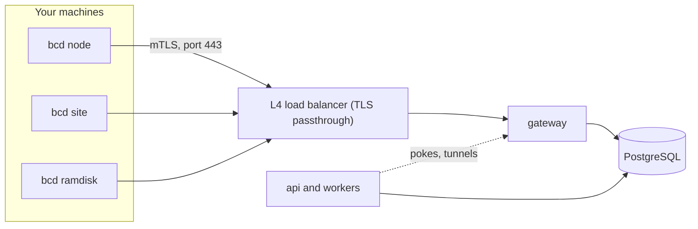
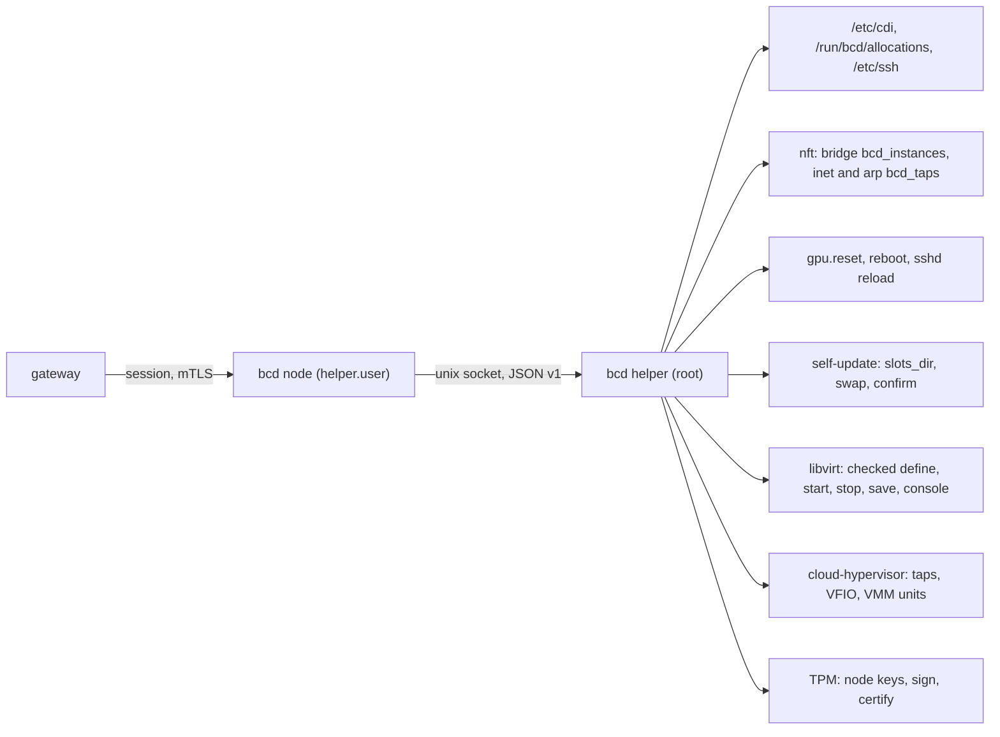

import { Braces, Install, Kubernetes, OctagonAlert, RadioTower, Route, Loop, SlidersHorizontal } from '@/lib/icons';

<Term id="bcd">bcd</Term> is the Better Compute daemon. One Go binary runs on every server you manage, on the site
agents that boot bare metal, and inside the PXE ramdisk. It connects out to a regional
<Term id="gateway">gateway</Term>, reports what the machine is, runs the typed <Term id="command">commands</Term>
the control plane sends, and converges the machine toward its <Term id="nodespec">NodeSpec</Term>.

The daemon holds no policy. It never decides who gets a GPU or when a machine is wiped; the TypeScript control plane
does. What bcd decides on its own is about safety: refusing a command meant for another node or past its deadline,
never running a side effect twice, and never dropping a device assignment because it lost its connection.

<Callout type="warn" title="Built and tested, not released">
The v0.1 node agent is implemented: `bcd join`, `bcd node`, `bcd status`, `bcd doctor` and `bcd version` work, and
`tests/e2e/bcd.test.ts` runs the Linux binary (fake-hardware build) against a real control plane and gateway over
mTLS. `bcd site` and `bcd ramdisk` now run too, with their command kinds, the site's boot server (proxy DHCP, TFTP,
iPXE scripts, the image cache) and the ramdisk's discovery join, but only the Go unit tests exercise them: no test
runs them against the control plane or on a real machine. A node agent also runs VPS instances, instance tunnels
and the metadata service, and `tests/e2e/bcd-vps.test.ts` creates, starts and deletes an instance on it through the
control plane on a fakehw build's file-backed runtime. A host build runs instances on the `libvirt-kvm` runtime when
`virsh` is installed (362317c) and on the `cloud-hypervisor` runtime when `cloud-hypervisor` is (2598f0a); both so
far have been tested only against fake tools (a fake `virsh`, a fake cloud-hypervisor API), never on a real
hypervisor. bcd is not released: the release
pipeline exists but no tag has been cut, so the install script has nothing to download yet. `bcd sim` runs many
real node agents on fake hardware in one process (fakehw builds only; see [bcd sim](#bcd-sim)). Self-update with A/B
slots (de9f380; the end-to-end test updates a real bcd to a second signed build) and the WebSocket fallback (6cd48be;
tested end to end against the real gateway, renewal included, 4b2d5aa) are written, and the whole bcd end-to-end
suite runs under signed intent. `bcd helper`, the root half of [privilege separation](#privilege-separation), is
written (28dc2ae) and tested end to end with an unprivileged `bcd node`, self-update included (2d67b25), and
`daemon install-script --unprivileged` sets it up (169c459). A site agent drives IPMI BMCs through the `bcx-ipmi`
plugin (51806ab), tested against a fake `ipmitool` only. GPU details come from `nvidia-smi` rather than the NVML
library (cb987e5), and NVML events are missing (see [what bcd does today](#what-bcd-does-today)). The
[host converger](/docs/daemon/host-config) (6c2343f), MIG and slot holds with their cgroup slices (46a61db,
260e33c) and Kubernetes workers (88ecb07, 7579184) are written and tested against fakes only, and bcd can run as a
[DaemonSet](/docs/daemon/kubernetes) on an existing cluster (8df8c70): CI builds its image and has a kind cluster's
API server dry-run its manifests (ac1ca4b), but no test has deployed it. The TypeScript `FakeDaemon` covers those in tests, the simulator and
`better-compute dev --sim N`.
</Callout>

## Where bcd sits



Each daemon holds one long-lived gRPC <Term id="session">session</Term> to one gateway. The gateway keeps sessions,
heartbeats and lane counters in memory and writes what matters to PostgreSQL, which stays the only source of truth.
Losing a gateway loses open streams and nothing else: the daemon redials, the next gateway replays what was in
flight, and the daemon's <Term id="journal">journal</Term> makes sure nothing runs twice. See
[sessions](/docs/daemon/sessions) and [delivery](/docs/daemon/delivery).

## Modes

The same binary runs in several modes. The mode decides which command kinds the daemon accepts and which role its
certificate carries.

| Mode | Runs on | Does (PLAN.md) | Certificate | Planned | In the code |
| --- | --- | --- | --- | --- | --- |
| `node` | every server | the session, the journal, inventory, health (NVML events, kernel XIDs, EDAC, SMART, from v0.2), NodeSpec convergence (CDI holds, MIG layout, host config, runtimes), commands, tunnels (v0.3), OTLP telemetry, self-update (v0.4) | `node`, 24 h | v0.1 | works for the v0.1 scope; see below |
| `site` | one or two per site, as a node with role `site` | proxy DHCP, TFTP and iPXE over HTTPS, and discovery vouching while it holds the site boot lease; the image cache and BMC access at all times | `site`, 24 h | v0.2 | works: BMC operations over Redfish, or through a hosted bcx driver such as `bcx-ipmi` (51806ab), `site.httpProxy`, boot entries, and the boot server (proxy DHCP, TFTP, iPXE scripts with signed discovery assertions under the boot lease, the image cache) |
| `ramdisk` | the PXE initramfs | inspection, DCGM diagnostics, wipes (`quick`, `secure-erase`, `crypto-erase`), image streaming, `boot.kexec` | `ramdisk`, at most 2 h | v0.2 | works: joins with the `discovery` attestor from its kernel command line, then runs `disk.wipe`, `deploy.image`, `boot.kexec`, `diag.dcgm` and the shared kinds. No ramdisk image is built in the repository |
| `sim` | test hosts | N daemons on fake hardware with real TLS and gRPC | a test CA | v0.4 | works in fakehw builds: N real node agents in one process against the configured gateway, each with its own identity (a `node` certificate from a normal join); see [bcd sim](#bcd-sim) |
| `helper` | beside `node`, as root | typed privileged operations over a local socket | none | v0.4 | works on Linux (28dc2ae): `bcd helper --config` serves an unprivileged `bcd node` on `[helper] socket`, self-update's privileged half included (2d67b25); `daemon install-script --unprivileged` installs it as `bcd-helper.service` (169c459); see [privilege separation](#privilege-separation) |

A <Term id="site-agent">site agent</Term> and the <Term id="ramdisk">ramdisk</Term> speak the same session protocol
as a node and run the same agent (`runAgent`: session, journal, dispatcher, convergers, status socket); only their
command kinds and what runs beside the agent differ. [Sites](/docs/guides/bare-metal/sites) and
[deploying](/docs/guides/bare-metal/deploying) cover what they do for bare metal.

The three agent modes take these flags:

| Mode | Flags | Identity |
| --- | --- | --- |
| `bcd node` | `--config` (default `/etc/bcd/config.toml`) | joined by `bcd join`, kept in `data_dir` |
| `bcd site` | `--config` | joined by `bcd join --role site` with a site token; refuses a data directory that holds another role's identity. With a `[boot]` section it also runs the boot server |
| `bcd ramdisk` | `--cmdline` (default `/proc/cmdline`), `--data-dir` (default `/run/bcd`) | no config file: the `bc.*` boot parameters give the gateway, pins and credentials, and the key, identity and journal live in tmpfs, so every ramdisk boot is a new identity |

Beside the modes, bcd has five local commands, all of which work:

| Command | Does |
| --- | --- |
| `bcd join` | Joins the fleet with a join token read from `BCD_JOIN_TOKEN`, standard input or `--token-file` (deleted once the join succeeds), never from arguments. `--role` is `node` (the default) or `site`; the token decides what is allowed. It seals the token to the key in `join-encryption.jwk` next to the config, or, when that file is absent and `--server https://…` is given, to `join.encryptionJwk` from the control plane's `/.well-known/better-compute`; either key is refused unless it matches `join_encryption_key_pin`. `--node-id` joins an installed OS with the `provisioned` attestor and fails unless the joined node is that one; `--attestor` names another. It verifies the signed `JoinResponse`, writes `node.key` (a PKCS#8 key, or the record of a key it made in the host's TPM; see [the node key in the TPM](/docs/guides/nodes/attestation#the-node-key-in-the-tpm)) and `identity.json` under `data_dir`, and prints `joined as <node> (site <site>, role <role>)`. With `--server` and no `config.toml` at all, it reads the gateway (`gateway.url`, `serverName`, which the server publishes when its options set `gateway.url`) from that well-known document, checks the document's pins against `--serving-ca-pin`, `--join-signing-pin` and `--join-encryption-pin` (all three required on a host build; a fakehw build may take them from the document, which is trust on first use), joins, then writes `config.toml` (0600, naming the data directory from `--data-dir`, default `/var/lib/bcd`) and `join-encryption.jwk` (0644); see [joining from the well-known document](/docs/daemon/install#joining-from-the-well-known-document). With a `config.toml`, pin flags given must match it. A node that already joined exits 0 without a token, so a join unit may run on every boot; a different `--node-id` is refused. `--reset --yes` (a1c1a46, as root) first moves an identity that still loads but no longer works aside, so the machine joins again; see [joining again with --reset](/docs/daemon/install#joining-again-with---reset) |
| `bcd status` | Asks the running agent (node, site or ramdisk) over its root-only unix socket (`--socket`, default `/run/bcd/bcd.sock`; `--json` for JSON) for its node, site and role, boot, session epoch and clock offset, applied and observed generations with each section's state, running and deferred commands, the event backlog, certificate expiry, what holds the node key (`in the TPM` or `a file`; `nodeKey` in JSON, 50e18f9), trust bundle version and whether signed intent is enforced. Since ad8791f also the machine: one line per GPU read now, a `kubernetes` line and a `telemetry` line (see [below](#bcd-status)) |
| `bcd doctor` | Checks the configuration file, NVML, the hardware backend, `/dev/kvm`, IOMMU units, a TCP connection to the gateway and the node's identity |
| `bcd update` | Shows the self-update slots, the release floor, a pending update and the versions that failed to start (`--config`); `--clear-failed` lets a failed version be tried again. See [self-update](/docs/daemon/install#self-update) |
| `bcd version` | Prints the version, platform, Go version and build tags |

Exit codes are 0 for success, 1 for a failure and 2 for a usage error. bcd
never echoes a positional argument, so a join token pasted into the command line does not end up in logs:

```bash
$ bcd join bcjt_jt_01...
bcd join: takes no positional arguments
bcd join reads the join token from BCD_JOIN_TOKEN or stdin, never from arguments
```

`bcd doctor` prints one line per check, with a status of `ok`, `warn` or `fail`. The `nvml` check asks `nvidia-smi`
for the driver version and GPU count (cb987e5); a host without `nvidia-smi` warns
(`nvml: nvidia-smi not found (no NVIDIA driver on this host)`), and a build with `-tags nonvml` warns that NVML is
not available in this build:

```text
ok    config    /etc/bcd/config.toml: gateway https://gw.eu-1.example.com, site fsn1
ok    nvml      driver …, 8 GPUs
ok    hardware  host: 8 GPUs, … inventory sections hashed
ok    kvm       /dev/kvm present
ok    iommu     16 IOMMU units
ok    gateway   gw.eu-1.example.com:443 reachable in 4ms
ok    identity  node node_01k5w… (site fsn1, role node), certificate valid for 14h12m0s
```

Since f9d7af9 doctor also prints one `gpu` line per GPU from `nvidia-smi`: its UUID and name, how busy it is, its
temperature, power draw of its limit and memory used of its total. A pending row remap or a MIG mode change waiting
for a reset is a warning; failed row remapping or uncorrectable ECC errors since the driver loaded is a failure. A
host without the NVIDIA driver prints no `gpu` line. With a configuration file it adds the Kubernetes checks:
`kubernetes` fails when `[kubernetes] allowed_clusters` does not parse, reports the number of allowed clusters, and
fails a node bcd joined to a cluster without any, since every `k8s-join` then refuses (9f860ad); on a node bcd joined to a cluster,
`kubelet` fails when the kubelet is not running, and `device-plugin` warns when `/var/lib/kubelet/device-plugins` is
missing. `gpu-isolation` fails whenever bcd would report `ForeignGpuExposure`: on a joined worker for a toolkit
configuration that lets unprivileged pods pick GPUs and for another GPU DRA driver in the node's ResourceSlices, and,
since f88bcdb, on a node with `[host] units = false` (a DaemonSet) for the toolkit and for a container runtime
configuration it cannot read (see [GPU isolation](/docs/daemon/kubernetes#gpu-isolation)). As root with `[helper]`,
`helper` says what the helper binds host units to: root's signed join record (`ok`), trust on first use for a node
joined before that record (`warn`), or a record that names another node or fails its signature (`fail`; f77c6f9), and
fails when neither `command_root_sha256` nor the record names command-signing roots, so host units would go unsigned
(71ccf71; see [signed specs](/docs/daemon/host-config#signed-specs)).

```text
ok    gpu       GPU-5f1c… NVIDIA H100 80GB HBM3: 87% busy, 61 C, 540/700 W, 71.2/79.6 GiB
warn  gpu       GPU-9a02… NVIDIA H100 80GB HBM3: 0% busy, 34 C, 72/700 W, 0.0/79.6 GiB; a row remap waits for a GPU reset
ok    kubernetes 1 allowed clusters
```

A missing `/dev/kvm` or IOMMU is a warning (the host cannot run VPS instances, or pass GPUs through to them), and so
is a node that has not joined. An identity that is there but does not load (a node key that no longer matches its
certificate, an unreadable `identity.json`) is a failure since a1c1a46 (it was a warning); its detail, like that of
an expired certificate, ends with the way back: `join again as root: bcd join --reset --yes, then bcd join`. A host with neither `virsh` nor `cloud-hypervisor` gets a warning that it runs no VPS
instances. With either, doctor reports the runtime it found and checks a VPS host's tools: it fails one missing
`qemu-img` (no instance disks), both `genisoimage` and `xorriso` (no NoCloud user data seed) or `nft` (no
anti-spoofing or network policies, so the metadata service and instance dials stay off) (4a0165f). For
`cloud-hypervisor` it also warns when `/usr/share/cloud-hypervisor/CLOUDHV.fd` is missing (its instances cannot
boot) and fails without `systemd-run` (its VMMs could not outlive bcd) (2598f0a). Since 2845f41 it also warns when
`[update] release_pins` is missing (self-update is refused) and otherwise reports the pin count and threshold, fails
when the slots are in use but the entrypoint does not link to the slots directory's `current`, warns about a pending
update and each failed version (pointing at `bcd update --clear-failed`), and warns when a site agent has no
`[site] bmc_networks`. It finds the slots and records where `bcd update` does (8eca2b1): `[update] slots_dir`, else
`/usr/local/lib/bcd` under the helper, else `<data_dir>/bin`. Run as root on a helper node, it fails the `helper`
check for each directory on the way to the slots, the helper socket or the entrypoint that is not root's alone, the
condition that keeps `bcd helper` from starting (9e71b1f). A
gateway that does not accept a TCP connection within 5
seconds, or an expired node certificate, is a failure. It also warns when `config.toml` is readable by anyone but its owner, and exits 1 when any
check fails. Since e2a0cf0 it also checks that the host clock is synchronized (`clock`), and `bcd hardware`
reports what the host really is; see [running bcd on real hardware](/docs/daemon/real-hardware).

Since ab26e87 doctor also checks what enforcing booked host resources needs from the host:

| Check | Fails or warns when |
| --- | --- |
| `cgroups` | Fails without cgroup v2 (`/sys/fs/cgroup/cgroup.controllers`) or without its `cpuset`, `cpu` and `memory` controllers, since holds with limits cannot be confined; warns without `hugetlb`, since a hold's huge page limits are not enforced |
| `hugepages` | Reports the free and total 2 MiB and 1 GiB pages, or that no pool exists and huge-page-backed flavors and limits are refused here |
| `vfio` | On a host with an active IOMMU, warns when `vfio-pci` is not loaded: GPU passthrough cannot rebind devices |
| `systemd` | With `cloud-hypervisor` installed, fails below systemd 247 (its confined units need it) and warns when the version cannot be read |
| `libvirt` | Under `[helper]` with `virsh` installed (ed3c7d2), fails when the helper's user is in the `libvirt` group, which is root-equivalent (`gpasswd -d bcd libvirt`), when `/etc/libvirt/qemu.conf` lacks `dynamic_ownership = 0`, and when QEMU's user (`libvirt-qemu`, else `qemu`) is not in the node account's primary group (`usermod -aG`); warns when neither QEMU user exists. See [libvirt through the helper](#libvirt-through-the-helper) |
| `cloud-hypervisor` | Under `[helper]` with `cloud-hypervisor` installed (7fe74a1), warns when `[helper] instance_bridges` is empty, since the helper then refuses every instance tap; otherwise `ok`: its taps, VFIO and VMM units go through `bcd helper` |
| `tpm` | Under `[helper]` (both `socket` and `user` set; e6c3f53), fails when the helper's user is in the `tss` group, which lets it send the TPM any command although `bcd helper` holds the node keys: "`<user>` is in the tss group: it can send the TPM any command (lock or clear its hierarchies); bcd helper holds the node keys, so remove it (gpasswd -d `<user>` tss) and restart bcd.service". Warns when the membership cannot be read; prints nothing on a host without a `tss` group or a user outside it. See [node keys through the helper](#node-keys-through-the-helper) |
| `node key` | Once the node has joined (50e18f9): `ok` when the key is in the TPM, `ok` for a file key on a host without a TPM, and warns for a file key on a host with one: "a file key although this host has a TPM: the next renewal moves it into the TPM (through bcd helper when bcd node runs unprivileged)" (a1c1a46) |

## bcd status

`bcd status` prints the agent's state first, then, since ad8791f, the machine's:

```text
gpus       2
  0 GPU-5f1c…   87%   61 C   540/700 W  71.2/79.6 GiB  held by alloc_01k…
  1 GPU-9a02…    0%   34 C    72/700 W  0.0/79.6 GiB  UNHEALTHY
kubernetes hosted node gpu-node-7, offering 1 bcd.dev/gpu
telemetry  https://otel.example.internal:4318, last export 2026-09-26T08:12:00Z
```

- **gpus.** One line per GPU, read from `nvidia-smi` at that moment: index, UUID, how busy, temperature, power draw of
  its limit, memory used of its total, the allocation holding it, and `UNHEALTHY` when it may take no work (a failed
  or pending row remap, uncorrectable ECC errors, an XID). `--json` also carries the model and the processes.
- **kubernetes.** On a Kubernetes worker: `joined` or `hosted`, the Node and, when joined, its API server, and how
  many devices each `bcd.dev` resource offers the kubelet (`no devices` when none).
- **telemetry.** With a `telemetry` section: the OTLP endpoint, the last export and the last error.

`--json` has `gpus`, `kubernetes` and `telemetry` objects for the same.

## bcd sim

`bcd sim` (aa7501c) runs many real node agents in one process against the gateway of a configuration file, so the
load a gateway sees is the real daemon's, not a model of it. It exists only in fakehw builds (`go build -tags
fakehw`); a host build exits 2 with `bcd sim: needs a fakehw build`.

| Flag | Default | Meaning |
| --- | --- | --- |
| `--config` | `/etc/bcd/config.toml` | The gateway URL, `gateway_server_name`, pins, journal limits and logging, as for `bcd node`. The simulated nodes live under its `data_dir/sim` |
| `--nodes` | `1` | How many daemons to run; below 1 is a usage error (exit 2) |
| `--seed` | `1` | The fakehw seed of the first daemon; daemon `i` uses `seed + i`, so each is a distinct machine with its own hardware key |

Each simulated machine `i` gets its own data directory `<data_dir>/sim/<i>` holding its `node.key`, `identity.json`,
bbolt journal, fakehw boot id and the file-backed `libvirt-kvm` instance runtime, and runs the same agent as
`bcd node` over its own session. A machine that has not joined yet joins as role `node` (claims hostname
`sim-<i>`) with the one token `bcd sim` reads at start from `BCD_JOIN_TOKEN` or standard input; the token must
allow as many uses as there are unjoined machines, and at most 16 joins are in flight at once. The token is only
read when some machine still needs it, and `join-encryption.jwk` must sit next to the configuration file (there is
no `--server` fallback). Machines that joined before simply reconnect on the next run.

A `node.reboot` writes a new boot id and restarts only that machine's agent, not the process; a machine whose agent
fails is restarted after a back-off of one second per consecutive failure, capped at a minute. The process runs
until SIGINT or SIGTERM, then prints how many machines joined and how many reboots it saw:

```bash
printf '%s\n' "$SIM_TOKEN" | bcd sim --config ./sim.toml --nodes 5 --seed 100
# bcd sim: 5 nodes (fakehw seeds 100-104) against <gateway_url>
# ... one "simulated node joined" log line per machine ...
# bcd sim: stopped; 5 joined, 0 reboots
```

`tests/e2e/bcd.test.ts` runs five of them with one five-use join token and checks that five distinct machines
(five distinct hardware keys) connect and that the token appears nowhere in the output. `better-compute sim` is a
different tool: the deterministic, single-process fleet simulator built on the TypeScript
[FakeDaemon](#the-fakedaemon), with chaos and invariant checks and no real gateway. `bcd sim` is the one to point at
a real gateway and PostgreSQL. PLAN.md's nightly run of `bcd sim --nodes 10000` through Toxiproxy (v0.4) is not
wired up.

## What bcd does today

`bcd node` is the v0.1 node agent (`daemon/internal/agent`); `bcd site` and `bcd ramdisk` run the same agent with
their own kinds. What it implements and what is still missing, as of commit 2598f0a:

| Area | Implemented | Missing |
| --- | --- | --- |
| Identity | Join with a sealed `join-token` as role `node` or `site`; a `provisioned` join for an OS a deploy installed (`--token-file`, `--node-id`, `--server` for the well-known join key); with no `config.toml`, the configuration bootstrapped from the well-known document and checked against the install's three pins (69aaba9); the ramdisk's `discovery` join (the token and the site agent's signed assertion from the kernel command line); a retried deferral with the same CSR, `JoinResponse` verification (pinned signer, CSR binding, leaf key, SPIFFE id, role); a `tpm` join with no token, `bcd join --attestor tpm` over `/dev/tpmrm0` (8545688; `internal/tpm`, up to 3 challenge rounds, checked against the TypeScript verifier by a fixture contract in both directions and end to end with the software TPM `tpmsim`, db9bd46; see [bcd with its TPM](/docs/guides/nodes/attestation#bcd-with-its-tpm)); renewal at 60% of the lifetime with proof of possession and a new key; the node key in the host's TPM when there is one (an unprivileged `bcd node` reaching it only through `bcd helper`'s `tpm.*` operations, 8870b8d), else a 0600 PKCS#8 file, a file-key node moving into the TPM at its next renewal (965c14d, 50e18f9, 0ba2a79; see [the node key in the TPM](/docs/guides/nodes/attestation#the-node-key-in-the-tpm)) | A proof of where the key lives for any join other than a certified `tpm` join (those certificates name the AK, and every renewal sends the AK's certification of the next key, cf24876 and d94f1f3), a join or TPM node key on a hardware TPM (every test uses `tpmsim`), the `.well-known` fallback for a stale key file (bcd reads the well-known key only when `join-encryption.jwk` is absent and `--server` is given) |
| Transport | gRPC over HTTP/2 with connect-go (`Join`, `Renew`, `Session`, `Tunnel`), TLS 1.3 pinned to the serving CA's SPKI (never system roots), mTLS with the node certificate, HTTP/2 pings every 20 s; `gateway_server_name` for a gateway reached by IP; with `[websocket] url`, the WebSocket fallback for proxies that strip client certificates: the session over `wss://.../v1/session` with a node proof and a checked gateway proof, renewals over `POST /v1/renew`, no tunnels, command-signing roots required (6cd48be, tested end to end in 4b2d5aa; see [the fallback](/docs/daemon/protocol#websocket-fallback-v04)) | |
| Session | Hello from the journal (with the trust bundle version it holds), Welcome (epoch, event ack, clock offset, requested sections, signed trust bundle), heartbeats with lane credits (inventory hashes every 10th and right after changed sections, 427787a), `Ack`, `Cancel`, `Drain`, `RevocationNotice`, `OpenTunnel`, secret and workload-token answers, full-jitter redial, or exactly the gateway's `grpc-retry-pushback-ms` when a busy refusal carries one (joins too; 2237be7); a Welcome more than 5 minutes before the server time mark is refused, and one within that allowance never moves the working clock back; a newer trust bundle is acknowledged once, in the next `StatusReport` (`trust_version` is 0 in every other report) | |
| Journal | bbolt, every write fsynced; the command rules, results with their `boot_id`, the `cancelled` outcome, the TTL sweep, spent exec-ticket ids (kept until 5 minutes after the ticket expires); a corrupt file is moved aside | |
| Commands | `inventory.refresh`, `diag.nvml`, `logs.collect` (redacted bundle to a presigned https URL), `gpu.reset` (refuses a GPU with a live hold, reads health back), `node.reboot` (self-terminating); on a site agent `bmc.*`, `site.httpProxy`, `boot.prepareRamdisk` and `boot.cleanUp`; in the ramdisk `disk.wipe`, `deploy.image`, `boot.kexec` and `diag.dcgm` (also on nodes); on a VPS host `instance.snapshot` (disk, and optionally memory, uploaded to a presigned https URL with its SHA-256); `driver.invoke` (node, site and ramdisk) into a hosted bcx driver plugin; the acceptance order; signed commands verified once the trust bundle holds command-signing roots; with approver keys in it, the v1.0 destructive-batch quorum (`BATCH_UNAPPROVED`, each batch leaf run at most once, recorded in `data_dir/batch-leaves.json`, and `UNBATCHED_LIMIT` counted per rolling hour of the host clock in `data_dir`; a quorum change in a newer trust bundle only at a higher approver-set epoch with the held approvers' signatures, a refused set keeping the held quorum while roots and version apply, a keyless node taking only its pinned `approver_set_sha256` set and refusing destructive commands until it has it, the held set reported in `Hello` and `StatusReport` (e171f0d), and a `site.httpProxy` write only under a payload-bound leaf; e7ddb38, 8b0f50c, see [the quorum](/docs/operations/pki#the-destructive-batch-quorum-v10)); attested results node-signed; `daemon.upgrade` (node and site, self-terminating; see [self-update](/docs/daemon/install#self-update)) | Every other registered kind (answered `UNSUPPORTED`) |
| Driver plugins | The bcx host (`internal/bcx`): the plugins of `[plugins] dir` named in its `pins` file, each run only if its binary's SHA-256 is its pin, over the go-plugin style handshake and gRPC with pinned mTLS on a unix socket; their drivers are advertised in `Hello.drivers`. `bcx.Serve` is the plugin side for Go plugins. On Linux each plugin runs from the file that was hashed (`/proc/self/fd/3`), under its own uid from a block bcd keeps (`0x7FFE0000` to `0x7FFEFFFF`, assigned in name order) when bcd is root (or `[plugins] user`; root only for plugins named in `[plugins] privileged`), through bcd's `__bcx-exec` shim with `no_new_privs` and a seccomp filter on every thread (no namespaces, mounts or `io_uring`), in its own process group and, with `[plugins] cgroup`, its own cgroup with `memory_max` and `pids_max`, in a delegated cgroup bcd prepares itself (d132fef, 3872c6b, 6827df8, d902063); `daemon install-script --plugins` sets a node up for it. A plugin that exits is restarted (9006eee): back-off from 1 s to 1 min, re-hashed against its pin and sandboxed again, with operations meanwhile failing with a retryable `unavailable`. See [drivers](/docs/extending/drivers#the-plugin-sandbox) | A plugin that fails its first start is only logged and skipped, never retried; plugins beside an unprivileged `bcd node` |
| Desired state | Full specs and patches, signature checks with command-signing roots, stored and enforced offline; `host` (the twelve config units `kernel-modules`, `sysctl`, `hugepages`, `cpu`, `iommu`, `nvidia-driver`, `fabric-manager`, `gpu-settings`, `mig-layout`, `gpu-sharing`, `container-toolkit` and `k8s-join`, each re-planned in order against the host, a failing one never holding back the rest (c21ef84), through `bcd helper`'s `host.unit` when unprivileged (only from signed specs, 03c023d, 2d18327), with the conditions `FabricManagerDown`, `MPSDown` and `RebootRequired`; drift repaired by a pass every 10 minutes (3c0fe02); 6c2343f, 7579184; `[host] units = false` turns it off, a193249, and under the helper root's own copy of the setting refuses every `host.unit`, 3fa9021; see [host configuration](/docs/daemon/host-config)); `devices` (CDI holds and env files for whole GPUs, MIG instances and slots with parent-aware conflicts and no hold beside a GPU a VM has, 46a61db; `BINDING_KUBERNETES` holds for the kubelet device plugin, d02ba4f; a hold with limits in its own cgroup slice, 260e33c, except a Kubernetes hold, e01d7ff; host admission of holds, `resources-exhausted`, 31555bf; node-signed `AllocationBound` and `AllocationReleased`, `AllocationFailed`); the kubelet device plugins or the DRA driver `gpu.bcd.dev` and the release reaper on a node bcd joined to a cluster or runs on as a DaemonSet (88ecb07, 7579184, 1e5f96b, 7d24836; see [Kubernetes workers](/docs/guides/capacity/kubernetes)); `access` (break-glass SSH: the sshd drop-in, CA, node-bound principals and a KRL; the exec-ticket JWKS; a CA key or principal that could inject an sshd line makes the whole spec invalid, signed or not); `instances` (below); `telemetry` (bcd's own metrics, `bcd.gpu.*`, `bcd.host.*` and the instances' `bcd.instance*`, over OTLP/HTTP to the section's collector, 27c7ee2, 3111284, 0b21b4b; see [node metrics](/docs/operations/observability#node-metrics-from-bcd)); `site` (the boot lease state, and `cache_images` pulled into the image cache: `PROGRESSING` while they warm); `daemon` (self-update to a signed release under `[update] release_pins`: A/B slots in `data_dir/bin`, `upgrade.json` with a 120 s deadline, confirmation on the first `Welcome`, a swap back without one, a crash-loop rollback unit under systemd; de9f380; once confirmed, no older binary is taken, the other slot's included, c139b9c) | A non-empty `daemon` section is `SectionUnsupported` in `bcd sim` and `bcd ramdisk`; no host unit or Kubernetes path has run on a real machine (all tested against fakes, apart from `TestRealKernel`'s sysctl, THP and 2 MiB pages); see [the roadmap](/docs/reference/roadmap#cpu-memory-and-kubernetes-v11) |
| Instances | The `instances` converger over a `Runtime` interface (`List`, `Ensure`, `SetState`, `Destroy`), on node agents: the section is the whole desired set; a domain bcd did not create is only reported; user data is fetched with a `SecretRequest` bound to the allocation; `RUNNING`, `PAUSED` and `STOPPED`; `restore_from` boots a new instance from a snapshot, downloaded over https only to `data_dir/snapshots/<sha256>` and verified first, in the background while the converger goes on (another runtime, or a memory snapshot from another CPU model, fails it), and deleted once no spec restores from it; transfers end when a 2-minute window moves less than 1 MiB; `instance.snapshot` stages its upload under `data_dir/snapshots` too, bounded by the command's deadline; a failing instance fails alone (`InstanceFailed`); `StatusReport.instances` lists every domain with `instances_complete`, and `Hello.drivers` lists each runtime (kind `runtime`). A host build with `virsh` on its `PATH` runs `libvirt-kvm` (362317c; see [delivery](/docs/daemon/delivery#instances)): `virsh` on `qemu:///system` (under `bcd helper`, through its checked `libvirt.*` operations; ed3c7d2) and `qemu-img`, qcow2 overlays on sha256-verified https base images, a NoCloud seed ISO, taps named before the domain starts, VFIO GPU passthrough, host-passthrough CPU, and every domain it defines marked in its metadata. A host build with `cloud-hypervisor` on its `PATH` runs that runtime too (2598f0a): one VMM per instance in a confined `bcd-ch-<id>.service` transient unit in `bcd-instances.slice` (since b12c217 as the instance's own uid with no capabilities and no network, its taps handed over as file descriptors; only KVM and VFIO devices, only its own instance directory and base image visible, `/run` and `/var` hidden, memory, tasks and CPU bounded by the flavor) driven over its REST API socket, the same verified qcow2 overlays and NoCloud seed, persistent taps bridged before the VMM starts, VFIO GPUs, memory snapshots and restores (only into the same vCPUs and memory), a serial console socket, and `instances/<id>/vm.json` as bcd's record of what it owns. Both runtimes read qcow2 headers in Go, with no tool probing a tenant image, and refuse a base image or restored snapshot disk that names a backing file or an external data file, is encrypted or is not a qcow2, and an instance disk that names anything but its recorded base; `raw` and `iso` images are never probed (security review 12, 933c51b, and its verification, b12c217; see [tenant images](/docs/daemon/delivery#tenant-images)). A memory restore's guest gets its own SSH identity on a hot-added disk (ca08d5c; see [identity rebind](/docs/daemon/delivery#identity-rebind)). Both runtimes' tests run against fakes (a fake `virsh`, a fake cloud-hypervisor API, fake `qemu-img`), and neither has run on real hardware. fakehw builds run a file-backed runtime under the same name; `tests/e2e/bcd-vps.test.ts` runs that one against the control plane. A bcx plugin whose driver lists the kind `runtime` is also a runtime on `bcd node` (`list`, `apply`, `remove` over `Invoke`; no snapshots; see [walkthrough 4](/docs/extending/walkthroughs#walkthrough-4-a-kata-runtime-over-bcx)). The instance `network_policy` as host nftables rules on the taps, in the `bcd_instances` bridge table, replaced atomically before any domain starts together with the `inet bcd_taps` backstop that drops traffic from or to a tap off its bridge (933c51b): `PRIVATE` keeps a NIC to its IPAM subnets and the host, `NONE` to the host only, and a policy that cannot be expressed or rules that fail to load fail the instance (6db49c8); a host with runtimes advertises the capability `instance.network-policy` in `Hello`, since an older bcd drops the field. The same table guards every tap with a MAC and IPAM addresses, whatever its policy: only the NIC's own MAC, IP addresses, EUI-64 link-local address and ARP (278296e, 6827df8), each guarded address bound to its tap against every other port, and no foreign neighbour adverts (6639335); every instance tap, guarded or not, drops DHCP server replies, router advertisements and redirects and may not use or claim the host's own bridge addresses (6827df8); the metadata service and instance tunnel dials trust only addresses the loaded table binds, never one two instances claim, a check every 5 seconds counts both tables' rules and, if the table or a chain was flushed, ends that trust at once and loads the ruleset again, and a host whose nft cannot load it keeps egress instances running with both off. The metadata service on `[imds] listen`: `PUT /latest/api/token`, then `GET /latest/identity-token?audience=`, for the running instance that holds the request's source address | A run of `libvirt-kvm` or `cloud-hypervisor` on a real KVM host; `iso` images on `cloud-hypervisor` (refused). A host build with neither tool and without a runtime plugin fails a non-empty `instances` section (`this host runs no instance runtime`) |
| Tunnels | `OpenTunnel` with the exec ticket re-verified against the pinned JWKS and the journaled `jti` set; for node tickets `console` on a real pseudo-terminal, `ssh` and `tcp` to loopback ports; for instance tickets `ssh` (port 22) and `tcp` to the instance's own address as its runtime reports it, never a loopback, link-local or host address, and `console` on the serial console of a running, managed instance of this host, from its runtime (`libvirt-kvm` opens the pty its live domain names for the serial port, `cloud-hypervisor` dials the VM's serial socket; the fakehw stand-in echoes; f8273ef), never the host's shell, which `tunnels.open` issues since 798e710 (`better-compute console --instance`); `tunnel.instance-dial` advertised when the host runs a runtime; at most 16 at once | `exec` into a guest (it needs a guest agent: the tunnel closes with exit status 127) |
| Secrets and workload tokens | `SecretRequest` and `WorkloadTokenRequest`, node-signed, answered with a JWE to a fresh one-time P-256 key, matched by request id within 10 s. Callers: BMC credentials and `site.httpProxy` secret headers (bound to the workflow step), the boot server's discovery tokens (bound to the workflow), `deploy.image` user data (bound to the step), instance user data (bound to the allocation), the `k8s-join` unit's bootstrap token and the OTLP exporter's headers (bound to the node's own spec, workflow `host:<unit>`), the metadata service's workload tokens | |
| Health | NVIDIA XIDs from `/dev/kmsg` as `Xid<n>` device conditions for the rest of the boot, kept in `data_dir/faults.json` with the boot id so a bcd restart in the same boot keeps them, or until a `gpu.reset` leaves the GPU healthy (662fb55); PSI pressure and CPU steal every 30 s in `StatusReport.pressure`; `diag.nvml` checks from `nvidia-smi` data: `nvml.init` needs the driver's management interface, and per GPU `ecc.uncorrectable`, `row-remap.pending`, `row-remap.failure`, `pcie.link` (a link narrower than its maximum width) and `xid.recent` (this boot's XIDs), each failure with its reason; the inventory collected again every 10 minutes and about 2 seconds after an XID burst (662fb55) | NVML events, EDAC, SMART |
| Inventory | `inventory.Collector` from procfs and sysfs without cgo: DMI, UEFI and Secure Boot, TPM presence, CPU and NUMA, memory, disks, NICs with SR-IOV and RDMA, NVIDIA GPUs from `/proc/driver/nvidia`, OS, cgroups, KVM, IOMMU; on a site agent an `images` section listing its image cache (digest, source URL, size, `READY` or `PULLING`), re-sent when a pull starts or ends; on a host build the GPUs completed by `nvidia-smi` and merged by UUID (cb987e5): MIG mode and instances, NVLink, topology, fabric clique, ECC counters and row remapping, power limit, persistence and compute mode, with live samples (memory, utilization, temperature, power, clocks, processes) kept out of the inventory hash | A go-nvml backend; netlink |
| Site agent | Redfish BMC operations (power, boot device, CD virtual media, inspection, firmware inventory, credential rotation, BIOS settings, RAID layouts, and firmware updates served to the BMC from the verified image cache; 944221c), each only under its own `bmc.*` kind, pinned to the enrolled SPKI, on the system a BMC address names (`/redfish/v1/Systems/<id>`) or else the first, with every resource path kept under `/redfish/v1` on that BMC; a `bmc.*` operation whose driver is not `redfish` goes to the hosted bcx driver with that id that implements the operation's concern (`power.setPower`: concern `power`), with the address and TLS pin as its config and the credentials, a rotation's new password included, as secrets, never arguments; the kind's operation allowlist, the quorum and the BMC memory apply as for Redfish, and a driver the agent does not host answers `unsupported-driver` (51806ab). `bcx-ipmi` is that driver for IPMI (`ipmi`: `power.getPower`, `power.setPower`, `management.setBootDevice` and, since 7818f19, `inspect.inspect` from the FRU, BMC and sensor data, without the host's MACs but with the system GUID as its UUID (7cd1dd2), through `ipmitool -I lanplus` with cipher suite 17, or 3, 8 or 12 from the BMC's enrollment driver options (`driver_options_json`, handed to the plugin as `config.options`, 7753df0), and the password over a pipe; a BMC with a TLS key pin is refused, since IPMI has no TLS (933c51b); see [drivers](/docs/extending/drivers#bcx-ipmi-the-ipmi-driver)); `site.httpProxy` to site-internal addresses only; boot entries persisted in `data_dir/boot-entries.json`; the boot server: proxy DHCP (UDP 67 and 4011) and read-only TFTP for the iPXE builds, `GET /boot/ipxe` scripts with a signed discovery assertion each, all answering only prepared machines while the agent holds the boot lease and hears from the gateway, and listing the unknown ones in `StatusReport.discovered` (0056e1e; well-formed fields only, 0442561), which metal stores and proposes as the MAC of a machine enrolled by product UUID, for an operator to confirm (3d26428, 8de6e2f; see [discovering new machines](/docs/guides/bare-metal/sites#discovering-new-machines)); request headers capped at 8 KiB and TFTP at 64 transfers, 4 per source (0442561, 4d8b493); `sanboot` of a cached ISO for a boot entry with `sanboot_sha256`, which metal sets for a catalog ISO on a driver without virtual media (0056e1e, 3d26428); the image cache (`data_dir/cache/<sha256>`, served only under grants at `GET /cache/t/<grant>/<sha256>`, b7ed8a2, trimmed least recently used first to `[boot] cache_max_bytes` without evicting an image `cache_images` still names) | Vendor BMC drivers; IPMI beyond power, boot device and inspection (virtual media, firmware, BIOS, RAID and rotation are Redfish only); a run of `bcx-ipmi` against a real BMC (its tests use a fake `ipmitool`); matching `site.httpProxy` targets to the node's own addresses; the iPXE builds and the ramdisk itself, which you supply |
| Ramdisk | Boot parameters from `/proc/cmdline`, the `discovery` join as role `ramdisk`, state in tmpfs; quick wipes read back, secure and crypto erase with `nvme format`, `hdparm` or `blkdiscard --secure`; image streaming (from the site cache by digest, else the source) through SHA-256 and gzip or zstd; cloud-init or Ignition user data; kexec into the installed kernel; `dcgmi diag` | A ramdisk image (kernel and initramfs with bcd and its tools) built in the repository; qcow2 images; a run on a real machine |
| Privilege separation | `bcd helper` (28dc2ae, `internal/helper`): with `[helper] socket` and `user` set, `bcd node` runs as that account and sends its privileged work to the helper, which runs as root: the files bcd owns (CDI specs, allocation env files, the sshd drop-in, CA, KRL and principals), `firewall.apply` and `firewall.check` on the `bcd_instances` and `bcd_taps` tables, `gpu.reset`, `reboot` and `ssh.reload`, and self-update's `update.*` operations with the slots in root's `[update] slots_dir` (2d67b25), the `host.unit` operation that plans and applies one config unit as root (6c2343f), and `slice.apply` and `slice.remove` for GPU holds' cgroup slices (260e33c), and the `libvirt.*` operations that define and run `libvirt-kvm` domains after a default-deny check of each definition, and hand the node its console as a descriptor (c305a05, af09411, 8c0cf9e, fea4d2e, used since ed3c7d2), and the `ch.*` operations for `cloud-hypervisor` (its taps, VFIO groups and VMM units, built by root from the instance record it checks; 7fe74a1), and the `tpm.*` operations that derive, sign with and certify the node's keys in root's TPM, which the node never opens (8870b8d). `daemon install-script --unprivileged` sets it up (169c459; without the `libvirt` group since d418820, without the `tss` group since 8870b8d). Peers are checked with `SO_PEERCRED` and `/proc/<pid>/exe`; requests are versioned JSON, strictly decoded, and each is logged (a successful `tpm.sign` excepted). `tests/e2e/bcd.test.ts` runs an unprivileged node beside a real helper that writes and removes a GPU hold's CDI spec, and a signed update reaching an unprivileged node through the helper | PLAN.md's `runtime.*` operations (a MIG layout goes through `host.unit` rather than `mig.apply`); bcx plugins beside an unprivileged node (`--unprivileged` refuses `--plugins`); only `bcd node` uses the helper (`bcd site` ignores `[helper]`, and the ramdisk has no configuration file) |
| Local | `bcd status` over the unix socket, with the GPUs, the Kubernetes worker and the OTLP export (ad8791f); `bcd doctor`'s host checks (KVM, IOMMU, gateway reachability, identity, cgroup v2 controllers, huge page pools, `vfio-pci`, systemd for cloud-hypervisor, the libvirt and cloud-hypervisor setup under the helper, what holds the node key); `bcd sim`, many fakehw node agents in one process (aa7501c) | `doctor` and `support-bundle` against the running agent; a clock check |

## Outbound only

Nodes only dial out. A daemon connects to `gw.<region>:443` through an L4 load balancer that passes TLS through to
the gateway, so a server needs no inbound port, no public address and no firewall exception. Everything the control
plane wants from a node travels down the session the node opened: commands, desired state, requests to open a
[tunnel](/docs/guides/access/tunnels), revocation notices.

`bcd ramdisk` opens no TCP listener, and neither does `bcd node` unless it serves the metadata service. The only
local endpoint is a root-only unix socket (mode 0600 in a 0700 directory) that serves `bcd status`; PLAN.md also plans
`doctor` and `support-bundle` against the running agent on it. If the socket cannot be created, the agent logs it and
runs without. Under [privilege separation](#privilege-separation) there is a second unix socket, `bcd helper`'s at
`[helper] socket`, which only the node's account and root may use. A VPS host with `[imds] listen` set serves its instances' metadata service there (for example
`169.254.169.254:80` on the instances' bridge), answering only requests whose source address belongs to one of its
running instances. The other exception is a site agent with a `[boot]` section: its boot server listens on plain HTTP at `[boot] listen`, and optionally for proxy DHCP (UDP 67
and 4011) and TFTP, for the PXE machines of its own provisioning network. It answers a booting machine only while it
holds the site's boot lease (see
[sites](/docs/guides/bare-metal/sites#the-boot-server-in-bcd-site)).

## Privilege separation

By default `bcd node` runs as root under systemd hardening: `ProtectSystem=strict`, `NoNewPrivileges`, a narrow
set of writable paths and a bounded capability set. [Installing bcd](/docs/daemon/install#the-systemd-unit) shows
the unit.

PLAN.md §6 (v0.4) splits the daemon in two, and since 28dc2ae bcd can run that way. With `[helper] socket` and
`[helper] user` in `config.toml`, `bcd node` runs as that unprivileged account, and `bcd helper --config
/etc/bcd/config.toml` runs as root beside it and performs a few typed operations on the node's behalf.
`daemon install-script --unprivileged` (169c459) sets this up: the `bcd` account, `bcd-helper.service`, and a
`bcd.service` drop-in that runs the node as `bcd` (see
[running bcd node unprivileged](/docs/daemon/install#running-bcd-node-unprivileged)). The session,
the journal, and every command, spec and frame that comes from the network are then parsed by the unprivileged
process; the helper parses only its own small requests, and trusts nothing in them.



### What the helper does

| Operation | Sent by the node for | Checked by the helper |
| --- | --- | --- |
| `file.write`, `file.remove` | The `devices` converger's CDI specs and env files, the `access` converger's sshd files | A file kind and an id, never a path (below); at most 1 MiB |
| `firewall.apply` | The instances' nftables ruleset | Only the shape bcd renders: at the top level, `table …`, `delete table …`, `flush table …` and `table … {` blocks of exactly three tables, `bridge bcd_instances`, `inet bcd_taps` (933c51b) and `arp bcd_taps` (b12c217), the same name in another family refused; inside a block no nested `table`; no `include` or `define` line and no line naming `ruleset`; balanced braces |
| `firewall.check` | The 5-second check that the tables are still loaded | A rule count from 0 to 1,000,000, compared with the rules of the three tables (an absent `inet` or `arp bcd_taps` counts as none) |
| `gpu.reset` | The `gpu.reset` command | A `GPU-…` UUID of a GPU in the host's own inventory |
| `reboot` | `node.reboot` | The reason is cut to 200 bytes |
| `ssh.reload` | The `access` converger, when the sshd drop-in changed | none |
| `host.unit` | The host converger, for each config unit that is not converged (6c2343f) | A unit name of `[a-z0-9-]`; at most 1024 busy GPUs; the signed spec that asks for exactly these settings, under roots pinned in `command_root_sha256` or from the trust bundle the pinned JoinService key signed (03c023d, 2d18327); the helper plans the unit again as root with its own units, which check the settings, and gives it 30 minutes. See [under bcd helper](/docs/daemon/host-config#under-bcd-helper) |
| `slice.apply`, `slice.remove` | The `devices` converger, for a hold with limits (260e33c) | Only a `bcd-alloc-<id>.slice` name and cpulists reach `systemctl` and cgroupfs; `slice.remove` stops a slice only once it is empty |
| `update.status`, `update.prepare`, `update.swap`, `update.confirm`, `update.rollback`, `update.settle` | [Self-update](/docs/daemon/install#self-update): the `daemon` section and `daemon.upgrade` (2d67b25) | Everything that matters, with the helper's own configuration: the manifest against its release pins and threshold, the release floor, the expiry against its own clock, and the staged binary's size and SHA-256 (below) |
| `libvirt.define` | The `libvirt-kvm` runtime, defining an instance's domain (af09411) | The domain XML against the default-deny policy, and never over a domain bcd did not define (below) |
| `libvirt.start`, `libvirt.shutdown`, `libvirt.destroy`, `libvirt.suspend`, `libvirt.resume`, `libvirt.undefine` | The runtime's state changes | An instance id, and a domain whose bcd metadata names it (for every `libvirt.*` operation but `define`); `start` may ask for `--paused` (d418820), `undefine` adds `--nvram --managed-save` |
| `libvirt.blockresize` | Growing a disk | A `vdX` target and a size in bytes |
| `libvirt.setmem` | The [balloon controller](/docs/daemon/delivery#memory-ballooning) (12e9ced) | A size of at least 1 MiB, applied live; libvirt caps it at the domain's memory |
| `libvirt.attach-disk`, `libvirt.detach-disk` | The [identity rebind](/docs/daemon/delivery#identity-rebind)'s disk | Only `vdz`, live; the attached file passes the same file checks as a domain's disks |
| `libvirt.save`, `libvirt.restore` | Memory snapshots and restores | `save` writes into root's staging directory first, then copies into the node's instance directory through an `os.Root` and hands the file to the node's uid; `restore` checks the state file, and a `--xml` definition against the same policy and for the same domain |
| `libvirt.console` | [Console tunnels](/docs/guides/access/tunnels#the-node-half) to an instance (8c0cf9e) | A bcd domain's pty console, opened as root (`O_NOCTTY`, a Unix98 pty slave) and sent back as a file descriptor (`SCM_RIGHTS`); the node gets that descriptor, never the path's permissions |
| `ch.taps`, `ch.untaps`, `ch.vfio`, `ch.unvfio`, `ch.launch`, `ch.stop` | The `cloud-hypervisor` runtime's taps, GPUs and VMM units (7fe74a1) | An instance id, and what root reads and checks itself from that instance's record; see [cloud-hypervisor through the helper](#cloud-hypervisor-through-the-helper) |
| `tpm.nodekey`, `tpm.sign`, `tpm.ak`, `tpm.certify`, `tpm.release` | The node key in the TPM: loading it, every signature it makes, and a renewal's certification by the AK (8870b8d) | A 32-byte unique naming the key, a SHA-256, -384 or -512 digest, 32 bytes of qualifying data; root builds every TPM command itself; see [node keys through the helper](#node-keys-through-the-helper) |

The helper builds each file's path from its own table:

| Kind | Path | Id |
| --- | --- | --- |
| `cdi` | `/etc/cdi/bcd-<id>.json` | `[A-Za-z0-9_-]`, 1 to 128 characters |
| `allocation-env` | `/run/bcd/allocations/<id>.env` | the same |
| `ssh-dropin` | `/etc/ssh/sshd_config.d/10-better-compute.conf` | none |
| `ssh-ca` | `/etc/ssh/bc_ca.pub` | none |
| `ssh-krl` | `/etc/ssh/bc_krl` | none |
| `ssh-principals` | `/etc/ssh/bc_principals/<id>` | `[A-Za-z0-9._@-]`, 1 to 64 characters |
| `k8s-token` | `/var/lib/bcd-hostconfig/k8s/bootstrap-token` | none; the kubeadm bootstrap token staged for `host.unit` `k8s-join` (7579184; in root's directory since 1bb78d6) |

Every file is written mode 0644, except `k8s-token`, which is 0600. The helper walks each directory down from `/` with `os.Root`, checking every
component with `Lstat` and refusing a symlink or anything that is not a directory (a missing one is created 0755).
Running as root on the real filesystem, it also refuses a directory on the way that is not root's or that group or
others can write (02485b3).
It writes a temporary file created exclusively in that directory, then renames it over the target, so a symlink
planted at the target is replaced, never followed. The node side (`helper.Client`) maps a path to its kind and id and
refuses any path outside the table before it sends anything.

### libvirt through the helper

The `libvirt` group gives root: whoever can write to `qemu:///system` can define a storage pool over `/etc` or a
domain with a host disk. So since ed3c7d2 an unprivileged `bcd node` is not in that group. Its `libvirt-kvm` runtime
(`runtime.Libvirt` with a `Hypervisor`) sends every privileged `virsh` verb to the helper's `libvirt.*` operations
above, reads through libvirt's read-only socket (`virsh -r`) for `list`, `domstate`, `dumpxml` and `domstats` only,
and refuses any other verb ("is not an operation bcd helper does"). A paused start or restore passes the helper's
`Paused` flag (`--paused`; f3c6a65). `libvirt.restore` needs a definition, checked like a `define` and passed as
`--xml`: a restore without one is refused before anything runs, since `virsh restore` alone would start the domain
the node-written state file embeds (b6df6f1). The helper runs `virsh -c qemu:///system` as root, stages each definition in its own directory,
`/var/lib/bcd-hostconfig/libvirt`, and acts only on domains whose bcd metadata names them, never on one bcd did not
define.

`libvirt.define` checks the domain XML default-deny (c305a05, fea4d2e): only what the runtime renders is admitted, and
anything else is refused, such as `qemu:commandline`, filesystems, block, USB or direct devices, graphics, a custom
emulator or kernel, a `seclabel`, a DOCTYPE or entities, and foreign namespaces or attributes.

| Part of the domain | Admitted |
| --- | --- |
| Domain | `type="kvm"`, `os` type `hvm`, at most 1 MiB and 4096 elements; the name is an instance id, and bcd's metadata (its own namespace only) names that instance exactly once |
| Disks | File disks and cdroms, driver `qemu`, `qcow2` or `raw`, under `data_dir`'s `libvirt/instances`, `libvirt/images` or `volumes` only, as a clean absolute path. As root the helper checks that no component from that directory down is a symlink and that the file is a regular file of the node's uid with one link, then re-runs the image checks (414bfef): an instance's qcow2 disk must be an overlay of `<images>/<image>.<format>` as bcd's metadata names it (flat when restored), and a cdrom must pass the base image check. Since 3fcd1a1 the overlay's base is checked as root too, since QEMU opens it: under bcd's directories, the node's own regular file with one link and no symlink on the way, a plain image naming no backing or data file, and named by its SHA-256 (64 lowercase hex digits) |
| Interfaces | `type="bridge"` on a bridge listed in `[helper] instance_bridges`, with the tap exactly `runtime.TapName(domain, i)`; with no bridges configured, no domain with a NIC is defined |
| Host devices | Managed PCI hostdevs of this host's GPUs, from its inventory at each request |
| Others | `memballoon` `none` or `virtio`; `pty` serial and console; vCPU, `cputune` pinning, `numatune` and huge page backing |

libvirt then runs with `dynamic_ownership = 0`, so it never chowns a path the node names: QEMU reaches the node's files
through the node's group instead. The runtime makes instance disks 0660 (read-only ones 0640) and gives directories on
the way group search rather than others' search. The file checks are the second line, since the node owns those
directories and could race them. `daemon install-script --unprivileged` sets the host up (d418820; see
[running bcd node unprivileged](/docs/daemon/install#running-bcd-node-unprivileged)), and `bcd doctor`'s `libvirt`
check fails a host that is not.

`internal/helper` tests the validator (`domain_test.go`), the operations against a fake `virsh`
(`libvirt_linux_test.go`, a foreign domain refused, a paused start) and the file check on a real file system; the
runtime's side is `internal/runtime` `hypervisor_test.go`. No test has run it against a real libvirtd.

### cloud-hypervisor through the helper

Until 7fe74a1 an unprivileged node dropped `cloud-hypervisor` with a warning and did not advertise it, since its VMMs
need root for their `systemd-run` units, taps and VFIO devices. Since then (runtime side d86fcbe, helper side
7fe74a1 and 94843ec) it runs under `[helper]` like `libvirt-kvm`, and sandboxes, which default to it, can use such a host. The
node keeps owning every file and shares the instance's with the VMM's own uid through POSIX ACL entries (`aclGrant`,
55e0069; the unit's `UMask` becomes `0007`), and root does only the steps that need root, each from what it checks
itself:

| Operation | What root does and checks |
| --- | --- |
| `ch.taps`, `ch.untaps` | Creates exactly `runtime.TapName(instance, i)` (at most 16), owned by the node, on a bridge of `[helper] instance_bridges`, and deletes only those names; an existing interface of that name that is not a tap is refused |
| `ch.vfio`, `ch.unvfio` | Binds the IOMMU groups of the GPUs the instance record names to `vfio-pci` and gives `/dev/vfio/<group>` (0600) to the VMM's uid: only this host's GPUs (from its inventory at each request), none that root sees holding work, none whose `/dev/vfio` group is owned by another running VMM unit's user (94843ec: a passed-through GPU is on `vfio-pci`, where neither `nvidia-smi` nor a CDI hold sees it), and only a group whose other devices are functions of this host's GPUs or PCI bridges. `ch.unvfio` gives groups back to root and unbinds them, skipping any group a running VMM unit's user owns. Who holds a group is root's own observation of `/dev/vfio`, never a node-written record |
| `ch.launch` | Reads and checks the instance's `vm.json` as root (`runtime.CHRecord`: the node's regular files, no symlink in the instance directory, the base image and overlay re-checked, volumes in the volume store, the VMM uid in bcd's range and no other running unit's, vCPU and memory bounds), then runs `systemd-run` with the confined unit it builds itself (`runtime.CHLaunch`) and root's own `cloud-hypervisor` binary, one launch at a time |
| `ch.stop` | Reads the VMM's user from the unit before stopping `bcd-ch-<id>.service`, answers its `ActiveState`, and once it is `inactive` or `failed` gives back to root exactly the `/dev/vfio` groups that user owns |

The node still talks to each VMM over its API socket, which reaches only what the VMM's own uid can open inside its
unit. Each call names the instance by the domain-name pattern and is logged with it (`instance=` in the helper's
log). Without a `cloud-hypervisor` binary on root's `PATH` the helper refuses every `ch.*`. `bcd doctor` warns when
`[helper] instance_bridges` is empty. See [delivery](/docs/daemon/delivery#the-runtimes) for the runtime side.
`internal/helper`'s `ch_test.go` (taps on allowed bridges only, a launch never taking another unit's uid, VFIO for
whole groups of this host's GPUs only) and `internal/runtime`'s `ch_privileged_linux_test.go` run against fakes; no
real VMM has run under the helper.

### Node keys through the helper

bcd keeps the node key in the host's TPM (see [the node key in the TPM](/docs/guides/nodes/attestation#the-node-key-in-the-tpm)).
Until 8870b8d an unprivileged `bcd node` opened `/dev/tpmrm0` itself, through the `tss` group the install script put
it in. Security review 3 found that too much: the kernel's resource manager filters no command, so a compromised
`bcd` user could change the hierarchies' authorization, clear the TPM through the (default empty) lockout
authorization or trip its dictionary-attack lockout, breaking root's TPM-sealed secrets (LUKS keys enrolled with
`systemd-cryptenroll`) and attestation. Now the unprivileged node never opens the TPM:

- **Who opens it.** Processes that run as root open it themselves: `bcd join`, `bcd helper`, and `bcd node` without
  `[helper]`. When `bcd node` runs unprivileged with `[helper] socket` set on a host with a TPM, every node-key
  operation goes to the helper instead (`helper.TPMKeys`).
- **What the node can ask.** Only the five operations below, each naming a node key by the 32-byte unique that
  `node.key` records. The helper derives the key from `tpm.NodeKeyTemplate` itself, with the empty password the
  template sets, and uses its own AK, so the node chooses no template, handle, hierarchy or authorization.
- **What the node checks.** The key the helper derives must have the node-key attributes, every signature must
  verify against the key's public half, and a certification must come from the AK the helper announced.

| Operation | Does | Refuses |
| --- | --- | --- |
| `tpm.nodekey` | Derives the node key of a unique and answers its public area (`TPMT_PUBLIC`) | A unique that is not 32 bytes |
| `tpm.sign` | Signs a digest with that key (ASN.1 ECDSA) | A digest that is not 32, 48 or 64 bytes (SHA-256, -384, -512) |
| `tpm.ak` | Answers the AK's public area | |
| `tpm.certify` | Has the AK certify the key (`TPM2_Certify`) over the qualifying data, a renewal's `sha256(csr)`; answers the `TPMS_ATTEST`, its signature and the AK's public area | Qualifying data that is not 32 bytes |
| `tpm.release` | Unloads the key; it is derived again at its next use | A unique that is not 32 bytes |

At most 8 node keys stay loaded in the helper (TPM object slots are few); the least recently used one is unloaded to
make room, and an unloaded key is derived again whenever it is used, so a helper restart costs nothing. The node's
calls time out after 30 seconds. A helper on a host without a TPM refuses every `tpm.*` operation ("node keys in the
TPM are not served by this helper (the host has no TPM)"), and any other `tpm.` verb is an unknown operation. Every
TLS handshake and node statement signs, so a successful `tpm.sign` is not logged; its refusals and every other
`tpm.*` call are.

`daemon install-script --unprivileged` no longer adds `bcd` to `tss`, and an upgrade run takes it out (see
[running bcd node unprivileged](/docs/daemon/install#running-bcd-node-unprivileged)). Until that run, a host
installed between 0ba2a79 and 8870b8d keeps `bcd` in `tss`, and since e6c3f53 `bcd doctor` fails its `tpm` check
there (`gpasswd -d bcd tss`, then restart `bcd.service`). `internal/helper`'s
`TestHelperTPMKeys` checks the operations against `tpmsim`; no hardware TPM has run them.

### Self-update through the helper

Self-update's privileged half is `selfupdate.Manager` (2d67b25): `Prepare` (verify only), `Swap`, `Confirm`,
`RollBack`, `Settle`, `Status`, `Expire` and `ClearFailed`. A node without a helper runs it in process; under the
helper the helper runs it, and the node only downloads and restarts:

1. **The slots are root's.** The binary slots and the upgrade and release records (`upgrade.json`, `update.json`)
   live in `[update] slots_dir`, by default `/usr/local/lib/bcd` under the helper (`<data_dir>/bin` otherwise, with
   the records in `data_dir`). The helper creates it, each missing directory on the way 0755 whatever its umask,
   never re-moding one that exists. A `slots_dir` inside `data_dir` (or containing it), or an `[update] entrypoint`
   inside `data_dir`, is refused under the helper, since the node owns that directory and could plant the binary root
   trusts (9e71b1f). Running as root, the helper adopts the entrypoint's binary into a slot only when it is a
   root-owned regular file that group and others cannot write.
2. **The node downloads.** It asks `update.prepare` which artifact to fetch and writes it to
   `<data_dir>/staging/bcd-<version>`.
3. **The helper verifies and swaps.** `update.swap` takes no path from the node. The helper verifies the signed
   manifest again under its own `[update]` pins, threshold and release floor, and the expiry against its own clock
   (the node's server time can only make that check stricter). It opens the staged file beneath the staging
   directory's parent without following a symlink or blocking on a FIFO, takes only a regular file with one link
   owned by the node's uid (c139b9c), and hashes it as it copies it into the other slot, so what is checked is what
   runs, then records `upgrade.json` and swaps.
4. **The node confirms.** The node restarts into the entrypoint, and on its first `Welcome` asks the helper for
   `update.confirm`, which moves the release floor up. The helper confirms only while `current` points at the
   pending slot.
5. **The helper's own watchdog.** An update still unconfirmed 30 seconds after its deadline is swapped back by the
   helper, which then restarts `bcd.service`, whatever the node does. The watchdog is re-armed when the helper starts.

A terminal refusal (a manifest that does not verify, a version below the floor) comes back flagged as such, so the
node treats it as final rather than retrying.

The helper trusts nothing the node claims (c139b9c, security review 11). The running version is the current slot's
record in `slots.json` (before the first update, the helper's own version), not the version the node reports.
`update.settle` decides by where `current` points, so a node that falsely claims to run the old version cannot get
the new one recorded as failed and the watchdog disarmed. `slots.json` records each slot's version, manifest
sequence and written SHA-256, and the binary in the other slot is reused without a manifest only when its recorded
sequence is known and not below the floor. Once a release is confirmed, nothing takes the node below it, so a
compromised node cannot swap back to an older binary that root would then run. `tests/e2e/bcd.test.ts` delivers a build signed under the pinned key to
an unprivileged node through a real helper, with the slots outside the data directory, and sees it confirmed.

### Who it serves

- **The peer.** For every connection the helper reads the caller's pid, uid and gid with `SO_PEERCRED`. The uid and
  gid must both be `[helper] user`'s (its primary group), or the uid must be 0. `/proc/<pid>/exe` must be the same
  file as an installed bcd: `[update] entrypoint`, `bcd-a` or `bcd-b` in `[update] slots_dir`, or the helper's own
  binary. A refused caller gets only "not allowed"; the helper logs its pid, uid and the reason.
- **The protocol.** One request per connection: JSON `{"v":1,"op":…}` of at most 4 MiB, answered `{"v":1,"ok":…}`
  with an `error` when it failed. Both sides refuse unknown fields and another version, so a node and helper of
  different versions refuse each other rather than guess. Each side gives a request 2 minutes, and the helper serves
  at most 32 requests at once (c139b9c); a connection over that cap gets a retryable `busy` answer (9e71b1f).
- **The socket.** Mode 0660, owned by root and the node account's primary group. Its directory (created 0755 if
  missing) must be root's and closed to group and other writes, or the helper refuses to start. Run as root, it
  also requires every existing directory from `/` down to the slots, the socket and the entrypoint to be root's
  alone (c139b9c, 9e71b1f), and checks that before it touches its update records; `bcd doctor` as root reports a
  directory that is not as a failed `helper` check. The helper binds,
  chmods and chowns the socket inside a private 0700 directory and only then renames it into place, so no path the
  node could swap for a symlink is ever changed by root (2d67b25, after a security review found the earlier
  chmod-after-bind could be redirected). The install script uses `/run/bcd-helper/helper.sock`, not `/run/bcd`, which
  `bcd` owns.
- **The log.** Every operation is logged with the peer's pid, the operation, the file kind and id or the GPU, and
  the outcome (`helper: operation … op=file.write kind=cdi name=<allocation>` in text logs).

`bcd helper` refuses to start without `[helper] socket`, when `[helper] user` names no account, or when it is not
root (a fakehw build excepted). The helper is Linux only, since it needs `SO_PEERCRED`. The configuration check
requires an absolute socket path and a user that is not `root`. See the keys in
[config.toml](/docs/daemon/install#configtoml).

Both units start the same entrypoint, which a swap points at the new slot. A self-update restarts only the node,
so the helper keeps running the binary it started with until it restarts; that works as long as both speak the same
helper protocol version (1 today), since a node and a helper of different versions refuse each other. A
[rerun of the install script](/docs/daemon/install#before-v04-rerun-the-script) restarts both units.

What the helper does not cover still runs with the node account's own rights: the journal, key and status socket
in `data_dir` and `socket_path`, the `libvirt-kvm` runtime's reads on libvirt's read-only socket and its files under
`data_dir/libvirt`, the `cloud-hypervisor` runtime's files and ACL grants and its VMMs' API sockets, and reading
`/dev/kmsg` for XIDs. From 7dde6a3 until 7fe74a1 `cloud-hypervisor` was not offered under the helper; now its taps,
VFIO and VMM units go through `ch.*` (see [above](#cloud-hypervisor-through-the-helper)). bcx plugins need root to
start (they get their own uids only when bcd is root), so `--unprivileged` refuses `--plugins`. PLAN.md's
`runtime.*` operations are not helper operations; the MIG layout, like every config unit, goes through `host.unit`. The end-to-end tests cover the CDI path (an
unprivileged fakehw `bcd node` beside a real `bcd helper` binds and releases a GPU hold, and the helper's log shows
the `file.write` and `file.remove` of its CDI spec) and self-update. Only `bcd node` uses the helper.

<Callout type="info" title="Hosts installed before d418820">
Until ed3c7d2 and d418820 the install script put the `bcd` account in the `libvirt` group on VPS and sandbox hosts,
which made `[helper]` separate nothing there. Such a host keeps that group membership until you run the install
script again (see [upgrading an unprivileged libvirt host](/docs/daemon/install#upgrading-an-unprivileged-libvirt-host));
`bcd doctor` fails its `libvirt` check until then.
</Callout>

Other limits hold with or without the helper:

- **Keys.** The node key is in the host's TPM when there is one (50e18f9, 0ba2a79; for an unprivileged node, held
  by the helper, 8870b8d): `/var/lib/bcd/node.key` then
  holds only the record the key is derived from again, and the key cannot be copied off the machine, though root on
  the node can derive and use it. Otherwise it is a 0600 PKCS#8 file, which the next renewal moves into the TPM once
  one is usable. A `bcd join --attestor tpm` also proves it to the control plane: the TPM's attestation key certifies
  the join's key (cf24876), and the certificate then names that AK, so every renewal has the AK certify the next key
  in the TPM or fails loudly (d94f1f3; see
  [renewing a TPM-held key](/docs/guides/nodes/attestation#renewing-a-tpm-held-key)). bcd never exports it. It signs only statements of the form "this node says": the mTLS handshake,
  renewal proofs of possession, attested results, allocation reports, and secret and workload-token requests.
- **Allowlists.** Each role accepts only its own command kinds; anything else is rejected `UNSUPPORTED`.
- **Bounds.** A command body is at most 1 MiB and a desired-state body at most 4 MiB. The journal is capped at 64
  MiB and 10,000 unacked events.
- **Secrets.** Commands carry references, never values. bcd fetches a value with a node-signed `SecretRequest` and
  opens the answer, a JWE sealed to a fresh one-time key, only for that request id; the design keeps the value in
  memory only and zeroes it after use. The site agent asks for BMC credentials, `site.httpProxy` secret headers and
  each PXE machine's discovery token this way, and the ramdisk for `deploy.image` user data. `logs.collect` redacts
  tokens, JWTs, private keys and URL passwords from its bundle before the upload.

## Inside bcd

The Go module (`github.com/better-compute/better-compute/daemon`, Go 1.26 or later per `go.mod`) is laid out by
concern. Its third-party modules are connect-go, protobuf, bbolt and klauspost/compress (zstd for image streaming);
go-nvml is not added: GPUs are read through `nvidia-smi` instead (cb987e5).

| Package | What | State |
| --- | --- | --- |
| `cmd/bcd` | subcommands and flags | every subcommand works; `sim` only in fakehw builds (aa7501c) |
| `cmd/bcx-ipmi` | the IPMI BMC driver plugin a site agent hosts (`ipmitool`, lanplus), shipped as its own archive (348ff56) | done (51806ab; tested against a fake `ipmitool`) |
| `internal/agent` | the agent of every mode: join, session, dispatcher, the `devices`, `access`, `instances` and `site` convergers, the kinds, tunnels, secret and workload-token requests, the health watch, renewal, status; the site agent's kinds and boot server; the ramdisk's kinds and their host operations | done for v0.1; the v0.2 site and ramdisk parts in progress |
| `internal/bootparams` | the `bc.*` kernel command line between `bcd site` and `bcd ramdisk` (`Render`, `Parse`) | done |
| `internal/redfish` | the site agent's Redfish client | done for the operations listed above |
| `internal/pxe` | the boot server's first stage: a proxy DHCP server that never hands out addresses, and a read-only TFTP server | done |
| `internal/bcx` | the out-of-process driver protocol: `Start` hosts a sha256-pinned plugin (handshake, pinned mTLS, `Describe`, `Invoke`, `Health`), `Serve` is the plugin side | done |
| `internal/imds` | the VPS host's metadata service: session tokens bound to the calling instance, workload tokens per audience, forwarded requests refused | done |
| `internal/runtime` | the `Runtime` interface instance runtimes implement; `Libvirt`, the `libvirt-kvm` runtime over `virsh` and `qemu-img`; `CloudHypervisor`, one cloud-hypervisor VMM per instance over its REST API; and `Fake`, a file-backed runtime whose domains outlive the process and stop on a new boot id | done: `libvirt-kvm` (362317c) and `cloud-hypervisor` (2598f0a), both tested against fakes only |
| `internal/hostconfig` | the config units of `NodeSpec.host` over a `System` port (`OSSystem`, `FakeSystem`), the registry that orders and re-plans them | done (6c2343f), tested against `FakeSystem`, and `TestRealKernel` on a real kernel for sysctl, THP and 2 MiB pages |
| `internal/kube` | the `k8s-join` unit, the kubelet device plugins (`deviceplugin/v1beta1` over connect's gRPC, hand-encoded messages checked against the upstream descriptors), the DRA driver `gpu.bcd.dev` (7d24836), hosted mode (1e5f96b) and the release reaper | done (88ecb07, wired in 7579184), tested against a fake host and a fake kubelet |
| `internal/slice` | the cgroup-v2 slices of GPU holds with limits | done (1d03c28, used since 260e33c) |
| `internal/config` | `/etc/bcd/config.toml` in a strict TOML subset | done |
| `internal/journal` | the journal contract and the command rules (duplicates, crash recovery, self-terminating kinds), an in-memory store and the bbolt store | done |
| `internal/dispatch` | lanes with credits and worker pools, per-resource locks, the kind registry, the acceptance checks | done |
| `internal/session` | Hello and Welcome, the epoch, resume, reconnect back-off | done |
| `internal/converge` | the NodeSpec sections and the observed-generation rule | done; section convergers live in `internal/agent` |
| `internal/pki` | purpose-framed ES256, keys and pins, the join JWE, CSRs, `JoinResponse` and signed-intent verification, trust bundles, exec tickets, secret and workload-token requests | done; interop fixtures from `@better-compute/pki` |
| `internal/health` | the XID parser for `/dev/kmsg`, PSI pressure and CPU steal | done |
| `internal/transport` | the `AgentGateway` client over connect-go, and `ws.go`, a dependency-free RFC 6455 client for the WebSocket fallback with renewal over `POST /v1/renew` | done |
| `internal/selfupdate` | the A/B binary slots, `upgrade.json`, the release floor and the crash-loop rollback units | done (de9f380) |
| `internal/helper` | privilege separation: `bcd helper`'s server (peer checks, the file table, the ruleset check, the `update.*` operations) and the node's clients | done (28dc2ae, 2d67b25) |
| `internal/inventory` | NodeInventory v1, canonicalization, section encoding and hashes, the procfs/sysfs `Collector` | done |
| `internal/support` | the secret scanner of `@better-compute/pki` for log bundles | done |
| `internal/fakehw` | a deterministic 8x H100 SXM5 80GB HGX node | done |
| `internal/nvml` | the NVML boundary: `nvml.SMI`, a cgo-free backend over `nvidia-smi` (`-q -x`, `-L`, `--query-gpu compute_cap`, `topo -m`, `nvlink -s`, `nvlink -R` for each link's peer (5026330), `mig -lgip`; each run bounded to 30 s), and `Probe` for doctor | done without cgo (cb987e5), tested against captured `nvidia-smi` output; `-tags nonvml` builds a stub (`ErrNotBuilt`); a go-nvml backend is not added |
| `gen/` | Go code generated from `proto/` (protoc-gen-go, protoc-gen-connect-go) | done; `node scripts/daemon-proto-gen.mjs [--check]` |

Two numbers shape everything the daemon runs. Commands go to one of three lanes, and each lane has a fixed worker
pool, never a goroutine per command: `control` 4 workers, `provision` 2, `bulk` 1. The converger runs NodeSpec
sections in a fixed order (`host`, `devices`, `instances`, `access`, `telemetry`, `daemon`), each as an idempotent
plan and apply, and advances its observed generation only when every section has converged or failed terminally.

Contributors build and test the module from `daemon/`:

```bash
go test -tags nonvml,fakehw ./...   # logic tests: no cgo, no NVIDIA driver, fake HGX H100 hardware
go vet -tags nonvml,fakehw ./...
go build -ldflags "-X main.version=0.1.0" -o bin/bcd ./cmd/bcd
```

From the repository root, `node scripts/daemon-test.mjs` runs the same tests on any OS.

The `nonvml` tag builds without cgo and never loads `libnvidia-ml`; `fakehw` reports the fake HGX node instead of
reading the host, keeps its boot id in `data_dir`, "reboots" by re-executing itself, and is the only build that
accepts `dev_insecure_h2c`. bcd targets Linux on amd64 and arm64 (for Grace and GB200). On Windows,
`scripts/daemon-test.mjs` cross-compiles each package's test binary for linux/amd64 and runs it in WSL, since
Application Control may refuse locally built executables. See [testing](/docs/operations/testing#the-go-daemon).

## The FakeDaemon

`FakeDaemon` in `@better-compute/testing` is the daemon side of the protocol in TypeScript. It mirrors the Go
packages rule for rule: the same journal rules, the same acceptance checks, the same lane credits and worker pools,
the same converger order, the same server time mark. Its fake hardware produces the same inventory section hashes as
Go's `fakehw` for the same seed. It runs over any frame transport: an in-memory link with fault injection, real
HTTP/2 to a real gateway, or the WebSocket fallback.

It is what runs wherever features bcd lacks, or many daemons without a real gateway, are needed:

- `better-compute dev --sim N` joins N simulated machines through a loopback gateway, the way bcd does: a join token
  sealed to JoinService's key, the `Join` RPC, a session, `diag.nvml` acceptance and adoption. See
  [local development](/docs/operations/local-development).
- `better-compute sim` runs the deterministic fleet simulator with crashes, reboots, journal loss, partitions and
  gateway kills, then checks invariants I1, I2, I3, I4, I5 and I8.
- `createFleetSim`, `createControlPlaneSim` and the real-time harness drive fleets from tests and benchmarks. See
  [testing](/docs/operations/testing).

```bash
better-compute dev --memory --sim 8
better-compute sim --nodes 100 --chaos heavy --seed 7
```

Both now speak the WebSocket fallback and self-update (bcd with a real A/B slot swap, the FakeDaemon's opt-in
`selfUpdate` in simulation). bcd matches it on joining, sessions, the journal, signed intent, the five v0.1 kinds, `driver.invoke` (the same driver
selection, secret handling and idempotency key), the `devices` section, the
`instances` rules (on a fakehw build; the FakeDaemon's `FakeHypervisor` and bcd's fake runtime follow the same ones),
the metadata service's contract, tunnels (both advertise `tunnel.instance-dial`: the FakeDaemon when its tunnels are
configured, bcd when it runs a runtime), secret and workload-token requests, XID conditions and host pressure. bcd is ahead on the `access` and `host`
sections, which the FakeDaemon still reports as `SectionUnsupported`, its tunnels run a real shell where the
FakeDaemon's answer with an echo shell, and its site agent and ramdisk act on real BMCs and disks (disk image files
under the `fakehw` build) where the FakeDaemon's simulate them.

<Cards>
  <Card title="Installing bcd" href="/docs/daemon/install" icon={<Install />}>The install script, the files it writes and upgrades.</Card>
  <Card title="Protocol" href="/docs/daemon/protocol" icon={<Braces />}>Transport, proto packages, frames and version skew.</Card>
  <Card title="Sessions" href="/docs/daemon/sessions" icon={<Loop />}>Hello, epochs, resume rules and liveness.</Card>
  <Card title="Delivery" href="/docs/daemon/delivery" icon={<Route />}>Desired state, commands, credits and the journal.</Card>
  <Card title="Host configuration" href="/docs/daemon/host-config" icon={<SlidersHorizontal />}>The config units bcd applies from NodeSpec.host.</Card>
  <Card title="On Kubernetes" href="/docs/daemon/kubernetes" icon={<Kubernetes />}>bcd as a DaemonSet on an existing cluster.</Card>
  <Card title="Gateway" href="/docs/daemon/gateway" icon={<RadioTower />}>The process that holds the sessions.</Card>
  <Card title="Failure modes" href="/docs/daemon/failure-modes" icon={<OctagonAlert />}>What happens when each piece fails.</Card>
</Cards>
