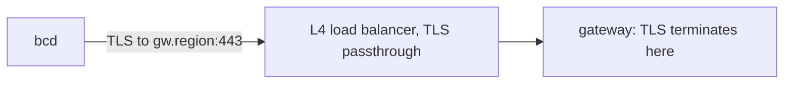

Every bcd mode (node, site agent, ramdisk) speaks one protocol to the control plane: `agent/v1`, a gRPC service
defined in `proto/bettercompute/agent/v1`. The daemon always dials out, the connection carries one long-lived
bidirectional stream of frames, and everything security-relevant inside it is either authenticated by TLS or
signed end to end, so the <Term id="gateway">gateway</Term> in the middle can relay but not forge.

## Transport



- **Endpoint.** The daemon dials `gw.<region>:443` (the `gateway_url` of its config). An L4 load balancer passes
  TLS through, so TLS terminates in the gateway process and the gateway sees the client certificate.
- **One HTTP/2 connection** carries the `Session` stream and, from v0.3, on-demand `Tunnel` streams. The gateway
  sends an HTTP/2 PING every 20 seconds.
- **Certificates.** The gateway's serving certificate comes from a separate gateway serving CA
  (`better-compute pki issue-gateway --san gw.<region>`), and bcd pins that CA's SPKI hash. Nodes present client
  certificates from the per-region node CA, which signs client certificates only. `Join` is server-authenticated
  TLS (the node has no certificate yet); `Renew`, `Session` and `Tunnel` are mutual TLS.
- **gRPC framing.** `serveGateway` implements gRPC on `node:http2` without a framework: `POST` with an
  `application/grpc` or `application/grpc+proto` content type, 5-byte length-prefixed messages, `grpc-status`
  and a percent-encoded `grpc-message` in trailers (trailers-only for immediate errors), no compression.
  `grpc-timeout` is tolerated and ignored, because sessions are long-lived by design. Other methods get HTTP 405,
  other content types 415.
- **Daemon side.** bcd will use connect-go over the generated Go code. That code does not exist yet: Go is not
  installed, so `daemon/gen/` is empty and the daemon's session package is a contract with a `TODO(v0.1)`. The
  FakeDaemon in `@better-compute/testing` speaks the protocol over real HTTP/2 today.

### WebSocket fallback (v0.4)

Some networks run a TLS-inspecting proxy that strips client certificates. For them the gateway also serves the same
frames over a WebSocket:

| Item | Value |
| --- | --- |
| URL | `wss://<gateway>/v1/session`, `GET` with `Upgrade: websocket`, version 13 |
| Subprotocol | `bc.agent.v1` |
| Framing | The same length-prefixed `AgentFrame` and `ServerFrame` messages as the gRPC `Session` |
| Daemon proof | `x-bc-nonce` (22 to 128 base64url characters) and `x-bc-proof`: an ES256 JWT of type `bc-agent-proof+jwt`, signed by the node key, with the node chain in `x5c`, `sub` the node id, `aud` the gateway's public host, a lifetime of at most 120 s, `iat` within 60 s, a single-use `jti` and the nonce |
| Gateway proof | The `101` response carries `x-bc-gateway-proof`: a JWS of type `bc-gateway-proof+jwt` over the nonce, signed by the serving key with the serving chain in `x5c`; the daemon checks it against the serving CA it pinned |

A WebSocket session is marked signed-only: the gateway sends it only commands and desired states that carry a
signature, and unsigned ones stay pending. The proxy can still see frame metadata (kinds, sizes, timing) and can
delay or drop frames, but it cannot forge intent. PLAN.md allows this mode only once all commands and specs are
signed: with `pki.commandSigning` both are (the gateway relays each generation's stored signed spec), so a
WebSocket daemon receives its desired state. There is no long-poll or unary path before v1. The gateway side (`attachGatewayWs`, `serveGatewayWs`)
and a daemon-side dialer (`connectGatewayWs`, used by the FakeDaemon) exist; bcd does not implement it yet.

## Proto packages

| Package | Files | Stability | Holds |
| --- | --- | --- | --- |
| `bettercompute.agent.v1` | `session.proto`, `commands.proto`, `inventory.proto` | frozen, additive only | The `AgentGateway` service, the frames, NodeSpec, the v0.1 command payloads, NodeInventory v1 |
| `bettercompute.common.v1` | `common.proto` | frozen, additive only | `Signature`, `TrustBundle`, `DriverManifest`, and the `AgentRole`, `Lane`, `CommandState` and `CommandRejectReason` enums |
| `bettercompute.site.v1` | `site.proto` | draft until v0.2 | Site agent payloads: boot lease state, proxy-DHCP entries, iPXE scripts, BMC operations, discovery assertions, and NodeSpec's `site` section |
| `bettercompute.driver.v1` | `driver.proto` | draft until v0.5 | bcx, the out-of-process driver protocol (`DriverPlugin`: `Describe`, `Validate`, `Invoke`, `Stream`, `Health`) |

`@better-compute/protocol` carries the TypeScript code generated by protoc-gen-es (`node scripts/proto-gen.mjs`),
plus helpers: bounded encoders and decoders, the command kind table, the signing-input layout and version
negotiation. It depends only on `@bufbuild/protobuf` and is browser-safe. The draft packages are exported as the
`site` and `driver` namespaces. `protocolRegistry` holds every message, for `Any` payloads and JSON.

## The AgentGateway service

```proto
service AgentGateway {
  rpc Join(JoinRequest) returns (JoinResponse);
  rpc Renew(RenewRequest) returns (RenewResponse);
  rpc Session(stream AgentFrame) returns (stream ServerFrame);
  rpc Tunnel(stream TunnelFrame) returns (stream TunnelFrame);  // v0.3
}
```

| RPC | Auth | What the gateway does |
| --- | --- | --- |
| `Join` | server TLS, serving CA pinned | Counts it against the handshake bucket and relays it to JoinService. The token is sealed (compact JWE to the JoinService encryption key) and the response is signed with the join-signing key, so the gateway can neither read the one nor forge the other |
| `Renew` | mTLS | Relays it with the peer's node id. JoinService verifies the proof of possession: a signature by the current node key under purpose `renew-pop`, within 60 s of server time, not replayed within 120 s |
| `Session` | mTLS | Runs the session: see [sessions](/docs/daemon/sessions) |
| `Tunnel` | mTLS | Relays one interactive stream, opened by the daemon after an `OpenTunnel` frame |

The node id always comes from the certificate's SPIFFE URI SAN, `spiffe://<trust domain>/site/<site>/node/<node>`,
never from a frame. `Join` also carries the hardware claims, the attestor name (`join-token` in v0.1;
`x509pop`, `provisioned` and `discovery` in v0.2; `cloud-iid` in v0.3; `tpm` in v0.5), attestor evidence, the
daemon version and the role. A `JoinResponseBody` may carry a `JoinDeferral` (v0.2) instead of a certificate: the
daemon then sends `Join` again with the same CSR, after `retry_after_seconds` or with its answer to a challenge.
The join flow is described in [joining nodes](/docs/guides/nodes/joining).

PLAN.md places JoinService and the secret broker in the api, behind internal mTLS. The gateway consumes them as a
port, `GatewayServices` (`join`, `renew`, `secret`, `trustBundle`), so the gateway package never imports the
server; `better-compute serve` passes the compute instance's `gatewayServices`.

## Frames

The first `AgentFrame` of a session must be `Hello` and the first `ServerFrame` is `Welcome`. After that both sides
send frames as they need to.

| AgentFrame (daemon to gateway) | Purpose |
| --- | --- |
| `hello` | Identity, versions, journal cursors, inventory hashes |
| `heartbeat` | Free lane credits, coarse load, applied generation; inventory hashes on every 10th |
| `update` | A `CommandUpdate`: acked, running, or a terminal outcome |
| `events` | An `EventBatch` of journaled events for one `journal_id` |
| `status` | A `StatusReport`: observed and applied generation, section states, conditions; from v0.3 the hosted instances and `pressure` (`HostPressure`: CPU, memory and I/O PSI "some" avg10 and CPU steal) |
| `inventory` | One `InventorySection`: the canonical encoding of a section and its SHA-256 |
| `spec_request` | Asks for a full `DesiredState` |
| `secret_request` | Asks for one secret, sealed to a one-time key (v0.2) |
| `workload_token_request` | A hosted instance's workload identity token, sealed to a one-time key (v0.5) |

| ServerFrame (gateway to daemon) | Purpose |
| --- | --- |
| `welcome` | Epoch, liveness settings, lane credits, event ack, requested inventory sections, server time, trust bundle |
| `command` | A `Command`: the stored body, an optional signature and the delivery attempt |
| `cancel` | Stop a command between actions |
| `desired` | A `DesiredState`: a full NodeSpec or a section patch at a generation |
| `ack` | Cumulative event ack for a journal, and command ids whose results are stored |
| `open_tunnel` | Open a `Tunnel` stream for an exec ticket (v0.3) |
| `drain` | Reconnect elsewhere after `reconnect_after_ms` |
| `revoked` | This certificate is revoked; the session closes |
| `secret` | The answer to a `secret_request`: a JWE, or an error |
| `workload_token` | The answer to a `workload_token_request`: a JWE and its expiry, or an error (v0.5) |

A gateway ignores an `AgentFrame` case it does not know, so a newer daemon can send frames an older gateway does
not understand. Sessions are covered in [sessions](/docs/daemon/sessions); commands, desired state and events in
[delivery](/docs/daemon/delivery).

### Secrets

Commands carry secret references (`secret://`, `vault://`, `env://`), never values. For each reference the daemon
sends `SecretRequest{ref, workflow_id, step_id, allocation_id, epk, node_sig, request_id}`, where `epk` is a fresh
P-256 public key used once and `node_sig` covers every other field. The broker checks the signature and that the
reference is bound to the agent's current step or allocation, and answers with a compact JWE
(`ECDH-ES+A256KW`, `A256GCM`) to `epk`, or with an `error` of `not-found`, `not-bound`, `access-denied` or
`unavailable`. Gateways see ciphertext only. A session whose certificate is tenant-controlled always gets
`access-denied`.

### Workload tokens (v0.5)

A VPS host's metadata service gets a hosted instance's workload identity token the same way:
`WorkloadTokenRequest{request_id, instance_id, audience, epk, node_sig}`, where `audience` is empty for the issuer's
default, `epk` is a fresh P-256 key used once, and `node_sig` (purpose `workload-token`) covers the other fields. The
gateway relays it to `GatewayServices.workloadToken` outside the frame queue, and the answer is
`WorkloadTokenResponse{request_id, jwe, expires_at, error}`: a compact JWE of the token to `epk`, or an `error` of
`not-bound`, `disabled`, `audience`, `rate-limited`, `access-denied` or `unavailable`. A gateway without the service
answers `unavailable`, and a tenant-controlled session always gets `access-denied`. See
[workload identity](/docs/guides/vps/instances#workload-identity).

### Tunnels (v0.3)

`OpenTunnel{tunnel_id, ticket}` asks the daemon to open a `Tunnel` stream. The ticket is an ES256 JWT, valid 60
seconds, with a single-use `jti`, audience `node:<id>`, a `sid` and an `op`. The gateway verifies it before asking,
and the daemon verifies it again against the JWKS in its NodeSpec `access` section and its own `jti` set. The
daemon's first `TunnelFrame` is `opened`; then `data` on channel 0 (stdin and stdout, or the byte stream) or 1
(stderr), `resize` with rows and columns, and `closed` with an exit code. Limits and re-authorization are in
[tunnels](/docs/guides/access/tunnels).

## Message size bounds

Everything is bounded (principle P12). The bounds live in `@better-compute/protocol`, and both sides decode with
them before parsing:

| Constant | Bound | Applies to |
| --- | --- | --- |
| `MAX_COMMAND_BODY_BYTES` | 1 MiB | A serialized `CommandBody`, a command payload, a command result |
| `MAX_SPEC_BODY_BYTES` | 4 MiB | A serialized `DesiredStateBody` |
| `MAX_FRAME_BYTES` | 5 MiB | One `Session` or `Tunnel` frame, and every gRPC message the gateway reads |

`encodeMessage` and `decodeMessage` throw `ProtocolError` with `FRAME_TOO_LARGE` or `INVALID_FRAME`. Decoding keeps
unknown fields, so a relay that re-encodes a newer peer's message loses nothing. Bulk data never rides the session:
log collection uploads to a presigned URL and images are fetched by URL.

## Signed envelopes

Anything a relay must not alter travels as `bytes body` plus a `Signature`, and the signature covers the exact body
bytes, so nobody ever re-encodes to verify. A `Signature` is ES256 in the raw 64-byte `r || s` form, a `kid` and an
optional certificate chain. The signed bytes are domain-separated by purpose:

```text
input = "bettercompute.v1/" || purpose || 0x00 || part_1 || ... || part_n
part  = uint32_be(len(bytes)) || bytes
```

| Purpose | Signer | Parts |
| --- | --- | --- |
| `command` | worker key | `[Command.body]` |
| `desired-state` | worker key | `[DesiredState.body]` |
| `join-response` | JoinService signing key | `[JoinResponse.body]` |
| `trust-bundle` | JoinService signing key | `[SignedTrustBundle.body]` |
| `attested-report` | node key | `[AttestedReport.body]` |
| `command-update` | node key | `[command_id, uint32_be(state), sha256(result)]` |
| `secret-request` | node key | `[request_id, ref, workflow_id, step_id, allocation_id, epk]` |
| `workload-token` | node key | `[request_id, instance_id, audience, epk]` (v0.5) |
| `renew-pop` | current node key | `[sha256(csr), node_id, client_time]` |
| `x509pop` | node key of a possibly expired certificate | `[sha256(csr), node_id, client_time]` |
| `discovery-assertion` | site agent node key | `[SignedDiscoveryAssertion.body]` |

Worker keys chain to the command-signing roots of the `TrustBundle` the daemon received in `JoinResponse`, and a
newer bundle arrives in `Welcome.trust`, signed by the pinned JoinService key. The daemon accepts a bundle only
when its version is greater than the one it holds. The envelopes exist from v0.1 with optional signatures, so
turning them on is additive. See [delivery](/docs/daemon/delivery#signed-commands-and-attested-results) for which
kinds require them.

## Errors outside frames

Refusals that end a stream use gRPC status codes:

| Code | When |
| --- | --- |
| `UNAUTHENTICATED` | No valid node certificate; a revoked or superseded certificate; the certificate expired during the session |
| `PERMISSION_DENIED` | `Hello.node_id` is not the certificate's node; the certificate is not valid for `Hello.role`; the node has not joined |
| `INVALID_ARGUMENT` | The first frame is not `Hello`; `Hello` lacks `role`, `boot_id` or `journal_id`; a second `Hello`; an undecodable message |
| `RESOURCE_EXHAUSTED` | The handshake token bucket, the stream limit or the pending-Hello limit; retry with jitter |
| `ABORTED` | A newer session of the same node superseded this one |
| `UNAVAILABLE` | The gateway is starting, draining, stopping or fenced, or a frame failed on a temporary error; reconnect |
| `UNIMPLEMENTED` | An unknown method |

## Version skew

**Negotiation.** `Hello` carries `proto_min`, `proto_max`, `daemon_version` and `capabilities`. The gateway picks
the highest version inside both ranges (`negotiateProtocolVersion`) and returns it in `Welcome.protocol_version`,
along with its own capabilities. Today both sides speak exactly version 1 (`PROTOCOL_VERSION = { min: 1, max: 1 }`
in TypeScript, `ProtoMin` and `ProtoMax` in Go). When the ranges do not overlap, the daemon is below the server's
minimum: `Welcome.upgrade_required` is set, no desired state or command other than `daemon.upgrade` is sent, and
the FakeDaemon rejects anything else `UNSUPPORTED`.

**What is recorded.** The gateway stores `Hello.daemon_version` and `Hello.proto_max` in `node_sessions`
(migration `core/0008_session_versions`), which is how the rollout controller sees a node finish an upgrade and
finds nodes that need `daemon.upgrade`.

**Policy.** Daemons may lag N-1 minor versions before 1.0 and N-2 from 1.0. The range widens when a release adds a
version and its minimum rises when the skew window drops one. The upgrade order is expand migrations, workers and
api, gateways, daemons, then contract migrations a release later.

**Additive only.** `agent/v1` and `common/v1` were frozen at the end of P0. CI runs `buf breaking` with the `FILE`
rule set against `proto/baseline.binpb`; the draft `site` and `driver` packages are excluded until their phases
freeze them. Within the frozen packages, change is absorbed at every level:

| Something new | An older peer |
| --- | --- |
| A field | Ignores it; relays keep it as an unknown field |
| An `AgentFrame` case | The gateway ignores the frame |
| A command kind | The daemon rejects it `UNSUPPORTED` |
| A NodeSpec section | The daemon reports condition `SectionUnsupported` with the field number as the reason and converges the rest |
| A protocol version | Negotiated down, or `upgrade_required` below the minimum |

## Built-in command kinds

`commands.proto` holds the payloads and results of the v0.1 kinds, and `commandKinds` in `@better-compute/protocol`
holds their flags; the daemon's dispatcher must carry the same table. Later kinds (`diag.dcgm`, `wipe`, `deploy.*`,
`boot.kexec`, `driver.invoke`, `daemon.upgrade`) add their own messages.

| Kind | Lane | Retry-safe | Self-terminating | Attested | Destructive | Roles |
| --- | --- | --- | --- | --- | --- | --- |
| `diag.nvml` | control | yes | no | yes | no | node, ramdisk |
| `inventory.refresh` | control | yes | no | no | no | node, site, ramdisk |
| `logs.collect` | bulk | yes | no | no | no | node, site, ramdisk |
| `node.reboot` | control | yes | yes | no | yes | node, site |
| `gpu.reset` | control | no | no | yes | yes | node |

Module kinds and timeouts are in [command kinds](/docs/reference/command-kinds).
