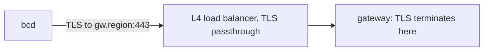

Every bcd mode (node, site agent, ramdisk) speaks one protocol to the control plane: `agent/v1`, a gRPC service
defined in `proto/bettercompute/agent/v1`. The daemon always dials out, the connection carries one long-lived
bidirectional stream of frames, and everything security-relevant inside it is either authenticated by TLS or
signed end to end, so the <Term id="gateway">gateway</Term> in the middle can relay but not forge.

This page explains how the protocol behaves. For every service, message, field number and enum value, see the
generated [protocol reference](/docs/reference/protocol), built from the `.proto` files with each declaration's own
comment; the message names below link to their entries there.

## Transport



- **Endpoint.** The daemon dials `gw.<region>:443` (the `gateway_url` of its config). An L4 load balancer passes
  TLS through, so TLS terminates in the gateway process and the gateway sees the client certificate.
- **One HTTP/2 connection** carries the `Session` stream and, from v0.3, on-demand `Tunnel` streams. The gateway
  sends an HTTP/2 PING every 20 seconds.
- **Certificates.** The gateway's serving certificate comes from a separate gateway serving CA
  (`better-compute pki issue-gateway --san gw.<region>`), and bcd pins that CA's SPKI hash. Nodes present client
  certificates from the per-region node CA, which signs client certificates only. `Join` is server-authenticated
  TLS (the node has no certificate yet); `Renew`, `Session` and `Tunnel` are mutual TLS.
- **gRPC framing.** `serveGateway` implements gRPC on `node:http2` without a framework: `POST` with an
  `application/grpc` or `application/grpc+proto` content type, 5-byte length-prefixed messages, `grpc-status`
  and a percent-encoded `grpc-message` in trailers (trailers-only for immediate errors), no compression.
  `grpc-timeout` is tolerated and ignored, because sessions are long-lived by design. Other methods get HTTP 405,
  other content types 415.
- **Daemon side.** bcd (`daemon/internal/transport`) uses connect-go over the Go code generated into `daemon/gen/`
  (protoc-gen-go and protoc-gen-connect-go, through `daemon/buf.gen.yaml` and `node scripts/daemon-proto-gen.mjs`;
  `--check` verifies it is current). It speaks gRPC over HTTP/2 with TLS 1.3 pinned to the serving CA's SPKI hash,
  never the system roots, presents its node certificate, and sends HTTP/2 PINGs every 20 seconds. When
  `gateway_url` names an IP address, `gateway_server_name` gives the name the gateway certificate must carry.
  `tests/e2e/bcd.test.ts` runs it against `serveGateway`'s mTLS listener. The FakeDaemon in
  `@better-compute/testing` speaks the same protocol over real HTTP/2 or in memory.

### WebSocket fallback (v0.4)

Some networks run a TLS-inspecting proxy that strips client certificates. For them the gateway also serves the same
frames over a WebSocket:

| Item | Value |
| --- | --- |
| URL | `wss://<gateway>/v1/session`, `GET` with `Upgrade: websocket`, version 13 |
| Subprotocol | `bc.agent.v1` |
| Framing | The same length-prefixed `AgentFrame` and `ServerFrame` messages as the gRPC `Session` |
| Daemon proof | `x-bc-nonce` (22 to 128 base64url characters) and `x-bc-proof`: an ES256 JWT of type `bc-agent-proof+jwt`, signed by the node key, with the node chain in `x5c`, `sub` the node id, `aud` the gateway's public host, a lifetime of at most 120 s, `iat` within 60 s, a single-use `jti` and the nonce |
| Gateway proof | The `101` response carries `x-bc-gateway-proof`: a JWS of type `bc-gateway-proof+jwt` over the nonce, signed by the serving key with the serving chain in `x5c`; the daemon checks it against the serving CA it pinned |

A WebSocket session is marked signed-only: the gateway sends it only commands and desired states that carry a
signature, and unsigned ones stay pending. The proxy can still see frame metadata (kinds, sizes, timing) and can
delay or drop frames, but it cannot forge intent. PLAN.md allows this mode only once all commands and specs are
signed: with `pki.commandSigning` both are (the gateway relays each generation's stored signed spec), so a
WebSocket daemon receives its desired state. There is no long-poll or unary path before v1. The gateway side is
`attachGatewayWs` and `serveGatewayWs`, and `connectGatewayWs` is the FakeDaemon's dialer.

**Renewal without a client certificate** (06cb334, PLAN.md §7.1). Behind such a proxy the mTLS `Renew` cannot work,
and a node would lose its identity after 24 hours, so the WebSocket listener also takes `POST /v1/renew`: the
`RenewRequest` bytes as `application/x-protobuf`, answered with the `RenewResponse` bytes, errors mapped as for gRPC
(status, `grpc-status`, `x-bc-reason`, `retry-after`). No TLS identity is used: the request carries the current chain
and a proof of possession by the current key, so the peer is the node the chain's leaf names, and JoinService checks
chain, revocation, generation and the proof (with its replay cache). A node gets 6 renewals an hour, and a body is at
most 64 KiB. `gatewayRenewHandler` serves it for hosts that attach the WebSocket listener to their own server.

**In bcd** (6cd48be). A `[websocket] url` in `config.toml` moves `bcd node` and `bcd site` to this transport: a
dependency-free RFC 6455 client dials `wss://.../v1/session` (through the environment's HTTP CONNECT proxy when one
is set), with masked binary messages of at most 16 MiB, answered pings and the close handshake. TLS is verified
against the pinned serving CA, or against `[websocket] proxy_ca_file` for the transport only; either way the 101's
`x-bc-gateway-proof` must chain to the pinned serving CA for server authentication, be signed by that leaf, and name
this node and nonce with an `iat` within 60 s, or bcd never talks to the gateway. The identity is re-read at every
dial, so a renewal applies at the next one, and renewals go to `POST /v1/renew` on the same origin, honouring the
gateway's pushback. Refusals' `x-bc-reason` and pushback (`grpc-retry-pushback-ms`, `retry-after`) steer the redial.
In WebSocket mode bcd refuses tunnels (they need the gRPC transport) and refuses to dial without command-signing
roots, since the session receives signed intent only. Go tests cover the session, unproven gateways and the renewal
against an in-process gateway, and `tests/e2e/bcd.test.ts` runs it end to end (4b2d5aa): beside a
`createDevStack({ signedIntent: true })` stack, the TypeScript `serveGatewayWs` with a serving certificate from the
CA the node pins; the node restarts with `[websocket] url`, runs a signed `inventory.refresh` over the WebSocket
session and renews over `POST /v1/renew`. `daemon install-script --websocket-url` writes the section (see
[installing bcd](/docs/daemon/install#generate-the-script)).

## Proto packages

| Package | Files | Stability | Holds |
| --- | --- | --- | --- |
| `bettercompute.agent.v1` | [`session.proto`](/docs/reference/protocol#sessionproto), [`commands.proto`](/docs/reference/protocol#commandsproto), [`inventory.proto`](/docs/reference/protocol#inventoryproto) | frozen, additive only | The [`AgentGateway`](/docs/reference/protocol#agentgateway) service, the frames, [`NodeSpec`](/docs/reference/protocol#nodespec), the v0.1 command payloads, [`NodeInventory`](/docs/reference/protocol#nodeinventory) v1 |
| `bettercompute.common.v1` | [`common.proto`](/docs/reference/protocol#commonproto) | frozen, additive only | [`Signature`](/docs/reference/protocol#signature), [`TrustBundle`](/docs/reference/protocol#trustbundle), [`DriverManifest`](/docs/reference/protocol#drivermanifest), and the [`AgentRole`](/docs/reference/protocol#agentrole), [`Lane`](/docs/reference/protocol#lane), [`CommandState`](/docs/reference/protocol#commandstate) and [`CommandRejectReason`](/docs/reference/protocol#commandrejectreason) enums |
| `bettercompute.site.v1` | [`site.proto`](/docs/reference/protocol#siteproto) | draft until v0.2 | Site agent payloads: boot lease state, proxy-DHCP entries, iPXE scripts, BMC operations, discovery assertions, and NodeSpec's `site` section ([`SiteSpec`](/docs/reference/protocol#sitespec)) |
| `bettercompute.driver.v1` | [`driver.proto`](/docs/reference/protocol#driverproto) | draft until v0.5 | bcx, the out-of-process driver protocol ([`DriverPlugin`](/docs/reference/protocol#driverplugin): `Describe`, `Validate`, `Invoke`, `Stream`, `Health`) |

`@better-compute/protocol` carries the TypeScript code generated by protoc-gen-es (`node scripts/proto-gen.mjs`),
plus helpers: bounded encoders and decoders, the command kind table, the signing-input layout and version
negotiation. It depends only on `@bufbuild/protobuf` and is browser-safe. The draft packages are exported as the
`site` and `driver` namespaces. `protocolRegistry` holds every message, for `Any` payloads and JSON.

## The AgentGateway service

The service as `session.proto` declares it (see [`AgentGateway`](/docs/reference/protocol#agentgateway) in the
reference for each request and response message):

```proto
service AgentGateway {
  rpc Join(JoinRequest) returns (JoinResponse);
  rpc Renew(RenewRequest) returns (RenewResponse);
  rpc Session(stream AgentFrame) returns (stream ServerFrame);
  rpc Tunnel(stream TunnelFrame) returns (stream TunnelFrame);  // v0.3
}
```

| RPC | Auth | What the gateway does |
| --- | --- | --- |
| `Join` | server TLS, serving CA pinned | Counts it against the handshake bucket and relays it to JoinService. The token is sealed (compact JWE to the JoinService encryption key) and the response is signed with the join-signing key, so the gateway can neither read the one nor forge the other |
| `Renew` | mTLS | Relays it with the peer's node id. JoinService verifies the proof of possession: a signature by the current node key under purpose `renew-pop`, within 60 s of server time, not replayed within 120 s |
| `Session` | mTLS | Runs the session: see [sessions](/docs/daemon/sessions) |
| `Tunnel` | mTLS | Relays one interactive stream, opened by the daemon after an `OpenTunnel` frame |

The node id always comes from the certificate's SPIFFE URI SAN, `spiffe://<trust domain>/site/<site>/node/<node>`,
never from a frame. `Join` also carries the hardware claims, the attestor name (`join-token` in v0.1;
`x509pop`, `provisioned` and `discovery` in v0.2; `cloud-iid` in v0.3; `tpm` in v0.5), attestor evidence, the
daemon version and the role (see [`JoinRequest`](/docs/reference/protocol#joinrequest) and
[`HardwareClaims`](/docs/reference/protocol#hardwareclaims)). A
[`JoinResponseBody`](/docs/reference/protocol#joinresponsebody) may carry a
[`JoinDeferral`](/docs/reference/protocol#joindeferral) (v0.2) instead of a certificate: the
daemon then sends `Join` again with the same CSR, after `retry_after_seconds` or with its answer to a challenge.
The join flow is described in [joining nodes](/docs/guides/nodes/joining). bcd sends `join-token` (for `bcd join`,
as role `node` or `site`), `provisioned` (for `bcd join --node-id` on an OS a deploy installed; `--attestor` names
any other) and `discovery` (for `bcd ramdisk`, as role `ramdisk`, with the site agent's serialized
`SignedDiscoveryAssertion` as the evidence); it answers no attestor challenge yet.

PLAN.md places JoinService and the secret broker in the api, behind internal mTLS. The gateway consumes them as a
port, `GatewayServices` (`join`, `renew`, `secret`, `trustBundle`), so the gateway package never imports the
server; `better-compute serve` passes the compute instance's `gatewayServices`.

## Frames

The first [`AgentFrame`](/docs/reference/protocol#agentframe) of a session must be
[`Hello`](/docs/reference/protocol#hello) and the first [`ServerFrame`](/docs/reference/protocol#serverframe) is
[`Welcome`](/docs/reference/protocol#welcome). After that both sides send frames as they need to.

| AgentFrame (daemon to gateway) | Purpose |
| --- | --- |
| `hello` | Identity, versions, journal cursors, inventory hashes, and `trust_version`: the trust bundle version the daemon holds (0 for none) |
| `heartbeat` | A [`Heartbeat`](/docs/reference/protocol#heartbeat): free lane credits, coarse load, applied generation; inventory hashes on every 10th, and on the first after changed inventory sections (427787a) |
| `update` | A [`CommandUpdate`](/docs/reference/protocol#commandupdate): acked, running, or a terminal outcome |
| `events` | An [`EventBatch`](/docs/reference/protocol#eventbatch) of journaled events for one `journal_id` |
| `status` | A [`StatusReport`](/docs/reference/protocol#statusreport): observed and applied generation, section states, conditions; from v0.3 the hosted instances and `pressure` (`HostPressure`: CPU, memory and I/O PSI "some" avg10 and CPU steal); `discovered` from a site agent (unknown PXE machines) and `volume_storage` from a runtime host (the volume store's space, b8e7271); `trust_version` once the daemon applied a newer trust bundle mid-session (0 means unchanged; bcd sets it only in the first report after the change, the FakeDaemon in every report) |
| `inventory` | One [`InventorySection`](/docs/reference/protocol#inventorysection): the canonical encoding of a section and its SHA-256 |
| `spec_request` | A [`SpecRequest`](/docs/reference/protocol#specrequest) for a full `DesiredState` |
| `secret_request` | Asks for one secret, sealed to a one-time key (v0.2) |
| `workload_token_request` | A hosted instance's workload identity token, sealed to a one-time key (v0.5) |

| ServerFrame (gateway to daemon) | Purpose |
| --- | --- |
| `welcome` | Epoch, liveness settings, lane credits, event ack, requested inventory sections, server time, trust bundle |
| `command` | A [`Command`](/docs/reference/protocol#command): the stored body ([`CommandBody`](/docs/reference/protocol#commandbody)), an optional signature and the delivery attempt, plus a [`BatchApproval`](/docs/reference/protocol#batchapproval) and [`BatchProof`](/docs/reference/protocol#batchproof) for a batched destructive command (v1.0) |
| `cancel` | A [`Cancel`](/docs/reference/protocol#cancel): stop a command between actions |
| `desired` | A [`DesiredState`](/docs/reference/protocol#desiredstate): a full NodeSpec or a section patch at a generation |
| `ack` | An [`Ack`](/docs/reference/protocol#ack): cumulative event ack for a journal, and command ids whose results are stored |
| `open_tunnel` | Open a `Tunnel` stream for an exec ticket (v0.3) |
| `drain` | A [`Drain`](/docs/reference/protocol#drain): reconnect elsewhere after `reconnect_after_ms` |
| `revoked` | A [`RevocationNotice`](/docs/reference/protocol#revocationnotice): this certificate is revoked; the session closes |
| `secret` | The answer to a `secret_request`: a JWE, or an error |
| `workload_token` | The answer to a `workload_token_request`: a JWE and its expiry, or an error (v0.5) |

A gateway ignores an `AgentFrame` case it does not know, so a newer daemon can send frames an older gateway does
not understand. Sessions are covered in [sessions](/docs/daemon/sessions); commands, desired state and events in
[delivery](/docs/daemon/delivery).

### Secrets

Commands carry secret references (`secret://`, `vault://`, `env://`), never values. For each reference the daemon
sends [`SecretRequest`](/docs/reference/protocol#secretrequest)`{ref, workflow_id, step_id, allocation_id, epk,
node_sig, request_id}`, where `epk` is a fresh
P-256 public key used once and `node_sig` covers every other field. The broker checks the signature and that the
reference is bound to the agent's current step or allocation, or, for a credential the node's own spec names, to
workflow `host:<unit or section>` and step `<field>` (`host:k8s-join` / `tokenRef`, `host:telemetry` / `headersRef`;
see [sealed secrets](/docs/operations/security#sealed-secrets)), and answers with a
[`SecretResponse`](/docs/reference/protocol#secretresponse) holding a compact JWE
(`ECDH-ES+A256KW`, `A256GCM`) to `epk`, or with an `error` of `not-found`, `not-bound`, `access-denied` or
`unavailable`. Gateways see ciphertext only. A session whose certificate is tenant-controlled always gets
`access-denied`.

bcd builds the request and opens the answer in `daemon/internal/pki/secrets.go` (`NewSecretRequest`,
`OpenSecretResponse`): the JWE has `typ` `bcsecret+jwe` and must be bound to the same reference and request id and
unexpired, and a refusal surfaces its error code. The agent matches answers by request id on the session that sent
the request, waits at most 10 seconds and ignores an answer to nothing. The Go tests check both directions against
fixtures produced by `@better-compute/pki`. These bcd features send one: a site agent's BMC operations (the
credential, and for `bmc.rotate` the new one) and `site.httpProxy` secret headers, bound to the command's workflow
step; its boot server's discovery tokens, bound to the boot entry's workflow; the ramdisk's `deploy.image` user data,
bound to the step; a VPS host's instance user data, bound to the instance's allocation; the `k8s-join` unit's
bootstrap token (7579184) and the OTLP exporter's headers (27c7ee2), bound to the node's spec.

### Workload tokens (v0.5)

A VPS host's metadata service gets a hosted instance's workload identity token the same way:
[`WorkloadTokenRequest`](/docs/reference/protocol#workloadtokenrequest)`{request_id, instance_id, audience, epk,
node_sig}`, where `audience` is empty for the issuer's
default, `epk` is a fresh P-256 key used once, and `node_sig` (purpose `workload-token`) covers the other fields. The
gateway relays it to `GatewayServices.workloadToken` outside the frame queue, and the answer is
[`WorkloadTokenResponse`](/docs/reference/protocol#workloadtokenresponse)`{request_id, jwe, expires_at, error}`: a
compact JWE of the token to `epk`, or an `error` of
`not-bound`, `disabled`, `audience`, `rate-limited`, `access-denied` or `unavailable`. A gateway without the service
answers `unavailable`, and a tenant-controlled session always gets `access-denied`. bcd implements the host's half
the same way as secrets (`NewWorkloadTokenRequest`, `OpenWorkloadTokenResponse`, a `bcworkload+jwe` answer bound to
the instance and the request id), and its metadata service (`[imds] listen`) calls it for the running instance that
holds the request's source address. See [workload identity](/docs/guides/vps/instances#workload-identity).

### Tunnels (v0.3)

[`OpenTunnel`](/docs/reference/protocol#opentunnel)`{tunnel_id, ticket}` asks the daemon to open a `Tunnel` stream
of [`TunnelFrame`](/docs/reference/protocol#tunnelframe)s. The ticket is an ES256 JWT, valid 60
seconds, with a single-use `jti`, audience `node:<id>`, a `sid` and an `op`. The gateway verifies it before asking,
and the daemon verifies it again against the JWKS in its NodeSpec `access` section and its own `jti` set. The
daemon's first `TunnelFrame` is `opened`; then `data` on channel 0 (stdin and stdout, or the byte stream) or 1
(stderr), `resize` with rows and columns, and `closed` with an exit code. bcd refuses a ticket by opening nothing,
so the gateway's open times out; it runs at most 16 tunnels at once. What it runs for each op, limits and
re-authorization are in [tunnels](/docs/guides/access/tunnels#the-node-half).

## Message size bounds

Everything is bounded (principle P12). The bounds live in `@better-compute/protocol`, and both sides decode with
them before parsing:

| Constant | Bound | Applies to |
| --- | --- | --- |
| `MAX_COMMAND_BODY_BYTES` | 1 MiB | A serialized `CommandBody`, a command payload, a command result |
| `MAX_SPEC_BODY_BYTES` | 4 MiB | A serialized [`DesiredStateBody`](/docs/reference/protocol#desiredstatebody) |
| `MAX_FRAME_BYTES` | 5 MiB | One `Session` or `Tunnel` frame, and every gRPC message the gateway reads |

`encodeMessage` and `decodeMessage` throw `ProtocolError` with `FRAME_TOO_LARGE` or `INVALID_FRAME`. Decoding keeps
unknown fields, so a relay that re-encodes a newer peer's message loses nothing. Bulk data never rides the session:
log collection uploads to a presigned URL and images are fetched by URL.

## Signed envelopes

Anything a relay must not alter travels as `bytes body` plus a `Signature`, and the signature covers the exact body
bytes, so nobody ever re-encodes to verify. A [`Signature`](/docs/reference/protocol#signature) is ES256 in the raw 64-byte `r || s` form, a `kid` and an
optional certificate chain. The signed bytes are domain-separated by purpose:

```text
input = "bettercompute.v1/" || purpose || 0x00 || part_1 || ... || part_n
part  = uint32_be(len(bytes)) || bytes
```

| Purpose | Signer | Parts |
| --- | --- | --- |
| `command` | worker key | `[Command.body]` |
| `desired-state` | worker key | `[DesiredState.body]` |
| `join-response` | JoinService signing key | `[JoinResponse.body]` |
| `trust-bundle` | JoinService signing key | `[SignedTrustBundle.body]` |
| `attested-report` | node key | `[AttestedReport.body]` |
| `command-update` | node key | `[command_id, uint32_be(state), sha256(result)]` |
| `secret-request` | node key | `[request_id, ref, workflow_id, step_id, allocation_id, epk]` |
| `workload-token` | node key | `[request_id, instance_id, audience, epk]` (v0.5) |
| `renew-pop` | current node key | `[sha256(csr), node_id, client_time]` |
| `x509pop` | node key of a possibly expired certificate | `[sha256(csr), node_id, client_time]` |
| `discovery-assertion` | site agent node key (`bcd site`, one per iPXE script it serves) | `[SignedDiscoveryAssertion.body]` |
| `batch-approval` | operator approver key (v1.0 [quorum](/docs/operations/pki#the-destructive-batch-quorum-v10)), in [`BatchApproval.signatures`](/docs/reference/protocol#batchapproval) | `[batch_id, scope_root, uint32_be(scope_size), timestamp(not_after), trust_domain]`; each verifier supplies the trust domain from its own configuration |
| `approver-set` | a current operator approver key | `[uint64_be(approver_set_epoch), sha256(approverSetInput), trust_domain]` (4835f4f, c6214dc): a change of the trust bundle's quorum fields |

Worker keys chain to the command-signing roots of the [`TrustBundle`](/docs/reference/protocol#trustbundle) the
daemon received in `JoinResponse`, and a newer bundle arrives in `Welcome.trust`, a
[`SignedTrustBundle`](/docs/reference/protocol#signedtrustbundle) signed by the pinned JoinService key. The bundle also carries the v1.0
quorum's `approver_keys`, `approver_threshold`, `quorum_tiers` and `unbatched_destructive_per_hour`, empty unless
`pki.approvers` is set, `approver_set_epoch` (field 8, c6214dc), the set's own epoch, separate from `version` and
raised with every change of the set, and `approver_set_signatures`, by which the current approvers sign a change of
those fields for that epoch (purpose `approver-set`, parts `[uint64_be(approver_set_epoch),
sha256(approverSetInput), trust_domain]`), published on every version while the set is current. A daemon holding set
`H` at epoch `e` takes `(N, e')` only when `e' > e` and its current threshold of `H`'s keys signed it, `N == H`
included; otherwise it keeps its quorum and applies the rest of the bundle. Both daemons report the set they enforce,
`approver_set_epoch` and `approver_set_sha256`, in `Hello` (fields 18 and 19) and beside `trust_version` in
`StatusReport` (10 and 11), since a bundle's version can be taken while its quorum part is refused (see
[changing the approver set](/docs/operations/pki#changing-the-approver-set)). The daemon accepts a bundle only
when its version is greater than the one it holds, and the control plane raises the version whenever the bundle's
content changes, so a change always reaches the fleet. The envelopes exist from v0.1 with optional signatures, so
turning them on is additive. See [delivery](/docs/daemon/delivery#signed-commands-and-attested-results) for which
kinds require them.

## Errors outside frames

Refusals that end a stream use gRPC status codes:

| Code | When |
| --- | --- |
| `UNAUTHENTICATED` | No valid node certificate; a revoked or superseded certificate; the certificate expired during the session |
| `PERMISSION_DENIED` | `Hello.node_id` is not the certificate's node; the certificate is not valid for `Hello.role`; the node has not joined |
| `INVALID_ARGUMENT` | The first frame is not `Hello`; `Hello` lacks `role`, `boot_id` or `journal_id`; a second `Hello`; an undecodable message |
| `RESOURCE_EXHAUSTED` | The handshake token bucket, the stream limit or the pending-Hello limit; retry after the `grpc-retry-pushback-ms` trailer the refusal carries (see [opening](/docs/daemon/sessions#opening)), else with jitter |
| `ABORTED` | A newer session of the same node superseded this one |
| `UNAVAILABLE` | The gateway is starting, draining, stopping or fenced, or a frame failed on a temporary error; reconnect |
| `UNIMPLEMENTED` | An unknown method |

## Version skew

**Negotiation.** `Hello` carries `proto_min`, `proto_max`, `daemon_version` and `capabilities`. The gateway picks
the highest version inside both ranges (`negotiateProtocolVersion`) and returns it in `Welcome.protocol_version`,
along with its own capabilities. It also stores the daemon's capabilities as `node_sessions.capabilities`, so the API
can refuse what an old daemon cannot do safely: `tunnels.open` opens an instance `ssh` or `tcp` tunnel only when the
node advertises `tunnel.instance-dial` (see [sessions](/docs/daemon/sessions#hello)). The gateway also writes each
capability as the system node label `bc.dev/cap.<name>=1`, and placement gates on those labels so an older bcd never
gets a spec field it would drop as unknown: vps places instances that need `instance.network-policy`,
`instance.ssh-host-only`, `instance.placement` or `instance.volumes` only where they are advertised, and capacity
places reservations that book host resources only on `devices.limits` nodes and `binding: 'kubernetes'` ones only on
`binding.kubernetes` nodes (409f783). A plain GPU hold without host resources needs no capability and still places on
an N-2 daemon. Today both sides speak exactly version 1 (`PROTOCOL_VERSION = { min: 1, max: 1 }`
in TypeScript, `ProtoMin` and `ProtoMax` in Go). When the ranges do not overlap, the daemon is below the server's
minimum: `Welcome.upgrade_required` is set, `Welcome.protocol_version` is the gateway's minimum, no desired state or
command other than `daemon.upgrade` is sent, and the FakeDaemon and bcd reject anything else `UNSUPPORTED`. bcd
runs `daemon.upgrade` (de9f380) when its `[update]` section pins release keys; without pins it refuses the update,
and the binary must be replaced by hand.

**The gateway's range.** `createGateway({ protocol: { min, max } })` sets the versions a gateway speaks; the default
is `PROTOCOL_VERSION`. Negotiation and the `Welcome` use it, so a gateway at `{ min: 1, max: 3 }` welcomes a daemon
at 1..1 at version 1 and one at 1..2 at version 2, while a gateway at `{ min: 2, max: 3 }` restricts a 1..1 daemon to
`upgrade_required`. A range with `min` below 1, `max` below `min` or a non-integer bound is `INVALID_CONFIG` at
construction. It exists for the v1.0 N-2 skew tests and staged protocol bumps (`tests/gateway-protocol.test.ts`);
no version beyond 1 is defined yet.

**The skew matrix.** `tests/skew-matrix.test.ts` runs each supported daemon line against real dev stacks
(`createDevStack({ gateway: { protocol }, daemon: { profile } })`). A FakeDaemon `profile` from `daemonSkewProfiles`
in `@better-compute/testing` makes it behave like an older bcd: the version and protocol range it announces, its
capabilities, the kinds it rejects `UNSUPPORTED`, the spec sections it reports `SectionUnsupported`, the inventory
sections and `Hello` fields it never sends. The rows today are N (0.5.0), N-1 (0.4.0, no `instance.snapshot`) and
N-2 (0.3.0, also no `daemon` section and no `trust_version`); each is welcomed at the highest shared version,
adopted, runs `inventory.refresh` and gets its missing kinds rejected. `belowMinimumProfile`, and the current line
against a gateway at `{ min: 2, max: 3 }`, get `upgrade_required`: no spec, and ordinary commands stay pending. A
release adds a row on top and drops the one that leaves the window.

**What is recorded.** The gateway stores `Hello.daemon_version` and `Hello.proto_max` in `node_sessions`
(migration `core/0008_session_versions`), which is how the rollout controller sees a node finish an upgrade and
finds nodes that need `daemon.upgrade`.

**Policy.** Daemons may lag N-1 minor versions before 1.0 and N-2 from 1.0. The range widens when a release adds a
version and its minimum rises when the skew window drops one. The upgrade order is expand migrations, workers and
api, gateways, daemons, then contract migrations a release later.

**Additive only.** `agent/v1` and `common/v1` were frozen at the end of P0. CI runs `buf breaking` with the `FILE`
rule set against `proto/baseline.binpb`; the draft `site` and `driver` packages are excluded until their phases
freeze them. Within the frozen packages, change is absorbed at every level:

| Something new | An older peer |
| --- | --- |
| A field | Ignores it; relays keep it as an unknown field |
| An `AgentFrame` case | The gateway ignores the frame |
| A command kind | The daemon rejects it `UNSUPPORTED` |
| A NodeSpec section | The daemon reports condition `SectionUnsupported` with the field number as the reason and converges the rest |
| A protocol version | Negotiated down, or `upgrade_required` below the minimum |

## Built-in command kinds

`commands.proto` holds the payloads and results of the v0.1 kinds, and `commandKinds` in `@better-compute/protocol`
holds their flags; the daemon's dispatcher must carry the same table. Later kinds add their own messages: the
ramdisk's `diag.dcgm`, `disk.wipe`, `deploy.image` and `boot.kexec` in `bettercompute.agent.v1`, the site agent's
`bmc.*`, `site.httpProxy`, `boot.prepareRamdisk` and `boot.cleanUp` in `bettercompute.site.v1` (their flags are
`metalCommandKinds` in `@better-compute/metal`, and bcd implements them), then `driver.invoke`, which bcd runs in the
bcx plugins it hosts (see [drivers](/docs/extending/drivers#driver-plugins-in-bcd)), and `daemon.upgrade`, which bcd
runs as its [self-update](/docs/daemon/install#self-update) (de9f380).

| Kind | Lane | Retry-safe | Self-terminating | Attested | Destructive | Roles |
| --- | --- | --- | --- | --- | --- | --- |
| `diag.nvml` | control | yes | no | yes | no | node, ramdisk |
| `inventory.refresh` | control | yes | no | no | no | node, site, ramdisk |
| `logs.collect` | bulk | yes | no | no | no | node, site, ramdisk |
| `node.reboot` | control | yes | yes | no | yes | node, site |
| `gpu.reset` | control | no | no | yes | yes | node |

Metal's kinds, by lane, are in [delivery](/docs/daemon/delivery#kinds-by-lane); every module kind and its timeout
is in [command kinds](/docs/reference/command-kinds).
