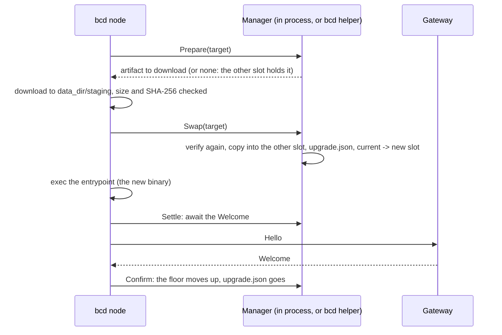

bcd replaces its own binary when the control plane asks for another version (PLAN.md §6 "Self-update", v0.4;
de9f380). It takes a binary only from a release manifest signed by keys pinned on the node, so a compromised control
plane cannot hand it one. The new binary goes into the other of two slots, runs, and must reach a gateway within 120
seconds or it is swapped back. Once a release is confirmed, the node never runs an older one.

The control plane's side, signing releases and rolling a version out in waves within each pool's disruption budget,
is on [rollouts](/docs/guides/rollouts). [Installing bcd](/docs/daemon/install#self-update) summarizes the steps for
operators. This page is the node's side in full.

<Callout type="warn" title="Tested, not yet used on a real fleet">
`tests/e2e/bcd.test.ts` updates a real bcd to a second build signed under the pinned key through `daemon.upgrade`,
with a real exec and its `Welcome` (fc0ca6a), and delivers a signed build to an unprivileged node through a real `bcd
helper` (2d67b25). The helper's root end-to-end test swaps, rolls back and records a failure as root (035fc41).
`internal/selfupdate` unit tests cover the manifest checks, the slots, the floor and the staged-file rules. No bcd
release has been cut, so no real host has updated itself yet.
</Callout>

## How an update reaches a node

A node is told its target version in two ways, which carry the same `DaemonSection`:

| Path | When | Kind |
| --- | --- | --- |
| `NodeSpec.daemon` | The rollout controller sets it as nodes start, wave by wave | Desired state, converged by the `daemon` section |
| `daemon.upgrade` command | A node whose daemon is below the server's minimum protocol version gets `Welcome.upgrade_required`; its session accepts only `daemon.upgrade`, so the controller also enqueues one with the same target (idempotency key `rollout:<rolloutId>:<nodeId>`) | `control` lane, retry-safe, self-terminating, 15-minute timeout |

```json title="DaemonSection"
{
  "version": "1.4.0",
  "url": "https://downloads.example.com/bcd/1.4.0/linux-amd64",
  "sha256": "9f2c...e41a",
  "signature": "<manifest.json bytes: { manifest, signatures }>"
}
```

`signature` is the release's signed manifest as `better-compute release sign` wrote it. A section naming the version
the node already runs plans nothing, and a `daemon.upgrade` for it succeeds at once. `bcd sim` and `bcd ramdisk` run
without self-update: the `daemon` section is `SectionUnsupported` there and `daemon.upgrade` is `UNSUPPORTED`.



## The release manifest

A release manifest (`type: bettercompute.release`, `spec: 1`) lists one version's files. Its published form is
`{ manifest, signatures }`: the canonical body in base64 and one `{ kid, sig }` per signer (see [sign a
release](/docs/guides/rollouts#sign-a-release)). bcd verifies it in `pki.VerifyReleaseManifest`
(`daemon/internal/pki/release.go`), in the same order as `@better-compute/pki` `release.ts`:

1. **Shape.** At most 1 MiB. The body parses, has exactly the manifest's fields, spelled exactly (so `Version`
   beside `version` cannot read differently in Go and JavaScript), and is well-formed: product
   `^[a-z][a-z0-9-]{0,63}$`, a semver version, a positive sequence, `expiresAt` after `issuedAt`, 1 to 16 distinct
   `ES256` keys, at least one artifact, each with a plain distinct name, an `os-arch` platform, a hex SHA-256 and a size.
2. **Signatures.** At least `threshold` distinct pinned keys signed it under purpose `release-manifest`. A signature
   counts only when its `kid` is a key the manifest lists, that key's SPKI matches a pin, and the P1363 signature
   verifies. Each pin counts once, however often it is configured; at most 16 signatures are read.
3. **Canonical form.** The body is byte for byte its canonical JSON (keys sorted by UTF-16 code units, no whitespace,
   plain integers).

Then `selfupdate.Manager` checks the release against the node:

| Check | Refusal |
| --- | --- |
| The target is a release version | `"<v>" is not a release version` |
| It is not a version that failed here before | `bcd <v> did not start; running <running> (<why>)` |
| The section's SHA-256 is 32 bytes | `the release sha256 must be 32 bytes` |
| Release pins are configured | `no release keys are pinned ([update] release_pins): bcd takes no binary on the control plane's word` |
| A manifest is present and verifies | `no signed release manifest`, or the verifier's reason |
| The product is `bcd` | `the manifest releases <p>, not bcd` |
| The manifest's version is the target | `the manifest releases bcd <m>, not <v>` |
| The sequence is not below the release floor | `release sequence <n> is older than <floor>, which this node ran or was installed at (rollback)` |
| With no floor yet (a development build), the version is not older than the running one | `bcd <v> is older than the running <r> (rollback)` |
| The manifest has not expired, on the host clock or the node's server time, whichever is later | `the release manifest expired at <time>` |
| It lists `bcd_<version>_<os>_<arch>` for this platform with the section's SHA-256 | `the manifest lists no bcd_<v>_linux_amd64 with the release sha256` |
| That artifact is at most 512 MiB | `the binary is <n> bytes; at most 536870912 are taken` |

Every one of these is a terminal refusal (`selfupdate.Refusal`): the `daemon` section goes `FAILED` with reason
`UpdateFailed` and `observed_generation` advances, and `daemon.upgrade` fails with `update-failed`. A download that
fails, or an update already in progress, is retryable instead.

## Where the files live

| Item | Root node (no helper) | Under bcd helper |
| --- | --- | --- |
| Slots `bcd-a`, `bcd-b`, links `current` and `previous`, `slots.json` | `[update] slots_dir`, else `<data_dir>/bin` | `[update] slots_dir`, else `/usr/local/lib/bcd` |
| `upgrade.json` (the pending update) and `update.json` (the floor and failed versions) | `data_dir` | The slots directory |
| Staging download | `<data_dir>/staging/bcd-<version>` | The same; the node writes it |
| Entrypoint | `[update] entrypoint`, default `/usr/local/bin/bcd`, a symlink to `<slots>/current` after the first update | The same |
| Crash-loop units | `/etc/systemd/system/bcd-rollback.service` and `bcd.service.d/50-bcd-rollback.conf` | The same, written by the helper |

`bcd update` and `bcd doctor` find the slots and records the same way (8eca2b1). Under the helper, `slots_dir` and the
entrypoint may not lie inside `data_dir`, which the node owns (9e71b1f), and every directory on the way to them must be
root's alone or the helper does not start.

`slots.json` records, per slot, the version, the manifest sequence (0 when unknown, such as the adopted install) and
the SHA-256 of the bytes written. A slot's record is cleared before its file is replaced, so a crash in between leaves
no record rather than a record of other bytes.

## Configuration

```toml title="/etc/bcd/config.toml"
[update]
release_pins = "sha256/<...>,sha256/<...>"
release_threshold = 2
release_sequence = 14          # optional
# slots_dir = "/usr/local/lib/bcd"
# entrypoint = "/usr/local/bin/bcd"
```

| Key | Default | Meaning |
| --- | --- | --- |
| `release_pins` | none | The `sha256/...` SPKI pins of the release keys, comma-separated. Without any, bcd refuses every update |
| `release_threshold` | 1 | How many distinct pinned keys must have signed: 1 to the number of distinct pins, at most 16 |
| `release_sequence` | 0 | A floor this node starts from; the effective floor is the highest of this, the binary's embedded sequence and the last confirmed release |
| `slots_dir` | see above | Absolute path of the slots |
| `entrypoint` | `/usr/local/bin/bcd` | Absolute path systemd starts; the first update makes it a symlink |

A release build embeds its manifest's sequence (`-X main.releaseSequence=<n>` from `BCD_RELEASE_SEQUENCE` in
`.goreleaser.yaml`), so a freshly installed node already refuses releases older than the one it was installed from.
`daemon install-script --release-pins` writes the section (see [generate the
script](/docs/daemon/install#generate-the-script)).

## The steps

### Prepare and download

`Prepare` runs every check above before anything is downloaded. It answers the artifact to fetch, or nothing when the
other slot already holds the target with a known sequence not below the floor and the section's SHA-256: going back to
a binary that ran here before needs no manifest and no download (c139b9c).

The node then downloads the URL, which must be `https://` with a host and no credentials (`http://` only in fakehw
builds or with `dev_insecure_h2c`). Redirects are followed only to https. It writes `<staging>/bcd-<version>.part`,
hashing as it goes, reads at most the manifest's size plus one byte, ends a transfer that moves too little in its idle
window, and keeps the file only when the size and SHA-256 are exactly the manifest's.

### Swap

`Swap` refuses when an update is already pending, then:

1. **Verifies again**, with the same checks as `Prepare`.
2. **Adopts the running binary** on the first update: copies the entrypoint's binary into slot `a` (creating each
   missing directory 0755 whatever the umask), points `current` at it and replaces the entrypoint with a symlink to
   `<slots>/current`. An entrypoint that is a symlink somewhere else is refused (`set [update] entrypoint`). On later
   updates, a plain file found at the entrypoint (an install script's `mv -f`) is copied into the current slot first,
   so the relink never falls back to an older binary (9006eee). Running as root, adoption takes only a root-owned
   regular file that group and others cannot write (9e71b1f).
3. **Writes the crash-loop units** when bcd runs under systemd (not in fakehw builds).
4. **Stages the binary** into the other slot. It opens `bcd-<version>` beneath the staging directory's parent with
   `os.Root`, refuses a symlinked staging directory, opens with `O_NOFOLLOW|O_NONBLOCK` (a FIFO cannot hang it), and
   takes only a regular file with one link; under the helper it must also be owned by the node's uid (c139b9c). It
   copies to `bcd-<slot>.tmp`, checking size and SHA-256 as it writes, so what is checked is what runs, then
   fsyncs, sets 0755 and renames.
5. **Records and swaps**: `upgrade.json` with `state: swapped`, the versions, the slots, the manifest sequence, the
   `daemon.upgrade` command id if any and a deadline of now plus 120 seconds, fsynced; then `previous` points at the
   old slot and `current` at the new one, each by an atomic symlink rename.

The agent then stops, closes everything, and `main` execs the entrypoint with the same arguments.

### Settle and confirm

Every start of the agent calls `Settle`, which decides from where `current` points, never from the version the
process claims (review 11):

| `upgrade.json` | `current` | Action |
| --- | --- | --- |
| None | any | `none` |
| `swapped` | the new slot, before the deadline | `await`: the new binary waits for its Welcome, with a timer to the deadline |
| `swapped` | the new slot, past the deadline | `restart`: swapped back now, and the agent restarts into the old binary |
| any | the old slot | `failed`: the version is recorded in `update.json` as failed with its reason ("bcd X did not start" unless a rollback said why), and `upgrade.json` goes |

On the first `Welcome`, the new binary calls `Confirm`: the release floor in `update.json` rises to the release's
sequence and `upgrade.json` is removed. A pending `daemon.upgrade` then completes `SUCCEEDED` from the new binary. The
helper confirms only while `current` is the pending slot.

### Rollback

An update that is not confirmed goes back three ways:

| Who | When |
| --- | --- |
| The new binary itself | No `Welcome` by the deadline: `RollBack` reverts `current`, removes `previous` and restarts |
| `bcd-rollback.service` | The new binary crash-loops before it can: `StartLimitBurst=5` within `StartLimitIntervalSec=600` triggers `OnFailure=` |
| `bcd helper` | Under the helper, its own watchdog 30 seconds after the deadline, whatever the node does, then `systemctl restart bcd.service` |

The rollback unit runs only while `upgrade.json` exists with `"state":"swapped"` and `previous` is a link; it copies
`previous` over `current`, resets `bcd.service`'s failed state and starts it:

```ini title="/etc/systemd/system/bcd.service.d/50-bcd-rollback.conf"
[Unit]
StartLimitIntervalSec=600
StartLimitBurst=5
OnFailure=bcd-rollback.service
```

The old binary then settles `failed`: the `daemon` section reports `FAILED` (`UpdateFailed`), `daemon.upgrade` fails
with `update-failed`, and that version is never tried again on this node until an operator runs `bcd update
--clear-failed`. `update.json` keeps at most 32 failed versions.

## The release floor

Confirmation is one way. `update.json`'s sequence is the floor, and `Prepare` refuses any manifest below it, so a
confirmed node runs no older release, the one still in its other slot included: that binary is reused without a
manifest only when its recorded sequence meets the floor (c139b9c). A control plane, compromised or mistaken, cannot
push a node back. To undo a bad release that nodes confirmed, sign a newer one with a higher sequence and roll it
forward (see [undo a bad release by rolling forward](/docs/guides/rollouts#undo-a-bad-release-by-rolling-forward)).

## Under bcd helper

On an unprivileged node, the privileged half (`selfupdate.Manager`) runs inside [bcd helper](/docs/daemon/helper#self-update)
(2d67b25). The node's `UpdateClient` sends `update.prepare`, `update.swap`, `update.confirm`, `update.rollback` and
`update.settle`; it only downloads into `<data_dir>/staging` and restarts. Root uses its own `[update]` section from its
root-owned `config.toml`, its own clock (the node's server time can only make the expiry check stricter), and its own
records in the slots directory. The running version is the current slot's record in `slots.json` (before the first
update, the helper's own version), never the version the node reports. A terminal refusal comes back with
`refused: true`, so the node treats it as final.

A self-update restarts only the node. The helper keeps running the binary it started with until it restarts, which
works while both speak helper protocol version 1.

## bcd update

`bcd update [--config /etc/bcd/config.toml] [--clear-failed]` shows the local state. Run it as root on a helper node,
whose records are root's.

```text
version 1.4.0, release floor 14, 2 release pins (threshold 2)
slots: current b (1.4.0), other a (1.3.2)
failed: 1.4.1 (bcd 1.4.1 was not welcomed by a gateway before its deadline)
```

| Line | Shows |
| --- | --- |
| `version …, release floor …, … release pins (threshold …)` | The running version, the effective floor and the pin count |
| `slots: not in use yet (the first update adopts <entrypoint>)` | Before the first update |
| `slots: current <slot> (<v>), other <slot> (<v>)` | The slots and their versions |
| `pending: <from> -> <to>, <state>` | An update between swap and confirmation, or a rollback not yet settled |
| `failed: <v> (<why>)` | Each version this node will not try again |

`--clear-failed` forgets the failed versions (`failed versions cleared`), so a rollout may try them again. It is a
local decision, never the control plane's. `bcd doctor` also reports self-update: it warns without `release_pins`,
fails when the slots are in use but the entrypoint does not link to `current`, and warns about a pending update and
each failed version (2845f41).

## Limits

- The node's running workloads are not touched by an update, but the agent restarts, so its session reconnects and the
  gateway replays what was in flight (see [failure modes](/docs/daemon/failure-modes#daemon-crash-or-node-reboot)).
- A node without systemd gets no crash-loop rollback (`bcd does not run under systemd; a crash-looping update is not
  rolled back` is logged); the deadline rollback still works when the new binary runs long enough to fire its timer.
- A downloaded binary is at most 512 MiB.
- Only `bcd node` and `bcd site` update themselves.
