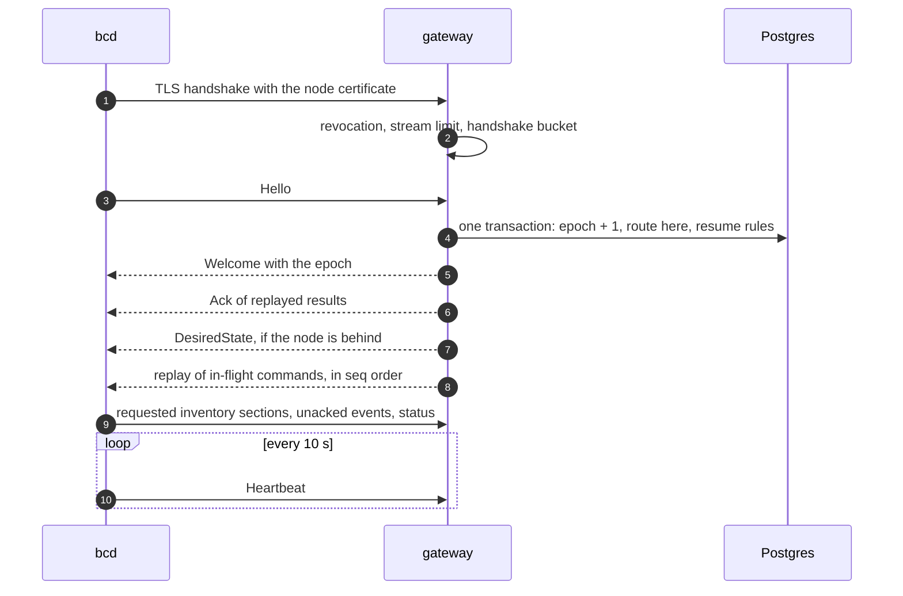

A <Term id="session">session</Term> is one daemon's long-lived `Session` stream to one gateway. At most one session
per node is live at a time, and every session has an epoch: a number that rises each time the node says `Hello`.
The epoch is what keeps a gateway that lost track of the world from routing work to a node it no longer holds.

This page follows a session from open to close. The frames themselves are listed in
[protocol](/docs/daemon/protocol#frames), and every field of every message is in the generated
[protocol reference](/docs/reference/protocol).



## Opening

Before any frame, the gateway admits the stream. It refuses with `UNAVAILABLE` while it is not started, holds no
lease or is draining, and with `RESOURCE_EXHAUSTED` when it holds `maxStreams` sessions (default 5,000) or the
handshake token bucket (200 per second, shared with `Join`) is empty. A certificate whose serial is in the
revocation set is refused `UNAUTHENTICATED`. The daemon retries a refusal with jittered back-off, unless the refusal
says when to come back.

A busy refusal carries a retry pushback, the standard gRPC trailer `grpc-retry-pushback-ms` (in the trailers-only
status or the trailing one), jittered so refused daemons never return in step:

| Refusal | Pushback |
| --- | --- |
| Handshake bucket empty (`Session` or `Join`) | Between 250 ms and the time the bucket needs to admit everyone refused this second (refusals / rate, at least 1 s), so a power-on herd spreads over exactly that window |
| More than `maxPendingHellos` Hellos in flight | 250 ms to 2 s: a Hello transaction takes milliseconds |
| At `maxStreams` | 5 to 30 s, or another gateway sooner |

bcd waits exactly the pushback (`transport.Pushback`: capped at 15 minutes; a missing, malformed or negative value is
ignored, since bcd always retries) instead of its own doubling, and the doubling then starts over; a refused `Join`
uses it as its next delay. The FakeDaemon follows it the same way. Before this, a 10,000-node power-on herd's connect
tail was each daemon's own back-off after repeated bucket refusals, 65 s in the simulator.

The first frame must be `Hello`; anything else closes the stream `INVALID_ARGUMENT`. The gateway checks:

- `Hello.node_id` equals the node id of the certificate's SPIFFE SAN (`PERMISSION_DENIED` otherwise);
- `role` is set and, when the certificate carries a role, matches it (`PERMISSION_DENIED`);
- `boot_id` and `journal_id` are set (`INVALID_ARGUMENT`).

At most 64 Hello transactions run at once per gateway (`maxPendingHellos`); the next one is refused
`RESOURCE_EXHAUSTED`. The bound exists because in a reconnect storm the handshake bucket admits Hellos faster than a
slow database commits them, and an unbounded queue once starved the gateway's own lease renewal until it fenced
itself (see `bench/gateway-streams`).

### Hello

[`Hello`](/docs/reference/protocol#hello) is kept small for reconnect storms: inventory travels as hashes, not
content.

| Field | Meaning |
| --- | --- |
| `node_id`, `role` | Who is speaking; checked against the certificate |
| `boot_id` | The kernel boot id, which changes on every boot |
| `journal_id` | The journal's id, which changes when the journal is lost |
| `daemon_version`, `proto_min`, `proto_max`, `capabilities`, `drivers` | Versions and what the daemon offers; each driver becomes the node label `bc.dev/driver.<id>=<version>`, and each kind it serves `bc.dev/driver-kind.<id>.<kind>=1` (14ceb1e) |
| `last_epoch` | The last epoch the daemon saw; diagnostics only |
| `applied_generation`, `applied_spec_hash` | The newest desired state it holds, and that spec's hash |
| `unacked_results` | Terminal command results the control plane has not acknowledged |
| `running_command_ids` | Commands this daemon process still has accepted or running |
| `last_event_seq` | The highest event sequence written in this journal |
| `inventory_hashes` | Inventory section name to the SHA-256 of its content |
| `trust_version` | The version of the command-signing trust bundle the daemon holds and verifies with (0 for none) |
| `approver_set_epoch`, `approver_set_sha256` | The approver set the daemon enforces: its epoch and the SHA-256 of its canonical fields, empty without approver keys (fields 18 and 19; 856c00c). A daemon can take a bundle's version while refusing its quorum part, so `trust_version` alone does not say which approvers it enforces |

bcd builds it from the journal (the rules of `session.NewHello`): done results not yet acked, and entries of the
current daemon process that are not done. After a daemon restart the process is new, so `running_command_ids` is
empty and the crash rules below apply instead.

`capabilities` are free-form names the daemon claims for itself. The gateway writes them, as sent in each `Hello`,
to `node_sessions.capabilities` (migration `core/0024_session_capabilities`): only names matching
`[a-z0-9][a-z0-9._-]{0,63}`, de-duplicated, sorted, at most 64. A daemon that stops advertising a capability loses it
at its next session. The API reads the column to refuse what the connected daemon cannot do safely:

| Capability | Checked by | Means |
| --- | --- | --- |
| `tunnel.instance-dial` | `tunnels.open` | The daemon dials an instance's own address for instance `ssh` and `tcp` tunnels. Without it those tunnels are `UNSUPPORTED` with details `{ reason: 'daemon-capability', capability }`; `exec` and node consoles are not affected |

On a node with GPUs, bcd advertises the capabilities `cdi` and `nvml` and the driver `nvidia`, and a node agent
lists each built-in instance runtime it runs as a driver of kind `runtime` (`libvirt-kvm`: on a host build with
`virsh`, the libvirt runtime of 362317c, and on a fakehw build its file-backed runtime; `cloud-hypervisor`: on a host
build with the `cloud-hypervisor` binary, 2598f0a); a runtime a bcx plugin serves
is listed once, through its plugin's manifest. A node agent that runs an instance runtime also advertises
`tunnel.instance-dial`, because it then dials an instance ticket to the instance's own address, never the host's (see
[tunnels](/docs/guides/access/tunnels#the-node-half)); a host without a runtime does not. The FakeDaemon
advertises it when its tunnels are configured.

### The Hello transaction

One transaction, fenced by the gateway's lease, does everything the reconnect proves:

1. **Certificate.** When the certificate serial is recorded in `node_certs`, a revoked certificate, or one from an
   older identity generation of the node, is refused `UNAUTHENTICATED`. Its `allowed_kinds` restrict what this
   session may receive.
2. **Previous session.** The node's `node_sessions` row is locked. A node without a row has not joined
   (`PERMISSION_DENIED`).
3. **Epoch bump and routing.**

   ```sql
   UPDATE node_sessions SET gateway_id = $gw, session_id = $s, session_epoch = session_epoch + 1,
     boot_id = $boot, journal_id = $journal, role = $role, daemon_version = $v, proto_max = $max,
     trust_version = $trust, capabilities = $caps,
     approver_set_epoch = $setEpoch, approver_set_sha256 = $setSha256,
     acked_event_seq = CASE WHEN journal_id IS DISTINCT FROM $journal THEN 0 ELSE acked_event_seq END,
     connected_at = compute_now(), last_seen = compute_now(), disconnected_at = NULL
   WHERE node_id = $node
   RETURNING session_epoch, acked_event_seq
   ```

4. **Resume rules**, below: self-terminating commands, the lost journal, and the replayed results.
5. **Replay set.** Every `dispatched`, `acked` or `running` command of the node moves to the new epoch. Those in
   `running_command_ids` are not re-sent (they still hold lane credits on the daemon); the rest are re-sent, in
   `seq` order, with their delivery `attempt` raised.
6. **Connectivity.** The node becomes `connected`, and `node.connected` is published with the epoch, the boot id
   and the flags `journalChanged`, `bootChanged` and `duplicateIdentity`.
7. **Inventory.** The hashes are recorded, and the sections whose hash changed or was never seen become
   `Welcome.request_sections`.

If an older session of the same node is live on this gateway, it is closed `ABORTED` ("superseded by a newer
session") without a disconnect write: its row already belongs to the new session.

### Welcome

The gateway's answer, [`Welcome`](/docs/reference/protocol#welcome):

| Field | Default | Meaning |
| --- | --- | --- |
| `epoch` | | `node_sessions.session_epoch` after the bump |
| `session_id`, `gateway_id` | | For logs and correlation |
| `protocol_version` | | The negotiated version |
| `heartbeat_interval_ms` | 10,000 | The heartbeat period |
| `lease_ttl_ms` | 40,000 | The node's liveness lease |
| `credits` | control 8, provision 4, bulk 2 | Commands the gateway keeps in flight per lane ([`LaneCredits`](/docs/reference/protocol#lanecredits)) |
| `acked_event_seq` | | Cumulative ack for `Hello.journal_id` (0 after a journal change) |
| `request_sections` | | Inventory sections to send now |
| `server_time` | | `compute_now()`; the daemon keeps the offset to its own clock |
| `trust` | | A newer command-signing trust bundle ([`SignedTrustBundle`](/docs/reference/protocol#signedtrustbundle) of a [`TrustBundle`](/docs/reference/protocol#trustbundle)), signed by the JoinService key |
| `upgrade_required` | false | The daemon is below the minimum protocol; only `daemon.upgrade` follows |
| `capabilities` | | What the gateway offers |

An upgrade-only session (`upgrade_required`) is still dispatched to, but only `daemon.upgrade`: `Hello` replays an
in-flight upgrade, the dispatch loop sends a pending one, every other command stays `pending` until the daemon
rejoins at a supported version, and no spec is sent. This is how a rollout reaches a daemon too old for the current
protocol (see [rollouts](/docs/guides/rollouts#daemonupgrade-for-restricted-sessions)).

Right after `Welcome`, the gateway sends an `Ack` for the replayed results it stored. Then, unless the session is
upgrade-only, a full `DesiredState` when the node's generation is above `applied_generation` (or the node has a
spec and the daemon reported no spec hash), then the replay. Commands the certificate may not run are cancelled
`kind-not-allowed` instead of replayed. A WebSocket session skips unsigned commands and withholds unsigned specs; with
`pki.commandSigning` the NodeSpec controller signs every generation, and the gateway relays the stored signed bytes
(`nodes.spec_body`, `nodes.spec_signature`) verbatim, so WebSocket daemons receive their specs. bcd refuses to dial a
WebSocket session at all without command-signing roots, renews its certificate over `POST /v1/renew` on the same
listener instead of the mTLS `Renew`, and opens no tunnels in that mode (see
[the WebSocket fallback](/docs/daemon/protocol#websocket-fallback-v04)).

The daemon applies `Welcome` (`session.ApplyWelcome`): it records the epoch as `last_epoch`, forgets events up to
`acked_event_seq`, keeps the clock offset, sets its lane credits, and sends the requested inventory sections, its
unacked events and its latest status. It evaluates every `not_after` in server time through that offset.

`server_time` is not signed, so the daemon never lets it move far backwards. The journal keeps a server time mark,
advanced at every `Welcome` and heartbeat; a `Welcome` whose `server_time` lies more than 5 minutes before the mark
ends the session ("server time went backwards"). Otherwise a gateway could set the daemon's clock back into an
expired worker certificate's window and replay old signed commands. bcd and the FakeDaemon both enforce it, and bcd
also keeps the mark in `identity.json` so that a lost journal does not reset it. A `Welcome` inside the 5-minute
allowance is accepted, but it never moves the daemon's working clock back: both take the latest of the `Welcome`'s
time, the stored mark and the clock the process already runs on. Otherwise a gateway could reconnect "a few minutes
earlier" and replay an expired command, or a tunnel ticket whose `jti` was already pruned; bcd also keeps spent
ticket ids 5 minutes past their expiry. A `trust` bundle is accepted only
when it verifies under the pinned join-signing key and its version is newer than the one held.

The daemon acknowledges a newly applied bundle in its next [`StatusReport`](/docs/reference/protocol#statusreport)
(`trust_version`), not at the next
reconnect. The gateway stores the `Hello` value in `node_sessions.trust_version` as is, even when it is lower than
before (a restored disk), and a status report only ever raises it; `pki rotate-command-root --stage switch` waits
until every connected node holds the new version (see [PKI](/docs/operations/pki)). Both daemons send the version in
`Hello`. The FakeDaemon repeats it in every status report; bcd sets it only in the first report it sends after
applying a newer bundle and leaves it 0 (unchanged) otherwise, which spares the gateway a `node_sessions` update per
report. Whenever a report carries `trust_version`, it also carries the held approver set (`StatusReport` fields 10
and 11; e171f0d, 5fe7cbf). The gateway writes the set to `node_sessions.approver_set_epoch` and
`approver_set_sha256` (fa39201): from `Hello` as reported, and from such a report only when its `trust_version` is at
least the recorded one, so a late, older report never pairs an old set with a newer version. An empty digest (no
approver keys held) is stored as NULL in both. Doctor's `pki.quorum-lag` and `pki trust-version` read the columns
(see [nodes that hold another set](/docs/operations/pki#changing-the-approver-set)).

## Epochs and fencing

The epoch splits writes into two kinds.

**Routing and liveness writes are fenced.** Marking a command dispatched, flushing `last_seen` and writing a
disconnect all carry `AND session_epoch = $myEpoch`. A gateway whose node has since said `Hello` elsewhere matches
no row: its liveness flush tells it the session is a zombie, and it closes the stream `ABORTED`. Dispatch locks the
node's session row `FOR SHARE` while it marks commands, so a dispatch and a concurrent `Hello` epoch bump
serialize instead of racing. As a backstop, every `Hello` replays all in-flight rows anyway.

**Facts are not fenced.** Results, events and status reports are true no matter which session carried them, so
they are accepted from any epoch. Results are deduplicated by command id through the command state table, events
by `(node_id, journal_id, seq)`, and `observed_generation` only moves forward. The daemon records the epoch but
never fences on it.

On top of the per-node epoch, every routing transaction first re-checks the gateway's own `gateway:<id>` lease; see
[the gateway](/docs/daemon/gateway#the-lease-and-fencing).

## Resume rules

`Hello` settles what the reconnect proves before anything is replayed.

| What changed since the previous Hello | Rule | Outcome |
| --- | --- | --- |
| `boot_id`, or the role | In-flight self-terminating commands (`node.reboot`, `boot.kexec`, `daemon.upgrade`) completed by the reboot or exec they caused | `succeeded`, reason `rebooted`; never replayed |
| `journal_id` (a previous one was recorded) | In-flight commands that are not retry-safe cannot be deduplicated any more | `failed`, reason `journal-lost`; never replayed |
| nothing, after a bcd self-update | A `daemon.upgrade` restarts the process without a reboot, so the daemon itself settles it from `upgrade.json` (de9f380) | `succeeded` from the new binary once welcomed, or `failed` with `update-failed` after a swap back |
| nothing | `unacked_results` are applied, then the rest is replayed | the journal deduplicates |

Both rules wake the owning controllers, which decide what to do next; a workflow step whose command failed
`journal-lost` is re-decided, not blindly retried. A journal is lost on a ramdisk reboot, a reinstall, or
corruption. The node's identity stays with its key, so the node reconnects as itself with a new `journal_id`, and
the event ack restarts at 0 for the new journal.

The daemon has its own half of these rules, applied at start and on every duplicate delivery; see
[the journal](/docs/daemon/delivery#the-journal).

### Duplicate identity

A second live `Hello` for a node from another `boot_id` wins: the newer session takes the row, `node.connected`
carries `duplicateIdentity: true`, and `security.node.duplicate-session` is published with `nodeId`, `gatewayId`,
`previousBootId`, `bootId`, `alternations`, `windowSeconds` and `quarantined`. `DuplicateIdentity` is an
inventory-owned condition. A prior session that already went quiet (outside the live window) is superseded without
counting.

The Hello transaction counts these alternations in `node_sessions.duplicate_hellos` and `duplicate_since`
(`core/0016`). When the same certificate alternates between machines more than 3 times within 10 minutes, the gateway
quarantines it:

1. the presented certificate's serial is revoked with `revocation_reason = 'duplicate-identity'` (every live
   certificate of the node when no serial was recorded, as on header-authenticated development gateways), so every
   gateway's revocation feed drops the other clone too;
2. `security.node.quarantined` is published with `nodeId`, `reason`, `alternations` and the revoked `serials`;
3. the clone connected to this gateway gets a revocation notice, and the `Hello` is refused `UNAUTHENTICATED`
   ("certificate quarantined: duplicate identity") once the revocation has committed.

The counter resets with the quarantine, so a re-joined machine starts afresh; re-join the real machine with a new
join token. The limits are `createGateway({ duplicateHellos: { max, windowMs } })` (defaults 3 and 10 minutes).

## Liveness

**Heartbeats.** The daemon sends [`Heartbeat`](/docs/reference/protocol#heartbeat) every `heartbeat_interval_ms`
(10 seconds) with its free credits per lane, its load ([`NodeLoad`](/docs/reference/protocol#nodeload): load average,
available memory, running commands, pending events) and its applied generation.
Every 10th heartbeat also carries the inventory hashes. The gateway sends an HTTP/2 PING every 20 seconds. Any frame
refreshes the session's last-seen time.

**Three missed heartbeats close the session.** The gateway's liveness loop runs every 5 seconds (half the
heartbeat interval, capped at the 15-second flush period) and closes any session silent for more than three
intervals, `UNAVAILABLE` with reason `heartbeat-timeout`. It also closes a session whose certificate has expired,
`UNAUTHENTICATED` with reason `certificate-expired`.

**No database write per heartbeat.** Last-seen times stay in memory. Every 15 seconds the gateway flushes them in one
statement, as ages rather than timestamps, so a gateway's clock skew cannot fake liveness:

```sql
UPDATE node_sessions s
   SET last_seen = compute_now() - make_interval(secs => v.age_ms / 1000.0)
  FROM unnest($ids, $ages, $epochs) AS v(id, age_ms, epoch)
 WHERE s.node_id = v.id AND s.session_epoch = v.epoch AND s.gateway_id = $gw
RETURNING s.node_id
```

A node missing from the result belongs to a newer session elsewhere, and its stream here is dropped.

**Transitions only.** The gateway writes `connected` at `Hello` and `disconnected` when a session closes. The
Liveness controller in the worker applies the transitions nobody reports:

| Transition | When | Effect |
| --- | --- | --- |
| `connected` to `disconnected` | The session's gateway lease expired (the gateway crashed or was partitioned) | Event `node.disconnected` |
| `disconnected` to `unreachable` | 40 s (the lease TTL) plus grace after the last sign of life | NoSchedule reason `unreachable`, condition `NodeUnreachable` |
| `unreachable` to `lost` | After the pool's `lostAfter`, only for `provider` and `vps-host` pools that set it | Never automatic for metal |

The grace is 120 seconds after a gateway loss, so sessions have time to move to another gateway, and 5 minutes after
the database or the Liveness controller itself was down for more than 20 seconds, so ages nobody could flush do not
read as dead nodes. None of these transitions releases anything: allocations, bookings and commands are untouched
(principle P6). See [disconnected is not dead](/docs/guides/concepts/consistency#disconnected-is-not-dead).

## Reconnecting

When a session closes for any reason, the daemon redials. Attempt `n` waits a uniformly random delay between 0 and
`min(60 s, 1 s x 2^n)` ("full jitter"), which spreads a reconnect storm across the window; a `Welcome` resets the
count. Go's `session.Backoff` and the FakeDaemon implement the same schedule.

| The session ends with | The daemon |
| --- | --- |
| [`Drain`](/docs/reference/protocol#drain)`{reconnect_after_ms, reason}` | Closes and redials after the given delay; rolling deploys send a random delay up to 60 s |
| [`RevocationNotice`](/docs/reference/protocol#revocationnotice)`{reason, serials}` | Stops using the certificate and does not redial with it |
| `RESOURCE_EXHAUSTED` | Retries after the `grpc-retry-pushback-ms` the gateway sent and restarts its doubling; without one, retries with jitter |
| `ABORTED`, `UNAVAILABLE`, a reset, a timeout | Redials with back-off; the load balancer may pick another gateway |

While disconnected the daemon keeps enforcing its last desired state, keeps journaling events, and never drops a
device assignment on its own. Everything it owes the control plane (results, events) is in the journal and goes
out after the next `Welcome`.

## BUSY

The gateway keeps at most `credits` commands in flight per node and lane, and the daemon accepts at most as many.
The two counters can disagree for a moment (a reconnect, a lost frame), so every heartbeat carries the daemon's free
credits and the gateway resynchronizes its counters from them.

When the daemon has no free credit on a command's lane, or its journal is full, it answers
`REJECTED` with reason `BUSY`. `BUSY` is not terminal and not journaled: the gateway puts the command back to
`pending` with `not_before` set by a back-off per command and session, 1 second doubling to 30 seconds, clears its
epoch, and pokes dispatch. Nothing is dropped. This is the daemon refusing a command; a gateway refusing a session
is the [retry pushback](#opening) above.

## Closing

A session that ends normally (the stream closes, a heartbeat timeout, an expired certificate, a revocation, a
protocol error, gateway shutdown) gets an epoch-fenced disconnect write:

```sql
UPDATE node_sessions SET gateway_id = NULL, disconnected_at = compute_now()
 WHERE node_id = $node AND session_epoch = $epoch AND gateway_id = $gw
```

The node becomes `disconnected`, `node.disconnected` is published with the reason, and the node's controller is
queued. In-flight commands stay as they are for the next session's replay. A superseded or fenced session skips the
write, because its row belongs to someone else.

## The node_sessions table

One row per node, inserted by JoinService with epoch 0 and owned by the gateways from then on.

| Column | Meaning |
| --- | --- |
| `node_id` | Primary key, references `nodes` |
| `gateway_id` | The gateway routing to the node; `NULL` while disconnected. Dispatch joins on it |
| `session_id` | The live session's id |
| `session_epoch` | Raised by every `Hello`; fences routing and liveness writes |
| `boot_id`, `journal_id`, `role` | As of the last `Hello`; compared by the resume rules |
| `acked_event_seq` | Cumulative event ack for `journal_id` |
| `last_seen` | Flushed from gateway ages every 15 s |
| `connected_at`, `disconnected_at` | Set by `Hello` and by the disconnect write |
| `daemon_version`, `proto_max` | From `Hello`; read by rollouts (migration `core/0008_session_versions`) |
| `duplicate_hellos`, `duplicate_since` | Duplicate-`Hello` count in the current window, for the quarantine (migration `core/0016_duplicate_identity`) |
| `trust_version` | The trust bundle version the daemon reported in `Hello` or a later `StatusReport`; read by the command-root switch (migration `core/0023_session_trust_version`) |
| `approver_set_epoch`, `approver_set_sha256` | The approver set the daemon reported enforcing (migration `core/0026_session_approver_set`: `numeric(20, 0)` with a check of at least 0, and `bytea`), written by `Hello` and by a `StatusReport` that acknowledges a trust bundle at least as new as the recorded one (fa39201); both NULL while the daemon holds no approver keys. Read by doctor's `pki.quorum-lag` and `pki trust-version`, which count a NULL digest as lagging while the published bundle has keys (08eb62e) |

Routing is always this join at dispatch time, never a column copied onto commands, so a reconnect needs no rewrite
and a command enqueued during a reconnect cannot be stranded. See [delivery](/docs/daemon/delivery).
