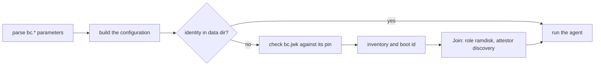

`bcd` has two modes for bare metal besides `bcd node`. **`bcd site`** is the <Term id="site-agent">site agent</Term>:
it drives BMCs, makes `site.httpProxy` requests for agentless machines, and, with a `[boot]` section, runs the site's
boot server (proxy DHCP, TFTP, iPXE scripts, the image cache). **`bcd ramdisk`** runs inside the PXE
<Term id="ramdisk">ramdisk</Term> that boot server boots: it joins from its kernel command line and runs the
commissioning and deploy kinds (wipe, image, kexec, diagnostics). Both are the same binary and the same agent core as
`bcd node` (session, journal, signed commands); only the kinds, the configuration and the extra servers differ.

This page is the daemon-side view: flags, `config.toml` keys, start-up checks, what each server answers, the exact
scripts and error codes. What the control plane does with all of it is in the bare-metal guide:
[sites and site agents](/docs/guides/bare-metal/sites) (the boot lease, discovery, the discovery attestor),
[BMC drivers and credentials](/docs/guides/bare-metal/bmc) (the operations metal sends, IPMI, sanboot) and
[deploying machines](/docs/guides/bare-metal/deploying#what-the-ramdisk-does) (what each ramdisk kind does to disks).

<Callout type="warn" title="Tested against fakes only">
No real site has run `bcd site`, and no real machine has booted `bcd ramdisk`. The Go tests drive both against fakes:
an `httptest` Redfish BMC, a scripted gateway session, real UDP and HTTP sockets on loopback, and fakehw disks that
are sparse files. The only real-system pieces are two Linux tests that build real ext4 images with `mkfs.ext4` and
write into and read out of them with `debugfs`. No test runs `bcd site` or `bcd ramdisk` against a control plane. The
metal test suite and the dev stack use a simulated site agent instead. See [what the tests cover](#what-the-tests-cover).
</Callout>

## The two modes

| | `bcd site` | `bcd ramdisk` |
| --- | --- | --- |
| Runs on | A machine next to the fleet, on the provisioning and BMC networks, one or two per site | The machine being commissioned or deployed, booted over PXE by the site agent |
| Configuration | `config.toml` (`--config`, default `/etc/bcd/config.toml`) | None: the `bc.*` kernel parameters (`--cmdline`, default `/proc/cmdline`) |
| Identity | Joined once with a site token (`bcd join --role site`), kept in `data_dir` | Joined on every boot with a single-use `discovery` token and the site agent's signed assertion, kept on tmpfs (`/run/bcd`) |
| Certificate | Role `site`, 24 hours, renewed | Role `ramdisk`, at most 2 hours, commissioning kinds only |
| Kinds | `bmc.*`, `site.httpProxy`, `boot.prepareRamdisk`, `boot.cleanUp`, plus shared kinds | `disk.wipe`, `deploy.image`, `boot.kexec`, `diag.dcgm`, plus shared kinds |
| Extra servers | Boot server (HTTP), proxy DHCP (UDP 67, 4011), TFTP | None |

Both reach the gateway outbound only, like every mode (see [outbound only](/docs/daemon#outbound-only)). They were
added in a302223 and 21a4647 (ramdisk) and 48cb975, 0c35daf and fc74ed9 (site).

## bcd site

### Flags and start-up

`bcd site` takes one flag:

| Flag | Default | Meaning |
| --- | --- | --- |
| `--config` | `/etc/bcd/config.toml` | The configuration file. `join-encryption.jwk` is read from the same directory |

It takes no positional arguments (exit 2). At start it checks, in this order:

| Check | On failure | Exit |
| --- | --- | --- |
| The configuration loads and validates (unknown keys and sections are errors) | `bcd site: <error>` | 1 |
| `data_dir` holds a joined identity | `bcd site: <error>` | 1 |
| The identity's role is `site` | `this data directory holds a <role> identity; join with a site token (bcd join --role site)` | 1 |
| With `[boot] listen`: `join-encryption.jwk` beside the config | `the boot server needs join-encryption.jwk: …` | 1 |
| With `proxy_dhcp = true` or a `tftp` address: `server_ip` is an IPv4 address and `url` is set | `proxy_dhcp and tftp need [boot] server_ip (IPv4) and url` | 2 |

Without `[boot] listen` it logs `no [boot] listen configured: this site agent does not serve PXE machines` and runs
the agent alone. With it, the boot server runs beside the agent. A boot server that fails later (no `kernel` or
`initrd`, a port it cannot bind) is logged as `boot server stopped` and does **not** stop `bcd site`: BMC work and
`site.httpProxy` go on. Watch for that log line.

Ports 67, 69 and 4011 are privileged. The unit the install script writes is for `bcd node` and has no
`CAP_NET_BIND_SERVICE`, so a site agent needs its own unit (see [installing a site agent](/docs/daemon/install#a-site-agent)).

### config.toml keys

`bcd site` reads the same file as `bcd node` (the format and the shared keys are on
[installing bcd](/docs/daemon/install#configtoml)). These are the keys that matter to a site agent:

| Key | Default | Used for |
| --- | --- | --- |
| `gateway_url`, `gateway_server_name`, `site`, the three `*_pin` keys | (required, except `gateway_server_name`) | The session, and copied into every ramdisk's `bc.gateway`, `bc.server_name`, `bc.site` and `bc.pins` |
| `data_dir` | `/var/lib/bcd` | Identity, journal, boot entries, BMC memory and the image cache (see [files](#files-in-data_dir)) |
| `[site] bmc_networks` | empty | Comma-separated CIDRs that `site.httpProxy` never reaches, whatever the control plane says. Invalid CIDRs fail validation. When set, the agent's Hello carries the capability `site.bmc-networks` (fc0ca6a), and `bcd doctor` warns about a site agent without it |
| `[boot] listen` | empty (no boot server) | The boot server's HTTP address, such as `0.0.0.0:8080` |
| `[boot] url` | empty | How machines reach the boot server, such as `http://10.20.0.2:8080`. iPXE chains to it, ramdisks get `<url>/cache` as `bc.cache`, and BMCs fetch firmware from it. Without it, firmware updates are refused |
| `[boot] kernel`, `[boot] initrd` | empty | URLs of the site's ramdisk kernel and initramfs, which iPXE fetches. Both are required for the boot server to start |
| `[boot] cmdline` | empty | Appended to every ramdisk's kernel command line (`console=ttyS0,115200`) |
| `[boot] server_ip` | empty | This agent's IPv4 address on the provisioning network: the proxy DHCP server id, the TFTP next-server |
| `[boot] proxy_dhcp` | `false` | Proxy DHCP on UDP `:67` and `:4011`, all interfaces |
| `[boot] tftp`, `[boot] tftp_root` | empty | The TFTP server's UDP address (`:69`) and the directory of iPXE builds it serves. `tftp_root` is also served over HTTP at `/boot/files/` for UEFI HTTP boot |
| `[boot] cache_max_bytes` | `0` (unbounded) | The image cache's byte budget |
| `[plugins] …` | none | Hosted bcx drivers, such as `bcx-ipmi` (see [IPMI through bcx-ipmi](/docs/guides/bare-metal/bmc#ipmi-through-bcx-ipmi)) |
| `[update] …`, `[websocket] …` | none | Self-update (`daemon.upgrade` runs on site agents too) and the WebSocket fallback, as on a node |

A complete site agent configuration is on [installing a site agent](/docs/daemon/install#a-site-agent).

### How it connects to the control plane

A site agent joins with a [site token](/docs/guides/bare-metal/sites#enroll-site-agents-with-site-tokens) and then
holds a [session](/docs/daemon/sessions) like any node: Hello and Welcome, heartbeats, the journal, signed commands.
Three things are specific to it:

- **Its Hello** lists the bcx drivers it hosts (their manifests), which become the `bc.dev/driver-kind.*` labels metal
  checks BMC operations against, and `site.bmc-networks` when `[site] bmc_networks` is set.
- **Its desired state** is the `site` section of its NodeSpec (`SiteSpec`): the boot lease state (`active`, `epoch`,
  `ttl_ms`), `cache_images` and `proxy_targets`. The site converger records the lease, checks the sanboot entries,
  evicts and warms the cache (below).
- **Its fence.** Every server frame updates the time it last heard from the gateway. The agent answers PXE machines
  only while the `site` section says it holds the lease at a non-zero epoch **and** it heard from the gateway within
  the lease TTL (15 seconds when the section gives none). A partitioned agent stops answering by itself. The lease
  itself is the control plane's; see [one active boot server per site](/docs/guides/bare-metal/sites#one-active-boot-server-per-site).

The site section's status:

| Condition | Status |
| --- | --- |
| A live boot entry sanboots a digest the section does not name as an `iso` cache image | Terminal failure: `sanboot image <sha256> of <mac> is not an iso cache image of the site` |
| A cache image without a 32-byte `sha256`, or whose download failed or did not match | Terminal failure naming the URL and the reason |
| Cache images still downloading | Retried: `<n> cache images warming` (the section stays `PROGRESSING`) |
| Otherwise | Converged |

### Kinds it runs

The kinds registered for role `site` (`siteKinds` and the shared table in `kinds.go`):

| Kind | Lane | Destructive | What bcd does |
| --- | --- | --- | --- |
| `bmc.query` | control | no | A read-only BMC operation |
| `bmc.boot` | control | yes | Boot device, virtual media, BIOS settings |
| `bmc.power` | control | yes | `power.setPower` |
| `bmc.rotate` | control | yes | `management.rotateCredential` |
| `bmc.firmware` | control | yes | `firmware.update` through the verified cache |
| `bmc.storage` | control | yes | `raid.applyLayout`, `raid.clear` |
| `site.httpProxy` | control | yes (0d42de8) | One HTTP request to an agentless machine of the site |
| `boot.prepareRamdisk` | control | no | Stores one boot entry (`ProxyDhcpEntry`) by MAC |
| `boot.cleanUp` | control | no | Drops the listed MACs, or every entry of a workflow |
| `inventory.refresh`, `logs.collect`, `driver.invoke`, `node.reboot`, `daemon.upgrade` | shared | as on a node | As on a node (`daemon.upgrade` only with `[update]` configured) |

A node refuses the site kinds, and a site agent refuses the ramdisk's. With command-signing roots in its trust
bundle, the agent refuses any command without a valid worker signature, and destructive kinds fall under the batch
quorum (see [signed commands](/docs/daemon/delivery#signed-commands-and-attested-results)). The table of kinds and
timeouts metal uses is on [how BMC operations run](/docs/guides/bare-metal/bmc#how-bmc-operations-run).

`boot.prepareRamdisk` refuses (`invalid-payload`) a MAC that does not parse and a `sanboot_sha256` that is neither
empty nor 32 bytes. Storing an entry also drops the MAC from the discovered list.

### The boot server

`ServeBoot` starts proxy DHCP and TFTP when configured, then one HTTP server with a 10-second header timeout and
8 KiB of headers (0442561). Its routes:

| Route | Answers | Gated by |
| --- | --- | --- |
| `GET /boot/chain.ipxe` | `chain <url>/boot/ipxe?mac=${net0/mac}&uuid=${uuid}&ip=${net0/ip}&buildarch=${buildarch}&platform=${platform}` | Nothing: it holds no secret |
| `GET /boot/ipxe?mac=&uuid=&ip=` | The machine's script (below) | The lease, then a live boot entry |
| `GET /boot/files/<file>` | The iPXE builds in `tftp_root`, for UEFI HTTP boot (only when `tftp_root` is set) | Nothing: it serves only `tftp_root` |
| `GET /cache/t/<grant>/<sha256>` | A cached image | A live grant; a boot grant also needs the lease (503 otherwise). Any other `/cache/` path is 404 (b7ed8a2) |

`/boot/ipxe` answers one of these scripts, all `text/plain`:

| Case | Status | Script |
| --- | --- | --- |
| Not the active boot server | 503 | `echo This boot server does not hold the site boot lease.`, `sleep 10`, `reboot` |
| No live boot entry for the MAC | 404 | `echo No boot is prepared for this machine.`, `exit` (the firmware falls through to its next boot device). A well-formed MAC is listed as discovered |
| Discovery token not available yet | 503 | `echo The boot credential is not available yet.`, `sleep 10`, `chain ${self}` |
| Sanboot entry, image not cached or not an `iso` cache image | 503 | `echo The installer image is not on this boot server yet.`, `sleep 30`, `chain ${self}` |
| Sanboot entry, image ready | 200 | `sanboot --no-describe <url>/cache/t/<grant>/<sha256>` |
| Ramdisk entry | 200 | `kernel <kernel> initrd=initrd <bc.* parameters> <cmdline>`, `initrd --name initrd <initrd>`, `boot` |

For a ramdisk entry the agent fetches the discovery token with a `SecretRequest` bound to the entry's workflow, once
per token reference (a second fetch in the same boot reuses it), then signs a fresh `DiscoveryAssertion` with its node
key under purpose `discovery-assertion`. The assertion's `not_after` is 15 minutes out, or the entry's `not_after` if
that is sooner; its IP is the `ip` query parameter, else the connection's address; its product UUID the `uuid`
parameter, else the entry's. When `[boot] url` is set, `bc.cache` becomes `<url>/cache/t/<grant>`, a grant that lasts
until the entry lapses (6 hours for an entry without `not_after`). The fields and how the control plane checks them
are on [the discovery attestor](/docs/guides/bare-metal/sites#the-discovery-attestor).

### Proxy DHCP

`daemon/internal/pxe` answers beside the site's own DHCP server and never hands out an address (`yiaddr` stays 0):

- It reads requests of type DISCOVER (answered with OFFER) and REQUEST (answered with ACK), and only from clients
  whose vendor class (option 60) starts with `PXEClient` or `HTTPClient`. Everything else is ignored.
- From the request it takes the MAC (`chaddr`), the client architecture (option 93), whether the client is iPXE
  (user class, option 77, contains `iPXE`), the SMBIOS UUID (option 97, 17 bytes with type 0) and the relay (`giaddr`).
- An answer carries the server id (option 54, `server_ip`), the vendor class (`HTTPClient` for HTTP boot clients,
  else `PXEClient` with PXE discovery control 8 in option 43, so the firmware boots the named file with no menu),
  option 66 and `siaddr` when there is a TFTP next-server, and the boot file in option 67 (and in the BOOTP file field
  when it is under 128 bytes).
- A client without an address and without a relay is answered on broadcast `255.255.255.255:68`; a relayed one at
  the address it came from.

Which file a client gets:

| Client | Option 93 | Answer |
| --- | --- | --- |
| iPXE (any architecture) | any | `<url>/boot/chain.ipxe` |
| BIOS PXE | 0 | `undionly.kpxe` from TFTP at `server_ip` |
| x86-64 UEFI PXE | 7, 9 | `ipxe.efi` from TFTP |
| arm64 UEFI PXE | 11 | `ipxe-arm64.efi` from TFTP |
| x86-64 UEFI HTTP boot | 16 | `<url>/boot/files/ipxe.efi` |
| arm64 UEFI HTTP boot | 19 | `<url>/boot/files/ipxe-arm64.efi` |
| Any other architecture | | No answer |

Before any of this, the agent must be the active boot server and the MAC must have a live boot entry. Otherwise the
request goes unanswered, and a MAC without an entry is listed as discovered.

The TFTP server is read-only (a write request gets error 4), octet mode only, with `blksize` (capped at 1,468 bytes so
a block fits a 1,500-byte MTU) and `tsize` negotiation. It retransmits each block up to 5 times, 2 seconds apart, from
one ephemeral socket per transfer. A name that resolves outside `tftp_root` is "file not found". It runs at most 64
transfers at once and 4 per source address, and drops a request beyond either bound unanswered (4d8b493).

You supply the iPXE builds and the ramdisk kernel and initramfs: the repository builds neither.

### Discovery

While it holds the lease, the agent lists every PXE request, and every `/boot/ipxe` fetch with a well-formed MAC, from
a MAC without a live entry in `StatusReport.discovered` (0056e1e). It keeps at most 256 machines, forgets each a day
after it was last seen, takes a UUID only in canonical form and an architecture only as `[a-z0-9_-]{1,32}` (0442561),
and asks for a status report for a new machine at most once every 30 seconds. With proxy DHCP on, an HTTP fetch counts
only for a MAC DHCP already showed. iPXE fetches report the architecture as `${buildarch}-${platform}` (`x86_64-efi`);
DHCP requests as `bios`, `x86_64-efi`, `arm64-efi`, `x86_64-efi-http`, `arm64-efi-http` or `arch-<n>`. What the
control plane does with the list is on [discovering new machines](/docs/guides/bare-metal/sites#discovering-new-machines).

### The image cache

The cache lives in `data_dir/cache` (60afcc7). Each image is a file named by its SHA-256 in hex with a `.json`
sidecar holding the URL it was pulled from and its last use:

- **Pulling.** Every `cache_images` entry not yet cached is downloaded in the background into a `.pull-*` temporary
  file, hashed on the way, and renamed into place only when the digest matches. Only `http://` and `https://` URLs
  are pulled.
- **Serving.** Only under a grant (b7ed8a2): a boot grant serves any cached image until the boot entry lapses and only
  while the agent holds the lease; a firmware grant serves one digest for 2 hours. Grants are 128-bit random tokens
  held in memory, so a restart invalidates them. Serving updates the last-use time at most once an hour.
- **Evicting** (2091cdc). With `cache_max_bytes` set, each converge pass deletes least recently used images until the
  cache fits, skipping every digest the `site` section still names.
- **Reporting** (4735600). The inventory's `images` section lists ready and pulling images (at most 1,000, the most
  recently used), the bytes used and the budget. The control plane turns it into the site's `image_locations`.

### BMC operations

For each `bmc.*` command the agent:

1. Decodes the `BmcOperationRequest` and refuses (`invalid-payload`, the command fails) an operation outside its
   kind's allowlist (944221c). The allowlist is on [Redfish in bcd site](/docs/guides/bare-metal/bmc#redfish-in-bcd-site).
2. Picks the driver: built-in Redfish for `redfish` or no driver; otherwise a hosted bcx driver with that id that
   lists the operation's concern (51806ab), or `unsupported-driver`.
3. Refuses driver options on Redfish (`invalid-config`, 7753df0).
4. Fetches the credential with a `SecretRequest` bound to the command's workflow step, as `{ username, password }`
   JSON or a bare password paired with the step's `username` argument. A rotation fetches the new password the same
   way, by `newCredentialRef`.
5. For `firmware.update`, pulls the image into the verified cache and hands the BMC a firmware grant URL instead of the
   source (`image-unverified` without `[boot] url` or a valid digest).
6. Remembers the BMC host, and every address its name resolves to, in `data_dir/bmc-hosts.json` (da474d0).
7. Runs the operation. A hosted driver gets the address, pin and options as config and the credentials as secrets,
   never in its arguments.

A BMC that refuses or fails does not fail the command: it succeeds with `ok: false` and a code. Only a malformed
payload fails the command itself.

| `error_code` | Raised when |
| --- | --- |
| `unreachable` | The connection failed, timed out (60 s) or the certificate did not match the pinned SPKI |
| `auth-failed` | The BMC answered 401 or 403 |
| `unsupported` | 404 or 405, an empty collection, no CD virtual media, no RAID controller, no such account, or an operation the client does not have |
| `bmc-error` | Any other status of 300 or more (with the first Redfish extended message), an answer that is not JSON, a resource path outside `/redfish/v1`, or a plugin failure without its own code |
| `invalid-args` | A power action or boot device it does not know, a missing image URL, password, component or settings, a BIOS attribute the BIOS lacks or with the wrong type, a RAID level other than 0, 1, 5, 6 or 10, a member disk not on the controller |
| `invalid-address` | Not `https://`, `redfish://` or a bare host, credentials, a query or a fragment in the address, a path other than `/redfish/v1/Systems/<id>` |
| `invalid-config` | Driver options on a Redfish BMC |
| `credentials-unavailable` | The credential or new password could not be fetched |
| `unsupported-driver` | No hosted driver with that id serves the concern |
| `image-unverified` | `firmware.update` without a boot server URL, without a hex SHA-256, or whose download did not match |

A hosted driver's own codes (such as `bcx-ipmi`'s `pin-unsupported`) pass through as they are.

The Redfish client (`daemon/internal/redfish`) uses TLS 1.2 or later, never an environment proxy, never follows a
redirect, and reads at most 4 MiB of an answer. Power actions map to `ResetType` values:

| `action` | `ResetType` |
| --- | --- |
| `on` | `On` |
| `off` | `ForceOff` |
| `graceful-off` | `GracefulShutdown` |
| `reset` | `ForceRestart` |
| `graceful-restart` | `GracefulRestart` |
| `cycle` | `PowerCycle` |
| `nmi` | `Nmi` |

`power.getPower` reports `on` for `On` and `PoweringOff`, `off` for `Off` and `PoweringOn`, and `unknown` otherwise.
`management.rotateCredential` patches the account, then lists `/redfish/v1/Systems` with the new password and answers
`{ verified }`. The per-operation Redfish requests are on
[Redfish in bcd site](/docs/guides/bare-metal/bmc#redfish-in-bcd-site).

### site.httpProxy

`site.httpProxy` makes one request on the control plane's behalf to an agentless machine of the site. Whatever the
command says, the agent enforces (0d42de8, a2a853d, 808379f, da474d0):

- an `http` or `https` URL without credentials; `GET`, `POST`, `PUT` or `DELETE` (an empty method is `GET`);
- no path that cleans to `/redfish…`, and no host that is a remembered BMC or inside `[site] bmc_networks`, by name or
  by any resolved address;
- every resolved address private, CGNAT `100.64.0.0/10` or unique-local, never loopback, link-local, multicast,
  unspecified or public; the connection goes to the first checked address, with no second lookup;
- the host is one of `target_node_id`'s addresses in `SiteSpec.proxy_targets` (an IP literal by value, a name by a
  listed name or by resolving only to listed addresses); with no listed target, nothing is allowed;
- a timeout of at most a minute (30 seconds when unset or out of range), a 10-second connect timeout, no redirects, the
  pinned SPKI when given, secret headers fetched with a `SecretRequest`;
- the response body cut at 1 MiB with `truncated` set, its headers sorted by name.

| Error code | Raised when |
| --- | --- |
| `forbidden-target` | Any rule above but the lookup and the connection |
| `unreachable` | The host does not resolve, or the request fails |
| `credentials-unavailable` | A secret header could not be fetched |
| `invalid-payload` | The request cannot be built |

What metal checks before it sends one is on
[deploying machines](/docs/guides/bare-metal/deploying#what-sitehttpproxy-allows).

### Files in data_dir

| Path | Holds |
| --- | --- |
| `identity.json`, the node key, the journal | As on a node |
| `boot-entries.json` | The boot entries by MAC (protobuf JSON, mode 0600), so a restart keeps answering; lapsed entries are dropped |
| `bmc-hosts.json` | Every BMC host and address this agent has driven (mode 0600); `site.httpProxy` refuses them |
| `cache/<sha256>`, `cache/<sha256>.json` | Verified images and their sidecars |

## bcd ramdisk

### Flags and boot parameters

`bcd ramdisk` is not installed on a host; it is the agent in the ramdisk image the site agent boots. Its flags:

| Flag | Default | Meaning |
| --- | --- | --- |
| `--cmdline` | `/proc/cmdline` | Where to read the `bc.*` boot parameters |
| `--data-dir` | `/run/bcd` | Key, identity and journal, on tmpfs: every boot is a new identity and a new journal |

The boot parameters are the contract between the two modes (`daemon/internal/bootparams`). The site agent renders
them in this order; the ramdisk ignores every argument that does not start with `bc.`:

| Parameter | Value | Missing or malformed |
| --- | --- | --- |
| `bc.gateway` | The gateway URL, `https://` (`http://` only in fakehw builds) | `bc.gateway must be the gateway URL` |
| `bc.server_name` | Optional: the name the gateway certificate carries | |
| `bc.cache` | Optional: the site cache under this boot's grant | |
| `bc.site` | The site id | `bc.site is missing` |
| `bc.pins` | Serving CA, join signing and join encryption pins, comma-separated | `bc.pins needs three pins`, `bc.pins is missing` |
| `bc.jwk` | The JoinService encryption key's public JWK, base64url without padding | `bc.jwk is missing`, or a decode error |
| `bc.token` | The machine's single-use, MAC-bound `discovery` join token | `bc.token is missing` |
| `bc.assertion` | The site agent's `SignedDiscoveryAssertion`, base64url | `bc.assertion is missing`, or a decode error |

The token is readable in `/proc/cmdline` by anything on the ramdisk, which runs nothing but bcd. It is single-use,
bound to the MAC, and support bundles redact it.

### Start-up and join



1. It reads and parses the command line. A missing parameter exits 2 (`TestRamdiskNeedsBootParameters`).
2. It builds the configuration from the parameters: gateway, server name, site, pins, `data_dir`, a socket at
   `<data-dir>/bcd.sock`, `bc.cache` as the image cache, JSON logs. An `http://` gateway is refused (exit 2) unless
   the binary is a fakehw build, which then speaks cleartext HTTP/2.
3. Without an identity in the data directory it joins: it decodes `bc.jwk` and checks it against the join encryption
   pin (exit 1 on a mismatch), collects the inventory (it joins without hardware claims if that fails, with a
   warning) and the boot id, and calls Join with role `ramdisk`, attestor `discovery`, the token and the assertion
   as the attestation. A failed join exits 1. With an identity already there (bcd restarted within the same boot),
   it skips the join.
4. It runs the agent until the machine kexecs into its installed OS or is powered off.

The control plane's checks on that join are on [the discovery attestor](/docs/guides/bare-metal/sites#the-discovery-attestor)
and [attestation](/docs/guides/nodes/attestation#discovery).

### The join configuration it installs

Before running, the ramdisk prepares the files a deploy writes into the installed OS (797915d): the same
configuration with `data_dir` reset to `/var/lib/bcd`, rendered as a `config.toml`, and `bc.jwk` as
`join-encryption.jwk`. For a ramdisk booted with `bc.server_name`, the installed file reads:

```toml title="/etc/bcd/config.toml (written by deploy.image)"
# Written by bcd (PLAN.md §3.5, §6 Install).
gateway_url = "https://gw.eu.example.com"
gateway_server_name = "gw.internal"
site = "site_01k5w..."
serving_ca_spki_pin = "sha256/..."
join_signing_key_pin = "sha256/..."
join_encryption_key_pin = "sha256/..."
```

So the installed OS's `bcd join` needs nothing more from its user data than the provisioned token.

### Kinds it runs

| Kind | Lane | Flags | What bcd does |
| --- | --- | --- | --- |
| `disk.wipe` | provision | destructive | Wipes the listed disks (by WWN or serial) or every non-removable one, and verifies |
| `deploy.image` | provision | destructive | Streams a verified image onto the root disk, then user data and the join configuration |
| `boot.kexec` | control | self-terminating | Boots the installed OS without POST |
| `diag.dcgm` | provision | | `dcgmi diag -r <level> -j`; from level 2, refuses GPUs held by a workload |
| `inventory.refresh`, `diag.nvml`, `logs.collect`, `driver.invoke` | shared | | As on a node |

What each does to the disks, step by step, is on [what the ramdisk does](/docs/guides/bare-metal/deploying#what-the-ramdisk-does).
The daemon-side details:

- **Wipe.** `quick` (the default) zeroes the first and last MiB of each disk and reads them back. The other modes use
  `nvme format --ses=1 --force` (or `--ses=2` for crypto erase) for NVMe, `hdparm` security erase for SATA, else `blkdiscard --secure`.
  Every disk is attempted; if any is not verified, the command fails with reason `wipe-unverified` and the result still
  lists every disk's method and outcome. Metal sends it attested, so the result is node-signed.
- **Root disk.** The hint's first non-empty field wins (`wwn`, `serial`, `device`); otherwise the smallest
  non-removable disk of at least 4 GiB (or the hint's `min_size_bytes`, if larger).
- **Image stream.** The ramdisk asks the site cache first, `GET <bc.cache>/<sha256>`, and falls back to the image's
  source URL on any error or non-200. The SHA-256 covers the stored bytes (before gzip or zstd), and after
  decompression the rest of the stream is drained so the hash covers all of it. Data goes straight to the device in
  4 MiB buffers. A copy error, a failed sync or a digest mismatch zeroes the disk's ends again, so nothing bootable is
  left. Then the kernel rereads the partition table (`blockdev --rereadpt`, `udevadm settle`).
- **User data and join files.** User data is fetched with a `SecretRequest` bound to the step and written as a
  cloud-init NoCloud seed or Ignition's `config.ign`. ext filesystems are written in userspace with `debugfs` and FAT
  with `mtools` (1ae1789, d9a900f); only xfs and btrfs fall back to a `nodev,nosuid` mount, written through `os.Root`
  with exclusive creates.
- **kexec.** It journals the command as running with the boot id before it acts, then loads the kernel and initrd
  (the given paths, `/boot/vmlinuz` and `/boot/initrd.img`, or the newest `vmlinuz-*` and its initrd), copied out of
  an ext root with `debugfs` or from a read-only mount, with `root=UUID=<root> ro` plus the requested arguments, and
  runs `systemctl kexec`, falling back to `kexec -e`. It completes when the installed OS rejoins.

| Error code | Kind | Raised when |
| --- | --- | --- |
| `inventory-failed` | all four | The disk or GPU inventory could not be collected |
| `disk-missing` | `disk.wipe`, `deploy.image`, `boot.kexec` | A listed disk is absent, no disk to wipe, or no disk matches the root hint |
| `wipe-unverified` (reason) | `disk.wipe` | A disk was not wiped and verified |
| `unsupported-format` | `deploy.image` | A qcow2 image |
| `download-failed` | `deploy.image` | The image could not be fetched, or its gzip or zstd header is bad |
| `disk-write-failed` | `deploy.image` | Opening, writing or syncing the device failed |
| `checksum-mismatch` | `deploy.image` | The stored bytes do not match the pinned SHA-256 |
| `disk-too-small` | `deploy.image` | More bytes were written than the disk holds |
| `user-data-unavailable` | `deploy.image` | The user data secret could not be fetched |
| `user-data-failed` | `deploy.image` | Writing the user data or the join configuration failed |
| `kexec-failed` | `boot.kexec` | Loading or executing the kernel failed |
| `dcgm-failed` | `diag.dcgm` | `dcgmi` produced no output or unparseable JSON |
| `invalid-payload` | all | A malformed request: a non-http(s) image URL, a digest that is not 32 bytes, a DCGM level above 4 |

The ramdisk image needs `bcd` and the tools these call; the list is on [installing the ramdisk](/docs/daemon/install#the-ramdisk).

## What the tests cover

| Test | Checks |
| --- | --- |
| `internal/pxe` `TestProxyDHCPAnswersPreparedMachines` | Over real UDP on loopback: firmware gets `ipxe.efi`, iPXE gets the chain URL, the UUID and architecture are parsed, an unprepared MAC gets no answer |
| `internal/pxe` `TestTFTPServesFilesUnderItsRoot`, `TestTFTPBoundsItsTransfers` | A 3,000-byte file with `blksize` and `tsize` over real UDP; path traversal and write requests refused; the 64 and 4 transfer bounds |
| `internal/redfish` `TestRedfishOperations`, `TestRedfishAddressNamesTheSystem`, `TestRedfishRefusesForeignResourcePaths`, `TestBiosRaidAndFirmware` | Against an `httptest` TLS Redfish service: power, boot device, virtual media, inspection, rotation and the old password failing, the SPKI pin, plain HTTP refused, a multi-system service, BMC paths kept on the BMC, BIOS typing, RAID layouts and SimpleUpdate |
| `internal/bootparams` `TestRenderParseRoundTrip` | Render and parse round-trip; missing parameters and a wrong pin count refused |
| `internal/agent` `TestBootServerRendersARamdiskScript` | A real agent with a scripted session: 503 without the lease, 404 for an unknown MAC, the token fetched once for the workflow, the script parsed back by `bootparams`, the assertion verified against the agent's key at epoch 7, the PXE answers, and the fence after a minute without the gateway |
| `internal/agent` `TestSiteBMCAndBootEntries`, `TestBMCOperationsKeepToTheirKind`, `TestBMCThroughAHostedDriver`, `TestParseCredentialForms` | `unreachable` and `unsupported-driver` as `ok: false`, entries persisted, lapsed and cleaned up, site kinds refused on a node, operations outside their kind, firmware only through the verified cache, a hosted driver getting credentials as secrets, `invalid-config` |
| `internal/agent` `TestProxyTargetAllowed`, `TestHTTPProxyRefusesTargetsOutsideTheSite` | Proxy targets by IP and name; loopback, metadata, public and non-HTTP targets, remembered BMCs, `/redfish` paths and `bmc_networks` refused |
| `internal/agent` `TestDiscoveryListIsCappedAndForgets`, `TestUnknownMachinesAreListedAndSanbootBootsTheCachedISO` | The 256 cap and 24-hour expiry; an unknown machine listed in the status report; a sanboot served under its grant; an uncached sanboot answered 503 and failing the site |
| `internal/agent` `TestSiteCacheWarmsAndServes`, `TestDeployImageFromTheSiteCache`, `TestCacheEvictsLeastRecentlyUsedOutsideTheKeepSet` | Warming and the `images` section, a ramdisk deploying from the cache, LRU eviction outside the keep set |
| `internal/agent` `TestDiskWipeQuickVerifies`, `TestDeployImageStreamsAndChecksTheDigest`, `TestPickRootDiskAndDCGM`, `TestPartitionsAndBootFiles` | On fakehw sparse disk files: a node-signed quick wipe, `disk-missing`, a gzip image streamed with user data, `checksum-mismatch` leaving zeroed ends, root disk choice, DCGM parsing, `lsblk` parsing and kernel lookup |
| `internal/agent` `TestExtWriteInUserspace`, `TestExtBootFilesInUserspace` (Linux) | Real ext4 images built with `mkfs.ext4`: a planted symlink replaced, files root-owned 0600, bad paths refused, symlinks resolved inside the image, loops and escapes refused. Skipped without `mkfs.ext4` or `debugfs` |
| `internal/agent` `TestWriteInRootStaysInTheImage`, `TestWriteInRootReplacesSpecialFiles` | The mount fallback never writes outside the mounted root or through a special file |
| `cmd/bcd` `TestRamdiskNeedsBootParameters` | `bcd ramdisk` exits 2 naming `bc.gateway` on a command line without parameters |

Under a fake root, `SecureErase` zeroes the file, `RunDCGM` passes every GPU and `Kexec` reboots the fake host, so the
secure-erase tools, `dcgmi` and `kexec` have not run from bcd. No test has started `bcd site` as a process, joined a
site agent or a ramdisk to a real gateway, answered a real PXE ROM, or talked to a real BMC.

<Cards>
  <Card title="Sites and site agents" href="/docs/guides/bare-metal/sites">Boot leases, the boot server, discovery and the discovery attestor.</Card>
  <Card title="BMC drivers and credentials" href="/docs/guides/bare-metal/bmc">The operations metal sends, IPMI and sanboot.</Card>
  <Card title="Deploying machines" href="/docs/guides/bare-metal/deploying">Walkthroughs, and what the ramdisk does to disks.</Card>
  <Card title="Installing bcd" href="/docs/daemon/install#site-agents-and-the-ramdisk">Setting up a site agent and the ramdisk image.</Card>
  <Card title="Delivery" href="/docs/daemon/delivery">Commands, lanes, signatures and the journal.</Card>
</Cards>
