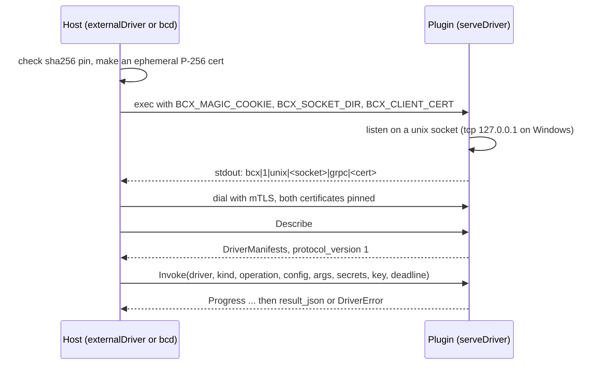

import { Power, Layers, Workflow } from '@/lib/icons';

A <Term id="driver">driver</Term> is the code that does one hardware job for a machine: read and set its power
through the <Term id="bmc">BMC</Term>, pick its boot device, write an image to its disk, or run its VMs. Each job is a
driver **kind** (Ironic calls it an interface), and one driver may implement several kinds together, which is what
Ironic calls a hardware type: a `redfish` driver serves `power`, `management` and `virtual-media` for the same BMC.

Code registers drivers; data selects them. A driver is a `defineDriver()` declaration. Which driver a machine uses for
each kind is data: a binding on the node, inherited from its pool's hardware profile.

<Callout type="warn" title="What runs today">
- **Declarations work.** `defineDriver`, the driver kinds, `drivers.list`, hardware profiles and per-node bindings are
  implemented and tested.
- **The built-in drivers run in bcd, partly.** They live inside `bcd site` and `bcd ramdisk`, the Go daemon's v0.2
  modes, which are written but not released. Redfish (with BIOS settings, RAID layouts and firmware updates), PXE
  and iPXE, image streaming and kexec are there. IPMI power, boot device and inspection run in `bcx-ipmi`, a bcx plugin the
  site agent hosts (51806ab, 7818f19); vendor BMCs are not there. See [what bcd does today](/docs/daemon#what-bcd-does-today).
- **No control-plane code calls a driver's operations yet.** Metal's BMC steps build commands for the site agent
  instead. Direct calls from TypeScript (`ctx.drivers.for(node)`) are planned for v0.5.
- **bcx works in TypeScript and in bcd.** `@better-compute/driver-sdk` (v0.5 draft) serves and hosts plugins end to
  end, with real subprocesses in its tests. bcd hosts sha256-pinned, sandboxed plugins from its `[plugins] dir` and runs
  `driver.invoke` in them (`daemon/internal/bcx`, Go unit tests only); see
  [driver plugins in bcd](#driver-plugins-in-bcd). The control plane still does not merge the drivers a daemon
  advertises into its registry.
</Callout>

## Driver kinds

`DriverKinds` in `@better-compute/core` is empty. Packages open it by declaration merging, so a kind type-checks only
where the package that declares it is imported:

| Kind | Declared by | Operations | Built-in drivers |
| --- | --- | --- | --- |
| `power` | metal | `getPower()`, `setPower(action)` | v0.2 |
| `management` | metal | `setBootDevice(device, { persistent, uefi })`, optional `rotateCredential(newPassword, { username })` | v0.2 |
| `boot` | metal | `prepareRamdisk(spec)`, `prepareInstance(boot)`, `cleanUp()` | v0.2 |
| `deploy` | metal | `deploy(spec)`, `tearDown({ wipe })`, both `AsyncIterable<Progress>` | v0.2 |
| `inspect` | metal | `inspect()`, a `NodeInventory` | v0.2 |
| `virtual-media` | metal | `insert(iso)`, `eject()` | v0.2 |
| `console` | metal | `open()`, a byte stream | draft until v0.3 |
| `bios` | metal | `getSettings()`, `applySettings(settings)` | draft until v0.5 |
| `raid` | metal | `applyLayout(layout)`, `clear()` | draft until v0.5 |
| `firmware` | metal | `components()`, `update(component, image)` | draft until v0.5 |
| `runtime` | vps | `traits`, `list()`, `apply(spec)`, `reboot(id)`, `remove(id)`, optional `console(id)` | v0.3 (in bcd: `libvirt-kvm`, 362317c, and `cloud-hypervisor`, 2598f0a, both written and tested against fake tools only); bcd also serves a bcx plugin of this kind as a runtime (`list`, `apply`, `remove`) |

Importing only `@better-compute/core` leaves `power` and `runtime` unusable, and `tests/stubs-driver-kinds.test.ts`
checks exactly that. [BMC drivers and credentials](/docs/guides/bare-metal/bmc) describes what each metal kind is for.

A new kind is the same declaration in your own package:

```ts title="kinds.ts"
declare module '@better-compute/core' {
  interface DriverKinds {
    'acme-cooling': { getFanCurve(): Promise<number[]>; setFanCurve(curve: number[]): Promise<void> };
  }
}
```

## Declaring a driver

```ts title="drivers/acme-bmc.ts"
import { defineDriver, field, manifest } from 'better-compute/core';
import 'better-compute/metal'; // merges the metal kinds into DriverKinds

export const acmeBmc = defineDriver({
  id: 'acme-bmc',
  version: '1.0.0',
  runsOn: 'site',
  config: manifest({
    address: field.url(),
    credentials: field.secret(),
    timeout: field.duration().default('30s'),
  }),
  capabilities: ['virtual-media'],
  implements: {
    power: (config, ctx) => ({
      async getPower() {
        return 'on';
      },
      async setPower(action) {
        ctx.emit({ phase: 'power', message: `setting ${action}` });
      },
    }),
    'virtual-media': (config) => ({ insert: async (iso) => {}, eject: async () => {} }),
  },
  retrySafe: { power: ['getPower'], 'virtual-media': ['insert', 'eject'] },
  async validate(config, ctx) {
    await ctx.secrets.resolve(config.credentials); // a live check, e.g. log in once
  },
});
```

`defineDriver` returns the definition frozen with `extension: 'driver'`.

<TypeTable
  type={{
    id: { type: 'string', description: 'The driver id bindings name, such as redfish or ipmi.', required: true },
    version: { type: 'string', description: 'The implementation version. kind:id@version must be unique in a deployment.', required: true },
    runsOn: { type: "'control-plane' | 'site' | 'node' | 'ramdisk'", description: 'Where the driver executes.', required: true },
    config: { type: 'Manifest<C>', description: "The per-binding config. Declare credentials with field.secret(), so they stay SecretRefs.", required: true },
    capabilities: { type: 'readonly string[]', description: 'Free-form flags such as virtual-media or uefi-http.' },
    implements: { type: '{ [kind]: (config, ctx) => DriverKinds[kind] }', description: 'One factory per kind; it may be async.', required: true },
    retrySafe: { type: 'Partial<Record<kind, readonly string[]>>', description: 'Per kind, the operations safe to run again after an interruption.' },
    validate: { type: '(config, ctx) => Promise<void>', description: 'Live checks beyond the manifest; throw to refuse.' },
  }}
/>

Every factory receives the parsed config and a `DriverContext`:

<TypeTable
  type={{
    node: { type: 'NodeRef', description: 'The node acted on, when there is one.' },
    idempotencyKey: { type: 'string', description: 'Stable across retries of the same operation.' },
    signal: { type: 'AbortSignal', description: 'Aborted when the caller gives up.' },
    deadline: { type: 'number', description: 'Epoch ms the operation must finish by, when set.' },
    traceparent: { type: 'string', description: 'W3C trace context of the calling step.' },
    clock: { type: 'Clock', description: 'Use it instead of Date.now(), so simulations stay deterministic.' },
    secrets: { type: 'SecretResolver', description: 'resolve(ref) returns the value; keep it in memory only.' },
    log: { type: 'Logger', description: 'debug, info, warn and error with structured fields.' },
    emit: { type: '(progress: Progress) => void', description: '{ phase?, message?, percent?, bytes? } for long operations.' },
  }}
/>

Mark an operation retry-safe only when running it twice does no harm. A power cycle is not retry-safe; reading the
power state is. The flag decides whether an interrupted call may be repeated, and, over bcx, whether an error the
plugin returns is marked `retryable`.

## Registering and listing

Pass drivers to `betterCompute({ drivers })`, or ship them in a module's `extensions` (see
[modules](/docs/extending/modules)). The registry refuses a second `driver:<id>@<version>` with `INVALID_CONFIG`.

[`drivers.list`](/docs/reference/api/drivers#list) returns what the deployment registered, so `metal.enroll` callers
and the console can offer valid choices. It returns declarations only, never a configuration or a credential:

```ts
const { items } = await compute.api.drivers.list(credential, { tenantId: 'root', kind: 'power' });
// [{ id: 'acme-bmc', version: '1.0.0', runsOn: 'site', kinds: ['power', 'virtual-media'],
//    capabilities: ['virtual-media'], retrySafe: { power: ['getPower'], 'virtual-media': ['eject', 'insert'] } }]
```

It is decided as `compute:drivers:read` on the tenant, filters by `kind` (lower-case letters, digits and hyphens), and
sorts by id, then version, with kinds, capabilities and operations sorted too.

## Binding drivers to machines

Machines of one pool usually share their BMC and boot hardware, so bindings live in a hardware profile that
`metal({ hardwareProfiles })` names and a pool selects with `policy.hardwareProfile`:

```ts
import { metal } from 'better-compute/metal';

const bareMetal = metal({
  hardwareProfiles: {
    'gpu-redfish': {
      description: 'HGX hosts with Redfish BMCs',
      drivers: { power: 'redfish', management: 'redfish', boot: 'ipxe', deploy: 'image-stream' },
    },
  },
});
```

A binding is a driver id, or `{ driver, config }` when the binding carries config. At `metal.enroll`,
`resolveDriverBindings` builds the node's bindings in three layers, each overriding the one before per kind:

1. The enrolled BMC binds `power`, `management` and `virtual-media` to `bmc.driver`, with `{ address, credentials }`
   as config (the credentials as a `secret://` reference).
2. The hardware profile: the enroll input's `hardwareProfile`, else the pool's `policy.hardwareProfile`. An unknown
   name is `INVALID_INPUT`.
3. Per-node overrides.

The result is stored on the node (`nodes.drivers`) and served in its NodeSpec. `metal.enroll` checks only that
`bmc.driver` is present and a well-formed id string; PLAN.md has bindings validated against the registry, which is not done yet. The
hardware profile also carries the BIOS settings and RAID layout that commissioning applies (drafts until v0.5); see
[profiles and images](/docs/guides/bare-metal/profiles-and-images).

### From a profile step to a driver

A profile step names a driver operation as `<concern>.<operation>` with `on:` set to an agent. When no registered
step has that id, the workflow engine turns it into one `driver.invoke` command whose args carry the concern, the
operation, the step's `with`, and the driver and config bound in the profile's own `drivers`:

```json title="driver.invoke payload"
{
  "workflowId": "wf_…",
  "stepId": "main.3",
  "attempt": 0,
  "targetNodeId": "node_…",
  "args": { "concern": "bios", "operation": "applySettings", "args": { "…": "…" }, "driver": "acme-bmc" }
}
```

`targetNodeId` appears when the command goes to the site agent rather than the machine itself. `provisionModule()`
registers the `driver.invoke` kind: lane `provision`, destructive (so always signed, since driver operations include
power and deploy), not retry-safe, roles `node`, `site` and `ramdisk`, payload `DriverInvokeRequest`, and a 10-minute
default timeout (each step's own timeout sets `notAfter`). `tests/e2e/bcx.test.ts` runs such steps end to end: a
module profile binds `power.getPower` and `power.setPower` to a bcx plugin's driver, and both go out as
`driver.invoke` through the real engine, queue and gateway to a FakeDaemon that runs them in the plugin process
(`fakeDriverInvoke` from `@better-compute/testing`). bcd runs `driver.invoke` with the same semantics in the
plugins it hosts (see [driver plugins in bcd](#driver-plugins-in-bcd)); no end-to-end test runs bcd for it yet. Metal's own steps
(`power.setPower`, `media.insert`, ...) are registered control-plane steps that relay typed commands instead; see
[workflows](/docs/guides/bare-metal/workflows).

## BMCs on the site agent

The control plane never dials into a site. Metal's BMC steps run in the control plane, where the node's BMC address and
credential reference are, and send one `BmcOperationRequest` (`driver`, `address`, `credentialsRef`, `operation`,
`argsJson`, optional `tlsSpkiSha256`) to the site's agent under a kind such as `bmc.query`, `bmc.boot`,
`bmc.power`, `bmc.rotate` or `bmc.firmware`. The site agent fetches the credential by reference, runs `<concern>.<operation>` on the named driver,
and answers a `BmcOperationResult`. PLAN.md drives BMCs through bmclib (Redfish, IPMI and vendor BMCs); `bcd site`
has its own Redfish client built in (see [Redfish in bcd site](/docs/guides/bare-metal/bmc#redfish-in-bcd-site)),
and since 51806ab it sends a `bmc.*` operation whose `driver` is anything else to a bcx plugin it hosts:

- It picks the hosted driver whose id is the request's `driver` and whose manifest lists the operation's concern
  among its kinds (`power.setPower`: concern `power`, operation `setPower`). No such driver answers
  `unsupported-driver` ("no hosted driver ipmi implements power"), and nothing is invoked.
- It calls `Invoke` with the concern as `kind`, the operation, the BMC `address` and `tlsSpkiSha256` (hex) as
  `config_json`, the remaining arguments as `args_json`, the command id as the idempotency key, the command's
  `traceparent` and its `not_after` as the deadline.
- The credential is fetched by reference as for Redfish and sent only as secrets (`username`, `password`, and a
  rotation's `newPassword`, which is taken out of the arguments), never in the arguments or the config.
- The kind's operation allowlist, the destructive-batch quorum and the site agent's memory of BMC addresses (which
  `site.httpProxy` refuses) apply exactly as for Redfish. A `DriverError` keeps its code; a result that is not JSON is
  `bmc-error`.

A new BMC family is therefore a bcx plugin on the site agent, whose driver id the node's BMC binding names. Its
operations can also run through profile steps sent as `driver.invoke`. The command kinds and credential handling are
on [BMC drivers and credentials](/docs/guides/bare-metal/bmc).

### bcx-ipmi, the IPMI driver

`daemon/cmd/bcx-ipmi` is the first Go plugin in the repository (51806ab): driver `ipmi`, kinds `power`,
`management` and, since 7818f19, `inspect`, `runsOn: site`, over `ipmitool` with IPMI-over-LAN (`-I lanplus`).

| Operation | `ipmitool` command | Answer |
| --- | --- | --- |
| `power.getPower` | `chassis power status` | `{"power":"on"}` or `{"power":"off"}` |
| `power.setPower` (`action`) | `chassis power on`, `off`, `cycle`, `reset` or `soft` (`shutdown` is `soft`) | `{}` |
| `management.setBootDevice` (`device`, `persistent`) | `chassis bootdev pxe`, `disk`, `cdrom` or `bios` (`hdd` is `disk`, `cd` is `cdrom`), plus `options=persistent` | `{}` |
| `inspect.inspect` | `fru print 0` and `chassis power status` (required), then `mc info`, `lan print` and `sdr list` (best effort) | The Redfish driver's shape, less the host's NICs and UUID (below) |

`inspect.inspect` answers:

| Field | From |
| --- | --- |
| `manufacturer`, `model`, `serialNumber` | The builtin FRU (`fru print 0`): `Product Manufacturer`, `Product Name`, `Product Serial`, falling back to the board's (and for the serial the chassis') fields |
| `power` | `chassis power status` |
| `macs`, `ipAddresses` | Always empty: IPMI does not name the host's NICs reliably. `productUuid` is left out for the same reason |
| `board` | `{ manufacturer, product, serial }` from the FRU's board fields |
| `bmc` | `{ firmware, manufacturer }` from `mc info` and `{ mac, ipAddress }` from `lan print`: the BMC's own identity, not the host's |
| `sensors` | `{ count, ok, problems }` from `sdr list`; `problems` names at most 32 sensors whose status is neither `ok` nor `ns` |

A failed FRU read or power read fails the operation; a failed `mc info`, `lan print` or `sdr list` only leaves its
part out. Each `ipmitool` run is a separate process with the password through its own pipe.

- **Config** is `{ "address": "10.0.0.5[:623]", "cipherSuite": 17 | 3 }`: a host name or IP address with an
  optional port (a `scheme://` prefix is stripped; anything else is `invalid-address`), and the RMCP+ cipher suite,
  17 (HMAC-SHA256, AES-128) by default or 3 for BMCs without 17; any other value is `invalid-config` (933c51b). The
  site agent's config today carries only the address and the BMC's key pin, so a metal operation always runs with
  suite 17.
- **No key pin.** IPMI has no TLS, so a BMC enrolled with a `tlsSpkiSha256` pin is refused (`pin-unsupported`) rather
  than driven unpinned: use a Redfish driver, or remove the pin.
- **Credentials** come as the secrets `username` and `password`. The password reaches `ipmitool` through a pipe it
  reads once (`-f /dev/fd/3`), never its arguments (a process listing) nor its environment (readable in `/proc` by
  any process of the same user); an IPMI 2.0 password has at most 20 bytes. `ipmitool` runs by absolute path (the
  first of `/usr/bin`, `/usr/sbin`, `/usr/local/bin` and `/usr/local/sbin` that has it) with a fixed
  `PATH=/usr/sbin:/usr/bin:/sbin:/bin` and nothing else in its environment (933c51b). A username outside
  `[A-Za-z0-9._@-]{1,64}`, a missing password or a longer one is `credentials-unavailable`.
- **Arguments** are checked against fixed sets before anything runs: an unknown action or device is `invalid-args`,
  and any other operation is `unsupported-operation`.
- **Failures.** Each `ipmitool` run has 30 seconds (`unreachable`, retryable, on timeout); a failing `ipmitool` is
  `bmc-error` (retryable) with the first line of its output. `Health` is `NOT_SERVING` when `ipmitool` is not
  installed.

It covers power, boot device and inspection: virtual media, firmware, BIOS, RAID and credential rotation stay
Redfish's. goreleaser builds it without cgo and ships it as `bcx-ipmi_<version>_linux_{amd64,arm64}.tar.gz` (348ff56),
and the api's downloads route serves that archive (97b2ac2; see
[serving the binaries](/docs/daemon/install#serving-the-binaries)); `daemon install-script --install-plugins bcx-ipmi`
installs it with its pin after checking the archive against the signed release manifest (adf2ae9; see
[installing plugins from the release](/docs/daemon/install#installing-plugins-from-the-release)). To use it, have it
in a site agent's `[plugins] dir` (below) and enroll the machine's BMC with driver `ipmi`, without a key pin and with
its PXE `macs`, since IPMI inspection finds none; see
[IPMI through bcx-ipmi](/docs/guides/bare-metal/bmc#ipmi-through-bcx-ipmi) for what metal can and cannot do with it.
Its tests run it against a fake `ipmitool` only.

## Out-of-process drivers: bcx

bcx is one protocol, `bettercompute.driver.v1.DriverPlugin`, for drivers that run in their own process, in any
language, next to `bcd` or the control plane. It is go-plugin style: the host execs the plugin, the plugin prints one
handshake line, and the host dials it over gRPC on HTTP/2 with mutual TLS.

| RPC | Does |
| --- | --- |
| `Describe` | the drivers the plugin serves, as `DriverManifest`s, its version and the bcx protocol version (1) |
| `Validate` | checks a config against the manifest and the driver's live checks; answers `{ valid, issues[] }` with JSON pointers |
| `Invoke` | runs one operation; streams `Progress`, then exactly one `result_json` or `DriverError { code, message, retryable }` |
| `Stream` | a duplex byte stream (consoles); the first frame is `open` |
| `Health` | `SERVING` or `NOT_SERVING` |

A `DriverManifest` is `{ id, version, kinds[], runs_on, config_schema_json, capabilities[], retry_safe_operations[] }`,
with the config schema as JSON Schema 2020-12 (`manifest().jsonSchema()`) and retry-safe operations as
`<kind>.<operation>`. The proto is draft and excluded from `buf breaking` until v0.5 ships.



### The plugin side

`serveDriver` serves **the same `defineDriver` object** you would register in process:

```ts title="acme-bmc-plugin.ts"
#!/usr/bin/env node
import { serveDriver } from '@better-compute/driver-sdk';
import { acmeBmc } from './drivers/acme-bmc.js';

await serveDriver(acmeBmc, { pluginVersion: '1.0.0' }); // or serveDriver([acmeBmc, acmeMedia], …)
```

Run by hand, without the magic cookie, it prints that it is a plugin and exits with code 1. Started by a host, it
prints the handshake line on stdout, writes JSON log lines to stderr (the host forwards them to its own log), shuts
down gracefully on SIGTERM or when its stdin closes, and ignores SIGINT.

| Option | Default | Does |
| --- | --- | --- |
| `pluginVersion` | `''` | `DescribeResponse.plugin_version` |
| `streams` | none | operations, as `<kind>.<operation>`, that return a byte stream; each is advertised as capability `bcx.stream:<kind>.<operation>` |
| `network` | `unix`, or `tcp` on Windows | where to listen |
| `log` | JSON lines on stderr | the plugin's logger |
| `handleSignals` | `true` | the SIGTERM, stdin and SIGINT behaviour above |
| `shutdownGraceMs` | 5,000 | how long in-flight calls may run after shutdown starts |
| `env`, `stdout` | `process.env`, `process.stdout` | for tests |

Throw `driverError(code, message)` for an error of your own: the code must be lower-case kebab-case, and the host sees
`DRIVER_ERROR` with `details.driverCode`. A thrown `ComputeError` travels as its code in kebab-case (`INVALID_CONFIG`
becomes `invalid-config`); any other error is `driver-error` with its message.

### The host side

```ts title="compute.ts"
import { externalDriver } from '@better-compute/driver-sdk';

const acme = externalDriver({ command: ['/opt/bc/plugins/acme-bmc'], sha256: '9f3e…' });
export const compute = betterCompute({ drivers: [...builtins, ...(await acme.start())] /* , … */ });
// on shutdown: await acme.close();
```

`start()` verifies the pin, execs the plugin, reads the handshake within `startTimeoutMs`, dials it and calls
`Describe`. It resolves with one `RemoteDriverDefinition` per served driver, a normal `DriverDefinition` whose parts
are backed by the plugin:

- `implements[kind](config, ctx)` returns a proxy whose every method calls `Invoke`. Awaiting a call sends progress to
  `ctx.emit`; iterating it (`for await (const p of deploy(spec))`) yields the progress instead.
- `config` is a Standard Schema built from the plugin's JSON Schema. The host checks structure (types, enums,
  patterns, lengths, ranges, required and unknown fields) and passes the value through unchanged; the plugin parses it
  again, applying defaults.
- `validate` calls the plugin's `Validate`; `retrySafe` and `capabilities` come from the manifest.

`startExternalDrivers([a, b])` starts several hosts and returns all their drivers.

| Option | Default | Does |
| --- | --- | --- |
| `command` | required | the command line, run without a shell; `command[0]` is resolved against `cwd` or `PATH` |
| `sha256` | required | hex SHA-256 of the pinned file, checked before every start and restart |
| `env` | none | extra environment for the plugin |
| `cwd` | `process.cwd()` | the plugin's working directory |
| `startTimeoutMs` | 30,000 | time to print the handshake and answer `Describe` |
| `callTimeoutMs` | none | deadline of calls whose context carries no `deadline` |
| `restart` | `{ initialDelayMs: 250, maxDelayMs: 30000 }` | crash restart back-off, doubling |
| `shutdownGraceMs` | 5,000 | between stdin EOF and SIGTERM, and SIGKILL |
| `log` | warnings on stderr | plugin stderr, exits and restarts |

### Wire rules

- **Pinning.** `sha256` pins `command[0]`. When `command[0]` is `node`, `nodejs` or `bun`, it pins the script instead:
  the first later argument not starting with `-` (after `bun`'s optional `run`). Interpreter options must use the
  `--name=value` form, and only the entry file is pinned, so bundle a JS plugin into one file. A mismatch is
  `INVALID_CONFIG`, and the host stops restarting.
- **Mutual TLS.** Each side makes an ephemeral self-signed P-256 certificate. The plugin accepts exactly the host's
  certificate from `BCX_CLIENT_CERT`, not merely one signed by the same key; the host trusts only the certificate in the
  handshake line.
- **Environment.** The plugin does not inherit the host's environment: it gets `PATH`, the temp directories, `HOME`, a
  few OS basics, your `env`, and the three `BCX_*` variables.
- **Arguments and results.** `args_json` is a JSON array of the positional arguments (trailing `undefined`s dropped);
  a non-array value from another host is taken as the single argument. Results are JSON, and `undefined` travels as
  `null`.
- **Deadlines.** The host sends `ctx.deadline`, or now plus `callTimeoutMs`. The plugin turns it into `ctx.signal` and
  ends the call with `timeout` even when the operation ignores the signal; the host gives up one second later.
  Aborting the caller's `ctx.signal` cancels the call.
- **Secrets.** The host resolves only top-level config fields the schema declares secret (`x-bc.kind: 'secret'` or
  `writeOnly`), and only when their value is a `SecretRef`, and sends them in the request. In the plugin,
  `ctx.secrets.resolve(ref)` resolves only refs delivered that way.
- **Streams.** For an advertised stream operation the proxy opens `Stream` instead of `Invoke`. The plugin answers the
  `open` frame with an empty `data` frame, then bytes flow both ways until `close`. The deadline bounds opening the
  stream, not its lifetime.
- **Supervision.** A crash or a lost connection fails calls in flight with a retryable `DRIVER_ERROR`
  (`driverCode: 'unreachable'`), restarts the plugin with back-off, and makes new calls wait for the restart. A
  restarted plugin that describes other drivers is logged and the registered ones are kept. `close()` closes stdin,
  sends SIGTERM (not on Windows), then SIGKILL after `shutdownGraceMs`.

### Driver plugins in bcd

bcd hosts bcx plugins in `bcd node` and `bcd site`, with the Go side of the protocol in `daemon/internal/bcx`.
(`bcd ramdisk` accepts `driver.invoke` too, but it has no config file, so no plugin directory and no plugins.) Point
the agent at a plugin directory in `config.toml`; there is no default in bcd, and `daemon install-script --plugins`
writes the one below (see [installing a plugin node](#installing-a-plugin-node)):

```toml title="/etc/bcd/config.toml"
[plugins]
dir = "/usr/local/lib/bcd/plugins"
```

The directory holds the plugin binaries and a `pins` file in `sha256sum` format, one `<sha256 hex>  <file name>` line
per plugin (`#` comments and blank lines are skipped). Keep both root-owned, like `config.toml`:

```text title="/usr/local/lib/bcd/plugins/pins"
9f3e0c…  acme-bmc
```

At start, before its session opens, the agent runs every plugin the `pins` file names:

1. It opens the binary, hashes it through that open file and refuses to run it unless the SHA-256 equals its pin.
   On Linux the plugin is then executed from the same open file (fd 3, `/proc/self/fd/3`), never by path again, so
   what runs is what was hashed even if the file at the path is replaced in between.
2. It makes an ephemeral self-signed P-256 certificate and a fresh 0700 socket directory, and execs the plugin with
   only `PATH`, `BCX_MAGIC_COOKIE`, `BCX_SOCKET_DIR` and `BCX_CLIENT_CERT` in its environment, sandboxed as
   [below](#the-plugin-sandbox). The plugin's stderr goes to bcd's.
3. It waits up to 10 seconds for the handshake line (`bcx|1|unix|<socket>|grpc|<cert>`), dials the socket over gRPC
   with mTLS, pinning the plugin's certificate byte for byte, and calls `Describe`; a plugin that reports a bcx
   protocol other than 1 is stopped.
4. `Hello.drivers` advertises each driver the plugins describe, so the gateway labels the node
   `bc.dev/driver.<id>=<version>`.

A missing `pins` file runs no plugin (logged as a warning); an unreadable pin line, a pin mismatch or a plugin that
fails to start is logged and skipped. Plugins are stopped with the agent. Two paths reach them: `driver.invoke`,
below, and, on `bcd node`, the `instances` converger, which runs a hosted driver of kind `runtime` whose id is not a
built-in runtime as one of its runtimes (`list`, `apply(spec)`, `remove(id)` over `Invoke`; snapshots unsupported).
See [walkthrough 4](/docs/extending/walkthroughs#walkthrough-4-a-kata-runtime-over-bcx).

bcd supervises every plugin that started (`bcx.Supervise`, 9006eee, PLAN.md §5.5). When a plugin's process exits,
bcd starts it again after a back-off that begins at 1 second and doubles to at most 1 minute (back to 1 second once a
run lasted a minute), and each restart hashes the binary against its pin and sandboxes it again. An operation that
arrives during a restart fails with a retryable `unavailable` error. A plugin that comes back with other drivers is
logged, and the node keeps advertising the first set until bcd itself restarts. A plugin that fails its first start
is still only logged and skipped, and bcd does not call `Health` on its own.

#### The plugin sandbox

On Linux bcd runs every plugin confined, as PLAN.md §5.5 asks, set by the rest of the `[plugins]` section:

```toml title="/etc/bcd/config.toml"
[plugins]
dir = "/usr/local/lib/bcd/plugins"
# user = "bcx"               # unset (the default): each plugin gets its own uid
privileged = "kata"          # comma-separated: plugins that run as root, unfiltered
sandbox = true               # the default: no_new_privs + seccomp through bcd's shim
cgroup = "/sys/fs/cgroup/system.slice/bcd.service/plugins"  # in bcd's delegated cgroup
memory_max = 1_073_741_824   # bytes per plugin; 0 or unset: no limit
pids_max = 256               # tasks per plugin; 0 or unset: no limit
```

| Key | Default | Effect |
| --- | --- | --- |
| `user` | none | When bcd runs as root, unset gives each plugin its own uid and gid from a block bcd keeps for itself (`0x7FFE0000` to `0x7FFEFFFF`, at the top of the range systemd leaves unassigned, clear of system users, systemd's `DynamicUser` range and container ranges), so no plugin can read another's memory. The uid is derived from the plugin's name, moves past any uid another plugin or an existing account has, and plugins are assigned in name order, so a uid is stable across restarts and reordering the `pins` file changes nothing (6827df8). Set, every plugin runs as that account and its primary group. Either way no supplementary groups, and the socket directory is chowned to the plugin. `root` (or `0`) is a configuration error, and an account that resolves to uid 0 or does not exist keeps that plugin from running (logged). Ignored when bcd is not root |
| `privileged` | none | Plugins, by name and comma-separated, that run as root without the shim or the filter: a runtime plugin that makes namespaces and mounts (Kata). Each is logged at start as a privileged plugin. Every other plugin is confined |
| `sandbox` | `true` | Runs each unprivileged plugin through bcd itself as a shim (the hidden `bcd __bcx-exec <name>` command, `bcx.RunShim`): on one locked OS thread it sets `no_new_privs`, installs a seccomp filter synchronised to every thread (`SECCOMP_FILTER_FLAG_TSYNC`), then execs the verified binary from fd 3. `false` drops the shim; the uid still applies |
| `cgroup` | none | A directory under `/sys/fs/cgroup` inside bcd's delegated cgroup; each plugin, privileged ones included, runs in its own child `bcx-<name>`. bcd prepares it at start (below) |
| `memory_max` | none | Written to the child cgroup's `memory.max` |
| `pids_max` | none | Written to the child cgroup's `pids.max` |

The seccomp filter (amd64 and arm64) answers `EPERM` to what no driver plugin needs and a compromised one could abuse:
kexec, loading and deleting kernel modules, mounts (`mount`, `umount2`, `pivot_root` and the new mount API),
namespaces (`unshare`, `setns`, and `clone` with any `CLONE_NEW*` flag), swap, reboot, `bpf`, `io_uring_*`, `ptrace`
and `process_vm_readv`/`writev`, the kernel keyring, `perf_event_open`, `userfaultfd`, `open_by_handle_at`,
`iopl`/`ioperm` (amd64), setting the clock, `acct`, `quotactl`, `lookup_dcookie` and `syslog`. `clone3` answers
`ENOSYS`, since its flags are out of a filter's reach and libc and Go fall back to `clone`. So a plugin cannot make a
user and network namespace to reach `nf_tables`. A system call from another ABI (x32, a foreign architecture) kills
the process. On other architectures the shim installs no filter.

Every plugin also runs in its own process group, is killed if bcd dies (`Pdeathsig`), and is killed as a group on
close, so whatever it started goes with it. The sandbox is Linux only: on another OS bcd runs a plugin by path and
refuses to start it when a shim, a user or a cgroup is asked for, so there a plugin runs only with
`sandbox = false`. The Go tests check that a sandboxed plugin's `perf_event_open` and `unshare(CLONE_NEWUSER)` get
the filter's `EPERM`, that `/proc/<pid>/exe` is the verified binary, and that the keys parse and validate.

With `cgroup` set, bcd prepares the directory before it starts any plugin (d902063): it creates it and enables the
memory and pids controllers in it and in its parent. cgroup v2 gives no controllers to the children of a cgroup that
holds processes itself, so when bcd finds itself running directly in the parent (systemd older than 254, without
`DelegateSubgroup=main`), it first moves itself into a `main` leaf beside the plugins. A path outside
`/sys/fs/cgroup`, or a cgroup bcd cannot write (not delegated), means no plugin runs, and the log says why. To set a
node up for all this, see [installing a plugin node](#installing-a-plugin-node).

`driver.invoke` then runs in the plugins, as the FakeDaemon's `fakeDriverInvoke` does:

| Step | bcd |
| --- | --- |
| Pick the driver | the one hosted driver whose manifest lists the concern among its kinds, restricted to `driver` when the args name one; none is `driver-not-found`, several are `ambiguous-driver` (the step must name one) |
| Secrets | every top-level `config` field whose value is a `secret://`, `vault://` or `env://` reference is fetched with a node-signed `SecretRequest` bound to the workflow step and sent as a `SecretValue`; the config keeps the reference. A failed fetch is `secret-unavailable` |
| Request | `InvokeRequest` with the concern as `kind`, the operation, `config_json`, `args_json` (the step's args), the idempotency key `wf:<workflowId>:<stepId>#<attempt>`, the command's `traceparent`, and the command's `not_after` as the deadline, which also cancels the call |
| Result | `DriverInvokeResult { result_json }`; a `DriverError` keeps its code, any other failure is `driver-error` |

A Go plugin serves the protocol with `bcx.Serve(ctx, impl, os.Stdout)`, where `impl` is a
`driverv1connect.DriverPluginHandler`: it checks the magic cookie, listens on `plugin.sock` in the host's directory,
accepts only the host's certificate from `BCX_CLIENT_CERT`, and prints the handshake line. It is the start of a Go
plugin SDK, internal to the daemon module for now. The Go unit tests run a pinned plugin (the test binary executed
again as one), a refused unpinned binary, and `driver.invoke` through a hosted driver with a secret; no end-to-end
test runs bcd with a plugin against the control plane yet.

The control plane does not merge `Hello.drivers` into its driver registry. What it does with them today is label
the node: at every `Hello` the gateway writes each advertised driver as the system label
`bc.dev/driver.<id>=<version>`, each kind a driver serves as `bc.dev/driver-kind.<id>.<kind>=1` (14ceb1e; kinds
outside `[a-z][a-z0-9-]`, 1 to 32 characters, skipped, at most 32 per driver), and each `Hello` capability as
`bc.dev/cap.<name>=1` (such as `bc.dev/cap.instance.network-policy`), and drops the ones no longer advertised, so
placement can require a runtime, a driver's kind or a capability with `PlacementRequest.nodeLabels`, `'*'` matching
any value. The kind labels are meant for BMC steps that check a site agent's driver serves a concern before they run
(`bc.dev/driver-kind.ipmi.inspect`); no metal step reads them yet (see [placement](/docs/guides/capacity/placement#eligibility-filters)). The FakeDaemon
only advertises an `nvidia` driver of kind `config` on GPU hosts. PLAN.md's v0.5 acceptance includes "a third-party TS driver runs on a
node via bcx" and a Kata `runtime` plugin in Go (walkthrough 4).

#### Installing a plugin node

Two things in the stock `bcd.service` stop the sandbox: its capability bounding set lacks `CAP_SETUID` and
`CAP_SETGID`, and `ProtectControlGroups=yes` keeps the cgroup tree read-only. The install script handles both
(4225772):

```bash
better-compute daemon install-script --pool pool_vps --site fsn1 \
  --gateway-url https://gw.eu.example.com --base-url https://compute.example.com \
  --bcd-version 0.1.0 --sha256 amd64=<hex> \
  --plugins --privileged-plugins kata > install-bcd.sh
```

1. `--plugins` writes a `[plugins]` section with `dir = "/usr/local/lib/bcd/plugins"` (root-owned, 0755, so each
   plugin's uid can reach its binary) and `cgroup = "/sys/fs/cgroup/system.slice/bcd.service/plugins"`, unless the
   node's `config.toml` already has one. `--privileged-plugins NAMES` implies `--plugins` and adds `privileged`.
2. On every run, the script installs the drop-in `/etc/systemd/system/bcd.service.d/plugins.conf` when
   `config.toml` has a `[plugins]` section, and removes it when not: `CAP_SETUID CAP_SETGID CAP_KILL` added to the
   bounding set, `Delegate=yes` with `DelegateSubgroup=main`, `ProtectControlGroups=no`, and `RestrictNamespaces=no`
   only when `privileged` names a plugin.
3. Copy the plugin binaries into the directory and list them in its `pins` file, both root-owned, then restart
   `bcd.service`. The script installs only the plugins a release ships (`--install-plugins bcx-ipmi` with
   `--release-manifest`, adf2ae9); any other plugin is yours to place.

An upgrade keeps the `[plugins]` section, and with it the drop-in. See
[the plugin drop-in](/docs/daemon/install#the-plugin-drop-in) for the unit settings.

## Testing a driver

Unit-test the definition in process: call `implements[kind](config, ctx)` with a context you build and assert on the
operations. Then test the plugin as a real subprocess, as `tests/driver-sdk-*.test.ts` do with
`tests/fixtures/bcx-echo-driver.mjs`:

```ts title="acme-bmc.test.ts"
import { externalDriver, pinnedFile, sha256File } from '@better-compute/driver-sdk';

const command = [process.execPath, 'dist/acme-bmc-plugin.js'];
const host = externalDriver({ command, sha256: await sha256File(pinnedFile(command)) });
const [acme] = await host.start();

const power = await acme.implements.power({ address: 'https://10.0.0.10', credentials: 'secret://root/bmc' }, context);
expect(await power.getPower()).toBe('on');
expect(await host.health()).toEqual({ serving: true, message: '' });
await host.close();
```

`tests/fixtures/bcx-loader.mjs` lets a plain `node` subprocess load the workspace's TypeScript sources, so the fixture
runs without a build. The suites cover the handshake and pinning, Describe, Validate, Invoke with progress, errors,
deadlines, cancellation, secrets and streams, and supervision (crash restart, a pin changed under a running host,
graceful close):

```bash
pnpm vitest run tests/driver-sdk-handshake.test.ts tests/driver-sdk-host.test.ts tests/driver-sdk-supervision.test.ts
```

<Cards>
  <Card title="BMC drivers and credentials" href="/docs/guides/bare-metal/bmc" icon={<Power />}>The metal kinds, BMC commands, sealed credentials and rotation.</Card>
  <Card title="Profiles and images" href="/docs/guides/bare-metal/profiles-and-images" icon={<Layers />}>Hardware profiles, deploy profiles and the image catalog.</Card>
  <Card title="Steps and profiles" href="/docs/extending/steps-and-profiles" icon={<Workflow />}>Workflow steps that drive agents.</Card>
</Cards>
