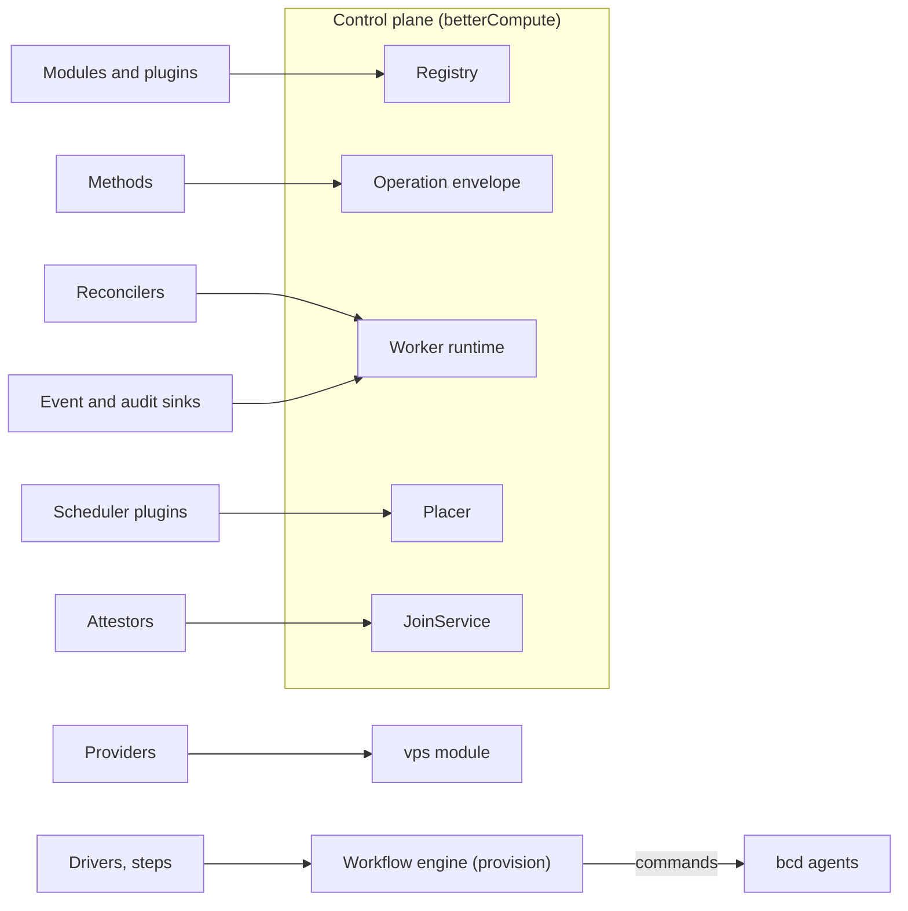

import { Braces, Cloud, Fingerprint, Inbox, Package, Plug, Signpost, SlidersHorizontal, Workflow } from '@/lib/icons';

Better Compute has no plugin loader. Every place you can change its behaviour is a typed contract in
`@better-compute/core`, and you plug an implementation in by passing it to `betterCompute()`. Two rules from PLAN.md
§5.1 shape all of them:

- **Code registers kinds; data configures instances.** A driver, a provider or an attestor is code you register
  once. A BMC binding, a provider account or a join token is a row, validated by the manifest that code declares.
- **Registration is explicit.** Nothing is discovered from the file system or `node_modules`. Everything arrives in
  an options array, and the registry refuses what it cannot check: a duplicate `kind:id@version`, a method whose
  action is missing from the IAM catalog, or a migration named for another module are all `INVALID_CONFIG` when
  `betterCompute()` or `initialize()` runs.

## The extension points

| Extension point | Declared with | Import from | Registered through | Runs in |
| --- | --- | --- | --- | --- |
| [Module](/docs/extending/modules) | `defineModule` | `better-compute` | `modules` | control plane |
| [Plugin](/docs/extending/modules#plugins) (a module with an id) | `definePlugin` | `better-compute` | `plugins` | control plane |
| [API method](/docs/extending/methods) | `defineMethod` | `better-compute/core` | a module's `api()` | control plane |
| [Driver](/docs/extending/drivers) | `defineDriver` | `better-compute` | `drivers`, or a module's `extensions` | control plane, site agent, node, ramdisk |
| Out-of-process driver (bcx) | `serveDriver`, `externalDriver` | `@better-compute/driver-sdk` | `drivers` | its own process |
| [Attestor](/docs/extending/attestors) | `defineAttestor` | `better-compute` | `attestors` | JoinService, in the control plane |
| [Provider](/docs/extending/providers) | `defineProvider` | `better-compute/vps` | `providers` | control plane |
| [Scheduler plugin](/docs/extending/scheduler-plugins) | `defineSchedulerPlugin` | `better-compute` | `scheduler.plugins`, or a module's `extensions` | the placer, in api and worker processes |
| [Event sink](/docs/extending/sinks) | `defineSink({ kind: 'events' })` | `better-compute` | `sinks.events`, or a module's `extensions` | the `sinks` worker role |
| [Audit sink](/docs/extending/sinks#audit-sinks) | `defineSink({ kind: 'audit' })` | `better-compute` | `sinks.audit`, or a module's `extensions` | the `audit-sinks` reconciler, `controllers` role |
| [Step and profile](/docs/extending/steps-and-profiles) | `defineStep`, `defineProfile` | `better-compute/provision` | a module's `extensions` and `profiles` | control plane or one agent command |

The root entry `better-compute` exports `defineModule`, `definePlugin`, `defineDriver`, `defineSchedulerPlugin`,
`defineAttestor` and `defineSink`. `defineMethod`, `defineStep`, `defineProfile` and `defineProvider` come from the
`better-compute/core`, `/provision` and `/vps` subpaths.

Other contracts in `core` are ports rather than plug-ins: `SqlExecutor` (the store), `IamPort`, `Clock`,
`Notifier`, `LeaseProvider`, `SecretStore`, `BlobStore`, `CertificateAuthority`, `ImageSource` and `NodeAdapter`. You
replace them through their own options (`database`, `iam`, `clock`, `notifier`, `secrets`, `pki`), not through
`extensions`; the [configuration reference](/docs/operations/configuration) lists them.

## Where each one plugs in



A module is the unit everything else hangs off. It can carry API groups, reconcilers, migrations, command kinds,
NodeSpec sections, IAM catalog fragments, CLI commands, profiles and `extensions` (drivers, steps, scheduler
plugins, attestors, sinks). The top-level options (`drivers`, `providers`, `attestors`, `scheduler.plugins`,
`sinks`) register extensions that do not need a module of their own. Both paths end in the same registry and the
same `kind:id@version` uniqueness check, and every consumer reads both: scheduler plugins a module lists join
`scheduler.plugins` in the placer, and its event and audit sinks join `sinks.events` and `sinks.audit`.

```ts title="compute.ts"
import { betterCompute, defineSchedulerPlugin, defineSink } from 'better-compute';
import { acmeWidgets } from '@acme/bc-widgets'; // definePlugin({ id: 'acme-widgets', … })

export const compute = betterCompute({
  // …database, secret, baseURL, iam
  plugins: [acmeWidgets()],
  scheduler: { plugins: [defineSchedulerPlugin({ id: 'rack-spread', scorers: [/* … */] })] },
  sinks: {
    events: [defineSink({ kind: 'events', id: 'warehouse', async deliver(events) { /* … */ } })],
  },
});
```

## What is stable

Better Compute is pre-1.0. The contracts in `@better-compute/core` froze at the end of phase P0 and change only by
additive edits: new optional members in minor versions, and a new interface selected by version for anything
breaking. PLAN.md §5.1 keeps every `define*` helper **experimental until v1.0**, so pin your versions.

| Extension point | State today |
| --- | --- |
| Modules, plugins, methods | Built. Every built-in feature (`capacity`, `events`, `fleet`, `rollout`, `audit`, `iam`, `vps`, `metal`, `provision`) is a module on this contract. |
| Reconcilers, command kinds, NodeSpec sections, migrations | Built, with the v0.1 worker runtime. |
| Scheduler plugins | Built: filters, scorers, atom pickers and admission hooks run in both placers. |
| Sinks | Built: event sinks on OutboxDispatch with durable cursors and dead letters; audit sinks on the built-in `audit-sinks` module. Usage sinks are refused with `INVALID_CONFIG` (usage goes to IAM billing through the bridge); see [sinks](/docs/extending/sinks#usage). Sinks and scheduler plugins a module lists in `extensions` run like those in the options. |
| Attestors | Built: `join-token`, `x509pop`, `provisioned`, `discovery`, `cloud-iid` and `tpm` are all `defineAttestor` values. bcd produces `join-token` joins, `provisioned` joins for an OS a deploy installed (`bcd join --node-id`), and `discovery` joins from `bcd ramdisk` with its site agent's signed assertion; its producers for the others are not written. |
| Drivers, steps, profiles | Built in TypeScript (`metal`, `provision`). bcd runs the metal command kinds that steps send (Redfish BMC operations, boot entries and `site.httpProxy` on `bcd site`; wipes, image writes, kexec and DCGM on `bcd ramdisk`), and `driver.invoke` in the bcx plugins it hosts; not released and tested by Go unit tests only. |
| Providers | Built: `hetzner` and `proxmox` provider packages, checked by `providerConformanceCases()`. |
| bcx out-of-process drivers | A v0.5 draft. `@better-compute/driver-sdk` works for TypeScript plugins, and bcd hosts sha256-pinned plugins (see [drivers](/docs/extending/drivers#driver-plugins-in-bcd)); the proto is unstable until v0.5 ships. |

<Callout type="warn" title="The daemon half is mostly missing">
Several extension points end in a command that a <Term id="bcd">bcd</Term> agent runs: driver operations on a site
agent, steps on a ramdisk, NodeSpec sections on a node. The Go daemon's node agent is built and tested end to end,
and its site-agent and ramdisk modes are written with Go unit tests; none of it is released. It converges the
`devices`, `access`, `instances` (over a fakehw stand-in runtime only) and `site` sections and runs its built-in and
metal kinds, and `driver.invoke` in the bcx plugins it hosts, but no `host` or `daemon` section. The TypeScript `FakeDaemon` in `@better-compute/testing`
speaks the real protocol and runs the other paths in tests and in `better-compute dev --sim N`. See
[what bcd does today](/docs/daemon#what-bcd-does-today).
</Callout>

## Rules every extension follows

These hold for anything you write against the contracts, and the built-in modules follow them too:

1. **Modules never import each other's internals.** They meet through the ports on `ModuleContext`: the `vps`
   module books host capacity through `ctx.capacity.reserve`, not by importing `@better-compute/capacity`. The
   repository enforces the direction with `scripts/check-deps.mjs`.
2. **IAM is never awaited inside a compute transaction.** The envelope makes the one decision before your handler's
   transaction opens. Composite methods decide their sub-calls with `ctx.check` before they open a transaction.
3. **Write state, events and work in one transaction.** `ctx.events.publish`, `ctx.work.enqueue`,
   `ctx.commands.enqueue` and `ctx.authz.upsert` all take the caller's `tx`, so a rollback leaves nothing behind.
4. **Business time comes from the database.** SQL uses `compute_now()`, never `now()`; TypeScript uses `ctx.clock`.
   `scripts/check-sql-now.mjs` fails CI on a bare `now()` in `packages/*/src`.
5. **Everything is retried.** Reconcilers are level-triggered, sinks are at-least-once, commands carry idempotency
   keys. Write each piece so that running it twice changes nothing.

## Conformance

A contract comes with a conformance suite: plain `{ name, run }` cases you run against your implementation. The
runner lives on its own subpath of `@better-compute/core`, so the root entry carries no test code:

```ts title="acme-cloud.test.ts"
import { runConformance } from '@better-compute/core/conformance';
import { providerConformanceCases } from 'better-compute/vps';
import { acmeCloudSubject } from './acme-cloud-subject'; // your provider, against recorded responses

const report = await runConformance(providerConformanceCases(), () => acmeCloudSubject());
// report: { passed: string[], failed: { name, error }[] }; a factory gives each case a fresh subject
```

`storeConformanceCases()` from `@better-compute/postgres/conformance` does the same for a `SqlExecutor`. The acceptance tests in
`tests/extensions/` register third-party-style plugins with zero edits to `@better-compute/*`; see
[walkthroughs](/docs/extending/walkthroughs).

<Cards>
  <Card title="Modules" href="/docs/extending/modules" icon={<Package />}>defineModule and definePlugin: groups, migrations, reconcilers, NodeSpec sections and the module context.</Card>
  <Card title="Methods" href="/docs/extending/methods" icon={<Braces />}>defineMethod: actions, resources, validation, admission, composites and errors.</Card>
  <Card title="Drivers" href="/docs/extending/drivers" icon={<Plug />}>defineDriver, driver kinds, and out-of-process drivers over bcx.</Card>
  <Card title="Attestors" href="/docs/extending/attestors" icon={<Fingerprint />}>defineAttestor: how a joining agent proves what it is.</Card>
  <Card title="Providers" href="/docs/extending/providers" icon={<Cloud />}>defineProvider: cloud and hosting APIs behind VPS and metal pools.</Card>
  <Card title="Scheduler plugins" href="/docs/extending/scheduler-plugins" icon={<SlidersHorizontal />}>Filters, scorers, atom pickers and admission hooks for the placer.</Card>
  <Card title="Sinks" href="/docs/extending/sinks" icon={<Inbox />}>Event and audit sinks, their cursors and dead letters, and where usage goes.</Card>
  <Card title="Steps and profiles" href="/docs/extending/steps-and-profiles" icon={<Workflow />}>defineStep and defineProfile for provisioning workflows.</Card>
  <Card title="Walkthroughs" href="/docs/extending/walkthroughs" icon={<Signpost />}>End-to-end extensions built without touching Better Compute.</Card>
</Cards>
