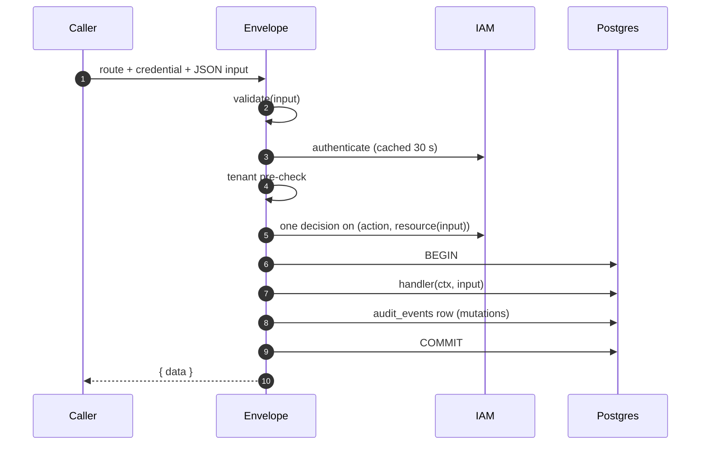
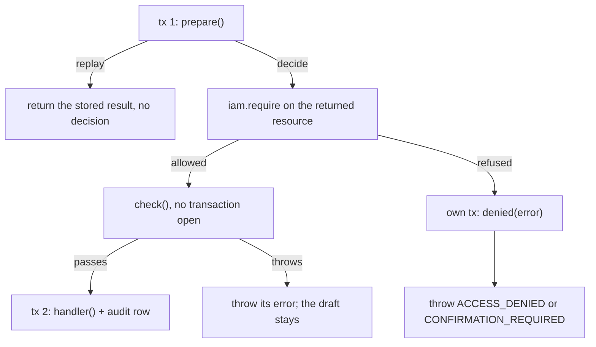

A method is a typed function behind one route. You declare what it needs, and the operation envelope does the
security work around it: authenticate the caller, check the tenant, make exactly one IAM decision, open the
transaction, run your handler and write the audit row. Your handler never calls IAM for its own admission and never
opens the outer transaction.

## The definition

```ts title="@better-compute/core"
interface MethodDefinition<I, O> {
  action: `compute:${string}` | null;
  kind: 'read' | 'mutation' | 'public';
  resource(input: I): MethodResource | undefined;
  validate(input: unknown): I;
  handler(context: MethodContext, input: I): Promise<O>;
  admission?: MethodAdmission<I, O>;
  transaction?: 'auto' | 'manual';
  poll?: MethodPoll<I, O>;
}
```

<TypeTable
  type={{
    action: { type: 'compute:<area>:<verb> | null', description: 'The IAM action decided. Plugins: compute:<plugin-id>:<verb>. null only for public methods.', required: true },
    kind: { type: "'read' | 'mutation' | 'public'", description: 'Decides how the call is decided, whether it writes, and whether it is audited.', required: true },
    resource: { type: '(input) => { type, id, action? }', description: 'The resource the action is decided on, without the IAM type prefix.', required: true },
    validate: { type: '(raw) => I', description: 'Parses the raw input; must reject unknown and invalid fields with INVALID_INPUT.', required: true },
    handler: { type: '(ctx, input) => Promise<O>', description: 'Runs after the decision, in a transaction unless transaction is manual.', required: true },
    admission: { type: 'MethodAdmission', description: 'Request-as-resource admission for creates and extends. Mutations only.' },
    transaction: { type: "'auto' | 'manual'", description: 'manual: composite mutations that open their own transactions and use check/invoke.', default: "'auto'" },
    poll: { type: '{ done(output); refresh(ctx, input, output) }', description: 'Async-with-wait: how the envelope waits when the input asks wait: { timeoutMs }. Mutations only; see below.' },
  }}
/>

`defineMethod` (from `better-compute/core`) freezes the definition and keeps its input and output types, which is
what types `compute.api` and the client. The registry checks the shape when the module registers: `resource`,
`validate` and `handler` must be functions, `kind` one of the three, a public method's `action` `null`, every other
action must match `^compute:[a-z][a-z0-9-]{0,63}:[a-z][a-z0-9-]{0,63}$`, and a plugin's must start with
`compute:<id>:`. Anything else is `INVALID_CONFIG`.

## How a call runs



1. **Public methods** (`kind: 'public'`, `action: null`) are validated and run; the credential is passed along
   only when one was presented.
2. **Everything else** needs a credential (`UNAUTHENTICATED` without one, before any IAM call). The input is
   validated, then the caller is authenticated through the <Term id="iam-port">IamPort</Term>, cached for 30
   seconds by the credential's hash.
3. **Tenant pre-check.** A caller whose tenant is neither the input's `tenantId` nor the root tenant gets
   `ACCESS_DENIED` before compute's database is read or IAM is asked anything.
4. **One decision.** Mutations call `iam.require`, never cached. Reads call `iam.authorize`, whose allows are cached
   for 10 seconds per session. A refusal is `ACCESS_DENIED` and no transaction is opened.
5. **The handler** runs in one transaction: read-only for reads, so a read that writes fails. An allowed mutation
   also gets an `audit_events` row with its <Term id="admission-context">admission context</Term>, in the same
   transaction, so a rolled-back mutation leaves no audit row either.

A thrown error rolls the transaction back and becomes the error response.

## Actions and resources

`resource(input)` names what the action is decided on, without the IAM type prefix: `{ type: 'tenant', id }`,
`{ type: 'pool', id: input.poolId }`. The envelope adds the prefix (`compute-` by default) and decides in the tenant
the input names. So a method's input needs a `tenantId`, unless it is decided on the fleet (`{ type: 'fleet', id:
'global' }`), which is always decided in the root tenant. A method with neither is `INVALID_CONFIG` at call time.

Keep `resource` a pure projection of the validated input. For methods that have a row in the method table,
`initialize()` probes `resource` with a placeholder input and compares the kind it decides on with the row.

| Method kind | Decides on | Examples |
| --- | --- | --- |
| Tenant-scoped | `tenant` | `webhooks.*` (`compute:webhooks:manage`), `quotas.get`, `pools.create` |
| Object-scoped | the object | `reservations.get` on `reservation`, `pools.get` on `pool` |
| Fleet-wide | `fleet` / `global` | `fleet.apply`, `rollouts.create`, `quotas.set` |

A plugin can decide on its own resource types, declared in its `catalog.resourceTypes`, as long as IAM can resolve
them: write their rows into the authz projection with `ctx.authz.upsert(tx, { type, id, tenantId, attributes,
ownerId })` when you create them. See [actions and resources](/docs/guides/iam/actions-and-resources).

### Per-input actions

Some rows of the method table decide a different action for some inputs: `tunnels.open` decides
`compute:nodes:console` when it targets a node. `resource()` returns that action in `resource.action`, and the
envelope decides it, but only if the row lists that `(action, type)` pair as an alternative. A method without a
row, which includes every plugin method, cannot override its action; `resource.action` other than its own action
is `INVALID_CONFIG`.

## Validation

`validate` receives the raw JSON object (or `{}` for an empty body) and returns the typed input. It must reject
unknown fields, not strip them. The `manifest` builder does both:

```ts
import { field, manifest } from 'better-compute';

const rotateInput = manifest({
  tenantId: field.string({ pattern: '^[A-Za-z0-9._:-]{1,128}$' }),
  webhookId: field.string({ pattern: '^whk_[0-9a-hjkmnp-tv-z]{26,52}$' }),
  keepPreviousSeconds: field.int({ min: 0, max: 86_400 }).optional(),
});
// validate: (raw) => rotateInput.parse(raw)
// → INVALID_INPUT "Unknown field x", "keepPreviousSeconds: …", "Required", …
```

`parse` throws `ComputeError('INVALID_INPUT')` naming the first problem. Validation runs before authentication,
so a malformed request never costs an IAM call. Another validator works too, but wrap its failures in
`ComputeError('INVALID_INPUT', …)`: any other error thrown from `validate` reaches the caller as `INTERNAL_ERROR`.

## The method context

The handler's `MethodContext` is the [module context](/docs/extending/modules#the-module-context) plus the call:

| Member | Meaning |
| --- | --- |
| `sql` | The envelope's transaction. `sql.transaction(fn)` opens a savepoint; `migrate` and `close` are refused |
| `caller` | `{ identityId, identityKind, tenantId, sessionId, sessionKind, mfa, agentId?, delegationId? }`; absent for public methods |
| `credential` | The credential as presented, for calls you make on the caller's behalf |
| `admission` | The recorded decision of an allowed mutation: tenant, identity, session, action, resource, `decidedAt` |
| `requestId` | The caller's `X-Request-Id` when it is short and plain, else a generated `req_…` |
| `traceparent` | The request's W3C `traceparent` header when it is valid (version `00`, non-zero ids); `ctx.commands.enqueue` then defaults each command's `traceparent` to it unless the command sets its own |
| `signal` | Aborts when the transport does |
| `check`, `invoke` | Composite methods only; see below |

## Admission: the request as a resource

A create that should be decided on what it asks for, not only on the tenant, uses `admission`. The request is first
written as a <Term id="draft">draft</Term> with its attributes in the authz projection, IAM decides on the draft,
and only an allowed draft becomes real. This is how `reservations.create` lets a policy cap GPU count and duration
in one decision; see [reservations](/docs/guides/capacity/reservations#the-admission-sequence).

```ts title="@better-compute/core"
interface MethodAdmission<I, O> {
  prepare(context: MethodContext, input: I, tx: SqlTx): Promise<
    { status: 'decide'; resource: MethodResource } | { status: 'replay'; result: O }
  >;
  denied?(context: MethodContext, input: I, tx: SqlTx, error: unknown): Promise<void>;
  describe?(input: I): string;
  check?(context: MethodContext, input: I, resource: MethodResource): Promise<void>;
}
```



- **`prepare`** runs in the first transaction and never calls IAM. It looks up the idempotency key (scoped to the
  tenant and the caller's identity), writes or reuses the draft and its projection row, and says what to decide on.
  A finished request by the same identity is a `replay`: its stored result is returned without a second decision. A
  different request under the same key must throw `CONFLICT`. `draftId(prefix, tenantId, identityId, key)` from
  `better-compute/core` derives a deterministic id for the draft.
- **The decision** is one `require` on the resource `prepare` returned. `resource(input)` may return `undefined`
  for admission methods, which learn their resource only in `prepare`.
- **`check`** (optional) runs after the decision allowed the request and before the handler, with **no transaction
  open**, so it may call IAM: for example `ctx.iam.billingCheck` for a budget. Its `ctx.sql` runs each statement on
  its own. A throw refuses the request with that error and does **not** call `denied`: the draft stays as it is, so
  a retry with the same key is decided again later (say, once a budget's window resets). Composite `ctx.check` runs
  it too.
- **`handler`** runs in a second transaction with `ctx.admission` set, and the audit row is written there.
- **`denied`** runs in a transaction of its own after a refusal, to mark the draft denied or clear pending changes.
  If it throws, the failure is logged and the refusal is still what the caller gets.
- **Delegated sessions.** When the caller is an agent in a delegated session, the envelope asks IAM to open a
  confirmation, with `describe(input)` as the reason shown to the person. If the delegation holds the action for
  confirmation, the error becomes `CONFIRMATION_REQUIRED` with `details: { confirmationId, expiresAt?, action,
  resource }`, and `denied` receives it so the draft can wait as `awaiting-confirmation`. See
  [delegated confirmation](/docs/guides/iam/delegated-confirmation).

A replay-only admission needs no draft at all. `projects.create` derives its id from the key and returns
`{ status: 'replay', result }` when the project exists, else `{ status: 'decide', resource: { type: 'tenant', id } }`.
`pools.create` does the same when an `idempotencyKey` is given.

Only mutations take an `admission`, and a method cannot combine it with `transaction: 'manual'`.

## Async-with-wait

A mutation whose work finishes later (a queued placement) can let callers wait for it in the same request (PLAN.md
section 9.1). Declare `poll`, and accept `wait: { timeoutMs }` in `validate`:

```ts title="@better-compute/core"
interface MethodPoll<I, O> {
  done(output: O): boolean;
  refresh(context: MethodContext, input: I, output: O): Promise<O>;
}
```

After the mutation commits (plain or admitted, and on a replay too), the envelope checks `done(output)`. When it is
false and the input asks for a positive `wait.timeoutMs`, it calls `refresh` in read-only transactions, backing off
from 50 ms to 1 s, until `done`, the timeout (at most 30 seconds, wall clock) or the request's abort, and answers the
last output. A timeout is not an error: the output itself must say the work is still pending, as a reservation's
`operation.state: 'running'` does. `reservations.create` is the built-in user; see
[waiting for placement](/docs/guides/capacity/reservations#waiting-for-placement). The registry refuses (`INVALID_CONFIG`)
a `poll` on a method that is not a mutation, or one without both functions.

## Composite methods

A mutation declared `transaction: 'manual'` composes other methods, each decided for the same caller. `fleet.apply`
is the one built in: it applies a whole fleet document through `pools.create`, `quotas.set` and the rest, all or
nothing.

```ts title="packages/fleet/src/module.ts (trimmed)"
apply: defineMethod<ApplyInput, ApplyResult>({
  action: 'compute:fleet:admin',
  kind: 'mutation',
  resource: () => ({ type: 'fleet', id: 'global' }),
  transaction: 'manual',
  validate: parseApply,
  async handler(ctx, input) {
    const first = await ctx.sql.transaction((tx) => plan(ctx, tx, input));
    // Phase 1: one decision per call, as the caller, with no transaction open.
    for (const call of first.calls) await ctx.check!(call.path, call.input);
    // Phase 2: re-plan and run everything in one transaction.
    await ctx.sql.transaction(async (tx) => {
      const second = await plan(ctx, tx, input);
      if (second.planHash !== first.planHash) throw new ComputeError('CONFIG_DRIFT', 'plan again');
      for (const call of second.calls) await ctx.invoke!(tx, call.path, call.input);
    });
    return { plan: first, applied: first.calls.length };
  },
}),
```

- The composite itself is decided once, like any mutation. Its handler then runs **with no transaction open**;
  `ctx.sql` runs each statement on its own and each `ctx.sql.transaction` is a real transaction.
- **`ctx.check(path, input)`** makes the target's tenant pre-check, validation and one decision exactly as the
  envelope would, and records a grant keyed by the path and the canonical JSON of the input. It refuses to run inside
  a transaction (`INVALID_STATE`).
- **`ctx.invoke(tx, path, input)`** consumes one grant (else `ACCESS_DENIED`), runs the target's handler in a
  savepoint of `tx` without another decision, and writes the sub-call's own audit row. A failed sub-call leaves
  nothing behind. Grants live only for the current call.
- `check` refuses (`UNSUPPORTED`) other composites, admissions with a `denied` hook (reservations, instances) and
  list methods that decide their items one by one. Replay-only admissions work: `prepare` runs in a short
  transaction at `check` and again inside `invoke`.
- The composite's own audit row is written in its own transaction after the handler succeeds.

Paths are the routes below the base path: `pools/create`, or `plugins/acme/widgets/poke`.

## Serving plugin methods

A plugin's methods are served under its id. For plugin `acme`, group `widgets`, method `poke`:

<Tabs items={['HTTP', 'Server', 'Client']}>
<Tab value="HTTP">

```bash
curl -X POST https://compute.example.com/api/compute/plugins/acme/widgets/poke \
  -H "Authorization: Bearer $BETTER_COMPUTE_TOKEN" \
  -H "Content-Type: application/json" \
  -H "X-Better-Compute: 1" \
  -d '{"tenantId":"acme","widgetId":"w-1"}'
# → { "data": { "poked": "w-1" } }
```

</Tab>
<Tab value="Server">

```ts
const result = await compute.api.plugins.acme.widgets.poke(
  { headers: request.headers },
  { tenantId: 'acme', widgetId: 'w-1' },
);
```

</Tab>
<Tab value="Client">

```ts
import { createComputeClient } from 'better-compute/client';
import type { compute } from './compute';

const client = createComputeClient<typeof compute>({ baseURL, token });
await client.plugins.acme.widgets.poke({ tenantId: 'acme', widgetId: 'w-1' });
```

</Tab>
</Tabs>

Every route takes `POST` with `Content-Type: application/json`, the `X-Better-Compute: 1` header (without either
the answer is `CSRF_REJECTED`) and a JSON object of at most 64 KiB. Success is `{ data }`; failure is `{ error: { code, message, retryAfterMs?, details? } }`
with the code's HTTP status. `compute.api` runs the same envelope in process.

## Errors

Throw `ComputeError` from `better-compute/core`. Its code and message are shown to the caller; `details` carries
structured context.

```ts
throw new ComputeError('CONFLICT', 'Widget changed meanwhile', undefined, { widgetId });
throw new ComputeError('RATE_LIMITED', 'Slow down', undefined, { retryAfterMs: 20_000 });
```

A numeric `details.retryAfterMs` moves to the body's top-level `retryAfterMs`, and the HTTP answer gets a
`Retry-After` header in seconds. Anything that is not a `ComputeError`, and any `INTERNAL_ERROR`, reaches the
caller as `INTERNAL_ERROR` with the message `Internal server error`, so a leaked connection string stays in your
logs. `isComputeError(error, code?)` recognizes errors from a second copy of the package too.

| Code | Status | Throw it when |
| --- | --- | --- |
| `INVALID_INPUT` | 400 | Validation fails (the manifest does this for you) |
| `NOT_FOUND` | 404 | The object does not exist in the input's tenant. Use it for other tenants' objects too, so nothing leaks |
| `INVALID_STATE` | 409 | The object exists but cannot do this now (`cancel` on an active reservation) |
| `CONFLICT` | 409 | An idempotency key reused for a different request, or a lost race worth retrying |
| `CAPACITY_UNAVAILABLE`, `QUOTA_EXCEEDED` | 409 | Nothing fits, or a quota is spent |
| `CONFIG_DRIFT` | 409 | Live state moved since a plan was made |
| `UNSUPPORTED` | 422 | A valid request this deployment or object does not support |
| `RATE_LIMITED` | 429 | With `details.retryAfterMs` |
| `DRIVER_ERROR`, `PROVIDER_ERROR` | 502 | A driver or provider call failed |
| `UNAVAILABLE` | 503 | A dependency is unreachable for now and nothing changed; with `retryAfterMs` |
| `NOT_IMPLEMENTED` | 501 | A stub: `notImplemented(feature, phase)` names the phase that delivers it |
| `INVALID_CONFIG` | 500 | The deployment is misconfigured, not the request |

Leave `UNAUTHENTICATED`, `ACCESS_DENIED`, `CONFIRMATION_REQUIRED`, `CSRF_REJECTED` and the transport codes to the
envelope. The [error reference](/docs/reference/errors) lists every code.
