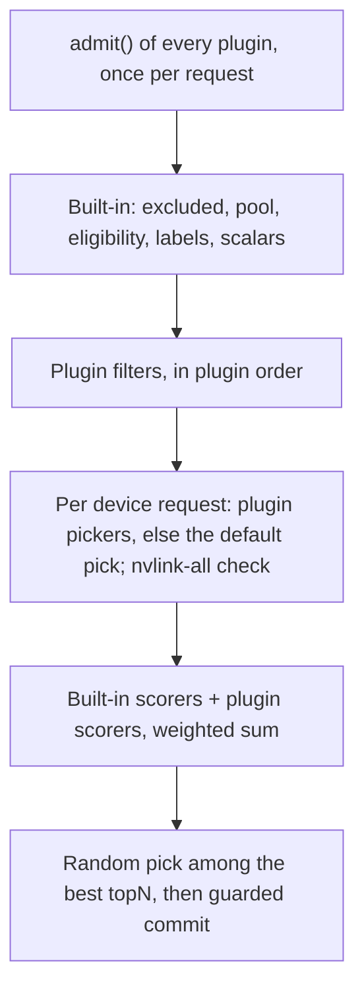

The <Term id="placer">placer</Term> of the built-in capacity module decides which node and which
<Term id="atom">atoms</Term> a request gets. You cannot replace the placer, but you can shape every decision it
makes: a scheduler plugin adds **filters** that turn nodes down, **scorers** that rank the rest, **atom pickers**
that choose devices on a node, and an **admission hook** that can refuse a request outright. None of them can break
the booking guarantees: whatever they choose is still committed with guarded statements under the
`EXCLUDE` constraint. [Placement](/docs/guides/capacity/placement) explains the pipeline they plug into.

## The contract

```ts title="@better-compute/core"
interface SchedulerPluginInput {
  id: string;
  admit?(request: PlacementRequest, context: AdmissionContext): Promise<void>;
  filters?: { id: string; filter(request: PlacementRequest, node: NodeView): true | { reason: string } }[];
  scorers?: { id: string; weight?: number; score(request: PlacementRequest, node: NodeView): number }[];
  preferAllocation?: {
    class: string;
    pick(request: DeviceRequest, free: Atom[], node: NodeView): Atom[] | undefined;
  }[];
}
```

`defineSchedulerPlugin(input)` (from `better-compute`) freezes it and marks it as a `scheduler` extension. Filters,
scorers and pickers are synchronous and pure: no SQL, no clock, no network. They see a read-only `NodeView` and the
`PlacementRequest`, and the same inputs must give the same answer, because the simulator replays placements.

### What a plugin sees

<TypeTable
  type={{
    id: { type: 'string', description: 'The node id.' },
    'siteId, poolId, ownerTenantId': { type: 'string', description: 'Where the node lives and who owns it.' },
    role: { type: 'NodeRole', description: 'Only host nodes reach plugin filters; others fail eligibility first.' },
    'provisionState, connectivity, trust': { type: 'string', description: 'Lifecycle, session and trust state.' },
    'maintenance, cordoned': { type: 'boolean', description: 'Always false for nodes that reach plugin filters.' },
    labels: { type: 'Record<string, string>', description: 'Node labels, such as rack or fabric.domain.' },
    noScheduleReasons: { type: 'string[]', description: 'Health taints; empty for nodes that reach plugin filters.' },
    devices: { type: 'Device[]', description: 'Every device, including partitioned parents, for topology.' },
    free: { type: 'Atom[]', description: "Atoms free for the request's interval: { id, class, parentId?, healthy, bookable, attributes }." },
    resources: { type: 'Record<string, { allocatable, ratio, allocated }>', description: 'Scalar resources such as vcpu and memoryGiB.' },
    links: { type: 'Record<string, Record<string, GpuLink>>', description: "links[a][b] is NV, PIX, PXB, PHB, NODE or SYS, when inventory reported it." },
  }}
/>

The request carries `tenantId`, `poolId`, `projectId`, `reservationId` or `instanceId`, `devices` (class, count,
selector, topology, sharing), `topology`, `gang`, `resources`, `imageId`, `during`, `priority`, `excludeNodes` and
`nodeLabels` (labels every candidate must carry with exactly those values; the built-in `labels` filter drops the
others before plugin filters run, so a plugin never sees them).

## Where each hook runs



| Hook | Runs | A failure means |
| --- | --- | --- |
| `admit` | Once per request, before candidates are gathered, only when the placement has an admission context | The error is thrown to the caller and the request's transaction rolls back |
| `filters` | Per candidate node, after the built-in eligibility, exclusion and scalar checks, before device fit | The node is rejected with `filter: <filter id>` and your reason |
| `preferAllocation` | Per device request whose class matches, before the default NVLink- and NUMA-aware pick | See below |
| `scorers` | Per node that fits | Scores are clamped to 0..1; a non-finite score counts as 0 |

The first filter that answers `{ reason }` turns the node down, and the reason shows in the `Unschedulable`
message of a pending reservation (`no node fits (12 nodes): 7 × rack-a: …`). Keep reasons short and stable.

### Admission hooks

`admit` receives the request and the <Term id="admission-context">admission context</Term> of the decision that let
it in: the tenant, identity, identity kind, session kind, agent and delegation, action and resource. It is an
admission decision, so it runs once, in the request's own transaction:

- `reservations.create`, with both placers (the pool-lease placer runs it before answering `queued`);
- whole-node leases (`binding: 'node'`) at create, although they do not go through the placement pipeline;
- bookings a module makes through `ctx.capacity.reserve(tx, request, { admission })` in its caller's request:
  `instances.create` passes its decision, so VPS instances are admitted too.

The system's own re-placements of an admitted request carry no caller and are not re-admitted: pending retries,
BookingRepair, bind-timeout re-places, spot preemption and a module's retries. Filters, pickers and scorers apply to
every attempt.

Use IAM policies for who may ask for what; they see the request's attributes. Use `admit` for rules that are about
placement itself, and throw a `ComputeError` to refuse:

```ts
import { ComputeError, defineSchedulerPlugin } from 'better-compute';

export const gangCap = defineSchedulerPlugin({
  id: 'gang-cap',
  async admit(request, context) {
    if (request.gang && request.gang.size > 8 && context.identityKind === 'agent')
      throw new ComputeError('UNSUPPORTED', 'Agents may book gangs of at most 8 nodes');
  },
});
```

### Atom pickers

For each device request, the first plugin (in `scheduler.plugins` order) with a picker for that exact `class` that
returns an array wins. Return `undefined` to fall through to the next picker and finally to the default pick. The
array must hold exactly `count` distinct atoms taken from `free`; anything else rejects the node with the plugin's
id as the filter. `topology: 'nvlink-all'` is checked on your pick as on the default one.

## Adding a scorer

Suppose your racks on power tier `low` are cheaper to run, and you want placements to prefer them without ever
refusing the others:

```ts title="power-tier.ts"
import { defineSchedulerPlugin } from 'better-compute';

export const powerTier = defineSchedulerPlugin({
  id: 'power-tier',
  scorers: [
    {
      id: 'power-tier.low',
      weight: 0.5,
      score: (_request, node) => (node.labels['power-tier'] === 'low' ? 1 : 0),
    },
  ],
  filters: [
    {
      id: 'power-tier.no-drain',
      filter: (_request, node) =>
        node.labels['power-tier'] === 'draining' ? { reason: 'rack is draining' } : true,
    },
  ],
});
```

```ts title="compute.ts"
import { betterCompute } from 'better-compute';
import { powerTier } from './power-tier';

export const compute = betterCompute({
  // …database, secret, baseURL, iam
  scheduler: {
    plugins: [powerTier],
    weights: { 'power-tier.low': 0.75, spread: 0.25 },
    topN: 5,
  },
});
```

Then check it the way the capacity tests do, with the pure planner and hand-built views:

```ts title="power-tier.test.ts"
import { planPlacement } from 'better-compute/capacity';

const plan = planPlacement(request, [nodeA, nodeB], pool, { plugins: [powerTier] });
expect(plan.ranked[0]!.nodeId).toBe('b'); // b carries power-tier=low
expect(plan.ranked[0]!.scores['power-tier.low']).toBe(1);
```

Each ranked plan carries its per-scorer `scores` and the total `score`, and `plan.rejected` lists every node turned
down with the filter that did it.

### Weights

A node's total is the sum of weight × score over every scorer. The built-in weights are:

| Scorer | Default weight | Scores 1 for |
| --- | --- | --- |
| `binpack` | 1 | Nodes left fullest after the placement (keeps 8-GPU boards whole) |
| `topology` | 1 | All picked GPUs on NVLink; 0.5 when a link is unknown |
| `fragmentation` | 0.25 | Leaving 0 free atoms (0.5 for a power of two) |
| `spread` | 0 | The emptiest nodes (1 − binpack) |
| `image-cached` | 0.5 | Nodes whose runtime already caches the request's `imageId` |

A plugin scorer's weight is, in order of precedence: `scheduler.weights[id]`, the scorer's own `weight`, then 1.
`scheduler.weights` also overrides the built-ins by id; `{ spread: 1, binpack: 0 }` turns packing into spreading.
Give your scorers ids of their own: a plugin scorer named like a built-in replaces that built-in's score. Ties
break on node id, and the placer picks at random among the best `topN` (default 5), with a seeded random in the
simulator.

### The image-cached scorer

`image-cached` is the one built-in scorer that reads state outside the node view. When a request carries an
`imageId` (VPS instances), the inline placer reads the nodes of the pool whose `node_image_cache` row for that image
is `ready`, and scores them 1. The table is fed from the daemon's `images` inventory section; while it does not
exist the set is empty and the scorer is 0 for every node. Requests without an `imageId` skip it. Plugin scorers
cannot read the database; if yours needs outside state, keep it in node labels (set by operators with
`nodes.label`) or device attributes (reported by inventory).

## Performance

For requests without selectors, without a gang and without plugin scorers, the inline placer first asks SQL for
every fitting node's free-atom counts and plans only the best 48 (at least 8 × `topN`), falling back to the whole
pool whenever nodes outside that shortlist could still rank in the top `topN`. **Any plugin scorer turns the
shortlist off**, because SQL cannot compute your score: every placement then loads and plans every node of the pool.
Filters and pickers keep the shortlist. On large pools prefer a filter, or a label a selector can match, over a
scorer when either would do.

## Placers

`Placer` is a contract in `core`, but the capacity module does not take a custom one. It offers two, chosen with
`capacity.placer`:

| | `inline` (default) | `pool-lease` (v0.4) |
| --- | --- | --- |
| Runs | In the admission transaction, pool row locked only for the commit | In the `capacity.placer` reconciler (`shardBy: 'pool'`, worker role `scheduler`), batches of at most 64 |
| Plans from | The SQL shortlist or every node of the pool | An in-memory index of the pool (`PoolIndex`), kept across batches |
| Plugins | `admit`, filters, pickers, scorers | `admit` at create; filters, pickers and scorers in each batch |

Instances, gangs and BookingRepair always place inline. Both placers run the same `planPlacement` with the same
plugins, so a plugin behaves the same under either. See [placement](/docs/guides/capacity/placement#two-placers) and
[scaling](/docs/operations/scaling).

<Callout type="info" title="Registering">
Scheduler plugins reach the built-in capacity module two ways: `betterCompute({ scheduler: { plugins } })`, and the
`extensions` of any module or plugin you register. Both lists are joined (the options' plugins first) and checked
for a duplicate id, and the placer runs them all.
</Callout>
