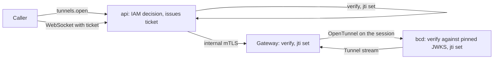

import { Command, KeySquare, Route, ShieldCheck } from '@/lib/icons';

Sooner or later someone needs a shell. A training job hangs on one GPU, a VM does not boot its service, a node
reports an XID and an engineer wants to look at `dmesg`. The usual answer, SSH keys copied onto every machine,
leaves standing access that nobody reviews and nobody removes.

Better Compute gives no one standing access. Every interactive session is decided by IAM at the moment it opens,
carries a credential that is bound to one machine and expires within minutes, and is checked again while it
lasts. The <Term id="gateway">gateway</Term> that relays the bytes holds no key that could open a session on its
own.

## Three ways in

| Path | Target | Decided as | Credential | Lifetime |
| --- | --- | --- | --- | --- |
| Tunnel, op `exec`, `ssh` or `tcp` | An instance | `compute:instances:exec` on the instance | An exec ticket from `tunnels.open` | Ticket 60 s; tunnel at most 12 h |
| Tunnel, op `console` | A node | `compute:nodes:console` on the node | An exec ticket from `tunnels.open` | Ticket 60 s; tunnel at most 12 h |
| Break-glass SSH | A node | `compute:nodes:ssh-root` on the node, with an MFA session | An OpenSSH user certificate from `nodes.issueSshCert` | 15 min by default, 1 h at most |
| Allowlisted commands | A node | `compute:nodes:exec` on the node | None: the daemon runs a registered command kind | The kind's timeout |

- **[Tunnels](/docs/guides/access/tunnels)** are the everyday path. The caller gets a short
  <Term id="exec-ticket">exec ticket</Term> and opens a WebSocket with it; the API relays the stream to the gateway
  that holds the node's <Term id="session">session</Term>, and the node opens a `Tunnel` stream back. The browser
  terminal in the console uses exactly this.
- **[Break-glass SSH](/docs/guides/access/ssh)** is for platform operators when the agent itself is the problem. It
  signs the caller's own public key with the compute SSH CA; nothing goes through the gateway.
- **[Commands](/docs/guides/nodes/commands)** (`commands.run`) cover the repeatable jobs, such as a diagnostic or a
  log collection, without any shell at all. Each <Term id="command-kind">command kind</Term> is registered and
  audited.

## How a tunnel is trusted

Three processes check every exec ticket before a byte flows, and each keeps its own set of ticket ids, so a ticket
opens one tunnel, once.



- **The api** decides the caller, then signs an ES256 ticket for one node (`aud` = `node:<id>`), one tunnel
  (`sid`), one operation (`op`) and at most 60 seconds.
- **The gateway** verifies the signature against the issuer's JWKS, the audience, the lifetime and the `jti`, then
  asks the node over its session.
- **The daemon** verifies the ticket again against the JWKS pinned in its <Term id="nodespec">NodeSpec</Term>
  `access` section and its own `jti` set, and only then opens the stream.

The last check is the one that matters. PLAN.md's security model treats the gateway as relay-only: a compromised
gateway can delay, drop or read frames, but it holds no signing key, so it cannot mint a ticket the daemon would
accept. The gateway test suite covers exactly that case: a gateway handed an attacker's JWKS accepts a forged
ticket, and a bcd-like test daemon holding the real JWKS refuses it, so no tunnel opens. bcd's own tests refuse
replayed, expired, tampered and other-node tickets and a ticket whose `sid` is not the tunnel's.

## Authorization

The actions live on the `compute-node` and `compute-instance` resource types (see
[actions and resources](/docs/guides/iam/actions-and-resources)):

| Action | Resource | Used by |
| --- | --- | --- |
| `compute:instances:exec` | `compute-instance/<id>` | `tunnels.open` with an `instanceId` |
| `compute:nodes:console` | `compute-node/<id>` | `tunnels.open` with a `nodeId` |
| `compute:nodes:ssh-root` | `compute-node/<id>` | `nodes.issueSshCert` |
| `compute:nodes:exec` | `compute-node/<id>` | `commands.run` |

A node must also be visible to the calling tenant through the authorization projection; otherwise the answer is
`NOT_FOUND`, never a hint that the node exists.

PLAN.md §12.6 describes break-glass as an eligible binding: a policy that allows `compute:nodes:console` and
`compute:nodes:ssh-root` only with MFA and only on platform-trusted nodes, bound so that people activate it when
they need it. `better-compute iam setup` does not print this policy; write it yourself in the
[policy](/docs/guides/iam/policies) format:

```json title="break-glass (eligible binding)"
{
  "name": "break-glass",
  "document": {
    "version": 1,
    "statements": [
      {
        "sid": "BreakGlass",
        "effect": "allow",
        "actions": ["compute:nodes:console", "compute:nodes:ssh-root"],
        "resources": ["compute-node/*"],
        "conditions": {
          "Bool": { "principal.mfa": true },
          "StringEquals": { "resource.trust": "platform" }
        }
      }
    ]
  }
}
```

The `agent-guardrails` example policy that `iam setup` does print denies `compute:nodes:ssh-root` to agent keys and
to delegated sessions, so an AI agent never gets a root shell through a person's delegation.

### Re-checks while a tunnel is open

The api re-authorizes the caller every 60 seconds. When the WebSocket upgrade carried a credential (an
`Authorization` header or the IAM cookie), each re-check is an ordinary decision with it. Browsers cannot set
headers on a WebSocket, so without one the re-check goes by the identity and session recorded in the ticket: the
session must still be listed and unexpired, the identity active, and `policies.simulate` must allow the same action
on the same target. Sessions of agents, delegations and assumed roles cannot be simulated exactly, so they answer
false and the tunnel closes at its first re-check. A refusal closes the tunnel; IAM unreachable for 2 minutes closes
it too.

## Audit and events

- `tunnels.open`, `nodes.issueSshCert` and `commands.run` are mutations, so each allowed call writes an
  `audit_events` row with its admission context: who, which action on which resource, and when. See
  [audit](/docs/guides/events/audit).
- `tunnels.open` publishes `tunnel.issued` (subject `instance/<id>` or `node/<id>`) with the tunnel id, node,
  op, identity and expiry. `nodes.issueSshCert` publishes `node.ssh-cert.issued` with the certificate's key id,
  serial, principals and expiry. Both reach [webhooks](/docs/guides/events/webhooks) and
  [watch](/docs/guides/events/watch) like any other event.
- The end of a tunnel is reported to the host's `onClose` hook with the tunnel id, node, identity and reason
  (`revoked`, `iam-unreachable`, `max-duration`, `caller-closed` and so on). No audit row is written for it by
  default.

## What ships today

Interactive access is the v0.3 roadmap item "tunnels with daemon-verified tickets, `nodes.issueSshCert`, the
`access` section". Both halves are written and tested: the control plane, and the node half in the Go bcd (built,
not released yet) and in the TypeScript FakeDaemon.

| Piece | State |
| --- | --- |
| `tunnels.open`, `nodes.issueSshCert` | Implemented in `@better-compute/server`, registered when you configure `tunnels` |
| Exec tickets, the SSH CA, JWKS rotation | Implemented in `@better-compute/pki` |
| `GET /api/compute/tunnels/<ticket>` relay, re-authorization | `handleTunnel`, mounted by `better-compute serve` and by the console's `server.mjs` |
| Gateway relay (`OpenTunnel`, `Tunnel` stream, internal `/v1/tunnels`) | Implemented in `@better-compute/gateway` |
| Browser terminal and node console | `apps/console` with `@better-compute/console-kit` |
| NodeSpec `access` section (JWKS, SSH CA keys) | Sent to every node |
| Daemon side: verifying tickets, opening `Tunnel` streams, running shells, applying `access` to sshd | In bcd (built and tested, not released): it re-verifies each ticket against the NodeSpec's JWKS and its journaled `jti` set, runs a node console on a real pseudo-terminal and pipes `ssh` and `tcp` to loopback ports (`tests/e2e/bcd.test.ts` opens a console end to end), and its `access` converger writes the sshd drop-in, CA, node-bound principals and KRL. `exec` into an instance waits for bcd's instances runtime. The TypeScript FakeDaemon, with its `tunnels` option (on in `dev --sim`), answers `OpenTunnel` with an echo shell, which the CLI's `console` and `exec` tests drive end to end; it still reports a non-empty `access` section as `SectionUnsupported` |

<Callout type="warn" title="The generated reference says planned">
  The [API reference](/docs/reference/api/tunnels#open) lists `tunnels.open` and `nodes.issueSshCert` as planned for
  v0.3, because it is generated from a control plane built without `tunnels` options. Both methods exist in the
  code and are served as soon as you pass `tunnels` to `betterCompute`.
</Callout>

## In this section

<Cards>
  <Card icon={<Route />} title="Tunnels" href="/docs/guides/access/tunnels">
    tunnels.open, exec tickets, the WebSocket relay, re-authorization, and the web terminal.
  </Card>
  <Card icon={<KeySquare />} title="Break-glass SSH" href="/docs/guides/access/ssh">
    Short OpenSSH user certificates from the compute SSH CA, for MFA sessions only.
  </Card>
  <Card icon={<Command />} title="Commands" href="/docs/guides/nodes/commands">
    Allowlisted command kinds with commands.run, without a shell.
  </Card>
  <Card icon={<ShieldCheck />} title="Security model" href="/docs/operations/security">
    Keys, trust boundaries, and what a compromised gateway can and cannot do.
  </Card>
</Cards>
