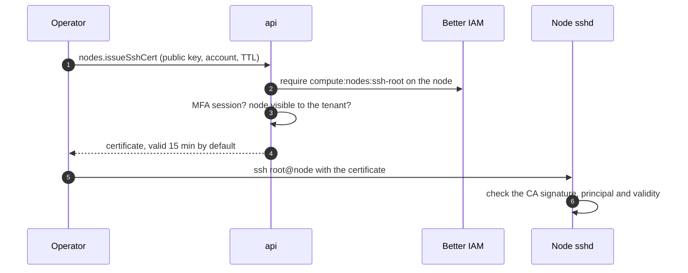

[Tunnels](/docs/guides/access/tunnels) and [commands](/docs/guides/nodes/commands) both go through the node's agent.
When the agent itself is the problem (it crashed, it cannot reach its gateway, its session is stuck), a platform
operator needs a way in that does not depend on it. That is break-glass SSH.

Better Compute runs an SSH certificate authority. An operator sends the public key of their own key pair to
`nodes.issueSshCert`; the CA signs it into an OpenSSH user certificate for one Unix account that lasts minutes, and
the operator connects with plain `ssh`. The private key never leaves their machine, no `authorized_keys` file
changes, and every certificate is recorded.



The certificate does not travel through a gateway: you reach the node's `sshd` over your own network path, such as
a management network or VPN.

## Set up the CA

`better-compute pki init` writes an SSH CA into the PKI bundle, and `better-compute pki show` prints its public key
as `sshCaPublicKey`. Pass the bundle's CA to `betterCompute` beside the exec ticket issuer; the CA is part of the
`tunnels` options, so it needs an issuer too (see [tunnels](/docs/guides/access/tunnels)).

```ts title="compute.ts"
export const compute = betterCompute({
  // database, secret, iam, modules, pki ...
  tunnels: {
    issuer: execTicketIssuer(bundle, { issuer: 'https://compute.example.com' }),
    ssh: bundle.sshCa, // [!code highlight]
    sshRequiresMfa: true, // the default
  },
});
```

To manage the key yourself, build the CA with `createSshCertificateAuthority` from `better-compute/pki` and give
every api replica the same private key:

<TypeTable
  type={{
    algorithm: {
      type: "'ed25519' | 'ecdsa-p256'",
      description: 'The CA key type when no privateKey is given. ECDSA P-256 suits FIPS-style deployments.',
      default: "'ed25519'",
    },
    privateKey: {
      type: 'KeyObject | Uint8Array | string',
      description: 'The CA private key (PEM or DER). ca.export().privateKeyPem returns it.',
      default: 'a new key',
    },
    comment: {
      type: 'string',
      description: 'The comment on the CA public key line.',
      default: "'better-compute-ssh-ca'",
    },
    maxTtlSeconds: {
      type: 'number',
      description: 'The longest certificate this CA signs. Values above 3600 are lowered to 3600.',
      default: '3600',
    },
    clock: { type: 'Clock', description: 'The clock validity is computed from.', default: 'systemClock' },
  }}
/>

`ca.publicKey` is the OpenSSH public key line (`ssh-ed25519 AAAA... better-compute-ssh-ca`). The tunnels module puts
it into every node's NodeSpec as `access.sshCaPublicKeys`.

## Issue a certificate

`nodes.issueSshCert` is decided as `compute:nodes:ssh-root` on the node (see
[the reference](/docs/reference/api/nodes#issuesshcert)).

<TypeTable
  type={{
    tenantId: { type: 'string', description: 'The tenant acting.', required: true },
    nodeId: { type: 'string', description: 'The node (node_...).', required: true },
    publicKey: {
      type: 'string',
      description: 'Your OpenSSH public key line, Ed25519 or ECDSA P-256, at most 4096 characters.',
      required: true,
    },
    principal: {
      type: 'string',
      description: 'The Unix account to log in as: a lowercase letter or underscore, then up to 31 lowercase letters, digits, underscores or hyphens.',
      default: "'root'",
    },
    ttlSeconds: { type: 'number', description: 'Lifetime, 60 to 3600.', default: '900' },
  }}
/>

| Situation | Error |
| --- | --- |
| No SSH CA is configured | `UNSUPPORTED` |
| The session has no MFA (and `sshRequiresMfa` is not `false`) | `ACCESS_DENIED` with `details.reason: 'mfa-required'` |
| IAM does not allow `compute:nodes:ssh-root` on the node | `ACCESS_DENIED` |
| The node is not visible to the tenant | `NOT_FOUND` |
| An RSA or malformed key, a bad account name, a TTL outside 60 to 3600 | `INVALID_INPUT` |

<Tabs items={['CLI', 'TypeScript']}>
<Tab value="CLI">

```bash
export BETTER_COMPUTE_URL=https://compute.example.com
export BETTER_COMPUTE_TOKEN=...   # a session verified with a second factor
better-compute api nodes.issueSshCert \
  tenantId=root nodeId=node_01jzq3v0m6y8x7w5t4s3r2p1na \
  publicKey=@$HOME/.ssh/id_ed25519.pub principal=root ttlSeconds:=900 \
  --query certificate > ~/.ssh/id_ed25519-cert.pub
ssh -i ~/.ssh/id_ed25519 root@10.20.0.14
```

`--query certificate` prints the certificate line alone. Saved as `<key>-cert.pub` next to the private key, it is
picked up by `ssh` automatically.

</Tab>
<Tab value="TypeScript">

```ts
const issued = await client.$request<{
  nodeId: string;
  certificate: string;
  serial: string;
  keyId: string;
  principals: string[];
  validBefore: number;
}>('nodes/issueSshCert', {
  tenantId: 'root',
  nodeId: 'node_01jzq3v0m6y8x7w5t4s3r2p1na',
  publicKey: 'ssh-ed25519 AAAA... alice@laptop',
  principal: 'ubuntu',
  ttlSeconds: 600,
});
```

The tunnels module adds `issueSshCert` to the `nodes` group at run time, so the typed client does not list it; call
it by path.

</Tab>
</Tabs>

## The certificate

Every certificate is an OpenSSH `cert-v01` user certificate, written without external tools:

- **Type.** It follows your key: `ssh-ed25519-cert-v01@openssh.com` or `ecdsa-sha2-nistp256-cert-v01@openssh.com`.
- **One principal.** The account you asked for, `root` by default. An empty principal list, which OpenSSH reads as
  "any account", is never issued.
- **Validity.** From 1 minute before issue (for clock skew) until `validBefore`, which the server computes on its own
  clock as now plus `ttlSeconds`.
- **Permissions.** Only `permit-pty`: no agent, port or X11 forwarding, and no user rc file.
- **Key id.** `bc:<identityId>:<nodeId>:ssh_<id>`, which sshd writes to its log on every login, so a log line leads
  back to the person and the issue record.
- **Serial.** Microseconds since the epoch, bumped past the last serial the CA issued.

To read one back, run `ssh-keygen -L -f ~/.ssh/id_ed25519-cert.pub`, or call `parseSshCertificate(line)` from
`better-compute/pki`, which returns every field and whether the signature verifies (`signatureValid`). Check that
`signatureKey` is your CA separately.

## Audit

Each issue writes an `audit_events` row with the admission context and publishes `node.ssh-cert.issued` (subject
`node/<id>`) with the key id, serial, principals, identity and `validBefore`. Route it to a
[webhook](/docs/guides/events/webhooks) if every break-glass login should page someone.

## What the node needs

The node must trust the CA for user certificates. The control plane sends the CA key in NodeSpec
`access.sshCaPublicKeys` (protobuf `AccessSection.ssh_ca_public_keys`), but nothing applies it yet: `bcd`'s
`access` converger is still empty, and the FakeDaemon reports a non-empty `access` section as
`SectionUnsupported`. Until the daemon does it, configure sshd yourself with the `sshCaPublicKey` that
`better-compute pki show` prints:

```text title="/etc/ssh/sshd_config.d/10-better-compute.conf"
TrustedUserCAKeys /etc/ssh/better-compute-ca.pub
```

Without an `AuthorizedPrincipalsFile`, sshd accepts a certificate for the account its principal names, which is how
`principal` maps to a Unix account. Logging in as `root` also needs `PermitRootLogin` to allow key logins; its
default, `prohibit-password`, does.

## In the console

A platform administrator sees a **Break-glass SSH** panel on each node's page. It takes your public key, the
account (default `root`) and a lifetime of 5, 15, 30 or 60 minutes, and returns the certificate with a copy button
and the file name to save it under. When the session lacks MFA, it asks you to sign in again with a second factor
instead of showing the error.

## Shipped and planned

| Behavior | State |
| --- | --- |
| `nodes.issueSshCert` with MFA, TTL at most 1 h, `permit-pty` only, recorded | Shipped when `tunnels.ssh` is set |
| The CA key in NodeSpec `access.sshCaPublicKeys` | Shipped |
| Nodes trusting the CA automatically | Not yet: needs the daemon's `access` converger |
| TTL capped by the IAM activation that granted `ssh-root` | Planned in PLAN.md §12.6; the method does not read activations |
| Revoking break-glass certificates on offboarding, capping them on `binding:deactivate` | Planned in PLAN.md §12.8; the IAM bridge has the handler hooks, no shipped handler does it |
| A revocation list for issued certificates | None; certificates live until `validBefore`, so keep TTLs short |
| Rotating the SSH CA | No rotation flow; `access.sshCaPublicKeys` lists only the current key |
