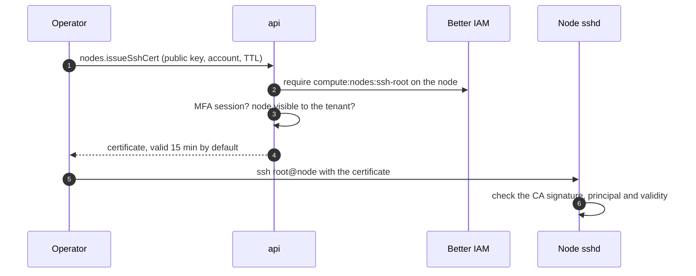

[Tunnels](/docs/guides/access/tunnels) and [commands](/docs/guides/nodes/commands) both go through the node's agent.
When the agent itself is the problem (it crashed, it cannot reach its gateway, its session is stuck), a platform
operator needs a way in that does not depend on it. That is break-glass SSH.

Better Compute runs an SSH certificate authority. An operator sends the public key of their own key pair to
`nodes.issueSshCert`; the CA signs it into an OpenSSH user certificate for one Unix account that lasts minutes, and
the operator connects with plain `ssh`. The private key never leaves their machine, no `authorized_keys` file
changes, and every certificate is recorded.



The certificate does not travel through a gateway: you reach the node's `sshd` over your own network path, such as
a management network or VPN.

## Set up the CA

`better-compute pki init` writes an SSH CA into the PKI bundle, and `better-compute pki show` prints its public key
as `sshCaPublicKey`. Pass the bundle's CA to `betterCompute` beside the exec ticket issuer; the CA is part of the
`tunnels` options, so it needs an issuer too (see [tunnels](/docs/guides/access/tunnels)).

```ts title="compute.ts"
export const compute = betterCompute({
  // database, secret, iam, modules, pki ...
  tunnels: {
    issuer: execTicketIssuer(bundle, { issuer: 'https://compute.example.com' }),
    ssh: bundle.sshCa, // [!code highlight]
    sshRequiresMfa: true, // the default
    sshAccounts: ['root'], // the default: the Unix accounts certificates may name
    limits: { tunnelsPerMinute: 10, sshCertsPerHour: 20 }, // the defaults, per identity and api replica
  },
});
```

Beyond the limits a call is `RATE_LIMITED` with `retryAfterMs`. Each api replica counts its own calls in memory.

To manage the key yourself, build the CA with `createSshCertificateAuthority` from `better-compute/pki` and give
every api replica the same private key:

<TypeTable
  type={{
    algorithm: {
      type: "'ed25519' | 'ecdsa-p256'",
      description: 'The CA key type when no privateKey is given. ECDSA P-256 suits FIPS-style deployments.',
      default: "'ed25519'",
    },
    privateKey: {
      type: 'KeyObject | Uint8Array | string',
      description: 'The CA private key (PEM or DER). ca.export().privateKeyPem returns it.',
      default: 'a new key',
    },
    comment: {
      type: 'string',
      description: 'The comment on the CA public key line.',
      default: "'better-compute-ssh-ca'",
    },
    maxTtlSeconds: {
      type: 'number',
      description: 'The longest certificate this CA signs. Values above 3600 are lowered to 3600.',
      default: '3600',
    },
    clock: { type: 'Clock', description: 'The clock validity is computed from.', default: 'systemClock' },
  }}
/>

`ca.publicKey` is the OpenSSH public key line (`ssh-ed25519 AAAA... better-compute-ssh-ca`). The tunnels module puts
it into every node's NodeSpec as `access.sshCaPublicKeys`.

## Issue a certificate

`nodes.issueSshCert` is decided as `compute:nodes:ssh-root` on the node (see
[the reference](/docs/reference/api/nodes#issuesshcert)).

<TypeTable
  type={{
    tenantId: { type: 'string', description: 'The tenant acting.', required: true },
    nodeId: { type: 'string', description: 'The node (node_...).', required: true },
    publicKey: {
      type: 'string',
      description: 'Your OpenSSH public key line, Ed25519 or ECDSA P-256, at most 4096 characters.',
      required: true,
    },
    principal: {
      type: 'string',
      description: "The Unix account to log in as: one of the module's sshAccounts.",
      default: "'root'",
    },
    ttlSeconds: { type: 'number', description: "Lifetime, 60 to 3600, and never past the caller's session.", default: '900' },
  }}
/>

A certificate never outlives the session that asked for it: when the caller's session has an expiry,
`validBefore` is the earlier of now plus `ttlSeconds` and that expiry.

| Situation | Error |
| --- | --- |
| No SSH CA is configured | `UNSUPPORTED` |
| The session has no MFA (and `sshRequiresMfa` is not `false`) | `ACCESS_DENIED` with `details.reason: 'mfa-required'` |
| The session ends within a minute | `ACCESS_DENIED` with `details.reason: 'session-ending'`: sign in again |
| IAM does not allow `compute:nodes:ssh-root` on the node | `ACCESS_DENIED` |
| The node is not visible to the tenant | `NOT_FOUND` |
| More than `sshCertsPerHour` certificates for this identity | `RATE_LIMITED` with `retryAfterMs` |
| An RSA or malformed key, an account not in `sshAccounts`, a TTL outside 60 to 3600 | `INVALID_INPUT` |

<Tabs items={['CLI', 'TypeScript']}>
<Tab value="CLI">

```bash
export BETTER_COMPUTE_URL=https://compute.example.com
export BETTER_COMPUTE_TOKEN=...   # a session verified with a second factor
better-compute ssh-cert --tenant root --node node_01jzq3v0m6y8x7w5t4s3r2p1na
ssh -i ~/.ssh/id_ed25519 root@10.20.0.14
```

`ssh-cert` sends `--key` (default `~/.ssh/id_ed25519.pub`, else `~/.ssh/id_ecdsa.pub`) as `publicKey`, `--account`
(default `root`) as `principal` and `--minutes` (default 15, 1 to 60) as `ttlSeconds`, and writes the certificate
beside the key as `<key>-cert.pub`. It prints the certificate's path, serial, principals, account and
`validBefore`. A `--key` that is not a `.pub` file, or whose content holds a private key, is refused before anything
is sent. The same call through `api`:

```bash
better-compute api nodes.issueSshCert \
  tenantId=root nodeId=node_01jzq3v0m6y8x7w5t4s3r2p1na \
  publicKey=@$HOME/.ssh/id_ed25519.pub principal=root ttlSeconds:=900 \
  --query certificate > ~/.ssh/id_ed25519-cert.pub
ssh -i ~/.ssh/id_ed25519 root@10.20.0.14
```

`--query certificate` prints the certificate line alone. Saved as `<key>-cert.pub` next to the private key, it is
picked up by `ssh` automatically.

</Tab>
<Tab value="TypeScript">

```ts
const issued = await client.$request<{
  nodeId: string;
  certificate: string;
  serial: string;
  keyId: string;
  principals: string[];
  validBefore: number;
}>('nodes/issueSshCert', {
  tenantId: 'root',
  nodeId: 'node_01jzq3v0m6y8x7w5t4s3r2p1na',
  publicKey: 'ssh-ed25519 AAAA... alice@laptop',
  principal: 'ubuntu',
  ttlSeconds: 600,
});
```

The tunnels module adds `issueSshCert` to the `nodes` group at run time, so the typed client does not list it; call
it by path.

</Tab>
</Tabs>

## The certificate

Every certificate is an OpenSSH `cert-v01` user certificate, written without external tools:

- **Type.** It follows your key: `ssh-ed25519-cert-v01@openssh.com` or `ecdsa-sha2-nistp256-cert-v01@openssh.com`.
- **One node-bound principal.** `<account>@<nodeId>`, such as `root@node_01jzq3…`, never a bare account. Each node
  accepts only its own principals (NodeSpec `access.sshPrincipals`), so a certificate for one node opens no other
  node that trusts the same CA. An empty principal list, which OpenSSH reads as "any account", is never issued.
- **Validity.** From 1 minute before issue (for clock skew) until `validBefore`, which the server computes on its own
  clock as now plus `ttlSeconds`, capped at the session's expiry.
- **Permissions.** Only `permit-pty`: no agent, port or X11 forwarding, and no user rc file.
- **Key id.** `bc:<identityId>:<nodeId>:ssh_<id>`, which sshd writes to its log on every login, so a log line leads
  back to the person and the issue record.
- **Serial.** Microseconds since the epoch, bumped past the last serial the CA issued.

To read one back, run `ssh-keygen -L -f ~/.ssh/id_ed25519-cert.pub`, or call `parseSshCertificate(line)` from
`better-compute/pki`, which returns every field and whether the signature verifies (`signatureValid`). Check that
`signatureKey` is your CA separately.

## Audit

Each issue writes an `audit_events` row with the admission context and publishes `node.ssh-cert.issued` (subject
`node/<id>`) with the key id, serial, principals, identity and `validBefore`. Route it to a
[webhook](/docs/guides/events/webhooks) if every break-glass login should page someone. The certificate itself is
recorded in `ssh_certificates` (serial, node, tenant, identity, issuing session, principal, key id, expiry) for
revocation, re-authorization and audit.

## Revoke a certificate

`nodes.revokeSshCert({ tenantId, nodeId, serial, reason? })` ends a certificate before `validBefore`. It is decided
as `compute:nodes:ssh-root` on the node, takes the decimal `serial` that `issueSshCert` returned and a `reason` of up
to 500 characters, and answers `{ nodeId, serial, principal, expiresAt, revokedAt }`. It is idempotent: the first
revocation stands. An unknown serial, or one issued for another node or tenant, is `NOT_FOUND`.

A revocation invalidates the node's desired state and publishes `node.ssh-cert.revoked`. From the next NodeSpec on,
`access.sshRevokedSerials` lists the node's revoked certificates that are still within their lifetime: the node's
KRL, for sshd's `RevokedKeys`. The hourly `tunnels.ssh-certificates-gc` reconciler drops records a day past their
expiry, in batches of 5,000.

Revocation also happens without a call, the same way (the serial joins the node's KRL through its next NodeSpec):

| Trigger | Revokes | Where |
| --- | --- | --- |
| A Better IAM role activation ends (`binding:deactivate`) | The holder's live certificates in every tenant (an inherited binding reaches child tenants). A revocation that does not name its holder in `metadata.identityId` revokes nothing and is left to the re-decision | `serve`'s default IAM `binding` handler |
| The identity is offboarded, expires or is deleted (or the `IamReconcile` backstop finds it gone) | Every certificate it holds, in every tenant, before its streams close; an update such as a rename keeps them | `serve`'s default `identity` handler |
| The identity's sessions are revoked (`auth:session:revoke`, `auth:session:revoke-others`, `identity:revoke-sessions`) | Every certificate it holds, since the event does not say which session ended; issue a new one from a live session | `serve`'s default `sessions` handler |
| A re-decision says no | That certificate, with reason `access-withdrawn` | The `tunnels.ssh-certificates-reauthorize` reconciler |

The reconciler runs every minute and re-decides the 500 longest-unchecked live certificates: each one as
`compute:nodes:ssh-root` on its node for the session that issued it (`ssh_certificates.session_id`), through
`IamPort.authorizeSession`. An allow stamps `reauthorized_at`. This catches what Better IAM does not announce as an
event: a deleted binding, an expired role activation, a changed policy. A certificate recorded without a session
id, or an IAM port without `authorizeSession`, is not re-decided. Tenant-wide session revocations name no identity
and are left to this re-decision. Each revocation publishes `node.ssh-cert.revoked` in the certificate's own tenant.
See [IAM events](/docs/guides/iam#iam-events-compute-reacts-to).

<Callout type="warn" title="IAM down keeps certificates valid">
When the re-decision cannot reach Better IAM, the certificate stays valid until it expires, at most 1 hour after
issue, and the reconciler logs a warning. This is deliberate: break-glass access exists for outages, and IAM may be
part of one.
</Callout>

## Who has access

`nodes.listSshCerts` answers who holds, or held, break-glass access to a node: the certificates issued for it
through the tenant, newest first. It is decided as `compute:nodes:read` on the node, not `ssh-root`, because it is
audit information that the node's `node.ssh-cert.issued` and `node.ssh-cert.revoked` events already show to the same
readers (see [the reference](/docs/reference/api/nodes#listsshcerts)).

<TypeTable
  type={{
    tenantId: { type: 'string', description: 'The tenant that issued the certificates.', required: true },
    nodeId: { type: 'string', description: 'The node (node_...).', required: true },
    includeExpired: {
      type: 'boolean',
      description: 'Also certificates past their expiry. Records are kept a day after expiry, then dropped.',
      default: 'false',
    },
    limit: { type: 'number', description: 'Page size, 1 to 500.', default: '100' },
    cursor: { type: 'string', description: 'The nextCursor of the previous page.' },
  }}
/>

It answers `{ items, nextCursor? }`. Each item carries `serial`, `nodeId`, `identityId` (who asked for it),
`principal`, `keyId`, `issuedAt`, `expiresAt` and `state`: `active`, `expired` or `revoked`. A revoked item adds
`revokedAt`, `revokedBy` (an identity, or `iam` for a revocation driven by IAM) and `revokeReason`. The list never
returns the certificate or any key. Without `includeExpired`, revoked certificates that have not yet expired are
still listed.

Pages are keyed on `(issuedAt, serial)`, so a page boundary never drops or repeats a certificate. A node the tenant
cannot see is `NOT_FOUND`; a malformed cursor is `INVALID_INPUT`. Like `issueSshCert`, the method is added to the
`nodes` group at run time, so call it by path:

```bash
better-compute api nodes.listSshCerts tenantId=root nodeId=node_01jzq3v0m6y8x7w5t4s3r2p1na includeExpired:=true
```

## What the node needs

The node must trust the CA for user certificates, accept only its own principals and honour the revocation list.
The control plane sends all three in NodeSpec `access` (`sshCaPublicKeys`, `sshPrincipals`, `sshRevokedSerials`),
and bcd's `access` converger (`daemon/internal/agent/access.go`) turns them into sshd configuration:

| File | Content |
| --- | --- |
| `/etc/ssh/sshd_config.d/10-better-compute.conf` | The drop-in below |
| `/etc/ssh/bc_ca.pub` | The CA public keys, one per line |
| `/etc/ssh/bc_principals/<account>` | This node's principals for that account, `<account>@<nodeId>`, one per line |
| `/etc/ssh/bc_krl` | An OpenSSH KRL revoking `sshRevokedSerials` under every CA key |

```text title="/etc/ssh/sshd_config.d/10-better-compute.conf"
# Written by bcd from NodeSpec access (break-glass SSH certificates). Do not edit.
TrustedUserCAKeys /etc/ssh/bc_ca.pub
AuthorizedPrincipalsFile /etc/ssh/bc_principals/%u
RevokedKeys /etc/ssh/bc_krl
```

- **Only this node's principals.** A principal for another node, or one whose account is empty or contains `/`,
  `\`, `.` or whitespace, is never written, so a certificate for one node cannot open another that trusts the same CA.
  Without an `AuthorizedPrincipalsFile`, sshd would accept only a principal equal to the account name, which these
  certificates never carry.
- **A native KRL.** bcd encodes the KRL itself (OpenSSH's `PROTOCOL.krl`, a certificate-serial section per CA key,
  `krl_version` set to the spec generation). With no revoked serials it is a valid empty KRL. The Go tests check the
  file with `ssh-keygen -Q` when it is installed.
- **Reloads only when needed.** sshd reads the CA, principals and KRL files at each login, so a new revocation takes
  effect without a reload. bcd runs `systemctl reload-or-restart` on `ssh`, then `sshd`, only when the drop-in
  itself is written or removed.
- **Empty removes everything.** An empty or absent `access` section removes every file bcd wrote, so the node
  stops trusting the CA when the control plane stops sending it. Stale principal files are removed on every pass.

The FakeDaemon has no such converger and still reports a non-empty `access` section as `SectionUnsupported`. On a
node without bcd, configure sshd the same way by hand with the `sshCaPublicKey` that `better-compute pki show`
prints, and build the KRL with `ssh-keygen -k`. Logging in as `root` also needs `PermitRootLogin` to allow key
logins; its default, `prohibit-password`, does.

## In the console

A platform administrator sees a **Break-glass SSH** panel on each node's page. It takes your public key, the
account (default `root`) and a lifetime of 5, 15, 30 or 60 minutes, and returns the certificate with a copy button
and the commands to save and use it. A pasted private key is refused in the browser before anything is sent. When
the session lacks MFA, it asks you to sign in again with a second factor instead of showing the error.

Under **Who holds access** the panel lists the node's certificates from `nodes.listSshCerts` (holder, principal,
issued, until, state and revocation reason, with **Include expired**), and every active one has a **Revoke** button
that calls `nodes.revokeSshCert` after a confirmation. See [the console](/docs/guides/clients/console#break-glass-ssh).

## Sandbox certificates are separate

[Sandboxes](/docs/guides/vps/sandboxes#run-code-inside) use SSH certificates too, from a second CA: `tunnels.sandboxSsh`
(the PKI bundle's sandbox SSH CA), never `tunnels.ssh`. The differences:

| | Break-glass | Sandbox exec |
| --- | --- | --- |
| Method and action | `nodes.issueSshCert`, `compute:nodes:ssh-root` on the node | `sandboxes.exec`, `compute:sandboxes:exec` on the sandbox |
| Principal | `<account>@<nodeId>` | `<account>@<instanceId>`, account default `sandbox` |
| Lifetime | 60 s to 1 h, default 15 min | 60 s to 15 min, default 10 min |
| Session | MFA by default | a signed-in session, not an API key; no MFA requirement |
| Who trusts the CA | nodes, through NodeSpec `access` and bcd | sandbox guests, through the user data vps renders |
| Revocation | recorded in `ssh_certificates`, KRL on the node, re-decided every minute | none in the guest: the short lifetime, plus tunnel re-authorization |
| Path | your own network to the node's sshd | always through a tunnel |

Because the two CAs differ, a sandbox certificate never opens a node and a break-glass certificate never opens a
sandbox. The tunnels module refuses a CA public key that is not one printable line, since it is written into sshd
configuration.

## Shipped and planned

| Behavior | State |
| --- | --- |
| `nodes.issueSshCert` with MFA, TTL at most 1 h and never past the session, node-bound principal, `permit-pty` only, recorded, rate-limited | Shipped when `tunnels.ssh` is set |
| The CA key, principals and revoked serials in NodeSpec `access` | Shipped |
| Nodes applying them automatically | In bcd's `access` converger (built and tested, bcd not released yet); not in the FakeDaemon |
| `nodes.revokeSshCert` and the node's KRL (`access.sshRevokedSerials`) | Shipped in the control plane; bcd writes the KRL that sshd enforces |
| Revoking certificates on `binding:deactivate` | Shipped as `serve`'s default IAM `binding` handler |
| Revoking certificates on offboarding, expiry, deletion and session revocation | Shipped as `serve`'s default `identity` and `sessions` handlers |
| Re-deciding live certificates every minute (`tunnels.ssh-certificates-reauthorize`) | Shipped; IAM unreachable keeps a certificate until it expires |
| `nodes.listSshCerts`: who holds or held a certificate for a node, with its state | Shipped, and in the console's node page with a revoke button per certificate |
| Rotating the SSH CA | No rotation flow; `access.sshCaPublicKeys` lists only the current key |
