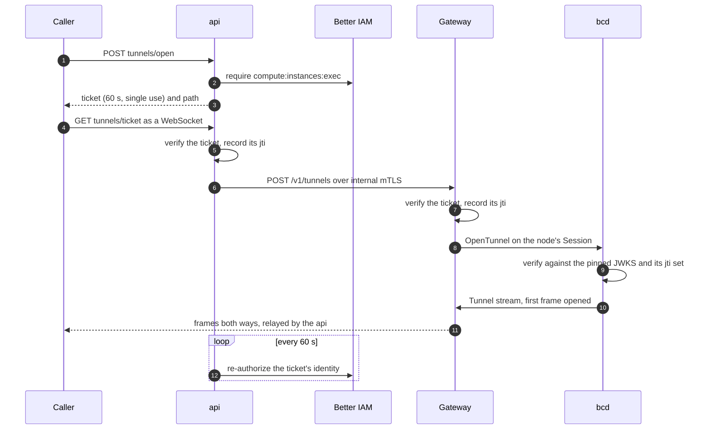

A <Term id="tunnel">tunnel</Term> is a two-way byte stream between a caller and something on a node: a shell in an
instance, the console of a node, an instance's SSH server, or one TCP port. It rides the connection the node already
holds to its <Term id="gateway">gateway</Term>, so the node needs no inbound port, no VPN and no bastion host. The
API decides who may open one, and every hop checks a short-lived ticket before any byte flows.



<Callout type="warn" title="Node consoles work in bcd; instance tunnels need a VM runtime">
  Every half is implemented and tested, including the daemon's (steps 8 and 9) in the Go `bcd`, which is built but
  not released. `tests/e2e/bcd.test.ts` opens a node console through the api's relay, the gateway and a real bcd, and
  the shell's exit status comes back. bcd dials instance `ssh` and `tcp` tunnels to the instance's own address, but
  only a host that runs an instance runtime advertises `tunnel.instance-dial`, and today only fakehw builds have one;
  on a real host build `tunnels.open` refuses instance `ssh` and `tcp` tunnels outright, and `exec` into an instance
  closes at once with exit status 127. See [the node half](#the-node-half). The TypeScript FakeDaemon answers every
  op with an echo shell, so tunnels also open end to end in the tests and in `better-compute dev --sim N`.
</Callout>

## Turn tunnels on

Tunnels are off until you give `betterCompute` an exec ticket issuer. With one, the server registers
`tunnels.open` (and `nodes.issueSshCert`, see [break-glass SSH](/docs/guides/access/ssh)) and puts the issuer's JWKS
into every node's NodeSpec as `access.execTicketJwks`.

```ts title="compute.ts"
import { loadPkiBundle } from 'better-compute/cli';
import { execTicketIssuer } from 'better-compute/pki';
import { betterCompute } from 'better-compute/server';

// `better-compute pki init` puts an exec ticket key and the SSH CA into the bundle.
const bundle = await loadPkiBundle('.better-compute/pki.json', process.env);

export const compute = betterCompute({
  // database, secret, iam, modules, pki ...
  baseURL: 'https://compute.example.com',
  tunnels: {
    // `iss` must be the deployment's public origin: `serve` and its gateways check it.
    issuer: execTicketIssuer(bundle, { issuer: 'https://compute.example.com' }),
    ssh: bundle.sshCa,
  },
});
```

<TypeTable
  type={{
    issuer: {
      type: 'ExecTicketIssuer',
      description: 'From execTicketIssuer(bundle, { issuer }) or createExecTicketIssuer({ issuer, privateKey }). A tunnels object without one throws INVALID_CONFIG.',
      required: true,
    },
    ssh: {
      type: 'SshCertificateAuthority',
      description: 'The compute SSH CA for nodes.issueSshCert. Without it that method answers UNSUPPORTED.',
    },
    sshRequiresMfa: {
      type: 'boolean',
      description: 'Refuse nodes.issueSshCert for sessions without MFA.',
      default: 'true',
    },
  }}
/>

Every api replica and every gateway must use the same ticket key. A key's `kid` is its RFC 7638 thumbprint, so
processes holding the same key name it the same way and a node's pinned JWKS matches any replica. Without
`privateKey`, `createExecTicketIssuer` generates a key per process, which only works for a single process.

<TypeTable
  type={{
    issuer: { type: 'string', description: 'The iss claim. Use the origin of baseURL.', required: true },
    privateKey: {
      type: 'KeyObject | Uint8Array | string',
      description: 'A P-256 private key (PEM or DER). Shared by every replica.',
      default: 'a new key',
    },
    keepPrevious: {
      type: 'number',
      description: 'How many earlier keys rotate() keeps in the JWKS.',
      default: '1',
    },
    clock: { type: 'Clock', description: 'The clock iat and exp come from.', default: 'systemClock' },
  }}
/>

### With better-compute serve

`better-compute serve` wires both roles from `tunnels.issuer`:

- The **api role** mounts `GET {basePath}/tunnels/{ticket}`, verifies tickets against the issuer's JWKS with
  `iss` equal to the public origin, relays through `gatewayTunnelRelay`, and re-authorizes callers with
  `tunnelAuthorizer(iam)` from `@better-compute/iam`.
- The **gateway role** gets `tunnels: { jwks, issuer }` with the same JWKS and origin.

The optional `host.tunnels` block of the configuration's `host` export tunes the api side:

<TypeTable
  type={{
    authorize: {
      type: '(input) => Promise<boolean>',
      description: 'The re-check. Default tunnelAuthorizer(iam), which needs an IamPort with authorizeSession (the embedded bridge with sessionReviewer, or remote authorizeSessions).',
    },
    control: {
      type: '{ tls, timeoutMs }',
      description: "Client TLS from the internal CA for the gateways' internal control APIs.",
    },
    reauthorizeMs: { type: 'number', description: 'How often the caller is re-checked.', default: '60000' },
    maxDurationMs: { type: 'number', description: 'Hard cap on a tunnel.', default: '43200000 (12 h)' },
    onClose: {
      type: '(event) => void',
      description: 'Called with { tunnelId, nodeId, subject, reason } when a tunnel ends, for your audit trail.',
    },
  }}
/>

`better-compute doctor` reports `host.tunnels` when no re-authorizer can be built, and `host.gateway.tunnels` when
tunnels are configured but the gateway has no internal control API (`host.gateway.internal`) to open them on. See
[deployment](/docs/operations/deployment) and [PKI](/docs/operations/pki).

### With your own HTTP server

`handleTunnel` answers an `upgrade` request. It returns `false` for paths that are not tunnel paths, answers every
failure on the socket itself, and never rejects. The console's `server.mjs` mounts it this way:

```ts title="server.ts"
import { createServer } from 'node:http';
import { gatewayTunnelRelay } from 'better-compute/gateway';
import { tunnelAuthorizer } from 'better-compute/iam';
import { handleTunnel } from 'better-compute/server';

const tunnels = {
  sql: compute.context.sql,
  issuer, // the same ExecTicketIssuer passed to betterCompute({ tunnels })
  issuerName: 'https://compute.example.com',
  relay: gatewayTunnelRelay({ sql: compute.context.sql, tls: internalClientTls }),
  authorize: tunnelAuthorizer(compute.context.iam),
};

const server = createServer(compute.nodeHandler);
server.on('upgrade', (req, socket, head) => {
  void handleTunnel(req, socket, head, tunnels).then((handled) => {
    if (!handled) socket.destroy();
  });
});
```

`handleTunnel` also takes `basePath` (default `/api/compute`), `jtiCache`, `reauthorizeMs`, `authorizeTimeoutMs`
(10 s), `iamOutageMs` (2 min), `maxDurationMs` (12 h), `maxMessageBytes` (1 MiB), `pingIntervalMs` (30 s) and
`onClose`.

## Open a tunnel

`tunnels.open` is decided as `compute:instances:exec` on the instance, or as `compute:nodes:console` on the node
when the input names a node. See [the reference](/docs/reference/api/tunnels#open).

<TypeTable
  type={{
    tenantId: { type: 'string', description: 'The tenant acting.', required: true },
    instanceId: { type: 'string', description: 'An instance (inst_...). Give exactly one of instanceId and nodeId.' },
    nodeId: { type: 'string', description: 'A node (node_...), for its console.' },
    op: {
      type: "'exec' | 'console' | 'ssh' | 'tcp'",
      description: 'console is for nodes only; exec, ssh and tcp are for instances only.',
      required: true,
    },
    port: { type: 'number', description: 'For tcp only, and required there: 1 to 65535.' },
  }}
/>

It refuses what cannot be tunneled:

| Situation | Error |
| --- | --- |
| Both or neither of `instanceId` and `nodeId`, a wrong op for the target, a `port` without `tcp` | `INVALID_INPUT` |
| An unknown instance, a draft, another tenant's instance, or a node the tenant cannot see | `NOT_FOUND` |
| A provider instance, which has no node agent to tunnel through | `UNSUPPORTED` |
| An instance that is not `running`, or a node that is not connected to a gateway | `INVALID_STATE` |
| An instance `ssh` or `tcp` tunnel whose node's current session does not advertise the `tunnel.instance-dial` capability (`node_sessions.capabilities`, from `Hello`) | `UNSUPPORTED` with `details: { reason: 'daemon-capability', capability }` |

The capability check exists because a daemon that cannot dial the instance's own address would reach the host's
loopback services instead. `exec` and node consoles do not need it.

The result carries the ticket and where to use it:

```json title="tunnels.open result"
{
  "tunnelId": "tun_01jzq3v0m6y8x7w5t4s3r2p1n0",
  "nodeId": "node_01jzq3v0m6y8x7w5t4s3r2p1na",
  "instanceId": "inst_01jzq3v0m6y8x7w5t4s3r2p1ia",
  "op": "exec",
  "ticket": "eyJhbGciOiJFUzI1NiIsInR5cCI6ImJjLWV4ZWMrand0Ii...",
  "expiresAt": 1790251260000,
  "path": "tunnels/eyJhbGciOiJFUzI1NiIsInR5cCI6ImJjLWV4ZWMrand0Ii..."
}
```

The server adds the `tunnels` group at run time, so the typed client does not list it. Call it by path, over HTTP,
or from the CLI:

<Tabs items={['TypeScript', 'HTTP', 'CLI']}>
<Tab value="TypeScript">

```ts
const opened = await client.$request<{ tunnelId: string; path: string }>('tunnels/open', {
  tenantId: 'acme',
  instanceId: 'inst_01jzq3v0m6y8x7w5t4s3r2p1ia',
  op: 'exec',
});
```

</Tab>
<Tab value="HTTP">

```bash
curl -s https://compute.example.com/api/compute/tunnels/open \
  -H "authorization: Bearer $BETTER_COMPUTE_TOKEN" \
  -H 'content-type: application/json' -H 'x-better-compute: 1' \
  -d '{"tenantId":"acme","instanceId":"inst_01jzq3v0m6y8x7w5t4s3r2p1ia","op":"exec"}'
```

</Tab>
<Tab value="CLI">

```bash
better-compute api tunnels.open tenantId=acme instanceId=inst_01jzq3v0m6y8x7w5t4s3r2p1ia op=exec
```

The CLI prints the ticket; it does not open the WebSocket.

</Tab>
</Tabs>

Each call publishes `tunnel.issued` (subject `instance/<id>` or `node/<id>`) with the tunnel id, node, op,
identity, expiry and port, and writes an audit row like every mutation.

## Exec tickets

An <Term id="exec-ticket">exec ticket</Term> is a compact ES256 JWT with header `typ: bc-exec+jwt`, so no other JWT
(a session JWT, a workload token) passes as one.

| Claim | Value |
| --- | --- |
| `iss` | The issuer name, the deployment's origin |
| `aud` | `node:<nodeId>`: the only daemon that may accept it |
| `sub` | The caller's Better IAM identity id |
| `sid` | The tunnel id (`tun_...`), also `tunnelId` in the result |
| `op` | `exec`, `console`, `ssh` or `tcp` |
| `jti` | A single-use id (`tkt_...`) |
| `iat`, `exp` | Seconds; at most 60 apart |
| `tnt`, `inst`, `port` | Tenant, instance and TCP port, when they apply |
| `ses` | The caller's IAM session, for re-authorization |
| `act` | The action `tunnels.open` decided, re-decided as is |

`verifyExecTicket` is the check the api, the gateway and the daemon share. It refuses with `ACCESS_DENIED` and a
`details.reason`: `malformed`, `algorithm must be ES256`, `not an exec ticket`, `unknown key`, `bad signature`,
`ticket for another node`, `foreign issuer`, `lifetime too long`, `issued in the future`, `expired`,
`op not allowed` or `replayed`. Clock tolerance is 5 seconds, and a ticket id is recorded only after every other
check passed.

`issuer.rotate()` starts signing with a new key and keeps the previous `keepPrevious` keys in the JWKS, so tickets
and NodeSpecs in flight stay valid across a rotation. The ticket travels in the URL path, but it is single use and
expires within a minute, so one that shows up in a proxy log is already spent.

## Connect

Open `wss://<host>{basePath}/tunnels/<ticket>` within 60 seconds. `tunnelUrl` builds it from the base URL and the
`path` in the result, and `connectTunnel` speaks the frames, in browsers and in Node.js 22 and later:

```ts title="exec.ts"
import { connectTunnel, tunnelUrl } from 'better-compute/client';

const tunnel = connectTunnel({
  url: tunnelUrl('https://compute.example.com', '/api/compute', opened.path),
});
tunnel.onData((data, channel) => (channel === 1 ? process.stderr : process.stdout).write(data));
await tunnel.ready; // the node opened its end
tunnel.resize(40, 120);
tunnel.write('nvidia-smi\n');
tunnel.close(); // the node reports its exit status, then the socket closes
const { exitCode, reason } = await tunnel.exited;
```

Each binary WebSocket message is one protobuf `bettercompute.agent.v1.TunnelFrame`. Its body is `opened` (the
node's first frame), `data` (channel 0 is stdout or the byte stream, 1 is stderr), `resize` (rows and columns) or
`closed` (exit code and reason). The server stamps the ticket's tunnel id on everything the caller sends.

The upgrade is refused with a plain HTTP answer before any WebSocket exists:

| Status | Code | When |
| --- | --- | --- |
| 426 | `METHOD_NOT_ALLOWED` | Not a WebSocket version 13 upgrade |
| 400 | `INVALID_INPUT` | The ticket in the path cannot be decoded |
| 403 | `ACCESS_DENIED` | The ticket fails verification (the reason is not revealed) |
| 409 | `INVALID_STATE` | The node has no session on any gateway |
| 502 | The gateway's code | The gateway refused or could not open the tunnel |
| 500 | `INTERNAL_ERROR` | Anything unexpected |

Once open, the socket closes with one of these:

| Close code | Reason | Why |
| --- | --- | --- |
| 1000 | `closed`, `caller-closed` | The node ended the stream, or the caller hung up |
| 1003 | `binary TunnelFrames only` | The caller sent a text message |
| 1007 | `not a TunnelFrame` | A binary message that does not decode |
| 1008 | `revoked` | A re-check answered no |
| 1008 | `max-duration` | 12 hours passed |
| 1009 | `message too large` | A message over `maxMessageBytes` (1 MiB) |
| 1011 | `iam-unreachable` | No successful re-check for 2 minutes |
| 1011 | `relay-error` | The gateway stream failed |

The server pings every 30 seconds and drops a peer that has been silent for two periods. Backpressure runs end to
end: a full socket on one side pauses reading on the other.

### From a terminal

The CLI does all of the above for you. `better-compute console --node ID` (op `console`) and `better-compute exec
--instance ID` (op `exec`) call `tunnels.open` as the token, open the WebSocket on the server named by `--url`, and
attach your terminal in raw mode until the remote program exits:

```bash
better-compute console --url https://compute.example.com --tenant acme --node node_01k5w…
```

Every key goes to the remote, Ctrl-C included; Ctrl-] detaches. The window size is sent at start and on every
resize. The command exits with the remote program's status, and with 255 when the tunnel breaks, like ssh. Both
need `--url`: without it they fail with `UNSUPPORTED` before spending a ticket. See the
[CLI guide](/docs/guides/clients/cli#interactive-access).

## Re-authorization and revocation

While a tunnel is open, the api re-checks the caller every 60 seconds, with a 10-second timeout per check.

- **A no** closes the tunnel with `revoked`.
- **An error or a timeout** counts as IAM unreachable; once 2 minutes pass without a successful check, the tunnel
  closes with `iam-unreachable`, even while a check still hangs.
- **12 hours** is the hard maximum, whatever the answers.

How the check is made is described in [access](/docs/guides/access): with the upgrade request's credential when it
carried one, otherwise by the identity and session recorded in the ticket. A delegated or agent session cannot be
re-decided that way and closes at its first re-check.

The gateway keeps its own registry of the tunnels it relays and can close them without the api:

- revoking a node's identity closes every tunnel to that node (reason `revoked`);
- `POST /v1/tunnels/close` on its internal control API, with `{ tunnelId?, nodeId?, subject?, reason }`, closes the
  matching tunnels and answers `{ closed }`. `gatewayControlClient(...).closeTunnels(filter, reason)` calls it;
- a gateway that stops closes all of its tunnels (`gateway-stopped`).

### Closing on IAM revocation

IAM revocations close tunnels at once, without waiting for the 60-second re-check. The IAM bridge's inbox routes
`delegation:revoke`, `agent:suspend` and `agent:suspend-all` to its `agent` handler, and
`agentStreamCloser(gatewayStreamCloser(() => gatewayClients))` from `better-compute/iam` turns each into one close
request sent to every gateway's control API:

| Event | Tunnels closed |
| --- | --- |
| `delegation:revoke` | Those opened under the delegation (and its agent, when the event names it) |
| `agent:suspend` | Those the agent opened |
| `agent:suspend-all` | Every agent's tunnels in the tenant |

The request goes out as soon as the `iam.inbox` job (every 2 seconds) drains the event, without waiting for the inbox
transaction, and a gateway that is away never fails the drain: close failures go to `onError`. When a revoked
delegation had live hand-offs, IAM revokes them without naming them, so the tenant's agent tunnels are re-authorized
at once (`POST /v1/tunnels/reauthorize`) instead of at their next check. The 60-second re-check stays the backstop.
`tests/e2e/access.test.ts` holds the v0.3 exit: on a real embedded Better IAM, `delegations.revoke` closes the agent's
tunnel in under 5 seconds with the revocation's reason, and the administrator's own console stays open.

`better-compute serve` wires this for you with `host.iam`:

```ts title="better-compute.config.ts"
export const host = defineHost(async () => ({
  iam: { bridge }, // the bridge whose modules and port the configuration uses
}));
```

`installIamHandlers` then installs the default reactions before the workers start: `agent` closes the agent's
tunnels on every gateway that heartbeated in the last 2 minutes (`gatewayStaleMs`), over its `internal_url` with the
TLS of `host.tunnels.control` (h2c only without TLS), and drops the agent's cached authentications. Better IAM
names the identity, not the session, in its session events, so:

- an offboarded, expired or deleted identity closes its tunnels on every gateway and its streams in this process's
  `host.iam.streams` (such as `GET /watch` streams);
- `auth:session:revoke`, `auth:session:revoke-others` and `identity:revoke-sessions` close the identity's local
  streams (clients reconnect and are re-authorized) and make every gateway re-authorize the identity's tunnels at
  once: the revoked sessions' shells close, the others keep running;
- a `binding:deactivate` (a role activation ended) makes every gateway re-check the holder's tunnels, and revokes
  the holder's break-glass SSH certificates ([SSH](/docs/guides/access/ssh#revoke-a-certificate));
- role- and tenant-wide revocations are left to the periodic re-check. Your own `host.iam.handlers` replace the
default of the same name. `better-compute doctor` warns `host.iam` when the IAM module is registered without it. See
[delegated confirmation](/docs/guides/iam/delegated-confirmation).

## The gateway half

The gateway verifies every ticket itself before it asks the node. `createGateway({ tunnels })` takes `jwks` (a
function returning the issuer's JWKS, read on every open), `issuer`, `jtiCache`, an optional `reauthorize`,
`reauthorizeMs` (60 s), `iamOutageMs` (2 min), `maxDurationMs` (12 h) and `openTimeoutMs` (10 s, how long the node
has to open its `Tunnel` stream). Opening fails with `ACCESS_DENIED` for a bad, foreign or replayed ticket,
`NOT_FOUND` when the node has no session on that gateway, `CONFLICT` when the tunnel id is already open, and
`INVALID_STATE` when the node did not open in time, or at once when the node is connected over the WebSocket
fallback, which carries Session frames only. A `Tunnel` stream from a node that no gateway asked for, or one
that answers for another node's tunnel, is refused.

`serve`'s gateway role wires `reauthorize` itself when the IAM port can re-authorize sessions: every 60 seconds, and
on `POST /v1/tunnels/reauthorize`, it decides the ticket's action (`compute:instances:exec` or
`compute:nodes:console`) on its instance or node again for the ticket's identity and session, the same decision
the api side makes. A ticket without a session, or with an unexpected action, fails closed.

On the api side, `gatewayTunnelRelay` looks up the gateway holding the node's session (`node_sessions.gateway_id`,
then `gateways.internal_url`, cached 30 s) and calls that gateway's `gatewayControlClient(...).openTunnel`, an
HTTP/2 stream (`POST /v1/tunnels`) on the internal mTLS control API. An unregistered
gateway, or one that takes longer than 10 seconds, is `UNAVAILABLE`. When the caller hangs up, the node gets
5 seconds to report its exit status. See [the gateway](/docs/daemon/gateway) and
[the protocol](/docs/daemon/protocol).

## The node half

bcd answers `OpenTunnel` itself and trusts nothing the gateway says about the ticket
(`daemon/internal/agent/tunnels.go`, `daemon/internal/pki/tickets.go`):

1. `pki.VerifyExecTicket`, the Go port of `verifyExecTicket`, checks the header `typ` `bc-exec+jwt`, ES256 under the
   key with the ticket's `kid` in the JWKS pinned by its NodeSpec (`access.exec_ticket_jwks_json`, kept by the
   [access converger](/docs/guides/access/ssh#what-the-node-needs)), `aud` `node:<its own id>`, a lifetime of at most
   60 s that is neither in the future nor expired (5 s leeway, against server time), a known op, and a `sid` and a
   `jti`. Tickets that `@better-compute/pki` issues are interop fixtures of the Go tests.
2. The `jti` goes into the journal (at most 10,000 live ids, expired ones pruned), so a restart does not forget a
   spent ticket. A known `jti`, or a full set, is refused as `replayed`.
3. The ticket's `sid` must equal the tunnel id in `OpenTunnel`, so a gateway cannot reuse a ticket for another
   stream.
4. bcd dials the `Tunnel` RPC, sends `opened` first, and starts the program for the op.

A refused ticket opens nothing: bcd logs `tunnel refused` with the reason, and the gateway's open times out after
10 seconds, exactly as if the node had not answered. A node without a pinned JWKS refuses every ticket, and at most
16 tunnels are open at once.

A ticket that names an instance (`inst`) must reach that instance and nothing of the host, whose loopback (its sshd,
admin ports, other tenants' forwards) is off limits to a tenant. So bcd runs different programs for node and instance
tickets. When a program cannot start, the tunnel opens and closes at once with exit status 127 and the reason.

| Op | Node ticket | Instance ticket |
| --- | --- | --- |
| `console` | A login shell (`/bin/bash -l`, or `/bin/sh -l`) as root in `/`, on a pseudo-terminal opened through `/dev/ptmx` without cgo. `resize` sets the window size, a hang-up sends `SIGHUP` to the shell's process group, and `closed` carries the shell's exit status | Refused: it needs a guest agent |
| `exec` | Refused: `exec` is into an instance; a host shell is `console`, decided as `compute:nodes:console` | Refused: it needs a guest agent |
| `ssh` | A TCP connection to the node's own sshd on `127.0.0.1:22` | A TCP connection to port 22 of the instance's own address |
| `tcp` | A TCP connection to the ticket's `port` on `127.0.0.1` | A TCP connection to the ticket's `port` on the instance's own address |

For an instance ticket bcd looks the instance up in its runtimes. It must be a running domain that bcd manages on
this host (a stopped instance or one on another host is refused), and bcd dials the first of its reported addresses
that is not loopback, link-local, multicast, unspecified or an address of the host itself, so an instance ticket
never reaches the host.

`tunnels.open` issues `ssh`, `tcp` and `exec` only for instances and `console` only for nodes. The API guards instance
`ssh` and `tcp` with a capability: the node's current session must advertise `tunnel.instance-dial` in its `Hello`
(stored in `node_sessions.capabilities`; see [sessions](/docs/daemon/sessions#hello)), or `tunnels.open` answers
`UNSUPPORTED` before any ticket is minted. bcd advertises it only when it runs an instance runtime, which today means
a fakehw build; on a real host build `console` is the only op that runs. An instance `exec` needs no capability, and
bcd refuses it as above.

## The web terminal

The console (`apps/console`) has a terminal on every instance (`/instances/<id>/terminal`, decided as
`compute:instances:exec`) and a console on every connected node (`/nodes/<id>/console`, decided as
`compute:nodes:console`; the node page shows the link only while the node is connected). Keys, pastes and
resizes go straight to the target; **Reconnect** asks for a new ticket.

Both pages use `createTerminalSession` from `@better-compute/console-kit`, which you can use in your own UI:

```ts title="terminal.ts"
import { createTerminalSession } from '@better-compute/console-kit';

const session = createTerminalSession(api, {
  tenantId: 'acme',
  instanceId: 'inst_01jzq3v0m6y8x7w5t4s3r2p1ia', // or nodeId for a node's console
  op: 'exec', // or 'ssh'
  baseURL: 'https://compute.example.com',
});
session.subscribe(() => render(session.get())); // status: idle | opening | open | closed | error
session.onOutput((data) => terminal.write(data));
await session.open(); // tunnels.open, then the WebSocket
session.write('ls\n');
```

The store keeps the last 256 KiB of output (`maxBufferedBytes`) and the exit status once the session ends.

The console serves the upgrade from `node server.mjs`, because Next.js route handlers cannot. It reads the ticket
key from `CONSOLE_EXEC_TICKET_KEY_FILE`, the SSH CA from `CONSOLE_SSH_CA_KEY_FILE`, and its mTLS identity toward
gateways from `CONSOLE_GATEWAY_TLS_CERT`, `_KEY` and `_CA`. In development it generates the two keys; in
production, without the key file, tunnels are off. See [the console](/docs/guides/clients/console).

## Limits and defaults

| Setting | Value |
| --- | --- |
| Ticket lifetime | 60 s at most, single use at the api, the gateway and the daemon |
| Clock tolerance on tickets | 5 s |
| Re-authorization | Every 60 s, 10 s per check |
| IAM outage before closing | 2 min |
| Tunnel lifetime | 12 h at most |
| WebSocket message | 1 MiB at most; ping every 30 s |
| Node open timeout (gateway) | 10 s |
| Tunnels open at once on one bcd node | 16 |
| Spent ticket ids a bcd node remembers | 10,000, until each expires |
| Exit status grace after the caller hangs up | 5 s |
| TCP ports | 1 to 65535, instances only |
