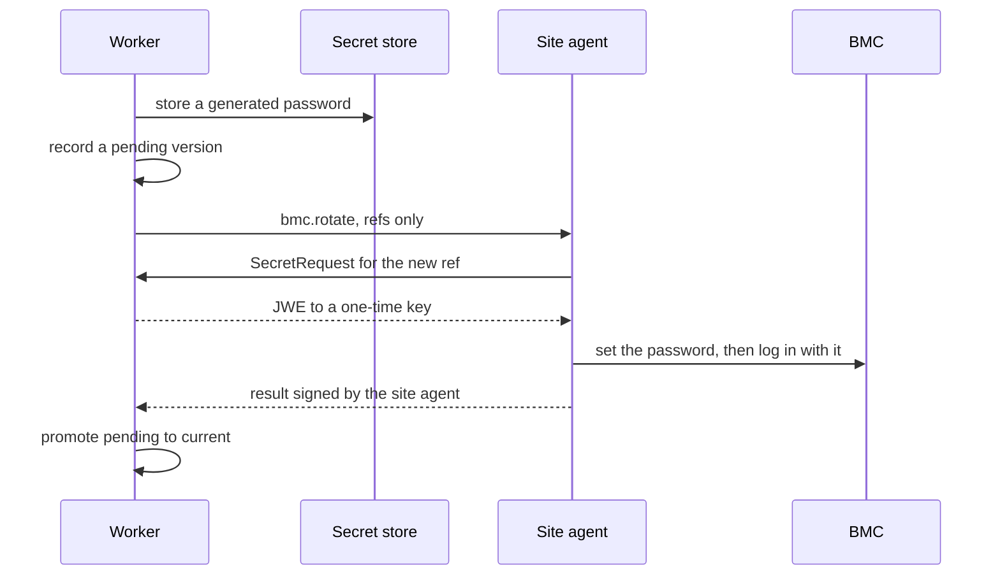

A <Term id="bmc">BMC</Term> is the one part of a server that works when the server does not: it can
power the machine, pick its boot device, mount media and report hardware. Metal drives every machine
through its BMC, from a <Term id="site-agent">site agent</Term> on the site's management network,
because the control plane never dials into a site. This page covers the driver contract, the BMC
operations metal sends, and how BMC credentials are stored, delivered and rotated.

## Driver concerns

Importing `@better-compute/metal` merges ten driver kinds into `DriverKinds` of
`@better-compute/core` by declaration merging, so `defineDriver({ implements: { power: … } })`
type-checks wherever the package is imported. Each kind is one Ironic-style
<Term id="driver">driver</Term> concern:

| Concern | Operations | Built-in drivers arrive |
| --- | --- | --- |
| `power` | `getPower()`, `setPower(action)` | v0.2 |
| `management` | `setBootDevice(device, { persistent, uefi })`, optional `rotateCredential(newPassword, { username })` | v0.2 |
| `boot` | `prepareRamdisk(spec)`, `prepareInstance(boot)`, `cleanUp()` | v0.2 |
| `deploy` | `deploy(spec)`, `tearDown({ wipe })`, both streaming progress | v0.2 |
| `inspect` | `inspect()`, returning a `NodeInventory` | v0.2 |
| `virtual-media` | `insert(iso)`, `eject()` | v0.2 |
| `console` | `open()`, a byte stream (Serial-over-LAN) | draft until v0.3 |
| `bios` | `getSettings()`, `applySettings(settings)` | draft until v0.5 |
| `raid` | `applyLayout(layout)`, `clear()` | draft until v0.5 |
| `firmware` | `components()`, `update(component, image)` | draft until v0.5 |

`metalDriverKinds` holds the same table as data. One driver may implement several concerns, which
is what Ironic calls a hardware type:

```ts title="drivers/redfish.ts"
import { defineDriver, field, manifest } from 'better-compute/core';
import 'better-compute/metal'; // merges the metal driver kinds into DriverKinds

export const redfish = defineDriver({
  id: 'redfish',
  version: '1.0.0',
  runsOn: 'site',
  config: manifest({ address: field.url(), credentials: field.secret() }),
  implements: {
    power: (config) => ({ getPower: async () => 'on', setPower: async (action) => {} }),
    management: (config) => ({ setBootDevice: async (device, options) => {} }),
    'virtual-media': (config) => ({ insert: async (iso) => {}, eject: async () => {} }),
  },
  retrySafe: { power: ['getPower', 'setPower'], management: ['setBootDevice'] },
});
```

The built-in drivers (Redfish, IPMI and vendor BMCs through bmclib, PXE, iPXE and UEFI HTTP boot,
image streaming and kexec) run inside `bcd site` and `bcd ramdisk`, the Go daemon's v0.2 modes.
Today `bcd site` has Redfish built in, with the operations in [Redfish in bcd site](#redfish-in-bcd-site), and runs
every other BMC driver as a bcx plugin it hosts (51806ab). The repository has one such plugin, `bcx-ipmi`, for
[IPMI](#ipmi-through-bcx-ipmi); vendor BMCs through bmclib are not built. An operation for a driver the agent does not
host answers `unsupported-driver`. Out-of-process drivers in other languages come with bcx and
`@better-compute/driver-sdk` (v0.5). See [drivers](/docs/extending/drivers).

## How BMC operations run

Metal's BMC steps are control-plane steps: only the control plane knows the machine's BMC address
and credential reference, so each step builds a `bettercompute.site.v1.BmcOperationRequest` and sends
it to the site agent of the machine's site:

```json title="BmcOperationRequest (proto3 JSON)"
{
  "driver": "redfish",
  "address": "https://10.0.0.10",
  "credentialsRef": "secret://root/…",
  "operation": "power.setPower",
  "argsJson": "{\"action\":\"cycle\"}",
  "tlsSpkiSha256": "<base64, when the BMC certificate is pinned>"
}
```

A BMC enrolled with `bmc.driverOptions` also carries them in `driverOptionsJson` (site/v1 field 7, 51a3dfe), as
canonical JSON with sorted keys, so a batch leaf bound to the payload keeps the same bytes; the built-in Redfish driver
takes none and answers `invalid-config` if a request has any. The agent fetches the credentials by reference (below),
runs `<concern>.<operation>` on the driver
and answers a `BmcOperationResult` (`ok`, `resultJson`, `errorCode`, `message`). The command kinds
are all on the `control` lane and accepted only by agents with role `site`:

| Kind | Used by | Retry-safe | Flags | Timeout |
| --- | --- | --- | --- | --- |
| `bmc.query` | `power.getPower`, `inspect.oob`, firmware checks, reading BIOS settings and the RAID layout | yes | none | 2m |
| `bmc.boot` | `management.setBootDevice`, `media.insert`, `media.eject`, applying BIOS settings (pending until the next boot) | yes | destructive | 2m |
| `bmc.power` | `power.setPower`, `metal.power` | no | destructive | 5m |
| `bmc.rotate` | `metal.rotateBmcCredential` | no | attested by the site agent, destructive | 5m |
| `bmc.firmware` | firmware reflash | no | destructive | 1h |
| `bmc.storage` | applying or clearing a RAID layout (a v0.5 draft) | no | destructive | 1h |
| `boot.prepareRamdisk` | boot entries for a PXE boot | yes | none | 2m |
| `boot.cleanUp` | removing a node's boot entries | yes | none | 2m |
| `site.httpProxy` | one HTTP request to an agentless machine | no | destructive (0d42de8) | 1m |

A power cycle is not idempotent, so `bmc.power` is never retried blindly. Once its trust bundle holds
command-signing roots, an agent refuses every command that lacks a valid worker signature over the command body,
whatever its kind, so a compromised gateway cannot forge one (0d42de8; before, only destructive kinds needed one).
The destructive flag decides what falls under the v1.0 batch quorum. `bmc.boot` is destructive because the boot
device, virtual media and BIOS settings decide what a machine boots (with any later power cycle, that is a reimage),
and `bmc.rotate` because a changed password locks the platform out (9c14146, 3ff8131). `site.httpProxy` is
destructive because a request can change the machine it reaches, and bcd never lets it reach a BMC: the site agent
remembers every BMC host it has driven with a `bmc.*` command (`data_dir/bmc-hosts.json`) and refuses those hosts,
by name and by resolved address, and any `/redfish` path (`forbidden-target`), so a BMC is reached only through the
`bmc.*` kinds and their quorum. See [security](/docs/operations/security).

## Redfish in bcd site

`bcd site` answers every `bmc.*` kind with its Redfish client (`daemon/internal/redfish`). For each command it
fetches the credential with a `SecretRequest` bound to the command's workflow step, reads it as the enrolled
`{ username, password }` JSON or as a bare password (with the step's `username` argument as the account; the same
fallback fills a JSON without a username), and runs the operation:

| Operation | Redfish request | Result |
| --- | --- | --- |
| `power.getPower` | `GET` the address's system (the one it names, else the first `ComputerSystem`) | `{ power: 'on' \| 'off' \| 'unknown' }` |
| `power.setPower` | `POST .../Actions/ComputerSystem.Reset` with the `ResetType` of [power](#power) | `{}` |
| `management.setBootDevice` | `PATCH` the system's `Boot`: `BootSourceOverrideTarget` `Pxe`, `UefiHttp`, `Hdd` or `Cd` for `pxe`, `http`, `disk` and `cd`; `Once`, or `Continuous` when `persistent`; `UEFI`, or `Legacy` when `uefi` is false | `{}` |
| `virtual-media.insert`, `virtual-media.eject` | `InsertMedia` (an http(s) image URL) or `EjectMedia` on the first virtual media device that takes a CD or DVD, of the system's own manager (its `Links.ManagedBy`), else of the first manager | `{}` |
| `inspect.inspect` | the system and its `EthernetInterfaces` | `macs`, `ipAddresses`, `manufacturer`, `model`, `serialNumber`, `productUuid`, `power` |
| `firmware.components` | `UpdateService/FirmwareInventory` | `components: [{ id, name, version }]` |
| `management.rotateCredential` | `PATCH` the `AccountService` account with the new password (fetched by `newCredentialRef`), then a login with it | `{ verified }` |
| `bios.getSettings` | `GET` the system's `Bios` resource | `{ settings }`, every attribute as text |
| `bios.applySettings` | `PATCH` the BIOS settings object (`@Redfish.Settings.SettingsObject`, else `.../Bios/Settings`) with `Attributes`, each value converted to the type the BIOS reports (boolean, integer or string); an attribute the BIOS lacks or a mistyped value is `invalid-args` before anything is written | `{ pendingReboot: true, changed }` |
| `raid.getLayout` | the volumes of the system's first storage subsystem that has any (the RAID controller) | `{ volumes: [{ level, sizeGiB }] }` |
| `raid.applyLayout` | checks the layout first (levels 0, 1, 5, 6, 10; member disks named by serial number or WWN on that controller), then `DELETE`s every existing volume and `POST`s the layout's volumes | `{ volumes }` |
| `raid.clear` | `DELETE` every volume of the controller | `{ deleted }` |
| `firmware.update` | `UpdateService.SimpleUpdate` on the named component of `FirmwareInventory`, with the site cache's copy of the image as `ImageURI` | `{ started: true, component }` |

- **Transport.** HTTPS with basic authentication only; a plain-http address is refused (`invalid-address`). With
  `tlsSpkiSha256` the BMC's certificate must match that SPKI hash, since BMCs mostly present self-signed
  certificates; without it the system roots verify it. Redirects are never followed, and a request times out after
  60 seconds.
- **The address.** `bmc.address` is a host (`10.20.0.5`, `bmc.example:8443`), an `https://` or `redfish://` URL,
  or such a URL naming one system of a multi-system service (sushy-tools in front of libvirt, a chassis manager):
  `https://192.168.122.1:8000/redfish/v1/Systems/<id>`. Requests always go over HTTPS to the URL's host. Without a
  system path the client drives the first member of `/redfish/v1/Systems`. Any other path, credentials in the URL, a
  query or a fragment is refused (`invalid-address`). Virtual media uses the system's own manager, from its
  `Links.ManagedBy`, and falls back to the first member of `/redfish/v1/Managers`.
- **Paths stay on the BMC.** Resource paths come from the BMC's own answers (`@odata.id`), so every request path
  must start with `/redfish/v1` and contain no `@`, `..`, query, backslash or whitespace; anything else fails with
  `bmc-error`. A value such as `@evil.example/…` appended to the base would otherwise have sent the credentials to
  another host.
- **Failures.** A BMC that refuses or fails does not fail the command: it succeeds with `ok: false` and a stable
  `errorCode`, as the FakeDaemon's fake site answers. The codes are `unreachable` (including a pin mismatch),
  `auth-failed` (401 or 403), `unsupported` (404, 405, or an operation the client does not have), `bmc-error`,
  `invalid-args`, `invalid-address`, `invalid-config` (driver options on a Redfish BMC, 7753df0),
  `credentials-unavailable` and `unsupported-driver`.
- **Each kind carries only its own operations.** The kind decides the lane, retry safety and whether the batch
  quorum applies, so bcd runs an operation only under the kind metal assigns it: `bmc.query` (`power.getPower`,
  `inspect.inspect`, `firmware.components`, `bios.getSettings`, `raid.getLayout`), `bmc.boot`
  (`management.setBootDevice`, `virtual-media.insert` and `eject`, `bios.applySettings`), `bmc.power`
  (`power.setPower`), `bmc.rotate` (`management.rotateCredential`), `bmc.firmware` (`firmware.update`) and
  `bmc.storage` (`raid.applyLayout`, `raid.clear`). Anything else fails `invalid-payload`, so a `bmc.query`, which
  needs no batch, cannot power a machine off or rebuild its RAID.
- **Firmware comes from the site cache.** The BMC fetches the image itself and cannot check its digest, so the site
  agent first pulls it into its SHA-256-verified image cache (the step's `url` and `sha256`) and hands the BMC the
  boot server's `/cache/t/<grant>/<sha256>` URL, whose grant serves that one image for 2 hours (b7ed8a2; see
  [the image cache](/docs/guides/bare-metal/sites#the-boot-server-in-bcd-site)). An agent without a boot server has no cache to serve from and refuses the
  update (`ok: false`, `image-unverified`), as it does a missing or malformed digest.
- **Rotation.** `bmc.rotate` is attested: bcd signs its result with the site agent's node key, which is what the
  worker checks before promoting the new password.

## IPMI through bcx-ipmi

A machine whose BMC speaks IPMI rather than Redfish is enrolled with `bmc.driver: 'ipmi'`. `bcd site` hands its
`bmc.*` operations to the hosted bcx driver `ipmi`, which `daemon/cmd/bcx-ipmi` serves over `ipmitool -I lanplus`
(51806ab), with RMCP+ cipher suite 17 unless the BMC's `bmc.driverOptions` name another (933c51b, 7753df0):

| Operation | Kind | `ipmitool` |
| --- | --- | --- |
| `power.getPower` | `bmc.query` | `chassis power status`, answered `{ power: 'on' \| 'off' }` |
| `power.setPower` | `bmc.power` | `chassis power on`, `off`, `cycle`, `reset` or `soft` |
| `management.setBootDevice` | `bmc.boot` | `chassis bootdev pxe`, `disk`, `cdrom` or `bios`, with `options=persistent` when `persistent` |
| `inspect.inspect` | `bmc.query` | `fru print 0` and `chassis power status`, plus `mc info`, `mc guid`, `lan print` and `sdr list` when they answer (7818f19): `manufacturer`, `model`, `serialNumber` and `power`, with empty `macs` and `ipAddresses`, `productUuid` from the system GUID when the BMC has one (7cd1dd2; lower-cased, canonical form only, never the all-zero GUID), plus `board`, the BMC's own `bmc` identity and a `sensors` summary. See [bcx-ipmi](/docs/extending/drivers#bcx-ipmi-the-ipmi-driver) |

- The operation allowlist per kind, the batch quorum and the site agent's BMC memory apply exactly as for Redfish.
- The site agent fetches the credential as for Redfish and hands the plugin the username and password only as
  secrets; the plugin passes the password to `ipmitool` through a pipe (`-f /dev/fd/3`), never on its command line
  or in its environment. An IPMI 2.0 password has at most 20 bytes and, since `ipmitool -f` keeps only the first word,
no whitespace (`credentials-unavailable` otherwise).
- The BMC address is a host or IP address with an optional port (`10.20.0.14`, `10.20.0.14:623`).
- IPMI has no TLS: enroll an `ipmi` BMC without `bmc.tlsSpkiSha256`. With a pin, every operation fails
  `pin-unsupported` rather than running unpinned.
- Everything else (virtual media, firmware, BIOS, RAID, rotation) is Redfish only; a catalog ISO boots over PXE
  instead of virtual media (see [sanboot](#sanboot-instead-of-virtual-media)). Metal knows this and refuses a
  verb that would need the rest before any workflow starts (a3ec8d0; see
  [what metal checks before a workflow](#what-metal-checks-before-a-workflow)). Should such an operation still reach
  the site agent, it answers `unsupported-driver` for a concern `ipmi` does not list (`virtual-media`, `bios`, ...),
  and the plugin answers `unsupported-operation` for an unknown operation of a concern it lists; either fails the
  step with `DRIVER_ERROR`.

An `ipmi` machine enrolls and commissions to `ready` (a3ec8d0, 3f19859, f62f9e9). The rules that get it there:

- **Out-of-band inspection is optional.** `inspect.oob` runs `bcx-ipmi`'s FRU inspection when the agent's plugin
  serves `inspect`, and records what it reports. When the driver lacks `inspect`, or the site agent answers
  `unsupported-driver` or `unsupported-operation` (a `bcx-ipmi` from before 7818f19), the step is skipped with a
  `skipped` result, and the ramdisk inspects in band later.
- **PXE MACs: given, or discovered by UUID and confirmed.** IPMI inspection reports no host MACs, so a machine in a
  pool with an agent (one the ramdisk boots) needs another way to them (3d26428, 7cd1dd2, 8de6e2f):
  - enroll it with its `macs`; or
  - enroll it with its `productUuid` (the SMBIOS UUID), and let PXE discovery propose the MAC. `metal.ensureRamdisk`
    sets one-time PXE and power-cycles the machine with no boot entry, so its site agent lists it; a MAC first seen
    under that UUID (in any byte order) within 10 minutes of the cycle becomes the machine's candidate, shown as
    `discoveredMac` (see [discovering new machines](/docs/guides/bare-metal/sites#discovering-new-machines)). The
    step then waits, polling every 5 seconds, until an operator binds a MAC with
    [`metal.confirmMac`](/docs/reference/api/metal#confirmmac) (from the CLI, `metal discovered --site …` to see the
    candidate, then `metal confirm-mac <node> --mac …`; 002dd95), and boots the machine into the ramdisk as usual. A
    pool with `policy.trustProvisioningNetwork: true` binds the candidate without confirmation, and then checks the
    ramdisk's own UUID and NICs against the machine.

  With neither `macs` nor a usable `productUuid` (a firmware placeholder UUID does not count), `metal.enroll` is
  `UNSUPPORTED` with reason `bmc-driver-unsupported` ("enroll the machine with macs, or with its productUuid for PXE
  discovery"). Since 7cd1dd2 `bcx-ipmi`'s inspection also returns the BMC's system GUID as `productUuid`, which
  `inspect.oob` records in place of the enrolled one, so discovery matches the UUID the BMC reports. Discovery never
  enrolls a machine and never binds a MAC from the DHCP data alone. An inspection that reports no MACs keeps the
  enrolled ones; one that reports MACs records them with `macSource: 'inspection'`.
- **Agentless machines take their addresses at enrollment.** In a pool with `agent: 'none'`, pass the machine's own
  IPs as `addresses` (IP literals, at most 16, deduplicated). The site's agents get them as
  `SiteSpec.proxy_targets` at once, so `site.httpProxy` can reach the machine. Out-of-band inspection replaces them
  only when it reports some, and IPMI reports none, so they stand.
- **Driver options.** `bmc.driverOptions` is a JSON object of at most 1 KiB that metal sends on every BMC operation
  of the machine (`driverOptionsJson` of the request, canonical JSON with sorted keys). `bcx-ipmi` takes one key,
  `cipherSuite`: 17 by default, or 3, 8 or 12 for BMCs without 17. Keys that look like credentials are
  `INVALID_INPUT`, and the `redfish` driver takes no options (`INVALID_INPUT` at enrollment). See
  [bcx-ipmi](/docs/extending/drivers#bcx-ipmi-the-ipmi-driver).
- **What stays Redfish only.** A hardware profile with BIOS settings or a RAID layout, the dedicated-root teardown
  (`metal-tenant-root-release`, which rotates the BMC password and checks firmware), and a deploy profile whose
  `media.insert` mounts a bare `url` or a `fromStep` ISO are refused for an `ipmi` machine with `UNSUPPORTED`. A
  `media.insert` that names a catalog ISO with `image` is accepted since 3d26428: the machine boots it over PXE
  instead (see [sanboot instead of virtual media](#sanboot-instead-of-virtual-media)).

```ts title="An IPMI machine"
await compute.api.metal.enroll(credential, {
  tenantId: 'root',
  siteId: 'site_…',
  poolId: 'pool_…', // a pool with an agent: the ramdisk boots it by its PXE MAC
  bmc: {
    address: '10.20.0.14',
    driver: 'ipmi',
    credentials: 'secret://root/bmc-bm-7', // no tlsSpkiSha256: IPMI has no TLS
    driverOptions: { cipherSuite: 3 }, // an older BMC without suite 17
  },
  macs: ['b8:ce:f6:00:00:07'], // or, instead: productUuid: '4c4c4544-0042-3810-8051-b2c04f4e3232'
});
```

None of this has run against a real BMC.

### Sanboot instead of virtual media

A driver without virtual media can still boot an ISO (3d26428), because the site agent can serve one over PXE with
iPXE `sanboot` (see [the boot server](/docs/guides/bare-metal/sites#the-boot-server-in-bcd-site)). The ISO must be a
catalog image of format `iso`, named in the step's `image` (at most 200 characters), since only a catalog image has
a digest the site's cache can verify:

```json title="deploy profile step"
{ "use": "media.insert", "with": { "image": "img_01k5w…" } }
```

`media.insert` resolves the image in the tenant's catalog (`NOT_FOUND` otherwise, `INVALID_INPUT` when it is not an
`iso`) and verifies it for use. Then:

1. **A driver with virtual media** (the table says so, or does not know the driver) mounts it as before: `url`,
   `fromStep`'s URL, or else the image's `https://` source. When the site agent answers that the driver has no
   virtual media (`DRIVER_ERROR` with an unsupported code), a step with `image` falls through to sanboot; one
   without fails.
2. **Without virtual media**, metal pins the image at the machine's site for the workflow, so the site agents cache
   it (`cacheImages`), and waits (polling every 10 seconds) until the site's `image_locations` row is `ready`. It then
   sends the machine's boot entries with `sanbootSha256` set and no discovery token, and the step returns
   `{ sanboot: <sha256>, imageId, entries }`. The step's timeout is 30 minutes, to leave time for the cache.
3. **A later `management.setBootDevice` step to `cd`** sets `pxe` instead while the workflow's last media step is a
   sanboot `media.insert`, and returns `sanboot: true`: the "CD" is on the network.
4. **`media.eject`** after a sanboot sends `boot.cleanUp` to the site agent, which drops the entries, then releases
   the workflow's image pin and returns `{ ejected: true, sanboot: true }`. On a driver without virtual media and no
   sanboot to undo, it returns `ejected: false` with a `skipped` reason instead of failing.

The check before a workflow counts this fallback (`unmetBmcNeeds`): a `media.insert` with `image` needs only
`management.setBootDevice` on such a driver, so an `ipmi` machine takes the profile, while a bare `url` or `fromStep`
still needs `virtual-media.insert` and is refused.

### What metal checks before a workflow

Metal keeps a table of the BMC operations each driver serves (`builtinBmcDrivers` in
`packages/metal/src/capabilities.ts`): `redfish` serves every operation metal sends, plus `inspect.macs` (its
inspection reports the PXE MACs); `ipmi` serves `power.getPower`, `power.setPower`, `management.setBootDevice` and
`inspect.inspect`. Each metal step needs certain operations: `metal.ensureRamdisk` needs the boot device and power,
`media.insert` virtual media (or, with a catalog `image`, only the boot device, for
[sanboot](#sanboot-instead-of-virtual-media)), `metal.firmwareCheck` `firmware.components`, `metal.rotateBmcCredential`
`management.rotateCredential`, and `bios.apply`, `bios.verify` and `raid.apply` count only when the node's hardware
profile sets BIOS settings or a RAID layout. `inspect.oob` is optional, and a step with `onFailure: 'continue'`
never counts.

Before the workflows start, metal checks every step of the profiles a call will run against the node's driver, and
refuses with `UNSUPPORTED`:

```json title="error details"
{
  "reason": "bmc-driver-unsupported",
  "driver": "ipmi",
  "unmet": [{ "profile": "metal-commission@2", "step": "bios.apply", "operations": ["bios.getSettings", "bios.applySettings"] }]
}
```

| Where | What is checked |
| --- | --- |
| `metal.enroll` | The `enrolling`, `inspecting` and `commissioning` chain, and that the PXE MACs are knowable (given, found by inspection, or discoverable by a usable `productUuid` and then confirmed) |
| Every lifecycle verb | The chain of workflows the verb starts; the verb is rolled back with it |
| `metal.deploy` | A stored deploy profile (the tenant's or a public one), at the call |
| A module-shipped deploy profile | When the reconciler starts it: under a savepoint, rolled back, and the node fails with the same error |
| `metal.unrescue`, `metal.power` | The unrescue profile; `power.setPower` |

`metal({ bmcDrivers: { <id>: [operations] } })` declares the operations of other drivers, or replaces the built-in
entries. The site's agents narrow the table: each agent's Hello writes `bc.dev/driver-kind.<driver>.<kind>` labels
for the drivers it hosts (14ceb1e; see [labels](/docs/guides/nodes/inventory-and-health#labels)), and metal keeps
only the operations of the kinds they report. That also makes a driver the table does not know checkable. A driver
neither names is not checked in advance; its site agent answers at run time. Built-in Redfish is never in the labels.

The plugin is not built into bcd. A release ships it as `bcx-ipmi_<version>_linux_<arch>.tar.gz`, the api's
downloads route serves it, and `daemon install-script --install-plugins bcx-ipmi --release-manifest …` installs it
into `/usr/local/lib/bcd/plugins` with its pin, after checking the archive against the signed manifest (adf2ae9; see
[installing plugins from the release](/docs/daemon/install#installing-plugins-from-the-release)). Install `ipmitool`
on the agent's host; without it the plugin's health is `NOT_SERVING`. It has been tested against a fake `ipmitool` only. See [bcx-ipmi](/docs/extending/drivers#bcx-ipmi-the-ipmi-driver).

## Enrolling a machine

`metal.enroll` creates the node in `enrolling`, owned by the pool's tenant, with role `unassigned`,
`platform` trust and power `unknown`, and queues the reconciler. It is decided as
`compute:nodes:provision` on the pool. It publishes `node.enrolled`. The node's metal view carries `macSource`
(`operator` for MACs given at enrollment or with `metal.confirmMac`, `inspection`, or `discovered`) and, for a machine
still without MACs, the `discoveredMac` candidate awaiting confirmation (8de6e2f).

```ts
const node = await compute.api.metal.enroll(credential, {
  tenantId: 'root',
  siteId: 'site_…',
  poolId: 'pool_…',
  bmc: {
    address: 'https://10.0.0.10',
    driver: 'redfish',
    credentials: { username: 'admin', password: process.env.BMC_PASSWORD! }, // or 'secret://…'
    tlsSpkiSha256: '<64 hex digits>',
  },
  macs: ['b8:ce:f6:00:00:01'],
  uefi: true,
});
// node.bmc = { driver: 'redfish', address: 'https://10.0.0.10', credentialsSet: true }
// node.addresses = [] until inspection reports some (the view adds bmc.driverOptions when set)
```

<TypeTable
  type={{
    tenantId: { type: 'string', description: 'The pool owner.', required: true },
    siteId: { type: 'string', description: "The pool's site. Another site is INVALID_INPUT.", required: true },
    poolId: { type: 'string', description: 'A pool the tenant owns; otherwise NOT_FOUND.', required: true },
    'bmc.address': { type: 'string', description: 'The BMC endpoint, at most 512 characters: a host, or an https:// URL that may name one system (/redfish/v1/Systems/<id>) of a multi-system service.', required: true },
    'bmc.driver': { type: 'string', description: 'A driver id such as redfish or ipmi.', required: true },
    'bmc.credentials': { type: "'secret://…' | { username, password }", description: 'A secret reference, or inline credentials stored at once and never echoed.', required: true },
    'bmc.tlsSpkiSha256': { type: 'string', description: "64 hex digits: the SHA-256 of the BMC certificate's SubjectPublicKeyInfo, pinned." },
    'bmc.driverOptions': { type: 'object', description: 'Options for the BMC driver, sent on every BMC operation: a JSON object of at most 1 KiB, never credential-like keys (e.g. bcx-ipmi { cipherSuite: 3 }). The redfish driver takes none. Stored in metal_nodes.bmc_driver_options (metal/0006).' },
    macs: { type: 'string[]', description: 'Up to 16 PXE MACs. Redfish out-of-band inspection finds them when left out; IPMI inspection does not, so an ipmi machine in a pool with an agent is UNSUPPORTED without them or a usable productUuid.' },
    addresses: { type: 'string[]', description: "Up to 16 IP literals: the machine's own addresses, the only hosts site.httpProxy may reach for an agentless machine. Out-of-band inspection replaces them when it reports some." },
    productUuid: { type: 'string', description: 'The SMBIOS product UUID (what the BMC reports), at most 64 characters. A UUID in any case or with braces is stored in canonical form; any other string is stored lower-cased and never matches (894f6f9). Without macs, PXE discovery proposes a MAC from it for metal.confirmMac (3d26428, 8de6e2f).' },
    arch: { type: "'x86_64' | 'arm64'", description: 'Selects the boot architecture of the PXE entry.', default: "'x86_64'" },
    uefi: { type: 'boolean', description: 'UEFI or legacy BIOS boot.', default: 'true' },
    hardwareProfile: { type: 'string', description: "Overrides the pool's policy.hardwareProfile for this node." },
  }}
/>

From the command line, `metal enroll` (171d9be) takes the credentials as a reference, or as a username and a
password file; there is no password flag, so a password never lands in shell history or the process list:

```bash
better-compute metal enroll --tenant root --site site_01k5w… --pool pool_01k5w… \
  --bmc-address https://10.0.0.10 --bmc-driver redfish --bmc-credentials secret://root/bmc-bm-1 \
  --bmc-tls-spki 9f3e… --macs b8:ce:f6:00:00:01
better-compute metal enroll --tenant root --site site_01k5w… --pool pool_01k5w… \
  --bmc-address 10.0.0.11 --bmc-driver redfish --bmc-username admin --bmc-password-file ./bmc-pass.txt
```

`--bmc-credentials` must be a `secret://`, `vault://` or `env://` reference; otherwise pass `--bmc-username` with
`--bmc-password-file` (one trailing newline is dropped, and an empty file is refused), never both forms. `--legacy-bios`
sends `uefi: false`, and `--arch`, `--product-uuid` and `--hardware-profile` map to the fields below. The command has
no flags for `bmc.driverOptions` or `addresses` yet: enroll a machine that needs them through the API. See
[metal enroll](/docs/reference/cli#metal-enroll).

`bmc.driver`, `bmc.tlsSpkiSha256` and every entry of `macs` must be JSON strings: a missing driver,
`true`, or a number for the pin or a MAC is `INVALID_INPUT`, never coerced to text. The pin may use
upper-case hex and a MAC `-` separators; both are stored lower case, MACs with `:`.

The first workflow, `metal-enroll`, proves the credentials work (`power.getPower`) and inspects the
machine out of band (`inspect.oob`), recording the PXE MACs, SMBIOS UUID and IP addresses the BMC
reports (Redfish reports all three; `bcx-ipmi` reports only the UUID, from the system GUID, and the enrolled MACs
and addresses are kept). A reported UUID is what [PXE discovery](/docs/guides/bare-metal/sites#discovering-new-machines)
later matches for a machine without MACs. A driver without out-of-band
inspection skips that step. A machine whose BMC does not answer fails in `enrolling`. Before the node is created,
`metal.enroll` checks that its driver can serve enrollment through commissioning (see
[what metal checks before a workflow](#what-metal-checks-before-a-workflow)).

## Credentials

Postgres never holds a BMC password, only a `secret://` reference:

- **Inline credentials** go to the secret store before anything else happens, so the pair never
  reaches a row, a log or an event. The answer says only `credentialsSet: true`.
- **A reference** comes from [`secrets.put`](/docs/reference/api/secrets#put), the write-only secret
  API (v0.2). Store the pair as JSON, the shape inline credentials are stored in, and use
  `scope: 'fleet'` for platform machines:

```ts
const { ref } = await compute.api.secrets.put(credential, {
  tenantId: 'root', // fleet secrets belong to the root tenant
  name: 'bmc-bm-1', // a second put under the same name makes a new version
  value: JSON.stringify({ username: 'admin', password }), // at most 64 KiB, never returned
  scope: 'fleet', // decided on compute-fleet/global; 'tenant' (default) on compute-tenant/{t}
  idempotencyKey: 'bmc-bm-1-v1',
});
```

The CLI's `secrets put` (573b0b0) reads the value only from a file (`--value-file`) or standard input (`--stdin`),
never from an argument, so it stays out of shell history and the process list. Exactly one of the two is required,
one trailing newline is dropped, and an empty value is refused before anything is sent:

```bash
# bmc-bm-1.json holds {"username":"admin","password":"…"}, mode 0600
better-compute secrets put --tenant root --name bmc-bm-1 --scope fleet --value-file ./bmc-bm-1.json
vault read -field=bmc secret/site-fsn1 | better-compute secrets put --tenant root --name bmc-bm-1 --scope fleet --stdin
better-compute secrets delete --tenant root --name bmc-bm-1 --scope fleet
```

`secrets.put` and `secrets.delete` are decided as `compute:secrets:manage`. `secrets.put` records the scope it
decided on in `secret_refs.scope` (migration `core/0025_secret_scope`) and answers it in the secret's info, so a
fleet secret stays distinguishable from the root tenant's own: a put or delete of a `fleet` secret without
`scope: 'fleet'` is `INVALID_STATE`, since it was decided on the tenant and the secret is guarded by the fleet.
Secrets stored before the migration read `tenant`, and a fleet put may claim one. No method reads a value
back, and the `security.secret.put` and `security.secret.deleted` events carry only the ref, name
and version. Unless you pass other stores in the `secrets` option, the server uses the
`local-sealed` store, which keeps ciphertext in `sealed_secrets`, sealed under the deployment
secret.

### How the site agent gets the password

A command carries only the reference. The agent asks for the value with a `SecretRequest` signed by
its node key and naming a fresh one-time key, and the API releases it only when all of these hold:

1. the request is signed by the node's current, unrevoked certificate and names the session's node;
2. the certificate is a platform identity, never a tenant's `node-tenant` certificate;
3. the reference is bound to work the node is doing right now: a live command of that workflow step,
   addressed to it, that carries the reference;
4. the request id was not used before.

The answer is a JWE (ECDH-ES+A256KW, A256GCM) to the one-time key that expires within five
minutes, so the gateway relays only ciphertext.

## Power

[`metal.power`](/docs/reference/api/metal#power) sends one `bmc.power` command to the site agent and
returns `{ commandId }` without waiting for the BMC. It is decided as `compute:nodes:power`. `bmc.power` is
destructive, so when the deployment keeps batches it first creates a batch of one leaf (subject
`bmc:<site agent>/<BMC address>`, kind `bmc.power`, reason `power <action> <node>`) and enqueues the command in it
(478025a); the answer then carries `batchId` and `held`. With approver keys configured the command stays held until
approvers sign that batch (see [the quorum](/docs/operations/pki#the-destructive-batch-quorum-v10)).

```bash
better-compute metal power node_01k5w… --tenant root --action graceful-restart
```

| `action` | Redfish `ResetType` |
| --- | --- |
| `on` | `On` |
| `off` | `ForceOff` |
| `graceful-off` | `GracefulShutdown` |
| `reset` | `ForceRestart` |
| `graceful-restart` | `GracefulRestart` |
| `cycle` | `PowerCycle` |
| `nmi` | `Nmi` |

- It is `INVALID_STATE` while a workflow controls the machine's power (`inspecting`,
  `commissioning`, `deploying`, `releasing`), when the node has no BMC credentials, or when no site
  agent of the node's site is connected. Any other action name is `INVALID_INPUT`.
- The command expires five minutes after it is queued and is keyed by the request id, so a retried
  HTTP request does not power-cycle twice.
- Power is its own axis: it never changes the provision state. The power steps record the last
  known state on the node.

## Rotating BMC passwords

A BMC password that a tenant may have seen, or that has simply lived too long, has to change without
ever locking the platform out. `metal.rotateBmcCredential` rotates in two phases, and the old
password stays current until the new one is proven:



1. The worker generates a 20-character password with upper case, lower case, a digit and a symbol
   (no quotes, backslashes or look-alike characters), stores it in the secret store, and records a
   `pending` version in `bmc_credential_versions`. The enrollment credential is recorded first as
   version 1, `current`. The new secret keeps the enrollment shape, `{ username, password }` JSON,
   so everything that resolves the reference still gets the account name: the username is the
   step's `username` argument, else the one in the current credential (resolved on the server). A
   bare password is stored only when neither names a username.
2. `bmc.rotate` sends only references. The site agent fetches the new value, applies it through the
   driver's `management.rotateCredential`, logs in with it, and signs the result.
3. Only a result signed by a `site` certificate that says `verified: true` promotes the version:
   pending becomes `current`, the old one `superseded`, and the node's credential reference and
   driver bindings name the new secret. The node's `BmcCredentialRotated` condition turns `True`.
4. On any failure the old credential stays current, the version becomes `failed` (keeping its
   reference, since the BMC may hold the new password if only the answer was lost), the condition
   turns `False` with the reason, and the step fails with `DRIVER_ERROR`.

A retry of the step reuses the pending version rather than minting another password. Superseded
secrets are deleted from the store once no pending or in-flight command still names them. A node has
at most one current and one pending version at a time.

Today the tenant-root teardown runs the rotation after every dedicated-root lease, and a failed
rotation quarantines the machine (see [dedicated-root metal](/docs/guides/bare-metal/dedicated-root)).
You can add it to your own profiles:

```ts
{ use: 'metal.rotateBmcCredential', on: 'site', with: { username: 'admin' } }
```

PLAN.md also rotates at enrollment and every 90 days; neither is scheduled automatically yet.
Password rules, lockouts and account names differ per vendor, and the driver is responsible for
meeting or refusing them.

## Firmware checks

`metal.firmwareCheck` asks the BMC for every firmware component (`firmware.components`) and compares
it with the pool's `policy.firmwareBaseline` (component id to exact version). Drift fails the step
with `DRIVER_ERROR` and details `code: 'FIRMWARE_DRIFT'`, listing each component's expected and found
version, unless the pool sets `firmwareRemediation: 'reflash'` and has an https image with a sha256
in `firmwareImages` for every drifted component. Then `bmc.firmware` writes each image, and the check
runs again. The teardown of a dedicated-root lease uses it.

## Retirement

`metal.retire` erases the disks (crypto-erase), powers off and runs `metal.revokeIdentity`, which
revokes the node's certificates, bumps its identity generation, clears its driver bindings, drops
its BMC credential reference, and frees the hardware subjects bound to it, so the machine can join
again later as a new node.

## Operating guidance

PLAN.md sets these rules for the management network, which are deployment practice rather than
something the control plane can enforce:

- BMC passwords are random per machine and never shared across machines.
- The management VLAN is reachable only from site agents.
- Vendor default accounts and IPMI cipher suite 0 are disabled (verify per vendor).
- Pin the BMC's certificate with `tlsSpkiSha256` wherever the BMC serves a stable one.
