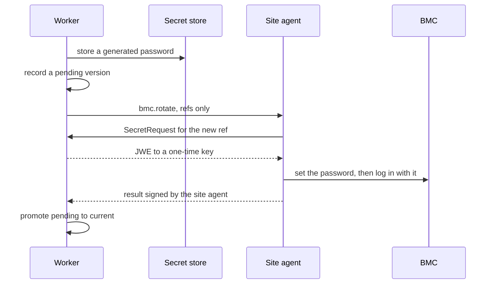

A <Term id="bmc">BMC</Term> is the one part of a server that works when the server does not: it can
power the machine, pick its boot device, mount media and report hardware. Metal drives every machine
through its BMC, from a <Term id="site-agent">site agent</Term> on the site's management network,
because the control plane never dials into a site. This page covers the driver contract, the BMC
operations metal sends, and how BMC credentials are stored, delivered and rotated.

## Driver concerns

Importing `@better-compute/metal` merges ten driver kinds into `DriverKinds` of
`@better-compute/core` by declaration merging, so `defineDriver({ implements: { power: … } })`
type-checks wherever the package is imported. Each kind is one Ironic-style
<Term id="driver">driver</Term> concern:

| Concern | Operations | Built-in drivers arrive |
| --- | --- | --- |
| `power` | `getPower()`, `setPower(action)` | v0.2 |
| `management` | `setBootDevice(device, { persistent, uefi })`, optional `rotateCredential(newPassword, { username })` | v0.2 |
| `boot` | `prepareRamdisk(spec)`, `prepareInstance(boot)`, `cleanUp()` | v0.2 |
| `deploy` | `deploy(spec)`, `tearDown({ wipe })`, both streaming progress | v0.2 |
| `inspect` | `inspect()`, returning a `NodeInventory` | v0.2 |
| `virtual-media` | `insert(iso)`, `eject()` | v0.2 |
| `console` | `open()`, a byte stream (Serial-over-LAN) | draft until v0.3 |
| `bios` | `getSettings()`, `applySettings(settings)` | draft until v0.5 |
| `raid` | `applyLayout(layout)`, `clear()` | draft until v0.5 |
| `firmware` | `components()`, `update(component, image)` | draft until v0.5 |

`metalDriverKinds` holds the same table as data. One driver may implement several concerns, which
is what Ironic calls a hardware type:

```ts title="drivers/redfish.ts"
import { defineDriver, field, manifest } from 'better-compute/core';
import 'better-compute/metal'; // merges the metal driver kinds into DriverKinds

export const redfish = defineDriver({
  id: 'redfish',
  version: '1.0.0',
  runsOn: 'site',
  config: manifest({ address: field.url(), credentials: field.secret() }),
  implements: {
    power: (config) => ({ getPower: async () => 'on', setPower: async (action) => {} }),
    management: (config) => ({ setBootDevice: async (device, options) => {} }),
    'virtual-media': (config) => ({ insert: async (iso) => {}, eject: async () => {} }),
  },
  retrySafe: { power: ['getPower', 'setPower'], management: ['setBootDevice'] },
});
```

The built-in drivers (Redfish, IPMI and vendor BMCs through bmclib, PXE, iPXE and UEFI HTTP boot,
image streaming and kexec) run inside `bcd site` and `bcd ramdisk`, the Go daemon's v0.2 modes,
which are not built yet. Out-of-process drivers in any language arrive with bcx and
`@better-compute/driver-sdk` in v0.5. See [drivers](/docs/extending/drivers).

## How BMC operations run

Metal's BMC steps are control-plane steps: only the control plane knows the machine's BMC address
and credential reference, so each step builds a `bettercompute.site.v1.BmcOperationRequest` and sends
it to the site agent of the machine's site:

```json title="BmcOperationRequest (proto3 JSON)"
{
  "driver": "redfish",
  "address": "https://10.0.0.10",
  "credentialsRef": "secret://root/…",
  "operation": "power.setPower",
  "argsJson": "{\"action\":\"cycle\"}",
  "tlsSpkiSha256": "<base64, when the BMC certificate is pinned>"
}
```

The agent fetches the credentials by reference (below), runs `<concern>.<operation>` on the driver
and answers a `BmcOperationResult` (`ok`, `resultJson`, `errorCode`, `message`). The command kinds
are all on the `control` lane and accepted only by agents with role `site`:

| Kind | Used by | Retry-safe | Flags | Timeout |
| --- | --- | --- | --- | --- |
| `bmc.query` | `power.getPower`, `inspect.oob`, firmware checks | yes | none | 2m |
| `bmc.boot` | `management.setBootDevice`, `media.insert`, `media.eject` | yes | none | 2m |
| `bmc.power` | `power.setPower`, `metal.power` | no | destructive | 5m |
| `bmc.rotate` | `metal.rotateBmcCredential` | no | attested by the site agent | 5m |
| `bmc.firmware` | firmware reflash | no | destructive | 1h |
| `boot.prepareRamdisk` | boot entries for a PXE boot | yes | none | 2m |
| `boot.cleanUp` | removing a node's boot entries | yes | none | 2m |
| `site.httpProxy` | one HTTP request to an agentless machine | no | none | 1m |

A power cycle is not idempotent, so `bmc.power` is never retried blindly. From v0.2 agents refuse
destructive kinds that lack a worker signature over the command body, so a compromised gateway
cannot forge one. See [security](/docs/operations/security).

## Enrolling a machine

`metal.enroll` creates the node in `enrolling`, owned by the pool's tenant, with role `unassigned`,
`platform` trust and power `unknown`, and queues the reconciler. It is decided as
`compute:nodes:provision` on the pool.

```ts
const node = await compute.api.metal.enroll(credential, {
  tenantId: 'root',
  siteId: 'site_…',
  poolId: 'pool_…',
  bmc: {
    address: 'https://10.0.0.10',
    driver: 'redfish',
    credentials: { username: 'admin', password: process.env.BMC_PASSWORD! }, // or 'secret://…'
    tlsSpkiSha256: '<64 hex digits>',
  },
  macs: ['b8:ce:f6:00:00:01'],
  uefi: true,
});
// node.bmc = { driver: 'redfish', address: 'https://10.0.0.10', credentialsSet: true }
```

<TypeTable
  type={{
    tenantId: { type: 'string', description: 'The pool owner.', required: true },
    siteId: { type: 'string', description: "The pool's site. Another site is INVALID_INPUT.", required: true },
    poolId: { type: 'string', description: 'A pool the tenant owns; otherwise NOT_FOUND.', required: true },
    'bmc.address': { type: 'string', description: 'The BMC endpoint, at most 512 characters.', required: true },
    'bmc.driver': { type: 'string', description: 'A driver id such as redfish or ipmi.', required: true },
    'bmc.credentials': { type: "'secret://…' | { username, password }", description: 'A secret reference, or inline credentials stored at once and never echoed.', required: true },
    'bmc.tlsSpkiSha256': { type: 'string', description: "64 hex digits: the SHA-256 of the BMC certificate's SubjectPublicKeyInfo, pinned." },
    macs: { type: 'string[]', description: 'Up to 16 PXE MACs. Out-of-band inspection finds them when left out.' },
    productUuid: { type: 'string', description: 'The SMBIOS product UUID, when known.' },
    arch: { type: "'x86_64' | 'arm64'", description: 'Selects the boot architecture of the PXE entry.', default: "'x86_64'" },
    uefi: { type: 'boolean', description: 'UEFI or legacy BIOS boot.', default: 'true' },
    hardwareProfile: { type: 'string', description: "Overrides the pool's policy.hardwareProfile for this node." },
  }}
/>

The first workflow, `metal-enroll`, proves the credentials work (`power.getPower`) and inspects the
machine out of band (`inspect.oob`), recording the PXE MACs, SMBIOS UUID and IP addresses the BMC
reports. A machine whose BMC does not answer fails in `enrolling`.

## Credentials

Postgres never holds a BMC password, only a `secret://` reference:

- **Inline credentials** go to the secret store before anything else happens, so the pair never
  reaches a row, a log or an event. The answer says only `credentialsSet: true`.
- **A reference** comes from [`secrets.put`](/docs/reference/api/secrets#put), the write-only secret
  API (v0.2). Store the pair as JSON, the shape inline credentials are stored in, and use
  `scope: 'fleet'` for platform machines:

```ts
const { ref } = await compute.api.secrets.put(credential, {
  tenantId: 'root', // fleet secrets belong to the root tenant
  name: 'bmc-bm-1', // a second put under the same name makes a new version
  value: JSON.stringify({ username: 'admin', password }), // at most 64 KiB, never returned
  scope: 'fleet', // decided on compute-fleet/global; 'tenant' (default) on compute-tenant/{t}
  idempotencyKey: 'bmc-bm-1-v1',
});
```

`secrets.put` and `secrets.delete` are decided as `compute:secrets:manage`. No method reads a value
back, and the `security.secret.put` and `security.secret.deleted` events carry only the ref, name
and version. Unless you pass other stores in the `secrets` option, the server uses the
`local-sealed` store, which keeps ciphertext in `sealed_secrets`, sealed under the deployment
secret.

### How the site agent gets the password

A command carries only the reference. The agent asks for the value with a `SecretRequest` signed by
its node key and naming a fresh one-time key, and the API releases it only when all of these hold:

1. the request is signed by the node's current, unrevoked certificate and names the session's node;
2. the certificate is a platform identity, never a tenant's `node-tenant` certificate;
3. the reference is bound to work the node is doing right now: a live command of that workflow step,
   addressed to it, that carries the reference;
4. the request id was not used before.

The answer is a JWE (ECDH-ES+A256KW, A256GCM) to the one-time key that expires within five
minutes, so the gateway relays only ciphertext.

## Power

[`metal.power`](/docs/reference/api/metal#power) sends one `bmc.power` command to the site agent and
returns `{ commandId }` without waiting for the BMC. It is decided as `compute:nodes:power`.

| `action` | Redfish `ResetType` |
| --- | --- |
| `on` | `On` |
| `off` | `ForceOff` |
| `graceful-off` | `GracefulShutdown` |
| `reset` | `ForceRestart` |
| `graceful-restart` | `GracefulRestart` |
| `cycle` | `PowerCycle` |
| `nmi` | `Nmi` |

- It is `INVALID_STATE` while a workflow controls the machine's power (`inspecting`,
  `commissioning`, `deploying`, `releasing`), when the node has no BMC credentials, or when no site
  agent of the node's site is connected. Any other action name is `INVALID_INPUT`.
- The command expires five minutes after it is queued and is keyed by the request id, so a retried
  HTTP request does not power-cycle twice.
- Power is its own axis: it never changes the provision state. The power steps record the last
  known state on the node.

## Rotating BMC passwords

A BMC password that a tenant may have seen, or that has simply lived too long, has to change without
ever locking the platform out. `metal.rotateBmcCredential` rotates in two phases, and the old
password stays current until the new one is proven:



1. The worker generates a 20-character password with upper case, lower case, a digit and a symbol
   (no quotes, backslashes or look-alike characters), stores it in the secret store, and records a
   `pending` version in `bmc_credential_versions`. The enrollment credential is recorded first as
   version 1, `current`.
2. `bmc.rotate` sends only references. The site agent fetches the new value, applies it through the
   driver's `management.rotateCredential`, logs in with it, and signs the result.
3. Only a result signed by a `site` certificate that says `verified: true` promotes the version:
   pending becomes `current`, the old one `superseded`, and the node's credential reference and
   driver bindings name the new secret. The node's `BmcCredentialRotated` condition turns `True`.
4. On any failure the old credential stays current, the version becomes `failed` (keeping its
   reference, since the BMC may hold the new password if only the answer was lost), the condition
   turns `False` with the reason, and the step fails with `DRIVER_ERROR`.

A retry of the step reuses the pending version rather than minting another password. Superseded
secrets are deleted from the store once no pending or in-flight command still names them. A node has
at most one current and one pending version at a time.

Today the tenant-root teardown runs the rotation after every dedicated-root lease, and a failed
rotation quarantines the machine (see [dedicated-root metal](/docs/guides/bare-metal/dedicated-root)).
You can add it to your own profiles:

```ts
{ use: 'metal.rotateBmcCredential', on: 'site', with: { username: 'admin' } }
```

PLAN.md also rotates at enrollment and every 90 days; neither is scheduled automatically yet.
Password rules, lockouts and account names differ per vendor, and the driver is responsible for
meeting or refusing them.

## Firmware checks

`metal.firmwareCheck` asks the BMC for every firmware component (`firmware.components`) and compares
it with the pool's `policy.firmwareBaseline` (component id to exact version). Drift fails the step
with `DRIVER_ERROR` and details `code: 'FIRMWARE_DRIFT'`, listing each component's expected and found
version, unless the pool sets `firmwareRemediation: 'reflash'` and has an https image with a sha256
in `firmwareImages` for every drifted component. Then `bmc.firmware` writes each image, and the check
runs again. The teardown of a dedicated-root lease uses it.

## Retirement

`metal.retire` erases the disks (crypto-erase), powers off and runs `metal.revokeIdentity`, which
revokes the node's certificates, bumps its identity generation, clears its driver bindings, drops
its BMC credential reference, and frees the hardware subjects bound to it, so the machine can join
again later as a new node.

## Operating guidance

PLAN.md sets these rules for the management network, which are deployment practice rather than
something the control plane can enforce:

- BMC passwords are random per machine and never shared across machines.
- The management VLAN is reachable only from site agents.
- Vendor default accounts and IPMI cipher suite 0 are disabled (verify per vendor).
- Pin the BMC's certificate with `tlsSpkiSha256` wherever the BMC serves a stable one.
