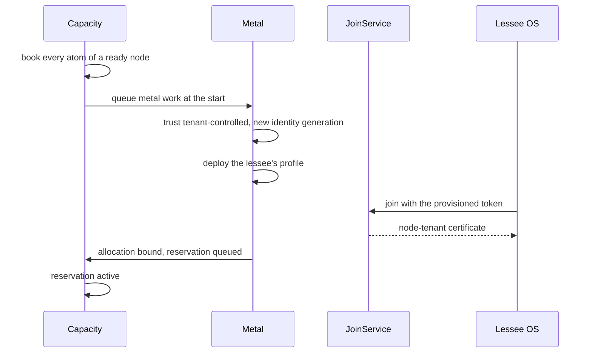

Some tenants need the whole machine: their own kernel, their own OS image, root on the host. The
moment a tenant has root, nothing running on that machine can be trusted by the platform again: not
its agent, not its inventory, not its reports. A dedicated-root lease is designed around that. For
the lease, the machine's trust changes to `tenant-controlled` and the platform gives up its identity
on it. Afterwards, the machine comes back only through a teardown driven entirely from the BMC side.

Dedicated-root leases are a v0.5 feature of PLAN.md. They are implemented in metal
(`metal/0003_tenant_root`) and capacity (whole-node placement), and tested end to end against the
simulated site. The contract between the two modules is rows only; neither imports the other.

## Set up a tenant-root pool

Whole-node leases are served only by pools that opt in with `policy.tenantRoot`. Give the pool a
firmware baseline too: the teardown verifies it, and fails without one.

```ts
await compute.api.pools.create(credential, {
  tenantId: 'root',
  siteId,
  class: 'metal-dedicated',
  policy: {
    hardwareProfile: 'gpu-redfish',
    tenantRoot: true,
    firmwareBaseline: { bmc: '1.12.0', bios: '2.4.1', 'gpu-vbios': '96.00.5f' },
    firmwareRemediation: 'reflash', // or 'quarantine', the default
    firmwareImages: {
      bios: { url: 'https://firmware.site-a/bios-2.4.1.bin', sha256: '<64 hex digits>' },
    },
  },
});
```

<TypeTable
  type={{
    tenantRoot: { type: 'boolean', description: "Reservations may use binding: 'node' here; metal leases the pool's ready nodes whole." },
    firmwareBaseline: { type: 'Record<string, string>', description: 'Component id to the exact version every component must report after a lease. Required by the teardown.' },
    firmwareRemediation: { type: "'quarantine' | 'reflash'", description: 'On drift: fail with maintenance on, or write the baseline images and check again.', default: "'quarantine'" },
    firmwareImages: { type: 'Record<string, { url, sha256 }>', description: 'Baseline images for reflash: https URLs and 64-hex digests; anything else is ignored.' },
    allowUnverifiedRelease: { type: 'boolean', description: 'Agentless pools only: let a release reach ready without an attested wipe.' },
  }}
/>

Offer the pool to the tenants who may lease from it, as with any pool (see
[pools](/docs/guides/capacity/pools)). Nodes under tenant control add no capacity to the pool's
rollups while they are leased.

## Reserve a whole machine

The tenant creates a <Term id="reservation">reservation</Term> with `binding: 'node'` and names
the metal profile to deploy:

```ts
const reservation = await client.reservations.create({
  tenantId: 'acme',
  poolId,
  devices: [{ class: 'gpu', count: 8 }],
  duration: '7d',
  binding: 'node',
  node: { profileId: 'acme-root-os', profileVersion: 1 },
  idempotencyKey: 'acme-root-2026-09',
});
```

- `binding: 'node'` needs `node.profileId`, and `node` needs `binding: 'node'` (`INVALID_INPUT`
  otherwise). Always pass `profileVersion`: metal refuses to start a lease whose reservation names no
  version, publishes `node.tenant-root.refused`, and leaves the node `ready`.
- A node binding cannot be `spot`, and a pool without `policy.tenantRoot` refuses it.
- Placement takes nodes that are `ready`, not in maintenance, not cordoned, with `platform` trust and
  no live allocation in the window, whose healthy atoms cover `devices`. Other NoSchedule reasons do not
  stop a lease, with one exception: a node tainted `dedicated=<tenant>` is leased only by that tenant
  (see [taints](/docs/guides/nodes/operating-nodes#taints)). The same check guards the lease's commit and
  BookingRepair. The allocation books every
  bookable atom of the node, so nothing else can land on it. `gang` leases several such nodes on one
  topology value.
- The profile resolves in the lessee's tenant: the lessee's own profile, or a public one. The image
  it deploys resolves in the machine owner's tenant, so the lessee's profile has to name a public
  (promoted) image.
- If metal has not finished deploying the node within 2 hours, the lease fails and is not placed
  again elsewhere.
- A bound lease bills `node.metal.hours` per lease-hour, plus the GPU meter for the GPUs that were
  healthy at the start of each hourly window. See [billing and usage](/docs/guides/iam/billing-and-usage).

## How a lease starts



1. When the reservation reaches its start (`binding`), capacity queues the node's `metal` work.
2. On a `ready` node of a tenant-root pool, not in maintenance, metal records the lease, marks the
   machine `tenant_root`, sets its release wipe to `secure-erase` and its trust to
   `tenant-controlled`, and starts a new identity generation, which revokes every platform certificate
   of the node before any tenant code runs. It then applies `deploy` with the lessee's profile and
   publishes `node.tenant-root.leased` (allocation, reservation, lessee tenant, profile and version).
3. The deploy workflow runs in the lessee's tenant. When the installed OS joins, JoinService sees the
   node's `tenant-controlled` trust and issues a `node-tenant`
   <Term id="node-certificate">certificate</Term> instead of a `node` one.
4. When the deploy completes, the node is `deployed` with the profile's role (usually `dedicated`).
   Metal marks the allocation bound and queues capacity's reservation work, which moves the
   reservation to `active`, and publishes `node.tenant-root.bound`.

## What the tenant gets, what the platform keeps

A `node-tenant` certificate runs a session as a node, but carries none of a platform node's
authority:

| | Lessee | Platform |
| --- | --- | --- |
| Root on the OS, its disks and kernel | yes | no |
| Session through the gateway, telemetry and `leave` | yes | |
| Secrets from the broker | never: the broker refuses `node-tenant` certificates | |
| Destructive commands | never: the gateway rejects them as `tenant-controlled` | |
| Results that count (wipe, diagnostics) | never: only platform identities attest | the platform ramdisk |
| BMC, power and boot device | no | yes, from the site agent |
| The teardown | no | always |

The attestation check accepts only `ramdisk` and `node` certificates by default, so even a wipe
result the lessee's OS signs with its own key for this very node is refused.

The lessee's inventory and health reports are advisory. While the node is `tenant-controlled`, an
inventory it sends is appended as a snapshot (`node.inventory.changed` with `advisory: true`) but
changes none of the node's devices, device health, labels, conditions, image cache or hardware key, and
its XIDs and host pressure are ignored. A GPU the lessee reports missing or unhealthy therefore stays
healthy and on the lease's bill. `metal.exitTenantRoot` ends the advisory period, so the first report
under platform trust applies for real. See
[trust](/docs/guides/nodes/inventory-and-health#trust-tenant-controlled-nodes-are-advisory).

PLAN.md also disables in-band BMC access where the vendor supports it. That is not implemented yet,
which is one reason the teardown rotates the BMC password.

## The teardown

When capacity releases the allocation (a release, the end of its time or a lapsed lease), metal
moves the deployed node to `releasing` (`node.tenant-root.ending`) and runs
`metal-tenant-root-release@1` instead of the ordinary release. Every step is driven from the site
agent or the control plane:

| # | Step | Why |
| --- | --- | --- |
| 1 | `power.setPower` off | stop the tenant's OS |
| 2 | `metal.fenceTenant` | revoke the lessee's certificates first, so nothing left behind can sign for this node |
| 3 | `metal.rotateBmcCredential` | the lessee may have learned the BMC password; see [BMC rotation](/docs/guides/bare-metal/bmc) |
| 4 | `metal.ensureRamdisk` | boot the platform ramdisk over PXE |
| 5 | `disk.wipe` secure-erase | an attested wipe of every disk |
| 6 | `diag.dcgm` level 1 | GPU reset and ECC check |
| 7 | `metal.firmwareCheck` | every component must match `policy.firmwareBaseline` |
| 8 | `metal.exitTenantRoot` | a new identity generation, trust back to `platform`, the lease cleared |
| 9 | `power.setPower` off | park the machine |

The cleanup step `boot.cleanUp` removes the boot entries. As with every release, the node reaches
`ready` only if the wipe's result is node-signed and every disk passed read-back. The v0.5 exit
criterion holds in the tests: a lease and its release yield a new identity generation.

Agentless pools (`agent: 'none'`) run `metal-tenant-root-release-oob@1` instead: power off, fence,
rotate, eject media, firmware check, exit. It has no wipe, so it reaches `ready` only with
`policy.allowUnverifiedRelease`.

## When the teardown fails

Every failure quarantines the machine: the node is `failed` with `failedFrom: 'releasing'` and
maintenance on, and it stays `tenant_root` with `tenant-controlled` trust, because only a completed
teardown clears them.

- **Firmware drift** fails the check with `code: 'FIRMWARE_DRIFT'`, listing each drifted component.
  With `firmwareRemediation: 'reflash'` and an image for every drifted component, the site agent
  writes the images (`bmc.firmware`) and the check runs again; drift that survives the reflash still
  quarantines.
- **A rotation the BMC refuses** fails the teardown, and the old credential stays current.
- **A wipe not signed by a platform identity** never reaches `ready`.
- **A pool without `firmwareBaseline`** fails the check with `INVALID_CONFIG`.

`metal.recover` sends the node back to `releasing`, and since it is still `tenant_root`, the teardown
runs again from the start. The same holds for a lessee deploy that failed: recovering it runs the
tenant-root teardown, not the ordinary release. Maintenance stays on after recovery; see
[failure and recovery](/docs/guides/bare-metal).

## When the lessee's tenant is deleted

When Better IAM deletes the lessee's tenant, compute's tenancy teardown ends its reservations through
capacity (`capacityTenantDeleted`), so each lease is released now and runs the tenant-root teardown above.
Metal's own `tenantDeleted` hook retires the machines the deleted tenant owns, not the platform machines it
leased. See [tenancy](/docs/guides/iam/tenancy#suspended-and-deleted-tenants).

## Limits

- PLAN.md offers dedicated-root only on vetted hardware until TPM measured boot exists, since a
  tenant with root could otherwise persist below the OS in ways a firmware version check does not see.
- Reservation lifecycle, quotas and offerings work as for any reservation; see
  [reservations](/docs/guides/capacity/reservations).
