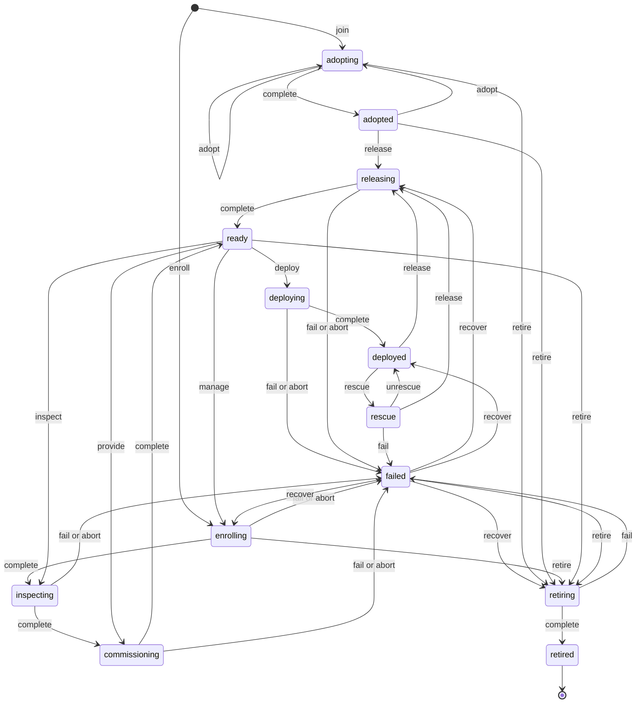

import { MapPin, Workflow, Layers, Power, Rocket, ShieldKeyhole } from '@/lib/icons';

Bare metal is how Better Compute takes a server you own from a powered-off box with a
<Term id="bmc">BMC</Term> to a running, accepted node, and back again with its disks wiped. Nobody
has to touch the machine: the control plane drives it through the BMC and network boot, and every
step is recorded, retried and resumable.

There are two ways a machine becomes a node:

- **Adopt** (v0.1). The machine already runs an OS. You install `bcd` with a join token, it joins,
  and the pool's acceptance checks move it to `adopted`. No BMC, no reimage. See
  [joining nodes](/docs/guides/nodes/joining).
- **Enroll** (v0.2). You give the control plane the machine's BMC address and credentials. It
  inspects the machine out of band, PXE-boots it into a <Term id="ramdisk">ramdisk</Term>, burns it
  in, wipes it and parks it in `ready`. A deploy then streams an image to disk and the installed OS
  joins as the same node.

This section covers the second path: the `metal` module in `@better-compute/metal` (also
`better-compute/metal`), built on the <Term id="workflow">workflow</Term> engine of
`@better-compute/provision`.

<Callout type="warn" title="What runs today">
The control plane side is implemented and tested: the `metal` API group, the metal reconciler, the
workflows, steps and profiles of every provision state, and the site and ramdisk command kinds. The
agents that touch hardware are modes of the Go daemon `bcd`, and both exist but are not complete.
`bcd site` runs BMC operations over Redfish (other BMC drivers answer `unsupported-driver`),
`site.httpProxy`, boot entries and the pre-warmed image cache. While it holds the site boot lease it
answers PXE and UEFI HTTP boot for prepared machines: proxy DHCP (it never hands out addresses),
TFTP for the iPXE builds, and iPXE scripts over HTTP(S). `bcd ramdisk` runs `disk.wipe`, `deploy.image`, `boot.kexec`
and `diag.dcgm`, and joins with the boot parameters on its kernel command line. The test suite
still drives the whole lifecycle with simulated site agents and ramdisks
(`tests/extensions/metal-sim.ts`).
</Callout>

## Register the module

`metal()` contributes the verbs, the reconciler, its steps, profiles, command kinds and the
`metal/*` migrations. It declares `requires: ['provision']`, and the workflow engine has to know
metal's steps and profiles, so pass the same instance to both:

```ts title="compute.ts"
import { betterCompute } from 'better-compute';
import { metal } from 'better-compute/metal';
import { provisionModule } from 'better-compute/provision';

const bareMetal = metal({
  hardwareProfiles: {
    'gpu-redfish': {
      description: 'Redfish BMC, iPXE boot, image streaming from the ramdisk',
      drivers: { power: 'redfish', management: 'redfish', boot: 'ipxe', deploy: 'image-stream', inspect: 'agent' },
    },
  },
});

export const compute = betterCompute({
  // database, secret, baseURL, iam and pki as usual
  modules: [
    provisionModule({
      modules: [bareMetal], // the engine resolves metal's steps and profiles
      userData: {
        controlPlaneUrl: 'https://gw.example.com', // the gateway the installed bcd joins through
        bcdUrl: 'https://compute.example.com/api/compute/downloads/bcd/0.2.0/linux-amd64',
        bcdSha256: '<hex digest of that binary>',
      },
    }),
    bareMetal,
  ],
});
```

- `hardwareProfiles` maps a name to per-concern driver bindings. A pool picks one with
  `policy.hardwareProfile`, and `metal.enroll` can override it per node. See
  [profiles and images](/docs/guides/bare-metal/profiles-and-images).
- `verifyAttestation` decides whether a node-signed result (a wipe, a DCGM run) is genuine. The
  default, `nodeSignedResults()`, rebuilds the signing input from the stored command row and checks
  the node's signature against `node_certs`. `acceptIngestedAttestation` exists for tests only.
- The server finds the module that exposes `workflowEngine()` (the provision module) and puts its
  engine on `ctx.workflows`, so you do not wire it yourself.
- The server also gives every step the secret broker (`ctx.secrets`, for BMC credentials and
  rendered user data) and the join-token port (`ctx.pki`, for discovery and `provisioned` tokens).
  For agents to join with those tokens, configure the `pki` option (JoinService) and the attestors
  shown on [sites](/docs/guides/bare-metal/sites).

## The provision state machine

Every metal node has a <Term id="provision-state">provision state</Term>. The legal moves live in
one table in `@better-compute/core` (`provisionStateTable`), so the adopt path of v0.1 needs no
metal package, and every verb, API method and reconciler checks against the same data. Illegal
moves fail with `INVALID_STATE`.



| State | What is happening | Workflow |
| --- | --- | --- |
| `adopting` | A machine that joined with its own OS runs the pool's acceptance checks | none (server) |
| `adopted` | Accepted, running its own OS; schedulable | none |
| `enrolling` | BMC access is verified; out-of-band inspection finds the PXE MACs | `metal-enroll` |
| `inspecting` | The machine boots the ramdisk and reports its inventory in band | `metal-inspect` |
| `commissioning` | DCGM level 2, a quick wipe, power off | `metal-commission` |
| `ready` | Clean and powered off, waiting for a deploy | none |
| `deploying` | The profile named in `metal.deploy` runs | the tenant's profile |
| `deployed` | Running the installed OS; schedulable | none |
| `releasing` | Wipe with the chosen mode, power off | `metal-release` |
| `rescue` | The rescue ramdisk is booted on a deployed machine; after `metal.unrescue`, the machine boots back into its OS | `metal-rescue`, then `metal-unrescue` |
| `failed` | A workflow failed or an operator aborted; `failedFrom` says where | none |
| `retiring` | Crypto-erase, power off, revoke the identity | `metal-retire` |
| `retired` | Terminal: identity revoked, BMC credentials forgotten | none |

Only `adopted` and `deployed` nodes can be scheduled (`schedulableProvisionStates`).
Maintenance, cordon, power and connectivity are separate axes: a node can be `deployed` and cordoned,
or `ready` and powered on. Pools whose machines never run `bcd` (`agent: 'none'`) use out-of-band
variants of these profiles; see [Talos on an agentless pool](/docs/guides/bare-metal/deploying).

## The metal API group

Every method is a mutation decided as `compute:nodes:provision` on the node, except `enroll`
(decided on the pool, since the node does not exist yet) and `power` (`compute:nodes:power`).

| Method | Verb | Legal from | Moves to |
| --- | --- | --- | --- |
| [`enroll`](/docs/reference/api/metal#enroll) | creates the node | none | `enrolling` |
| [`manage`](/docs/reference/api/metal#manage) | `manage` | `ready` | `enrolling` (re-verifies the BMC) |
| [`inspect`](/docs/reference/api/metal#inspect) | `inspect` | `ready` | `inspecting` |
| [`provide`](/docs/reference/api/metal#provide) | `provide` | `ready` | `commissioning` |
| [`deploy`](/docs/reference/api/metal#deploy) | `deploy` | `ready` | `deploying` |
| [`undeploy`](/docs/reference/api/metal#undeploy) | `release` | `deployed`, `rescue` | `releasing` |
| [`rescue`](/docs/reference/api/metal#rescue) | `rescue` | `deployed` | `rescue` |
| [`unrescue`](/docs/reference/api/metal#unrescue) | `unrescue` | `rescue` | `deployed`, once the installed OS is back |
| [`abort`](/docs/reference/api/metal#abort) | `abort` | `enrolling`, `inspecting`, `commissioning`, `deploying`, `releasing` | `failed` |
| [`recover`](/docs/reference/api/metal#recover) | `recover` | `failed` | the recover target below |
| [`retire`](/docs/reference/api/metal#retire) | `retire` | `adopting`, `adopted`, `enrolling`, `ready`, `failed` | `retiring` |
| [`power`](/docs/reference/api/metal#power) | none (power axis only) | any state but `inspecting`, `commissioning`, `deploying`, `releasing` | unchanged |

Because the reconciler chains finished workflows, `manage`, `inspect` and `provide` each run the
rest of the chain back to `ready`: `manage` re-verifies the BMC, re-inspects and re-commissions,
`provide` only re-commissions. Every chain ends with a wipe. To retire a deployed machine, undeploy
it first.

Each method returns the node's metal view, never its credentials:

```ts
const node = await compute.api.metal.deploy(credential, {
  tenantId: 'root',
  nodeId: 'node_01k…',
  profileId: 'ubuntu-24.04-gpu-host',
  profileVersion: 1,
});
// {
//   nodeId, tenantId, siteId, poolId, provisionState: 'deploying', maintenance: false,
//   power: 'off', bmc: { driver: 'redfish', address: 'https://10.0.0.10', credentialsSet: true },
//   macs: ['b8:ce:f6:00:00:01'], workflowId?, failedFrom?, lastError?
// }
```

`metal.undeploy` takes an optional `wipe` (`none`, `quick`, `secure-erase` or `crypto-erase`;
default `quick`), and `metal.abort` an optional `reason` of up to 512 characters. The inputs of
`enroll` and `power` are on [BMC drivers and credentials](/docs/guides/bare-metal/bmc).

### Rescue and unrescue

`metal.rescue` boots the rescue ramdisk on a deployed machine (`metal-rescue`, one `metal.ensureRamdisk` step), for
repairs from outside the installed OS. `metal.unrescue` brings it back without a reinstall: it starts the
`metal-unrescue` workflow (set the boot device to disk, persistently; power-cycle; wait up to 20 minutes for the
installed OS to rejoin with role `node`; clean up boot entries) and publishes `node.provision.unrescuing`. The node
stays in `rescue` while that runs. The metal reconciler applies `unrescue` and moves it to `deployed` only once the
workflow succeeded; if it failed, the node goes to `failed` with maintenance on, and `metal.recover` takes it back to
`deployed`.

`unrescue` outside `rescue` is `INVALID_STATE`, a second call while the workflow runs returns the node unchanged, and
a call while the rescue ramdisk is still booting is `CONFLICT`. It needs the provision module (`INVALID_CONFIG`
otherwise).

## How a verb becomes work

A verb does not touch the machine. In one transaction it locks the node, checks the move against the
state table, applies it as a guarded update (`WHERE version = $v`, else `CONFLICT`), refreshes the
node's authorization projection, queues the `metal` reconciler for the node and publishes
`node.provision.<state>`.

The metal reconciler (work kind `metal`, sharded by node) is level-triggered:

1. For a node in a workflow-driven state (`enrolling`, `inspecting`, `commissioning`, `deploying`,
   `releasing`, `retiring`, `rescue`), it makes sure exactly that state's workflow runs, started with
   `owner: 'metal'`.
2. When the workflow ends, the engine queues the reconciler again. A succeeded workflow applies
   `complete`; a failed or cancelled one applies `fail`.
3. It repeats (up to eight transitions per run), so `enrolling → inspecting → commissioning → ready`
   chains without a caller. While a workflow runs, it looks again every 30 seconds (`metalPollMs`) in
   case a wake-up was missed.

A finished deploy sets the node's role to the profile's `role` (`host` unless it says `dedicated`).

## Failure and recovery

`fail` (a workflow failed) and `abort` (an operator stopped it with `metal.abort`) both land in
`failed`, record `failedFrom`, store the error in `lastError` and turn maintenance on. `metal.abort`
also aborts the running workflow, which still runs its cleanup steps.

`metal.recover` moves a failed node to the last stable point for where it failed, never straight to
`ready`:

| `failedFrom` | `recover` goes to |
| --- | --- |
| `enrolling`, `inspecting`, `commissioning` | `enrolling` |
| `deploying`, `releasing` | `releasing` (which wipes before `ready`) |
| `rescue` | `deployed` |
| `retiring` | `retiring` |

- `ready` is reachable only through commissioning or through a release whose wipe was verified. A
  release whose `disk.wipe` result is not node-signed, or whose disks did not all pass read-back,
  fails with `UNVERIFIED_WIPE` instead of reaching `ready`.
- `recover` clears `failedFrom` but leaves maintenance on. Clearing maintenance is a separate
  operator decision, and the API has no method for it yet.
- Leave rescue with `metal.unrescue` to keep the installed OS, or with `metal.undeploy` to wipe and release the
  machine. See [rescue and unrescue](#rescue-and-unrescue).
- `retired` is terminal. `recover` on a retired node is `INVALID_STATE`.

## Events

Metal publishes into the node owner's tenant:

- `node.enrolled`, then `node.provision.<state>` on every move (`node.provision.ready`,
  `node.provision.failed`, …);
- `node.provision.workflow` when a state's workflow starts, with its `workflowId` and profile;
- `node.provision.unrescuing` when `metal.unrescue` starts its workflow, with the `workflowId`;
- `node.release.unverified` when an agentless pool released without an attested wipe;
- `node.tenant-root.leased`, `.bound`, `.ending` and `.refused` for
  [dedicated-root leases](/docs/guides/bare-metal/dedicated-root).

The workflow engine adds `workflow.*` and `workflow.step.*` events. See
[workflows](/docs/guides/bare-metal/workflows) and [events](/docs/guides/events).

## In this section

<Cards>
  <Card icon={<MapPin />} title="Sites and site agents" href="/docs/guides/bare-metal/sites">
    Boot domains, bcd site, site tokens and the one active boot server per site.
  </Card>
  <Card icon={<Workflow />} title="Provisioning workflows" href="/docs/guides/bare-metal/workflows">
    Persisted steps on the control plane, site, node or ramdisk; retries, rejoin and cancel.
  </Card>
  <Card icon={<Layers />} title="Profiles and images" href="/docs/guides/bare-metal/profiles-and-images">
    Versioned profiles, the ones metal ships, driver bindings, user data and the image catalog.
  </Card>
  <Card icon={<Power />} title="BMC drivers and credentials" href="/docs/guides/bare-metal/bmc">
    Driver concerns, power, sealed BMC credentials and two-phase password rotation.
  </Card>
  <Card icon={<Rocket />} title="Deploying machines" href="/docs/guides/bare-metal/deploying">
    Walkthroughs: an emulated site, Ubuntu autoinstall and Talos.
  </Card>
  <Card icon={<ShieldKeyhole />} title="Dedicated-root metal" href="/docs/guides/bare-metal/dedicated-root">
    Whole machines leased to a tenant with root, and the teardown that takes them back.
  </Card>
</Cards>
