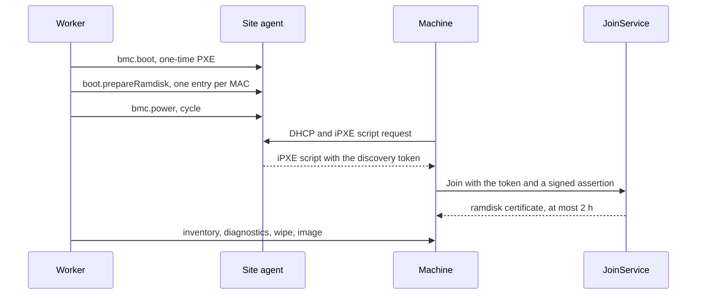
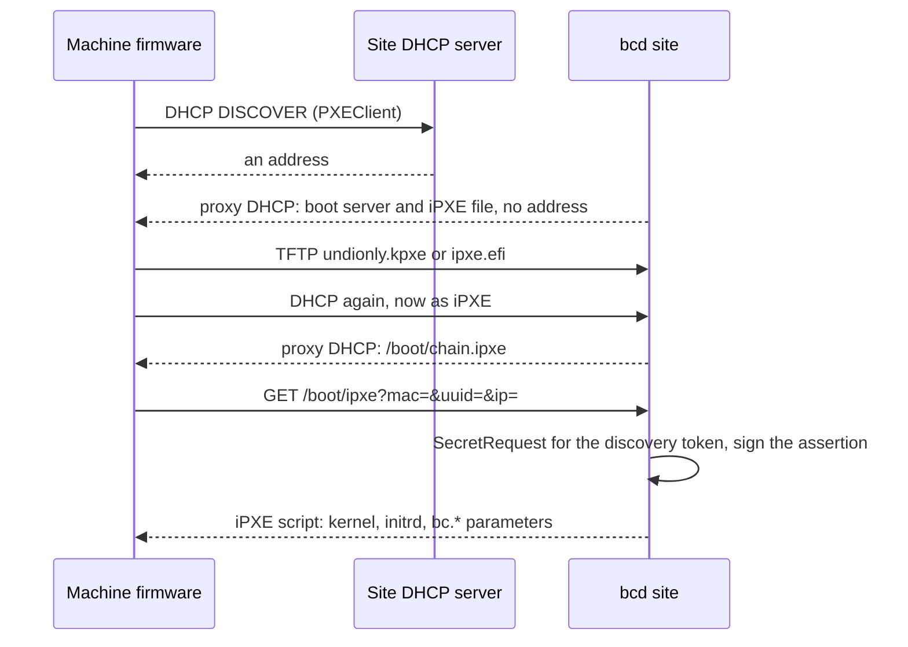

A <Term id="site">site</Term> is a boot and failure domain: a room, a cage or a lab whose machines
share a provisioning network and a BMC network. Everything the control plane does to a machine's
hardware (power, boot device, network boot, image streaming) goes through a
<Term id="site-agent">site agent</Term> on that site, because the control plane never dials into a
site. Pools, nodes and join tokens all belong to exactly one site.

## Sites

A site has an owner, a kind and a region:

| Kind | Owner | Created under | Use it for |
| --- | --- | --- | --- |
| `shared` | the root (platform) tenant | `compute-fleet/global` | platform hardware shared through offerings |
| `dedicated` | the root tenant | `compute-fleet/global` | platform hardware set aside for one customer |
| `custom` | the tenant | `compute-tenant/{t}` | a tenant's own hardware (bring your own) |

Every `sites.*` mutation is decided as `compute:sites:manage`. Creating a `shared` or `dedicated`
site with a `tenantId` other than the root tenant is `INVALID_INPUT`.

```ts
const site = await compute.api.sites.create(credential, {
  tenantId: 'root',
  kind: 'shared',
  region: 'eu-central-1', // a region label
  iamRegion: 'eu-central', // optional: the IAM region name, when it differs
  idempotencyKey: 'site-fsn1',
});
// { id: 'site_…', ownerTenantId: 'root', kind: 'shared', region: 'eu-central-1', iamRegion: 'eu-central', version: 1 }
```

The id derives from the tenant, the caller and the idempotency key, so a retry returns the same site
and a different request under the same key is `CONFLICT`. The site's `region`, `iamRegion` and
`kind` are the attributes IAM conditions see on `compute-site`.

- [`sites.update`](/docs/reference/api/sites#update) (v0.2) changes `region` and `iamRegion`, or clears
  `iamRegion` with `clearIamRegion: true`. Pass the `version` you read to get `CONFLICT` instead of a
  lost update.
- [`sites.delete`](/docs/reference/api/sites#delete) (v0.2) refuses with `INVALID_STATE` while the site
  still has live pools or nodes. Otherwise it revokes every join token of the site (site tokens
  included), expires its open join requests, drops its boot lease, and removes the row, or tombstones
  it when anything ever referenced it. Deleting a tombstoned site again answers `deleted: false`.

## The site agent

A site agent is `bcd` running in `site` mode on a machine next to the fleet, one or two per site. To
the control plane it is a node like any other: a `nodes` row with `role = 'site'`, no pool, a
`site` certificate and a session through the gateway. It runs the site's commands:

| Duty | When | In `bcd site` today |
| --- | --- | --- |
| Proxy DHCP, so booting machines find the iPXE binary without replacing your DHCP server | only while holding the boot lease | yes, with `[boot] proxy_dhcp` |
| TFTP and iPXE scripts, one per machine being booted | only while holding the boot lease | yes: read-only TFTP for the iPXE builds, scripts over plain HTTP |
| Vouching for ramdisks that PXE-booted from it (signed discovery assertions) | only while holding the boot lease | yes |
| An image cache that ramdisks stream from | always | yes, by digest (`GET /cache/<sha256>`) |
| BMC access (Redfish, IPMI, vendor drivers) on the management network | always | Redfish built in; IPMI power, boot device and inspection through the hosted `bcx-ipmi` plugin (51806ab, 7818f19), which `daemon install-script --install-plugins bcx-ipmi` installs from the release (adf2ae9); no vendor driver |

The command kinds it accepts are role-restricted to `site`: `bmc.query`, `bmc.boot`, `bmc.power`,
`bmc.rotate`, `bmc.firmware`, `bmc.storage`, `boot.prepareRamdisk`, `boot.cleanUp` and `site.httpProxy`, plus
the shared `inventory.refresh`, `logs.collect` and `node.reboot`. Their payloads are messages of
`bettercompute.site.v1`, which stays a draft package until v0.2 closes. Every `bmc.*` kind but `bmc.query`, and
`site.httpProxy` since 0d42de8, is destructive, so under the v1.0 quorum it runs only in an approved batch;
`site.httpProxy` also never reaches a BMC (the agent refuses the BMC hosts it drives, any `/redfish` path and its
local `[site] bmc_networks`), and reaches only the addresses of the agentless machine it names (`SiteSpec.proxy_targets`,
which metal fills from inspection; a2a853d, 8391d74). See
[BMC drivers and credentials](/docs/guides/bare-metal/bmc) and the
[command kinds reference](/docs/reference/command-kinds).

The agent's desired state is the `site` section of its NodeSpec (`SiteSpec`): the boot lease state (below) and,
since v0.2, `cacheImages`, the verified catalog images its cache pre-warms (`url`, `sha256`, `format`). The
provision module fills that list: every live pool of the agent's site can name images in `policy.prewarmImages`
(`name@version` refs, resolved in the pool owner's catalog), and only images that still verify (signed, signer not
revoked, row untampered) are listed, deduplicated by URL. The agent pulls each one and re-verifies its digest before
serving it. `images.register` and `images.promote` recompute the specs of the site agents whose pools name the ref,
and so does `pools.update` when `prewarmImages` changes. Modules contribute `site` fields independently, because
the section merges field by field (see [NodeSpec sections](/docs/extending/modules#nodespec-sections)).

<Callout type="info" title="Status">
`bcd site` exists, and its contracts are in `proto/bettercompute/site/v1`. It runs BMC operations over
Redfish, or through a bcx plugin it hosts for any other driver (such as `bcx-ipmi` for `ipmi`; see
[IPMI through bcx-ipmi](/docs/guides/bare-metal/bmc#ipmi-through-bcx-ipmi); a driver it does not host answers
`unsupported-driver`), `site.httpProxy` and boot entries. While it holds the boot lease,
its boot server answers prepared machines only: proxy DHCP (boot server and file, never an address), TFTP for the iPXE
builds, iPXE scripts and discovery assertions over plain HTTP (see [the boot server](#the-boot-server-in-bcd-site)).
Its cache pre-warms `cacheImages`, serves them to the site's ramdisks by digest and reports them in its `images`
inventory section, which becomes the site's `image_locations`. bcd is not released, and only its Go unit tests run
these parts (against a fake Redfish BMC, a scripted session and real sockets): no test runs `bcd site` against the
control plane, and no real site has run it. The dev stack joins site agents as FakeDaemons with role `site`
(`createDevStack().joinSite()`), and the metal test suite answers site commands with a simulated agent.
</Callout>

## Enroll site agents with site tokens

A site agent joins with a site token: a join token of role `site`, bound to one site and no pool.
[`siteTokens.create`](/docs/reference/api/site-tokens#create) is decided as `compute:sites:manage` on
`compute-site/{siteId}`, and only the site's owner can mint one.

```ts
const minted = await compute.api.siteTokens.create(credential, {
  tenantId: 'root',
  siteId: site.id,
  ttlSeconds: 3600, // 60 to 86 400
  maxUses: 2, // how many agents may enroll with it: 1 (default) to 16
  idempotencyKey: 'fsn1-site-agents',
});
// { id: 'jt_…', siteId, role: 'site', usesLeft: 2, expiresAt, token: 'bcjt_<id>.<secret>' }
```

- The bearer (`bcjt_<id>.<secret>`) is in the answer that created the token and nowhere else: only
  its hash is stored, and a replay of the same request omits it. The same key for another site is
  `CONFLICT`.
- A deleted site is `INVALID_STATE`; a site the tenant does not own is `NOT_FOUND`.
- [`siteTokens.revoke`](/docs/reference/api/site-tokens#revoke) takes `tenantId`, `siteId` and
  `tokenId`. It revokes only site tokens: a node join token is `NOT_FOUND` there.
- Both publish security events: `security.site-token.created` and `security.site-token.revoked`.

From the command line (573b0b0), where `--out` writes the one-time token to a new 0600 file instead of printing it
and `revoke` refuses a pasted token (anything with a `.`), so the secret is never sent as an id:

```bash
better-compute sites create --tenant root --kind shared --region eu-central-1 --iam-region eu-central --key site-fsn1
better-compute site-tokens create --tenant root --site site_01k5w… --ttl 3600 --max-uses 2 --out ./site-token
better-compute site-tokens revoke jt_01k5w… --tenant root --site site_01k5w…
```

`site-tokens create --ttl` is in seconds (60 to 86,400).

The agent joins through the same Join RPC as any daemon (see [joining nodes](/docs/guides/nodes/joining)),
and JoinService issues it a 24-hour certificate with role `site`. With bcd that is
`BCD_JOIN_TOKEN=bcjt_... bcd join --role site`, then `bcd site`; see
[installing bcd](/docs/daemon/install#a-site-agent).

## One active boot server per site

Two agents answering DHCP for the same machine would race, and a stale agent vouching for a ramdisk
would be a way in. So exactly one agent per site is the boot server: the holder of the lease
`site:<siteId>:boot`.

- The lease has a 15-second TTL and a fencing epoch that grows on every change of holder.
- The SiteBoot controller renews it while its holder is a connected site agent. The holder learns
  that it is active, and at which epoch, from the `site` section of its NodeSpec (`BootLeaseState`).
- A holder that loses its session keeps the lease until it expires and self-fences after the TTL: it
  stops answering proxy DHCP, iPXE and discovery. Only then is the first connected standby (by node
  id) promoted, under a new epoch. A live lease never changes hands, so two agents can never both
  believe they are active at the same epoch.
- When no agent is left, the lease is released and the epoch still moves on.
- Every discovery assertion carries the epoch the agent held, and the control plane refuses an epoch
  that is not the lease's current one.

The lease logic is the server's SiteBoot controller (`tickSiteBoot`). `betterCompute()` registers it as the built-in
`site-boot` module: a singleton reconciler whose `tick` key runs every 5 seconds in the `controllers` role.

A failover does not restart a machine that was already booting. BMC operations are reroutable between a site's
agents: a power cycle the dead agent already ran is reused, not sent again, and one it never received is moved to
the new agent. Boot entries stay per agent, so the new lease holder gets its own entry (and its own single-use
discovery token) and serves the waiting machine. `tests/metal-site-failover.test.ts` kills the active agent right
after it power-cycled a machine: the standby is promoted when the dead agent's lease runs out, never earlier, the
machine boots from it within 30 seconds, the deploy completes, and the boot step's BMC commands ran once. With both
agents down the boot waits, and the first agent back serves it.

### Where site steps go

`siteAgentFor(nodeId)` picks the agent for a machine's site steps: a connected site agent of the
machine's own site, the boot-lease holder first, otherwise the first connected agent by id. A machine's
site steps never go to another site's agent. When no agent is connected, a relaying step waits and
retries until its timeout, and a step that runs on `site` directly fails with `NO_SITE_AGENT` at its
deadline. PLAN.md also routes BMC and image-cache work to any agent that advertises the driver; that
is not implemented.

## Booting a machine into the ramdisk

Metal never lets a machine boot something it did not prepare. Before each network boot, the
`metal.ensureRamdisk` step sets a one-time PXE boot through the BMC, sends the site agent one boot
entry per known PXE MAC, and power-cycles the machine:



- Each entry (`ProxyDhcpEntry`) names the MAC, the SMBIOS product UUID when known, the boot
  architecture (`BIOS`, `X86_64_EFI` or `ARM64_EFI`, from the node's `arch` and `uefi`), the workflow
  and a `notAfter` two hours out.
- Each entry carries a fresh single-use `discovery` join token bound to that MAC (`expect.mac`), valid
  for 900 seconds. The token is stored in the secret store and the entry carries only its reference;
  the site agent fetches the bearer with a SecretRequest for that workflow step and renders it into
  that MAC's iPXE script. No command body ever holds the token.
- A token is minted only when its entry's command is first sent, not on every poll, and the cleanup
  step `boot.cleanUp` removes the entries and deletes the stored tokens.
- A machine with no known MAC fails with `INVALID_STATE`: inspect it out of band first.

### The boot server in bcd site

`bcd site` keeps the boot entries it receives in `data_dir/boot-entries.json`, keyed by MAC, so a restart keeps
answering; `boot.cleanUp` drops a workflow's entries (or the listed MACs), and lapsed entries are dropped on their
own. With a `[boot]` section in its config (see [installing bcd](/docs/daemon/install#a-site-agent)) it serves them
in three stages:



1. **Proxy DHCP** (UDP 67 and 4011, `proxy_dhcp = true`) answers `PXEClient` and `HTTPClient` requests beside your
   DHCP server and never hands out an address. It reads the MAC, the client architecture (option 93) and whether the
   client is iPXE already. Firmware gets the iPXE build for its architecture from TFTP at `server_ip`:
   `undionly.kpxe` for BIOS, `ipxe.efi` for x86-64 UEFI, `ipxe-arm64.efi` for arm64 UEFI. UEFI HTTP boot clients get
   the same build as a URL, `<url>/boot/files/<file>`. iPXE itself gets `<url>/boot/chain.ipxe`, which chains to
   `/boot/ipxe` with its MAC, SMBIOS UUID and IP.
2. **TFTP** (`tftp`, `tftp_root`) is read-only, octet mode, with block size and transfer size negotiation, and serves
   nothing outside its root. You supply the iPXE builds.
3. **`GET /boot/ipxe`** renders the machine's script: the site's ramdisk `kernel` and `initrd`, and on the kernel
   command line the `bc.*` boot parameters `bcd ramdisk` joins with (the gateway, pins and join key, the machine's
   discovery token and a signed assertion, and `bc.cache` when `url` is set), then `cmdline`.

Proxy DHCP answers, and `/boot/ipxe` renders a script, only when both hold:

- the MAC has a live boot entry; an unknown machine gets no proxy DHCP answer and a 404 script that exits, so it
  falls through to its next boot device, and is listed as discovered (see
  [discovering new machines](#discovering-new-machines));
- the agent is the active boot server: its `site` section says it holds the lease at a non-zero epoch, and it has
  heard from the gateway within the lease TTL (15 seconds when the section gives none). A partitioned agent fences
  itself this way; its `/boot/ipxe` answers 503 with a script that waits 10 seconds and reboots.

The discovery token is fetched with a `SecretRequest` bound to the entry's workflow the first time the machine asks
for its script and reused if it asks again; while it is not available the script waits and retries. Each script
carries a fresh `DiscoveryAssertion` (the site, this agent's node id, the lease epoch, the MAC, the IP from the query
or the connection, the product UUID from the query or the entry, the workflow, `issued_at` in server time, and a
`not_after` at most 15 minutes out and never past the entry's), signed by the agent's node key under purpose
`discovery-assertion`.

**Sanboot of a cached ISO** (0056e1e, e763001). For a BMC without virtual media, such as `ipmi`, a boot entry may
carry `ProxyDhcpEntry.sanboot_sha256` instead of a ramdisk boot: `/boot/ipxe` then answers
`sanboot --no-describe <url>/cache/<sha256>`, and iPXE reads the ISO from the image cache with HTTP range requests.
The ISO boots as it is, with no discovery token and no `bc.*` parameters. The agent serves it only when the site
spec names that digest as an `iso` cache image and the verified copy is cached. Otherwise the machine waits (a 503
script that sleeps 30 seconds and chains again, never the ramdisk), and the `site` section fails naming the entry.
The control plane does not set `sanboot_sha256` yet: metal still refuses a deploy profile that needs virtual media
for an `ipmi` machine (see [IPMI](/docs/guides/bare-metal/bmc#ipmi-through-bcx-ipmi)).

The image cache is served by the same HTTP server at `GET /cache/<sha256 hex>`, digest paths only, whether or not
the agent holds the lease. The agent pulls every `cacheImages` entry of its `site` section in the background into
`data_dir/cache/<sha256>`, and a copy becomes visible only after its bytes match the digest. The `site` section
stays `PROGRESSING` while images warm and fails for an image whose bytes do not match. With `[boot] cache_max_bytes` set, each pass trims the cache to that budget, least
recently used first, and never evicts an image the section still names (the pools' pre-warm images plus every image
a deploy at the site is streaming). A ramdisk booted with
`bc.cache` tries the cache first for `deploy.image` and falls back to the image's source URL; the digest is checked
on the stream either way, so a cache can never substitute an image.

### The discovery attestor

The ramdisk joins with the discovery token plus the site agent's `SignedDiscoveryAssertion` that it
served this MAC. The `discovery` attestor admits it only when all of these hold:

- the token is a live, single-use `discovery` token for the same site, and its `expect.mac` matches;
- the vouching agent is a site agent of that site, holds the live boot lease, and the assertion's
  epoch is the lease's current epoch;
- the assertion is signed by that agent's key under a `site` certificate, at most 15 minutes old, and
  used for one join only;
- the ramdisk's claimed MACs include the asserted MAC, and its product UUID matches when asserted.

The result is a <Term id="ramdisk">ramdisk</Term> certificate valid for at most two hours and
restricted to the commissioning command kinds. When the assertion names a running workflow, the
ramdisk joins as that workflow's node, so a known machine re-commissions as itself.

Hosts wire the attestors with provision's resolvers:

```ts title="compute.ts"
import { discoveryAttestor, provisionedAttestor } from 'better-compute/pki';
import { discoveryWorkflowNodeResolver, provisionedTargetResolver } from 'better-compute/provision';

export const compute = betterCompute({
  // …
  attestors: [
    discoveryAttestor({ resolveWorkflowNode: discoveryWorkflowNodeResolver() }),
    provisionedAttestor({ resolveTarget: provisionedTargetResolver() }),
  ],
});
```

Both resolvers answer only for workflows that are still running, so a token or assertion from a
finished or aborted workflow cannot re-key a node that has moved on. See
[attestation](/docs/guides/nodes/attestation) for the other attestors.

## Discovering new machines

Today a machine enters metal by its BMC: `metal.enroll` with the BMC address, then the `inspect.oob`
step asks the BMC for the machine's PXE MACs, SMBIOS UUID and IP addresses and records them. That is
what makes the boot entries above possible.

Machines that PXE-boot without being enrolled first are designed but not shipped end to end. Since 0056e1e the
site agent's side exists: a PXE or HTTP-boot DHCP request, or an iPXE script fetch, from a MAC without a live boot
entry, while the agent holds the boot lease, is never answered but listed in `StatusReport.discovered` (e763001):

| Field | Value |
| --- | --- |
| `mac` | The machine's MAC |
| `product_uuid` | The SMBIOS UUID from DHCP option 97, the one a BMC also reports |
| `arch` | The client architecture |
| `first_seen`, `last_seen`, `count` | When it was first and last seen, and how often |
| `relay` | The DHCP relay (`giaddr`) it came through |

The list holds at most 256 machines (the oldest `last_seen` goes first), forgets each a day after it was last seen,
and drops a machine once it gets a boot entry. A new machine asks for a status report at most once every 30 seconds.
Nothing is enrolled from it. The control plane does not read the list yet: the gateway neither stores nor publishes
it, and metal does not match it to enrollments, so an `ipmi` machine is still enrolled with its `macs` (see
[IPMI](/docs/guides/bare-metal/bmc#ipmi-through-bcx-ipmi)). The discovery attestor already supports operator approval:

- `approval: 'never'` (the default) admits as described above;
- `approval: 'unknown-machines'` defers a join that no running workflow names;
- `approval: 'always'` defers every discovery join.

A deferred join becomes a pending join request (24 hours by default) that an operator decides with
[`joinRequests.approve`](/docs/reference/api/join-requests#approve) or `joinRequests.reject`; the
ramdisk retries every 30 seconds with the same CSR and consumes the approval once.

## Next

- [Provisioning workflows](/docs/guides/bare-metal/workflows): what runs on the site agent and when.
- [BMC drivers and credentials](/docs/guides/bare-metal/bmc): the BMC side of the site agent.
- [PKI](/docs/operations/pki): the node CA and JoinService keys the agents join against.
