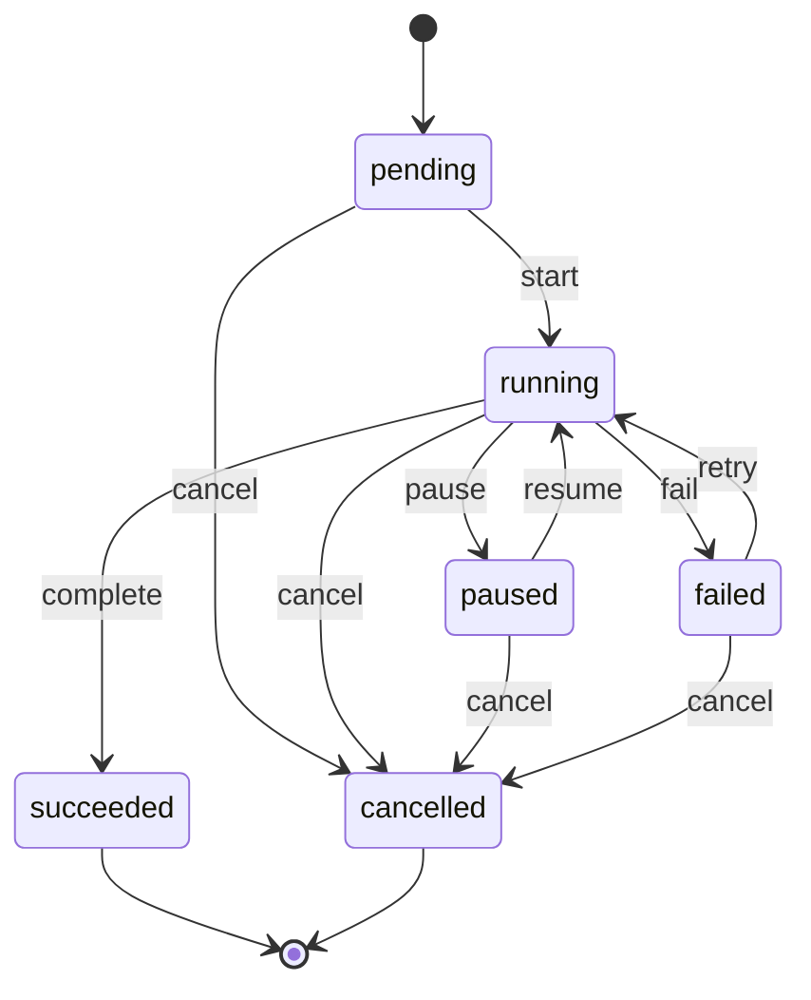

Commissioning or deploying a machine is a dozen operations on three different computers: the BMC
through the site agent, the ramdisk on the machine, then the installed OS. Any of them can take an
hour, and the worker that started them can crash in between. A <Term id="workflow">workflow</Term>
makes that safe: the engine in `@better-compute/provision` expands a
<Term id="profile">profile</Term> into rows, runs one <Term id="step">step</Term> at a time, and
records every transition, so whichever worker next owns the node's shard picks up exactly where the
last one stopped.

You rarely start workflows yourself. Metal starts one for each workflow-driven provision state (see
[bare metal](/docs/guides/bare-metal)), and the `health` reconciler starts remediation workflows. Your
part is writing profiles and steps, and watching or steering workflows through the API.

## Anatomy of a workflow

`ctx.workflows.start(tx, { tenantId, profileId, profileVersion, nodeId, owner })` runs in the
caller's transaction. It loads the pinned profile version, expands it, and inserts a `workflows` row
(id `wf_…`) with one `workflow_steps` row per step:

- The profile document is snapshotted on the workflow, and the profile version is marked used, which
  makes it immutable from then on.
- A node (or an instance) has at most one active workflow: a second `start` is `CONFLICT`. An
  unknown profile or node is `NOT_FOUND`; a profile whose steps do not resolve is `INVALID_INPUT`
  listing every issue.
- `owner` names a work kind to queue when the workflow finishes. Metal passes `owner: 'metal'`, so
  its reconciler reacts without polling.

Steps belong to one of three phases, which run in this order:

| Phase | Where its rows come from | Row ids |
| --- | --- | --- |
| `main` | the profile's `steps`, then its `acceptance` steps | `main.1`, `main.2`, … |
| `on-failure` | a step's `onFailure` when it names a step | `main.3.on-failure` |
| `cleanup` | a step definition's own `cleanup` (last in, first out), then the profile's `cleanup` | `main.3.cleanup.1`, `cleanup.1` |

A workflow holds at most 512 steps across all phases. Only one step runs at a time.

## Where steps run

Every step has a `runsOn`:

| `runsOn` | Runs as | Example |
| --- | --- | --- |
| `control-plane` | `run(input, context)` in the worker that owns the target's shard | `userdata.render`, `wait.agentJoined` |
| `site` | exactly one command to the site agent of the node's site | a driver operation with `on: 'site'` |
| `node` | exactly one command to the node's `bcd` | `node.reboot` |
| `ramdisk` | exactly one command to the machine's ramdisk | `boot.kexec` |

A profile step's `use` resolves in this order:

1. A registered step with that id. If the profile also says `on:`, it must match the step's `runsOn`,
   or one of its `relays` (below).
2. Otherwise, with `on:` set to an agent, a driver operation `<concern>.<operation>` such as
   `power.setPower`, for the concerns `power`, `management`, `boot`, `deploy`, `inspect`,
   `virtual-media`, `console`, `bios`, `raid`, `firmware` and `config`. It becomes one
   `driver.invoke` command carrying the driver bound in the profile's `drivers` for that concern,
   with a default timeout of 10 minutes.
3. Otherwise `fallback`, resolved the same way.

### Relaying steps

Most of metal's steps are control-plane steps that build a command only the control plane can build
(the BMC address and credential reference, the resolved image, a boot entry with its token) and
send it to an agent themselves with `awaitCommand`. They declare where they relay to (for example
`relays: ['site']`), so profiles may still write them as `{ use: 'power.setPower', on: 'site' }`.

`awaitCommand(context, { nodeId, kind, payload, key?, timeoutMs? })` sends a command once per step
attempt, under the key `wf:<id>:<stepId>#<attempt>[:<key>]`, and finds the same command on every
re-run. Until it settles, it throws `stepNotReady` and the engine runs the step again two seconds later
(`commandStepPollMs`). A command that failed, was rejected, expired or was cancelled throws
`DRIVER_ERROR` with its reason.

## States



A `failed` workflow is not terminal: `workflows.retry` runs it again. Steps have their own table:

| Step state | Meaning | Next |
| --- | --- | --- |
| `pending` | not started | `running`, `skipped` (a false `when`), `cancelled` |
| `running` | a control-plane step is executing, or an agent step is about to send | `waiting`, `succeeded`, `failed`, `cancelled` |
| `waiting` | parked on its command, or on the agent rejoining | `succeeded`, `failed`, `cancelled` |
| `failed` | failed; back to `pending` with `attempt + 1` while retries remain | `pending` |
| `succeeded`, `skipped`, `cancelled` | done | none |

## Step options

These fields of a profile step (`ProfileStep`) control how it runs:

<TypeTable
  type={{
    use: { type: 'string', description: 'A registered step id, or a driver operation <concern>.<operation>. Dotted, at most 128 characters.', required: true },
    on: { type: "'control-plane' | 'site' | 'node' | 'ramdisk'", description: "Where it runs. Required for driver operations; for a registered step it must match its runsOn or relays." },
    with: { type: 'Record<string, Json>', description: "The step's input, validated against the step's input manifest when the profile is expanded." },
    timeout: { type: 'Duration', description: "How long one attempt may take: '90s', '30m', '1h30m' or milliseconds. Defaults to the step definition's timeout (10 minutes for driver operations)." },
    retries: { type: 'number', description: 'Extra attempts after a failure, 0 to 100.', default: "the step definition's, else 0" },
    await: { type: "'rejoin'", description: 'Complete when the agent comes back with a new boot or role. Only on steps that run on an agent.' },
    onFailure: { type: "'fail' | 'rescue' | 'continue' | ProfileStep", description: 'What a failure does once retries are spent. A step here runs, then the workflow fails; it cannot have its own onFailure step.', default: "'fail'" },
    fallback: { type: 'string', description: 'The step to use when use does not resolve.' },
    when: { type: 'string', description: 'A label expression on the target node; false skips the step. At most 256 characters.' },
  }}
/>

`when` is deliberately small: `key` (the label is present and not `false`), `!key`, `key=value` and
`key!=value`, joined by `&&`, for example `nvswitch && gpu.model=H100` or `!mig.capable`. An
expression that parses to nothing is false.

## Running and waiting

The `workflow` reconciler (sharded by node; its key is the node id, or the workflow id for workflows
without a node) advances each workflow one transition per transaction, with the workflow row locked.
The API verbs lock the same row, so they serialize with the reconciler.

- **Control-plane steps** are marked `running` in one transaction, run outside any transaction, and
  are settled in another that first checks the step is still `running` with the same attempt. A
  crash in between re-runs the step under the same idempotency key, `wf:<id>:<stepId>`. A step that
  cannot finish yet throws `stepNotReady(ms)` and runs again after `ms` (5 seconds by default), until
  its timeout.
- **Agent steps** send exactly one command, keyed `wf:<id>:<stepId>` and `#<attempt>` on retries,
  with the step's deadline as the command's `not_after`. Site steps go to the node's site agent (see
  [where site steps go](/docs/guides/bare-metal/sites)); a driver operation's command carries
  `targetNodeId` naming the machine.
- **Waiting.** A waiting step is looked at again every 10 seconds (`workflowPollMs`) and never later
  than its deadline, so progress never depends on a wake-up being delivered. When a workflow
  finishes, the engine queues its owner.

### Awaiting a rejoin

Some commands end the process that runs them: `boot.kexec` replaces the ramdisk with the installed
OS, and `node.reboot` and `daemon.upgrade` restart the node. Their kinds are self-terminating, and a
step that sends one sets `await: 'rejoin'`:

- When the command is sent, the step records the node's current `boot_id` and session role.
- It succeeds when the agent is connected again with a different `boot_id` or role, whatever the
  command itself reported. Its result is `{ bootId, role }`.
- Only its timeout fails it (`REJOIN_TIMEOUT`), so an `onFailure` step, such as a BMC power reset,
  fires only when the machine did not come back in time.

```ts
{ use: 'boot.kexec', on: 'ramdisk', await: 'rejoin', timeout: '15m',
  onFailure: { use: 'power.setPower', on: 'site', with: { action: 'reset' } } }
```

## Failure, retry and cancel

When an attempt fails and retries remain, the step goes back to `pending` with `attempt + 1`
(`workflow.step.retrying`), and its command gets a new idempotency key. Once retries are spent:

- `continue` moves on to the next step.
- `fail` (the default) and `rescue` mark the workflow failing: the rest of the main phase is
  cancelled, the cleanup phase runs, and the workflow ends `failed`. With `rescue`, the workflow error
  carries `rescue: true`.
- A step in `onFailure` runs first, then the workflow fails the same way.
- A failing cleanup or on-failure step never stops the rest of the cleanup. A step definition's own
  cleanup runs only if its step started.

The error a failed step records says why:

| Code | Cause |
| --- | --- |
| `TIMEOUT` | no result before the step's deadline; an in-flight command is cancelled |
| `REJOIN_TIMEOUT` | an `await: 'rejoin'` step's agent did not come back in time |
| `NO_SITE_AGENT` | no connected site agent served the node's site before the deadline |
| `COMMAND_FAILED`, `COMMAND_REJECTED`, `COMMAND_EXPIRED`, `COMMAND_CANCELLED` | the step's command ended that way, with its reason |
| `DRIVER_ERROR` | a relaying step's command failed, or the agent's result failed a check |
| `INVALID_CONFIG` | the step is not registered in this worker, or a port it needs is missing |
| `INVALID_INPUT` | the step's input no longer passes its manifest |

The workflow's own error is `<stepId> (<action>): <message>` with the step's code.

## The workflows API

The `workflows` group reads a node's workflows and lets an operator abort, retry, pause or resume one.
All six methods are decided on the node (`compute-node`): `get` and `list` as `compute:workflows:read`,
`abort`, `retry`, `pause` and `resume` as `compute:workflows:manage`.

```ts
const { items } = await compute.api.workflows.list(credential, {
  tenantId: 'root',
  nodeId: 'node_01k…',
  limit: 20, // at most 100; newest first, with a cursor
});
const wf = await compute.api.workflows.get(credential, { tenantId: 'root', nodeId: 'node_01k…', workflowId: items[0].id });
// wf.state, wf.stepId (the step in flight), wf.error, and every step with its
// phase, action, runsOn, state, attempt, commandId, deadline, result and error
```

- [`workflows.abort`](/docs/reference/api/workflows#abort) (with an optional `reason`) cancels pending
  steps and the in-flight command, runs the cleanup phase, and ends the workflow `cancelled`. A
  pending or failed workflow is cancelled at once, with no cleanup owed. Aborting twice does nothing;
  aborting a succeeded workflow is `INVALID_STATE`.
- [`workflows.retry`](/docs/reference/api/workflows#retry) runs a failed workflow again from
  `fromStep`, by default the first main step that did not succeed. That step and every later main step
  go back to `pending` with the next attempt number, and the on-failure and cleanup steps are re-armed.
  It is `CONFLICT` when the node has another active workflow by now.
- [`workflows.pause`](/docs/reference/api/workflows#pause) and
  [`workflows.resume`](/docs/reference/api/workflows#resume) (v0.2, `compute:workflows:manage`) take
  `{ tenantId, nodeId, workflowId }` and return the workflow. Pause applies to a `running` workflow: the step
  in flight finishes and no further step starts until `resume`, which puts it back to `running` and wakes it.
  A workflow in its cleanup phase cannot pause, and pausing or resuming from any other state is
  `INVALID_STATE`. Hosts call the same engine functions, `pauseWorkflow` and `resumeWorkflow`.

<Callout type="warn" title="Metal's own workflows">
Metal reacts to the end of every workflow it owns. Aborting one with `workflows.abort` fails the
node, and by the time a metal workflow has failed, the node is already `failed` and metal no longer
watches that workflow. Steer metal nodes with `metal.abort` and `metal.recover`, which start a fresh
workflow.
</Callout>

## Events

The engine publishes into the workflow's tenant, with subject `workflow/<id>` and data holding
`workflowId`, `nodeId`, `profileId` and `profileVersion`:

- `workflow.created`, `.started`, `.paused`, `.resumed`, `.retried`, `.succeeded`, `.failed`,
  `.cancelled`;
- `workflow.step.started`, `.succeeded`, `.failed`, `.retrying`, `.skipped`.

When a workflow whose profile has `hostConfig` succeeds, the engine also invalidates the node's
desired state, so the new host config reaches the daemon as NodeSpec. See
[desired state and commands](/docs/guides/concepts/desired-state-and-commands).

## What the tests guarantee

- A worker killed at any point of a deploy resumes from the persisted workflow, and no destructive
  command is sent twice (`tests/metal-chaos.test.ts`).
- A site agent that disappears mid-deploy holds its steps until it is back, then they finish without
  duplicates.
- A failed command is retried under a new idempotency key, and the workflow fails after cleanup when
  retries run out; `onFailure: 'continue'` and false `when` expressions behave as above
  (`tests/provision-engine.test.ts`).

To write your own steps and profiles, see [steps and profiles](/docs/extending/steps-and-profiles).
