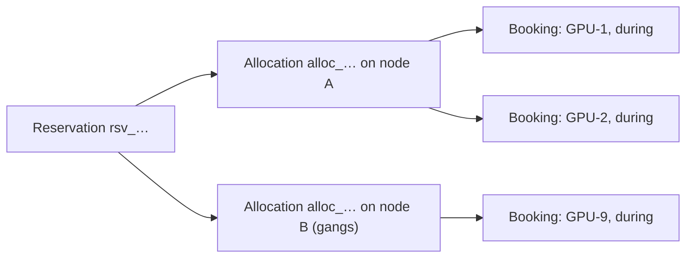

import { Cpu, Route, CalendarClock, Gauge, Waypoints, Zap, Split, Boxes } from '@/lib/icons';

Capacity is the part of Better Compute that answers two questions: how many GPUs a
<Term id="pool">pool</Term> can hand out over a time window, and which exact devices a
<Term id="reservation">reservation</Term> gets. It lives in `@better-compute/capacity` (also
`better-compute/capacity`), which the server registers as an always-on built-in module right after
inventory; you do not register it yourself.

Everything here rests on one idea: a claim on hardware is a row with a time range, and the database
refuses two overlapping rows for the same device. Placement, quotas and rollups are layered on top
of that rule, so no scheduler bug or concurrent request can hand one GPU to two tenants.

## Atoms and bookings

Inventory turns what a node reports into <Term id="device">devices</Term>. Each has a class
(`gpu`, `gpu.mig`, `gpu.slot`, `nic.vf`, `disk` or `node`), typed attributes such as `gpuProduct`,
`gpuModel`, `vramGiB` and `numaNode`, and two flags: `healthy` and `bookable`. A bookable device is an
<Term id="atom">atom</Term>, and only atoms are ever booked.

- A whole GPU is one `gpu` atom, identified by its GPU UUID.
- A GPU in MIG mode is an unbookable `gpu` parent plus one `gpu.mig` atom per instance
  (`<gpuUuid>/gi<g>/ci<c>`).
- A GPU in a `timeslice` or `mps` pool is an unbookable parent plus `gpu.slot` atoms
  (`<gpuUuid>/s<k>`). See [fractional GPUs](/docs/guides/capacity/fractional-gpus).

When a reservation is placed, capacity writes one <Term id="allocation">allocation</Term> per node
and one <Term id="booking">booking</Term> per atom:



A booking is `(device_id, allocation_id, during)`, where `during` is a `tstzrange`. The allocation
also records scalar claims (`vcpu`, `memoryGiB`, `diskGiB`) that VPS instances take from
`node_resources`. Since v1.1's first pieces, GPU reservations also book host CPUs, memory and 1 GiB huge pages
with their devices ([host resources](/docs/guides/capacity/reservations#host-resources)), which the node turns into
a cgroup slice for the workload, and a reservation can hand its GPUs to a node's kubelet
([Kubernetes workers](/docs/guides/capacity/kubernetes)). What is still missing is on
[the roadmap](/docs/reference/roadmap#cpu-memory-and-kubernetes-v11).

## Capacity math

Every number capacity reports is derived from bookings and node state, following PLAN.md section 10.2:

```text
allocatable = healthy, bookable atoms on schedulable nodes   (scalars: floor(allocatable × ratio))
allocated   = bookings whose during contains compute_now()   (scalars: node_resources.allocated)
reserved    = bookings that start after compute_now()
available   = max(0, allocatable − allocated − reserved)
```

Time is always the database's `compute_now()`, never the API process's clock, so every process agrees
on what "now" is (see [consistency](/docs/guides/concepts/consistency)).

A node's atoms count as allocatable only when the node is schedulable: role `host`, not in
<Term id="maintenance">maintenance</Term>, not <Term id="cordon">cordoned</Term>, provision state
`adopted` or `deployed`, `connected`, no `NoSchedule` reason, at least one converged spec, and trust
`platform` (or `tenant-owned` in its owner's pool). Everything else lands in a bucket that explains why
it is not allocatable:

| Bucket | What lands there |
| --- | --- |
| `provisioning` | Provision state other than `adopted` or `deployed`, or no converged spec yet |
| `maintenance` | Nodes in maintenance, and cordoned nodes |
| `unreachable` | Connectivity other than `connected` |
| `unhealthy` | Nodes with a `NoSchedule` reason, and unhealthy atoms on otherwise schedulable nodes |
| excluded | Not counted at all: nodes whose role is not `host`, `tenant-controlled` nodes, and `tenant-owned` nodes in another tenant's pool |

GPUs are never overcommitted. Only scalar resources carry an overcommit `ratio`.

`available` is deliberately conservative: an atom booked now and again later counts in both
`allocated` and `reserved`. For an exact answer about a specific window, ask the placer with
[`capacity.preview`](/docs/reference/api/capacity#preview) instead of subtracting rollup numbers.

## Why double-booking cannot happen

Six independent guards hold. The torture tests in `tests/capacity-concurrency.test.ts` attack the
first five with 1,000 interleaved and 1,000 concurrent operations: reservations, releases, cordons,
taints and `healthy` flips.

1. **Device-time exclusivity.** `device_bookings` carries
   `EXCLUDE USING gist (device_id WITH =, during WITH &&)`. At most one live booking exists per atom
   per instant, whatever the placer or API does. This is the
   <Term id="exclude-constraint">EXCLUDE constraint</Term>.
2. **The atom rule.** A partitioned GPU's parent is not bookable, and a MIG or slot layout change books
   every atom of the GPU, parent included, for the change window. A flat `EXCLUDE` cannot see
   parent and child overlapping; the atom rule removes the case.
3. **Guarded counters.** Scalars are claimed with
   `UPDATE node_resources SET allocated = allocated + $n WHERE … AND allocated + $n <= floor(allocatable * ratio)`,
   with a `CHECK` constraint as a backstop.
4. **Linearizable eligibility.** The placer locks the chosen node `FOR SHARE OF n` under the
   schedulability predicate, and the chosen atoms `FOR SHARE` where they are healthy and bookable.
   Cordon, taint, liveness and quarantine writes update those same rows, so whichever transaction
   commits second sees the first.
5. **Quota.** `quota_usage` is charged with a guarded `used + n <= max` update, and a
   `CHECK (used BETWEEN 0 AND max)` backs it up.
6. **Defence in depth on the node.** The node refuses an assignment that overlaps one it already
   holds. The TypeScript FakeDaemon and the devices converger of `bcd` both answer such an assignment
   with `AllocationFailed`.

Every guarded statement returns fewer rows instead of raising, and `INSERT … ON CONFLICT DO NOTHING`
(without a conflict target) honours the exclusion constraint. A lost race therefore rolls back to a
savepoint and the placer replans, without aborting the request's transaction. The details are on
[placement](/docs/guides/capacity/placement).

## Rollups

Reading capacity never aggregates devices. `pool_capacity_rollup` holds one row per pool and resource
(`gpu`, `gpu.mig`, `gpu.slot`, and scalars such as `vcpu`), and two mechanisms keep it current:

- **Deltas in the booking transaction.** Every placement adds its atoms to `allocated` (the booking
  has started) or `reserved` (it starts later), and every release subtracts them, in the same
  transaction that writes the bookings.
- **A periodic rebuild.** The `capacity.rollup` reconciler recomputes every pool from nodes, devices,
  bookings and `node_resources` every 5 minutes (`rollupEvery` in the capacity options). The rebuild
  is what moves a booking from `reserved` to `allocated` once it starts, and what picks up bucket
  changes such as a cordon or a node going unreachable.

Between rebuilds the rollup can lag reality by up to one period. Treat it as a dashboard number; the
placer never reads it.

## The capacity API

Four read methods serve capacity, all decided as `compute:capacity:read`:

| Method | Decided on | Returns |
| --- | --- | --- |
| [`capacity.summary`](/docs/reference/api/capacity#summary) | the tenant | Every pool the tenant owns or is offered, with its rollup rows, plus totals per GPU model |
| [`capacity.byPool`](/docs/reference/api/capacity#bypool) | the pool | One pool's rollup rows (`pools.capacity` answers the same) |
| [`capacity.preview`](/docs/reference/api/capacity#preview) | the pool | Whether a reservation request would fit now, and where, without booking anything |
| [`capacity.timeline`](/docs/reference/api/capacity#timeline) | the pool | GPUs booked per time bucket, for calendar views |

```ts title="capacity.ts"
const summary = await compute.api.capacity.summary(credential, { tenantId: 'acme' });
// summary.byGpuModel.H100 → { total, allocatable, allocated, reserved, available }

const rows = await compute.api.capacity.byPool(credential, { tenantId: 'acme', poolId });
```

`summary.byGpuModel` adds up only the whole-GPU (`gpu`) rows of each pool; MIG and slot rows are in
`summary.pools[].capacity`. A pool without a GPU model is summed under `other`. Each rollup row looks
like this:

```json title="capacity.byPool (one row)"
{
  "poolId": "pool_01k…",
  "resource": "gpu",
  "total": 64,
  "allocatable": 56,
  "allocated": 24,
  "reserved": 8,
  "available": 24,
  "provisioning": 0,
  "unhealthy": 1,
  "maintenance": 7,
  "unreachable": 0,
  "updatedAt": 1790000000000
}
```

`total` is the sum of `allocatable` and the four buckets. From the CLI, `better-compute capacity`
prints the summary, `--pool` one pool's rows, and `--preview` with `--gpus` and `--for` a placement
preview (see the [CLI reference](/docs/reference/cli)):

```bash
better-compute capacity --tenant acme
better-compute capacity --tenant acme --preview --pool pool_01k… --gpus 8 --for 1d --selector "vramGiB >= 80"
```

Preview and timeline are described with the features they serve: [placement](/docs/guides/capacity/placement)
and [gang and calendar reservations](/docs/guides/capacity/gang-and-calendar).

## In this section

<Cards>
  <Card title="Pools" href="/docs/guides/capacity/pools" icon={<Boxes />}>
    Classes, sharing modes, policy, offerings with quota, and archiving.
  </Card>
  <Card title="Placement" href="/docs/guides/capacity/placement" icon={<Route />}>
    The placer contract, filters, scorers, the shortlist and the commit.
  </Card>
  <Card title="Reservations" href="/docs/guides/capacity/reservations" icon={<Cpu />}>
    Drafts, the admission sequence, states, bindings, leases and the API.
  </Card>
  <Card title="Quotas and usage" href="/docs/guides/capacity/quotas-and-usage" icon={<Gauge />}>
    Per-pool limits, hourly usage windows and Better IAM billing.
  </Card>
  <Card title="Gang and calendar reservations" href="/docs/guides/capacity/gang-and-calendar" icon={<CalendarClock />}>
    Multi-node bookings on one fabric, future start times and BookingRepair.
  </Card>
  <Card title="Spot and preemption" href="/docs/guides/capacity/spot-and-preemption" icon={<Zap />}>
    Preemptible reservations, notices and what happens to their allocations.
  </Card>
  <Card title="Fractional GPUs" href="/docs/guides/capacity/fractional-gpus" icon={<Split />}>
    MIG instances, time-slice and MPS slots as atoms.
  </Card>
  <Card title="Domain model" href="/docs/guides/concepts/domain-model" icon={<Waypoints />}>
    Where pools, nodes, devices and reservations sit among the other records.
  </Card>
</Cards>
