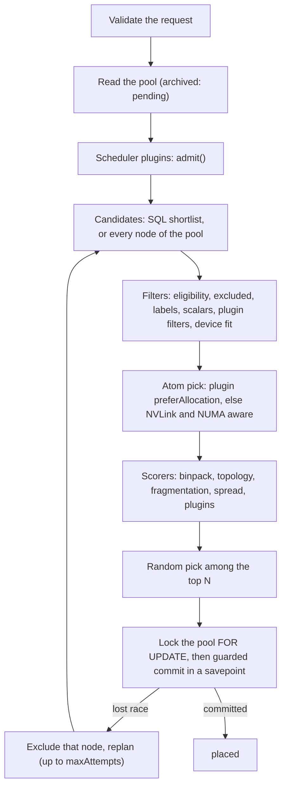

The <Term id="placer">placer</Term> decides where a request lands: which node of the pool, which
atoms on it, and which scalar amounts it claims. It runs for reservations, for VPS instances placed
through the capacity port, for gangs, for BookingRepair and for spot preemption. Placement never
charges quota and never talks to IAM; both happen before it is called.

## The placer contract

Every placer implements one interface from `@better-compute/core`:

```ts title="@better-compute/core"
interface Placer {
  readonly id: string;
  place(tx: SqlTx, request: PlacementRequest, context: PlacementContext): Promise<PlacementOutcome>;
}

type PlacementOutcome =
  | { status: 'placed'; allocations: Allocation[] } // bookings, counters and allocations written in tx
  | { status: 'pending'; reason: string } // nothing fit after replanning
  | { status: 'queued' }; // a batching placer took the request
```

<TypeTable
  type={{
    tenantId: { type: 'string', description: 'The tenant the allocations belong to.', required: true },
    poolId: { type: 'string', description: 'The pool to place into.', required: true },
    reservationId: { type: 'string', description: 'The owner of the allocations. Exactly one of reservationId and instanceId.' },
    instanceId: { type: 'string', description: 'The owner when a VPS instance is placed.' },
    devices: { type: 'DeviceRequest[]', description: 'Device classes, counts, selectors and topology. At most 64 devices in all.', required: true },
    topology: { type: "'any' | 'nvlink-all'", description: 'The default topology for every device request.', default: "'any'" },
    gang: { type: '{ size: number; topologyKey?: string }', description: 'Book size nodes, each taking devices (v0.5).' },
    resources: { type: 'Record<string, number>', description: 'Scalar claims such as vcpu or memoryGiB, non-negative integers.' },
    during: { type: '{ start: number; end: number }', description: 'The booked interval in epoch milliseconds; must be non-empty.', required: true },
    excludeNodes: { type: 'string[]', description: 'Nodes to leave out, as after a lost race.' },
    nodeLabels: { type: 'Record<string, string>', description: "Labels every candidate must carry with exactly these values, or with any value for '*', such as a runtime a daemon advertised (bc.dev/driver.kata: '*'). Absent: no label constraint." },
  }}
/>

A request must claim at least one device or resource; anything malformed is `INVALID_INPUT` before any
lock is taken. `PlacementContext` carries the database `clock`, a `random` function (seeded in the
simulator, so placements replay), the scheduler `plugins`, the scorer `weights`, `topN`, and the
<Term id="admission-context">admission context</Term> when the call comes from an admitted request.

## Two placers

| | `inline` (default) | `pool-lease` (v0.4, for production on Postgres) |
| --- | --- | --- |
| `reservations.create` answers | `placed` or `pending` | `pending` with a `Queued` condition, then `placed` once the batch runs; with `wait: { timeoutMs }` the answer holds until then (at most 30 s) |
| Where placement runs | In the request's second transaction | In the `capacity.placer` reconciler that owns the pool's shard |
| Pool lock | Taken only for the commit, a few milliseconds | Never at admission; once per batch of at most 64, after the batch's rows and the pool index are loaded |
| Throughput in `bench/placements` (PGlite, 1,000 nodes) | about 35 placements/s | about 118 placements/s |

```ts title="compute.ts"
import { betterCompute } from 'better-compute';

export const compute = betterCompute({
  // …database, secret, baseURL, iam
  capacity: { placer: 'pool-lease', maxBatch: 64, maxAttempts: 3 },
  scheduler: { weights: { spread: 0.5 }, topN: 5 },
});
```

Both placers commit with guarded statements, so neither can double-book. The pool-lease placer plans
queued reservations oldest first against an in-memory index of the pool, skipping rows another
transaction holds; bookings made elsewhere meanwhile are caught by the guarded commit, and the request
is planned again without that node. Instances, gangs, BookingRepair and spot preemption
always place inline, because they need an answer at once. The inline placer stays the library default
because it is synchronous and easier to test. See [scaling](/docs/operations/scaling) for sizing.

## The pipeline

`planPlacement` is the pure half of placement: no SQL, no clock. The inline placer runs it and then
commits the chosen plan:



Plans are made on plain reads. The pool row lock is taken only right before the first commit, and the
commit re-validates the node, the atoms and the scalars, so the critical section is the commit alone.

## Eligibility filters

A node that fails a filter is rejected with a filter name and a reason. These are the exact reasons,
checked in this order:

| Filter | Reason | Capacity bucket |
| --- | --- | --- |
| `excluded` | `excluded by the request` | |
| `eligible` | `in another pool` | |
| `eligible` | `role <role>` | excluded |
| `eligible` | `tenant-controlled nodes add no capacity` | excluded |
| `eligible` | `tenant-owned node outside its owner's pool` | excluded |
| `eligible` | `in maintenance` | maintenance |
| `eligible` | `cordoned` | maintenance |
| `eligible` | `provision state <state>` | provisioning |
| `eligible` | `awaiting its first converged spec` | provisioning |
| `eligible` | `connectivity <connectivity>` | unreachable |
| `eligible` | `NoSchedule: <reasons>` | unhealthy |
| `labels` | `needs label <key>=<value>` (the first `nodeLabels` entry the node lacks) | |
| `fits` | `no <resource>`, or `<resource>: <n> requested, <m> free` | |
| a plugin filter's id | the plugin's reason | |
| `fits` | `<n> of <count> <class> free` (plus `matching the selector`) | |
| `topology` | `no <count> <class> fully connected by NVLink` | |

`NoSchedule` reasons come from `nodes.no_schedule_reasons`, which conditions, taints and liveness
maintain in the same transaction as their cause (see [inventory and health](/docs/guides/nodes/inventory-and-health)).
The one reason a request can tolerate is a dedication to its own tenant: a node tainted `dedicated=acme` places
`acme`'s work and no one else's (see [operating nodes](/docs/guides/nodes/operating-nodes)). Whole-node leases,
which ignore every other NoSchedule reason, honour dedications too (`leasableSqlFor`), in their candidate query, at
commit and in BookingRepair. The schedulability check exists twice, as `ineligibility(node, pool, tenantId?)` in
TypeScript and as the SQL predicate the commit locks with (`schedulableSqlTolerating`), and a test keeps the two in
agreement. A third form, `mayBeSchedulableSql` (schedulable for some tenant: no reason, or one dedication alone),
drives the node controller's wake edge, so a node that becomes schedulable only for its dedicated tenant still
wakes that tenant's pending reservations.

Scalar room is `floor(allocatable × ratio) − allocated` from the node's `node_resources` row. TypeScript's floor matches the SQL
guards' numeric one (`scalarCapacity()`, a44b886, adds an epsilon that absorbs float rounding), so `100 × 0.29` is
29 in the pipeline, the pool index and the rollup, not 28, and the last unit places; the guarded commit still
decides. A queued reservation is not placed into a pool archived after it
was queued: the batch placer reads the locked pool row, and such a reservation stays pending with `the pool is
archived`, as inline placement answers.

`nodeLabels` (v0.2) is checked on every path: the pipeline filter above, the SQL shortlist (a `node_labels` check
added only when the request names labels, so other requests pay nothing) and the pool-lease index, which memoizes
its rankings per label set. The labels a request usually needs are the ones the gateway writes at every `Hello`:
each driver the daemon advertises becomes the system label `bc.dev/driver.<id>=<version>`, and each kind it serves
`bc.dev/driver-kind.<id>.<kind>=1` (14ceb1e; see [labels](/docs/guides/nodes/inventory-and-health#labels)). Plans read labels without locks, and the commit
reads the locked nodes' labels again (bb6da07, in `commitPlan` and `commitPlansBulk`), so a label that went away in
between, such as a capability a downgraded daemon no longer advertises, makes that commit a lost race, and the placer
replans without the node. A value of `'*'` (`anyLabelValue`) asks only for the label to exist, whatever its value,
on every path. The capacity API does not take `nodeLabels` from callers; a module sets it on the requests it builds
through the capacity port. The vps module does (PLAN.md's walkthrough 4): a hosted instance whose runtime `bcd` does
not build in (anything but `libvirt-kvm` and `cloud-hypervisor`, which host builds run when `virsh` or the `cloud-hypervisor` binary is installed) asks for `bc.dev/driver.<runtime>: '*'`
(`runtimeNodeLabels`), so a plugin runtime such as `firecracker` lands only on hosts whose daemon advertised that
driver, in any version. The two built-ins ask for no label, although a host build runs each only when its tool is
installed, so give every host of a pool the pool's runtime: an instance placed on a host without it fails there
(`runtime <id> is not installed on this host`).

## Device fit and selectors

For each device request, the candidates are atoms of the requested class that are free for the whole
`during` window, healthy, bookable, and match the request's selector. A selector is a list of
`matchExpressions`, all of which must hold. Each expression reads a device attribute first, then a
node label with the same key.

```json title="A selector"
{
  "matchExpressions": [
    { "key": "gpuProduct", "op": "In", "values": ["H100-SXM5-80GB"] },
    { "key": "vramGiB", "op": "Gte", "values": [80] },
    { "key": "fabric.domain", "op": "Exists" }
  ]
}
```

- Operators: `In`, `NotIn`, `Exists`, `DoesNotExist`, `Gt`, `Gte`, `Lt`, `Lte`.
- `In` and `NotIn` compare as strings; the four comparisons are numeric and take exactly one value.
  A value that is not a number never matches a comparison.
- At most 32 expressions per selector and 64 values per expression. Keys start with a letter and may
  contain letters, digits, `.`, `_`, `/` and `-`.

The CLI and `parseSelector` (exported by `better-compute/capacity`) accept a shorthand, and
`formatSelector` prints one back:

```bash
better-compute reserve --tenant acme --pool pool_01k… --gpus 8 --for 3d \
  --selector "gpuProduct in (H100-SXM5-80GB), vramGiB >= 80, mig.capable = true, fabric.domain"
```

`key in (a, b)` and `key notin (a, b)` are sets, `=` and `!=` are one-value `In` and `NotIn`, a bare
`key` is `Exists`, and `!key` is `DoesNotExist`. A bare key matches whatever the value is, so write
`mig.capable = true` rather than `mig.capable` when the value matters. Device attributes include `gpuProduct`, `gpuModel`,
`vramGiB`, `numaNode`, `architecture`, `computeCapability` and `migCapable`; node labels include
`gpu.product`, `gpu.model`, `cuda.driver.major`, `mig.capable` and `fabric.domain`.

## Atom pick and NVLink

When a node has more matching atoms than the request needs, the placer picks which ones:

1. A scheduler plugin's `preferAllocation` picker for the device class wins. It must return exactly
   `count` distinct free candidates, or the node is rejected.
2. Otherwise the default pick prefers NVLink-complete sets, then the fewest NUMA nodes. It grows a set
   from every seed atom, adding the atom whose worst link to the set is best, same NUMA node as the
   seed breaking ties, and keeps the set with the best worst link, then the smallest NUMA spread.

Links are ranked `NV` > `PIX` > `PXB` > `PHB` > `NODE` > `SYS`, as `nvidia-smi topo` prints them; MIG
instances and slots of one GPU count as `NV` to each other. With `topology: 'nvlink-all'` (the CLI's
`--nvlink`), a pick of more than one GPU whose worst link is not `NV` is rejected.

The placer reads links from the capacity table `capacity_device_links`, filled by
`syncDeviceLinks(tx, nodeId, gpusSection)` from the inventory topology matrix. The built-in inventory
controller does not call it in this release, so unless your host does, every pair of GPUs has an
unknown link: the topology scorer treats such a pick neutrally, and an `nvlink-all` request for more
than one GPU cannot be placed.

## Scorers

Every node that passes the filters gets a score between 0 and 1 from each scorer, and its total is the
weighted sum:

| Scorer | Weight | Score |
| --- | --- | --- |
| `binpack` | 1 | `1 − freeAfter / total` over atoms of the requested classes: fuller nodes first, so 8-GPU boards stay whole |
| `topology` | 1 | 1 for one GPU; `1 − worst / 5` by link rank; 0.5 when a link is unknown |
| `fragmentation` | 0.25 | 1 when the node ends up full, 0.5 when the free atoms left are a power of two, else 0 |
| `spread` | 0 | `1 − binpack`, for deployments that prefer spreading |

Plugin scorers add their own ids; their scores are clamped to 0..1 and weighted by the scorer's
`weight` (1 by default). `scheduler.weights` overrides any weight by id, built-in or plugin. Ties
break on node id, so a plan is reproducible. Finally the placer picks at random among the best `topN`
(default 5), so concurrent placements into one pool rarely collide on the same node.

```ts title="rack-affinity.ts"
import { defineSchedulerPlugin } from 'better-compute';

export const rackAffinity = defineSchedulerPlugin({
  id: 'rack-affinity',
  filters: [
    {
      id: 'no-quarantine-rack',
      filter: (request, node) => (node.labels['rack'] === 'r13' ? { reason: 'rack r13 is quarantined' } : true),
    },
  ],
  scorers: [{ id: 'rack-a', weight: 0.5, score: (request, node) => (node.labels['rack']?.startsWith('a') ? 1 : 0) }],
});
// betterCompute({ scheduler: { plugins: [rackAffinity] } })
```

[Scheduler plugins](/docs/extending/scheduler-plugins) covers the `admit` hook and pickers.

## The shortlist

Loading every node, device and booking of a large pool for each request is expensive. When a request
has no selectors, no gang and no plugin scorers, the inline placer first asks SQL for every
schedulable node with enough free atoms and scalar room, ranks them by the part of the score that
depends only on counts, and plans only the best 48 (at least 8 × `topN`). It uses that plan only when
no node outside the shortlist could reach the top N; otherwise it plans the whole pool. The result is
the same ranking either way, which `tests/capacity-shortlist.test.ts` checks.

## Commit and lock order

The chosen plan is written inside `SAVEPOINT capacity_place_<attempt>`, with statements that return
fewer rows instead of raising:

```sql title="The guarded commit"
SELECT n.id FROM nodes n JOIN pools p ON p.id = n.pool_id
 WHERE n.id = $1 AND n.pool_id = $2 AND <schedulable> FOR SHARE OF n;       -- node still schedulable
SELECT id, class FROM devices
 WHERE id = ANY($atoms) AND node_id = $1 AND healthy AND bookable FOR SHARE; -- atoms still healthy
INSERT INTO device_bookings (device_id, allocation_id, during)
  SELECT unnest($atoms), $alloc, tstzrange($start, $end)
  ON CONFLICT DO NOTHING RETURNING device_id;                                -- fewer rows: booked meanwhile
UPDATE node_resources SET allocated = allocated + $n
 WHERE node_id = $1 AND resource = $r AND allocated + $n <= floor(allocatable * ratio)
 RETURNING allocated;                                                        -- no row: ran out
INSERT INTO allocations (…) VALUES (…);                                      -- then the rollup delta
```

A short answer rolls back to the savepoint with one of these reasons, excludes the node, and replans:
`<node> is no longer schedulable`, `an atom on <node> turned unhealthy or unbookable`,
`an atom on <node> was booked concurrently`, or `<resource> on <node> ran out`. After `maxAttempts`
(default 3) lost races the answer is `pending` with
`Unschedulable after 3 conflicting attempts: …`.

Every transaction in capacity that locks several of these tables takes them in one order:
`quota_usage` → `pools` → `nodes` → `devices` → `node_resources` → `pool_capacity_rollup`. Quota is
charged before placement and refunded before a release, so reserve and release never wait on each
other in a cycle. Code that cordons, taints or releases nodes follows the same order.

## Reading a pending reason

When nothing fits, the reason summarizes the rejections, most common first, at most five groups:

```text
no node fits (3 nodes): 2 × fits: 1 of 4 gpu free; 1 × cordoned
```

An empty pool answers `the pool has no nodes`. A reservation stores the reason in its `Unschedulable`
condition (reason `NoFit`), so [`reservations.get`](/docs/reference/api/reservations#get) shows it.

## Previewing a placement

[`capacity.preview`](/docs/reference/api/capacity#preview) runs the same pipeline without the commit.
It takes the same input as `reservations.create`, including a syntactically valid `idempotencyKey`
that is never stored, and is decided as `compute:capacity:read` on the pool, so it checks neither quota
nor the reservation policy.

```ts
const preview = await compute.api.capacity.preview(credential, {
  tenantId: 'acme',
  poolId,
  devices: [{ class: 'gpu', count: 8, topology: 'nvlink-all' }],
  duration: '1d',
  idempotencyKey: 'preview',
});
// { fits: true, candidates: [{ nodeId: 'node_…', atoms: ['GPU-…', …], score: 2.25 }] }
// or { fits: false, candidates: [], reason: 'no node fits (…)', preemptible?: { reservations, startsAt } }
```

`candidates` lists up to 10 nodes, best first. A gang preview shows the members of the best gang, and
a `binding: 'node'` preview the leasable nodes it would take. `preemptible` appears for a regular
request that would fit by preempting spot work; see [spot and preemption](/docs/guides/capacity/spot-and-preemption).
