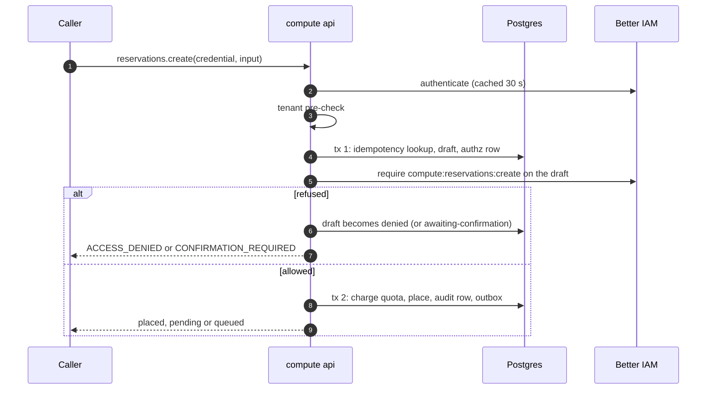
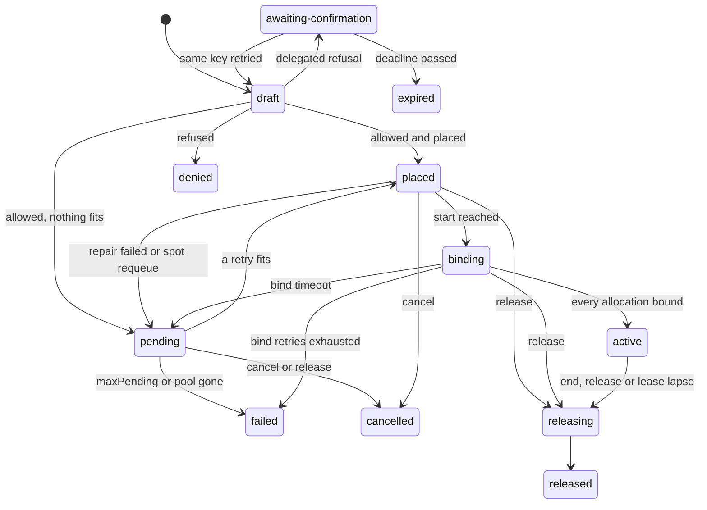

A <Term id="reservation">reservation</Term> is a tenant's claim on devices of one pool for a time
window: four NVLink-connected H100s for eight hours from now, or two nodes for three days starting
Monday. It is created as a request-as-resource: the request is first written as a
<Term id="draft">draft</Term>, Better IAM decides on that draft with everything it asks for as
attributes, and only an allowed draft is placed. So a policy such as "at most 8 H100s for at most 72
hours in these regions" is one decision on the reservation itself, not a check you write in code.

## Reserve GPUs

<Tabs items={['Server', 'Browser client', 'HTTP', 'CLI']}>
<Tab value="Server">

```ts title="reserve.ts"
import { compute } from './compute';

const reservation = await compute.api.reservations.create(
  { headers: request.headers }, // the caller's credential
  {
    tenantId: 'acme',
    poolId: 'pool_01k…',
    devices: [{ class: 'gpu', count: 4, topology: 'nvlink-all' }],
    duration: '8h',
    idempotencyKey: 'train-2026-09-24',
  },
);
// reservation.state: 'placed' (or 'pending' with an Unschedulable condition)
```

</Tab>
<Tab value="Browser client">

```ts title="reserve.ts"
import { createComputeClient } from 'better-compute/client';
import type { compute } from './compute';

const client = createComputeClient<typeof compute>({
  baseURL: 'https://compute.example.com',
  token: () => session.getToken(),
});
await client.reservations.create({
  tenantId: 'acme',
  poolId: 'pool_01k…',
  devices: [{ class: 'gpu', count: 4, topology: 'nvlink-all' }],
  duration: '8h',
  idempotencyKey: 'train-2026-09-24',
});
```

</Tab>
<Tab value="HTTP">

```bash
curl -X POST https://compute.example.com/api/compute/reservations/create \
  -H "Authorization: Bearer $BETTER_COMPUTE_TOKEN" \
  -H "Content-Type: application/json" \
  -H "X-Better-Compute: 1" \
  -d '{"tenantId":"acme","poolId":"pool_01k…","devices":[{"class":"gpu","count":4,"topology":"nvlink-all"}],"duration":"8h","idempotencyKey":"train-2026-09-24"}'
# → { "data": { "id": "rsv_…", "state": "placed", … } }
```

</Tab>
<Tab value="CLI">

```bash
better-compute reserve --tenant acme --pool pool_01k… --gpus 4 --for 8h --nvlink --key train-2026-09-24
better-compute reservations get rsv_… --tenant acme --query binding
```

`reserve` sends a new idempotency key on every run unless you pass `--key`, and prints the key so you
can retry. See the [CLI reference](/docs/reference/cli).

</Tab>
</Tabs>

<TypeTable
  type={{
    tenantId: { type: 'string', description: 'The tenant reserving. The caller must belong to it (or be root).', required: true },
    poolId: { type: 'string', description: 'A pool the tenant owns or is offered, not archived.', required: true },
    devices: {
      type: 'DeviceRequest[]',
      description: '1 to 8 entries of { class, count (1 to 64), selector?, topology?, sharing? }; at most 64 devices in all.',
      required: true,
    },
    duration: { type: 'string | number', description: 'Like 30m, 8h, 7d or 1h30m, or milliseconds; from 1 minute to 365 days.', required: true },
    idempotencyKey: { type: 'string', description: '1 to 128 letters, digits, dots, underscores, colons or hyphens. Scoped to the tenant and the caller.', required: true },
    start: { type: 'number', description: 'Epoch milliseconds; a later start makes a calendar reservation.', default: 'now' },
    topology: { type: "'any' | 'nvlink-all'", description: 'nvlink-all requires every GPU of a device request to be NVLink-connected.', default: "'any'" },
    binding: { type: "'hold' | 'node'", description: "hold hands the devices to software on the node; node leases whole machines (v0.5).", default: "'hold'" },
    node: { type: '{ profileId: string; profileVersion?: number }', description: "binding 'node' only: the metal profile to deploy." },
    leaseSeconds: { type: 'number', description: '30 to 86400. Makes the reservation renewable: it is released unless renewed within this period.' },
    projectId: { type: 'string', description: 'A project (prj_) to account the reservation to.' },
    spot: { type: 'boolean', description: 'Preemptible, billed at the spot meter (v0.5).', default: 'false' },
    gang: { type: '{ size: number; topologyKey?: string }', description: '2 to 64 nodes, each taking devices, all or nothing (v0.5).' },
    wait: { type: '{ timeoutMs: number }', description: '0 to 30000. Holds the answer while the reservation is queued for the pool-lease placer; see waiting for placement below.' },
  }}
/>

Unknown fields are `INVALID_INPUT`. `binding: 'instance'` is `UNSUPPORTED`: VPS instances are created
with `instances.create` and book through the capacity port (see [instances](/docs/guides/vps/instances)).

## The reservation object

<TypeTable
  type={{
    id: { type: 'string', description: 'rsv_ plus 52 characters, derived from the tenant, the caller and the idempotency key.' },
    tenantId: { type: 'string', description: 'The owning tenant.' },
    poolId: { type: 'string', description: 'The pool it is booked in.' },
    projectId: { type: 'string', description: 'The project, when the request named one.' },
    state: { type: 'ReservationState', description: 'See states and conditions below.' },
    request: { type: 'ReservationSpec', description: 'What was asked for, with duration stored in milliseconds (for example 28800000ms).' },
    during: { type: '{ start: number; end: number }', description: 'The booked window, once placed. Absent while pending.' },
    leaseExpiresAt: { type: 'number', description: 'Renewable reservations: when the lease lapses unless renewed.' },
    ownerIdentityId: { type: 'string', description: 'The identity that created it: the person, or the agent for agent keys.' },
    agentId: { type: 'string', description: 'The agent, for delegated sessions.' },
    delegationId: { type: 'string', description: 'The delegation, for delegated sessions.' },
    idempotencyKey: { type: 'string', description: 'The key it was created with.' },
    conditions: { type: 'Condition[]', description: '{ type, status, reason?, message?, since } entries.' },
    binding: { type: '{ nodeId; cdiDevices; envFile }', description: 'hold bindings, once a node reported the devices bound.' },
    operation: { type: '{ id; state; error? }', description: "The async operation behind the reservation: running, pending, succeeded or failed. See waiting for placement." },
    version: { type: 'number', description: 'Raised by every change.' },
  }}
/>

```json title="An active reservation"
{
  "id": "rsv_…",
  "tenantId": "acme",
  "poolId": "pool_01k…",
  "state": "active",
  "request": {
    "poolId": "pool_01k…",
    "devices": [{ "class": "gpu", "count": 4, "topology": "nvlink-all" }],
    "duration": "28800000ms",
    "binding": "hold"
  },
  "during": { "start": 1790000000000, "end": 1790028800000 },
  "ownerIdentityId": "…",
  "idempotencyKey": "train-2026-09-24",
  "conditions": [],
  "binding": {
    "nodeId": "node_01k…",
    "cdiDevices": ["bcd.dev/gpu=GPU-…", "bcd.dev/gpu=GPU-…", "bcd.dev/gpu=GPU-…", "bcd.dev/gpu=GPU-…"],
    "envFile": "/run/bcd/allocations/alloc_….env"
  },
  "operation": { "id": "rsv_…", "state": "succeeded" },
  "version": 4
}
```

## Drafts and idempotency

The draft id is deterministic: `rsv_` followed by the base32 SHA-256 of the tenant, the caller's
identity and the idempotency key. Retrying with the same key reaches the same row, and the same key
from another identity gets a row of its own, so nobody can squat on or replay someone else's request.

The stored request hash covers the validated input without `wait` and `idempotencyKey`. Durations
are normalized to milliseconds and `binding` defaults to `hold`, so `'2h'` and `7200000` are the same
request, with or without `binding: 'hold'`.
A second call with the same key:

- with the same request, on a reservation past the draft stage, returns the stored reservation with
  no second IAM decision;
- with the same request, on a draft (for example after `QUOTA_EXCEEDED`), decides the same draft again;
- with a different request, is `CONFLICT` with `details.reservationId`;
- on a refused key, stays `ACCESS_DENIED`.

Drafts are internal: `reservations.get` answers `NOT_FOUND` for them and `reservations.list` skips
them.

## The admission sequence

Every `create` follows the normative sequence of PLAN.md section 3.4, and `extend` follows it against
the existing reservation. IAM is never called inside a compute transaction.



<Steps>
<Step>

### Authenticate and pre-check

The credential is authenticated (cached for 30 seconds). If the caller's tenant is neither the input
tenant nor the root tenant, the answer is `ACCESS_DENIED` before compute's database is read, the same
answer whether or not anything exists.

</Step>
<Step>

### Transaction 1: the draft

The idempotency row is looked up and locked. The pool must be owned by or offered to the tenant and
not archived, or the answer is `NOT_FOUND`. Device classes must fit the pool's sharing mode, and
`binding: 'node'` needs a `tenantRoot` pool. Then the draft is inserted with its row in the IAM
<Term id="authz-projection">authz projection</Term>, parented to the pool and owned by the caller:

| Attribute | Value |
| --- | --- |
| `gpuModel` | The pool's GPU model, or `other` |
| `gpuCount` | Whole GPUs requested, times the gang size |
| `gpuSlices` | MIG instances and slots requested, times the gang size |
| `gangSize` | 1, or the gang size |
| `durationHours` | The duration in hours, to three decimals |
| `region` | The region of the pool's site |
| `binding`, `spot`, `renewable`, `projectId` | As requested; `renewable` is true with `leaseSeconds` |

</Step>
<Step>

### Decide exactly once

`iam.require` decides `compute:reservations:create` on `compute-reservation/<draft id>`. The resolver
hands IAM the attributes above and the pool's relations, so pool access and request limits are one
decision; see [policies](/docs/guides/iam/policies). A refusal marks the draft `denied`, unless the
caller is an agent in a delegated session and IAM opened a confirmation request (below).

Still outside any transaction, the budget check (`budgetAdmissionCheck`) runs when the pool's policy
sets `admission.budgetCheck: 'meter'` or the tenant's offer has `onBudgetExceeded: 'stop-new'` or
`'drain'`: it calls Better IAM's `billing.check` for the caller, and a spent budget answers
[`SPEND_LIMIT_REACHED`](/docs/reference/errors#spend_limit_reached). The draft stays, so the same key is
decided again once the budget's window resets. See [budgets](/docs/guides/iam/billing-and-usage#budgets).

</Step>
<Step>

### Transaction 2: quota and placement

Quota is charged all-or-nothing first. `QUOTA_EXCEEDED` ends the request and leaves the draft, so a
retry with the same key is decided again. Then the [placer](/docs/guides/capacity/placement) runs. A
regular request that does not fit may [preempt spot work](/docs/guides/capacity/spot-and-preemption).
The outcome is `placed`, `pending` with an `Unschedulable` condition (retried every 30 seconds), or,
with the pool-lease placer, `pending` with a `Queued` condition. The same transaction schedules the
lifecycle, writes the event to the outbox and records the audit row with the admission context.

</Step>
</Steps>

Two details differ from the PLAN.md text. Quota is charged by the reservation service before
placement, never by the placer, because a pending reservation keeps its charge (decision D9).

## Waiting for placement

`create` is async-with-wait (PLAN.md section 9.1): every reservation carries an `operation`, and a
request with `wait: { timeoutMs }` holds its answer until that operation stops running. The same client
code therefore works with both [placers](/docs/guides/capacity/placement#two-placers).

| `operation.state` | Reservation |
| --- | --- |
| `running` | A draft, or `pending` with a `Queued` condition: waiting for the pool-lease batch. The only state a `wait` waits on |
| `pending` | `pending` without `Queued` (`Unschedulable`, retried every 30 seconds), or `awaiting-confirmation` |
| `succeeded` | `placed`, `binding`, `active`, `releasing` or `released` |
| `failed` | `failed` (`CAPACITY_UNAVAILABLE`), `denied` (`ACCESS_DENIED`), `cancelled` or `expired` (`INVALID_STATE`), with `error` |

After transaction 2 commits (or a repeated key returns the stored reservation), the server re-reads the
reservation in read-only transactions, backing off from 50 ms to 1 s, until the operation is no longer
`running`, `timeoutMs` passes (capped at 30 seconds), or the request is aborted. The answer is the last
read either way: a timeout is not an error, it returns the reservation still `Queued`. With the inline
placer a create is placed or `Unschedulable` at once, so `wait` returns immediately. `wait` is excluded
from the request hash, and `extend` does not wait.

```ts
const reservation = await client.reservations.create({ ...input, wait: { timeoutMs: 20_000 } });
if (reservation.operation?.state === 'running') {
  // Still queued after 20 s: read it again later with reservations.get.
}
```

The `better-compute reserve` command sends `wait` (its `--wait`, 20 seconds by default) and, if the
answer is still `Queued`, keeps polling `reservations.get` until the same deadline. The MCP
`reserve_gpus` tool sends `wait` from its `waitSeconds`.

## States and conditions



`denied`, `released`, `failed`, `cancelled` and `expired` are terminal. The `capacity.reservations`
<Term id="reconciler">reconciler</Term> drives each reservation, woken by the work queue at the moments
that matter: the start, 15 minutes before it, the bind deadline, the end and the lease deadline.
While a reservation is active, the reconciler only sets and clears conditions from its nodes and atoms, and
never releases it (PLAN.md section 10.5): node connectivity and health changes wake it, and it rechecks every
15 minutes without them.

| Condition | Reason | Meaning |
| --- | --- | --- |
| `Unschedulable` | `NoFit` | Nothing fits; the message is the placer's summary |
| `Unschedulable` | `MaxPendingExceeded` | Pending longer than the pool's `maxPending` (default 24 h); the reservation failed |
| `Unschedulable` | `PoolGone` | The pool is no longer offered to the tenant, or archived; the reservation failed |
| `Unschedulable` | `BookingRepairFailed` | The booking went bad before the start and nothing else fits |
| `Unschedulable` | `SpotPreempted` | A spot reservation that had not started was preempted and re-queued |
| `Queued` | `PoolPlacer` | Waiting for the pool-lease placer's next batch |
| `BindTimeout` | `NodeDidNotBind`, `NodeRejectedBinding` | The node did not bind in time or refused; the message counts attempts |
| `Degraded` | `BindingLost` | A node reported it lost devices it had bound |
| `Degraded` | `AtomUnhealthy` | A booked atom of an active reservation is unhealthy; the message lists them. `BindingLost` wins when both apply |
| `NodeUnreachable` | `Unreachable` | A node of an active reservation is not connected; the message lists the nodes |
| `Preempted` | `SpotPreempted` | A running spot reservation was cut back to its notice deadline |
| `ConfirmationRequired` | the confirmation id | Waiting for a person; the message is the deadline in epoch milliseconds |
| `UnhealthyAtoms` | `NotBilled` | A node lease holds unhealthy GPUs that it is not billed for |

Lifecycle changes emit events with subject `reservation/<id>` and `state` and `poolId` in their data:
`reservation.placed` (with `nodeIds`, `start`, `end`), `reservation.pending`, `reservation.queued`,
`reservation.binding`, `reservation.active`, `reservation.extended`, `reservation.released` (with
`reason`: `release`, `expired`, `lease-lapsed` or `preempted`), `reservation.cancelled`,
`reservation.failed`, `reservation.awaiting-confirmation`, `reservation.expired`,
`reservation.repaired`, `reservation.preempting`, `reservation.preempted`, `reservation.reassigned` (an
offboarded owner's reservation handed to the successor, with `reservationId`, `from`, `to` and `reason`; it
has its own row in the event catalog and `webhooks.eventTypes`; see
[IAM events](/docs/guides/iam#iam-events-compute-reacts-to)) and
`reservation.binding-rejected` (with `allocationId`, `nodeId` and `reason`; see
[attested bindings](#attested-bindings)). Subscribe with
[webhooks](/docs/guides/events/webhooks) or [watch](/docs/guides/events/watch).

A node that becomes unreachable only raises conditions on the node; the reservation keeps its
booking (principle P6).

## Bindings

The binding says how the devices reach a workload.

**`hold`** (v0.1, the default) hands the devices to software already running on the node, such as
Slurm, Kubernetes or containerd with CDI. At the start the reservation moves to `binding` and the
node's desired state gains a `devices` assignment per allocation (`allocationId`, `deviceIds`, and
`until`, the booking's end). The node writes a <Term id="cdi">CDI</Term> spec and an env file and
reports `AllocationBound` with the CDI device names; once every allocation is bound the reservation is
`active`, and `reservations.get` returns `binding`. Failure handling:

- no report within 5 minutes, or an `AllocationFailed` report: the bookings are released and the
  reservation is placed again, at most twice; the third failure fails it;
- an `AllocationReleased` report for a bound allocation: `Degraded` with `BindingLost` until the node
  reports it bound again.

The gateway accepts a report only about an allocation placed on the reporting node's own session; a report naming
another node's allocation is ignored like an unknown one. A report that arrives while the reservation is still
`placed` is judged as soon as the start is reached, not after the bind timeout.

### Attested bindings

A gateway relays `AllocationBound`, so on its own a compromised gateway could claim a binding the node never made.
Attested bindings (v0.2, principle P14) close that gap: the node signs the report with its own key, the gateway stores
the signed bytes as received (`allocations.bound_report`, `bound_sig_kid`, `bound_sig`, `core/0017`), and the
reservation worker verifies them before the binding counts.

With `pki.commandSigning` configured, `betterCompute()` turns this on by default: capacity's `attestedBindings` is
`pkiAllocationBindingCheck()` from `@better-compute/server`. You can also pass your own
`capacity: { attestedBindings }` check. The pki check accepts a report only when:

- it is signed by a certificate of that node (current, or recently expired within the offline grace, never
  revoked);
- the certificate's role runs workloads (`node` or `node-tenant` by default; `roles` changes it);
- the signed body reports exactly this allocation bound.

A good report replaces the binding with the signed CDI devices and env file, marked `attested`, whatever the gateway
said. With the option on, only attested allocations count as bound. A report that fails the check never counts, and
each rejection publishes `reservation.binding-rejected` with `allocationId`, `nodeId` and `reason` (`unsigned
report`, a signature failure, `the signed report is not this allocation bound`, …):

| State when rejected | What happens |
| --- | --- |
| `binding` | `bound_at` is cleared, so nothing is billed; the reservation waits for a genuine report or its bind timeout |
| `active` | The binding is marked lost: `Degraded` with `BindingLost`, and billing keeps the real binding |

Node leases (`binding: 'node'`) are exempt: metal's worker binds them after its deploy workflow verified the machine.
The end-to-end test `tests/e2e/attested-bindings.test.ts` runs this through a real gateway on the dev stack: an
unsigned report, one signed by a foreign key, and the node's genuine signature over another allocation never
activate the reservation, and a forged re-report of an active binding marks it lost. Both daemons sign these
reports with their node key: the FakeDaemon, and the Go daemon `bcd`, whose devices converger sends every bind and
release as a node-signed `AttestedReport` (purpose `attested-report`).

Both implement the node side the same way (CDI spec `/etc/cdi/bcd-<alloc>.json`, env file
`/run/bcd/allocations/<alloc>.env`, device names `bcd.dev/gpu=<id>`); the CDI spec is the hold itself, and neither
drops a hold on its own. The FakeDaemon drives the simulator and `better-compute dev --sim N`; `bcd` is built and
tested end to end against the gateway but not released. See
[desired state and commands](/docs/guides/concepts/desired-state-and-commands) and [the daemon](/docs/daemon).

**`node`** (v0.5) leases whole machines in a pool whose policy sets `tenantRoot: true`. It needs
`node: { profileId, profileVersion? }` and cannot be spot. It books every bookable atom of `ready`,
platform-trusted nodes; metal deploys the profile from the start and marks the allocation bound, with
2 hours to do so and no second placement. See [dedicated root](/docs/guides/bare-metal/dedicated-root).

## Start, lease, extend and release

**Start.** Without `start` the window begins at placement. A `start` in the future books the window
now; see [calendar reservations](/docs/guides/capacity/gang-and-calendar). A pending reservation keeps
its requested start while it is still ahead; once it has passed, the window begins when a retry
places it, with the full duration.

**Renewable leases.** With `leaseSeconds`, the lease runs out `leaseSeconds` after placement.
[`reservations.renew`](/docs/reference/api/reservations#renew) (`compute:reservations:extend`) moves it
to now plus `leaseSeconds` without touching `during`, in states `placed`, `binding` and `active`. A
lapsed lease releases the reservation with reason `lease-lapsed`. Renewing a reservation created
without `leaseSeconds` is `INVALID_STATE`. Leases suit agents that may die without cleaning up.

**Extend.** [`reservations.extend`](/docs/reference/api/reservations#extend) takes exactly one of
`until` (epoch milliseconds) or `by` (a duration), plus an `idempotencyKey`. It is admitted like a
create: transaction 1 writes the pending change into the authz row, with `durationHours` set to the
total after the change, so a cap such as `BoundedExtend` also bounds extensions. On allow, every
allocation's end moves later, all or nothing, and the `EXCLUDE` constraint decides:

```ts
const result = await compute.api.reservations.extend(credential, {
  tenantId: 'acme',
  reservationId,
  by: '4h',
  idempotencyKey: 'train-2026-09-24-ext-1',
});
// { reservation, extended: true }
// or { reservation, extended: false, availableUntil: 1790040000000 } when another booking starts first
```

An `until` that the reservation already reaches answers `extended: false` without a decision, so
prefer `until` when you may retry: a repeated `by` extends again from the new end. A refusal clears
the pending change; so does a handler that throws after an allow (the reservation changed between the
transactions), through the admission's `abandoned` hook in a transaction of its own, so a refused
lifetime is never merged into later decisions on the reservation (a2288ec). A retry with the same key
decides again.

**Release and cancel.** [`reservations.release`](/docs/reference/api/reservations#release) ends a
reservation at `compute_now()`: the current booking is truncated, future ones are deleted, quota is
refunded, and billing stops. Releasing a pending reservation cancels it, and releasing a terminal one
changes nothing. [`reservations.cancel`](/docs/reference/api/reservations#cancel) withdraws one that has
not started (`pending` or `placed`); anything else is `INVALID_STATE`. Both are
`compute:reservations:release`. Freed capacity wakes the pool's pending reservations at once instead of
at their next 30-second retry.

```bash
better-compute extend rsv_… --tenant acme --until +12h
better-compute release rsv_… --tenant acme
```

## Delegated confirmation

When an agent acting for a person in a delegated session is refused, and the person's delegation holds
the action for confirmation, Better IAM opens a confirmation request and the call fails with
`CONFIRMATION_REQUIRED` (`details.confirmationId`, and `expiresAt` when IAM gives one). The draft moves
to `awaiting-confirmation` with a `ConfirmationRequired` condition and no quota charged. The deadline is
IAM's, clamped to at most 30 minutes.

Once the person approves, the agent retries **with the same idempotency key**. The retry reaches the
same draft, IAM decides it again, finds the approval, and the reservation is placed. After the
deadline, the reservation becomes `expired`, either by the reconciler or on a late retry. See
[delegated confirmation](/docs/guides/iam/delegated-confirmation) and the [MCP server](/docs/guides/clients/mcp),
which runs this loop for agents.

## The reservations API

| Method | Action | Decided on | Phase |
| --- | --- | --- | --- |
| [`reservations.create`](/docs/reference/api/reservations#create) | `compute:reservations:create` | the draft | v0.1 |
| [`reservations.get`](/docs/reference/api/reservations#get) | `compute:reservations:read` | reservation | v0.1 |
| [`reservations.list`](/docs/reference/api/reservations#list) | `compute:reservations:read` | tenant | v0.1 |
| [`reservations.release`](/docs/reference/api/reservations#release) | `compute:reservations:release` | reservation | v0.1 |
| [`reservations.cancel`](/docs/reference/api/reservations#cancel) | `compute:reservations:release` | reservation | v0.2 |
| [`reservations.extend`](/docs/reference/api/reservations#extend) | `compute:reservations:extend` | reservation | v0.1 |
| [`reservations.renew`](/docs/reference/api/reservations#renew) | `compute:reservations:extend` | reservation | v0.1 |

All seven are served today. `reservations.list` returns the caller's own reservations by default
(`scope: 'mine'`); `scope: 'all'` lists the tenant's. It filters by `state` and `poolId`, returns newest
first, and pages with `limit` (1 to 200, default 50) and `cursor`, the last reservation's id. Errors are
listed in the [error reference](/docs/reference/errors).
