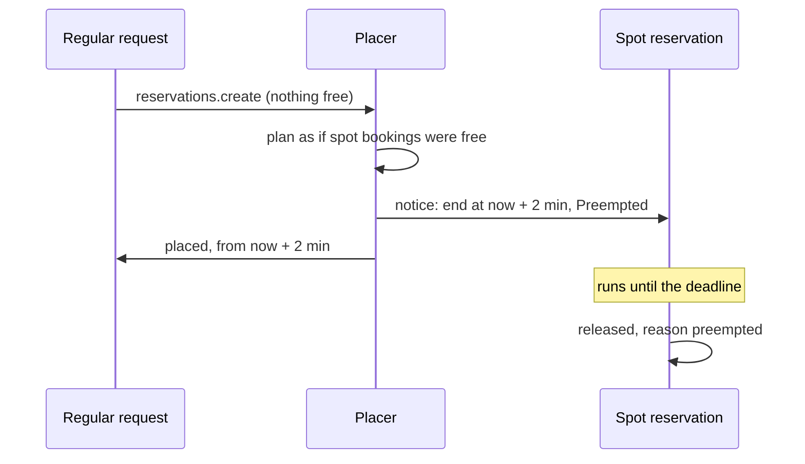

GPUs that nobody has reserved still cost money. <Term id="spot">Spot</Term> reservations let tenants
use them at a lower price, on one condition: when a regular request needs those GPUs and nothing
else fits, the spot reservation gets a short notice and gives them up. Spot shipped ahead of its
roadmap phase, v0.5.

## Reserve spot capacity

Set `spot: true` on a reservation:

```ts
await compute.api.reservations.create(credential, {
  tenantId: 'acme',
  poolId,
  devices: [{ class: 'gpu', count: 4 }],
  duration: '12h',
  spot: true,
  idempotencyKey: 'sweep-042',
});
```

- A spot reservation is admitted and placed like any other, with the same quota charge.
- The draft carries the IAM attribute `spot: true`, so a tenant policy can allow spot work to people
  or agents it would not give regular capacity to.
- It bills `gpu.<model>.spot.hours` instead of `gpu.<model>.hours`.
- `binding: 'node'` leases cannot be spot (`INVALID_INPUT`).

`better-compute iam setup --meters` does not create the spot meters. Create
`gpu.<model>.spot.hours` in Better IAM billing before you sell spot capacity; otherwise its usage
windows are dead-lettered (see [quotas and usage](/docs/guides/capacity/quotas-and-usage)).

## When preemption happens

Preemption is tried only for a **regular** request that would otherwise go `pending`: at admission, in
a pool-lease batch, or when a pending reservation retries. Spot requests never preempt, not even other
spot work; regular reservations are never preempted; node leases never preempt.

1. The deadline is the later of the request's start and now plus the notice (`spotNoticeMs`, 2 minutes
   by default).
2. The placer plans the request for the window starting at the deadline **as if** the bookings of every
   live spot reservation (placed, binding or active) overlapping that window were free.
3. Among the plans that fit (at most 64 are compared), it takes the one that preempts the fewest spot
   reservations, then the best score. A gang considers whole candidate gangs.
4. Inside one savepoint, it locks the victims with `FOR UPDATE SKIP LOCKED`, gives each a notice, and
   places the request on the planned nodes from the deadline.

If a victim is locked by another transaction or no longer qualifies, or the placement still fails,
the savepoint rolls back: no spot reservation is touched and the request goes `pending` as usual. The
preempting reservation answers `placed`, with `during.start` at the deadline, so it starts about two
minutes after it was requested.



## What happens to the spot reservation

Preemption is never a silent revoke. What the victim sees depends on whether it has started by the
deadline:

**It has started, or starts before the deadline.** Its bookings and allocations are cut back to end
at the deadline, and its `during.end` becomes the deadline. It gets a `Preempted` condition (reason
`SpotPreempted`), its nodes' desired state is refreshed with the new end, and
`reservation.preempting` is emitted with `at`, the deadline. The reservation keeps running until then;
at the deadline the lifecycle releases it with reason `preempted`, refunds its quota, and emits
`reservation.released`.

**It starts at or after the deadline.** It has not run yet, so it is not cut short. Its bookings are
released and it goes back to `pending` without a window, with `Unschedulable` and reason
`SpotPreempted`, keeping its quota charge. `reservation.preempted` is emitted with `requeued: true`.
It then retries every 30 seconds like any pending reservation.

Your workload should treat `reservation.preempting` as its signal to checkpoint. Subscribe to it with
[webhooks](/docs/guides/events/webhooks) or [watch](/docs/guides/events/watch), or poll
[`reservations.get`](/docs/reference/api/reservations#get) and compare `during.end` with the end you
booked.

### Notices never name another tenant

When the preempting reservation belongs to the victim's own tenant, the condition message reads
`preempted by rsv_…` and the events carry `by` with its id. When it belongs to another tenant, the
message is `preempted by a non-spot reservation` and `by` is absent, in the condition and in every
event. Nothing a tenant can read reveals another tenant's reservation.

## Preview a preemption

[`capacity.preview`](/docs/reference/api/capacity#preview) of a regular request that does not fit now
reports whether it would fit by preempting spot work:

```json
{
  "fits": false,
  "candidates": [],
  "reason": "no node fits (2 nodes): 2 × fits: 0 of 4 gpu free",
  "preemptible": { "reservations": 1, "startsAt": 1790000120000 }
}
```

`preemptible` gives a count and the start after the notice, never reservation ids. A spot request's
preview never has it.

## Billing

Each side pays for what it held. The victim bills the spot meter until the deadline, and the
re-queued kind bills nothing for the booking it lost, because it never became active. The preempting
reservation bills its regular meter from the moment it is active, so a preempt followed by a re-place
bills each hour once.

## Configure the notice

```ts title="compute.ts"
betterCompute({
  // …
  capacity: { spotNoticeMs: 5 * 60_000 }, // five minutes instead of two
});
```

A longer notice gives workloads more time to checkpoint and delays the preempting reservation by the
same amount. The same value drives `capacity.preview`'s `startsAt`.
