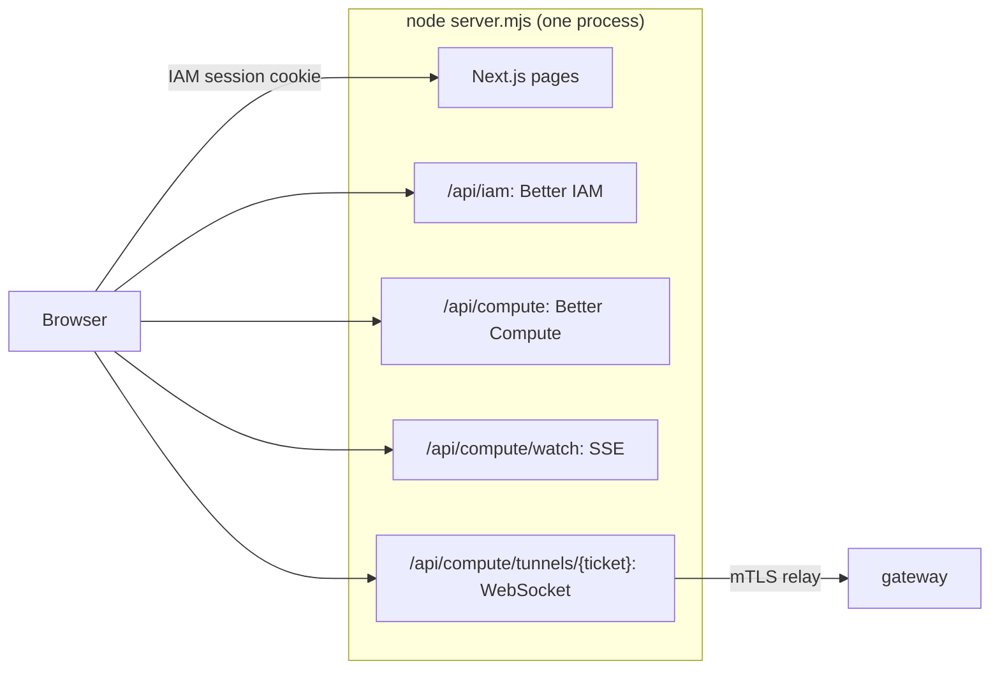

The console is a web UI for people: tenants reserve GPUs, create instances and open terminals; platform operators
watch nodes, rollouts and fleet drift. It comes in two layers you can use separately:

- **`apps/console`**, a Next.js 15 app that runs Better IAM and Better Compute in one process, on one origin. It is
  private to the repository (not published) and serves as the reference deployment.
- **`@better-compute/console-kit`**, the framework-free view models the console's pages are built on: resource
  stores, the live event stream, permission-aware actions, forms, charts and a terminal. Use it to build your own
  UI in React, Solid, Vue or anything else.

<Callout type="info" title="Ahead of its phase">
  PLAN.md schedules the console for v0.5. Both layers are written and tested today (`tests/console-kit*.test.ts`),
  but the console's configuration is a development-first reference, not a hardened product.
</Callout>

## One origin, one sign-in



Better IAM is mounted at `/api/iam` and Better Compute at `/api/compute` on the same origin, so the host-only IAM
session cookie authenticates both. Compute is built with `acceptIamCookie: true`: it accepts the cookie only on
POSTs that carry `X-Better-Compute: 1` and an `Origin` equal to the console's own. The compute IAM bridge installs
compute's action catalog in Better IAM and serves compute's decisions from its projection, as in any
[embedded](/docs/guides/iam#wire-embedded-mode) deployment.

`server.mjs` runs Next.js plus the one thing a route handler cannot do: the WebSocket upgrade of
`/api/compute/tunnels/{ticket}` for browser terminals and node consoles, served by `handleTunnel` and relayed over
mTLS to the gateway that holds the node's session. Tunnels open only from the console's own origin, and a signed-in
browser can only use its own person's tickets.

## Run it

```bash
cd apps/console
node server.mjs --dev      # or: pnpm dev
```

`--dev` sets `CONSOLE_DEV=1`, the only mode in which the console generates secrets for itself: the session secret,
the exec ticket key and the SSH CA key (under `.console-data/`) and, on the first start, the root administrator's
password, printed once. It also allows gateways without TLS. Open `http://localhost:3100/login` and sign in as
`admin@console.local`. Members of an organization sign in at `/login?org=<slug>`.

For production, build and start without `--dev`; every secret then comes from the environment:

```bash
cd apps/console
pnpm build                   # next build
CONSOLE_ORIGIN=https://console.example.com CONSOLE_SECRET=… CONSOLE_ADMIN_PASSWORD=… \
BETTER_COMPUTE_DATABASE_URL=postgres://… CONSOLE_IAM_DATABASE_URL=postgres://… \
node server.mjs --prod       # or: pnpm start
```

Run it from `apps/console`: the stack file and the data directory are resolved against the working directory.

| Variable | With `--dev` | Otherwise |
| --- | --- | --- |
| `CONSOLE_ORIGIN` | `http://localhost:3100` | set it to the public origin: cookie, origin and tunnel checks compare against it |
| `CONSOLE_SECRET` | generated into `.console-data/secret` | required, at least 32 random characters |
| `CONSOLE_DATA_DIR` | `.console-data` | the same |
| `CONSOLE_IAM_DATABASE_URL` | a libSQL file, `.console-data/iam.db` | PostgreSQL for Better IAM when set |
| `BETTER_COMPUTE_DATABASE_URL` | PGlite in `.console-data/compute` | `postgres://…` for compute |
| `CONSOLE_ADMIN_EMAIL`, `CONSOLE_ADMIN_PASSWORD` | `admin@console.local`, a generated password | the password is required on the first start |
| `CONSOLE_EXEC_TICKET_KEY_FILE` | a generated `exec-ticket.pem` | unset: tunnels are off |
| `CONSOLE_SSH_CA_KEY_FILE` | a generated `ssh-ca.pem` | unset: no break-glass SSH |
| `CONSOLE_GATEWAY_TLS_CERT`, `_KEY`, `_CA` | none needed (h2c gateways) | all three or none; tunnels need them |
| `CONSOLE_AUDIT_KEY_FILE` | a generated `audit-checkpoint.pem` (P-256 PKCS#8) | unset: no audit checkpoints; every replica shares the key |
| `CONSOLE_RELEASE_PINS`, `CONSOLE_DOWNLOADS_URL`, `CONSOLE_RELEASE_THRESHOLD` | unset: no rollout module | set the first two to mount rollouts |
| `CONSOLE_CONFIG` | `console.config.mjs` | another stack file |
| `PORT`, `HOSTNAME` | `3100`, `localhost` | the same |

Every replica and gateway must share the exec ticket key, and nodes pin its public key and the SSH CA's, so
production supplies the key files rather than generating them. The stack is built once per process from
`console.config.mjs` (loaded at run time, never bundled): Better IAM, then compute with the `vps`, `fleet` and
`events` (webhooks) modules and `retentionModule()` (the console builds `betterCompute()` itself, so the CLI's
automatic retention does not apply), `audit` when an audit key is available, and `rollout` when release pins are set.

Before the workers start, the stack calls `installIamHandlers(compute, { bridge, streams: [watches] })`, as `serve`
does for `host.iam`: a revoked delegation or suspended agent closes its tunnels on every gateway (over the console's
gateway mTLS) and its `/api/compute/watch` streams in this process, and revocations drop the IAM caches. See
[tunnels](/docs/guides/access/tunnels#closing-on-iam-revocation).

## Screens

Every page needs a session; without one the layout redirects to `/login`. Pages render in the browser over
console-kit, for the tenant the session acts in. Platform pages appear only for the root tenant.

| Page | Path | Shows and does |
| --- | --- | --- |
| Overview | `/` | capacity per pool, quota alerts |
| Reservations | `/reservations`, `/reservations/[id]` | the form with a capacity preview, the earliest start and approvals; the list and each reservation's actions |
| Instances | `/instances`, `/instances/[id]`, `/instances/[id]/terminal` | the form with sizes per pool; list, detail and a browser terminal |
| Nodes | `/nodes`, `/nodes/[id]`, `/nodes/[id]/console` | a filterable table; conditions, cordon, uncordon and drain, recent commands, the node console, and break-glass SSH certificates for root |
| Pools & capacity | `/pools`, `/pools/[id]` | pools owned or offered, a 7-day booking calendar, join tokens and join requests |
| Quotas | `/quotas` | used of max per pool and resource |
| Usage & spend | `/usage` | usage per meter, day, project and person, with a CSV export |
| Activity | `/activity` | the live event stream: the last 300 events this session received, filterable by type |
| Rollouts (root) | `/admin/rollouts` | daemon rollouts wave by wave; pause, resume and abort |
| Fleet drift (root) | `/admin/fleet` | drift of the fleet from its applied FleetConfig |

A "live" badge in the navigation shows the event stream's state. While the stream is down, the stores a page has
loaded refresh every 20 seconds instead, and only while the tab is visible.

Buttons follow two checks. A button is enabled only when the item's state allows the action (a released
reservation offers nothing) and Better IAM would allow it for the signed-in person. The second check is advisory: a
server action batches up to 50 checks through Better IAM's `can`, and the compute API still decides the real call.
A delegated call held back for approval shows "awaiting approval" with the confirmation id.

## console-kit

`@better-compute/console-kit` depends only on the typed client and core. Every store has `subscribe(listener)` and
`get()`, the contract of React's `useSyncExternalStore`, so a framework adapter is a few lines.

```ts
import { createComputeClient } from '@better-compute/client';
import { createPermissions, describeAction, startLiveConsole } from '@better-compute/console-kit';

const client = createComputeClient({ baseURL, token: () => session.token });

const live = await startLiveConsole(client, {
  tenantId,
  watchUrl: `${baseURL}/watch`, // wherever your host mounts handleWatch
  headers: () => ({ authorization: `Bearer ${session.token}` }),
  permissions: createPermissions({ authorize: (checks) => iamAuthorizeMany(checks) }),
});

live.reservations.subscribe(() => render(live.reservations.get()));
live.connection.subscribe(() => showBadge(live.connection.get().status));
```

| Area | Exports | Does |
| --- | --- | --- |
| Stores | `createConsoleResources`, `createListResource`, `createValueResource`, `createStore` | `nodes`, `pools`, `reservations`, `instances` and `capacity` for one tenant; lists page with `loadMore()`, a stale response never overwrites a newer one, and an error keeps the last good items |
| Live | `watchEvents`, `startLiveConsole`, `matchesType`, `parseSseBlock` | Server-Sent Events over `fetch`, resumed with `Last-Event-ID`; each event re-reads the item it names |
| Actions | `describeAction`, `actionsFor`, `createPermissions` | map a button to its IAM action and resource from core's API surface; batch checks (50 per call) in one tick and cache answers for 10 s |
| Detail pages | `createDetail`, `applicable` | one reservation, node, instance or pool with each action gated by state and by IAM; `run(path)` answers `done` or `confirmation-required` |
| Forms | `createReservationForm`, `validateReservation`, `createInstanceForm`, `validateInstance` | validation that mirrors the server, a debounced `capacity.preview`, one idempotency key per attempt kept across retries and confirmations |
| Views | `capacityChart`, `quotaView`, `createQuotaView`, `timelineView`, `earliestFit`, `usageView`, `usageCsv` | stacked capacity bars, quota meters (warning from 80 %), the booking calendar and earliest free window, usage and estimated spend |
| Admin | `createRolloutView`, `rolloutProgress`, `createFleetDriftView`, `nodeTable` | rollout waves, fleet drift by kind, a filterable, stably sorted node table |
| Terminal | `createTerminalSession`, `createScreen`, `keyInput` | `tunnels.open`, then the WebSocket; a VT100/xterm screen model with scrollback, no DOM |
| React | `bindReact`, and `@better-compute/console-kit/react` | `useStore`, `useList`, `usePermission`, `useDetail`, `useAction` |

### Live updates

`watchEvents({ url, types?, lastEventId?, headers?, onEvent, onStatus? })` reads the stream with `fetch` rather
than `EventSource`, so it can send an `Authorization` header (or, in the console, `X-Better-Compute: 1`). It
remembers the `id:` of the last event and sends it as `Last-Event-ID` when it reconnects, so it resumes exactly
after that event. It reconnects after the server's `retry:` delay (2 s by default) when the server closes the
stream, and with doubling backoff, capped at `maxBackoffMs` (60 s by default), after a failure. `onStatus` reports
`connecting`, `open`, `retrying` and `stopped`.

`applyEvent` routes each event by its subject: `reservation/…`, `node/…` and `instance/…` re-read that one item
(and drop it on `NOT_FOUND` or `ACCESS_DENIED`), and `pool/…` refreshes the pools. Reservation, pool and node events
(except `node.status`) also refresh the capacity summary, debounced by 250 ms. `startLiveConsole` does all of this
in one call and clears cached permission answers after events whose type starts with `iam.`, `binding.`,
`delegation.`, `agent.` or `project.members`. See [watch](/docs/guides/events/watch) for the server side.

### Permission-aware actions

```ts
const release = describeAction('reservations', 'release', reservation.id);
// { path: 'reservations/release', action: 'compute:reservations:release',
//   resource: { type: 'compute-reservation', id: 'rsv_…' }, kind: 'mutation' }
const allowed = await permissions.can(release);
```

`describeAction` throws for a method outside the API table, and `actionsFor(kind, id)` lists every mutation on a
resource kind, optionally limited to the phases and modules your deployment runs. `createPermissions` takes your
`authorize(checks)`, usually Better IAM's `authorizeMany` for the caller's tenant behind a server endpoint. A failed
batch rejects its checks and leaves them unanswered; it never answers "denied", so a button stays disabled rather
than lying. The server still decides every call, so a stale "allowed" only ever ends in a clean `ACCESS_DENIED`.

### React

```tsx
import type { LiveConsole } from '@better-compute/console-kit';
import { useList } from '@better-compute/console-kit/react';

function Reservations({ live }: { live: LiveConsole }) {
  const { items, status } = useList(live.reservations);
  if (status === 'loading') return <p>Loading</p>;
  return <ul>{items.map((item) => <li key={item.id}>{item.id}: {String(item.state)}</li>)}</ul>;
}
```

The `/react` entry binds the hooks to the app's `react`, an optional peer (React 19). Apps that bring their own
React build, or `preact/compat`, call `bindReact(React)` from the main entry instead. `useList` and `useDetail` load
on first use; `usePermission` returns `undefined` while IAM answers (render the button disabled), then `true` or
`false`; `useAction(detail, path)` returns `run`, `pending`, and the `outcome` or `error`. The hooks use
`useSyncExternalStore` with the same snapshot on the server, so they render during SSR.

Related: [TypeScript client](/docs/guides/clients/typescript-client), [tunnels](/docs/guides/access/tunnels),
[delegated confirmation](/docs/guides/iam/delegated-confirmation).
