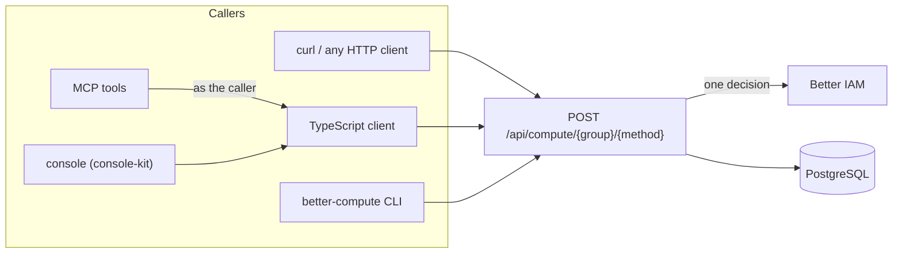

import { Bot, Gauge, SquareTerminal, TypeScript } from '@/lib/icons';

Better Compute has one API. Every client, whether it is a shell script, the typed TypeScript client, the
`better-compute` CLI, an AI agent's MCP tool or the web console, ends up sending the same request to the same
route, and every call is authorized the same way: Better IAM decides one action on one resource, as the caller. No
client has a side door, and no client can do more than the credential it carries.



## The HTTP API

Every method is `POST {basePath}/{group}/{method}` with a JSON object body. The default base path is
`/api/compute`, so `reservations.create` is `POST /api/compute/reservations/create`. The generated
[API reference](/docs/reference/api) lists all groups and methods; plugin methods live under
`/api/compute/plugins/{id}/{group}/{method}`.

```bash
curl -X POST https://compute.example.com/api/compute/pools/list \
  -H "Authorization: Bearer $BETTER_COMPUTE_TOKEN" \
  -H "Content-Type: application/json" \
  -H "X-Better-Compute: 1" \
  -d '{"tenantId":"acme"}'
# → { "data": { "items": [ … ] } }
```

The rules every request follows:

| Rule | Detail |
| --- | --- |
| Method | `POST` for API calls. `GET` answers only `{basePath}/health` and `{basePath}/.well-known/better-compute`; anything else is `METHOD_NOT_ALLOWED`. |
| Headers | `Content-Type: application/json` and `X-Better-Compute: 1`, or the call fails with `CSRF_REJECTED` before anything is read. |
| Body | A JSON object, at most 64 KiB, checked against the method's input schema (`INVALID_INPUT` otherwise). |
| Answer | `{ "data": … }` on success, `{ "error": { "code", "message", "details"? } }` on failure. See [errors](/docs/reference/errors). |
| Request id | Send `X-Request-Id` (up to 128 letters, digits, `.`, `_`, `:` or `-`) and the server echoes it and passes it to IAM; otherwise it makes one up and returns it. |
| Rate limits | A `RATE_LIMITED` answer carries `retryAfterMs` in the error body and a `Retry-After` header in seconds. |

`X-Better-Compute: 1` is the CSRF guard. A browser cannot send a custom header cross-origin without a CORS
preflight, and nothing in Better Compute approves one, so a forged form post from another site never reaches a
handler.

Before any database access, the server authenticates the caller and refuses a caller whose tenant is neither the
input's `tenantId` nor the root tenant, with the same `ACCESS_DENIED` whether or not the thing exists. Then it
decides once: see [how a call is decided](/docs/guides/iam/actions-and-resources#how-a-call-is-decided).

## Credentials

Better Compute authenticates Better IAM credentials only; it has no users, passwords or API keys of its own.

| Credential | How it is sent | Who uses it |
| --- | --- | --- |
| IAM bearer token (`biam_…`): a user session, an API key, a role session or a delegated agent session | `Authorization: Bearer …` | scripts, services, the CLI, agents |
| Session JWT from `sts.getSessionToken({ format: 'jwt', audience: [...] })`, with compute's audience | `Authorization: Bearer …` | services that verify tokens offline, browser apps on another origin |
| The IAM session cookie | the browser's cookie | only a console on the same origin, with `betterCompute({ acceptIamCookie: true })` |

The cookie counts only when `acceptIamCookie` is on and the request's `Origin` is the deployment's own origin: a
cookie request without `Origin` is `CSRF_REJECTED`, and one from another origin is `UNTRUSTED_ORIGIN`. Without the
option, compute drops the cookie before it calls IAM. [Credentials compute accepts](/docs/guides/iam#credentials-compute-accepts)
covers what each credential resolves to.

`system.version` and `system.whoami` are public: they answer without a credential, which makes them a quick check
that a URL points at a compute server.

## Ways to call

| Client | Package | Runs | Credential | Best for |
| --- | --- | --- | --- | --- |
| HTTP | none | anywhere | bearer token | other languages, quick checks |
| In-process API | `@better-compute/server` | inside your server | `{ headers }` or `{ token }` per call | your own backend that embeds compute |
| [TypeScript client](/docs/guides/clients/typescript-client) | `@better-compute/client` | browsers, Node.js 22+, edge runtimes | bearer token, or the cookie on the same origin | apps and services in TypeScript |
| [CLI](/docs/guides/clients/cli) | `@better-compute/cli` | a terminal or CI | `BETTER_COMPUTE_TOKEN` | operators, tenants, CI drift checks |
| [MCP](/docs/guides/clients/mcp) | `@better-compute/mcp` | an MCP host you run | the agent's bearer token, forwarded | AI agents |
| [Console](/docs/guides/clients/console) | `apps/console`, `@better-compute/console-kit` | a Next.js app | the IAM session cookie | people in a browser |

### In process

A backend that builds the control plane with `betterCompute()` can skip HTTP. `compute.api.<group>.<method>` takes
the caller's credential first and the input second, and runs exactly the same envelope: the tenant pre-check, the
IAM decision, the transaction and the audit row.

```ts title="server.ts"
import { compute } from './compute';

const pools = await compute.api.pools.list({ headers: request.headers }, { tenantId: 'acme' });
```

Pass the incoming request's headers so that IAM sees the real caller. There is no "system" credential that skips
the decision.

### The typed client

`createComputeClient<typeof compute>()` infers every group and method from your server's type, with a type-only
import, so there is no code generation. It is a small `fetch` wrapper that adds the headers above and turns error
envelopes into `ComputeClientError`. See [TypeScript client](/docs/guides/clients/typescript-client).

```ts
import { createComputeClient } from 'better-compute/client';
import type { compute } from './compute.server';

const client = createComputeClient<typeof compute>({
  baseURL: 'https://compute.example.com',
  token: () => session.getToken(),
});
const { items } = await client.pools.list({ tenantId: 'acme' });
```

### The CLI

`better-compute` calls the API as `BETTER_COMPUTE_TOKEN`, either against a running server with `--url` or in process
through `better-compute.config.ts`. `better-compute api GROUP.METHOD key=value` reaches any method; `reserve`,
`capacity`, `fleet plan` and friends wrap the common ones. See [CLI](/docs/guides/clients/cli).

```bash
export BETTER_COMPUTE_URL=https://compute.example.com BETTER_COMPUTE_TOKEN=biam_…
better-compute api pools.list tenantId=acme --format table
```

### MCP

`createComputeMcp()` serves a set of tools (`list_pools`, `reserve_gpus`, `node_status` and more) as a Streamable
HTTP MCP endpoint behind Better IAM's MCP gate. Each tool calls the API with the agent's own token, and a reservation
that a person must approve comes back as `confirmation-required` with the idempotency key to retry with. See
[MCP](/docs/guides/clients/mcp).

### The console

`apps/console` runs Better IAM and Better Compute in one Next.js process on one origin, so the IAM session cookie
signs people in to both. Its pages are built on `@better-compute/console-kit`, framework-free stores with live
updates and permission-aware buttons that you can reuse in your own UI. See [console](/docs/guides/clients/console).

## Events

Clients that need to know when something changes do not poll list methods. The [events](/docs/guides/events)
section covers the three ways out of the <Term id="outbox">outbox</Term>:

- `events.list` pages a tenant's history from a cursor, over the same API.
- [`GET /watch`](/docs/guides/events/watch) streams live events as Server-Sent Events. The host mounts it (the
  console serves it at `/api/compute/watch`), and console-kit's `watchEvents` reads it.
- [Webhooks](/docs/guides/events/webhooks) POST signed events to a tenant's HTTPS endpoints.

## Idempotency and retries

Methods that create things take an `idempotencyKey`. Keep the key for the life of one attempt and reuse it on
every retry, whether the retry follows a timeout, a `RATE_LIMITED` answer or a person's approval of a
`CONFIRMATION_REQUIRED` call. The same key with the same input returns the stored result; the same key with a
different input is `CONFLICT`. [Reservations](/docs/guides/capacity/reservations#drafts-and-idempotency) shows the
rules in full, and [delegated confirmation](/docs/guides/iam/delegated-confirmation) shows the approve-and-retry
loop.

<Cards>
  <Card title="TypeScript client" href="/docs/guides/clients/typescript-client" icon={<TypeScript />}>
    Create a typed client, pass credentials, handle errors and open tunnels.
  </Card>
  <Card title="CLI" href="/docs/guides/clients/cli" icon={<SquareTerminal />}>
    Authenticate, call any method, reserve GPUs, run fleet plans and verify the audit trail.
  </Card>
  <Card title="MCP" href="/docs/guides/clients/mcp" icon={<Bot />}>
    Tools for AI agents behind Better IAM's gate, with delegated confirmation.
  </Card>
  <Card title="Console" href="/docs/guides/clients/console" icon={<Gauge />}>
    The Next.js console and console-kit, the stores it is built on.
  </Card>
</Cards>
