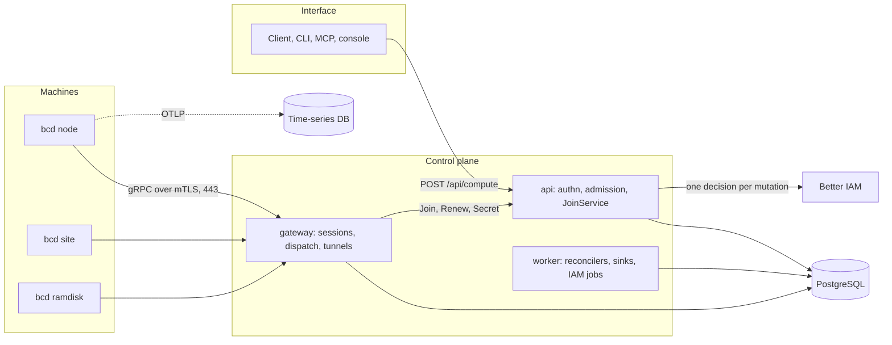
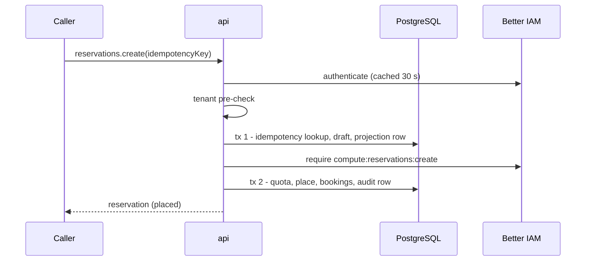

Better Compute separates who may ask for something from where the answer is kept and from the machines that carry
it out. Requests arrive over HTTP and are decided once by Better IAM; the answer is written to PostgreSQL; daemons
learn about it through long-lived sessions they opened themselves. This page describes those parts and how the four
main flows move through them.

## Planes

| Plane | Components | Trust |
| --- | --- | --- |
| Interface | The typed client, the CLI, MCP tools, the console kit, webhook receivers | Untrusted callers holding Better IAM credentials |
| Identity | Better IAM, embedded in the api and worker processes or remote, plus Better Compute's IAM plugin | Trusted |
| Control | `api`: stateless HTTP, admission, JoinService, the secret broker. `gateway`: daemon sessions and tunnels. `worker`: reconcilers, placer, workflows, event sinks, usage, IAM jobs, the CommandSweeper | Trusted; the gateway only relays |
| Data | PostgreSQL (with PgBouncer in transaction mode), an object store, a time-series database, a KMS or Vault | Trusted |
| Site | `bcd site`: proxy DHCP, TFTP, iPXE and HTTP boot, image cache, BMC access; one active boot server per site | High value; secrets are sealed per request |
| Node and ramdisk | `bcd node` with its runtimes and CDI; `bcd ramdisk` during commissioning | Trusted while the platform holds root; the ramdisk gets a restricted certificate of at most 2 hours |

## Components



- **PostgreSQL** holds nodes, sessions, devices, bookings, reservations, commands, the work queue, the outbox,
  leases and the authorization projection. It is the only place state is authoritative.
- **Gateways** hold daemon sessions in memory and write liveness to the database in batches. They sit behind an L4
  load balancer with TLS passthrough, because mutual TLS terminates in the gateway.
- **Workers** claim work from the database with `SKIP LOCKED` under shard and pool leases. Optional pokes (a
  notifier) wake gateways sooner, but every loop also converges without them.
- **Telemetry** goes from the daemon or `dcgm-exporter` to a time-series database over OTLP or remote write, never
  through PostgreSQL or the session.

## The control plane in your process

`betterCompute(options)` is synchronous and side-effect free: it validates options (`INVALID_CONFIG` otherwise) and
registers `system`, the server's own groups, the built-in node controllers and the always-on `inventory` and
`capacity` modules, then your `modules` and `plugins`. Nothing touches the database or Better IAM until you call it.

| Member | What it is |
| --- | --- |
| `api` | Every method as `(credential, input)`, through the same envelope as HTTP. It also drives the typed client's inference. |
| `handler` | The fetch transport: `(request: Request) => Promise<Response>`. |
| `nodeHandler` | The Node.js transport, for `createServer(compute.nodeHandler)`. |
| `gatewayServices` | JoinService's `join` and `renew` and the secret broker, consumed by `createGateway`. |
| `initialize()` | Checks every method's IAM action against the merged catalog, runs migrations, anchors the clock and awaits each module's `start()`. Idempotent. |
| `start({ roles })`, `stop()` | Run and stop the worker roles on timers, under their leases. |
| `jobs` | One deterministic pass per `tick()`, for tests and the simulator. |
| `events` | In-process subscribers of committed events. |
| `context`, `registry`, `caches`, `authz`, `selfCheck()`, `endpoint` | The module context, the method registry, cache invalidation, the projection, read-only health checks, and where the handler is mounted. |

```ts title="server.ts"
import { createServer } from 'node:http';
import { compute } from './compute';

await compute.initialize(); // registry checks, migrations, module start()
createServer(compute.nodeHandler).listen(3000); // POST /api/compute/{group}/{method}
await compute.start({ roles: ['controllers', 'sinks', 'iam'] });
```

The server package never imports the store, the IAM bridge, the gateway, or the injected `provision`, `metal` and
`vps` modules; they arrive through options, and `scripts/check-deps.mjs` fails CI if that changes.

## Process modes

One configuration runs in any process mode, so you scale each part separately against one database. With the CLI,
`better-compute serve --roles` picks the mode:

| Mode | Runs | Scales by | `serve --roles` |
| --- | --- | --- | --- |
| `api` | Stateless authentication and authorization, drafts, the admission transaction with inline placement, the outbox writes, JoinService | Requests, behind an L7 load balancer | `api` |
| `gateway` | Daemon sessions in memory, liveness, dispatch, result and event ingestion, `Join`/`Renew`/`Secret` hand-off, tunnels | Streams (at least three per region planned) | `gateway` |
| `worker` | `controllers` (reconcilers, workflows, the CommandSweeper), `sinks` (outbox dispatch), `iam` (Better IAM's jobs under singleton leases), `scheduler` | 256 shards spread over the workers | `controllers,scheduler,sinks,iam` |
| `all` | The API and every worker role in one process, plus the gateway when the configuration's `host.gateway` is set | Nothing; for development and small installations | `all` (the default) |

```bash
better-compute migrate                                                    # once per deploy
better-compute serve --roles api --port 3000 --no-migrate
better-compute serve --roles controllers,scheduler,sinks,iam --no-migrate
better-compute serve --roles gateway --no-migrate
```

Leases and shard ownership keep every job single-writer, so you can run several processes of each mode. The
`scheduler` role runs the reconcilers that declare `role: 'scheduler'` (placers), under their own rendezvous
membership (worker rows `scheduler/<id>`, leases `scheduler/shard:<n>`), so a scheduler-only process never takes node
shards from the controllers and each role spreads the 256 shards over its own processes. The pool-lease placer
(`capacity.placer`, used with `capacity: { placer: 'pool-lease' }`) is such a reconciler, so with that placer at
least one process must run the `scheduler` role. See [deployment](/docs/operations/deployment) and
[scaling](/docs/operations/scaling).

## Nodes only dial out

A daemon opens no listening port. It dials `gw.<region>:443` and keeps one HTTP/2 connection carrying the `Session`
stream and, from v0.3, on-demand `Tunnel` streams. Mutual TLS terminates in the gateway, which checks the certificate
chain, revocation and role, and that the SPIFFE ID matches the node id in `Hello`.

The gateway package holds no CA and no signing key. It hands `Join`, `Renew` and `SecretRequest` to
`gatewayServices`, the control plane's JoinService and secret broker, through dependency inversion. The design puts
those in the api process behind internal mutual TLS; the `serve --roles gateway` host of this release constructs them
in the gateway's own process from the shared configuration. Either way, a compromised gateway can delay or drop frames
but cannot forge what matters: renewals need proof of possession of the node key, join tokens are sealed to
JoinService's key, secrets travel as JWE to a per-request key, and attested results carry the node's signature. See
[the gateway](/docs/daemon/gateway) and [security](/docs/operations/security).

## The four flows

### A daemon joins (v0.1)

1. An operator mints a join token with [`joinTokens.create`](/docs/reference/api/join-tokens#create)
   (`compute:join-tokens:create` on the pool). The token, `bcjt_<id>.<secret>`, is shown once; only a hash is stored.
2. The install script puts `bcd`, its pinned configuration and the JoinService encryption key on the server.
3. `bcd join` sends `Join` with the token sealed to JoinService's key, a CSR and hardware claims.
4. JoinService runs the attestor chain, computes the hardware key, enforces the token's `expect` and reclaim rules,
   inserts the node as `adopting`, decrements the token and signs a 24-hour SPIFFE certificate.
5. The daemon opens its `Session`; the gateway bumps the session epoch and asks for inventory sections.
6. The inventory controller derives devices and conditions; the lifecycle controller runs the pool's acceptance
   checks (`diag.nvml`). On pass the node is `adopted` and receives desired-state generation 1.

No step calls Better IAM. See [joining](/docs/guides/nodes/joining).

### A user or agent reserves GPUs (v0.1)

This is the admission sequence every request-as-resource `create` follows:



A caller outside the input's tenant, and not in the root tenant, gets `ACCESS_DENIED` before any database access. A
repeated idempotency key from the same identity replays the stored result; a different request under the same key is
`CONFLICT`. The placer then books atoms in the second transaction, and the reservation binds through the node's
desired state. See [reservations](/docs/guides/capacity/reservations) and
[placement](/docs/guides/capacity/placement).

### Bare metal from PXE to ready (v0.2)

A site agent enrolled with a site token holds the site's boot lease and serves proxy DHCP and iPXE.
[`metal.enroll`](/docs/reference/api/metal#enroll) stores the BMC credentials as a secret reference; the machine is
inspected over Redfish, PXE-booted into `bcd ramdisk`, diagnosed and wiped (node-signed results), and reaches
`ready`. [`metal.deploy`](/docs/reference/api/metal#deploy) streams an image to disk, writes cloud-init with a
single-use token, and kexecs into the installed system, which rejoins as the same node. The control plane for this
flow has landed; `bcd site` and `bcd ramdisk` are not written yet (bcd has only its node agent), so it runs against
simulated agents. See
[bare metal](/docs/guides/bare-metal).

### A VPS instance (v0.3)

[`instances.create`](/docs/reference/api/instances#create) follows the same admission sequence on
`compute-instance`. On a hosted pool (`class: 'vps-host'`) the placer claims vCPU, memory, disk and optionally a GPU,
and the instance joins the node's desired state for the daemon to run. On a provider pool (`class: 'provider'`,
`agent: 'none'`) a workflow calls the provider's API, and no platform agent ever runs inside a tenant's VM. Later
operations change only the instance's desired state. See [VPS](/docs/guides/vps).
