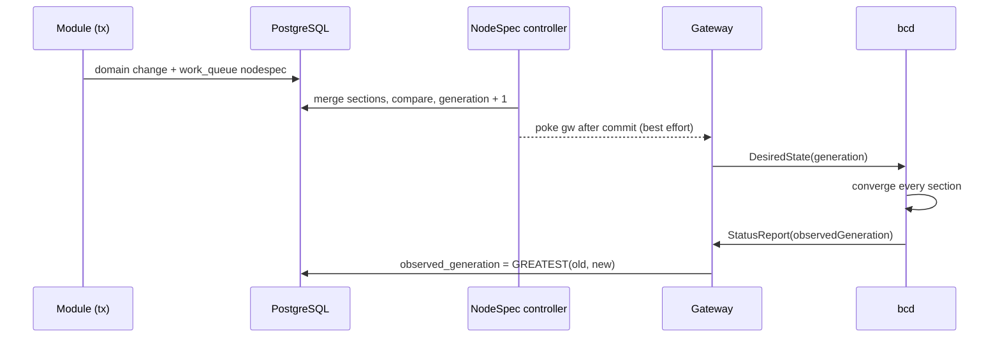
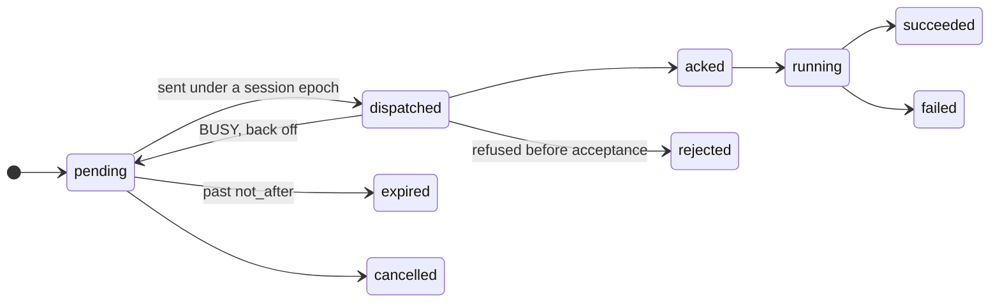

The control plane has two ways to make a node do something. It can change what the node should look like, its
desired state, and let the node converge on it. Or it can queue a command: a one-shot action with a deadline. Choosing
the right one is what keeps the fleet correct through reconnects, restarts and partitions.

## The rule

If losing the message would leave the node in the wrong steady state, it is desired state. If running it late could
do harm, it is a command with a deadline (`not_after`), plus a minimum generation when it presupposes a spec.

| Desired state (NodeSpec) | Commands |
| --- | --- |
| Device assignments of active reservations | `node.reboot` |
| VPS instances and whether they should run | `diag.nvml`, `diag.dcgm` |
| Host configuration units (drivers, MIG layout) | `inventory.refresh`, `logs.collect` |
| SSH CA keys and the exec-ticket JWKS | `gpu.reset`, `disk.wipe`, `deploy.image` |
| Telemetry endpoint, daemon version, the site's boot lease | `boot.kexec`, `bmc.power`, `daemon.upgrade` |

A reservation's GPUs are desired state because a node that restarts, or reconnects after a partition, must still
expose exactly the booked devices. A reboot is a command because a reboot delivered an hour late, after the node was
leased to someone else, would do damage.

## Desired state: NodeSpec

A <Term id="nodespec">NodeSpec</Term> is the full desired state of one node, in sections:

| Section | Holds | Contributed by |
| --- | --- | --- |
| `host` | Config units, such as the NVIDIA driver or a MIG layout | `provision` (profiles' `hostConfig`) |
| `devices` | Device assignments: allocation id, device ids, optional `until` | `capacity` (active reservations and instances) |
| `instances` | VPS instances with runtime, flavor, image and desired state | `vps` |
| `access` | SSH CA public keys, the exec-ticket JWKS | tunnels (v0.3) |
| `telemetry` | OTLP endpoint and export interval | no built-in module yet; your own module can set it |
| `daemon` | The bcd version, URL, SHA-256 and signature to run | `rollout` |
| `site` | Whether this site agent holds the boot lease, and its epoch | the site-boot controller |

Modules contribute sections through `nodeSpec(context, node)`, and the NodeSpec controller merges the contributions
in registration order. It stores the result in `nodes.spec` as the protobuf JSON of `bettercompute.agent.v1.NodeSpec`
and increments `nodes.generation` only when the canonical JSON differs from what is stored. Desired state applies
once a node is `adopted` or `deployed`: adoption writes generation 1.

### How a change reaches the node



1. Whatever changes a node's desired state calls `ctx.desired.invalidate(tx, nodeId)` in the same transaction,
   which enqueues `nodespec` work for the node. Nothing is pushed yet.
2. The NodeSpec controller recomputes the spec, and if it changed, writes the new generation and, after commit,
   pokes the node's gateway.
3. The gateway sends `DesiredState`. A daemon that reconnects behind the current generation gets the full spec
   after `Welcome`, so a lost poke delays convergence but never loses it.
4. The daemon converges each section with an idempotent plan and apply, and reports its `observedGeneration`. It
   advances only when every section has converged or failed terminally. The database keeps the highest value
   reported, so a late report cannot move it backwards.

A node is schedulable only once `observedGeneration` is at least 1: the placer never books devices on a node that
has not applied any desired state. `nodes.get` shows both numbers; `generation` greater than
`observedGeneration` means the node is still converging.

## Reconcilers

Controllers are <Term id="reconciler">reconcilers</Term>: level-triggered loops that read the current state, compare
it with the desired state, and act on the difference. They never trust that they saw every event, so a missed event,
a crash mid-run or a restart only delays them.

```ts
interface Reconciler {
  name: string;
  shardBy: 'node' | 'pool' | 'none';
  /** Level-triggered: SYNC_AGAIN re-queues the key. */
  run(context: ReconcileContext, key: string): Promise<'DONE' | 'SYNC_AGAIN'>;
  /** Keys also enqueued on a fixed period, e.g. [{ key: 'all', every: '5m' }]. */
  periodic?: readonly { key: string; every: Duration }[];
}
```

- **Edge-triggered wake-ups, level-triggered work.** A state change enqueues `(kind, key)` in the
  <Term id="work-queue">work queue</Term> in the same transaction. Enqueueing a key that is already queued bumps its
  generation instead of adding a row, and a successful run deletes the row only if the generation did not move, so a
  key dirtied again during its run is processed again. No wake-up is lost.
- **Resync.** Every worker re-enqueues the keys it owns every 5 minutes plus up to 5 minutes of jitter, in case
  anything slipped through.
- **Outcomes.** `DONE` removes the key; `SYNC_AGAIN` brings it back after 1 second; a thrown error backs off from 1
  second doubling to 5 minutes.
- **Sharding.** Node-sharded reconcilers spread keys over 256 shards (`nodes.shard`), and workers divide the shards
  among themselves by rendezvous hashing over the `workers` table, each shard under a fenced `shard:<n>` lease.
  `shardBy: 'none'` reconcilers run under a `singleton:<name>` lease.

With every module registered, the runtime runs these jobs: `node`, `nodespec`, `liveness`, `drain`, `inventory`,
`health`, `capacity.reservations`, `capacity.rollup`, `capacity.usage`, `workflow`, `metal`, `vps.instances`,
`vps.usage`, `fleet.drift`, `rollout`, `audit.checkpoint`, `events.fanout` and `events.deliver`, plus the runtime's
own `command-sweeper`, `outbox-dispatch` and `event-subscribers`. The [modules reference](/docs/reference/modules)
lists them per module. In tests, `compute.jobs[name].tick()` runs one deterministic pass of any of them.

## Commands

A <Term id="command">command</Term> is a durable row in `commands`, written in the caller's transaction through the
command queue:

```ts
await context.commands.enqueue(tx, {
  nodeId,
  kind: 'inventory.refresh',
  payload: { sections: ['gpus'], rescan: true }, // the kind's payload message, as proto3 JSON
  idempotencyKey: `refresh:${nodeId}:${reason}`, // unique per node; a repeat returns the existing command
  notAfter: context.clock.now() + 10 * 60_000, // mandatory: the daemon rejects a command past it
});
```

The runtime gives it the node's next `seq` (from `nodes.next_cmd_seq`), encodes the payload into the protobuf
`CommandBody`, and pokes the node's gateway after commit. Routing data never goes in the payload: the target is
`nodeId`, and the gateway that currently holds the node's session is found by a join at dispatch time.

### Kinds and their flags

Every command has a <Term id="command-kind">kind</Term> registered by the server or a module, and the kind carries
the rules for delivering it:

| Flag | Meaning |
| --- | --- |
| `lane` | `control`, `provision` or `bulk`. Each lane has its own daemon worker pool (4, 2 and 1 workers) and its own credits (8, 4 and 2), so a long image stream never blocks a reboot. |
| `retrySafe` | Safe to run again after a crash between acceptance and completion. `disk.wipe`, `deploy.image`, `gpu.reset` and `bmc.firmware` are not. |
| `selfTerminating` | Ends the agent's process or boot (`node.reboot`, `boot.kexec`, `daemon.upgrade`). It completes when the node comes back with a new boot, never by being replayed. |
| `attested` | The result is signed with the node's key and verified before any state transition (wipes, diagnostics). |
| `destructive` | Must be signed by the control plane from v0.2. |
| `timeout` | How long the command may run after `not_after` before the sweeper fails it. |
| `roles` | Which agents may run it: `node`, `site`, `ramdisk`. |

The [command kinds reference](/docs/reference/command-kinds) lists every kind with its flags and payload message.

### Lifecycle



- A daemon checks a command before accepting it, in this order: `UNSUPPORTED` (another node, or an unknown or
  disallowed kind), `STALE_GENERATION` (its `min_generation` is ahead of the applied spec, after waiting until
  `not_after`), `EXPIRED` (past `not_after`), `BUSY` (no credits in the lane), and from v0.2 `BAD_SIGNATURE` for an
  unsigned destructive kind. Only `BUSY` is retried: the command goes back to `pending` with a back-off from 1 to 30
  seconds.
- The CommandSweeper expires `pending` commands past `not_after`, and fails in-flight ones past
  `not_after` plus the kind's `timeout` with reason `timeout`. Both wake the controller that owns the command.
- When a node reconnects with a new boot, in-flight self-terminating commands succeed; when it reconnects with a new
  journal, in-flight commands that are not retry-safe fail with `journal-lost` instead of running twice.

### Running commands through the API

[`commands.run`](/docs/reference/api/commands#run) (`compute:nodes:exec` on the node) accepts an allowlist of kinds:
`diag.nvml`, `inventory.refresh`, `logs.collect` and `node.reboot`. Anything else is `UNSUPPORTED`. It takes an
`idempotencyKey`, scoped to your tenant and identity, and `notAfterSeconds` (default 600, from 10 to 3600):

```bash
better-compute api commands.run tenantId=$BETTER_COMPUTE_TENANT nodeId=node_… \
  kind=inventory.refresh payload:='{"sections": ["gpus"], "rescan": true}' idempotencyKey=refresh-1
better-compute api commands.get tenantId=$BETTER_COMPUTE_TENANT nodeId=node_… commandId=cmd_…
```

`commands.cancel` is planned for v0.2 in the method table; the runtime's queue can already cancel (a pending command
is never sent, an in-flight one receives `Cancel` until the daemon settles it). See [node commands](/docs/guides/nodes/commands)
and [delivery](/docs/daemon/delivery).

## When to use which

| You want to | Use |
| --- | --- |
| Give or take away devices, run or stop an instance, install a driver | Desired state: change the domain record and invalidate the node's spec |
| Collect logs, re-read inventory, run a diagnostic now | A command with a short `not_after` |
| Reboot, wipe, reset a GPU | A command; workflows send these as steps with `wf:<id>:<stepId>` idempotency keys |
| Upgrade the daemon across a pool | Desired state (`daemon` section), rolled out in waves by the rollout module |
