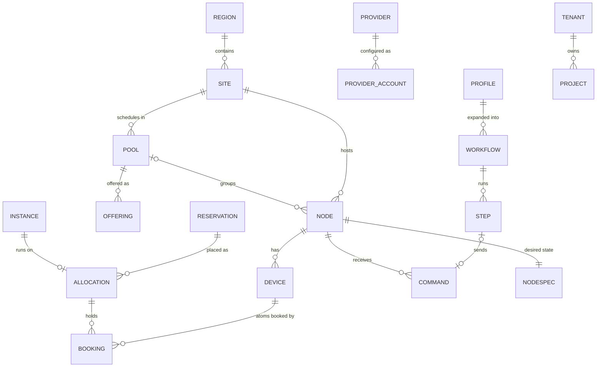

Every entity below is a TypeScript type in `@better-compute/core` and a table (or a column) in PostgreSQL. Records
carry epoch-millisecond timestamps, and every tenant-scoped record carries its `tenantId` or `ownerTenantId`: no
repository function reads an ambient tenant.

## How the entities relate

Ids read `<prefix>_<body>`, where a generated body is a 26-character ULID in lower-case Crockford base32, so ids of
one kind sort by creation time: `site_`, `pool_`, `node_`, `prj_`, `rsv_`, `alloc_`, `inst_`, `cmd_`, `wf_`, `img_`,
`prof_`, `jt_`, `pacct_`, `flv_`, `whk_`, `evt_` and others. Reservation and instance ids are derived from the
request instead of generated, as the section on reservations below explains.

## Regions, sites, pools and offerings

A <Term id="region">region</Term> is a geographic label in Better IAM's region-name grammar, stored on a site as
`iamRegion`.

A <Term id="site">site</Term> is a boot and failure domain served by at least one `bcd site` agent. Its `kind` is
`shared` or `dedicated` (the platform's hardware) or `custom` (a tenant's own hardware). A site agent is itself a
`nodes` row with `role: 'site'`.

A <Term id="pool">pool</Term> is a scheduling and policy domain in one site, owned by one tenant:

| Field | Values |
| --- | --- |
| `class` | `metal-host`, `metal-dedicated`, `vps-host`, `provider` |
| `gpuModel` | Exactly one GPU model family per pool, for example `H100` |
| `sharing` | `exclusive` (default), `mig`, `timeslice`, `mps` |
| `agent` | `bcd` (machines run the daemon) or `none` (reached only through a provider's API) |
| `policy` | `acceptance` checks, `overcommit` ratios for scalars, `lostAfter`, `disruptionBudget` (default 0.05), `admission.budgetCheck`, `maxPending`, `hardwareProfile`, `sharing.replicas`, `migLayout`, `tenantRoot` |
| `providerAccountId` | For `provider` pools, the account that backs them |

An <Term id="offering">offering</Term> is a `pool_offers` row that makes a pool exist in another tenant's view,
with a quota per resource (`gpu`, `vcpu`, …), an optional `priority` and `includeDescendants`. A resource missing
from the quota grants zero. See [pools](/docs/guides/capacity/pools).

## Nodes

A <Term id="node">node</Term> is a server running `bcd`, or a provider machine that runs it. Its state is not one
field but several independent axes, so each question has one answer:

| Axis | Values | Changed by |
| --- | --- | --- |
| `provisionState` | `adopting`, `adopted`, `enrolling`, `inspecting`, `commissioning`, `ready`, `deploying`, `deployed`, `releasing`, `rescue`, `failed`, `retiring`, `retired` | Workflows and the lifecycle controller |
| `maintenance` | true or false | Failures, remediation, operators |
| `cordoned` | true or false | `nodes.cordon`, `nodes.uncordon`, drains |
| `power` | `on`, `off`, `unknown` | BMC drivers |
| `connectivity` | `connected`, `disconnected`, `unreachable`, `lost` | Sessions and the liveness controller |
| `conditions` | Typed conditions such as `GpuCountMismatch`, `NodeUnreachable`, `ClockSkew` | Health, inventory, liveness |

Beside the axes a node has a `role` (`unassigned`, `host`, `dedicated`, `site`), a `trust` (`platform`,
`tenant-owned`, `tenant-controlled`), an `adapter` naming how the control plane reaches it (`bcd/v1`,
`provider-api/v1`), per-concern driver bindings, a <Term id="generation">generation</Term> and
`observedGeneration`, and a <Term id="hardware-key">hardware key</Term>: the SHA-256 of its normalized product UUID,
serial number, permanent MACs and GPU UUIDs, trusted only when at least two independent identifiers survive the
placeholder blocklist.

A node is schedulable only when all of these hold: `provisionState` is `adopted` or `deployed`, `role` is `host`,
it is neither in maintenance nor cordoned, `connectivity` is `connected`, its `noScheduleReasons` list is empty,
`observedGeneration` is at least 1, and its trust is `platform` (or `tenant-owned` in a pool its owner owns). See
[operating nodes](/docs/guides/nodes/operating-nodes).

## Devices and atoms

A <Term id="device">device</Term> is a unit with typed attributes, in the style of Kubernetes dynamic resource
allocation. Its `class` is `gpu`, `gpu.mig` (ids `<gpuUuid>/gi<g>/ci<c>`), `gpu.slot` (time-slice or MPS slots,
`<gpuUuid>/s<k>`), `nic.vf`, `disk` or `node`. Only <Term id="atom">atoms</Term>, devices with `bookable: true`, are
ever booked; a partitioned GPU's parent is not bookable. Device ids are stable: GPU UUID, disk WWN, MAC.

GPUs carry two names. `gpuProduct` is the normalized NVML name (`NVIDIA H100 80GB HBM3` becomes `H100-SXM5-80GB`);
`gpuModel` is the family (`H100`), mapped through a versioned `gpu-models.json`. An unknown name maps to `other` and
raises `GpuModelUnknown`. Pools, policies and meters use `gpuModel`; selectors may use either.

<Term id="inventory">Inventory</Term> is the node's `NodeInventory v1` document, sectioned and hashed, with
append-only snapshots. <Term id="capacity">Capacity</Term> is what the inventory makes bookable: allocatable,
allocated, reserved and available, per pool and resource. See [inventory and health](/docs/guides/nodes/inventory-and-health).

## Requests, reservations and bookings

A <Term id="reservation">reservation</Term> is a tenant's claim on a pool: `devices` (class, count, selector,
topology), an optional `start`, a `duration`, and a `binding`:

- `hold` (the default): CDI devices on the node, consumed by a workload manager there.
- `instance`: a VPS instance's allocation.
- `node`: a whole node deployed with the tenant's profile, in `tenantRoot` pools (v0.5).

A reservation starts as a <Term id="draft">draft</Term> whose id derives from the tenant, the caller's identity and
the idempotency key (`rsv_` plus the base32 SHA-256 of the three), so a retry finds the same row and Better IAM can
decide on the exact request before it exists. Its states are `draft`, `denied`, `awaiting-confirmation`, `pending`,
`placed`, `binding`, `active`, `releasing`, `released`, `failed`, `cancelled` and `expired`.

An <Term id="allocation">allocation</Term> is a placement on one node (a gang has one per node), owned by a
reservation or an instance, listing its atoms and scalar amounts. A <Term id="booking">booking</Term> is one row
`(device_id, allocation_id, during)` in `device_bookings`, where `EXCLUDE USING gist (device_id WITH =, during WITH &&)`
allows one live booking per atom per instant. See [reservations](/docs/guides/capacity/reservations).

## Leases

"Lease" is always qualified:

- An <Term id="allocation-lease">allocation lease</Term> is a renewable hold: a reservation made with `leaseSeconds`
  is released unless `reservations.renew` is called within every period.
- A <Term id="liveness-lease">liveness lease</Term> is a session's 40-second time to live.
- A <Term id="shard-lease">shard, pool or site lease</Term> gives one worker or agent ownership with a fencing epoch:
  `shard:<n>`, `pool:<id>`, `site:<id>:boot`, `singleton:<job>`, `gateway:<id>`.

## Instances, images and profiles

An <Term id="instance">instance</Term> is a VM, microVM or single-tenant container on an allocation, with a
`desiredState` (`running`, `stopped`, `deleted`) and an observed `state`. An <Term id="image">image</Term> is a
signed, content-addressed artifact (`name@version`, `raw`, `qcow2` or `iso`, with a SHA-256), `private` or `public`,
and `verified` once its signature checks out against a signer allowlist. A <Term id="profile">profile</Term> is a
versioned provisioning template for `metal` or `vps` targets, with driver bindings, an image, user data, steps, host
configuration and acceptance; it is immutable once a workflow used it.

## Workflows, drivers and providers

A <Term id="workflow">workflow</Term> is a profile expanded for one target into persisted
<Term id="step">steps</Term>. Each step runs on `control-plane`, `site`, `node` or `ramdisk`, and may
`await: 'rejoin'` for steps that end the agent's boot. A <Term id="driver">driver</Term> implements one or more
concerns (`power`, `management`, `boot`, `deploy`, `inspect`, `console`, `virtual-media`, `bios`, `raid`, `firmware`,
`config`, `runtime`). A <Term id="provider">provider</Term> is an external capacity API, configured as
<Term id="provider-account">provider accounts</Term>. See [workflows](/docs/guides/bare-metal/workflows) and
[drivers](/docs/extending/drivers).

## Commands and desired state

A <Term id="command">command</Term> is a durable, idempotent one-shot message to one node, with a per-node `seq`,
`not_before`, `not_after`, an optional `min_generation`, and the flags of its <Term id="command-kind">kind</Term>.
A <Term id="nodespec">NodeSpec</Term> is the node's generation-numbered desired state. The difference between the two
is the subject of [desired state and commands](/docs/guides/concepts/desired-state-and-commands).

## Tenants, projects and admission

A <Term id="tenant">tenant</Term> is a Better IAM `tenantId`: the root tenant is the platform, organizations are
customers. A <Term id="project">project</Term> is an application-owned grouping inside a tenant (the `projects`
table). The <Term id="admission-context">admission context</Term> is the IAM decision context recorded with each
allowed mutation (identity, session kind, agent, delegation, request id) in `audit_events`, because Better IAM does
not audit allows. Asynchronous work acts on that record, never on a stored token.

## IAM resource types

Better Compute contributes these types to Better IAM's catalog, with the configurable prefix `compute-`. All of them
are application-owned: Better Compute resolves them from its own projection and never registers them in Better IAM.

| Type | What it is | Parent | Relations | Attributes policies can read |
| --- | --- | --- | --- | --- |
| `compute-fleet` | The platform fleet | none | none | none |
| `compute-tenant` | A tenant's compute scope | none | none | none |
| `compute-project` | A project | none | `member`, `admin` | none |
| `compute-site` | A site | none | none | `region`, `iamRegion`, `kind` |
| `compute-pool` | A pool | none | `viewer`, `user`, `operator`, `admin` | `region`, `class`, `gpuModel`, `gpuMemoryGb`, `sharing` |
| `compute-node` | A machine | `compute-pool` | `operator` | `region`, `gpuModel`, `gpuCount`, `lifecycle`, `trust`, `dedicatedTo` |
| `compute-reservation` | A GPU reservation, decided as a draft | `compute-pool` | none | `region`, `gpuModel`, `gpuCount`, `durationHours`, `binding`, `projectId`, `spot` |
| `compute-instance` | A VPS instance | `compute-pool` | none | `vcpu`, `memoryGiB`, `gpus`, `imageId`, `imageVerified`, `projectId` |
| `compute-image` | An OS or ramdisk image | none | none | `visibility`, `verified` |
| `compute-profile` | A provisioning profile | none | none | none |
| `compute-provider-account` | An account with a capacity provider | none | none | none |

The first three are scope types. `compute-fleet` has the single id `global` and resolves only in the root tenant;
`compute-tenant/{t}` resolves only in tenant `t`; `compute-project/{id}` resolves in its owner tenant. Methods that
act on a whole scope, such as `pools.list` or `quotas.set`, are decided on one of them.

Because reservations and instances have `compute-pool` as their parent, a policy can combine pool access and
request limits in one decision: "users of this pool may reserve up to 8 H100s for at most 72 hours." See
[actions and resources](/docs/guides/iam/actions-and-resources) for every action.
