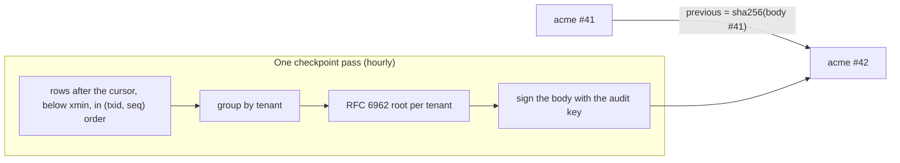

Better Compute keeps its own audit log, next to Better IAM's. Every mutation the API allows writes a row to
`audit_events` in the same transaction as the change, with the full <Term id="admission-context">admission
context</Term>: who acted, in which session, for which agent and delegation, which action on which resource, and
when it was decided. The audit module then seals those rows, hour by hour, into signed per-tenant Merkle
checkpoints. Anyone holding the audit key's pin can check that a tenant's trail was not edited, and a single event
can be proven to a third party with a small JSON file and no database access.

The two logs split the work:

| Log | Records | Where |
| --- | --- | --- |
| Better IAM's audit chain | denials and root overrides, as IAM decides them | Better IAM's database, per tenant |
| `audit_events` | allowed compute mutations with their admission context, joins, secret releases | compute's database, sealed by checkpoints |

## What is recorded

`audit_events` has one row per record:

| Column | Holds |
| --- | --- |
| `id` | `aud_…` |
| `tenant_id` | the tenant the record belongs to: the decision's tenant, or a node's owner |
| `occurred_at` | `compute_now()` when written, which is the writing transaction's start time |
| `action` | `compute:reservations:create`, or a system record such as `node.joined` |
| `resource_type`, `resource_id` | what it acted on, like `compute-reservation` and `rsv_…` |
| `admission` | the admission context (JSON) for API mutations |
| `details` | extra data (JSON) for system records |
| `txid`, `seq` | the writing transaction (`pg_current_xact_id()`) and a sequence: the commit-order cursor |

Rows are written by:

- **The API envelope**, for every allowed mutation, inside the handler's transaction. `admission` holds `tenantId`,
  `identityId`, `identityKind`, `sessionId`, `sessionKind`, `requestId`, `action`, `resource`, `decidedAt`, and
  `agentId` and `delegationId` when an agent acted in a delegated session. Reads are not recorded.
- **Composite calls** such as `fleet.apply`, one row per sub-call, under the sub-call's savepoint, so a failed
  sub-call leaves no row.
- **The join service**: `node.joined` or `node.reclaimed` on the node, with the attestor, join token, certificate
  serial, revoked serials, hardware key and `nodeKey` in `details`. `nodeKey` is `tpm` when the attestor proved the
  node key lives in the machine's TPM (a `tpm` join, cf24876; see
  [the node key in the TPM](/docs/guides/nodes/attestation#the-node-key-in-the-tpm)), else `unattested`.
- **The secret broker**: `secret.released` when a node receives a secret, with the secret reference as the
  resource and the node, request, certificate serial and version in `details`, never the value.

There are no foreign keys, so records outlive what they describe. The table is partitioned by UTC month on
`occurred_at` (`core/0018_partitioned_history`), and the retention pass never prunes it.

<Callout type="info" title="No API reads it yet">
  No API method returns audit rows today. Operators read `audit_events` in SQL and use the `better-compute audit`
  commands below. PLAN.md also plans command, step and ticket records in this table; the writers listed above are
  the ones in the code.
</Callout>

## Checkpoints

Better IAM's audit chain links each row to the one before it, so every writer serializes on the chain's head. Compute
does not: writers append freely, and a periodic pass seals what has committed.



**Commit order, not clock order.** `occurred_at` is the start of the writing transaction, so a long transaction
could commit a row into an hour that was already sealed. Checkpoints therefore follow the `(txid, seq)` cursor,
reading only transactions older than the snapshot's xmin, the same rule the [outbox](/docs/guides/events#commit-order-and-the-xmin-cursor)
uses. No row can commit behind the cursor, however long its transaction ran. `occurred_at` is still hashed, as data,
in microseconds.

**One pass.** The pass locks the cursor row `audit` in `audit_checkpoint_cursor`, reads up to 50,000 rows after
it, groups them by tenant, and writes one checkpoint per tenant into `audit_checkpoints`, all in one transaction.
Then it moves the cursor to the last row read. A full pass runs again at once.

**One checkpoint** covers one tenant's rows within the pass's global range `(from, to]`. Its body is canonical
JSON (sorted keys, no whitespace), and those exact bytes are signed:

```json title="A checkpoint body"
{
  "from": "88100.4410",
  "previous": "3q2-7w…",
  "root": "Jc1tQ…",
  "sequence": 42,
  "size": 17,
  "tenantId": "acme",
  "to": "88213.4519",
  "v": 1
}
```

| Field | Meaning |
| --- | --- |
| `sequence` | 1, 2, 3, … per tenant; a gap means a removed checkpoint |
| `from`, `to` | the global commit-cursor range, as `txid.seq` |
| `size` | the tenant's rows in the range |
| `root` | the base64url RFC 6962 Merkle root of those rows, in commit order |
| `previous` | the base64url SHA-256 of the previous checkpoint's body bytes; `null` for the first |

Each leaf is the RFC 6962 leaf hash, SHA-256 of `0x00` and the row's canonical JSON: `id`, `tenantId`,
`occurredAtUs` (microseconds since the epoch, as a string), `action`, `resourceType`, `resourceId`, `admission` and
`details`. The signature, `{ kid, sig, chain }`, is made for the purpose `audit-checkpoint` by the audit signing key,
a key that does nothing else. The row also stores `first_event_id`, `last_event_id` and the signed body text.

## Turn it on

The audit key lives in the PKI bundle: `better-compute pki init` creates `auditSigning` beside the other keys, and
`pki show` prints its `auditSigningKeyPin` (`sha256/…`), which verifiers need. Add the module with the key:

```ts
import { auditModule } from 'better-compute/audit';
import { loadPkiBundle } from 'better-compute/cli';

const bundle = await loadPkiBundle('.better-compute/pki.json', process.env);

const compute = betterCompute({
  // …
  modules: [auditModule({ signer: bundle.auditSigning! })],
});
```

| Option | Default | |
| --- | --- | --- |
| `signer` | required | the bundle's `auditSigning` key |
| `every` | `1h` | how often the `audit.checkpoint` reconciler runs |
| `limit` | 50,000 | rows per pass, all tenants together |

The module adds migration `audit/0001_checkpoints` (`audit_checkpoints` and `audit_checkpoint_cursor`) and the
periodic `audit.checkpoint` reconciler, which a worker process runs. Its self-check warns `audit.checkpoints` in
`better-compute doctor` when rows older than three hours are still unsealed, which means no worker runs the job. The
example deployments add the module whenever the PKI bundle has an audit key.

To seal right away, for example before an export, run the same pass from the CLI. It repeats until nothing is left:

```bash
better-compute audit checkpoint     # needs the bundle's private key, unsealed with BETTER_COMPUTE_SECRET
# → { "passes": 1, "checkpoints": 3, "events": 212 }
```

## Verify a tenant's trail

```bash
better-compute audit verify --tenant acme
better-compute audit verify --tenant acme --pin sha256/… --query problems
```

`verify` recomputes the tenant's whole chain from the rows as they are now, in one read-only, repeatable-read
transaction, and exits `AUDIT_TAMPERED` after printing the report when anything is wrong. It checks signatures under
the pin from `--pin`, `BETTER_COMPUTE_AUDIT_PIN` or the PKI bundle's public half, so it needs no secret.

```json title="Report"
{
  "ok": false,
  "tenantId": "acme",
  "checkpoints": 42,
  "events": 3180,
  "unsealed": 9,
  "problems": [{ "code": "root", "sequence": 17, "message": "The rows in range do not hash to the sealed root" }]
}
```

| Problem | Found when |
| --- | --- |
| `gap` | a checkpoint sequence is missing between two others |
| `body` | the stored body is not canonical, or does not match its row's tenant or range |
| `chain` | `previous` is not the hash of the previous checkpoint's body |
| `signature` | the signature does not verify under the audit key, or signs other bytes |
| `size` | the number of rows in the range differs from the sealed `size`: a row was inserted or deleted |
| `root` | the rows in the range do not hash to the sealed root: a row was edited, inserted or deleted |
| `uncovered` | rows older than a threshold are not sealed yet (only when `uncoveredOlderThanMs` is passed) |

`unsealed` counts the tenant's committed rows after its last checkpoint. The same check is available in code as
`verifyAuditCheckpoints(sql, { tenantId, trust: { pin }, uncoveredOlderThanMs? })` from `better-compute/audit`.

<Callout type="warn" title="What the database alone cannot show">
  Rows written since the last checkpoint (up to an hour with the default cadence) are not sealed yet. Deleting the
  newest checkpoints together with their rows leaves no gap for `verify` to find, and whoever holds both database
  access and the audit key can rewrite everything. Keep the audit key off the database hosts where you can, and copy
  checkpoints, or at least each tenant's latest body and signature, somewhere the database's operators cannot
  change. A copy of an older checkpoint lets anyone confirm, later, that the chain still contains it.
</Callout>

## Prove one event

An inclusion proof shows a third party, an auditor or the tenant, that one event is sealed in a signed checkpoint,
without giving them your database:

```bash
better-compute audit prove aud_01k… --tenant acme --out proof.json
better-compute audit check-proof proof.json --pin sha256/…
# → { "valid": true, "eventId": "aud_01k…", "tenantId": "acme", "sequence": 17 }
```

`prove` finds the checkpoint whose range covers the event and writes the event's leaf, its `index` in that
checkpoint, the audit path (base64url sibling hashes, bottom-up, per RFC 6962 section 2.1.1) and the signed
checkpoint body with its signature. It answers `NOT_FOUND` for an unknown event, or one that is not checkpointed yet.

`check-proof` needs only the file and the pin. It verifies the signature over the exact body bytes, that the parsed
body matches, that the event belongs to the checkpoint's tenant, and the audit path from the leaf to the signed root
(RFC 9162 section 2.1.3.2). It exits `INVALID_PROOF` otherwise. In code:

```ts
import { proveAuditEvent, verifyAuditProof } from 'better-compute/audit';

const proof = await proveAuditEvent(sql, { tenantId: 'acme', eventId: 'aud_01k…' });
const valid = verifyAuditProof(proof, { pin: 'sha256/…' }); // no database access
```

## Consistency proofs

`@better-compute/pki` also implements RFC 6962 consistency proofs: `merkleConsistencyProof(leaves, oldSize)` and
`verifyMerkleConsistency(oldSize, newSize, oldRoot, newRoot, proof)` show that a tree of `oldSize` leaves is a prefix
of a larger one, the append-only property of a transparency log.

The audit module does not use them today, because its trees do not grow: each checkpoint's tree covers only the rows
of its own range, and append-only history comes from the hash chain instead, with each body naming the hash of the
one before. There is no CLI command for consistency proofs. The primitives are there for tooling that builds a
single growing tree over a tenant's leaves.

## Copy it out with an audit sink

An audit sink receives every committed `audit_events` row, in commit order, at least once: for a SIEM, or the copy
outside the database that the callout above asks for. Declare it with `defineSink({ kind: 'audit', id, write })` and
list it in `betterCompute({ sinks: { audit: [...] } })` or in a module's `extensions`. The built-in `audit-sinks`
module then runs a singleton reconciler every 5 seconds that hands each sink the rows after its own cursor
(`audit_sink_cursors`), 500 at a time, with a per-sink back-off on failure. Records carry `id` for deduplication.
The sink does not depend on the audit module: it copies rows whether or not they are checkpointed. See
[sinks](/docs/extending/sinks#audit-sinks).

## Archiving

`audit_events` is partitioned by month, and nothing deletes audit rows on a timer. Checkpoints are verified against
the rows the table holds, so archiving is a deliberate operator step in two parts:

1. `markAuditArchived(sql, { month: 'YYYY-MM', partition?, by? })` from `better-compute/audit` records the month in
   `audit_archives` (migration `audit/0002_archives`). It refuses the current or a future month with
   `INVALID_STATE`, and a month that still has rows no checkpoint sealed (run a checkpoint pass first). It is
   idempotent.
2. `detachHistoryPartition(tx, 'audit_events', 'audit_events_pYYYYMM')` from `@better-compute/postgres` takes the
   month out of every read at once, leaving it as a standalone table to export and drop.

`verify` then lists a checkpoint wholly inside archived months whose rows are gone in the report's `archived`
(`{ sequence, months, partial }`), with `archivedMonths` beside it: its body, chain and signature are still checked,
its root and size are not. While the rows are still attached it is verified as usual, so an edit still shows. A
checkpoint that straddles an archived month counts as archived (`partial: true`) only once its rows stop matching. A
month detached without being marked still shows `size` and `root` problems. Archive only months whose checkpoints
you keep, and keep the pin to verify them later. See [retention](/docs/operations/retention) and
[PKI](/docs/operations/pki).
