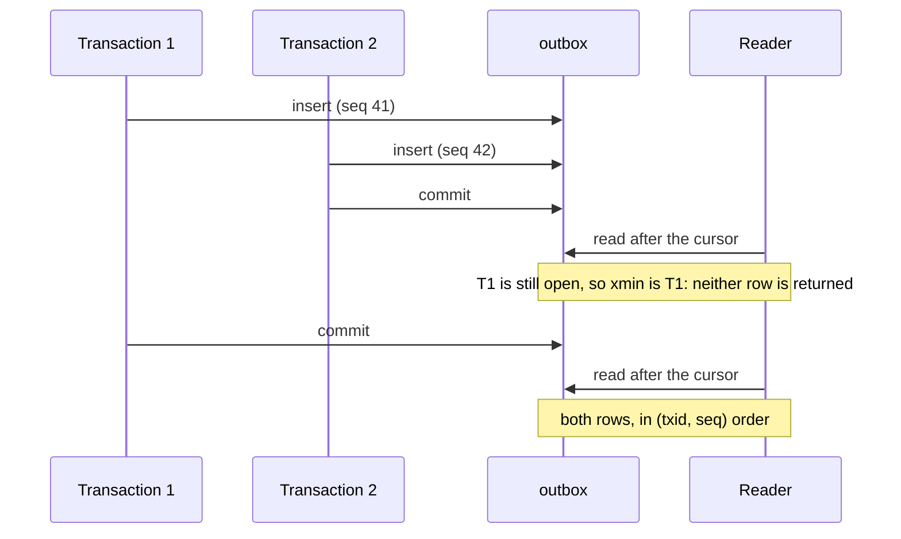

import { Activity, ScrollText, Webhook } from '@/lib/icons';

A dashboard that shows reservations, a billing job that counts GPU hours, and an alerting service that pages someone
when a node goes missing all need to know what changed and in what order. Polling every list method is slow and
misses short-lived states. A callback fired from the request can be lost when the process dies right after the
commit, or sent for a change that was rolled back.

Better Compute writes an event for every change into the <Term id="outbox">outbox</Term>, a table in the same
database, inside the same transaction as the change itself. The event exists if and only if the change committed.
Everything else (the history API, the live stream, webhooks, in-process subscribers and event sinks) reads that one
table.

## The outbox

Module code publishes through the context it is given, in the transaction it already holds:

```ts title="Inside a method handler or reconciler"
await context.events.publish(tx, {
  type: 'node.cordoned',
  tenantId: node.tenantId,
  subject: `node/${node.id}`,
  data: { reason: 'disk replacement' },
});
```

`publishMany(tx, events)` writes a batch in one statement, with `seq` in input order. The runtime checks every
event before anything is written:

| Field | Rule |
| --- | --- |
| `type` | `area.name` with at least one dot, at most 128 characters (`node.connected`, `node.provision.active`) |
| `tenantId` | Non-empty, at most 128 characters: the tenant that may read the event |
| `subject` | Non-empty, at most 512 characters: what the event is about, as `kind/id` |
| `data` | Any JSON, or omitted (`null`). The whole payload is at most 64 KiB |

A violation is `INVALID_INPUT`, and the transaction fails with it. The runtime adds an `id` (`evt_...`) and stamps
`time` from <Term id="compute-now">`compute_now()`</Term>, the database clock.

The table is small on purpose: `seq bigserial`, `txid xid8` (the writing transaction, from `pg_current_xact_id()`),
`topic` (the type), `payload jsonb` and `created_at`. It is created by the base schema (`core/0002_base`, with
`created_at` and the per-tenant index `outbox_tenant_cursor` added by `core/0009_runtime`).

### Commit order and the xmin cursor

`seq` is drawn when a row is inserted, not when its transaction commits, so a reader that walks `seq` can hand out
42, move its cursor past it, and never see 41 when a slower transaction commits it a moment later.



Every outbox reader therefore takes only rows of transactions older than the snapshot's xmin
(`txid < pg_snapshot_xmin(pg_current_snapshot())`) and orders them by `(txid, seq)`. Nothing can commit behind a
cursor once it was handed out. The cost is latency: an event becomes visible when every transaction older than it
has finished, so one long transaction holds the stream back until it ends. See
[consistency](/docs/guides/concepts/consistency).

## Event shape

Every reader returns the same CloudEvents-style object:

```json title="reservation.active"
{
  "id": "evt_01k5y3v0m6y8x7w5t4s3r2p1n0",
  "type": "reservation.active",
  "tenantId": "ten_01k5y2a9c3d4e5f6g7h8j9k0m1",
  "subject": "reservation/rsv_01k5y3a0b1c2d3e4f5g6h7j8k9",
  "time": "2026-09-24T10:15:02.114Z",
  "sequence": "88213.51120",
  "data": { "state": "active", "poolId": "pool_01k5y1z2x3w4v5t6s7r8q9p0n1" }
}
```

<TypeTable
  type={{
    id: { type: 'string', description: 'Unique event id (evt_...). Deduplicate on it: every consumer is at least once.', required: true },
    type: { type: 'string', description: 'The event type, such as reservation.active or node.disconnected.', required: true },
    tenantId: { type: 'string', description: 'The tenant the event belongs to. Every reader filters on it.', required: true },
    subject: { type: 'string', description: 'What it is about: reservation/rsv_..., node/node_..., instance/inst_...', required: true },
    time: { type: 'string', description: 'RFC 3339 in UTC, from compute_now() when the row was written.', required: true },
    sequence: { type: 'string', description: 'The outbox position (txid and seq) of this event. Use it to order and to resume.', required: true },
    data: { type: 'JSON | null', description: 'Type-specific details. Reservation events carry state and poolId, for example.' },
  }}
/>

<Callout type="warn" title="Two spellings of the same cursor">
  `events.list` and `nodes.events` write `sequence` and take `cursor` as `txid:seq` (a colon). The SSE stream and
  webhook bodies use `txid.seq` (a dot), and `Last-Event-ID` accepts only that form. Both name the same outbox
  position; replace the separator to move between them.
</Callout>

## Event types

The events module keeps a catalog of the families the control plane and its modules publish. Webhook subscriptions
are checked against it, and `webhooks.eventTypes` returns it. A test runs the simulator and fails when any module
writes a type outside the catalog.

| Family | Subject | Module | Types you will see |
| --- | --- | --- | --- |
| `site.*` | `site/{id}` | server | `site.created`, `site.updated`, `site.deleted`, `site.boot` |
| `project.*` | `project/{id}` | server | `project.created`, `project.archived` |
| `pool.*` | `pool/{id}` | capacity | `pool.created`, `pool.updated`, `pool.offered`, `pool.unoffered`, `pool.archived` |
| `quota.updated` | `pool/{id}` | capacity | `quota.updated` |
| `reservation.*` | `reservation/{id}` | capacity | `reservation.placed`, `pending`, `queued`, `binding`, `active`, `extended`, `preempting`, `preempted`, `repaired`, `failed`, `cancelled`, `expired`, `awaiting-confirmation`, `binding-rejected`, and one per state change |
| `reservation.reassigned` | `reservation/{id}` | capacity | An offboarded identity's reservation moved to its successor: `{ reservationId, from, to, reason }` |
| `node.*` | `node/{id}` | server | `node.joined`, `node.acceptance.started`, `node.acceptance.failed`, `node.adopted`, `node.connected`, `node.disconnected`, `node.unreachable`, `node.lost`, `node.status` (only when a report says something new; see below), `node.cordoned`, `node.uncordoned`, `node.draining`, `node.drained`, `node.labeled`, `node.tainted`, `node.adopting`, `node.deleted`, `node.command.queued`, `node.command.cancel-requested`, `node.report-failed`, `node.ssh-cert.issued`, `node.ssh-cert.revoked` |
| `node.inventory.changed`, `node.gpu.*`, `node.mig.*`, `node.disk.*`, `node.driver.*` | `node/{id}` | inventory | `node.gpu.added`, `node.gpu.missing`, `node.mig.layout.changed`, `node.disk.replaced`, `node.driver.changed`; `node.mig.scheduled`, `node.mig.granted` and `node.mig.applied` from capacity's MIG layout gate; also `node.condition.changed` from the hygiene sweep and host pressure (within `node.*`) |
| `node.enrolled`, `node.pxe-mac.discovered`, `node.pxe-mac.confirmed`, `node.provision.*` | `node/{id}` | metal | `node.provision.<state>` for each provisioning transition; `node.pxe-mac.discovered` when PXE discovery found a candidate MAC for a machine enrolled without MACs (`bound` says whether a trusted pool bound it at once); `node.pxe-mac.confirmed` when an operator bound a MAC with `metal.confirmMac` |
| `command.settled` | `command/{id}` | gateway | A command reached a terminal state |
| `workflow.*` | `workflow/{id}` | provision | `workflow.created`, `started`, `paused`, `resumed`, `retried`, `cancelled`, and one per state |
| `instance.*` | `instance/{id}` | vps | `instance.created`, `scheduled`, `provisioning`, `starting`, `stopping`, `resized`, `deleting`, `deleted`, `failed`, `lost`, `recovered`, `recreating`, `orphaned` |
| `sandbox.*` | `sandbox/{id}` | vps | `sandbox.created`, `ready`, `extended`, `expired`, `deleted`, `exec.issued`; `sandbox.snapshot.ready` / `failed` when a snapshot settles; see [sandbox events](/docs/guides/vps/sandboxes#events) |
| `fleet.*` | `fleet/{id}` | fleet | `fleet.drifted`, `fleet.converged` |
| `rollout.*` | `rollout/{id}` | rollout | `rollout.started`, `paused`, `resumed`, `aborted`, `completed` |
| `tunnel.*` | `tunnel/{id}` | server | `tunnel.issued` |
| `security.*` | varies | server | `security.join-token.created`, `security.join-token.revoked`, `security.site-token.created`, `security.site-token.revoked`, `security.join.refused`, `security.certificate-revoked`, `security.node.identity-revoked`, `security.node.duplicate-session` and `security.node.quarantined` (from the gateway), `security.secret.put`, `security.secret.deleted`, `security.secret.refused`, `security.workload.refused` (v0.5) |
| `webhook.ping` | `webhook/{id}` | events | A test delivery from `webhooks.ping` |

The catalog names the subject each family is declared with, but code is the final word: `tunnel.issued`, for
example, is published with the instance or node it opens as its subject. Modules you write publish their own
families; register them with `eventsModule({ extraEvents })` so webhooks can subscribe to them (see
[webhooks](/docs/guides/events/webhooks)).

`node.status` is published when a node's status report says something new on its session, not for every report.
The gateway compares reports without their gauges (host pressure, volume storage), which move on every converge
pass, so `node.status` does not carry every gauge update: read gauges from [metrics](/docs/operations/observability),
and conditions from `node.condition.changed`. A reconnected session publishes its first report again.

## Read history with events.list

`events.list` returns a tenant's committed events after a cursor, oldest first. It is decided as
`compute:events:read` on `compute-tenant/{tenantId}` ([reference](/docs/reference/api/events#list)).

<TypeTable
  type={{
    tenantId: { type: 'string', description: 'The tenant whose events to read.', required: true },
    type: { type: 'string', description: 'A type prefix, not a pattern: node. or reservation. or security.join (lower case, at most 64 characters).' },
    limit: { type: 'number', description: 'Events per page, at most 500.', default: '100' },
    cursor: { type: 'string', description: 'An event sequence (txid:seq). The page starts after it.' },
  }}
/>

The result is `{ items, cursor? }`. `cursor` is present only when more rows follow; to keep tailing, remember the
last item's `sequence` and pass it as the next `cursor`.

```ts title="Read every reservation event of a tenant"
let cursor: string | undefined;
do {
  const page = await client.events.list({ tenantId, type: 'reservation.', limit: 500, ...(cursor ? { cursor } : {}) });
  for (const event of page.items) await handle(event);
  cursor = page.cursor;
} while (cursor);
```

```bash
better-compute api events.list tenantId=$TENANT type=node. limit:=20 --format table
```

`nodes.events` is the same read narrowed to one node's subject, decided as `compute:nodes:read` on the node, with
at most 200 events per page ([reference](/docs/reference/api/nodes#events)).

## Ways to consume events

| Consumer | How it reads | Position kept by | Use it for |
| --- | --- | --- | --- |
| `events.list` | Pull, one page per call | The caller | History, backfill, reports |
| [`GET /watch`](/docs/guides/events/watch) | Server-Sent Events | The client (`Last-Event-ID`) | Browsers, consoles, scripts that follow live |
| [Webhooks](/docs/guides/events/webhooks) | Signed HTTPS POSTs | The events module (`event_cursors`) | Other services of the tenant |
| `compute.events.subscribe` | In process | Memory, per process | Reacting inside your own server |
| [Event sinks](/docs/extending/sinks) | `sinks.events` on `betterCompute` | `outbox_cursors` (`sink:<id>`) | Warehouses, queues, platform-wide feeds |

`compute.events.subscribe(pattern, handler)` calls `handler` for each committed event whose type matches (`*` matches
any run of characters, so `reservation.*` and `*` work) and returns the unsubscribe function. The first subscriber
starts the process's cursor at the head, so it sees events from that moment on, and the `event-subscribers` job of
every started process feeds it. A handler that throws is logged and does not stop the others. The position lives in
memory: a restarted process starts at the head again, so use a sink when you need every event.

Event sinks run in the `sinks` worker role, each under its own lease `singleton:outbox-dispatch:<sink id>` and in
its own loop, so different workers can deliver different sinks. Each sink has its own durable cursor, so a failing
sink backs off (1 s, doubling up to 5 minutes) without holding the others back, and a
new lease holder resumes where the last one saved. A failing batch is bisected down to one event, and an event the
sink refuses on every attempt while its neighbour goes through is dead-lettered to `outbox_dead_letters`; see
[poison events](/docs/extending/sinks#poison-events).

Every consumer is at least once: an event can arrive twice after a crash or a retry. Deduplicate on `id`, and order
by `sequence` (compare txid first, then seq, as numbers).

## Retention

The outbox is not an archive. `retentionModule()` from `@better-compute/postgres` prunes it with the periodic
`core.retention` reconciler. Deployments built by the CLI (`serve`, `dev`, `migrate`) add it automatically unless your
configuration registers a `retention` module itself.

- A row is deleted only when every durable cursor of the `outbox` stream in `outbox_cursors` has passed it, and it is
  older than `minAgeSeconds` (default 3600).
- A pass runs every 5 minutes (`every`) and deletes in batches of 5,000 (`batch`), at most 20 statements per pass
  (`maxRounds`), so a backlog drains over several passes without long locks.
- A stream with no durable cursor is never pruned. Today only event sinks save outbox cursors, so a deployment
  without sinks keeps its whole outbox.
- The webhook fan-out cursor, SSE clients and `events.list` callers do not hold retention back. A client that
  resumes from a pruned position continues with the oldest row still there, without an error.

See [retention](/docs/operations/retention) for the other tables the pass cleans.

## In this section

<Cards>
  <Card icon={<Webhook />} title="Webhooks" href="/docs/guides/events/webhooks">
    Signed deliveries to a tenant's HTTPS endpoints, with retries, dead letters and redelivery.
  </Card>
  <Card icon={<Activity />} title="Watch" href="/docs/guides/events/watch">
    GET /watch: live events over Server-Sent Events, resumable with Last-Event-ID.
  </Card>
  <Card icon={<ScrollText />} title="Audit" href="/docs/guides/events/audit">
    Admission contexts in audit_events, sealed by signed per-tenant Merkle checkpoints.
  </Card>
</Cards>
