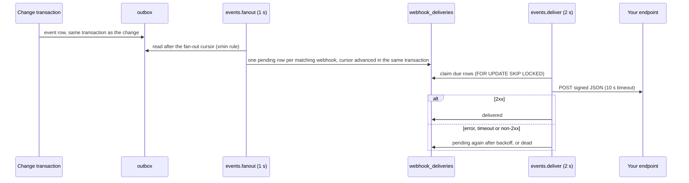

A webhook is a tenant's subscription: an HTTPS URL and a list of event type patterns. Every committed event of that
tenant whose type matches is POSTed to the URL as JSON, signed with a secret only the tenant and Better Compute
know. Delivery is at least once, with retries over about two days, a dead-letter state you can inspect, and
redelivery on request.

Webhooks come from the events module. Add it to your deployment with a secret of at least 32 characters, shared by
every process:

```ts
import { eventsModule } from 'better-compute/events';

const compute = betterCompute({
  // …
  modules: [eventsModule({ secret: process.env.BETTER_COMPUTE_SECRET! })],
});
```

The module adds the `webhooks` API group, the tables `webhooks`, `webhook_deliveries` and `event_cursors`
(migrations `events/0001_webhooks` and `events/0002_delivery_retention`), and three reconcilers that a worker process
runs: `events.fanout` every second, `events.deliver` every two seconds and `events.prune` every hour. Without a
worker running reconcilers (the `controllers` role of `better-compute serve`), webhooks are stored but nothing is
sent.

## How a delivery happens



**Fan-out.** `events.fanout` reads the <Term id="outbox">outbox</Term> after its cursor in `event_cursors`, with the
same xmin rule as every outbox reader, and queues one delivery for each active webhook of the event's tenant whose
patterns match and that existed when the event was written. The queue insert and the cursor move commit together,
and `(webhook_id, event_id)` is unique, so an event is queued at most once per webhook. The cursor is anchored at the
outbox tail when the control plane starts: history from before the first start is never replayed, and a new webhook
receives events from its creation on.

**Delivery.** `events.deliver` claims up to 50 due deliveries per pass and leases each for the timeout plus 30
seconds, so a crashed worker's claims come back. Within a pass, one webhook's deliveries go out one at a time in the
order they were queued; different webhooks are served in parallel. Each claim counts as an attempt. A delivery of a
paused or deleted webhook is cancelled instead of sent.

## Create a webhook

<Tabs items={['TypeScript', 'CLI', 'HTTP']}>
<Tab value="TypeScript">

```ts
const { webhook, secret } = await client.webhooks.create({
  tenantId: 'acme',
  url: 'https://hooks.example.com/compute',
  events: ['reservation.*', 'node.disconnected', 'node.lost'],
  description: 'Scheduler sync',
});
// Store `secret` now (whsec_...): it is returned once and never again.
```

</Tab>
<Tab value="CLI">

```bash
better-compute api webhooks.create tenantId=acme url=https://hooks.example.com/compute \
  'events[]=reservation.*' 'events[]=node.disconnected' description="Scheduler sync"
```

</Tab>
<Tab value="HTTP">

```bash
curl -X POST https://compute.example.com/api/compute/webhooks/create \
  -H "Authorization: Bearer $BETTER_COMPUTE_TOKEN" \
  -H "Content-Type: application/json" -H "X-Better-Compute: 1" \
  -d '{"tenantId":"acme","url":"https://hooks.example.com/compute","events":["reservation.*"]}'
# → { "data": { "webhook": { "id": "whk_…", … }, "secret": "whsec_…" } }
```

</Tab>
</Tabs>

<TypeTable
  type={{
    tenantId: { type: 'string', description: 'The tenant whose events to deliver.', required: true },
    url: { type: 'string', description: 'An https URL at a public address, without credentials. The fragment is dropped.', required: true },
    events: { type: 'string[]', description: '1 to 20 patterns: *, a family like reservation.* or node.gpu.*, or an exact type. At most 128 characters each; duplicates are removed.', required: true },
    description: { type: 'string', description: 'Up to 256 characters.' },
  }}
/>

A tenant can have 20 webhooks (`maxPerTenant`); the 21st is `QUOTA_EXCEEDED`. Every webhooks method is decided as
`compute:webhooks:manage` on `compute-tenant/{tenantId}`.

`webhooks.create` takes no idempotency key, so retrying a create whose answer was lost makes a second webhook with
its own secret, and both receive every matching event. Before retrying, check
[`webhooks.list`](/docs/reference/api/webhooks#list) and [delete](#test-pause-and-delete) the one you do not keep.

### Choosing events

A pattern is `*` (everything), a family ending in `.*`, or one exact type. `reservation.*` matches
`reservation.placed` and `reservation.active`; `node.*` also matches `node.gpu.missing`. Patterns are lower case
letters, digits and hyphens between dots.

`create` and `update` check every pattern against the event catalog and refuse one that nothing can match, such as
`nodes.*`, with `INVALID_INPUT` and the offenders in `details.unknown`, instead of letting a typo silently match
nothing. `webhooks.eventTypes` returns the catalog: each family's `type`, `subject`, `module` and `description`.
The [event reference](/docs/reference/events) lists the same catalog, and the [events](/docs/guides/events#event-types)
page lists the individual types you will see in each family.

Modules and plugins that publish their own families register them with `eventsModule({ extraEvents: [...] })` so
tenants can subscribe; `extraEvents: false` turns the check off and accepts any well-formed pattern.

### Webhook URLs

Webhook URLs are tenant input, and the workers that send deliveries sit inside your platform network, so a URL
pointing at a metadata service, a BMC or a database would be a server-side request forgery. Two checks prevent it:

- **When saved**, the URL must be `https`, carry no user name or password, and not be an IP literal of a non-public
  address, `localhost`, `*.localhost` or `*.internal`.
- **At every delivery**, the host is resolved again and the delivery fails if any address it resolves to is
  loopback, private, link-local, carrier-grade NAT, multicast, a documentation range or otherwise non-public (IPv4
  and IPv6, including IPv4-mapped addresses). This catches DNS names that change after the webhook was saved.

For local development only, `eventsModule({ allowInsecure: true })` permits `http:` and `allowPrivate: true`
permits private and loopback destinations.

## Receive and verify

Each delivery is a `POST` with the event as its JSON body:

```json title="Body"
{
  "id": "evt_01k5y3v0m6y8x7w5t4s3r2p1n0",
  "type": "reservation.active",
  "tenantId": "acme",
  "subject": "reservation/rsv_01k5y3a0b1c2d3e4f5g6h7j8k9",
  "time": "2026-09-24T10:15:02.114Z",
  "sequence": "88213.51120",
  "data": { "state": "active", "poolId": "pool_01k5y1z2x3w4v5t6s7r8q9p0n1" }
}
```

The body is stored when the delivery is queued, so every attempt, and every redelivery, sends the same bytes.
`sequence` is the outbox position in the `txid.seq` form; it is empty for a `webhook.ping`.

| Header | Value |
| --- | --- |
| `Content-Type` | `application/json` |
| `User-Agent` | `better-compute-webhooks/1` |
| `X-Better-Compute-Event` | the event type |
| `X-Better-Compute-Delivery` | the delivery id (`dlv_…`), the same on every retry and redelivery |
| `X-Better-Compute-Webhook` | the webhook id (`whk_…`) |
| `X-Better-Compute-Timestamp` | the signing time, in epoch seconds |
| `X-Better-Compute-Signature` | `v1=<hex>`, or several comma-separated during a secret rotation |

The signature is the scheme Better IAM uses for its own webhooks: an HMAC-SHA256, keyed with the webhook's secret,
over the timestamp, a dot and the raw body, `${timestamp}.${body}`, as lower-case hex. Verify it before you trust
anything in the body, and check that the timestamp is recent so an old delivery cannot be replayed.

```ts title="app/hooks/compute/route.ts"
import { verifyWebhookSignature } from 'better-compute/events';

export async function POST(request: Request): Promise<Response> {
  const body = await request.text(); // the raw bytes: never re-serialize before verifying
  const valid = verifyWebhookSignature({
    secret: process.env.COMPUTE_WEBHOOK_SECRET!,
    signature: request.headers.get('x-better-compute-signature') ?? '',
    timestamp: request.headers.get('x-better-compute-timestamp') ?? '',
    body,
  });
  if (!valid) return new Response('invalid signature', { status: 401 });

  const delivery = request.headers.get('x-better-compute-delivery')!;
  if (await alreadyHandled(delivery)) return new Response(null, { status: 204 });
  const event = JSON.parse(body);
  await enqueue(event); // do the work elsewhere: answer within 10 seconds
  await markHandled(delivery);
  return new Response(null, { status: 204 });
}
```

`verifyWebhookSignature({ secret, signature, timestamp, body, toleranceSeconds?, now? })` returns true when any
`v1=` value in the header matches, compared in constant time, and the timestamp is within `toleranceSeconds` of now
(300 by default, in either direction). In another language, compute the same HMAC and compare it with each `v1=`
part:

```bash
printf '%s.%s' "$TIMESTAMP" "$BODY" | openssl dgst -sha256 -hmac "$SECRET" -hex
```

**Answer quickly, and idempotently.** Any 2xx response marks the delivery `delivered`; its body is ignored.
Anything else, a redirect (redirects are not followed), a connection error or no answer within 10 seconds is a
failed attempt. Because delivery is at least once, the same event can arrive twice, after a timeout that your
endpoint in fact handled or after a redelivery. Deduplicate on `X-Better-Compute-Delivery` (one per webhook and
event) or on the event `id`, and order by `sequence`, not by arrival: a delivery that failed is retried later
without holding back the ones queued after it.

## Retries and dead letters

A failed attempt is retried after a delay that grows with each attempt. The eighth failed attempt makes the delivery
`dead`.

| After attempt | 1 | 2 | 3 | 4 | 5 | 6 | 7 | 8 |
| --- | --- | --- | --- | --- | --- | --- | --- | --- |
| Next try in | 1 min | 5 min | 30 min | 2 h | 6 h | 12 h | 24 h | dead |

That is about 44 hours and 36 minutes from the first attempt to the last. `eventsModule({ delivery })` changes the
policy for a deployment: `maxAttempts` (8), `backoffSeconds` (the table above; the last value repeats), `timeoutMs`
(10000) and `limit` (50 deliveries per pass). Each failure records `lastStatus` (the HTTP status, when there was
one) and `lastError`.

| State | Meaning |
| --- | --- |
| `pending` | queued or waiting for its next attempt (`nextAttemptAt`) |
| `delivered` | an attempt got a 2xx; `deliveredAt` is set |
| `dead` | every attempt failed |
| `cancelled` | the webhook was paused or deleted while the delivery was pending |

Inspect a webhook's history, newest first, and put deliveries back in the queue once the endpoint is fixed:

```ts
const { items } = await client.webhooks.deliveries({ tenantId: 'acme', webhookId, state: 'dead', limit: 100 });
for (const delivery of items)
  await client.webhooks.redeliver({ tenantId: 'acme', deliveryId: delivery.id });
```

`redeliver` works on a `dead`, `cancelled` or `delivered` delivery: it becomes `pending`, due now, with its attempt
count reset to zero, and keeps its id and body. It refuses with `NOT_FOUND` when the delivery does not exist in the
tenant or its webhook is paused. `deliveries` returns at most 200 items (50 by default).

`better-compute doctor` reports `events.webhook-dead-letters` while any delivery is dead, and
`events.webhook-backlog` when more than 1,000 deliveries are over five minutes late, which usually means no worker
runs `events.deliver`.

### How long history is kept

`events.prune` deletes settled delivery history once it is old enough, measured from when the delivery was queued:
`delivered` and `cancelled` deliveries after 30 days, `dead` ones after 90, so there is time to fix an endpoint and
redeliver. It deletes 5,000 rows per run and runs again a second later while a batch comes back full. `pending`
deliveries are never deleted, whatever their age.

```ts
eventsModule({ secret, retention: { deliveredDays: 14, deadDays: 60 } }); // retention: false keeps everything
```

A period under one day is `INVALID_CONFIG` when the module is defined. `pruneWebhookDeliveries(sql, retention?,
limit?)` runs one batch, for hosts that schedule pruning themselves. See [retention](/docs/operations/retention).

## Test, pause and delete

- **`ping`** queues a `webhook.ping` event to one webhook, due now, whatever its patterns. Its data is
  `{ webhookId }`. The result is the queued delivery, so you can follow it with `deliveries`.
- **`update`** changes `url`, `events`, `description` or `active`, with the same checks as
  `create`. Setting `active: false` pauses the webhook and cancels its pending deliveries; events that happen while
  it is paused are not queued for it. Setting `active: true` resumes it from new events on; redeliver cancelled
  deliveries you still want.
- **`delete`** removes the webhook and its whole delivery history.

## Rotate the secret

`rotateSecret` returns a new secret, once. With `keepPreviousSeconds` (up to 86400, one day), the old secret keeps
signing too until then, so each delivery carries two signatures, the new one first. Receivers that accept either
secret during the window switch without dropping a delivery:

```ts
const { secret, webhook } = await client.webhooks.rotateSecret({
  tenantId: 'acme',
  webhookId,
  keepPreviousSeconds: 3600,
});
// webhook.previousSecretExpiresAt: when the old secret stops signing
```

```ts title="Receiver during a rotation"
const valid = [process.env.COMPUTE_WEBHOOK_SECRET!, process.env.COMPUTE_WEBHOOK_SECRET_OLD]
  .filter((secret): secret is string => Boolean(secret))
  .some((secret) => verifyWebhookSignature({ secret, signature, timestamp, body }));
```

Without `keepPreviousSeconds` the old secret stops at once.

**At rest**, signing secrets are sealed with AES-256-GCM under a key derived with HKDF-SHA256 from the deployment
secret and bound to the webhook id, so a sealed value copied to another row does not open. When you rotate the
deployment secret itself, pass the old one in `eventsModule({ secret, previousSecrets: [old] })` so existing rows
still open.

## The webhooks API

| Method | Input | Returns |
| --- | --- | --- |
| [`create`](/docs/reference/api/webhooks#create) | `tenantId`, `url`, `events`, `description?` | `{ webhook, secret }` |
| [`list`](/docs/reference/api/webhooks#list) | `tenantId` | `{ items: Webhook[] }`, oldest first |
| [`get`](/docs/reference/api/webhooks#get) | `tenantId`, `webhookId` | `Webhook` |
| [`update`](/docs/reference/api/webhooks#update) | `tenantId`, `webhookId`, `url?`, `events?`, `description?`, `active?` | `Webhook` |
| [`rotateSecret`](/docs/reference/api/webhooks#rotatesecret) | `tenantId`, `webhookId`, `keepPreviousSeconds?` (0 to 86400) | `{ webhook, secret }` |
| [`delete`](/docs/reference/api/webhooks#delete) | `tenantId`, `webhookId` | `{ deleted: true }` |
| [`ping`](/docs/reference/api/webhooks#ping) | `tenantId`, `webhookId` | `{ delivery }` |
| [`deliveries`](/docs/reference/api/webhooks#deliveries) | `tenantId`, `webhookId`, `state?`, `limit?` (1 to 200) | `{ items: WebhookDelivery[] }`, newest first |
| [`redeliver`](/docs/reference/api/webhooks#redeliver) | `tenantId`, `deliveryId` | `{ delivery }` |
| [`eventTypes`](/docs/reference/api/webhooks#eventtypes) | `tenantId` | `{ items: EventFamily[] }` |

All ten are decided as `compute:webhooks:manage` on `compute-tenant/{tenantId}`. A webhook of another tenant is
`NOT_FOUND`.

<TypeTable
  type={{
    id: { type: 'string', description: 'whk_ followed by a sortable id.' },
    tenantId: { type: 'string', description: 'The owning tenant.' },
    url: { type: 'string', description: 'The normalized URL.' },
    description: { type: 'string', description: 'When set.' },
    events: { type: 'string[]', description: 'The patterns.' },
    active: { type: 'boolean', description: 'false while paused.' },
    createdAt: { type: 'number', description: 'Epoch milliseconds. Only events written after it are delivered.' },
    updatedAt: { type: 'number', description: 'Epoch milliseconds.' },
    previousSecretExpiresAt: { type: 'number', description: 'While a rotated-out secret still signs.' },
    version: { type: 'number', description: 'Raised by every update and rotation.' },
  }}
/>

A `WebhookDelivery` has `id` (`dlv_…`), `webhookId`, `tenantId`, `eventId`, `eventType`, `state`, `attempts`,
`nextAttemptAt`, `createdAt`, and `lastStatus`, `lastError` and `deliveredAt` when they apply. Times are epoch
milliseconds.

## Webhooks or watch

Webhooks suit another service of the tenant that must see every event even while it is down: the position lives in
Better Compute, and failed deliveries wait for it. For a browser, a console or a script that follows events while it
runs, [watch](/docs/guides/events/watch) streams them over one connection and resumes from a cursor the client
keeps. For a platform-wide feed into a warehouse or a queue, use an [event sink](/docs/extending/sinks).
