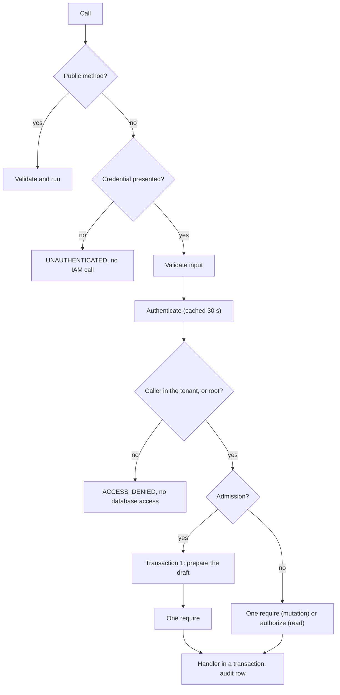

Every protected method asks Better IAM one question: may this caller perform this **action** on this
**resource** in this <Term id="tenant">tenant</Term>? Actions are written `compute:<area>:<verb>`, such as
`compute:reservations:create`. Resources are written `<type>/<id>`, such as `compute-pool/{poolId}`. Both come
from compute's catalog, which the bridge installs into every Better IAM host through `bridge.plugin()`, and they
are the names you write [policies](/docs/guides/iam/policies) against.

## Resource types

All of compute's resource types are app-owned: nothing is ever registered in Better IAM. When IAM needs a
resource, it calls compute's <Term id="resolver">resolver</Term>, which answers from the memory-resident
<Term id="authz-projection">authz projection</Term>. The prefix is `compute-` by default; `typePrefix` changes it
(it must match `^[a-z][a-z0-9-]{0,31}$`) and must be the same in `betterCompute()` and `createComputeIamBridge()`.

| Type | What it is | Parent | Relations | Declared attributes |
| --- | --- | --- | --- | --- |
| `compute-fleet` | The platform fleet. A scope type whose only id is `global`. | | | |
| `compute-tenant` | A tenant's compute scope. A scope type whose id is the tenant id. | | | |
| `compute-project` | A <Term id="project">project</Term> | | `member`, `admin` | |
| `compute-site` | A boot and failure domain | | | `region`, `iamRegion`, `kind` |
| `compute-pool` | A scheduling and policy domain | | `viewer`, `user`, `operator`, `admin` | `region`, `class`, `gpuModel`, `gpuMemoryGb`, `sharing` |
| `compute-node` | A machine | `compute-pool` | `operator` | `region`, `gpuModel`, `gpuCount`, `lifecycle`, `trust`, `dedicatedTo` |
| `compute-reservation` | A GPU reservation, decided while it is still a <Term id="draft">draft</Term> | `compute-pool` | | `region`, `gpuModel`, `gpuCount`, `durationHours`, `binding`, `projectId`, `spot` |
| `compute-instance` | A VPS instance | `compute-pool` | | `vcpu`, `memoryGiB`, `gpus`, `imageId`, `imageVerified`, `projectId` |
| `compute-image` | An OS or ramdisk image | | | `visibility`, `verified` |
| `compute-profile` | A provisioning profile | | | |
| `compute-provider-account` | An account with an external capacity provider | | | |

Besides a row's attributes, every resolved resource carries `ownerId` when the row has an owner, and the prefixed
`parentType` and `parentId` of its parent. Better IAM turns the parent into `resource.parentRelations`, so a
policy on a reservation can test the caller's relations on its pool. The attributes each row actually carries
today are listed under [Resource attributes](/docs/guides/iam/policies).

### Scope types

Three types exist only as scopes, so a decision about "everything in this tenant" or "the whole fleet" has a
resource to name:

- `compute-fleet/global` resolves only in the root tenant. Fleet-wide methods are decided in the root tenant,
  whatever `tenantId` their input names.
- `compute-tenant/{t}` resolves only when its id is the decision's tenant.
- `compute-project/{id}` resolves in the project's owner tenant.

### How the resolver answers

The resolver runs inside Better IAM's locked decision transaction, so a hit must do no I/O:

- It echoes `{ tenantId, type, id }` exactly. Better IAM refuses anything else as `RESOURCE_MISMATCH`.
- A row missing from memory costs one primary-key read, bounded to 20 ms. A row that does not exist is
  `NOT_FOUND`, which Better IAM does not audit and which aborts a whole `authorizeMany` batch.
- A lookup that times out, or a projection that is not loaded yet, denies (`ACCESS_DENIED`).
- Types without compute's prefix go to the `hostFallback` you passed to `bridge.resolveResource()`, or fail with
  `RESOURCE_RESOLVER_REQUIRED`.

Each process loads the projection at start and then tails `authz_changes` about once a second. Staleness can
cause a spurious denial, never a wrong mutation, because compute re-validates inside its own transaction.

Admissions never decide on a stale copy. After an admission's first transaction commits the draft (or the changed
row, as in `reservations.extend`), the envelope calls the optional `IamPort.refreshResource(tenantId, resource)`
before `iam.require`. The embedded port from `bridge.embedded()` implements it with `AuthzProjection.refresh(type,
id, tenantId)`, which re-reads that one row; on a miss or a failed read it drops the row, so the decision takes the
bounded miss path above and fails closed. Before this, `reservations.extend` decided on the row cached at creation,
so a `BoundedExtend`-style policy capped at 72 hours could be passed by one extra hour within the tail interval.
`tests/server-example-policies.test.ts` runs the example policies against real drafts to hold this.

In remote mode the IAM host decides on its replica's copy, so pass `refresh: { url, secret, sql? }` to
`bridge.remote()` (or `remoteIam()`, which it wraps):
the port then posts a signed `{ tenantId, type, id, lsn }` to the IAM host's refresh handler
(`computeIamHost().refreshHandler`), which waits at most 2 seconds until its replica has replayed compute's WAL
position from after transaction 1 and re-reads the row. Any failure fails the admission with `UNAVAILABLE` (fail
closed). Without `refresh` the remote port has no `refreshResource`, remote admissions can decide on a row up to the
replica lag plus 1 second old, and `better-compute doctor` warns `iam.refresh`.

## Actions

The core catalog declares 50 actions. Most areas have a `read` action and a `manage`, `create` or finer verb.
Where an action appears on a scope type as well as on an item type, the scope form gates list and create calls
and the item form gates calls on one resource:

| Action | Resource types that carry it |
| --- | --- |
| `compute:fleet:admin` | `compute-fleet` |
| `compute:sites:read` | `compute-tenant`, `compute-site` |
| `compute:sites:manage` | `compute-fleet`, `compute-tenant`, `compute-site` |
| `compute:pools:read` | `compute-tenant`, `compute-pool` |
| `compute:pools:create` | `compute-fleet`, `compute-tenant` |
| `compute:pools:manage` | `compute-pool` |
| `compute:pools:share` | `compute-pool` |
| `compute:capacity:read` | `compute-tenant`, `compute-pool` |
| `compute:quotas:read` | `compute-tenant` |
| `compute:quotas:manage` | `compute-fleet` |
| `compute:join-tokens:create`, `compute:join-tokens:read`, `compute:join-tokens:revoke` | `compute-pool` |
| `compute:flavors:read`, `compute:flavors:manage` | `compute-pool` |
| `compute:nodes:read` | `compute-tenant`, `compute-node` |
| `compute:nodes:provision` | `compute-pool`, `compute-node` |
| `compute:nodes:update`, `compute:nodes:cordon`, `compute:nodes:drain`, `compute:nodes:power`, `compute:nodes:exec`, `compute:nodes:console`, `compute:nodes:ssh-root`, `compute:nodes:delete`, `compute:nodes:revoke-identity` | `compute-node` |
| `compute:workflows:read`, `compute:workflows:manage` | `compute-node` |
| `compute:reservations:read` | `compute-tenant`, `compute-reservation` |
| `compute:reservations:create`, `compute:reservations:extend`, `compute:reservations:release` | `compute-reservation` |
| `compute:instances:read` | `compute-tenant`, `compute-instance` |
| `compute:instances:create`, `compute:instances:update`, `compute:instances:exec`, `compute:instances:delete` | `compute-instance` |
| `compute:projects:read`, `compute:projects:manage` | `compute-tenant`, `compute-project` |
| `compute:usage:read` | `compute-tenant`, `compute-project` |
| `compute:events:read`, `compute:webhooks:manage` | `compute-tenant` |
| `compute:secrets:manage` | `compute-fleet`, `compute-tenant` |
| `compute:drivers:read` | `compute-fleet`, `compute-tenant` |
| `compute:profiles:read`, `compute:profiles:manage` | `compute-tenant`, `compute-profile` |
| `compute:images:read` | `compute-tenant`, `compute-image` |
| `compute:images:publish` | `compute-fleet`, `compute-tenant`, `compute-image` |
| `compute:providers:read` | `compute-tenant`, `compute-provider-account` |
| `compute:providers:manage` | `compute-fleet`, `compute-tenant`, `compute-provider-account` |

### Adding actions

Modules and plugins extend the catalog with a `catalog` fragment, which `createComputeIamBridge()` merges into the
types above. The built-in modules add none: the core catalog covers all of their methods. The merge enforces
Better IAM's limits and fails with `INVALID_CONFIG` on a breach:

- An action matches `^compute:[a-z][a-z0-9-]*(:[a-z][a-z0-9-]*)+$`. A plugin's actions must start with
  `compute:<pluginId>:`.
- A type has at most 64 attributes and 32 relations, and its name at most 64 characters. Attribute types are
  `string`, `number` or `boolean`.
- Two fragments may not disagree on a type's parent or on an attribute's type. A parent must be in the catalog.

```ts title="acme-autoinstall.ts"
import { definePlugin } from 'better-compute/core';

export const acmeAutoinstall = () =>
  definePlugin({
    id: 'acme-autoinstall',
    catalog: {
      // Merged into compute-node; plugin actions live under compute:<id>:.
      resourceTypes: { node: { actions: ['compute:acme-autoinstall:render'] } },
    },
    // api(context) { ...methods that declare action 'compute:acme-autoinstall:render' }
  });
```

Pass the plugin to both `betterCompute({ plugins })` and `createComputeIamBridge({ plugins })`, so the API and
every IAM host agree. `initialize()` checks the method registry against the merged catalog: a method whose action
is missing (`uncatalogued`) or that disagrees with its method-table row (`mismatch`) fails with `INVALID_CONFIG`,
and a non-plugin method with no row (`undeclared`) is a `catalog.undeclared` warning in `better-compute doctor`.
See [Modules](/docs/extending/modules) and [Methods](/docs/extending/methods).

## Method-to-action table

This table is rendered from the live method registry. The normative source is PLAN.md §9.2, kept as `apiSurface`
in `@better-compute/core`: `scripts/authz-matrix.mjs` generates one test per row, and
`tests/iam-bridge-matrix.test.ts` checks every action and type pair against a real Better IAM carrying the
bridge, allowing each only when granted.

- **Decided on** is the resource type of the one decision. Its id comes from the input: the pool for
  `compute-pool`, the tenant for `compute-tenant`, `global` for `compute-fleet`.
- **or** means the method decides on one of two resources depending on its input. For example, `sites.create`
  decides on `compute-fleet` for `shared` and `dedicated` sites and on `compute-tenant` for a tenant's `custom`
  site, and `usage.list` decides on `compute-project` when the input names a project.
- **+ items** marks a list that follows the [list recipe](#list-methods-and-item-filtering).
- **planned** marks a method this release does not serve yet; it arrives in the phase shown.

### Platform and tenancy

| Method | Action | Decided on | Phase |
| --- | --- | --- | --- |
| [`system.whoami`](/docs/reference/api/system#whoami) | none (public) | nothing | v0.1 |
| [`system.version`](/docs/reference/api/system#version) | none (public) | nothing | v0.1 |
| [`system.selfCheck`](/docs/reference/api/system#selfcheck) | `compute:fleet:admin` | `compute-fleet` | v0.1 |
| [`projects.create`](/docs/reference/api/projects#create) | `compute:projects:manage` | `compute-tenant` | v0.1 |
| [`projects.get`](/docs/reference/api/projects#get) | `compute:projects:read` | `compute-project` | v0.1 |
| [`projects.list`](/docs/reference/api/projects#list) | `compute:projects:read` | `compute-tenant` + items | v0.1 |
| [`projects.archive`](/docs/reference/api/projects#archive) | `compute:projects:manage` | `compute-project` | v0.2 |
| [`sites.list`](/docs/reference/api/sites#list) | `compute:sites:read` | `compute-tenant` + items | v0.1 |
| [`sites.get`](/docs/reference/api/sites#get) | `compute:sites:read` | `compute-site` | v0.1 |
| [`sites.create`](/docs/reference/api/sites#create) | `compute:sites:manage` | `compute-fleet` or `compute-tenant` | v0.1 |
| [`sites.update`](/docs/reference/api/sites#update) | `compute:sites:manage` | `compute-site` | v0.2 |
| [`sites.delete`](/docs/reference/api/sites#delete) | `compute:sites:manage` | `compute-site` | v0.2 |
| [`siteTokens.create`](/docs/reference/api/site-tokens#create) | `compute:sites:manage` | `compute-site` | v0.2 |
| [`siteTokens.revoke`](/docs/reference/api/site-tokens#revoke) | `compute:sites:manage` | `compute-site` | v0.2 |
| [`secrets.put`](/docs/reference/api/secrets#put) | `compute:secrets:manage` | `compute-tenant` or `compute-fleet` | v0.2 |
| [`secrets.delete`](/docs/reference/api/secrets#delete) | `compute:secrets:manage` | `compute-tenant` or `compute-fleet` | v0.2 |
| [`drivers.list`](/docs/reference/api/drivers#list) | `compute:drivers:read` | `compute-tenant` | v0.2 |

### Nodes and access

| Method | Action | Decided on | Phase |
| --- | --- | --- | --- |
| [`joinTokens.create`](/docs/reference/api/join-tokens#create) | `compute:join-tokens:create` | `compute-pool` | v0.1 |
| [`joinTokens.list`](/docs/reference/api/join-tokens#list) | `compute:join-tokens:read` | `compute-pool` | v0.1 |
| [`joinTokens.revoke`](/docs/reference/api/join-tokens#revoke) | `compute:join-tokens:revoke` | `compute-pool` | v0.1 |
| [`joinRequests.list`](/docs/reference/api/join-requests#list) | `compute:join-tokens:read` | `compute-pool` | v0.2 |
| [`joinRequests.approve`](/docs/reference/api/join-requests#approve) | `compute:join-tokens:create` | `compute-pool` | v0.2 |
| [`joinRequests.reject`](/docs/reference/api/join-requests#reject) | `compute:join-tokens:create` | `compute-pool` | v0.2 |
| [`nodes.list`](/docs/reference/api/nodes#list) | `compute:nodes:read` | `compute-tenant` + items | v0.1 |
| [`nodes.get`](/docs/reference/api/nodes#get) | `compute:nodes:read` | `compute-node` | v0.1 |
| [`nodes.events`](/docs/reference/api/nodes#events) | `compute:nodes:read` | `compute-node` | v0.1 |
| [`nodes.cordon`](/docs/reference/api/nodes#cordon) | `compute:nodes:cordon` | `compute-node` | v0.1 |
| [`nodes.uncordon`](/docs/reference/api/nodes#uncordon) | `compute:nodes:cordon` | `compute-node` | v0.1 |
| [`nodes.drain`](/docs/reference/api/nodes#drain) | `compute:nodes:drain` | `compute-node` | v0.1 |
| [`nodes.label`](/docs/reference/api/nodes#label) | `compute:nodes:update` | `compute-node` | v0.1 |
| [`nodes.taint`](/docs/reference/api/nodes#taint) | `compute:nodes:update` | `compute-node` | v0.1 |
| [`nodes.adopt`](/docs/reference/api/nodes#adopt) | `compute:nodes:provision` | `compute-node` | v0.1 |
| [`nodes.revokeIdentity`](/docs/reference/api/nodes#revokeidentity) | `compute:nodes:revoke-identity` | `compute-node` | v0.1 |
| [`nodes.delete`](/docs/reference/api/nodes#delete) | `compute:nodes:delete` | `compute-node` | v0.2 |
| [`nodes.issueSshCert`](/docs/reference/api/nodes#issuesshcert) | `compute:nodes:ssh-root` | `compute-node` | v0.3, planned |
| [`inventory.get`](/docs/reference/api/inventory#get) | `compute:nodes:read` | `compute-node` | v0.1 |
| [`inventory.history`](/docs/reference/api/inventory#history) | `compute:nodes:read` | `compute-node` | v0.2 |
| [`inventory.diff`](/docs/reference/api/inventory#diff) | `compute:nodes:read` | `compute-node` | v0.2 |
| [`commands.run`](/docs/reference/api/commands#run) | `compute:nodes:exec` | `compute-node` | v0.1 |
| [`commands.get`](/docs/reference/api/commands#get) | `compute:nodes:read` | `compute-node` | v0.1 |
| [`commands.list`](/docs/reference/api/commands#list) | `compute:nodes:read` | `compute-node` | v0.1 |
| [`commands.cancel`](/docs/reference/api/commands#cancel) | `compute:nodes:exec` | `compute-node` | v0.2 |
| [`tunnels.open`](/docs/reference/api/tunnels#open) | `compute:instances:exec` | `compute-instance` or `compute:nodes:console` on `compute-node` | v0.3, planned |

### Capacity

| Method | Action | Decided on | Phase |
| --- | --- | --- | --- |
| [`pools.list`](/docs/reference/api/pools#list) | `compute:pools:read` | `compute-tenant` + items | v0.1 |
| [`pools.get`](/docs/reference/api/pools#get) | `compute:pools:read` | `compute-pool` | v0.1 |
| [`pools.create`](/docs/reference/api/pools#create) | `compute:pools:create` | `compute-fleet` or `compute-tenant` | v0.1 |
| [`pools.capacity`](/docs/reference/api/pools#capacity) | `compute:capacity:read` | `compute-pool` | v0.1 |
| [`pools.offer`](/docs/reference/api/pools#offer) | `compute:pools:share` | `compute-pool` | v0.1 |
| [`pools.unoffer`](/docs/reference/api/pools#unoffer) | `compute:pools:share` | `compute-pool` | v0.1 |
| [`pools.update`](/docs/reference/api/pools#update) | `compute:pools:manage` | `compute-pool` | v0.2 |
| [`pools.archive`](/docs/reference/api/pools#archive) | `compute:pools:manage` | `compute-pool` | v0.2 |
| [`capacity.summary`](/docs/reference/api/capacity#summary) | `compute:capacity:read` | `compute-tenant` | v0.1 |
| [`capacity.byPool`](/docs/reference/api/capacity#bypool) | `compute:capacity:read` | `compute-pool` | v0.2 |
| [`capacity.preview`](/docs/reference/api/capacity#preview) | `compute:capacity:read` | `compute-pool` | v0.2 |
| [`capacity.timeline`](/docs/reference/api/capacity#timeline) | `compute:capacity:read` | `compute-pool` | v0.2 |
| [`reservations.create`](/docs/reference/api/reservations#create) | `compute:reservations:create` | `compute-reservation` (the draft) | v0.1 |
| [`reservations.get`](/docs/reference/api/reservations#get) | `compute:reservations:read` | `compute-reservation` | v0.1 |
| [`reservations.list`](/docs/reference/api/reservations#list) | `compute:reservations:read` | `compute-tenant` + items | v0.1 |
| [`reservations.release`](/docs/reference/api/reservations#release) | `compute:reservations:release` | `compute-reservation` | v0.1 |
| [`reservations.cancel`](/docs/reference/api/reservations#cancel) | `compute:reservations:release` | `compute-reservation` | v0.2 |
| [`reservations.extend`](/docs/reference/api/reservations#extend) | `compute:reservations:extend` | `compute-reservation` | v0.1 |
| [`reservations.renew`](/docs/reference/api/reservations#renew) | `compute:reservations:extend` | `compute-reservation` | v0.1 |
| [`quotas.get`](/docs/reference/api/quotas#get) | `compute:quotas:read` | `compute-tenant` | v0.1 |
| [`quotas.set`](/docs/reference/api/quotas#set) | `compute:quotas:manage` | `compute-fleet` | v0.2 |

### Usage and events

| Method | Action | Decided on | Phase |
| --- | --- | --- | --- |
| [`usage.list`](/docs/reference/api/usage#list) | `compute:usage:read` | `compute-tenant` or `compute-project` | v0.1 |
| [`usage.export`](/docs/reference/api/usage#export) | `compute:usage:read` | `compute-tenant` or `compute-project` | v0.2 |
| [`events.list`](/docs/reference/api/events#list) | `compute:events:read` | `compute-tenant` | v0.1 |
| [`webhooks.create`](/docs/reference/api/webhooks#create) | `compute:webhooks:manage` | `compute-tenant` | v0.3 |
| [`webhooks.list`](/docs/reference/api/webhooks#list) | `compute:webhooks:manage` | `compute-tenant` | v0.3 |
| [`webhooks.get`](/docs/reference/api/webhooks#get) | `compute:webhooks:manage` | `compute-tenant` | v0.3 |
| [`webhooks.update`](/docs/reference/api/webhooks#update) | `compute:webhooks:manage` | `compute-tenant` | v0.3 |
| [`webhooks.rotateSecret`](/docs/reference/api/webhooks#rotatesecret) | `compute:webhooks:manage` | `compute-tenant` | v0.3 |
| [`webhooks.delete`](/docs/reference/api/webhooks#delete) | `compute:webhooks:manage` | `compute-tenant` | v0.3 |
| [`webhooks.ping`](/docs/reference/api/webhooks#ping) | `compute:webhooks:manage` | `compute-tenant` | v0.3 |
| [`webhooks.deliveries`](/docs/reference/api/webhooks#deliveries) | `compute:webhooks:manage` | `compute-tenant` | v0.3 |
| [`webhooks.redeliver`](/docs/reference/api/webhooks#redeliver) | `compute:webhooks:manage` | `compute-tenant` | v0.3 |
| [`webhooks.eventTypes`](/docs/reference/api/webhooks#eventtypes) | `compute:webhooks:manage` | `compute-tenant` | served, no §9.2 row |

### Provisioning and bare metal

| Method | Action | Decided on | Phase |
| --- | --- | --- | --- |
| [`profiles.create`](/docs/reference/api/profiles#create) | `compute:profiles:manage` | `compute-tenant` | v0.2 |
| [`profiles.get`](/docs/reference/api/profiles#get) | `compute:profiles:read` | `compute-profile` | v0.2 |
| [`profiles.validate`](/docs/reference/api/profiles#validate) | `compute:profiles:read` | `compute-profile` | v0.2 |
| [`profiles.render`](/docs/reference/api/profiles#render) | `compute:profiles:read` | `compute-profile` | v0.2 |
| [`profiles.list`](/docs/reference/api/profiles#list) | `compute:profiles:read` | `compute-tenant` + items | v0.2 |
| [`profiles.update`](/docs/reference/api/profiles#update) | `compute:profiles:manage` | `compute-profile` | v0.2 |
| [`profiles.delete`](/docs/reference/api/profiles#delete) | `compute:profiles:manage` | `compute-profile` | v0.2 |
| [`images.register`](/docs/reference/api/images#register) | `compute:images:publish` | `compute-tenant` or `compute-fleet` | v0.2 |
| [`images.get`](/docs/reference/api/images#get) | `compute:images:read` | `compute-image` | v0.2 |
| [`images.list`](/docs/reference/api/images#list) | `compute:images:read` | `compute-tenant` + items | v0.2 |
| [`images.promote`](/docs/reference/api/images#promote) | `compute:images:publish` | `compute-image` | v0.2 |
| [`workflows.get`](/docs/reference/api/workflows#get) | `compute:workflows:read` | `compute-node` | v0.2 |
| [`workflows.list`](/docs/reference/api/workflows#list) | `compute:workflows:read` | `compute-node` | v0.2 |
| [`workflows.abort`](/docs/reference/api/workflows#abort) | `compute:workflows:manage` | `compute-node` | v0.2 |
| [`workflows.retry`](/docs/reference/api/workflows#retry) | `compute:workflows:manage` | `compute-node` | v0.2 |
| [`workflows.pause`](/docs/reference/api/workflows#pause) | `compute:workflows:manage` | `compute-node` | v0.2 |
| [`workflows.resume`](/docs/reference/api/workflows#resume) | `compute:workflows:manage` | `compute-node` | v0.2 |
| [`metal.enroll`](/docs/reference/api/metal#enroll) | `compute:nodes:provision` | `compute-pool` | v0.2 |
| [`metal.manage`](/docs/reference/api/metal#manage) | `compute:nodes:provision` | `compute-node` | v0.2 |
| [`metal.inspect`](/docs/reference/api/metal#inspect) | `compute:nodes:provision` | `compute-node` | v0.2 |
| [`metal.provide`](/docs/reference/api/metal#provide) | `compute:nodes:provision` | `compute-node` | v0.2 |
| [`metal.deploy`](/docs/reference/api/metal#deploy) | `compute:nodes:provision` | `compute-node` | v0.2 |
| [`metal.undeploy`](/docs/reference/api/metal#undeploy) | `compute:nodes:provision` | `compute-node` | v0.2 |
| [`metal.rescue`](/docs/reference/api/metal#rescue) | `compute:nodes:provision` | `compute-node` | v0.2 |
| [`metal.abort`](/docs/reference/api/metal#abort) | `compute:nodes:provision` | `compute-node` | v0.2 |
| [`metal.recover`](/docs/reference/api/metal#recover) | `compute:nodes:provision` | `compute-node` | v0.2 |
| [`metal.retire`](/docs/reference/api/metal#retire) | `compute:nodes:provision` | `compute-node` | v0.2 |
| [`metal.power`](/docs/reference/api/metal#power) | `compute:nodes:power` | `compute-node` | v0.2 |

### VPS

| Method | Action | Decided on | Phase |
| --- | --- | --- | --- |
| [`instances.create`](/docs/reference/api/instances#create) | `compute:instances:create` | `compute-instance` (the draft) | v0.3 |
| [`instances.list`](/docs/reference/api/instances#list) | `compute:instances:read` | `compute-tenant` + items | v0.3 |
| [`instances.get`](/docs/reference/api/instances#get) | `compute:instances:read` | `compute-instance` | v0.3 |
| [`instances.start`](/docs/reference/api/instances#start) | `compute:instances:update` | `compute-instance` | v0.3 |
| [`instances.stop`](/docs/reference/api/instances#stop) | `compute:instances:update` | `compute-instance` | v0.3 |
| [`instances.resize`](/docs/reference/api/instances#resize) | `compute:instances:update` | `compute-instance` | v0.3 |
| [`instances.delete`](/docs/reference/api/instances#delete) | `compute:instances:delete` | `compute-instance` | v0.3 |
| [`flavors.list`](/docs/reference/api/flavors#list) | `compute:flavors:read` | `compute-pool` | v0.3 |
| [`flavors.create`](/docs/reference/api/flavors#create) | `compute:flavors:manage` | `compute-pool` | v0.3 |
| [`flavors.update`](/docs/reference/api/flavors#update) | `compute:flavors:manage` | `compute-pool` | v0.3 |
| [`flavors.delete`](/docs/reference/api/flavors#delete) | `compute:flavors:manage` | `compute-pool` | v0.3 |
| [`providerAccounts.create`](/docs/reference/api/provider-accounts#create) | `compute:providers:manage` | `compute-fleet` or `compute-tenant` | v0.3 |
| [`providerAccounts.list`](/docs/reference/api/provider-accounts#list) | `compute:providers:read` | `compute-tenant` + items | v0.3 |
| [`providerAccounts.get`](/docs/reference/api/provider-accounts#get) | `compute:providers:read` | `compute-provider-account` | v0.3 |
| [`providerAccounts.offers`](/docs/reference/api/provider-accounts#offers) | `compute:providers:read` | `compute-provider-account` | v0.3 |
| [`providerAccounts.update`](/docs/reference/api/provider-accounts#update) | `compute:providers:manage` | `compute-provider-account` | v0.3 |
| [`providerAccounts.delete`](/docs/reference/api/provider-accounts#delete) | `compute:providers:manage` | `compute-provider-account` | v0.3 |

### Fleet and rollouts

| Method | Action | Decided on | Phase |
| --- | --- | --- | --- |
| [`fleet.export`](/docs/reference/api/fleet#export) | `compute:fleet:admin` | `compute-fleet` | v0.2 |
| [`fleet.plan`](/docs/reference/api/fleet#plan) | `compute:fleet:admin` | `compute-fleet` | v0.2 |
| [`fleet.apply`](/docs/reference/api/fleet#apply) | `compute:fleet:admin` | `compute-fleet` | v0.2 |
| [`fleet.status`](/docs/reference/api/fleet#status) | `compute:fleet:admin` | `compute-fleet` | v0.2 |
| [`releases.register`](/docs/reference/api/releases#register) | `compute:fleet:admin` | `compute-fleet` | v0.4 |
| [`releases.list`](/docs/reference/api/releases#list) | `compute:fleet:admin` | `compute-fleet` | v0.4 |
| [`rollouts.create`](/docs/reference/api/rollouts#create) | `compute:fleet:admin` | `compute-fleet` | v0.4 |
| [`rollouts.list`](/docs/reference/api/rollouts#list) | `compute:fleet:admin` | `compute-fleet` | v0.4 |
| [`rollouts.get`](/docs/reference/api/rollouts#get) | `compute:fleet:admin` | `compute-fleet` | v0.4 |
| [`rollouts.pause`](/docs/reference/api/rollouts#pause) | `compute:fleet:admin` | `compute-fleet` | v0.4 |
| [`rollouts.resume`](/docs/reference/api/rollouts#resume) | `compute:fleet:admin` | `compute-fleet` | v0.4 |
| [`rollouts.abort`](/docs/reference/api/rollouts#abort) | `compute:fleet:admin` | `compute-fleet` | v0.4 |

## How a call is decided

The envelope in `@better-compute/server` runs the same steps for every method, over HTTP
(`POST /api/compute/<group>/<method>`), the typed client and `compute.api.<group>.<method>(credential, input)`:



1. Public methods (`system.whoami`, `system.version`) validate their input and run.
2. A call without a credential is `UNAUTHENTICATED`, with no IAM call.
3. The input is validated (`INVALID_INPUT`) before any IAM call.
4. `IamPort.authenticate` identifies the caller. The answer is cached for 30 seconds.
5. The tenant pre-check below runs.
6. Methods with an admission (request-as-resource creates, `reservations.extend`, and creates that take an
   idempotency key) run `prepare` in a first transaction: the idempotency lookup and the draft and projection rows,
   never an IAM call. A replay by the same caller returns the stored result without a decision. Otherwise the one
   decision is `require` on the resource `prepare` returned.
7. Every other mutation makes one `require`, never cached. A read makes one `authorize`, whose allows are cached
   for 10 seconds per session.
8. The handler runs in one transaction, read-only for reads. An allowed mutation also writes an `audit_events` row
   with its admission context in that transaction.

IAM is never called inside a compute transaction. Denials are opaque: Better IAM reports every denial as
`ACCESS_DENIED`, including a host without the plugin answering `UNKNOWN_ACTION`, and compute adds nothing to it.

## Cross-tenant refusal

A caller whose tenant is neither the input's `tenantId` nor the root tenant gets `ACCESS_DENIED` before compute
reads or writes its database and before any IAM decision. For fleet-wide methods, the decision tenant is the
root tenant, so only root-tenant callers pass.

The check exists because Better IAM resolves the resource before it checks the tenant. Without it, an outsider
probing ids would get `NOT_FOUND` for ids that do not exist and `ACCESS_DENIED` for ids that do, an existence
oracle, and every probe would append a denial to the victim tenant's audit chain. With it, the answer is the same
in every case, like Better IAM's own masked `TENANT_MISMATCH`, and no outsider traffic reaches the tenant's chain.
`tests/server-admission.test.ts` asserts that such a call makes one IAM call (`authenticate`) and no database
access at all.

Root-tenant callers continue to IAM, which allows them into another tenant only through `ROOT_OVERRIDE`: a
root-tenant person with root authority, in a user session with MFA. Better IAM audits every override. Inside your
own tenant, an id that is not in your view resolves to `NOT_FOUND`, which reveals nothing beyond the tenant.

## List methods and item filtering

The methods marked **+ items** return only the rows the caller may read, without one IAM round trip per row:

1. **Coarse gate.** The envelope's one decision on the scope, `compute-tenant/{t}` or `compute-project/{id}`.
2. **SQL pre-filter.** The query is scoped to the tenant and to rows the projection holds in that tenant's view.
3. **Owner-scoped kinds.** `reservations.list` and `instances.list` take `scope: 'mine' | 'all'`, and `mine` is
   the default: the coarse decision plus `owner_identity_id = caller` in SQL, with no per-item checks.
4. **Everything else**, including `scope: 'all'`, `pools.list`, `nodes.list`, `sites.list`, `projects.list`,
   `profiles.list`, `images.list` and `providerAccounts.list`: after the page is read, every item is decided with
   the method's action on its own resource. Allows already in the read-decision cache are reused; the rest go in
   `authorizeMany` batches of at most 50.

```ts
// The caller's own reservations: one decision on compute-tenant, no per-item checks.
const mine = await compute.api.reservations.list(credential, { tenantId });

// Every reservation the caller may read in the tenant: per-item checks in batches of 50.
const all = await compute.api.reservations.list(credential, { tenantId, scope: 'all' });
```

A batch never degrades into a partial list. When the resolver does not know an item yet (`NOT_FOUND` aborts the
whole batch), compute waits 100 ms for the projection to catch up, reloads the page and retries once. Any other
batch error fails the request, and an answer whose length does not match the batch is `INTERNAL_ERROR`.

Every denied item costs an audit write: Better IAM appends a denial to the tenant's audit chain, under its global
lock. Write policies so that list pages mostly allow, and prefer `scope: 'mine'` where it answers the question.

## Caches

| Cache | Key | Lifetime | Holds |
| --- | --- | --- | --- |
| Authentications | sha256 of the token, the `Authorization` header and the IAM cookie | 30 s | The `Caller` |
| Read decisions | Session, tenant, action, type and id | 10 s | Allows only |

Both caches hold at most 10 000 entries, least recently used first out. Mutations are never cached. The server
exposes invalidation as `compute.caches`: `dropIdentity(identityId)`, `dropSession(sessionId)`,
`dropDecisions()`, `clear()` and `stats()`. Every drop also discards answers that were in flight when it
happened, so a revocation cannot be overwritten by an older allow. Wire these to IAM events as shown in
[IAM integration](/docs/guides/iam).
