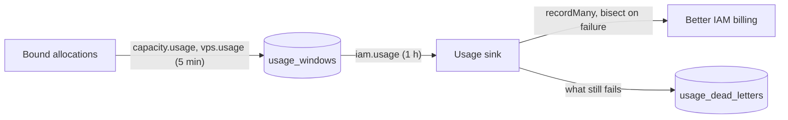
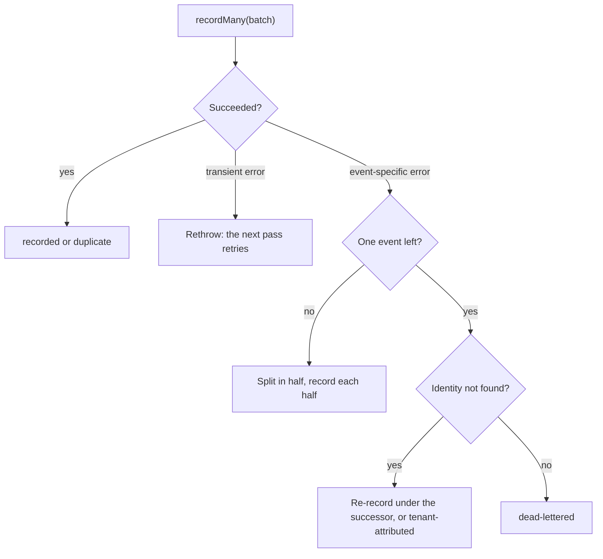

Better IAM is compute's billing ledger. Compute measures what each tenant held and for how long, and records it
on Better IAM meters. Better IAM prices the usage, tracks budgets and produces invoices. Compute never prices
anything itself.

The basis is **reserved time**: a reservation is billed from the moment it becomes active (its allocation is
bound on the node) until it is released or ends, whether or not the GPUs were busy. Usage leaves compute as
hourly <Term id="usage-window">usage windows</Term>, each with an idempotency key, so every retry is safe.



## Meters

Pricing in Better IAM is per meter, so compute uses one meter per GPU model family and one per other billable
unit. All are counted in hours:

| Meter | What accrues it |
| --- | --- |
| `gpu.<model>.hours`, lower case, such as `gpu.h100.hours` | GPUs booked by a reservation, and the GPUs of a hosted instance's flavor. Fractional atoms count as fractions of a GPU. |
| `gpu.<model>.spot.hours` | GPUs booked by a spot reservation (v0.5) |
| `node.metal.hours` | A whole-node lease (`binding: 'node'`, v0.5): one per lease hour, on top of its GPUs |
| `vps.vcpu.hours` | A hosted instance's vCPUs |
| `vps.memory.gib.hours` | A hosted instance's memory in GiB |
| `vps.sandbox.warm` | A warm [sandbox](/docs/guides/vps/sandboxes#warm-pools) instance's vCPUs until a sandbox claims it, billed to the tenant with no identity (v0.5) |

A fractional atom bills its share of a GPU: a MIG instance its compute slices over 7 (`3g.40gb` is 3/7), a
time-slice slot one over the number of slots, and an MPS slot its units over 100. See
[Fractional GPUs](/docs/guides/capacity/fractional-gpus). Provider-backed instances have no allocation in compute
and are billed by their provider.

### Create the meters

Meters live in the root tenant, and Better IAM resolves them for every tenant below it. `better-compute iam setup
--meters` creates the missing ones with a root credential and leaves existing ones alone, so you can run it
again after adding a model:

```bash
BETTER_IAM_TOKEN=biam_... better-compute iam setup --audience https://compute.example.com \
  --meters --iam-url https://iam.example.com --root-tenant ten_root --gpu-models H100,A100
```

- `--meters` needs `--iam-url` (or `BETTER_IAM_URL`) and `--root-tenant` (or `BETTER_COMPUTE_ROOT_TENANT`), and
  `BETTER_IAM_TOKEN` must hold a root session token or API key. It calls Better IAM through the optional peer
  `@better-iam/client`.
- Without `--gpu-models` it creates a meter for every known family: `H100`, `H200`, `B200`, `GB200`, `A100`,
  `L40S`, `L4` and `RTX-PRO-6000` (`gpu.rtx-pro-6000.hours`), plus `node.metal.hours`, `vps.vcpu.hours`,
  `vps.memory.gib.hours` and `vps.sandbox.warm` (warm sandbox vCPU hours).
- The result lists `meters.created` and `meters.existing`. No prices are set: pricing is your decision, made
  with Better IAM's `billing.setPrice`.

The same steps are exported for code:

```ts title="meters.ts"
import { computeMeters, setupIamMeters } from 'better-compute/iam';

const { created, existing } = await setupIamMeters(
  iam.api,
  { credential: rootCredential, tenantId: rootTenantId },
  computeMeters(['H100', 'A100']),
);
```

<Callout type="warn" title="Spot meters are not created for you">
  `computeMeters` creates neither `gpu.<model>.spot.hours` nor `gpu.other.hours`, the meter of GPUs in a pool
  without a known model. Better IAM refuses usage on an unknown meter with `NOT_FOUND`, so those windows end up
  dead-lettered. Create these meters yourself before you enable spot reservations.
</Callout>

## Usage windows

The `capacity.usage` job (every 5 minutes; `capacity: { usageEvery }` changes it) and the `vps.usage` job (every
5 minutes) write a window per allocation, meter and clock hour into `usage_windows`:

```sql title="usage_windows"
CREATE TABLE usage_windows (
  idempotency_key text PRIMARY KEY,     -- cmp:<allocationId>:<windowStartMs>
  allocation_id text NOT NULL REFERENCES allocations,
  tenant_id text NOT NULL,
  identity_id text,                     -- NULL once orphaned (tenant-attributed)
  meter text NOT NULL,
  quantity numeric NOT NULL CHECK (quantity >= 0),
  window_start timestamptz NOT NULL,
  window_end timestamptz NOT NULL,
  tags jsonb NOT NULL DEFAULT '{}',     -- region, pool, gpuModel, project, agent
  recorded_at timestamptz,
  outcome text CHECK (outcome IN ('recorded', 'duplicate', 'reattributed', 'dead-lettered')),
  CHECK (window_end > window_start),
  UNIQUE (allocation_id, window_start, meter)
);
```

- Windows are aligned to the clock hour. The quantity is the meter's rate per hour times the fraction of the
  hour used, rounded to six decimals: 4 GPUs held from 10:15 bill 3 GPU hours for the 10:00 window.
- A window is written only when it is final: its hour has closed, or billing ended inside it. It never changes
  afterwards, and `ON CONFLICT DO NOTHING` makes every pass safe to repeat. Each pass looks back 48 hours.
- The idempotency key is `cmp:<allocationId>:<windowStartMs>`. An allocation that bills a second meter in the same
  window (a node lease's GPUs) appends `:<meter>` to the second key.
- Tags carry only bounded values: `region`, `pool`, `gpuModel`, `project` and, for delegated work, `agent`. Never
  a reservation, allocation or node id.

A node lease bills `node.metal.hours` plus only the GPUs that were healthy at the start of each window. The
others are booked only to keep other tenants off the node, and the reservation shows an `UnhealthyAtoms`
condition for them.

### Attribution

Each window names the identity it bills: the reservation's or instance's owner. For work an AI agent does on a
person's behalf, that is the person, and the window carries the tag `agent=<agentId>`. For an agent using its own
key, the owner is the agent itself. In Better IAM's usage reports, agent-key usage therefore appears under
`groupBy: 'agent'`, while delegated usage appears only under `groupBy: 'tag:agent'`, because Better IAM's
`UsageInput` has no `agentId` for delegated work (upstream change U9 would add it).

## The usage sink

The `iam.usage` reconciler of the `iam` module runs every hour, ahead of Better IAM's daily period close. Each
pass takes up to 1000 closed, unrecorded windows, sends them through `IamPort.recordUsage`, and stores each
outcome on its window:

| Outcome | Meaning |
| --- | --- |
| `recorded` | Better IAM recorded the event |
| `duplicate` | The idempotency key was recorded before; nothing changed |
| `reattributed` | The identity no longer exists: the event was recorded under its successor, or for the tenant alone |
| `dead-lettered` | The event still failed on its own; it is stored in `usage_dead_letters` |

Embedded mode sends batches of 200 events per `billing.recordMany` (`usageBatchSize` on `bridge.embedded()`
takes 1 to 1000), which bounds how long one call holds Better IAM's lock. Remote mode sends at most 100 per HTTP
call, as the root service account.

### Poison isolation

Better IAM records a `recordMany` batch in one transaction, so a single bad event would fail its whole batch on
every retry. The sink isolates it:



- Event-specific errors are `NOT_FOUND`, `CONFLICT`, `BILLING_PERIOD_CLOSED`, `INVALID_INPUT`,
  `INVALID_TRANSITION` and `METER_ARCHIVED`. Anything else, such as Better IAM being down or a lock timeout, is
  transient: the whole call rejects, the windows stay unrecorded, and the next pass sends them again with the same
  keys. So is Better IAM's `NOT_FOUND` "Endpoint not found": it means the route is wrong (a misconfigured base path, a
  proxy), every event would fail alike, and dead-lettering them all would lose the usage.
- An identity deleted or moved before the flush (`NOT_FOUND` "Identity not found") is re-recorded under the
  successor named by Better IAM's `identity:offboard` event, which the IAM inbox stores in `iam_successors` and
  follows for up to 8 hops. Without a successor, the event is recorded with no identity and the tag
  `attribution=orphaned`, and the window's `identity_id` is cleared.
- `CONFLICT` means an idempotency key was reused on another meter, which points to a compute bug.
  `BILLING_PERIOD_CLOSED` means the period was invoiced before the window arrived. Both are dead-lettered.

### Dead letters

```sql title="usage_dead_letters"
CREATE TABLE usage_dead_letters (
  idempotency_key text PRIMARY KEY,
  tenant_id text NOT NULL,
  event jsonb NOT NULL,          -- the UsageEvent as last sent
  error_code text NOT NULL,
  error_message text NOT NULL,
  attempts int NOT NULL DEFAULT 1 CHECK (attempts > 0),
  first_failed_at timestamptz NOT NULL DEFAULT compute_now(),
  last_failed_at timestamptz NOT NULL DEFAULT compute_now(),
  resolved_at timestamptz
);
```

Nothing re-sends a dead letter automatically: its window is marked `dead-lettered` and the sink moves on. Fix the
cause (create the missing meter, for example) and record the event yourself with its stored idempotency key. For
a closed period, PLAN.md suggests a root `billing.createInvoiceItem` instead.

## Read usage

`usage.list` returns a tenant's windows as the tenant can read them, with each window's outcome:

```ts title="usage.ts"
const page = await compute.api.usage.list(credential, {
  tenantId,
  projectId, // optional: decides compute:usage:read on the project instead of the tenant
  meter: 'gpu.h100.hours',
  from: Date.parse('2026-09-01T00:00:00Z'), // windows that end after this
  to: Date.parse('2026-10-01T00:00:00Z'), // windows that start before this
  limit: 500, // 100 by default
});
// page.items[0]: { idempotencyKey, allocationId, tenantId, identityId?, meter, quantity,
//                  windowStart, windowEnd, tags, recordedAt?, outcome? }
```

It decides `compute:usage:read` on `compute-tenant/{t}`, or on `compute-project/{id}` when the input names a
project. Prices and invoices come from Better IAM's own billing API.

### Export usage

[`usage.export`](/docs/reference/api/usage#export) (v0.2) returns every window of a range in one response, for a
billing export, with the same decision as `usage.list`:

```ts title="export.ts"
const exported = await compute.api.usage.export(credential, {
  tenantId,
  projectId, // optional, as for usage.list
  meter: 'gpu.h100.hours', // optional
  from: Date.parse('2026-09-01T00:00:00Z'),
  to: Date.parse('2026-10-01T00:00:00Z'), // after from, at most 93 days later
  format: 'csv', // or 'jsonl'
});
// { format, data, count, totals: { 'gpu.h100.hours': 812 }, truncated }
```

- `csv` (the default) is RFC 4180 CSV with a header row: `idempotencyKey`, `allocationId`, `tenantId`,
  `identityId`, `meter`, `quantity`, `windowStart`, `windowEnd`, `tags`, `recordedAt`, `outcome`, times as ISO
  8601 and `tags` as JSON. `jsonl` is one JSON window per line.
- `totals` sums `quantity` per meter over the exported windows.
- At most 50,000 windows, ordered by start: `truncated: true` means more matched, so narrow the range or the
  meter.

## Budgets

PLAN.md stops spending in three layers, and all three work today:

1. **In the decision.** The `StopWhenOverBudget` statement of the [gpu-user policy](/docs/guides/iam/policies)
   denies new reservations, extensions and instances once `principal.spendExceeded` is true, meaning an enforced
   Better IAM budget covering the caller is spent. It costs nothing extra: Better IAM evaluates it inside the one
   decision. It also names `compute:sandboxes:create` and `compute:sandboxes:update`, so new
   [sandboxes](/docs/guides/vps/sandboxes) and sandbox extensions stop too.
2. **Per pool, before admission.** [`reservations.create`](/docs/reference/api/reservations#create),
   [`reservations.extend`](/docs/reference/api/reservations#extend),
   [`instances.create`](/docs/reference/api/instances#create) and
   [`sandboxes.create`](/docs/reference/api/sandboxes#create) (on the template's pool) run capacity's `budgetAdmissionCheck` as their
   [`MethodAdmission.check`](/docs/extending/methods#admission-the-request-as-a-resource), after the IAM decision
   with no transaction open. It calls Better IAM's `billing.check` through
   `IamPort.billingCheck({ tenantId, identityId }, credential)` when the pool's policy sets
   `admission.budgetCheck: 'meter'`, or when the tenant's offer has `onBudgetExceeded: 'stop-new'` or `'drain'`;
   otherwise it costs nothing. A spent budget refuses with
   [`SPEND_LIMIT_REACHED`](/docs/reference/errors#spend_limit_reached) (402), with the budget's `budgetId` and
   `name` in `details`. A refused create keeps its draft, so the same idempotency key is decided again once the
   budget's window resets; a refused extend clears the pending change. In remote mode the check runs as the
   caller, because Better IAM's HTTP `billing.check` reports the credential's own spend in its own tenant.
3. **On a budget alert.** Better IAM's `billing:budget-alert` event reaches the IAM inbox's `budget` reaction.
   `budgetAlertHandler` reads the alert (`budgetAlertOf`: budget, `actual` or `forecast`, threshold, spent,
   amount, window) and acts only on an exceeded budget, an `actual` alert at 100% or more. `serve`'s default
   handler then applies capacity's `applyBudgetPolicy`: every offer to the tenant with an `onBudgetExceeded`
   publishes `quota.budget-exceeded`, and `drain` also cancels the tenant's unstarted reservations in that pool.
   `stop-new` and `drain` also refuse new reservations and instances through the per-pool check above. Offers
   inherited through `includeDescendants` are not covered, because compute does not know the tenant tree: offer
   the budgeted tenant directly.

With `runIamJobs: true`, the `iam` module also runs Better IAM's budget checks every hour and its period close
every day.

<Cards>
  <Card title="Quotas and usage" href="/docs/guides/capacity/quotas-and-usage">
    Compute-side quotas, which cap what a tenant may hold regardless of budget.
  </Card>
  <Card title="Spot and preemption" href="/docs/guides/capacity/spot-and-preemption">
    Spot reservations and how preemption cuts their billing.
  </Card>
  <Card title="IAM integration" href="/docs/guides/iam">
    The `iam` module's jobs and the inbox that carries offboarding and budget events.
  </Card>
</Cards>
