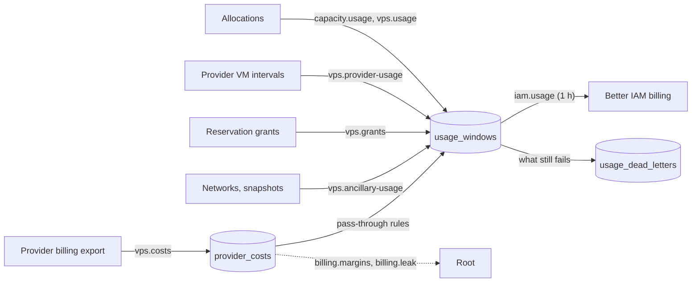
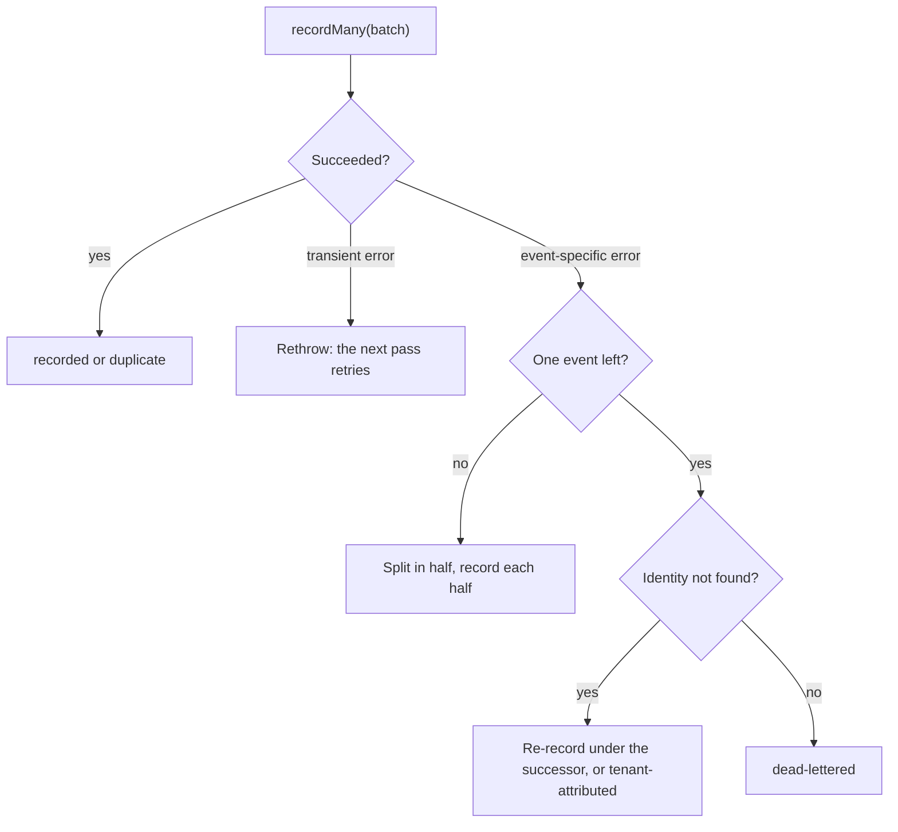

Better IAM is compute's billing ledger. Compute **meters**: it measures what each tenant held and for how long and
records it on Better IAM meters. Better IAM **rates and invoices**: it prices the usage, applies negotiated prices,
terms, credits and budgets, and closes each month into a statement. Compute never prices anything itself; the one
amount it computes is the reported cost of a provider pass-through charge.

The root (platform) tenant owns the meters and the prices, and each organization directly under it is a billing
account. That lets root bill its sub-tenants for the compute it issues to them: hosted and node capacity, cloud VMs
it creates or attaches for them, reservation capacity it commits to them, their networks, disks, public addresses
and snapshots, and provider costs such as egress at cost times a multiplier.

The basis is **reserved time**: a resource bills from the moment it is held until it is released, whether or not it
was busy. Usage leaves compute as hourly <Term id="usage-window">usage windows</Term>, each with an idempotency
key, so every retry is safe.



Every source writes the same windows and one flush, `iam.usage`, records them all, with the same dead letters and
outcomes.

## Set it up

1. **Give the IAM port a root billing credential.** The `billing` methods, the meter sync and the tenant
   estimates call Better IAM's billing API on the root tenant as a root service account. Embedded:
   `bridge.embedded(iam, { rootTenantId, serviceCredential })`, with an account that holds `iam:billing:manage` and
   `iam:billing:read` on the root tenant. Remote: `bridge.remote(...)` with its `serviceToken`. Without one the
   `billing` methods answer `UNSUPPORTED` and name this fix, estimates are absent, and the iam module's doctor warns
   `iam.billing-port`.
2. **Pick the deployment currency.** Better IAM bills in one currency per deployment. Name it once, in
   `vps({ billing: { currency } })` (ISO 4217, default `USD`): price proposals, tenant estimates, provider costs
   and margins all use it.
3. **Create the meters** (`billing.syncMeters`, or `better-compute iam setup --meters`), then **set prices**
   (`billing.setPrices`). See [Meters](#meters) and [Prices](#prices).
4. **Run the workers.** `iam.usage` (the iam module) flushes hourly; the vps module runs `vps.provider-usage`,
   `vps.grants`, `vps.ancillary-usage` (every 5 minutes), `vps.costs` (every 6 hours) and `vps.suspension` (every
   minute).

```ts title="compute.ts"
import { bridge } from 'better-compute/iam';
import { vps } from 'better-compute/vps';
import { gcp } from '@better-compute/provider-gcp';

const iamPort = bridge.embedded(iam, {
  rootTenantId,
  serviceCredential: { token: rootBillingKey }, // iam:billing:manage + iam:billing:read on the root tenant
  runIamJobs: { closeGraceHours: 6 }, // the default; the same value as vps's below
});

vps({
  providers: [gcp],
  billing: { currency: 'USD', gpuModels: ['H100', 'A100', 'L4'], closeGraceHours: 6 },
  costs: { every: '6h', lookbackDays: 3 },
});
```

`iam.jobs.close-period` closes each month only once the next one is `closeGraceHours` old (see
[Period close](#period-close)). Set the IAM jobs' and vps's `closeGraceHours` to the same value.

## Meters

Pricing in Better IAM is per meter and cannot vary by tag, so a distinct price needs a distinct meter. Compute
defines one catalog, `meterCatalog`, on the root tenant. Every meter is a `rate-card` meter counted per hour:

| Meter | What accrues it |
| --- | --- |
| `gpu.<model>.hours`, lower case, such as `gpu.h100.hours` | GPUs booked by a reservation, and the GPUs of a hosted instance's flavor. Fractional atoms count as fractions of a GPU. |
| `gpu.<model>.spot.hours` | GPUs booked by a spot reservation (v0.5) |
| `node.metal.hours` | A whole-node lease (`binding: 'node'`, v0.5): one per lease hour, on top of its GPUs |
| `vps.vcpu.hours`, `vps.memory.gib.hours` | A hosted instance's vCPUs, and its memory in GiB |
| `vps.volume.gib.hours` | A hosted volume's GiB |
| `vps.sandbox.warm` | A warm [sandbox](/docs/guides/vps/sandboxes#warm-pools) instance's vCPUs until a sandbox claims it, billed to the tenant with no identity (v0.5) |
| `vm.vcpu.hours`, `vm.memory.gib.hours`, `vm.gpu.<model>[.spot].hours` | A running provider VM's vCPUs, memory and GPUs |
| `vm.instance.hours` | One per running provider VM, for a per-VM fee |
| `vm.reserved.vcpu.hours`, `vm.reserved.memory.gib.hours`, `vm.reserved.gpu.<model>.hours` | The same, for a VM admitted against a provider reservation outside any grant |
| `vm.grant.slot.hours` | Every slot of a reservation grant, every hour of its term, used or not |
| `vm.grant.usage.hours` | Informational: one per running VM inside a grant (price it at 0) |
| `vm.managed.hours` | One per running VM in a `platform-fee` pool: the platform's management fee |
| `network.vpc.hours` | One per provisioned tenant network |
| `ip.public.hours` | One per running provider VM with a public address |
| `disk.<type>.gib.hours` | A provider VM's disks in GiB, running or stopped: `pd-standard`, `pd-balanced`, `pd-ssd`, `hyperdisk-balanced`, `local-ssd` |
| `snapshot.gib.hours` | A sandbox snapshot's size in GiB |
| `flavor.<name>.hours` | One per running VM of a flavor root gave a whole-shape meter (see [Flavor meters](#flavor-meters)) |

A fractional atom bills its share of a GPU: a MIG instance its compute slices over 7 (`3g.40gb` is 3/7), a
time-slice slot one over the number of slots, and an MPS slot its units over 100. See
[Fractional GPUs](/docs/guides/capacity/fractional-gpus).

**GPU models.** Every known GPU family (`H100`, `H200`, `B200`, `GB200`, `A100`, `L40S`, `L4`, `RTX-PRO-6000`,
`GH200`, `L40`, `A40`, `A30`, `A10`, `RTX-6000-ADA`, `RTX-A6000`, `RTX-5090`, `RTX-5080` and `RTX-4090`) always gets
`gpu.<family>.hours` and `gpu.<family>.spot.hours`, and `gpu.other.hours` covers a pool without a known model. The
provider-VM and reserved GPU meters exist only for the models you name: `vps({ billing: { gpuModels } })` and the
IAM bridge (`createComputeIamBridge({ meterCatalog: { gpuModels } })`) or `iam setup --gpu-models` (default
`H100`, `H200`, `B200`, `A100`, `L4` and `L40S`, plus `other`, always added). Name the same models in both, or
`billing.meters` reports the difference as missing. A provider's GPU string is named by its catalog family
(`nvidia-h100-80gb` is `h100`); a model the list does not name bills `vm.gpu.other.hours`.

**Reported meters** are the exception: a [pass-through](#pass-through) charge carries its own cost, so its meter is a
`reported` meter you create on the root tenant yourself (Better IAM's `billing.createMeter` with `pricing:
'reported'`, or the IAM port's `ensureMeters`). The catalog holds none.

Better IAM allows 100 meters per tenant, so the catalog refuses a longer GPU model list or too many flavor meters.

### Create the meters

Meters live in the root tenant, and Better IAM resolves them for every tenant below it. Root creates the missing
ones through the API:

```ts title="meters.ts"
const { catalog, missing } = await compute.api.billing.meters(rootCredential, {});
const { created, existing } = await compute.api.billing.syncMeters(rootCredential, {});
```

[`billing.meters`](/docs/reference/api/billing#meters) lists the catalog and the keys the root tenant lacks;
[`billing.syncMeters`](/docs/reference/api/billing#syncmeters) creates them and never changes a meter that exists.
Both are decided as `compute:billing:*` on `compute-fleet`, which resolves only in the root tenant, so a tenant
administrator is refused however broad its own grants.

The CLI does the same with a root credential, so you can run it again after adding a model:

```bash
BETTER_IAM_TOKEN=biam_... better-compute iam setup --audience https://compute.example.com \
  --meters --iam-url https://iam.example.com --root-tenant ten_root --gpu-models H100,A100
```

- `--meters` needs `--iam-url` (or `BETTER_IAM_URL`) and `--root-tenant` (or `BETTER_COMPUTE_ROOT_TENANT`), and
  `BETTER_IAM_TOKEN` must hold a root session token or API key. It calls Better IAM through the optional peer
  `@better-iam/client`. The result lists `meters.created` and `meters.existing`.
- If compute's IAM port holds a root billing credential, the iam module also defines the catalog when it starts
  (best effort: a refusal is logged as a warning).

The same steps are exported for code:

```ts title="setup.ts"
import { meterCatalog, setupIamMeters } from 'better-compute/iam';

const { created, existing } = await setupIamMeters(
  iam.api,
  { credential: rootCredential, tenantId: rootTenantId },
  meterCatalog({ gpuModels: ['H100', 'A100'] }),
);
```

<Callout type="info" title="meterCatalog, not computeMeters">
  `meterCatalog` is the full list and what `billing.syncMeters`, `iam setup --meters` and the iam module create.
  `computeMeters` is the older, smaller list (one `gpu.<model>.hours` per model, `node.metal.hours`,
  `vps.vcpu.hours`, `vps.memory.gib.hours` and `vps.sandbox.warm`); it stays exported, and creates no spot, `other`,
  volume or `vm.*` meter. Better IAM refuses usage on an unknown meter with `NOT_FOUND`, so windows for a meter you
  never created are dead-lettered (`meter-missing`). Meters that already exist are never changed: they keep their
  unit and the prices you set, and only missing ones are created.
</Callout>

## Prices

Prices are Better IAM `PriceSpec`s (`per-unit`, `graduated`, `volume` or `package`) in micros of the deployment
currency, stored on the root tenant's rate card. Root manages them through compute:

```ts title="prices.ts"
const { applied, failed } = await compute.api.billing.setPrices(rootCredential, {
  prices: [
    // the list price
    {
      meter: 'vm.gpu.h100.hours',
      effectiveFrom: '2026-11',
      spec: { model: 'per-unit', unitAmountMicros: 2_900_000 },
    },
    // a negotiated price for one customer (and its subtree)
    {
      meter: 'vm.gpu.h100.hours',
      targetTenantId: 'ten_acme',
      effectiveFrom: '2026-11',
      spec: { model: 'per-unit', unitAmountMicros: 2_500_000 },
    },
    {
      meter: 'vm.grant.usage.hours',
      effectiveFrom: '2026-11',
      spec: { model: 'per-unit', unitAmountMicros: 0 },
    },
  ],
});
```

- [`billing.setPrices`](/docs/reference/api/billing#setprices) takes up to 100 prices. Each meter must be in the
  catalog or be a flavor meter, else the whole request is `INVALID_INPUT`. A price Better IAM refuses lands in
  `failed` and does not stop the others.
- [`billing.prices`](/docs/reference/api/billing#prices) reads the rate card, newest first; the list price is the
  entry whose `targetTenantId` is the root tenant.
- Price by resource (the `vm.vcpu`, `vm.memory` and `vm.gpu` meters plus `vm.instance.hours`) or by whole machine
  shape ([flavor meters](#flavor-meters)), per region if you need to.
- Discounts, minimum commitments, tax, credits and invoice items stay in Better IAM (`billing.setTerms`,
  credits, `billing.createInvoiceItem`, credit notes). They are root-only there and need a root administrator's
  user session with MFA, so compute never calls them.

### Price proposals

[`billing.proposePrices`](/docs/reference/api/billing#proposeprices) reads a platform provider account's list
prices (for Compute Engine, the Cloud Billing Catalog), adds `marginPct` and returns `per-unit` specs root can
publish. It sets nothing: root reviews the proposals and passes the ones it wants to `setPrices`.

```ts title="propose.ts"
const { proposals, unpriced, currency } = await compute.api.billing.proposePrices(rootCredential, {
  accountId,
  marginPct: 25,
  region: 'us-central1',
  effectiveFrom: '2026-11',
});
await compute.api.billing.setPrices(rootCredential, {
  prices: proposals.map(({ meter, spec }) => ({ meter, effectiveFrom: '2026-11', spec })),
});
```

`vm.vcpu.hours` and `vm.memory.gib.hours` take the region's cheapest general-purpose machine family; GPU, disk and
address meters take their SKU; flavor meters are composed from their family's SKUs. Instance, reserved, grant,
managed, network and snapshot meters are always `unpriced`: they have no provider list price. Egress is not
proposed at all: it is billed at its real cost by [pass-through](#pass-through).

## Provider VMs

A cloud VM in a provider pool, created or attached, is metered from **lifecycle intervals**: `running` and
`stopped` spans of the instance, written in the same transaction as the state change that compute observed (the
reconciler's poll, at most a minute behind while steady, or the API action that made it). The database refuses two
open intervals for one instance. Every 5 minutes, `vps.provider-usage` turns the ended hours of every interval into
`instance` windows, once each hour is `vps({ billing: { meterGraceMs } })` old (default 5 minutes), so a change
stamped inside the hour has committed.

- **Edges.** Billing starts at the first observed `running` and ends at the observed stop, delete or detach. A
  requested stop keeps billing until the provider reports the VM stopped. A VM that is `lost` stops billing and
  starts a new interval when it is seen again; the lost time is not billed. An `error` closes the interval.
- **Shape.** An interval captures what the VM is billed on when it opens: the flavor or attached shape, its GPUs by
  catalog model, whether it is reserved or granted, its flavor meter, its public address and its disks. A resize,
  a grant change, or a public address appearing or disappearing closes the interval and opens a new one.
- **Attribution.** Windows go to the instance's tenant and owner (`identityId`), whoever issued the VM, with tags
  `region`, `pool`, `project`, `provider`, `gpuModel`, `flavor` and `source: instance`. Instance ids are never tags:
  they stay in the window's key (`cmp:instance:<id>:<windowStartMs>:<meter>`) and in `usage.platform`.

### Billing modes

A provider pool's `policy.billing.mode` decides what its VMs record:

| Mode | A running VM records | A stopped VM records |
| --- | --- | --- |
| `metered` | Its compute lines, plus `ip.public.hours` and `disk.<type>.gib.hours` | Its disk lines |
| `platform-fee` | `vm.managed.hours` only | Nothing |
| `none` | Nothing | Nothing |

The default is `metered` for root-owned pools and every hosted pool, and `platform-fee` for a provider pool on a
tenant's own cloud account. Only the platform sets `policy.billing` on
[`pools.create`](/docs/reference/api/pools#create) and `pools.update`: the explicit mode outranks the default, so
any other caller gets `ACCESS_DENIED`. The mode is read when an interval opens.

The compute lines of a `metered` VM, per hour:

- **Composed:** `vm.vcpu.hours` × vCPUs, `vm.memory.gib.hours` × GiB, `vm.gpu.<model>.hours` × GPUs (`.spot` for a
  Spot VM), and `vm.instance.hours` × 1.
- **Reserved:** a VM admitted against a provider reservation outside any grant uses `vm.reserved.*` instead (never
  `.spot`); `vm.instance.hours` stays as it is.
- **Granted:** a VM inside a [reservation grant](#reservation-grants) records only `vm.grant.usage.hours` × 1. The
  grant's slot-hours pay for it, so it records no compute meter.
- **Flavor meter:** `flavor.<name>.hours` × 1 replaces the composed lines.

The address and disk lines apply in `metered` mode only, and to granted and flavor-meter VMs too: a grant covers the
VM, not its disks or address.

### Attached VMs and BYO accounts

- **Attach.** An attached VM bills its tenant from its first observed `running` after it was attached, never
  before. [`instances.attach`](/docs/reference/api/instances#attach) takes `billing: 'metered' | 'none'`, default
  the pool's mode. `none` opens no interval, so nothing of the VM is metered, running or stopped; only the platform
  may pass it (`ACCESS_DENIED` otherwise). An attach to tenant A, a detach and an attach to tenant B give two
  intervals with the right tenants.
- **BYO.** A tenant that runs VMs on its own cloud account already pays its provider for them, so its pools default
  to `platform-fee`: at most `vm.managed.hours`, never a `vm.*` compute, address or disk meter, and its networks
  bill nothing. Its provider costs are its own: they are attributed to it but never passed through and never count
  toward the platform's margins.

### Flavor meters

Root can price a machine shape as one line: `billing.meter` on a flavor (`flavors.create` or `flavors.update`,
root only), such as `flavor.a3-highgpu-8g.us-central1.hours`. It matches `^flavor.[a-z0-9.-]{1,56}.hours$`, is
created on the root tenant when the IAM port can define meters, and is included in `billing.meters` and
`billing.syncMeters`. An instance copies the meter when it is created, so a later change to the flavor never changes
how an existing instance bills. Because Better IAM prices cannot vary by tag, flavor meters are also how you charge
a different price per region.

## Reservation grants

A [reservation grant](/docs/reference/api/reservation-grants) commits slots of a provider capacity reservation (a
GCE reservation on a root account, bound to a root pool) to one tenant for a term. Root creates and ends grants;
the grantee pays for the committed slots whether it uses them or not, and gets priority on them.

```ts title="grant.ts"
const grant = await compute.api.reservationGrants.create(rootCredential, {
  tenantId: rootTenantId,
  accountId,
  reservationId: 'us-central1-a/h100-pool',
  grantTenantId: 'ten_acme',
  slots: 2,
  startsAt: Date.parse('2026-11-01T00:00:00Z'),
  endsAt: Date.parse('2026-12-01T00:00:00Z'),
  idempotencyKey: 'acme-nov-h100',
});
```

- **Slot-hours.** `vps.grants` bills the grantee `vm.grant.slot.hours` × `slots` for every hour of the term that
  has ended (an hour the term only partly covers bills that fraction), tagged with the reservation's region, the
  pool, the provider and `source: grant`. Billing stops at `endsAt`.
- **No double billing.** The grantee's VMs inside the grant record only `vm.grant.usage.hours`. Beyond the grant, a
  VM takes an ordinary free slot of the reservation and bills `vm.reserved.*`.
- **Admission.** The grantee's creates fill its grant first. Nobody else can take a granted slot, even an idle one
  or one a stopped grant VM holds: others share `total − in use − unused granted slots`. Grants over one term never
  exceed the reservation's `total`; the database decides concurrent grants under the reservation's row lock
  (`CAPACITY_UNAVAILABLE` with `{ total, granted }`).
- **Adoption and renewals.** A grant that starts while its tenant already runs VMs on the reservation outside any
  grant takes them in, oldest first, up to its slots, and their intervals reopen as granted. When a grant ends,
  another live grant of the tenant on the same reservation (a renewal) takes its VMs; otherwise they bill
  `vm.reserved.*` from then on. VMs attached with `billing: 'none'` are never taken in.
- **Ending.** `reservationGrants.end` sets `endsAt` to now: the hours already in the term stay billed. A grant that
  has not started is `cancelled`. Deleting a tenant ends its active grants and cancels its scheduled ones.
- **Accounts.** `providerAccounts.unbindReservation` and `providerAccounts.delete` refuse with `INVALID_STATE`
  (`details.grantIds`) while a grant on the account is scheduled or active, and `delete` also until `vps.grants`
  has metered every committed slot-hour of the ended ones.
- **Reads.** `reservationGrants.get` and `list` are tenant reads (`compute:quotas:read` on the tenant): a tenant
  sees its own grants, and root lists every tenant's with `all: true`.

Grants are root contracts and are not budget-checked. Each change publishes `reservation-grant.created`, `active`,
`ended` or `cancelled` in the grantee's tenant.

## Networks, disks and snapshots

The `vps.ancillary-usage` reconciler (every 5 minutes) meters what a tenant holds beside its VMs; addresses and
disks are lines of the VM's own intervals.

- **Networks.** `network.vpc.hours` × 1 per tenant network from its first `ready` (`provisioned_at`) until it is
  deleted, billed to the network's tenant. A network being deleted or in `error` still exists at the provider and
  still bills; one never provisioned bills nothing. Firewall rules and subnets are free. Networks in a `none` or
  `platform-fee` pool bill nothing.
- **Public addresses.** `ip.public.hours` × 1 while a `metered` VM runs with a public address.
- **Disks.** `disk.<type>.gib.hours` × GiB per disk of a `metered` VM, while it runs and while it is stopped (the
  provider bills stopped disks too). The disks come from the provider's machine record (Compute Engine reports each
  disk and its type); otherwise one boot disk of the flavor's `diskGiB`, of `hyperdisk-balanced` for the machine
  families that take only Hyperdisk, else `pd-balanced`. A type with no meter of its own is billed as
  `pd-balanced` and the instance shows a `DiskTypeUnknown` condition.
- **Snapshots.** `snapshot.gib.hours` × `sizeBytes / 2^30` per sandbox snapshot from `ready` until it is deleted,
  billed to the snapshot's tenant, unless its pool's mode is `none` or `platform-fee`.

## Provider costs

The `vps.costs` worker reads what the providers billed the platform, for pass-through charges, margins and leak
detection. It runs for every account whose provider can read costs (`ProviderImpl.costs`): for Compute Engine,
an account with `billingExport` set (see [Google Compute Engine](/docs/guides/vps/providers#google-compute-engine)).

- **Reads.** Every `vps({ costs: { every } })` (default `6h`), each account's last `lookbackDays` (default 3, at
  most 31) are read outside any transaction and stored in `provider_costs` in batches of 500, keyed by the
  provider's stable row id. A run stays within `passBudgetMs` (default 50 s) and continues in a follow-up run. A
  rate limit or an outage backs the account off (5 minutes without a retry hint).
- **Attribution,** in order: the row's `better-compute-instance` label (the instance's tenant), its
  `better-compute-tenant` label, then, on a tenant's own (BYO) account, that tenant. Anything else is
  `unattributed` and publishes `billing.unattributed`. A label on a tenant's own account can never move its cost to
  another tenant.
- **Late and corrected rows.** Re-exported rows are idempotent. A corrected row replaces the stored one and
  publishes `billing.cost-corrected` (`passedThrough` says whether it was already billed); a passed-through row is
  never billed again, so root issues a credit note in Better IAM where the correction warrants one.
- **Currency.** A row in another currency than `billing.currency` is stored as received, flagged
  `CurrencyMismatch`, and left out of pass-through and margins.
- **Events.** `billing.cost-ingested` once per pass per account, with totals.

### Pass-through

Costs compute cannot meter itself, such as egress and provider snapshots, are billed at cost times a multiplier
through `billing.passThrough` rules on a **platform** provider account
([`providerAccounts.create`](/docs/reference/api/provider-accounts#create) and `update`):

```ts title="pass-through.ts"
await compute.api.providerAccounts.update(rootCredential, {
  tenantId: rootTenantId,
  accountId,
  config,
  billing: {
    passThrough: [
      { skuPattern: 'egress', meter: 'network.egress.gib', multiplier: 1.2 },
      { skuPattern: 'Storage PD Snapshot', meter: 'storage.snapshot.gib', multiplier: 1.1 },
    ],
  },
});
```

- **Rules.** At most 50 rules of `{ skuPattern, meter, multiplier }`. `skuPattern` is a case-insensitive substring
  of the SKU id or description, and the first matching rule wins. `meter` must be a `reported` meter on the root
  tenant (`INVALID_INPUT` otherwise). `multiplier` is 1 to 10. Rules are allowed on root accounts only.
- **What passes.** A regular-usage row attributed to a tenant other than the platform, in the deployment currency,
  with a positive net cost (cost plus credits), becomes one usage event on the rule's meter: `quantity` the row's
  usage, `cost` = net cost × `multiplier`, tags `region`, `provider`, `pool` and `source: cost`, key
  `costx:<accountId>:<rowId>`. It is written as a `cost` usage window and recorded by the normal flush, once.
- **Never billed twice.** A pattern that matches a SKU family compute meters itself is `INVALID_CONFIG`
  (`details.reason: 'meteredSku'`), and a row of such a SKU never passes, whatever the rules. For Compute Engine
  that is core, RAM, GPU and instance SKUs, persistent disk and Hyperdisk capacity, local SSD and external IP
  charges. A row of an instance billed `none`, or in a `none` or `platform-fee` pool, never passes either.

### Margins and leak detection

[`billing.margins`](/docs/reference/api/billing#margins) (root only) returns revenue minus provider cost over a range
of at most 400 days, grouped by `tenant`, `pool`, `account` or `meter`:

```ts title="margins.ts"
const margins = await compute.api.billing.margins(rootCredential, {
  from: Date.parse('2026-10-01T00:00:00Z'),
  to: Date.parse('2026-11-01T00:00:00Z'),
  groupBy: 'tenant',
});
// { rows, unattributedCostMicros, currency, from, to }
// rows: [{ key: 'ten_acme', revenueMicros, costMicros, marginMicros, marginPct }]
```

- **Revenue** is what Better IAM billed (`IamPort.spend`, by whole billing periods); without it, revenue and
  margins are `null`. **Cost** is cost plus credits of the platform's own accounts only: a tenant's own account is
  its cost, not the platform's.
- Revenue is rated usage **before contract terms**: list or negotiated prices, before the `setTerms` discount
  Better IAM applies when it closes the period. A discounted tenant's margin is overstated by its discount.
- The root tenant's own usage is never revenue (Better IAM never invoices the platform). By tenant, root's row keeps
  its cost with `revenueMicros: 0`. By pool or meter, spend cannot be scoped to root alone, so those groups include
  root's internal usage at its rated price.
- Provider compute cost has no meter dimension, so with `groupBy: 'meter'` it shows under `(none)`. Read the meter
  view for pass-through margins and the tenant or pool view for compute.

At the end of every `vps.costs` pass over a platform account, each instance's provider-billed compute is compared
with its metered running time per UTC day. The provider hours are the **distinct hour slots** the provider billed
compute for the instance, not the summed quantities (a provider bills cores and memory as separate rows). When they
exceed the metered hours by more than `vps({ costs: { leakToleranceHours } })` (default 1), `billing.leak` is
published, at most once per instance and day, so a metering bug surfaces before an invoice goes out. Instances
billed `none` and tenants' own accounts are not checked.

## Estimates

Tenants see an hourly price before they create something. On a provider pool, each
[`flavors.list`](/docs/reference/api/flavors#list) item carries `estimate`, and
[`instances.estimate`](/docs/reference/api/instances#estimate) answers the same for one flavor before a create:

```ts title="estimate.ts"
const { estimate } = await compute.api.instances.estimate(credential, {
  tenantId,
  poolId,
  flavor: 'a3-highgpu-8g',
});
// { perHourMicros: 98_320_000, currency: 'USD',
//   lines: [{ meter: 'vm.vcpu.hours', quantity: 208, amountMicros }, …] }
```

- The lines are the meters an instance of the flavor would record per hour in that pool's mode, each priced by
  Better IAM (`IamPort.quote`) with the tenant's effective price, so a negotiated price shows. A line with no price
  has `amountMicros: null`, and then `perHourMicros` is `null` rather than a partial sum.
- `instances.estimate` is a read of the pool's flavors (`compute:flavors:read` on the pool): no draft, no quota, no
  provider call and no audit row.
- The estimate is for an on-demand VM: Spot, grants and the VM's disks and addresses are not in it. Estimates are
  cached five minutes per tenant and pool, and are absent when the IAM port cannot quote.

## Usage windows

The `capacity.usage` job (every 5 minutes; `capacity: { usageEvery }` changes it) and the `vps.usage` job meter
allocations, and the vps reconcilers above meter their sources, into `usage_windows`, partitioned by month:

```sql title="usage_windows"
CREATE TABLE usage_windows (
  idempotency_key text NOT NULL,        -- see the key forms below
  allocation_id text REFERENCES allocations,  -- allocation windows only
  source_kind text NOT NULL DEFAULT 'allocation',  -- allocation, instance, grant, network, snapshot, cost
  source_id text,                       -- the instance, grant, network, snapshot or cost row
  tenant_id text NOT NULL,
  identity_id text,                     -- NULL once orphaned (tenant-attributed), and for tenant-billed sources
  meter text NOT NULL,
  quantity numeric NOT NULL CHECK (quantity >= 0),
  cost_micros bigint,                   -- pass-through: the reported cost
  window_start timestamptz NOT NULL,
  window_end timestamptz NOT NULL,
  tags jsonb NOT NULL DEFAULT '{}',     -- region, pool, project, provider, gpuModel, flavor, source, agent
  recorded_at timestamptz,
  outcome text CHECK (outcome IN ('recorded', 'duplicate', 'reattributed', 'dead-lettered')),
  claimed_at timestamptz,               -- a flush is sending it
  voided_at timestamptz, void_reason text,
  CHECK (window_end > window_start),
  PRIMARY KEY (idempotency_key, window_start)
) PARTITION BY RANGE (window_start);
```

- Windows are aligned to the clock hour. The quantity is the meter's rate per hour times the fraction of the
  hour used, rounded to six decimals: 4 GPUs held from 10:15 bill 3 GPU hours for the 10:00 window. A span from
  23:30 on the last day of a month to 00:30 gives two windows, one in each month.
- A window is written only when it is final: its hour has closed, or billing ended inside it. It never changes
  afterwards, and every pass is safe to repeat. Each source keeps a watermark and never derives an hour twice.
- **Keys.** An allocation window is `cmp:<allocationId>:<windowStartMs>` (an allocation that bills a second meter
  in the same window, a node lease's GPUs, appends `:<meter>`), unchanged from earlier versions. Every other source
  is `cmp:<kind>:<sourceId>:<windowStartMs>:<meter>`, and a pass-through window `costx:<accountId>:<rowId>`.
- Tags carry only bounded values: `region`, `pool`, `project`, `provider`, `gpuModel`, `flavor`, `source` and, for
  delegated work, `agent`. Never a reservation, allocation, node, instance, network or grant id.

A node lease bills `node.metal.hours` plus only the GPUs that were healthy at the start of each window. The
others are booked only to keep other tenants off the node, and the reservation shows an `UnhealthyAtoms`
condition for them.

### Attribution

Each allocation and instance window names the identity it bills: the reservation's or instance's owner. Grants,
networks, snapshots and pass-through costs bill the tenant with no identity. For work an AI agent does on a
person's behalf, the identity is the person, and the window carries the tag `agent=<agentId>`. For an agent using
its own key, the owner is the agent itself. In Better IAM's usage reports, agent-key usage therefore appears under
`groupBy: 'agent'`, while delegated usage appears only under `groupBy: 'tag:agent'`, because Better IAM's
`UsageInput` has no `agentId` for delegated work (upstream change U9 would add it).

## The usage sink

The `iam.usage` reconciler of the `iam` module runs every hour. Each pass claims up to 1000 ended, unrecorded,
unvoided windows of every source (it sets `claimed_at` in a short statement of its own), sends them through
`IamPort.recordUsage` (a pass-through window with its `cost`), and stores each outcome on its window:

| Outcome | Meaning |
| --- | --- |
| `recorded` | Better IAM recorded the event |
| `duplicate` | The idempotency key was recorded before; nothing changed |
| `reattributed` | The identity no longer exists: the event was recorded under its successor, or for the tenant alone |
| `dead-lettered` | The event still failed on its own; it is stored in `usage_dead_letters` |

A claim lasts 10 minutes: a pass that died leaves claims the next pass takes over, and a resend is a `duplicate`
because Better IAM knows the keys. Embedded mode sends batches of 200 events per `billing.recordMany`
(`usageBatchSize` on `bridge.embedded()` takes 1 to 1000), which bounds how long one call holds Better IAM's lock.
Remote mode sends at most 100 per HTTP call, as the root service account.

### Poison isolation

Better IAM records a `recordMany` batch in one transaction, so a single bad event would fail its whole batch on
every retry. The sink isolates it:



- Event-specific errors are `NOT_FOUND`, `CONFLICT`, `BILLING_PERIOD_CLOSED`, `INVALID_INPUT`,
  `INVALID_TRANSITION` and `METER_ARCHIVED`. Anything else, such as Better IAM being down or a lock timeout, is
  transient: the whole call rejects, the windows stay unrecorded, and the next pass sends them again with the same
  keys. So is Better IAM's `NOT_FOUND` "Endpoint not found": it means the route is wrong (a misconfigured base path, a
  proxy), every event would fail alike, and dead-lettering them all would lose the usage.
- An identity deleted or moved before the flush (`NOT_FOUND` "Identity not found") is re-recorded under the
  successor named by Better IAM's `identity:offboard` event, which the IAM inbox stores in `iam_successors` and
  follows for up to 8 hops. Without a successor, the event is recorded with no identity and the tag
  `attribution=orphaned`, and the window's `identity_id` is cleared.
- `CONFLICT` means an idempotency key was reused on another meter, which points to a compute bug.
  `BILLING_PERIOD_CLOSED` means the period was closed before the window arrived. Both are dead-lettered.

## Corrections

Nothing re-sends a dead letter automatically: its window is marked `dead-lettered` and the sink moves on. A closed
period (`BILLING_PERIOD_CLOSED`) is dead-lettered once and never retried by a later pass.

```sql title="usage_dead_letters"
CREATE TABLE usage_dead_letters (
  idempotency_key text PRIMARY KEY,
  tenant_id text NOT NULL,
  event jsonb NOT NULL,          -- the UsageEvent as last sent
  error_code text NOT NULL,
  error_message text NOT NULL,
  attempts int NOT NULL DEFAULT 1 CHECK (attempts > 0),
  first_failed_at timestamptz NOT NULL DEFAULT compute_now(),
  last_failed_at timestamptz NOT NULL DEFAULT compute_now(),
  resolved_at timestamptz
);
```

Root works the letters, and corrects usage before it is invoiced, through the `usage` methods. All are decided on
`compute-fleet/global`, so a tenant administrator is refused:

- [`usage.deadLetters({ reason?, cursor?, limit? })`](/docs/reference/api/usage#deadletters)
  (`compute:usage:read`) lists the open dead letters, each with `idempotencyKey`, `tenantId`, `meter`,
  `quantity`, `windowStart`, `reason` and `error`. The `reason` comes from Better IAM's error:
  `meter-missing` (`NOT_FOUND` naming a meter), `period-closed` (`BILLING_PERIOD_CLOSED`), `identity`
  (`NOT_FOUND` for an identity or tenant), `invalid` (`INVALID_INPUT`, `INVALID_TRANSITION`) or `other`.
- [`usage.retry({ idempotencyKeys | reason })`](/docs/reference/api/usage#retry) (`compute:usage:manage`) clears
  the outcome of those windows, so the next flush sends them again. A pass that records one resolves its letter; a
  pass that fails again counts another attempt. Fix the cause first (`billing.syncMeters` for `meter-missing`).
  `period-closed` letters are refused with `INVALID_STATE`, because retrying would only fail again: the usage needs
  a root invoice item in Better IAM (`billing.createInvoiceItem`). A key whose window retention already pruned is
  `NOT_FOUND`: record that usage in Better IAM by hand.
- [`usage.void({ idempotencyKeys, reason })`](/docs/reference/api/usage#void) (`compute:usage:manage`) sets
  `voided_at` and `void_reason` on windows no pass has sent (outcome `NULL`), so no pass ever sends them, and on
  dead-lettered windows (Better IAM refused them, so nothing was billed). Voiding any window resolves its open dead
  letters. The call is all or nothing.
  - A window Better IAM recorded (`recorded`, `duplicate`, `reattributed`) gives `INVALID_STATE` ("issue a credit
    note in Better IAM"): recorded usage is corrected in Better IAM by credit note, never by rewriting compute's
    history.
  - A window a pass has claimed within the last 10 minutes is being sent: `INVALID_STATE` ("being sent; retry
    shortly").
  - A voided window leaves the backlog counters and the tenants' `usage.list` and `usage.export`, and retention
    prunes it like a recorded one. Tenants see `voided: true` and the time with `includeVoided`, never root's
    reason.

## Period close

Better IAM closes calendar months. Compute makes sure the last hour of a month lands in it:

- Every metering reconciler writes only windows whose hour has ended, `iam.usage` flushes every hour, and provider
  usage waits `meterGraceMs` (5 minutes) after each hour. A window that straddles midnight on the last day is split
  at the hour, so it is in the right month.
- **Close at least 6 hours after the month ends.** Better IAM's `billing.closePeriod()` closes the previous month
  whenever it runs, and a window that arrives after it is refused (`BILLING_PERIOD_CLOSED`). With `runIamJobs`, the
  iam module runs `iam.jobs.close-period` every hour, and it calls `closePeriod()` only once the current UTC month
  is at least `runIamJobs: { closeGraceHours }` old (default 6, from 0 to 72). Closing a closed month again is
  harmless. A host that closes months itself leaves the job out of `runIamJobs.only` and waits as long.
- Before closing, check the iam module's doctor: `iam.usage-backlog` is an error while windows of a past month are
  still unrecorded. After closing, `usage.deadLetters({ reason: 'period-closed' })` lists what missed the month, for
  a root invoice item in the next one.

## Read usage

`usage.list` returns a tenant's windows as the tenant can read them, with each window's outcome. Windows of every
source appear, including the instance, grant, network, snapshot and pass-through windows of its cloud VMs:

```ts title="usage.ts"
const page = await compute.api.usage.list(credential, {
  tenantId,
  projectId, // optional: decides compute:usage:read on the project instead of the tenant
  meter: 'vm.gpu.h100.hours',
  from: Date.parse('2026-09-01T00:00:00Z'), // windows that end after this
  to: Date.parse('2026-10-01T00:00:00Z'), // windows that start before this
  limit: 500, // 100 by default
});
// page.items[0]: { idempotencyKey, allocationId?, tenantId, identityId?, meter, quantity,
//                  windowStart, windowEnd, tags, recordedAt?, outcome? }
```

It decides `compute:usage:read` on `compute-tenant/{t}`, or on `compute-project/{id}` when the input names a
project. Prices and invoices come from Better IAM's own billing API.

### Platform view

`usage.platform` is root's cross-tenant view: the windows of every tenant totalled by any of `tenant`, `pool`,
`meter`, `source` and `provider`, with the windows per outcome. It decides `compute:usage:read` on
`compute-fleet/global`. See [`usage.platform`](/docs/reference/api/usage#platform).

```ts title="platform.ts"
const view = await compute.api.usage.platform(rootCredential, {
  from: Date.parse('2026-09-01T00:00:00Z'),
  to: Date.parse('2026-10-01T00:00:00Z'), // at most 93 days after from
  groupBy: ['tenant', 'meter'],
});
// { format: 'json', rows: [{ keys: { tenant, meter }, quantity, windows, outcomes: { recorded: 3, pending: 1 } }],
//   count, voided, truncated }
```

### Export usage

[`usage.export`](/docs/reference/api/usage#export) (v0.2) returns every window of a range in one response, for a
billing export, with the same decision as `usage.list`:

```ts title="export.ts"
const exported = await compute.api.usage.export(credential, {
  tenantId,
  projectId, // optional, as for usage.list
  meter: 'gpu.h100.hours', // optional
  from: Date.parse('2026-09-01T00:00:00Z'),
  to: Date.parse('2026-10-01T00:00:00Z'), // after from, at most 93 days later
  format: 'csv', // or 'jsonl'
});
// { format, data, count, totals: { 'gpu.h100.hours': 812 }, voided, truncated }
```

- `csv` (the default) is RFC 4180 CSV with a header row: `idempotencyKey`, `allocationId`, `tenantId`,
  `identityId`, `meter`, `quantity`, `windowStart`, `windowEnd`, `tags`, `recordedAt`, `outcome`, times as ISO
  8601 and `tags` as JSON. `jsonl` is one JSON window per line. A cell a spreadsheet would read as a formula
  (starting with `=`, `+`, `-`, `@`, a tab or a carriage return) is prefixed with `'`, here and in
  `usage.platform`'s CSV.
- `totals` sums `quantity` per meter over the exported windows; voided windows are counted apart in `voided`.
- At most 50,000 windows, ordered by start: `truncated: true` means more matched, so narrow the range or the
  meter.

## Budgets

PLAN.md stops spending in three layers, and all three work today:

1. **In the decision.** The `StopWhenOverBudget` statement of the [gpu-user policy](/docs/guides/iam/policies)
   denies new reservations, extensions and instances once `principal.spendExceeded` is true, meaning an enforced
   Better IAM budget covering the caller is spent. It costs nothing extra: Better IAM evaluates it inside the one
   decision. It also names `compute:sandboxes:create` and `compute:sandboxes:update`, so new
   [sandboxes](/docs/guides/vps/sandboxes) and sandbox extensions stop too.
2. **Per pool, before admission.** Every path that creates something billable runs capacity's
   `budgetAdmissionCheck` as its
   [`MethodAdmission.check`](/docs/extending/methods#admission-the-request-as-a-resource), after the IAM decision
   with no transaction open: [`reservations.create`](/docs/reference/api/reservations#create),
   [`reservations.extend`](/docs/reference/api/reservations#extend),
   [`instances.create`](/docs/reference/api/instances#create),
   [`instances.attach`](/docs/reference/api/instances#attach) (a billed attach: not `billing: 'none'`, not a
   `none` pool), [`networks.create`](/docs/reference/api/networks#create) (on a `metered` pool),
   [`sandboxes.create`](/docs/reference/api/sandboxes#create) (on the template's pool) and
   [`sandboxes.extend`](/docs/reference/api/sandboxes#extend) (on the sandbox's pool). It calls Better IAM's
   `billing.check` through `IamPort.billingCheck({ tenantId, identityId }, credential)` when the pool's policy sets
   `admission.budgetCheck: 'meter'`, or when the tenant's offer has `onBudgetExceeded: 'stop-new'`, `'drain'` or
   `'suspend'`; otherwise it costs nothing. A spent budget refuses with
   [`SPEND_LIMIT_REACHED`](/docs/reference/errors#spend_limit_reached) (402), with the budget's `budgetId` and
   `name` in `details`. A root caller issuing into a tenant is checked against that **tenant's** budgets, not
   root's. A refused create keeps its draft, so the same idempotency key is decided again once the budget's window
   resets; a refused extend clears the pending change. In remote mode the check runs as the caller, because Better
   IAM's HTTP `billing.check` reports the credential's own spend in its own tenant. Reservation grants are root
   contracts and are not budget-checked.
3. **On a budget alert.** Better IAM's `billing:budget-alert` event reaches the IAM inbox's `budget` reaction.
   `budgetAlertHandler` reads the alert (`budgetAlertOf`: budget, `actual` or `forecast`, threshold, spent,
   amount, window) and acts only on an exceeded budget, an `actual` alert at 100% or more. `serve`'s default
   handler then applies capacity's `applyBudgetPolicy` to every offer to the tenant with an `onBudgetExceeded`.

Root sets an offer's policy over the API: [`pools.offer`](/docs/reference/api/pools#offer) takes
`onBudgetExceeded` and `allowedRegions`, and [`pools.updateOffer`](/docs/reference/api/pools#updateoffer) changes
them, or suspends and lifts the offer by hand:

| Policy | On a spent budget |
| --- | --- |
| `notify` | Publishes `quota.budget-exceeded` |
| `stop-new` | Also refuses new work on the pool through the per-pool check |
| `drain` | Also cancels the tenant's reservations on the pool that have not started |
| `suspend` | Stops spend: marks the offer suspended, publishes `quota.budget-suspended`, stops the tenant's running instances in the pool and refuses all its new work |

- **Suspend.** While an offer is suspended, every new piece of work on the pool is `SPEND_LIMIT_REACHED`
  (`details.reason: 'offer-suspended'`), billed or not: creating or attaching an instance, creating a network or a
  reservation, and starting an instance. The `vps.suspension` reconciler stops the tenant's running instances in
  the pool (`desiredState: 'stopped'`, condition `BudgetSuspended`) within a minute, retrying a stop that failed,
  with no host wiring; vps's `sandboxIamReactions` budget reaction only makes it immediate. The offer's sandbox warm
  pools are drained and not refilled. A hand suspension (`updateOffer({ suspended: true })`) does the same.
- **Lifting** (`updateOffer({ suspended: false })`) restarts nothing: stopped instances stay stopped until the
  tenant starts them. A new alert that finds the budget still spent suspends the offer again.
- **Regions.** With `allowedRegions`, new work on a pool whose site is in another region is `ACCESS_DENIED`
  (`details.reason: 'region-not-allowed'`).

Offers inherited through `includeDescendants` are not covered, because compute does not know the tenant tree:
offer the budgeted tenant directly. With `runIamJobs: true`, the `iam` module also runs Better IAM's budget checks
every hour.

<Cards>
  <Card title="Providers" href="/docs/guides/vps/providers#billing">
    Billing modes, attach billing, reservation grants and pass-through rules on provider accounts.
  </Card>
  <Card title="Quotas and usage" href="/docs/guides/capacity/quotas-and-usage">
    Compute-side quotas, which cap what a tenant may hold regardless of budget.
  </Card>
  <Card title="Spot and preemption" href="/docs/guides/capacity/spot-and-preemption">
    Spot reservations and how preemption cuts their billing.
  </Card>
  <Card title="IAM integration" href="/docs/guides/iam">
    The `iam` module's jobs and the inbox that carries offboarding and budget events.
  </Card>
</Cards>
