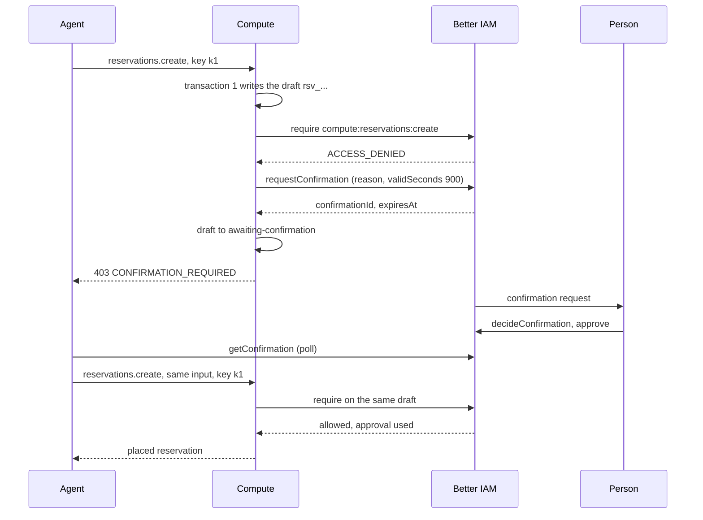
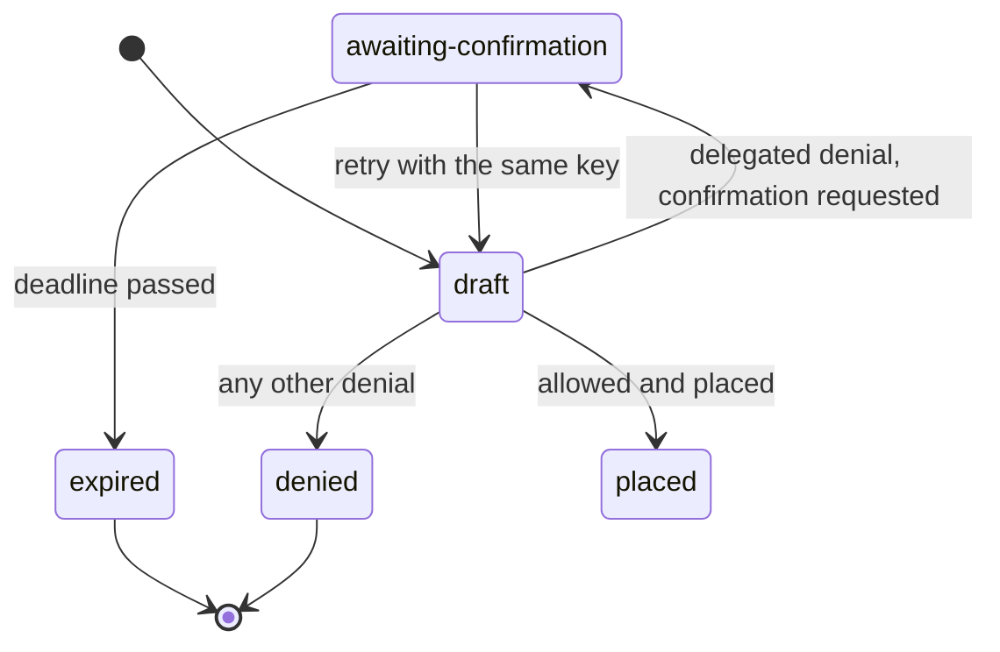

import { Bot, Cpu, FileBraces } from '@/lib/icons';

An AI agent can act for a person through a Better IAM **delegation**: the person grants the agent a set of
scopes, and the agent assumes the delegation to get a session that is decided as the person, narrowed by those
scopes. The person can also hold some actions back for confirmation, such as creating a reservation. With
<Term id="delegated-confirmation">delegated confirmation</Term>, compute turns a denial of such an action into a
request for the person's approval instead of a dead end: the agent receives `CONFIRMATION_REQUIRED`, the person
approves in Better IAM, and the agent retries the same request, which then goes through.

Delegated confirmation is the v0.3 flow of PLAN.md §3.4 step 7. The API envelope implements it for every method
with an admission, and reservations keep the waiting request as a draft in the `awaiting-confirmation` state.

## Set up a delegation

Delegations, agents and confirmations are Better IAM features. The person grants the delegation and names the
actions to hold back in `confirm`:

```ts title="delegate.ts"
// The organization registers the agent and gives it a key.
const agent = await iam.api.agents.create(orgOwner, { tenantId, name: 'Scheduler', model: 'claude-sonnet-5' });
const key = await iam.api.credentials.create(orgOwner, { tenantId, identityId: agent.id });

// The person delegates reservation work, holding back creation for confirmation.
const delegation = await iam.api.delegations.grant(alice, {
  tenantId,
  agentId: agent.id,
  scopes: ['compute:reservations:*'],
  confirm: ['compute:reservations:create'],
});

// The agent assumes the delegation: its session acts as Alice.
const { token } = await iam.api.delegations.assume(
  { token: key.token },
  { tenantId, delegationId: delegation.id },
);
```

Compute sees the result as a caller with `sessionKind: 'delegated'`, the person's `identityId`, and the
`agentId` and `delegationId`. In policies, such a session has `principal.kind` equal to `user` and
`principal.delegated` equal to true, and `principal.mfa` is always false. See
[Policies](/docs/guides/iam/policies) for guardrails that apply to delegated sessions.

## What happens on a denial



When the one decision of an admission is refused and the caller's session is delegated, the envelope asks Better
IAM for a confirmation with the caller's own credential:

1. It sends the decision's action and resource, the reason and `validSeconds: 900`. The reason is
   `<group>.<method>: <action> on <type>/<id>` unless the method describes itself.
2. If a pending request for the same action and resource already exists, compute reuses it instead of asking the
   person twice.
3. Better IAM answers `INVALID_INPUT` when the delegation does not hold the action back. The caller then gets a
   plain `ACCESS_DENIED`.
4. Otherwise the caller gets `CONFIRMATION_REQUIRED` (HTTP 403), and the method's denial hook parks the draft.

Better IAM hides the reason for a denial, so compute cannot tell "held back" from "forbidden by policy" before
asking. A request for a confirm-listed action that a policy forbids therefore also creates a confirmation request,
which the approval cannot rescue. Upstream change U8 would remove these futile requests.

## The error

```json title="403 response"
{
  "error": {
    "code": "CONFIRMATION_REQUIRED",
    "message": "The person this agent acts for must confirm the request; retry with the same idempotencyKey once they have",
    "details": {
      "confirmationId": "9c1f0e6a-...",
      "expiresAt": 1790001800000,
      "action": "compute:reservations:create",
      "resource": { "type": "compute-reservation", "id": "rsv_..." }
    }
  }
}
```

<TypeTable
  type={{
    confirmationId: {
      type: 'string',
      description: "Better IAM's confirmation request. Poll it with delegations.getConfirmation.",
      required: true,
    },
    expiresAt: {
      type: 'number',
      description: 'Epoch milliseconds when the pending request lapses undecided, when Better IAM reports it.',
    },
    action: {
      type: 'string',
      description: 'The action that was held back, such as compute:reservations:create.',
      required: true,
    },
    resource: {
      type: '{ type: string; id: string }',
      description: 'The exact resource the approval will open: for a create, the draft id derived from the idempotency key.',
      required: true,
    },
  }}
/>

The typed client raises it as a `ComputeClientError` with `code: 'CONFIRMATION_REQUIRED'`, `status: 403` and
these fields in `details`.

## The draft awaiting confirmation

For `reservations.create`, the draft stays behind and waits:

| Field | Value |
| --- | --- |
| `state` | `awaiting-confirmation` |
| Condition `ConfirmationRequired` | `status: 'true'`, `reason` is the confirmation id, `message` is the deadline in epoch milliseconds |
| Deadline | Better IAM's `expiresAt`, but never more than 30 minutes after the denial |
| Event | `reservation.awaiting-confirmation`, with `confirmationId` and `expiresAt` in `data` |

`reservations.get` returns the reservation in this state, so the agent and the person can see what is waiting.
It books nothing and holds no quota. At the deadline the reservation lifecycle moves it to `expired`, a terminal
state, and publishes `reservation.expired` with the reason `confirmation expired`. `reservations.cancel` accepts
only `pending` and `placed` reservations, so a waiting draft cannot be cancelled early (`INVALID_STATE`); let it
expire.



Other admissions handle the waiting differently. `instances.create` deletes its draft on any denial, but the
draft id is derived from the tenant, the caller and the idempotency key, so the retry recreates the same id and
the approval still matches. A delegated `reservations.extend` clears its pending change on denial and is decided
again on the same reservation when retried.

## Approve and retry

The person decides in Better IAM, from their own session. Better IAM emails them when it has an address for them
and email delivery is configured, and lists pending requests with `delegations.listConfirmations`:

```ts title="approve.ts"
await iam.api.delegations.decideConfirmation(alice, {
  tenantId,
  confirmationId,
  approve: true, // false rejects
});
```

An approval opens exactly that action on that resource, once, within the request's `validSeconds`: compute asks
for 900 seconds (15 minutes). The person has 30 minutes to decide before the request lapses.

The agent polls the request and retries with the **same input and the same idempotency key**:

```ts title="agent.ts"
import { createIamClient } from '@better-iam/client';
import { ComputeClientError, createComputeClient } from 'better-compute/client';
import type { compute } from './compute.server';

const client = createComputeClient<typeof compute>({ baseURL: 'https://compute.example.com', token: agentToken });
const iamClient = createIamClient({ baseURL: 'https://iam.example.com', token: agentToken });

async function waitForDecision(confirmationId: string) {
  for (;;) {
    const request = await iamClient.delegations.getConfirmation({ tenantId, confirmationId });
    if (request.status === 'rejected') return 'rejected';
    if (request.expired) return 'expired';
    if (request.status === 'approved') return 'approved';
    await new Promise((resolve) => setTimeout(resolve, 2000));
  }
}

export async function reserve() {
  const input = {
    tenantId,
    poolId,
    devices: [{ class: 'gpu', count: 4 }],
    duration: '8h',
    idempotencyKey: 'nightly-2026-09-24',
  };
  try {
    return await client.reservations.create(input);
  } catch (error) {
    if (!(error instanceof ComputeClientError) || error.code !== 'CONFIRMATION_REQUIRED') throw error;
    const decision = await waitForDecision(String(error.details?.confirmationId));
    if (decision !== 'approved') throw error; // rejected or lapsed: stop here
    return await client.reservations.create(input); // same key: same draft, now approved
  }
}
```

On the retry, `prepare` finds the waiting draft. Before its deadline it moves the draft back to `draft`, removes
the condition and decides again; the approved triple of action, type and id allows it, Better IAM marks the
approval used, and placement continues as usual. After the deadline the retry returns the `expired` reservation
without a decision. The same key with a different request is `CONFLICT`.

Stop when the person rejects. A retry after a rejection is decided again, denied again, and creates a new
confirmation request, because only pending requests are reused. After an expiry, start over with a new
idempotency key.

The MCP tools follow the same loop: they surface `confirmation-required` with the `confirmationId` and
`idempotencyKey`, poll for up to 25 seconds when the host gives them a way to, and retry with the same key. See
[MCP](/docs/guides/clients/mcp).

## Failing closed

Delegated confirmation never reveals more than a denial would:

- A session that is not delegated never triggers a confirmation request; it gets `ACCESS_DENIED`.
- An action the delegation does not hold back gets `ACCESS_DENIED`.
- If asking Better IAM fails, the caller gets `ACCESS_DENIED` and the server logs "Requesting a delegated
  confirmation failed; the request stays denied".
- Only methods with an admission ask. Any other method a delegated session is refused answers `ACCESS_DENIED`.

`tests/server-admission.test.ts` covers the envelope's side and `tests/iam-bridge-confirmation.test.ts` the round
trip through a real Better IAM, including the reuse of a pending request and an approval that opens only the
draft it was asked for.

<Cards>
  <Card icon={<Cpu />} title="Reservations" href="/docs/guides/capacity/reservations">
    Drafts, admission, placement and the full reservation lifecycle.
  </Card>
  <Card icon={<FileBraces />} title="Policies" href="/docs/guides/iam/policies">
    `agent-guardrails` and the conditions for delegated sessions.
  </Card>
  <Card icon={<Bot />} title="MCP" href="/docs/guides/clients/mcp">
    Compute's tools for AI agents, which handle confirmation for you.
  </Card>
</Cards>
