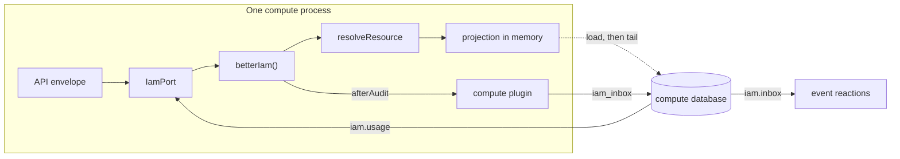

import { Bot, Building2, FileBraces, ListChecks, Receipt } from '@/lib/icons';

Better Compute has no user accounts, no roles and no policy language of its own. Every person, service account and
AI agent that calls the API is an identity in Better IAM, and every protected call is decided by Better IAM. Better
Compute keeps only what an IAM system cannot hold for it: the capacity data it decides about, and the machine PKI
that identifies its daemons.

Better IAM plays four roles for compute:

- **Identity provider.** Sessions, API keys, role sessions, delegated sessions for AI agents and session JWTs all
  come from Better IAM. Compute never issues a session.
- **Policy decision point.** Each protected method makes one decision on a `compute:*` action and a `compute-*`
  resource. Policies, roles, bindings, relationships and conditions live in Better IAM.
- **Billing ledger.** Compute measures reserved time and records hourly usage on Better IAM meters. Prices,
  budgets and invoices are Better IAM's.
- **Flag store.** Tenant feature flags such as `compute.h100` gate features inside decisions and, through a
  cache, in code.

<Callout type="info" title="Not on npm yet">
  Better IAM has not been published to npm. This repository vendors its 23 packages as tarballs under
  `vendor/better-iam` and pins them with pnpm overrides. `@better-compute/iam` needs `@better-iam/core` and
  optionally `@better-iam/server` and `@better-iam/client`.
</Callout>

## What each side owns

| Concern | Better IAM | Better Compute |
| --- | --- | --- |
| Identities | People, service accounts, agents, sessions, keys, delegations | None. Daemons, site agents and gateways use compute's own mTLS certificates and never hold an IAM credential. |
| Decisions | Policies, roles, bindings, relationships, conditions | Declares the action and resource of every method, and refuses callers from other tenants before asking |
| Resources | Nothing registered | Every `compute-*` type is app-owned: compute resolves it from its own <Term id="authz-projection">authz projection</Term> |
| Audit | Denials and root overrides, in the tenant's audit chain | Allowed mutations, in `audit_events`, with the <Term id="admission-context">admission context</Term> |
| Money | Meters, prices, budgets, invoices | Hourly <Term id="usage-window">usage windows</Term>, sent with idempotency keys |
| Limits | Spend budgets | <Term id="quota">Quotas</Term> per tenant and pool |
| Machines | Nothing | Node certificates, join tokens, attestors |

## Modes

The bridge supports two topologies. **Embedded** is the default and the only one supported from v0.1 to v0.3:
Better IAM runs inside compute's own processes. **Remote** is the v0.4 topology for a Better IAM deployment that
compute does not run.

| | Embedded (default) | Remote (v0.4) |
| --- | --- | --- |
| Compute's port | `bridge.embedded(iam, options)` | `bridge.remote({ baseURL, serviceToken, rootTenantId, iamDatabase })` |
| Authentication | `iam.authenticate`, one IAM lock acquisition | `sts.getCallerIdentity` over HTTP, two acquisitions |
| Decisions | `iam.require`, `iam.authorize` and `iam.authorizeMany` in process | The same calls over HTTP, each with the caller's own credential forwarded |
| Resolver | In process, reading compute's projection from memory | In the IAM host (`computeIamHost`), reading a replica of compute's projection |
| Events | The plugin's `afterAudit` writes `iam_inbox` in compute's database | The plugin writes `compute_inbox` in the IAM database (`postgresInbox`) or posts signed batches (`httpInbox`) |
| Usage | `billing.recordMany`, up to 200 events per call | HTTP `billing.recordMany` as the root service account, up to 100 per call |

The remote pieces (`bridge.remote`, `remoteIam`, and `computeIamHost`, `replicaProjection`, `postgresInbox`,
`httpInbox` and `createInboxHandler` from `better-compute/iam/plugin`) already exist and are tested against a real
Better IAM, but remote mode belongs to the v0.4 milestone on the [roadmap](/docs/reference/roadmap). Pointing Better
IAM's own console at compute's IAM database needs an upstream Better IAM change (U0) first, in either mode.

## How the pieces fit



`createComputeIamBridge(options)` builds every piece from one merged catalog. Pass it the same `modules` and
`plugins` you pass to `betterCompute()`, and the same `typePrefix` if you change it.

| Piece | What it does |
| --- | --- |
| `bridge.plugin()` | The `IamPlugin` for `betterIam({ plugins })`: compute's resource types and actions, and an `afterAudit` hook that forwards the events compute reacts to into `iam_inbox`. The hook never throws. |
| `bridge.resolveResource(hostFallback?)` | Better IAM's `resolveResource`. It answers `compute-*` types from memory and hands every other type to your own resolver. |
| `bridge.embedded(iam, options)` | The <Term id="iam-port">IamPort</Term> compute uses, over the Better IAM instance in the same process. Call `embedded()` or `remote()` once per bridge; a second call is `INVALID_STATE`. |
| `bridge.modules` | The `iam` module: projection and inbox lifecycle, the migration `iam/0001_successors` and the reconcilers listed below. |
| `bridge.catalog`, `bridge.projection`, `bridge.flags` | The merged catalog, the memory-resident projection and the flag cache, for tests and diagnostics. |

## Wire embedded mode

Every process that constructs `betterIam()` installs compute's plugin and resolver, and compute receives the port
and the `iam` module:

```ts title="compute.server.ts"
import { postgresAdapter } from '@better-iam/adapter-postgres';
import { betterIam } from '@better-iam/server';
import { createComputeIamBridge } from 'better-compute/iam';
import { metal } from 'better-compute/metal';
import { postgres } from 'better-compute/postgres';
import { betterCompute } from 'better-compute/server';

const modules = [metal()];
const bridge = createComputeIamBridge({ modules }); // the same modules compute registers

export const iam = betterIam({
  database: postgresAdapter({ connectionString: process.env.IAM_DATABASE_URL! }),
  secret: process.env.IAM_SECRET!,
  baseURL: 'https://iam.example.com',
  plugins: [bridge.plugin()], // catalog + afterAudit into iam_inbox
  resolveResource: bridge.resolveResource(), // compute-* types from memory
  // Optional: session JWTs whose audience includes compute.
  sts: { jwt: { signingKeys: [iamSigningKey], audiences: ['https://compute.example.com'] } },
});

export const compute = betterCompute({
  database: postgres({ url: process.env.BETTER_COMPUTE_DATABASE_URL! }),
  secret: process.env.BETTER_COMPUTE_SECRET!,
  baseURL: 'https://compute.example.com',
  modules: [...modules, ...bridge.modules],
  iam: bridge.embedded(iam, { rootTenantId, runIamJobs: true }),
});

await compute.initialize(); // catalog check, migrations, then the iam module loads the projection
```

- `rootTenantId` is the id of Better IAM's root tenant, which compute treats as the platform. You can also pass it
  to `betterCompute({ rootTenantId })`; when both are set they must agree.
- `initialize()` fails with `INVALID_CONFIG` when a method's action is missing from the merged catalog. See
  [Actions and resources](/docs/guides/iam/actions-and-resources).
- Until the `iam` module has loaded the projection, every compute decision is denied and inbox writes spill into
  memory. A host that constructs Better IAM outside compute calls `bridge.bind({ sql })` to do the same.
- `runIamJobs: true` makes the `iam` module run Better IAM's scheduler jobs (below). It needs a real `betterIam()`
  instance, or it throws `INVALID_CONFIG`.

For local development without configured IAM, `better-compute dev --sim N` starts an in-memory Better IAM with
compute's plugin and resolver installed and prints its root administrator's token. Plain `better-compute dev`
without IAM answers only public methods. See [Local development](/docs/operations/local-development).

## Credentials compute accepts

Callers authenticate to compute with Better IAM credentials only:

- **IAM bearer tokens** in the `Authorization` header: user sessions, API keys, role sessions and delegated
  sessions (`biam_…`).
- **Session JWTs** from Better IAM's `sts.getSessionToken({ format: 'jwt', audience: [iamIssuer, computeAudience] })`.
  Better IAM mints them only when `sts.jwt.audiences` contains compute's audience and the caller holds
  `iam:session-tokens:create` and `iam:assertions:create`; the `gpu-user` example policy grants both.
- **The IAM session cookie**, only when `betterCompute({ acceptIamCookie: true })` is set for a console on the same
  origin. Otherwise compute drops the cookie before calling IAM.

Authentication yields a `Caller`: `identityId`, `identityKind` (`user`, `service` or `agent`), `tenantId` (the
acting tenant; a role session acts in the role's tenant), `sessionId`, `sessionKind` (`user`, `role`, `api-key`,
`session-token` or `delegated`), `mfa`, and `agentId` and `delegationId` for agents. Any other identity or session
kind is refused with `UNAUTHENTICATED`.

## Fleet paths never call IAM

Every Better IAM call takes a turn on one serialized lane: its PostgreSQL adapter takes one advisory lock per
transaction. Compute therefore keeps IAM off every path that scales with the fleet. Heartbeats, inventory
reports, command traffic, joins, gateway jobs and reconcilers make no IAM call. Only API requests do:

| Request | IAM cost |
| --- | --- |
| A mutation or admission (`require`) | 2 lock acquisitions (Better IAM authenticates again inside `require`), 3 when the 30-second authentication cache misses |
| A read whose allow is cached | None for 10 seconds |
| A list page | One coarse decision, then at most one `authorizeMany` per 50 items |
| A feature flag | One `features.isEnabled` per tenant and key on a cache miss, never one per admission |

A resolver hit inside IAM's locked transaction does no I/O. PLAN.md adds one more acquisition for pools whose
policy sets `admission.budgetCheck: 'meter'`; the port supports that check, but the admission path does not call
it yet (see [Billing and usage](/docs/guides/iam/billing-and-usage)).

`tests/sim/iam-negative.test.ts` enforces the rule: it wraps the port in `spyIamPort`, tags fleet code paths with
`spy.path(name, fn)`, runs ten simulated minutes of joins, heartbeats, inventory, commands and a reservation, and
asserts that every recorded IAM call came from an API admission. `spyIamPort` is exported for your own tests.

## Rules for every IAM host

Better IAM's action catalog and event subscribers are process-local, so every process that constructs
`betterIam()` on compute's IAM database must install compute's plugin and resolver. Two failure modes follow when
one does not:

- **No plugin.** That host knows no `compute:*` action. Its decisions come back as `UNKNOWN_ACTION`, which every
  caller sees as `ACCESS_DENIED`. `policies.create` rejects `compute:*` actions with `INVALID_ACTION`,
  `relationships.create` on `compute-pool` fails, and audit events recorded there never reach compute's inbox.
- **Plugin but no resolver.** Compute decisions fail with `RESOURCE_RESOLVER_REQUIRED`.

Until upstream change U0 lands, the supported topology is that compute's own `api` and worker processes are the
only IAM hosts on that database, with `runIamJobs: true` so that someone dispatches Better IAM's audit hooks.
Administrators author policies with a Better IAM CLI whose configuration also installs `computeIamHost`, so that
`compute:*` actions validate.

The plugin's `afterAudit` must never throw: Better IAM awaits every plugin's hook in one loop without a guard, so
one throw would stall the host's whole event pipeline. A write to the inbox that fails or takes longer than
2 seconds spills the event into a bounded in-memory buffer (10 000 events, oldest dropped first), which is flushed
after the next successful write. `timeoutMs` and `spill` on `bridge.plugin()` change both limits.

## IAM events compute reacts to

The plugin forwards only allowed audit events whose action compute reacts to, and the inbox dedupes them on the
event id, because Better IAM delivers at least once:

| Events | Reaction |
| --- | --- |
| `identity:offboard`, `identity:expire`, `identity:delete`, `iam:identities:delete`, `iam:identities:update` | `identity`: close streams, reassign work; the successor of an offboarded identity is remembered for usage |
| `auth:session:revoke`, `auth:session:revoke-others`, `identity:revoke-sessions`, `tenant:revoke-sessions`, `iam:roles:revoke-sessions` | `sessions`: recheck streams, drop cached authentications |
| `agent:suspend`, `agent:suspend-all`, `delegation:revoke` | `agent`: close the agent's streams, cancel its unplaced work |
| `binding:activate`, `binding:deactivate`, `iam:bindings:activate` | `binding`: cap or close break-glass sessions |
| `iam:tenants:update`, `iam:tenants:delete` | `tenant`: suspend admissions, schedule teardown |
| Policy, role, binding and relationship changes, `feature:*` | `authz`: drop read-decision and flag caches |
| `billing:budget-alert` | `budget`: apply the offering's budget policy |

The `iam.inbox` reconciler drains the inbox per tenant in Better IAM's `sequence` order, without waiting for gaps,
and every reaction is level-triggered: it re-reads current state instead of trusting event order. Two reactions are
built in: remembering `successorId` from `identity:offboard`, and invalidating the flag cache. The rest are hooks.

`better-compute serve` installs default handlers when the configuration's host sets `host.iam: { bridge }`
(`installIamHandlers`): `agent` closes the agent's or delegation's tunnels on every live gateway within the 2-second
inbox drain, with `agentStreamCloser(gatewayStreamCloser(...))` from this package, and drops the agent's cached
authentications; `identity`, `sessions` and `authz` drop this process's caches, close the tunnels and streams of an
identity that is gone, and re-authorize an identity's tunnels at once when its sessions are revoked. `host.iam.handlers` replace the defaults one by one; `binding`, `tenant` and `budget` have no default.
See [tunnels](/docs/guides/access/tunnels#closing-on-iam-revocation). If you build the server yourself, wire the ones
you need:

```ts title="compute.server.ts"
import { agentStreamCloser, gatewayStreamCloser } from 'better-compute/iam';

bridge.setHandlers({
  // gatewayClients: gatewayControlClient(...) for each gateway's internal control API
  agent: agentStreamCloser(gatewayStreamCloser(() => gatewayClients)),
  async identity(_tx, event) {
    if (event.subjectId) compute.caches.dropIdentity(event.subjectId);
  },
  async sessions() {
    compute.caches.clear(); // rare; costs only re-authentication
  },
  async authz() {
    compute.caches.dropDecisions();
  },
  onError(error, event, reaction) {
    console.warn('IAM reaction failed', reaction, event.action, error);
  },
});
```

Each handler runs inside the drain transaction under its own savepoint. A handler that fails is reported to
`onError`, and the event is marked processed anyway: `iam.reconcile` repairs state, not events.

## Jobs the iam module runs

The `iam` module's reconcilers are singletons (`shardBy: 'none'`): exactly one worker running the `controllers`
role runs each one at a time, under its own lease.

| Reconciler | Every | What it does |
| --- | --- | --- |
| `iam.inbox` | 2 s | Claims up to 500 unprocessed `iam_inbox` rows with `FOR UPDATE SKIP LOCKED`, runs the reactions, and deletes processed rows after 7 days |
| `iam.reconcile` | 5 min | Re-reads from IAM every identity that owns a non-terminal reservation, and hands inactive ones to the `identity` handler. Embedded mode only. |
| `iam.usage` | 1 h | The usage sink: sends closed usage windows to Better IAM billing |
| `iam.pull` | 1 s | Remote mode with `iamDatabase`: moves rows from the IAM database's `compute_inbox` into `iam_inbox` |
| `iam.jobs.audit-hooks` | 1 s | With `runIamJobs`: Better IAM's `events.dispatch()`, which delivers audit events to plugins, compute's inbox included |
| `iam.jobs.auth-outbox` | 5 s | With `runIamJobs`: `auth.dispatchOutbox()` |
| `iam.jobs.budgets` | 1 h | With `runIamJobs`: `billing.checkBudgets()` |
| `iam.jobs.close-period` | 1 d | With `runIamJobs`: `billing.closePeriod()` |
| `iam.jobs.sweep` | 1 h | With `runIamJobs`: `sweepExpired()` |

`betterCompute({ iamJobs })` is an alternative for hosts that bring their own job functions: those run under the
`iam` worker role, each under a `singleton:iam:<name>` lease.

## Set up and check

`better-compute iam setup` prints the example policies for organization administrators to apply, and with
`--meters` creates the root billing meters. See [Policies](/docs/guides/iam/policies) and
[Billing and usage](/docs/guides/iam/billing-and-usage).

`better-compute doctor` runs `compute.selfCheck()`, which includes the `iam` module's own checks:

| Finding | Severity | Meaning |
| --- | --- | --- |
| `iam.not-configured` | warning | The configuration uses `unconfiguredIam()`: no credential authenticates and only `system.version` and `system.whoami` answer |
| `iam.projection` | error | The authz projection is not loaded, so every compute decision is denied |
| `iam.inbox-spill` | warning, or error once events were dropped | IAM events are spilled in memory because the inbox could not be written |
| `iam.inbox-backlog` | warning | More than 10 000 events wait in `iam_inbox`: no worker runs `iam.inbox` |

The CLI cannot see the IAM hosts themselves. On each process that constructs `betterIam()`, call
`checkIamHost(iam, { catalog: bridge.catalog, credential, rootTenantId, expectSessionJwts })` with a root
administrator's credential. It returns findings instead of throwing: `iam.catalog` and `iam.resource-types` (the
plugin is missing), `iam.resolver` (a synthetic decision on `compute-fleet/global` failed, typically with
`RESOURCE_RESOLVER_REQUIRED`) and `iam.session-jwt` (session JWTs are expected but `sts.jwt` is not configured).
PLAN.md lists further host checks, such as the inbox heartbeat age and a synthetic session JWT with
`doctor --token`, that are not implemented yet.

## In this section

<Cards>
  <Card icon={<ListChecks />} title="Actions and resources" href="/docs/guides/iam/actions-and-resources">
    The `compute:*` catalog, `compute-*` types, the method-to-action table and list filtering.
  </Card>
  <Card icon={<FileBraces />} title="Policies" href="/docs/guides/iam/policies">
    The `gpu-user` and `agent-guardrails` examples, pool relations and conditions.
  </Card>
  <Card icon={<Building2 />} title="Tenancy" href="/docs/guides/iam/tenancy">
    The root tenant, organizations, offerings and projects.
  </Card>
  <Card icon={<Receipt />} title="Billing and usage" href="/docs/guides/iam/billing-and-usage">
    Meters, hourly usage windows, the usage sink and budgets.
  </Card>
  <Card icon={<Bot />} title="Delegated confirmation" href="/docs/guides/iam/delegated-confirmation">
    Agents acting for people, `CONFIRMATION_REQUIRED` and the retry.
  </Card>
</Cards>
