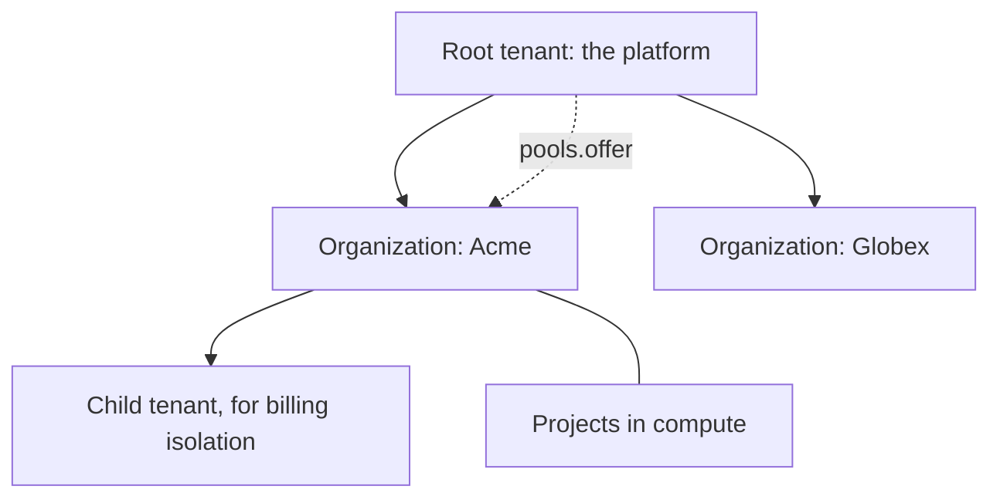

import { Coins, Layers, ListChecks } from '@/lib/icons';

Better Compute has no tenant table of its own. A <Term id="tenant">tenant</Term> is a Better IAM tenant id, every
compute record carries the id of the tenant that owns it, and every method takes a `tenantId`. Better IAM's
tenant tree gives compute its structure:

- The **root tenant** is the platform. It owns the shared fleet and decides fleet-wide operations.
- **Organization tenants** are customers. They own their reservations, instances and projects, and any hardware
  they bring.
- **Child tenants** below an organization exist only when you need billing isolation.

Inside a tenant, compute's <Term id="project">projects</Term> group work without creating more tenants.



## What lives where

| Root tenant (platform) | Organization tenant |
| --- | --- |
| Platform sites (`shared` and `dedicated`), their pools and nodes | Reservations and instances |
| <Term id="offering">Offerings</Term> of platform pools to organizations | Projects |
| Public images and profiles | Private images and profiles |
| Platform provider accounts and secrets | `custom` sites with their pools and `tenant-owned` nodes (bring your own hardware) |
| Billing meters and fleet roles | Webhooks, tenant secrets and tenant provider accounts |

The method table encodes this split. `sites.create` decides on `compute-fleet` for `shared` and `dedicated` sites,
which must name the root tenant (another `tenantId` is `INVALID_INPUT`), and on `compute-tenant` for an
organization's `custom` site. `pools.create` decides on `compute-fleet` for a platform pool and on
`compute-tenant` for a pool on the organization's own `custom` site. See
[Actions and resources](/docs/guides/iam/actions-and-resources).

## The root tenant

Tell compute which Better IAM tenant is the root, either as `betterCompute({ rootTenantId })` or through the port
with `bridge.embedded(iam, { rootTenantId })`. When both are given they must agree, and a missing or malformed id
is `INVALID_CONFIG`.

The root tenant is special in three ways:

- `compute-fleet/global` resolves only in the root tenant, so fleet-wide methods (`system.selfCheck`,
  `quotas.set`, `fleet.*`, `rollouts.*`, platform `sites.create` and `pools.create`) are decided there, whatever
  tenant their input names.
- Root-tenant callers pass compute's cross-tenant pre-check for any tenant. Better IAM then decides: it allows a
  root-tenant caller into another tenant only through its root override, which needs root authority and an
  MFA-verified user session, and it audits every override. Platform support on a customer's objects happens only
  this way.
- The billing meters live in the root tenant, and Better IAM resolves them for every tenant below it.

## Offering pools to organizations

A platform pool exists in an organization's view only once the platform offers it. `pools.offer` writes a
`pool_offers` row with the organization's quota and priority, and a projection row that makes the pool resolve
in that tenant:

```ts title="offer.ts"
await compute.api.pools.offer(rootOperator, {
  tenantId: rootTenantId, // the pool's owner
  poolId,
  toTenantId: acmeTenantId,
  quota: { gpu: 16 }, // per resource; a resource left out grants 0
  priority: 10, // -1000 to 1000, default 0
});
```

- The call decides `compute:pools:share` on the pool. Offering again updates the quota and priority.
- A pool holding `tenant-owned` nodes, or a single-tenant sharing mode (`timeslice`, `mps`), can be offered only
  to its owner.
- `pools.unoffer` removes the pool from the organization's view and drops its quota to zero. Live reservations
  keep their charge; nothing new fits. A pool cannot be unoffered from its owner (`INVALID_INPUT`).
- `includeDescendants: true` is stored on the offering, but this release writes the projection row only for
  `toTenantId`, so child tenants do not see the pool yet. PLAN.md expands offerings to descendants from a tenant
  tree cached from `iam:tenants:*` events; until then, offer the pool to each child tenant that needs it.

Organizations then share the pools they were offered with their own teams through Better IAM relationships. See
[Pool relations](/docs/guides/iam/policies) and [Pools](/docs/guides/capacity/pools).

## Visibility is the projection

What a tenant can see is exactly what compute's <Term id="authz-projection">authz projection</Term> holds in its
view: one row per resource type, id and tenant. List queries filter on the same rows, and the resolver answers
only from them.

| Resource | The views it exists in |
| --- | --- |
| Platform pool | The root tenant, and each tenant it is offered to |
| Pool on a `custom` site | Its owner tenant |
| Node | Its owner tenant |
| Site | Its owner tenant |
| Reservation, instance, project | Its owner tenant |
| Image | Its owner tenant. `images.promote` writes a row under the wildcard tenant `*`, PLAN.md's public row; the resolver in this release matches a row's tenant exactly. |

Inside your own tenant, an id that is not in your view resolves to `NOT_FOUND`. An id in another tenant never gets
that far: compute refuses the caller with `ACCESS_DENIED` before reading its database.

## Projects

A project is an app-owned grouping inside one tenant, stored in compute's `projects` table:

```sql title="projects"
CREATE TABLE projects (
  id text PRIMARY KEY,           -- prj_...
  tenant_id text NOT NULL,
  name text NOT NULL,            -- unique in the tenant
  state text NOT NULL,           -- active | archived
  version bigint NOT NULL,
  UNIQUE (tenant_id, name)
);
```

```ts title="projects.ts"
const project = await compute.api.projects.create(credential, {
  tenantId,
  name: 'ml-research', // a DNS label, at most 63 characters
  idempotencyKey: 'create-ml-research',
});
```

- `projects.create` decides `compute:projects:manage` on `compute-tenant/{t}`. It is idempotent per tenant,
  caller and key: the id derives from them, the same request again returns the project without a second decision,
  and the same key with a different name is `CONFLICT`. A second project with the same name is `CONFLICT` too.
- The creator becomes the project's `ownerId` in the projection. Membership is a Better IAM relationship on
  `compute-project/{id}`, with the relations `member` and `admin`.
- `projects.get` decides `compute:projects:read` on the project; `projects.list` follows the list recipe and
  filters by `state`.
- `projects.archive` (v0.2) decides `compute:projects:manage` on the project. It sets `state` to `archived`, bumps
  `version` and publishes `project.archived` (`projectId`, `name`); archiving an archived project returns it
  unchanged, with no event. Archiving only changes the state: compute does not check it when a reservation or
  instance names the project.

Reservations and instances take an optional `projectId`, which becomes the `projectId` attribute of their
resource and the `project` tag of their usage windows. `usage.list` with a `projectId` decides
`compute:usage:read` on the project instead of the tenant, so project members can read their project's usage:

```json title="Project members read their project and its usage"
{
  "sid": "ProjectMembers",
  "effect": "allow",
  "actions": ["compute:projects:read", "compute:usage:read"],
  "resources": ["compute-project/*"],
  "conditions": { "ArrayContains": { "resource.relations": "member" } }
}
```

Compute checks only that a reservation's `projectId` is a `prj_` id. A reservation's parent is its pool, not its
project, so a policy cannot test project membership when it decides `reservations.create`. Restrict which
projects a group may charge with `resource.projectId` conditions instead.

## Child tenants for billing isolation

Create a Better IAM child tenant under an organization only when a unit needs its own bill. Better IAM grants
nothing downward, so a child tenant needs its own role bindings and, in this release, its own `pools.offer`.
Everything else about the organization's work fits in projects.

## Quotas, flags and residency

- **Quotas** live in compute, because Better IAM's tenant limits are a fixed set. They are per tenant, pool and
  resource (`gpu`, `vcpu`, and so on), set by offerings and by `quotas.set` (v0.2, decided on `compute-fleet`),
  and read with `quotas.get`. An admission that would exceed one fails with `QUOTA_EXCEEDED`. See
  [Quotas and usage](/docs/guides/capacity/quotas-and-usage).
- **Flags** such as `compute.h100` are Better IAM feature flags. Policies test them through `tenant.features`,
  and code reads them through `IamPort.featureEnabled`, backed by a cache that holds each tenant and key for up to
  5 minutes and drops entries on `feature:*` events.
- **Residency** waits for Better IAM to expose a tenant region. The offerings table already has an
  `allowed_regions` column, but `pools.offer` does not accept it and nothing enforces it yet. Until then, restrict
  regions in policy with `resource.region`, as the `gpu-user` example does.

## Tenant lifecycle

Compute reacts to Better IAM's `iam:tenants:update` and `iam:tenants:delete` events through the `tenant` reaction
of the IAM inbox, whose intent is to suspend admissions and schedule teardown. The reaction is a hook you supply
with `bridge.setHandlers()`; the server does not install one yet. See [IAM integration](/docs/guides/iam).

<Cards>
  <Card icon={<ListChecks />} title="Actions and resources" href="/docs/guides/iam/actions-and-resources">
    Scope types, cross-tenant refusal and list filtering.
  </Card>
  <Card icon={<Layers />} title="Pools" href="/docs/guides/capacity/pools">
    Pool classes, sharing modes and offerings.
  </Card>
  <Card icon={<Coins />} title="Billing and usage" href="/docs/guides/iam/billing-and-usage">
    How usage is attributed to tenants, identities and projects.
  </Card>
</Cards>
