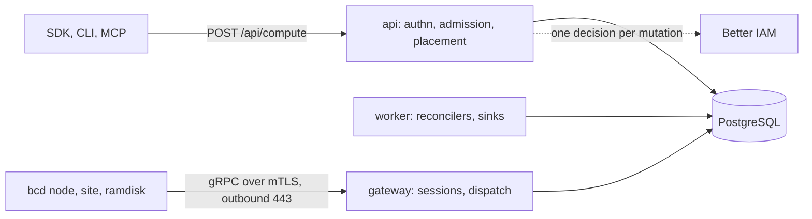

import { Blocks, Code, Cpu, FileCodeCorner, HardDrive, Instance, KeyRound, Rocket, Server, ShieldCheck, Webhook } from '@/lib/icons';

Better Compute tracks GPU and CPU capacity: what hardware exists, what is free, and who holds it, from a whole NVLink
set of GPUs to a few vCPUs and GiB of memory. The database referees every booking, so a GPU or a vCPU can never be
given to two holders at once. It also makes machines useful: you can adopt a server that is already running, deploy
an image to a bare machine over PXE, or run isolated VMs, as VPS or as [sandboxes](/docs/guides/vps/sandboxes), on
your own hosts or on a provider's. A sandbox is a hosted VPS instance with a template, a time-to-live and an optional
warm pool, served by the `sandboxes`, `sandboxTemplates` and `sandboxSnapshots` API groups of `vps()`.

It is a library, not a hosted service. You construct the control plane with `betterCompute()` in your own process,
on your own PostgreSQL, the same way you construct Better IAM with `betterIam()`:

```ts title="compute.ts"
import { betterCompute } from 'better-compute';
import { postgres } from 'better-compute/postgres';

export const compute = betterCompute({
  database: postgres({ url: process.env.BETTER_COMPUTE_DATABASE_URL! }),
  secret: process.env.BETTER_COMPUTE_SECRET!, // at least 32 characters
  baseURL: 'https://compute.example.com',
  rootTenantId, // the Better IAM root (platform) tenant
  iam, // an IamPort, for example bridge.embedded(iam, { rootTenantId })
  modules: [], // metal(), vps(), provisionModule() and friends
});

await compute.initialize(); // registry checks, migrations, module start()
```

## What it is for

GPU fleets are usually tracked in spreadsheets, a scheduler's memory, or a cloud console, and each of those forgets
something: who holds which device, which machine is healthy, or what was promised for next Tuesday. Better Compute
keeps one authoritative record and builds everything else on it:

- **Fleet truth.** <Term id="site">Sites</Term>, <Term id="pool">pools</Term>, <Term id="node">nodes</Term>,
  devices, health and holders, in PostgreSQL.
- **Exact capacity, now and over a horizon.** Every claim is a <Term id="booking">booking</Term> row guarded by an
  `EXCLUDE` constraint, so double-booking is impossible by construction, not by careful scheduling.
- **Many provisioning paths.** Adopt a running server, PXE or virtual media plus an image stream, a provider
  reinstall, a VPS on libvirt/KVM or Cloud Hypervisor, or a provider VM. Each path is a composition of drivers.
- **A daemon per server and a horizontally scalable control plane,** with an API, a typed client, a CLI and MCP tools.
- **Scale targets per region on one PostgreSQL primary:** 10,000 nodes, 100,000 GPUs, at least 200 placements per
  second and a command p99 under 1.5 s. These are design targets that the v0.4 phase is meant to prove.
- **Modularity.** New provisioning methods and providers are modules, drivers and profiles. They need no edits to
  the `@better-compute/*` packages.
- **Agent-ready.** AI agents use the same typed API or MCP tools, and a person can confirm what an agent asks for.

## What it is not

The design lists these as non-goals for v1:

- A workload orchestrator. Capacity goes to Kubernetes or Slurm through config drivers; Better Compute hands out
  devices, it does not run jobs.
- A source of users, roles, keys or invoices of its own. Better IAM owns all of those.
- A telemetry store. Metrics go to a time-series database, never through PostgreSQL or the control stream.
- Active-active multi-region, live migration, or volumes and software-defined networking beyond bridges, VLANs and
  IPAM.
- Windows or macOS nodes.
- Equinix Metal, which reached end of life on 2026-06-30.

## Three runtime parts



### bcd, the daemon

<Term id="bcd">bcd</Term> is one Go binary with a mode per job:

| Mode | Runs on | Does |
| --- | --- | --- |
| `node` | every server | session, inventory, NVML health, CDI device holds, commands |
| `site` | one or two per datacenter | proxy DHCP, iPXE, image cache, BMC access |
| `ramdisk` | a machine during PXE commissioning | inspection, diagnostics, wipe, image streaming |
| `sim` | test hosts | many real node agents on fake hardware in one process, against a gateway |

It only ever dials out, over gRPC on mutual TLS to a <Term id="gateway">gateway</Term> on port 443. See
[the daemon](/docs/daemon).

### The control plane

`betterCompute(options)` returns `{ api, handler, nodeHandler, gatewayServices, initialize, start, stop, … }`. The
same configuration runs in any of four process modes: `api` (stateless HTTP, admission and JoinService), `gateway`
(daemon sessions and dispatch), `worker` (reconcilers, event sinks, IAM jobs) or `all`. PostgreSQL is the truth, and
all SQL reads one clock, `compute_now()`. See [architecture](/docs/guides/concepts/architecture).

### The API and its clients

Every method is `POST /api/compute/{group}/{method}`. On the server you call it as
`compute.api.reservations.create(credential, input)`, in the browser through a typed client inferred from your
server instance, from a shell through the `better-compute` CLI, and from AI agents through MCP tools. All of them go
through the same envelope: authentication, the tenant pre-check, one IAM decision, then one transaction. See
[clients](/docs/guides/clients) and the [API reference](/docs/reference/api).

## Better Compute and Better IAM

Better Compute has no users, roles or API keys of its own. [Better IAM](/docs/guides/iam) is its only identity
provider, policy decision point and billing ledger, and also its feature-flag store and event source. Better Compute
owns only its machine PKI: the certificates that identify daemons.

- **One decision per mutation.** Each mutating call makes exactly one Better IAM decision, such as
  `compute:reservations:create` on the reservation being requested. Reads use a short decision cache.
- **Fleet paths never call IAM.** Heartbeats, inventory, commands and reconcilers run without a single IAM call, so
  a busy fleet cannot saturate the identity system.
- **Application-owned resources.** Better Compute contributes `compute-*` resource types (`compute-pool`,
  `compute-reservation`, …) to Better IAM's catalog and resolves them itself from an in-memory projection.
- **Billing on reserved time.** Usage windows such as `gpu.<model>.hours` are recorded in Better IAM's billing
  ledger.
- **Embedded by default.** The IAM bridge (`better-compute/iam`) runs Better IAM in the same processes. A remote
  mode, where Better IAM runs elsewhere, is part of the v0.4 phase.

Both are on npm: Better Compute 0.2.0 works with Better IAM `>=0.2.0 <0.4.0` (0.3 today), and you install the two side by side
(`npm install better-compute better-iam`).

## What it covers

<FeatureGrid>
  <Feature icon={<Blocks />} title="Concepts" href="/docs/guides/concepts">
    Architecture, the domain model, desired state and commands, and the consistency rules everything rests on.
  </Feature>
  <Feature icon={<Server />} title="Nodes" href="/docs/guides/nodes">
    Joining with a token, attestation, inventory and health, cordon and drain, and one-shot commands.
  </Feature>
  <Feature icon={<Cpu />} title="Capacity" href="/docs/guides/capacity">
    Pools, placement, reservations, quotas, gangs, calendar and spot reservations, and fractional GPUs.
  </Feature>
  <Feature icon={<HardDrive />} title="Bare metal" href="/docs/guides/bare-metal">
    Sites, workflows, profiles and images, BMC access, deploys, and dedicated-root leases.
  </Feature>
  <Feature icon={<Instance />} title="VPS" href="/docs/guides/vps">
    Instances on your own hosts or a provider's, flavors, provider accounts and networking.
  </Feature>
  <Feature icon={<KeyRound />} title="Access" href="/docs/guides/access">
    Exec and console tunnels with single-use tickets, and SSH certificates.
  </Feature>
  <Feature icon={<FileCodeCorner />} title="Fleet config" href="/docs/guides/fleet-config">
    Export, plan and apply sites, pools, offers and quotas as one document, with drift detection.
  </Feature>
  <Feature icon={<Rocket />} title="Rollouts" href="/docs/guides/rollouts">
    Signed bcd releases rolled out in waves within each pool's disruption budget.
  </Feature>
  <Feature icon={<ShieldCheck />} title="IAM" href="/docs/guides/iam">
    Actions and resources, policies, tenancy, billing and delegated confirmation with Better IAM.
  </Feature>
  <Feature icon={<Webhook />} title="Events" href="/docs/guides/events">
    Signed webhooks, the server-sent event stream, and tamper-evident audit checkpoints.
  </Feature>
  <Feature icon={<Code />} title="Clients" href="/docs/guides/clients">
    The typed TypeScript client, the CLI, MCP tools and the console kit.
  </Feature>
</FeatureGrid>

## Project status

<Callout type="warn" title="Version 0.2.0">
  Every package is at version 0.2.0 and on npm; see [Installation](/docs/guides/installation). This is an early
  release: the Go daemon `bcd` has no released binary yet, and nothing has run on real GPU hardware, so machines
  join as simulated daemons (`better-compute dev --sim N`) or as a `bcd` you build yourself.
</Callout>

The roadmap runs in phases, and a phase closes only when its exit tests pass in CI. Much of the TypeScript control
plane for later phases has already landed; what is still open is mostly the Go daemon and the tests that need it:

| Phase | Theme | What has landed | What is open |
| --- | --- | --- | --- |
| P0 | Scaffold | Workspace, repository rules, CI, Better IAM wired in; contracts frozen (`agent/v1`, `@better-compute/core`, the v0.1 schema and method table) | Nothing |
| v0.1 | Adopt and reserve | Server runtime, JoinService, gateway, machine PKI, inventory, capacity with the inline placer, IAM bridge, CLI `dev`, `serve` and `sim`, the TypeScript FakeDaemon and fleet simulator, bcd's node agent (join, session, journal, CDI holds, the v0.1 kinds, `bcd status`) tested end to end | A bcd release, a run on a real GPU host (bcd reads GPUs through `nvidia-smi`, cb987e5, tested against captured output only); the gateway and IAM-lane benchmark gates on reference hardware |
| v0.2 | Metal | Workflow engine, `metal()`, images and profiles, site tokens, join requests, write-only secrets, FleetConfig, XID health and remediation, node-signed attested results | `bcd site` and `bcd ramdisk`; emulation CI on real QEMU machines |
| v0.3 | VPS and access | `vps()` with hosted and provider pools, the Hetzner provider, tunnels (including bcd's node half) and break-glass SSH (including bcd's `access` converger), webhooks and the SSE stream, MCP tools, delegated confirmation; bcd's `libvirt-kvm` and `cloud-hypervisor` runtimes | A run of either runtime on real hardware |
| v0.4 | Scale and HA | Pool-lease placer, the WebSocket fallback (gateway and bcd), signed releases and rollouts, bcd self-update, `bcd helper` (an unprivileged node agent beside a root helper), remote IAM mode, Merkle audit checkpoints, metrics | 10,000-node runs, a bcd release |
| v0.5 | GPU depth and ecosystem | Gang, calendar and spot reservations, MIG and time-slice atoms, dedicated-root metal, TPM attestor, the bcx driver SDK (draft), the Proxmox provider, the console kit; sandboxes (templates with env and network, TTL expiry, warm pools of paused instances, snapshots and restores, exec over SSH certificates, the instance guard, the exit test on emulated hosts) | Real-hardware MIG tests; bcd enforcing a sandbox's network policy |
| v1.0 | Freeze | The destructive-batch quorum end to end, the API surface check, the N-2 skew matrix, upgrade in place (in simulation) | API and protocol freeze, external security review, npm provenance from CI |

The daemon deserves a note. `daemon/` holds the Go module, and its v0.1 node agent works: `bcd join`, `bcd node`,
`bcd status`, `bcd doctor` and `bcd version`, with the bbolt journal, the `devices` and `access` convergers, five
command kinds (including `gpu.reset`), tunnels, XID and host-pressure reporting, and sealed secret and workload-token
requests. `tests/e2e/bcd.test.ts` runs it against a real control plane and gateway. It is not released (no
binaries have been published), and it reads GPUs through `nvidia-smi` rather than the NVML library (cb987e5). `bcd site` (Redfish BMC operations, proxy DHCP, TFTP, iPXE
and the image cache) and `bcd ramdisk` (wipes, image streaming, kexec, DCGM) are written and covered by Go unit tests
only; a site agent drives IPMI BMCs through the `bcx-ipmi` plugin. The `instances` converger runs VMs on
`libvirt-kvm` on a host with `virsh` and on `cloud-hypervisor` on a host with its binary (both tested against fake
tools only) and on a file-backed runtime in fake-hardware builds, which alone run `bcd sim` (many real node agents in one
process against a gateway). Self-update with A/B slots, the WebSocket fallback and `bcd helper` (privilege
separation, self-update included) are written too. The
TypeScript `FakeDaemon` in `@better-compute/testing` covers the rest, and it is what joins in
`better-compute dev --sim N`, the simulator and most test suites. See [what bcd does today](/docs/daemon#what-bcd-does-today)
and the [roadmap](/docs/reference/roadmap) for each phase's exit tests.

## Where to go next

<Cards>
  <Card title="Quickstart" href="/docs/guides/quickstart">
    Install from npm, start the development server with simulated GPU machines, and reserve GPUs.
  </Card>
  <Card title="Installation" href="/docs/guides/installation">
    Requirements, installing from npm, the umbrella package and its subpaths, and building from a clone.
  </Card>
  <Card title="Concepts" href="/docs/guides/concepts">
    The architecture, the domain model and the design principles.
  </Card>
  <Card title="API reference" href="/docs/reference/api">
    Every API group and method, with its HTTP route, IAM action and phase.
  </Card>
</Cards>
