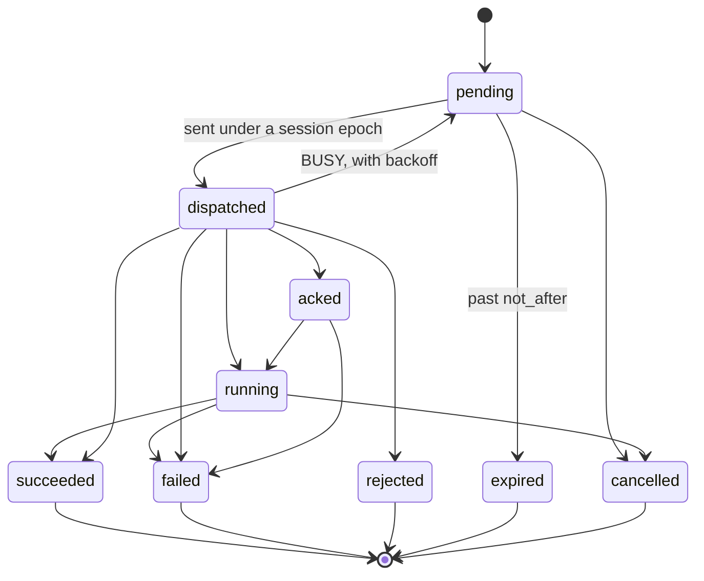

A <Term id="command">command</Term> is a one-shot action on one node: run a diagnostic, re-send inventory,
collect logs, reboot, wipe a disk. It is the other half of what a node receives, next to its
<Term id="nodespec">desired state</Term>, and the rule for choosing between them is simple:

- if losing the message would leave the node in the wrong steady state, it is **desired state** (assignments,
  instances, host configuration, access, the daemon version), which the node converges to and re-reads after
  any gap;
- if running it late could do harm, it is a **command**, with a deadline (`not_after`) and, when it presupposes
  a spec, a minimum generation.

Commands are durable rows in Postgres. They are queued in the caller's transaction, delivered in order over the
node's session, deduplicated by the node's journal, and settled by a result the node reports. See
[desired state and commands](/docs/guides/concepts/desired-state-and-commands) for the design.

## Running a command

[`commands.run`](/docs/reference/api/commands#run) (`compute:nodes:exec` on `compute-node/{nodeId}`) queues a
command from the API. It accepts an allowlist of kinds; any other kind is `UNSUPPORTED`.

| Kind | Payload | Does |
| --- | --- | --- |
| `diag.nvml` | `{}` | NVML health check of every visible GPU; attested |
| `inventory.refresh` | `{ sections?, rescan? }`: 1 to 8 of `system`, `cpu`, `memory`, `disks`, `nics`, `gpus`, `bmc`, `os`; `rescan` re-collects from the hardware first | Re-sends inventory |
| `logs.collect` | `{ sinceSeconds?, units? }`: 60 to 604,800 seconds, up to 16 systemd units | Collects logs (the upload destination arrives in v0.2) |
| `node.reboot` | `{}` | Reboots the machine; completes when the node rejoins |

```ts
const command = await client.commands.run({
  tenantId,
  nodeId,
  kind: 'inventory.refresh',
  payload: { sections: ['gpus'], rescan: true },
  idempotencyKey: 'refresh-after-gpu-swap-0412',
  notAfterSeconds: 300,
});
// { id: 'cmd_…', seq: 42, state: 'pending', notAfter: …, retrySafe: true, … }
```

```bash
better-compute api commands.run tenantId=$TENANT nodeId=node_… kind=node.reboot idempotencyKey=reboot-0412
```

- `idempotencyKey` is scoped to your tenant and identity: a retry returns the command already queued, and the
  same key for another kind is `CONFLICT`.
- `notAfterSeconds` (10 to 3,600, default 600) is how long the command may wait for the node before it expires.
- The node must be visible to your tenant (`NOT_FOUND` otherwise), and a new command publishes
  `node.command.queued`.

Modules queue any registered kind through the command queue, `ctx.commands.enqueue(tx, command)`, in their own
transaction. See [modules](/docs/extending/modules).

## Kinds and lanes

Every command kind is registered with its wire flags, a lane, a timeout and the agent roles that may run it. The
full list, with payload types, is in [command kinds](/docs/reference/command-kinds); the built-ins are
`diag.nvml`, `inventory.refresh`, `logs.collect`, `node.reboot` and `gpu.reset`, and modules add the rest (the
metal module the BMC, boot, disk, deploy, `site.httpProxy` and `diag.dcgm` kinds, the rollout module
`daemon.upgrade`).

| Flag | Meaning |
| --- | --- |
| `lane` | `control`, `provision` or `bulk`. Lanes keep a long disk wipe from blocking a quick diagnostic. |
| `retrySafe` | May run again when the daemon crashed after accepting it but before it started. Kinds such as `gpu.reset`, `disk.wipe`, `deploy.image` and `bmc.power` are not. |
| `selfTerminating` | The side effect ends the daemon (`node.reboot`, `boot.kexec`, `daemon.upgrade`). The command completes when the node rejoins with a new boot, and is never replayed. |
| `attested` | The result is signed by the node's key, for example `diag.nvml`, `diag.dcgm`, `disk.wipe` and `gpu.reset`. |
| `destructive` | Must carry a valid signature from v0.2, for example `node.reboot`, `gpu.reset`, `disk.wipe`, `deploy.image` and `bmc.power`. |
| `timeout` | How long an in-flight command may run past `not_after` before the sweeper fails it. |
| `roles` | Agent roles that may run it (`node`, `site`, `ramdisk`); any other role rejects it. |

Lanes bound the work in flight per node. The gateway keeps at most 8 `control`, 4 `provision` and 2 `bulk`
commands outstanding per session; the rest stay `pending` in Postgres until credits return. The daemon runs each
lane on its own fixed worker pool.

## States



Reports may skip steps: a lost acknowledgement does not stop a result from landing. `succeeded`, `failed`,
`rejected`, `expired` and `cancelled` are terminal.

Before accepting a command, the daemon checks, in this order:

1. `UNSUPPORTED`: the body names another node, or the kind is unknown or not allowed for its role;
2. `STALE_GENERATION`: `min_generation` is ahead of the spec it applied; it asks for the spec, waits until
   `not_after`, then rejects;
3. `EXPIRED`: past `not_after`, in server time (the daemon keeps the offset from `Welcome.server_time`);
4. `BUSY`: no credits; the gateway puts the command back to `pending` with a backoff from 1 to 30 seconds;
5. `BAD_SIGNATURE`: an unsigned destructive kind (v0.2).

The four refusals other than `BUSY` make the command `rejected`, and the daemon journals them, so a duplicate
delivery gets the same answer.

## Timing

| Field | Rule |
| --- | --- |
| `not_before` | Not dispatched earlier. Must come before `not_after`. |
| `not_after` | Mandatory. A command without one is `EXPIRED` on the node, so the control plane always sets it. |
| `min_generation` | The node must have applied at least this desired-state generation. |

The CommandSweeper, a singleton that runs every 5 seconds, enforces the deadlines on the control plane side:

- `pending` past `not_after` becomes `expired` (reason `not_after`);
- `dispatched`, `acked` or `running` past `not_after` plus the kind's timeout becomes `failed` (reason
  `timeout`). For self-terminating kinds the timeout covers the rejoin window. A kind that is no longer
  registered gets 15 minutes.

Each transition wakes the node's controller and the owner named by the idempotency key (`wf:<workflowId>:…`
wakes that workflow), and publishes `command.settled`.

## Delivery, idempotency and resume

- **Identity and order.** A command gets a `cmd_…` id and a per-node `seq` from `nodes.next_cmd_seq` in the
  enqueue transaction. The idempotency key is unique per node: workflow steps use `wf:<id>:<stepId>`,
  acceptance uses `acceptance:<nodeId>:<attempt>:<kind>`, and the API derives `api:…` from your key. A second
  enqueue with the same key returns the first command.
- **Resume.** When a node reconnects, `Hello` first settles what the reconnect proves, then the gateway replays
  every non-terminal command in `seq` order. The daemon's journal answers a duplicate with the stored result, or
  re-attaches to a running one.
- **Crashes.** A command the daemon accepted but never started runs again only if it is retry-safe; otherwise
  it fails with `interrupted` and its owner decides.
- **Lost journal.** A daemon whose journal is gone (a ramdisk reboot, a reinstall, corruption) comes back with a
  new journal id. In-flight commands that are not retry-safe fail with `journal-lost` instead of being replayed.
- **Self-terminating kinds.** A new boot or role on rejoin completes them as `succeeded` with `rebooted: true`.

The details, including epoch fencing, are in [delivery](/docs/daemon/delivery).

## Restricted identities

A node whose current certificate carries allowed kinds (a discovery ramdisk, for example) only accepts those.
The command queue refuses other kinds at enqueue with `INVALID_STATE` ("runs a restricted identity that does not
accept …"), and the gateway checks the session's certificate again at dispatch. See
[attestation](/docs/guides/nodes/attestation).

## Signatures and attested results

Two signatures protect commands from a compromised gateway, which can delay, drop or read frames but should
never forge intent or results:

- **Attested results.** For attested kinds the node signs its result with its node key: `CommandUpdate.node_sig`,
  under purpose `command-update`, over the command id, the state and the SHA-256 of the result. The gateway
  stores it exactly as received, and consumers verify it against `node_certs` before any state transition (the
  metal module's `nodeSignedResults()` does this for wipes and diagnostics). A forged wipe result is refused.
- **Signed commands (v0.2).** `Command.signature` carries a signature by a worker key that chains to the
  command-signing root in the node's trust bundle. `@better-compute/pki` provides the pieces
  (`createCommandSigningAuthority`, 24-hour worker keys from `issueWorkerKey`, `signCommand` and
  `verifyCommand`), and the daemon rejects unsigned destructive kinds with `BAD_SIGNATURE`. When the server is
  given `pki.commandSigning` (the root from `createCommandSigningAuthority`, or the PKI bundle's `commandSigning`),
  every command is signed by a 24-hour worker key that root certifies, and JoinResponse and Welcome carry the
  trust bundle (the roots, plus `pki.commandSigningRoots` during a rotation, and `pki.trustVersion`). Without it,
  commands go unsigned as in v0.1. The same key signs each NodeSpec generation (purpose `desired-state`, v0.4); the
  gateway relays the stored signed bytes, and the daemon verifies them before applying a spec. See
  [delivery](/docs/daemon/delivery#signed-commands-and-attested-results).

With `pki.commandSigning`, GPU bindings are attested too: a reservation goes active only once the node's own signed
`AllocationBound` verifies; see [attested bindings](/docs/guides/capacity/reservations#attested-bindings).

Commands never carry secret values: they carry `secretRef`s, which the agent exchanges for a value sealed to a
one-time key. See [security](/docs/operations/security).

## Cancelling

[`commands.cancel`](/docs/reference/api/commands#cancel) is planned for v0.2. The command queue already
implements cancellation for modules (`ctx.commands.cancel(tx, commandId)`):

- a `pending` command becomes `cancelled` at once;
- an in-flight command keeps its state and is marked `cancel_requested_at`; the gateway sends `Cancel` until the
  daemon reports a terminal state. The daemon stops between actions and reports the real outcome, so a side
  effect that already happened is never hidden;
- a terminal command is left alone; an unknown id is `NOT_FOUND`.

Deleting a node cancels its pending commands with reason `node-deleted`.

## Results

[`commands.get`](/docs/reference/api/commands#get) and [`commands.list`](/docs/reference/api/commands#list)
(`compute:nodes:read`) show a node's commands; `list` is newest first by `seq`, filters by `state`, and returns
up to 200 per page (100 by default).

<TypeTable
  type={{
    id: { type: 'string', description: 'cmd_…' },
    nodeId: { type: 'string', description: 'The node that runs it.' },
    seq: { type: 'number', description: 'Its position in the node order.' },
    kind: { type: 'string', description: 'The command kind.' },
    state: { type: 'CommandState', description: 'pending, dispatched, acked, running, succeeded, failed, rejected, expired or cancelled.' },
    reason: { type: 'string', description: 'Why it ended as it did: not_after, timeout, journal-lost, node-deleted, …' },
    notBefore: { type: 'number', description: 'Epoch milliseconds.' },
    notAfter: { type: 'number', description: 'Epoch milliseconds.' },
    minGeneration: { type: 'number', description: 'Set when the command presupposes a spec.' },
    retrySafe: { type: 'boolean', description: 'From the kind.' },
    selfTerminating: { type: 'boolean', description: 'From the kind.' },
    attested: { type: 'boolean', description: 'From the kind.' },
  }}
/>

Rather than polling, follow `command.settled` events (`commandId`, `nodeId`, `kind`, `state`, `reason`), which
the gateway publishes when a node reports a terminal state and the sweeper publishes when it expires or fails a
command. See [watching events](/docs/guides/events/watch).

```ts
const { items } = await client.commands.list({ tenantId, nodeId, state: 'failed', limit: 20 });
for (const command of items) console.log(command.seq, command.kind, command.reason);
```
