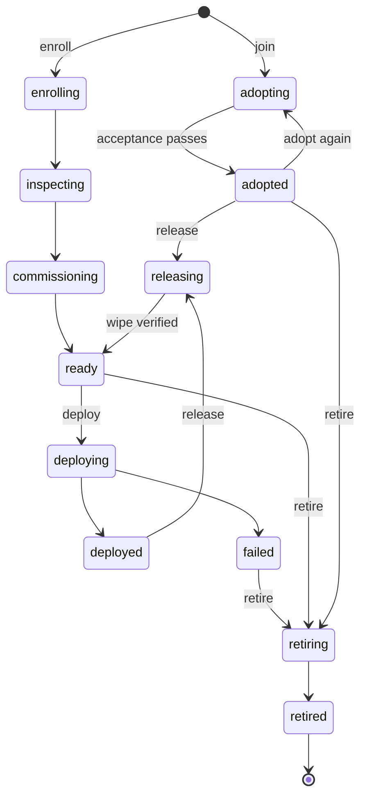

import { BadgeCheck, ClipboardList, LogIn, SquareTerminal, Wrench } from '@/lib/icons';

A <Term id="node">node</Term> is a machine Better Compute manages: a server running the daemon
<Term id="bcd">`bcd`</Term>, a <Term id="site-agent">site agent</Term> (`bcd site`, stored as a node with
`role: 'site'`), or a provider machine in a pool that runs the daemon. Everything the control plane does to
hardware hangs off a node: its <Term id="device">devices</Term> and <Term id="atom">atoms</Term>, the
allocations booked on them, the <Term id="command">commands</Term> it runs and the
<Term id="nodespec">desired state</Term> it converges to.

This section covers the node from an operator's point of view: how a machine joins, how it proves who it is,
what inventory and health say about it, how you take it out of service, and how you send it commands.

<Callout type="info" title="The daemon today">
The Go daemon `bcd` is written in `daemon/` but not built or released yet. The TypeScript `FakeDaemon` in
`@better-compute/testing` speaks the same protocol, and it is what the tests, the simulator and
`better-compute dev --sim N` run. Everything on these pages describes the control plane, which behaves the
same for both.
</Callout>

## State is several axes, not one status

A single status field cannot say "deployed, but cordoned for a firmware update, in maintenance after a failed
workflow, unreachable since a switch reboot, with one GPU reporting uncorrectable ECC errors". So a node's state
is split into independent axes, the way OpenStack Ironic does it. Each axis has one owner, and none of them
implies another.

| Axis | Values | Changed by |
| --- | --- | --- |
| `provisionState` | `adopting`, `adopted`, `enrolling`, `inspecting`, `commissioning`, `ready`, `deploying`, `deployed`, `releasing`, `rescue`, `failed`, `retiring`, `retired` | JoinService, the NodeLifecycle controller (acceptance), `nodes.adopt`, bare-metal workflows |
| `maintenance` | `true` or `false` | A bare-metal workflow that fails or is aborted, and health remediation that gives up |
| `cordoned` | `true` or `false` | `nodes.cordon`, `nodes.uncordon`, `nodes.drain` |
| `power` | `on`, `off`, `unknown` | Bare-metal power control through the BMC |
| `connectivity` | `connected`, `disconnected`, `unreachable`, `lost` | The gateway (session open and close) and the Liveness controller |
| `conditions` | Typed conditions, each `true`, `false` or `unknown` | Inventory, Health, Liveness, NodeLifecycle |

A seventh field ties them to scheduling: `noScheduleReasons`. It mirrors every reason the node must not receive
new work, such as an operator <Term id="taint">taint</Term> (`taint:<key>`), a NoSchedule
<Term id="condition">condition</Term> (`GpuCountMismatch`), `unreachable` or `draining`. Each writer updates it
in the same transaction as its cause, so the placer can lock the node row and read one column.

### Provision states

`provisionState` follows a state table in `@better-compute/core` (`provisionStateTable`). A server you already
run joins as `adopting` and becomes `adopted` once acceptance passes. A bare-metal server enrolled through its
BMC starts at `enrolling` and moves through inspection and commissioning to `ready`. Illegal moves fail with
`INVALID_STATE`.

The diagram leaves out a few edges (every workflow state can fail, `failed` can `recover`, and `deployed` can
enter `rescue`). The bare-metal side is covered in [bare-metal workflows](/docs/guides/bare-metal/workflows).
A failure records `failedFrom` and turns `maintenance` on.

## Identity, ownership and generations

Besides the state axes, a node carries these fields.

| Field | Meaning |
| --- | --- |
| `id` | `node_…`, assigned by JoinService or by `metal.enroll`. |
| `siteId`, `poolId`, `ownerTenantId` | Where the node lives and who owns it. `poolId` is absent for site agents and unassigned machines. |
| `role` | `host`, `dedicated`, `site` or `unassigned`. A node that joins a `metal-host`, `vps-host` or `provider` pool becomes `host`, one that joins a `metal-dedicated` pool becomes `dedicated`, a site agent is `site`, and a machine with no pool is `unassigned`. |
| `trust` | `platform`, `tenant-owned` or `tenant-controlled`. A node on a tenant's `custom` site is `tenant-owned`; a node under a dedicated-root lease is `tenant-controlled`. |
| `adapter` | How the control plane reaches the node: `bcd/v1` (the default), `provider-api/v1` for pools with `agent: 'none'`. `agentless-ssh/v1` is planned. |
| `drivers` | Per-concern driver bindings (`power`, `boot`, `deploy`, …) inherited from the pool's hardware profile. See [drivers](/docs/extending/drivers). |
| `hardwareKey`, `hardwareKeyTrusted` | SHA-256 over the machine's normalized identifiers. Trusted, and unique across nodes, when at least two independent identifiers survive. See [inventory and health](/docs/guides/nodes/inventory-and-health). |
| `generation`, `observedGeneration` | The desired-state <Term id="generation">generation</Term>, and the one the node last reported converged. |
| `identityGeneration` | Bumped whenever the node's identity is replaced: `nodes.revokeIdentity`, a reclaim or re-join in place, `nodes.delete`, and bare-metal teardown. Certificates of an earlier generation never work again. |
| `version` | Optimistic concurrency. Pass the `version` you read to a mutation; a node that changed since is `CONFLICT`. |

`nodes.get` returns the API view (`NodeDetail`): the axes except `power`, the fields above except `adapter`,
`drivers` and the key itself (only `hardwareKeyTrusted`), plus labels, conditions and the current session
(`epoch`, `gatewayId`, `connectedAt`, `disconnectedAt`, `lastSeen`). Modules and node adapters receive the full
`NodeRecord`.

Trust decides what a node's hardware may be used for. A `tenant-owned` node adds capacity only to its owner's
pools, and the offering validator refuses to offer a pool holding one to any other tenant. A
`tenant-controlled` node adds no capacity at all, and the lessee's operating system joins with a `node-tenant`
certificate: the gateway never sends it platform secrets or destructive platform commands. See
[dedicated root](/docs/guides/bare-metal/dedicated-root).

## When a node is schedulable

Placement books a node's atoms only when every check below holds. The capacity module runs them in this order,
and the first that fails decides which bucket of the pool's capacity the node's GPUs are reported in
(see [capacity](/docs/guides/capacity)).

1. `role` is `host`. Otherwise the node is `excluded`.
2. `trust` is `platform`, or `tenant-owned` in its owner's pool. Otherwise `excluded`.
3. Not in `maintenance` and not `cordoned`. Otherwise `maintenance`.
4. `provisionState` is `adopted` or `deployed`. Otherwise `provisioning`.
5. `observedGeneration` is at least 1: the node converged its first spec. Otherwise `provisioning`.
6. `connectivity` is `connected`. Otherwise `unreachable`.
7. `noScheduleReasons` is empty. Otherwise `unhealthy`.

The same predicate exists in SQL (`schedulableSql`), and the placer applies it to rows it locks, so a node
cordoned in one transaction cannot receive an allocation in another.

## The lifecycle at a glance

<Steps>
<Step>
### Join

The daemon presents a <Term id="join-token">join token</Term> (or other evidence) to JoinService, which admits
it in one transaction: a node row in `adopting`, a 24-hour <Term id="node-certificate">node certificate</Term>
and a `node.joined` event. See [joining](/docs/guides/nodes/joining) and [attestation](/docs/guides/nodes/attestation).
</Step>
<Step>
### Connect and report

The daemon opens a <Term id="session">session</Term> to the <Term id="gateway">gateway</Term> with `Hello`, and
sends the <Term id="inventory">inventory</Term> sections whose hashes the control plane has not seen. The
Inventory controller turns them into devices, labels and conditions.
</Step>
<Step>
### Acceptance

The NodeLifecycle controller runs the pool's acceptance checks (`diag.nvml` in v0.1) as commands. On a pass the
node becomes `adopted`, and the NodeSpec controller writes generation 1.
</Step>
<Step>
### Schedulable

Once the node reports `observedGeneration` 1 and nothing blocks it, reservations can land on it.
</Step>
<Step>
### Operate and retire

You cordon, drain, taint and label it, send it commands, and eventually retire and delete it. See
[operating nodes](/docs/guides/nodes/operating-nodes).
</Step>
</Steps>

No step on this path calls better-iam: joins, heartbeats, inventory and commands are fleet paths, and IAM is
consulted only when a person or agent calls the API.

## In this section

<Cards>
  <Card icon={<LogIn />} title="Joining" href="/docs/guides/nodes/joining">
    Join tokens, the join flow, node certificates and renewal, adopting a brownfield server, and join requests.
  </Card>
  <Card icon={<BadgeCheck />} title="Attestation" href="/docs/guides/nodes/attestation">
    Every attestor, what it proves, single-use evidence and two-round joins.
  </Card>
  <Card icon={<ClipboardList />} title="Inventory and health" href="/docs/guides/nodes/inventory-and-health">
    NodeInventory v1, hashing, GPU naming, devices, conditions, XID handling and acceptance.
  </Card>
  <Card icon={<Wrench />} title="Operating nodes" href="/docs/guides/nodes/operating-nodes">
    Cordon, drain, taint, labels, liveness, identity revocation and deletion.
  </Card>
  <Card icon={<SquareTerminal />} title="Commands" href="/docs/guides/nodes/commands">
    The command queue: kinds, lanes, timing, safety flags, results and cancellation.
  </Card>
</Cards>
