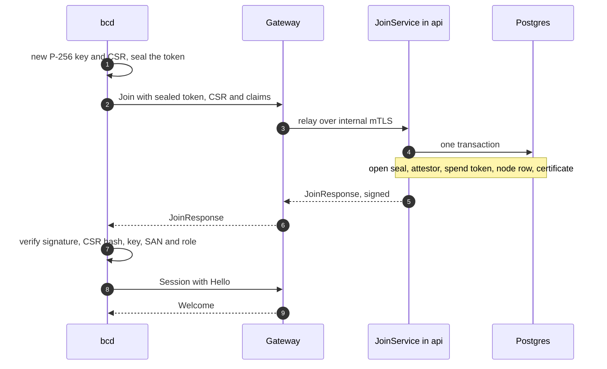
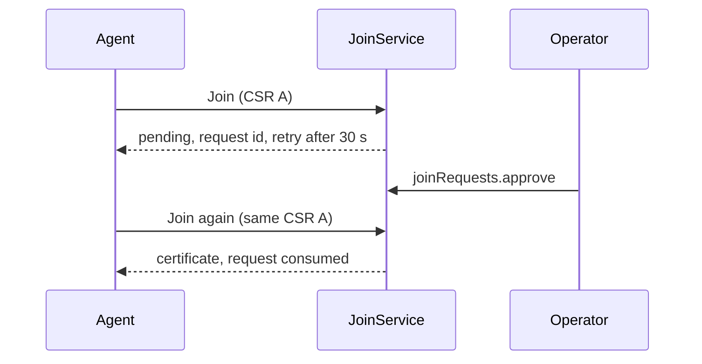

Joining turns a machine into a [node](/docs/guides/nodes): JoinService checks the machine's evidence, creates or
reclaims the node row, and signs a short-lived client certificate that the daemon uses for every later
connection. This page covers joining with a <Term id="join-token">join token</Term>, the v0.1 path for servers
you already run (a brownfield adopt). Bare-metal machines join through other
<Term id="attestor">attestors</Term>; see [attestation](/docs/guides/nodes/attestation).

<Callout type="info" title="Not published yet">
Better Compute is not on npm yet, and the Go daemon `bcd` is written but not built or released. The flow below
is what the control plane implements and what `FakeDaemon` (and `better-compute dev --sim N`) exercises today.
</Callout>

## Before you start

- **A pool that runs the daemon.** The node lands in one pool of one site. The pool must have `agent: 'bcd'`;
  `joinTokens.create` answers `INVALID_STATE` for a pool whose machines run no daemon. See
  [pools](/docs/guides/capacity/pools).
- **The machine PKI.** `better-compute pki init --trust-domain compute.example.com` writes the CAs and the two
  JoinService keys. Pass them to the server as `pki.join` (`pkiJoinCrypto({ trustDomain, nodeCa, signingKey,
  encryptionKey })`); without them every join fails with `INVALID_CONFIG`. See [PKI](/docs/operations/pki).
- **A gateway the machine can reach.** The daemon only dials out, to the regional gateway on port 443. See
  [the gateway](/docs/daemon/gateway).

## Join tokens

A join token is a single-purpose credential: it lets a limited number of machines join one pool, for a limited
time. Its bearer form is `bcjt_<id>.<secret>`, where the id is `jt_…` and the secret is 256 random bits in
base64url. The token is returned once, when it is created. The control plane stores only the SHA-256 of the
secret, so a database dump cannot be replayed as tokens.

### Creating a token

[`joinTokens.create`](/docs/reference/api/join-tokens#create) is decided as `compute:join-tokens:create` on
`compute-pool/{poolId}`. Only the pool's owner tenant can mint tokens for it; any other tenant gets
`NOT_FOUND`.

```ts title="join-token.ts"
const created = await compute.api.joinTokens.create(credential, {
  tenantId: rootTenantId,
  poolId,
  ttlSeconds: 3600,
  maxUses: 1,
  expect: { serial: 'SN-7701' },
  idempotencyKey: 'adopt-rack-b7-u12',
});

// `bcjt_jt_….…`: hand it to the machine out of band. It is never shown again.
console.log(created.token);
```

The same call from the CLI (`key:=value` sets JSON, `a.b=value` nests):

```bash
better-compute api joinTokens.create tenantId=$TENANT poolId=$POOL ttlSeconds:=3600 \
  expect.serial=SN-7701 idempotencyKey=adopt-rack-b7-u12 --query token
```

<TypeTable
  type={{
    tenantId: { type: 'string', description: 'The pool owner tenant.', required: true },
    poolId: { type: 'string', description: 'The pool machines join. Its site becomes the token site.', required: true },
    ttlSeconds: { type: 'number', description: 'Lifetime, 60 to 86,400 seconds (one day).', required: true },
    maxUses: { type: 'number', description: 'How many machines may join with it, 1 to 10,000.', default: '1' },
    expect: { type: '{ productUuid?, serial?, mac?, gpuUuid? }', description: 'Binds the token to one machine; name at least one identifier. mac is aa:bb:cc:dd:ee:ff, gpuUuid starts with GPU-.' },
    allowReclaim: { type: 'boolean', description: 'Lets a known machine with a new key reclaim its node.', default: 'false' },
    idempotencyKey: { type: 'string', description: 'Scoped to the tenant and the calling identity.', required: true },
  }}
/>

The answer is the token record (`id`, `poolId`, `siteId`, `role: 'node'`, `usesLeft`, `expect`, `allowReclaim`,
`expiresAt`) plus `token`. A retry with the same idempotency key returns the record without `token`; the same
key with a different pool, `expect` or `allowReclaim` fails with `CONFLICT`. Creating a token publishes
`security.join-token.created`, whose `pinned` field says whether it has an `expect` binding.

[`joinTokens.list`](/docs/reference/api/join-tokens#list) (`compute:join-tokens:read`) lists a pool's live
tokens, and every token with `includeInactive: true`; pages hold up to 200 (100 by default).
[`joinTokens.revoke`](/docs/reference/api/join-tokens#revoke) (`compute:join-tokens:revoke`) ends a token at
once and publishes `security.join-token.revoked`. Revoking twice is not an error.

### Token roles

Every token row has a role, which decides what kind of agent it can admit.

| Role | Admits | Minted by |
| --- | --- | --- |
| `node` | a `bcd node` into one pool | `joinTokens.create` |
| `site` | a `bcd site` agent into one site | [`siteTokens.create`](/docs/reference/api/site-tokens#create) (v0.2, `compute:sites:manage` on the site, at most 16 uses) |
| `provisioned` | the operating system a deploy installed | the provisioning engine's `userdata.render` step, single use |
| `discovery` | a PXE-booted ramdisk | the bare-metal boot step, one per MAC and bound to it, single use |

A token presented for another role is refused. Modules mint the last two through `ctx.pki.issueJoinToken`, and
they travel through the control plane only as secret references, never in a command body. They are covered in
[attestation](/docs/guides/nodes/attestation).

### Binding a token to one machine

A token with `maxUses: 1` still admits whichever machine presents it first. `expect` pins it to one machine:
every identifier you name must be among the machine's claims. The comparison normalizes formats first:

- `productUuid` is compared lower case and dashed, and a placeholder UUID never matches;
- `serial` matches the product, board or chassis serial, case-insensitively;
- `mac` must be a permanent, globally administered MAC of a physical NIC (separators and case do not matter);
- `gpuUuid` is compared case-insensitively.

A mismatch refuses the join without consuming the token.

## The join flow



1. **Key and CSR.** The daemon generates a P-256 key (kept in the TPM when there is one) and a PKCS#10 request.
2. **Sealed token.** The token is encrypted as a compact JWE (`ECDH-ES+A256KW`, `A256GCM`) to the JoinService
   encryption key pinned in the daemon's config. The protected header carries `typ: bcjt+jwe`, `iat` and `csr`,
   the SHA-256 of the request. The gateway relays the call but can neither read the token nor replay the sealed
   blob with a CSR of its own: JoinService refuses a seal made for another CSR.
3. **Join.** `Join` carries the sealed token, the CSR, the hardware claims (product UUID and serials, permanent
   MACs, GPU UUIDs, hostname), the attestor name (empty means `join-token`) and the requested role. It travels
   over TLS that authenticates the gateway against the pinned serving CA.
4. **Admission, in one transaction.** JoinService opens the seal, then the `join-token` attestor locks the token
   row and checks the secret (in constant time), revocation, expiry at `compute_now()`, the remaining uses and
   the role, and consumes one use. JoinService then enforces `expect`, the placeholder rule and the reclaim
   rules below, checks that the pool runs the daemon and belongs to the token's tenant, and inserts the node in
   `adopting` with `identityGeneration` 1. It writes the node's authorization projection row, publishes
   `node.joined` and writes the `node.joined` audit row. A node in a pool without acceptance checks (and a site
   agent) is queued for its controllers at once and adopted; when the pool runs acceptance checks the node is
   still disconnected, so JoinService does not queue it, and its first `Hello` wakes the controller that starts
   acceptance.
5. **Signed response.** The answer is `JoinResponse{ body, sig }`, signed with the pinned join-signing key. The
   body holds the node id, the certificate chain, the command-signing trust bundle, `csr_sha256`, the trust
   domain, the site and the role. The daemon checks, in order: the signature under the pinned key, that
   `csr_sha256` is its own request's, that the leaf certifies its key, the SPIFFE SAN, and the role.
6. **Session.** The daemon opens its session with `Hello`. See [sessions](/docs/daemon/sessions).

No step of the join calls better-iam.

### Refusals

The agent never learns why a join failed: every refusal is the same `ACCESS_DENIED` ("Join refused"), so a
stolen or guessed token reveals nothing. The reason is recorded server-side as a `security.join.refused` event
with `attestor`, `reason` (`<attestor>:<reason>`), `role`, and hashes only (`csrSha256`, `hardwareKey`). The
event goes to the token's tenant only once the token's secret verified; before that it goes to the root tenant,
so an unauthenticated caller cannot write into another tenant's event stream. Events are rate-limited to 60 per
attestor and reason per minute, and each carries `suppressed`, the count dropped since the last one. The
reasons you will see for token joins:

| Reason | Meaning |
| --- | --- |
| `join-token:malformed`, `unknown`, `secret-mismatch` | Not a token, or not one of ours |
| `join-token:revoked`, `expired`, `exhausted` | A real token that no longer admits anyone |
| `join-token:role-mismatch` | The agent asked for a role the token does not admit |
| `join:token` | The seal could not be opened, or was made for another CSR |
| `join:expect` | The claims do not match the token's `expect` |
| `join:placeholder-hardware` | Placeholder identifiers without an `expect` binding |
| `join:reclaim` | A known machine without `allowReclaim`, or in another tenant, site, pool or role |
| `join:pool`, `join:tenant`, `join:site` | The pool is missing or runs no daemon, belongs to another tenant, or the site does not match |

Two failures are not refusals: a missing JoinService configuration is `INVALID_CONFIG`, and two joins of the same
machine racing each other end with one `CONFLICT` ("This machine joined concurrently; retry").

## Node certificates

The certificate is the node's identity from here on. Its properties:

- **Key and lifetime.** ECDSA P-256, at most 24 hours (JoinService's `certTtlSeconds`, default and maximum
  86,400). Ramdisk certificates last at most 2 hours, and an attestor may shorten either.
- **Name.** One URI SAN, the <Term id="spiffe-id">SPIFFE ID</Term>
  `spiffe://<trustDomain>/site/<siteId>/node/<nodeId>`. Names come only from JoinService, never from the CSR's
  subject, and no tenant appears in the certificate.
- **Role.** One subject attribute `OU=bc-role:<role>` holds `node`, `site`, `ramdisk` or `node-tenant`. The
  certificate carries no private-arc OID, so Go's `crypto/x509` (and bcd) can parse it. See
  [PKI](/docs/operations/pki).
- **Record.** Every issued certificate is a `node_certs` row with its serial, identity generation, SPKI hash and
  DER, which is what later renewals and attested results are checked against.
- **Allowed kinds.** An attestor may restrict the command kinds a certificate accepts (`allowedKinds`: exact
  kinds or `prefix.*`). The command queue refuses other kinds at enqueue with `INVALID_STATE`, and the gateway
  checks again at dispatch. See [commands](/docs/guides/nodes/commands).

### Renewal

`bcd` renews at about 60% of the lifetime with `Renew`, proving possession of its **current** key. The request
carries a new CSR, the current chain, `client_time` and `pop_sig`: a signature by the current key under purpose
`renew-pop` over the CSR's SHA-256, the node id and the client time. JoinService in `api` verifies it; the
gateway only relays, so a compromised gateway cannot mint certificates. A renewal is refused unless:

- the presented leaf is byte for byte a `node_certs` row, unrevoked, unexpired and of the node's current identity
  generation;
- the node is not `retired`, and the caller's mTLS identity is that node;
- `client_time` is within 60 seconds of server time, and the same proof was not used in the last 120 seconds.

The new certificate keeps the role and the allowed kinds of the old one. A certificate that expired while the
machine was offline cannot be renewed; when the server has the `x509pop` attestor configured, the machine
re-joins with it within 7 days instead (see [attestation](/docs/guides/nodes/attestation)).

## Adopting a brownfield server

<Steps>
<Step>
### Create the PKI and the gateway certificate

```bash
BETTER_COMPUTE_SECRET=... better-compute pki init --trust-domain compute.example.com
better-compute pki issue-gateway --san gw.eu.example.com
```

`pki init` prints the pins the install script embeds (`pki show` prints them again). See
[PKI](/docs/operations/pki).
</Step>
<Step>
### Create a join token

Use `joinTokens.create` as above, one token per machine with an `expect` binding when you know its serial or
MAC.
</Step>
<Step>
### Generate the install script

```bash
better-compute daemon install-script --pool $POOL --site $SITE \
  --gateway-url https://gw.eu.example.com --base-url https://compute.example.com \
  --bcd-version 0.1.0 --sha256 amd64=<hex>,arm64=<hex> > install-bcd.sh
```

Instead of `--sha256`, pass `--release-manifest` and `--release-pins` to pin the digests of a signed release
manifest. The script holds no secret, so you can keep it in your provisioning repository.
</Step>
<Step>
### Run it on the server

```bash
BCD_JOIN_TOKEN=bcjt_... sudo -E sh install-bcd.sh
# or, keeping the token out of the environment:
sudo sh install-bcd.sh < token-file
```

Download the script first: piping it into `sh` leaves no standard input for the token.
</Step>
<Step>
### Watch it join

The node appears in [`nodes.list`](/docs/reference/api/nodes#list) as `adopting`, and events `node.joined`,
`node.connected`, `node.acceptance.started` and `node.adopted` follow.
</Step>
</Steps>

The install script:

- reads the token only from `BCD_JOIN_TOKEN` or standard input, never from arguments or a URL, and refuses
  anything that does not look like `bcjt_…`;
- downloads `bcd` for the machine's architecture from `{base-url}{base-path}/downloads/bcd/{version}/linux-{arch}`
  and checks its SHA-256;
- installs these files, then runs `bcd join` with the token on standard input and enables `bcd.service`.

<Files>
  <Folder name="/usr/local/bin" defaultOpen>
    <File name="bcd" />
  </Folder>
  <Folder name="/etc/bcd" defaultOpen>
    <File name="config.toml (0600)" />
    <File name="join-encryption.jwk (0644, public)" />
  </Folder>
  <Folder name="/etc/systemd/system" defaultOpen>
    <File name="bcd.service (hardened unit)" />
  </Folder>
</Files>

```ini title="/etc/bcd/config.toml"
gateway_url = "https://gw.eu.example.com"
site = "site_…"
serving_ca_spki_pin = "sha256/…"
join_signing_key_pin = "sha256/…"
join_encryption_key_pin = "sha256/…"
```

The token is consumed by the join and never written to disk. Run without a token on a host that already has
`/etc/bcd/config.toml`, the script upgrades `bcd` in place and restarts it.

### The join key and its fallback

The pins alone cannot seal a token, so the script also writes the JoinService encryption key to
`/etc/bcd/join-encryption.jwk`. `bcd join` uses it only when its SPKI hash equals `join_encryption_key_pin`.
When the file is missing or the key was rotated, the daemon fetches `GET {basePath}/.well-known/better-compute`,
whose `join` section the server publishes when `pki.join` is configured:

```json title="GET /api/compute/.well-known/better-compute"
{
  "name": "better-compute",
  "version": "0.1.0",
  "basePath": "/api/compute",
  "protocol": { "min": 1, "max": 1 },
  "join": {
    "encryptionJwk": { "kty": "EC", "crv": "P-256", "x": "…", "y": "…" },
    "encryptionKeyPin": "sha256/…",
    "signingCertificate": "MIIB…",
    "signingKeyPin": "sha256/…"
  }
}
```

The daemon accepts these keys only when they match its pins, so the fetch needs no trust in the transport.

## Placeholder hardware and reclaims

JoinService derives the machine's <Term id="hardware-key">hardware key</Term> from its claims, exactly as the
Inventory controller does from inventory. Firmware often reports placeholder values instead of real identifiers
(`To Be Filled By O.E.M.`, `Default string`, `System Serial Number`, all-zero UUIDs, one repeated character).
They are dropped before hashing, and the key is **trusted** only when at least two independent identifiers
remain (product UUID, a serial, permanent MACs, GPU UUIDs).

- **Placeholder hardware.** When the key is missing or untrusted, or neither a product UUID nor a serial
  survived, a `join-token` join is refused (`placeholder-hardware`) unless the token has an `expect` binding. With
  one, the node joins with an untrusted key. Machines like this can also be admitted through operator approval
  with the `discovery` or `tpm` attestors (see below).
- **Reclaims.** When a machine with a trusted key that already belongs to a node joins with a new key (a
  reinstall, a replaced disk), the join is a reclaim. It needs a token with `allowReclaim`, in the same tenant,
  site and pool, for the same role; otherwise it is refused (`reclaim`). The node keeps its id, its identity
  generation goes up by one, every older certificate is revoked (`reclaimed`, with a
  `security.certificate-revoked` event), acceptance runs again, and the audit row says `node.reclaimed`. A
  machine with fewer than two identifiers never reclaims: it joins as a new node.

## Join requests and approvals

Some joins need a person to decide: a PXE-booted machine nobody expected, or a TPM whose endorsement key is not
on any allow-list. The attestors that defer (`discovery` with `approval: 'unknown-machines'` or `'always'`,
and `tpm` with `enrollment`) record a **join request** and answer the daemon with a signed deferral instead of
a certificate. Nothing is issued and no token is spent.



The request records the machine (keyed by its trusted hardware key or TPM endorsement key hash, else by site and
MAC), the claims, and the SHA-256 of the CSR the retry must present. A machine has at most one pending request;
a newer attempt refreshes it with its new CSR. An approval admits exactly one join: the retry with that CSR
consumes it inside its own join transaction. A rejected request makes a retry with that CSR fail.

| State | Meaning |
| --- | --- |
| `pending` | Waiting for a decision (24 hours by default, the attestor's `pendingTtlSeconds`) |
| `approved` | Admits one retry until it expires (`ttlSeconds`, 60 to 86,400, one hour by default) |
| `rejected` | Refused; a later decision cannot change it |
| `expired` | Pending or approved past its expiry |
| `consumed` | The approved join happened |

The `joinRequests` group (v0.2) is decided on the pool, like join tokens:

| Method | Action | Notes |
| --- | --- | --- |
| [`joinRequests.list`](/docs/reference/api/join-requests#list) | `compute:join-tokens:read` | `state` defaults to `pending`; `all` lists every state. Shows the pool's requests and its site's requests no pool claimed yet. |
| [`joinRequests.approve`](/docs/reference/api/join-requests#approve) | `compute:join-tokens:create` | Assigns the pool. Approving twice returns the approval; any other decided state is `INVALID_STATE`, and so is an archived pool. |
| [`joinRequests.reject`](/docs/reference/api/join-requests#reject) | `compute:join-tokens:create` | Also withdraws an approval the machine has not used yet. |

```ts title="approve.ts"
const { items } = await client.joinRequests.list({ tenantId, poolId });
for (const request of items) {
  console.log(request.id, request.attestor, request.mac, request.vouchedBy, request.claims);
}

await client.joinRequests.approve({
  tenantId,
  poolId,
  requestId: items[0].id,
  ttlSeconds: 900,
  reason: 'rack B7 intake, ticket 4411',
});
```

A request shows what the attestor saw: `attestor`, `claims`, `hardwareKey` (hex), `mac`, `ip`, `workflowId`,
`vouchedBy` and `bootLeaseEpoch` (the site agent that vouched for a discovered machine), `csrSha256`, and the
decision fields `decidedAt`, `decidedBy`, `reason` and `consumedAt`. Decisions publish
`security.join-request.approved` and `security.join-request.rejected`.

## Troubleshooting

<Accordions type="single">
  <Accordion title="The daemon says Join refused">
    Read the pool owner's `security.join.refused` events (or the root tenant's, when the token itself did not
    verify). The `reason` names the check that failed. A refused join never consumes the token: the whole join
    is one transaction, and a refusal rolls it back.
  </Accordion>
  <Accordion title="joinTokens.create answers INVALID_STATE">
    The pool has `agent: 'none'`: its machines are reached through a provider API and run no daemon.
  </Accordion>
  <Accordion title="Every join fails with INVALID_CONFIG">
    The server has no JoinService keys. Pass `pki.join`, built with `pkiJoinCrypto` from the bundle
    `pki init` wrote.
  </Accordion>
  <Accordion title="The node joined but stays adopting">
    Acceptance has not passed. Look for the `AcceptanceFailed` condition on `nodes.get` and the
    `node.acceptance.failed` event, then fix the cause and call `nodes.adopt`. See
    [inventory and health](/docs/guides/nodes/inventory-and-health).
  </Accordion>
</Accordions>
