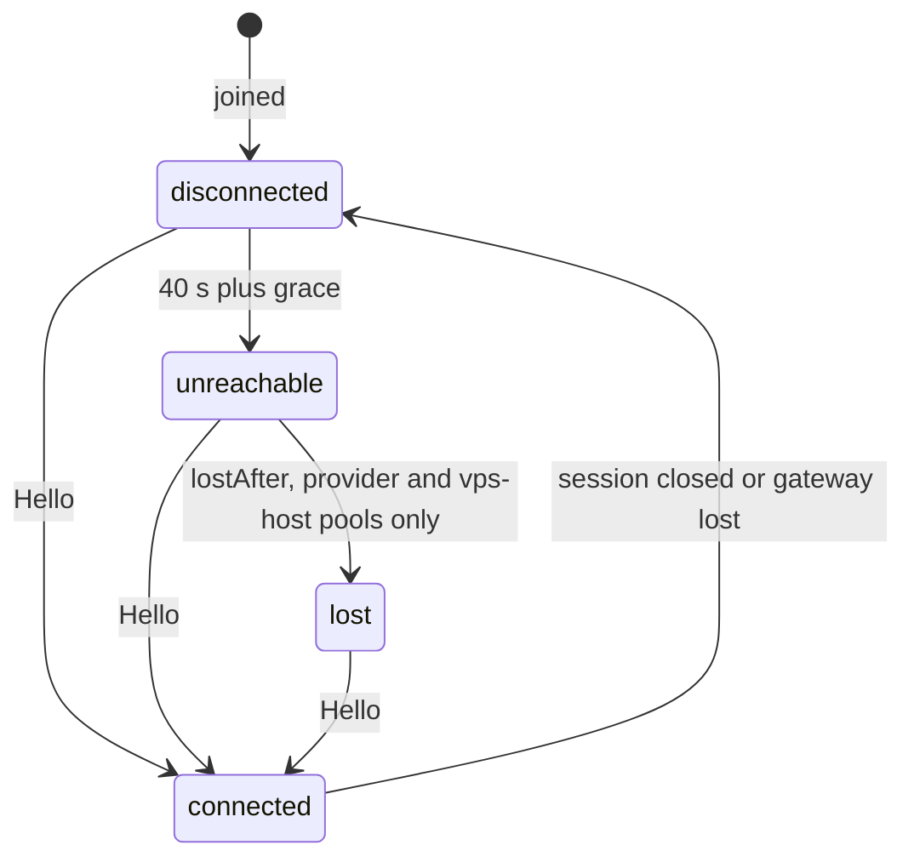

Sooner or later every node needs attention: a firmware update, a flaky GPU, a rack move, a decommission. The
`nodes` API gives you the controls, and each one moves exactly one of the node's
[independent axes](/docs/guides/nodes), so you always know what a control did and what it left alone.

Every `nodes` method except `list` is decided on `compute-node/{nodeId}`, and a tenant sees the nodes the
authorization projection holds for it; a node it cannot see is `NOT_FOUND`. Mutations accept an optional
`version`: pass the version you read, and a node that changed since fails with `CONFLICT` instead of being
overwritten. Most also take a free-text `reason` (up to 256 characters) that ends up in the event.

## Cordon and uncordon

A <Term id="cordon">cordon</Term> stops new work from landing on a node and changes nothing else: existing
allocations keep running, commands still flow, the node stays connected.

```ts
await client.nodes.cordon({ tenantId, nodeId, reason: 'BIOS update window' });
// … later
await client.nodes.uncordon({ tenantId, nodeId });
```

```bash
better-compute api nodes.cordon tenantId=$TENANT nodeId=node_… reason='BIOS update window'
```

[`nodes.cordon`](/docs/reference/api/nodes#cordon) (`compute:nodes:cordon`) sets `cordoned` and publishes
`node.cordoned`; cordoning a cordoned node returns it unchanged. [`nodes.uncordon`](/docs/reference/api/nodes#uncordon)
(same action) clears `cordoned`, ends a drain in progress, and publishes `node.uncordoned`.

## Drain

A <Term id="drain">drain</Term> is a cordon that also waits for the node to empty, so you know when it is safe to
work on it. [`nodes.drain`](/docs/reference/api/nodes#drain) (`compute:nodes:drain`) cordons the node, adds the
`draining` NoSchedule reason, publishes `node.draining`, and hands the node to the Drain controller.

The Drain controller does not evict anything in this release. It waits until the node holds no live allocation
(every allocation released, or past the end of its interval), looking again at the earliest allocation end and
at least every 5 minutes. Then it removes `draining` and publishes `node.drained`. The node stays cordoned until
you call `nodes.uncordon`. Forced release within the pool's disruption budget is planned for v0.4.

```ts
await client.nodes.drain({ tenantId, nodeId, reason: 'replace PSU' });
// Wait for the node.drained event (see the events guide), or poll:
const node = await client.nodes.get({ tenantId, nodeId });
const drained = node.cordoned && !node.noScheduleReasons.includes('draining');
```

Draining a node that is already draining changes nothing. To shorten a drain, release the reservations on it;
see [reservations](/docs/guides/capacity/reservations).

## Taints

A <Term id="taint">taint</Term> is a named NoSchedule reason you own. Use it when you want a node out of placement
for a reason that should stay visible, next to the conditions and liveness reasons the controllers write.

```ts
await client.nodes.taint({ tenantId, nodeId, add: ['rma-pending'], remove: ['burn-in'] });
```

[`nodes.taint`](/docs/reference/api/nodes#taint) (`compute:nodes:update`) adds and removes up to 32 keys each,
stored in `noScheduleReasons` as `taint:<key>`. A key is 1 to 128 letters, digits and `. _ / = : -`, starting
and ending with a letter or digit, and cannot be added and removed in one call. The method only ever moves
operator taints: conditions, `unreachable` and `draining` belong to their controllers. It publishes
`node.tainted`. Any entry in `noScheduleReasons` keeps a node out of placement, with one exception.

**Dedicating a node to a tenant.** The taint `dedicated=<tenantId>` (stored as `taint:dedicated=acme`) keeps every
other tenant off the node but not that tenant: placement for `acme` tolerates a dedication to `acme` and nothing
else, on every placement path (inline, shortlist, pool-lease index, bulk commits and BookingRepair) and for
whole-node leases (`binding: 'node'` reservations in a `tenantRoot` pool, see
[dedicated-root metal](/docs/guides/bare-metal/dedicated-root)), which ignore every other NoSchedule reason: a node
dedicated to `acme` is never leased by another tenant. A dedication together with any other reason, or
dedications to two tenants, blocks everyone. Capacity rollups still count a dedicated node as NoSchedule (bucket
`unhealthy`). A node that becomes schedulable for its one dedicated tenant still fires the wake edge, so that
tenant's pending reservations are placed at once instead of on their 30-second retry.

```ts
await client.nodes.taint({ tenantId, nodeId, add: ['dedicated=acme'] });
```

## Labels

Labels describe a node for placement: selectors in reservations match device attributes and node labels (see
[placement](/docs/guides/capacity/placement)). Inventory writes its own labels (`gpu.model`, `cpu.arch`, …);
[`nodes.label`](/docs/reference/api/nodes#label) (`compute:nodes:update`) manages yours.

```ts
const node = await client.nodes.label({
  tenantId,
  nodeId,
  set: { rack: 'b7', 'fabric/rail': '3' },
  remove: ['burn-in'],
});
```

`set` takes up to 64 labels and `remove` up to 64 keys. A key is up to 128 characters of letters, digits and
`. _ / -`, starting and ending with a letter or digit; a value is up to 256 characters of letters, digits and
`. _ : / @ + = -`. Setting a key that inventory or the system owns is `INVALID_INPUT`, and
`remove` only removes operator labels. The call returns the node with its labels and publishes `node.labeled`.

## Maintenance

`maintenance` is a separate axis from `cordoned`. It marks a node that needs an operator, and a node in
maintenance is reported in the `maintenance` capacity bucket and never scheduled. In this release it is turned
on by the system, not by an API call:

- a bare-metal workflow that fails or is aborted sets `provisionState: 'failed'` and turns maintenance on (see
  [bare-metal workflows](/docs/guides/bare-metal/workflows));
- health remediation that fails, is cancelled, or does not clear the fault in two attempts turns maintenance on
  and publishes `node.remediation.escalated` (see [inventory and health](/docs/guides/nodes/inventory-and-health)).

## Liveness and connectivity

A node's `connectivity` says whether it has a live session, not whether it is healthy or whether its workloads
run. The daemon sends a heartbeat every 10 seconds, the gateway keeps the last-seen time in memory and flushes
ages to Postgres every 15 seconds, and the node's liveness lease lasts 40 seconds.



| Transition | When | Effect |
| --- | --- | --- |
| to `connected` | the node's `Hello` | `node.connected`; clears the `unreachable` reason and the `NodeUnreachable` condition |
| to `disconnected` | the session closes, or its gateway's lease expires | `node.disconnected` with reason `gateway-lost` or `no-session` |
| to `unreachable` | 40 seconds after the node was last seen, plus grace; a node that joined but never opened a session counts from its join (its newest certificate's `issued_at`) | adds the `unreachable` NoSchedule reason, sets `NodeUnreachable` (`HeartbeatTimeout` or `GatewayLost`), publishes `node.unreachable` |
| to `lost` | the pool's `policy.lostAfter` after it became unreachable | `node.lost` |

Grace keeps an infrastructure problem from looking like a fleet of dead machines: 120 seconds after a gateway
loss, so sessions can move to another gateway, and 5 minutes after the Liveness controller or the database was
down for more than 20 seconds, so ages that could not be flushed meanwhile do not count against nodes.

"Last seen" is the later of the session's flushed `last_seen` and `disconnected_at`, else its `connected_at`. A node
that has joined but whose first `Hello` is still queued (a whole rack powering on at once) has none of these yet, so
both the Liveness sweep and the per-node check fall back to its newest `node_certs.issued_at`: it gets the same 40
seconds from its join instead of being marked unreachable the moment it joins.

### Disconnected is not dead

None of these transitions releases anything. Allocations, bookings and queued commands stay exactly as they
were: an unreachable node is only kept out of new placement. A partitioned server usually keeps running its
workloads, and releasing its GPUs to someone else would double-book hardware that is still in use. `lost` is
applied automatically only to nodes of `provider` and `vps-host` pools that set `policy.lostAfter`, never to bare
metal (a `vps-host` pool opts in so that its hosted instances can be recreated elsewhere). When the
node reconnects, it resumes where it left off: the gateway replays its unfinished commands and the desired state
it missed (see [delivery](/docs/daemon/delivery)).

## Revoking a node's identity

When you suspect a node's key is compromised, or you are handing the machine to someone else, revoke its
identity. [`nodes.revokeIdentity`](/docs/reference/api/nodes#revokeidentity) (`compute:nodes:revoke-identity`):

- revokes every live certificate of the node (with your `reason`, or `identity revoked`);
- raises `identityGeneration`, so no certificate of the old generation can renew or re-join with `x509pop`;
- publishes `security.node.identity-revoked` and returns `{ node, revokedCertificates }`.

A gateway that runs a revocation feed (`createRevocationFeed` from `@better-compute/pki`, which polls
`node_certs` every second by default) learns about the revocation from Postgres and closes the node's live
session at once; without a feed, a revoked certificate keeps its session until it expires. The machine can come
back only by joining again with fresh evidence, such as a new join token.

The gateway revokes a certificate on its own when it looks cloned: after more than 3 alternations between two
machines within 10 minutes it quarantines the certificate with reason `duplicate-identity` and publishes
`security.node.quarantined`. Watch `security.node.duplicate-session` to see it coming, then find the copy and
re-join the real machine. See [duplicate identity](/docs/daemon/sessions#duplicate-identity).

## Adopting again

[`nodes.adopt`](/docs/reference/api/nodes#adopt) (`compute:nodes:provision`) re-runs acceptance on a node in
`adopting` or `adopted`; any other state is `INVALID_STATE`. An adopted node goes back to `adopting` and leaves
placement until the checks pass. See [acceptance checks](/docs/guides/nodes/inventory-and-health).

## Deleting a node

[`nodes.delete`](/docs/reference/api/nodes#delete) (v0.2, `compute:nodes:delete`) removes a node that is done
for good or never got going. It accepts only:

- a `retired` node;
- a node still in `adopting` or `enrolling`, or one that failed during enrollment;
- and only when the node has no open allocation (`INVALID_STATE` with the count otherwise).

In one transaction it makes the node's devices unbookable, removes its scalar resources and rebuilds the pool's
capacity rollup, revokes its certificates (`node-deleted`), frees its attestor bindings and trusted hardware key,
cancels its pending commands, and removes it from every tenant's projection. The row itself stays as a tombstone
(`deletedAt`), because audit rows, certificates, inventory snapshots and past allocations still reference it.
The machine can then join again as a new node. A retry of the same delete returns `{ nodeId, deleted: false }`,
and `node.deleted` is published once.

For bare-metal nodes, retire through the metal workflow first; see
[bare-metal workflows](/docs/guides/bare-metal/workflows).

## The nodes API

| Method | Action | Phase | What it does |
| --- | --- | --- | --- |
| [`list`](/docs/reference/api/nodes#list) | `compute:nodes:read` on the tenant, then per item | v0.1 | Filters: `poolId`, `siteId`, `cordoned`, `provisionState`; up to 50 per page |
| [`get`](/docs/reference/api/nodes#get) | `compute:nodes:read` | v0.1 | The node with labels, conditions and its session |
| [`events`](/docs/reference/api/nodes#events) | `compute:nodes:read` | v0.1 | The node's events, oldest first; `type` filters by prefix (`node.`, `security.`), up to 200 per page |
| [`cordon`](/docs/reference/api/nodes#cordon), [`uncordon`](/docs/reference/api/nodes#uncordon) | `compute:nodes:cordon` | v0.1 | Stop or resume new placement |
| [`drain`](/docs/reference/api/nodes#drain) | `compute:nodes:drain` | v0.1 | Cordon and wait for the node to empty |
| [`label`](/docs/reference/api/nodes#label), [`taint`](/docs/reference/api/nodes#taint) | `compute:nodes:update` | v0.1 | Operator labels and NoSchedule taints |
| [`adopt`](/docs/reference/api/nodes#adopt) | `compute:nodes:provision` | v0.1 | Re-run acceptance |
| [`revokeIdentity`](/docs/reference/api/nodes#revokeidentity) | `compute:nodes:revoke-identity` | v0.1 | Revoke every certificate, new identity generation |
| [`delete`](/docs/reference/api/nodes#delete) | `compute:nodes:delete` | v0.2 | Tombstone a retired or never-adopted node |
| [`issueSshCert`](/docs/reference/api/nodes#issuesshcert) | `compute:nodes:ssh-root` | v0.3 | Break-glass SSH certificate; see [SSH](/docs/guides/access/ssh) |

To run diagnostics, collect logs or reboot a node, use [commands](/docs/guides/nodes/commands).
