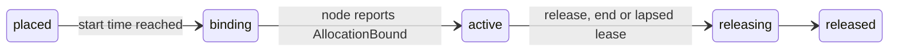

This walkthrough runs a complete control plane on your laptop: PGlite as the database, an embedded Better IAM, a
gateway, and eight simulated HGX H100 machines that join the way the real daemon does. You then reserve four GPUs,
see where they were placed, watch capacity change, and release them. Nothing above the daemon is mocked: the
machines get sealed join tokens, call the Join RPC, open a Session stream, pass `diag.nvml` acceptance and are
adopted by the real runtime.

<Callout title="Requirements">
  Node.js 22.12 or newer; 22.18 or newer to load a TypeScript configuration such as the one in `examples/dev`,
  because Node.js strips types by default from 22.18. No database server is needed. Better Compute is not on npm
  yet, so you build it from a clone.
</Callout>

<Steps>
<Step>

### Clone and build

The workspace pins pnpm 11.19.0. Install with that version once, then run the pinned copy from `node_modules`
(pnpm 12 refuses this workspace):

```bash
git clone https://github.com/better-compute/better-compute.git
cd better-compute
npx pnpm@11.19.0 install
node node_modules/pnpm/bin/pnpm.mjs build   # tsc -b: every package's dist/
```

The install resolves every `better-iam` and `@better-iam/*` package from the tarballs in `vendor/better-iam`, so it
needs no registry access for Better IAM.

</Step>
<Step>

### Put the CLI on your path

The `better-compute` command is `packages/cli/dist/index.js`. Point a shell alias at it, from the repository root:

<Tabs items={['bash / zsh', 'PowerShell']}>
<Tab value="bash / zsh">

```bash
alias better-compute="node '$PWD/packages/cli/dist/index.js'"
better-compute version   # 0.1.0
```

</Tab>
<Tab value="PowerShell">

```text
$bc = "$PWD\packages\cli\dist\index.js"
function better-compute { node $bc @args }
better-compute version
```

</Tab>
</Tabs>

`better-compute help` lists every command, and `better-compute help dev` shows one. The
[CLI reference](/docs/reference/cli) has them all.

</Step>
<Step>

### Start the development server with simulated machines

`examples/dev` is a configuration with every module registered (provision and metal, vps, events, fleet) and a
host export that adds server-sent events at `GET /watch`:

```bash
cd examples/dev
better-compute dev --memory --sim 8
```

- `dev` runs the API and every worker role on `127.0.0.1:3000`, and always migrates first.
- `--memory` uses a throwaway in-memory PGlite. Leave it out to keep the data between runs.
- `--sim 8` adds a gateway on loopback (cleartext HTTP/2, sessions authenticated by a header, for local development
  only) and joins eight simulated machines through it. `--sim-variant l40s` gives 4×L40S machines instead;
  `hgx-h100-gpu-missing` gives machines that fail acceptance and are never adopted; `cpu` gives machines without GPUs.

The configuration has no IAM wired in, so `--sim` starts an embedded, in-memory Better IAM and prints a root
administrator's token for it. Standard error shows:

```text
Development database: pglite:memory for …/examples/dev/better-compute.config.ts
better-compute listening on http://127.0.0.1:3000/api/compute
Workers running: controllers, scheduler, sinks, iam
Dev gateway (h2c, header auth, loopback only): http://127.0.0.1:52011
Embedded IAM root tenant …; root token (dev only): biam_ses_…
Joined 8 simulated hgx-h100 node(s) into pool_…
8 simulated node(s) adopted
```

Behind those lines, `dev` created a shared <Term id="site">site</Term> in region `dev-1`, a `metal-host`
<Term id="pool">pool</Term> for `H100` GPUs whose acceptance policy runs `diag.nvml` and expects 8 GPUs, and one
<Term id="join-token">join token</Term> with `maxUses` 8. Each simulated machine joined with it, received a node
certificate, opened its session, passed acceptance, and became `adopted` at desired-state generation 1, which is when
the placer starts to consider it. Leave this terminal running.

<Accordions type="single">
<Accordion title="Without the example configuration">

`dev` also works with no configuration at all. In an empty directory, `better-compute dev --memory --sim 8` runs the
server's own groups and the built-in `inventory` and `capacity` modules, with a development secret generated once in
`.better-compute/dev-secret`. Everything below works except `GET /watch`, which the example's host export adds.

</Accordion>
</Accordions>

</Step>
<Step>

### Look around

Open a second terminal, define the alias again with the path of your clone, and act as the root administrator that
`dev` printed. With
`BETTER_COMPUTE_URL` set, the CLI calls the running server over HTTP instead of loading a configuration:

```bash
export BETTER_COMPUTE_URL=http://127.0.0.1:3000
export BETTER_COMPUTE_TOKEN='biam_ses_…'   # the root token dev printed
export BETTER_COMPUTE_TENANT='…'           # the root tenant dev printed

better-compute api system.whoami
better-compute api nodes.list tenantId=$BETTER_COMPUTE_TENANT --format table
better-compute pools list --query "items[].id"
```

- `api GROUP.METHOD key=value …` calls any method; `key:=json` passes JSON values. `api --list` prints every route
  with the IAM action it is decided on.
- `nodes.list` shows eight nodes with `provisionState` `adopted`.
- The capacity shortcuts (`pools list`, `capacity`, `reserve`, `release`, `extend`, `reservations list|get`) read
  the tenant from `--tenant` or `BETTER_COMPUTE_TENANT`.

Copy the pool id and look at its capacity:

```bash
export POOL=pool_…   # the id pools list printed
better-compute capacity --pool $POOL
```

The rollup reports, per resource, `total`, `allocatable`, `allocated`, `reserved` and `available`, plus the GPUs
that are `provisioning`, `unhealthy`, in `maintenance` or `unreachable`. Eight adopted H100 boards give 64 allocatable
GPUs.

</Step>
<Step>

### Reserve GPUs

```bash
better-compute reserve --pool $POOL --gpus 4 --for 1h
```

`reserve` calls [`reservations.create`](/docs/reference/api/reservations#create). The request goes through the full
admission sequence: the tenant pre-check, an idempotency lookup, a draft reservation, exactly one Better IAM decision
on `compute:reservations:create`, then placement in a second transaction. The CLI prints the idempotency key it
generated on standard error; repeat the command with `--key` and the same value to retry safely without booking twice.

The pool's owner gets an effectively unlimited GPU quota when the pool is created, so this reservation fits. To
try a cap, set one with `better-compute api quotas.set tenantId=$BETTER_COMPUTE_TENANT poolId=$POOL resource=gpu max:=4`
and reserve again: the second request fails with `QUOTA_EXCEEDED`. See
[quotas and usage](/docs/guides/capacity/quotas-and-usage).

With the default inline placer, the answer is already `placed`: the placer picked one node, locked it and its GPUs,
and inserted four bookings. The reservation then moves on without you:



Read it back, with the id `reserve` printed:

```bash
better-compute reservations get rsv_… --query state     # active
better-compute reservations get rsv_… --query binding
```

```json
{
  "nodeId": "node_…",
  "cdiDevices": ["bcd.dev/gpu=GPU-…", "bcd.dev/gpu=GPU-…", "bcd.dev/gpu=GPU-…", "bcd.dev/gpu=GPU-…"],
  "envFile": "/run/bcd/allocations/alloc_….env"
}
```

The binding is a `hold`: the node's desired state gained a device assignment, and the (simulated) daemon wrote a CDI
spec for exactly the four booked GPUs and reported them. A workload manager on the node, such as Slurm, Kubernetes or
containerd with CDI, consumes those device names. Run `better-compute capacity --pool $POOL` again: `allocated` is 4
and `available` is 60.

</Step>
<Step>

### Watch events

Events leave through a transactional outbox. The example's `/watch` route streams your tenant's events as
server-sent events:

```bash
curl -N -H "Authorization: Bearer $BETTER_COMPUTE_TOKEN" \
  "http://127.0.0.1:3000/watch?types=node.*,reservation.*"
```

In another terminal, cordon a node and watch `node.cordoned` arrive:

```bash
better-compute api nodes.cordon tenantId=$BETTER_COMPUTE_TENANT nodeId=node_… reason=demo
```

A cordoned node keeps its current reservations; the placer just stops choosing it. `nodes.uncordon` reverses it.

</Step>
<Step>

### Release

```bash
better-compute release rsv_…
better-compute capacity --pool $POOL
```

`release` calls [`reservations.release`](/docs/reference/api/reservations#release). The bookings are truncated to
the current database time, the device assignment leaves the node's desired state, and `available` returns to 64.
Billing covers reserved time, from `active` until the release. A reservation that has not started yet is withdrawn
with `release --cancel` instead.

</Step>
</Steps>

## The same calls over HTTP and TypeScript

Every CLI command above is a call to the HTTP API, `POST /api/compute/{group}/{method}`. Requests need a JSON body,
`content-type: application/json` and `X-Better-Compute: 1`; answers are `{ "data": … }` or
`{ "error": { "code", "message" } }`:

```bash
curl -s http://127.0.0.1:3000/api/compute/pools/list \
  -H "Authorization: Bearer $BETTER_COMPUTE_TOKEN" \
  -H "content-type: application/json" -H "x-better-compute: 1" \
  -d "{\"tenantId\": \"$BETTER_COMPUTE_TENANT\"}"
```

In TypeScript, the client is typed by your server instance through a type-only import, so every group, method,
input and result is checked without code generation:

```ts title="reserve.ts"
import { createComputeClient } from 'better-compute/client';
import type { compute } from './compute.server'; // type-only: your betterCompute() instance

const client = createComputeClient<typeof compute>({
  baseURL: 'http://127.0.0.1:3000',
  token: () => process.env.BETTER_COMPUTE_TOKEN,
});

const reservation = await client.reservations.create({
  tenantId,
  poolId,
  devices: [{ class: 'gpu', count: 4 }],
  duration: 3_600_000, // milliseconds in the TypeScript type; over HTTP "1h" works too
  binding: 'hold',
  idempotencyKey: 'quickstart-1', // retrying with the same key returns the same reservation
});
```

See [the TypeScript client](/docs/guides/clients/typescript-client).

## Your own configuration

`better-compute init` writes a starter `better-compute.config.ts` in the current directory, and never overwrites an
existing one. This is what it writes, with its comments shortened:

```ts title="better-compute.config.ts"
import { unconfiguredIam, type CommandSpec } from 'better-compute/cli';
import { pglite } from 'better-compute/pglite';
import { postgres } from 'better-compute/postgres';
import { defineConfig } from 'better-compute/server';

export default defineConfig(({ env = process.env, cwd = process.cwd() } = {}) => ({
  database: env.BETTER_COMPUTE_DATABASE_URL
    ? postgres({ url: env.BETTER_COMPUTE_DATABASE_URL })
    : pglite({ dataDir: `${cwd}/.better-compute-pglite` }),
  secret: env.BETTER_COMPUTE_SECRET ?? '',
  baseURL: env.BETTER_COMPUTE_BASE_URL ?? 'http://localhost:3000',
  rootTenantId: 'root',
  iam: unconfiguredIam(),
}));

export const commands: CommandSpec<any>[] = [];
```

It imports the umbrella package's subpaths, so run it in a project where `better-compute` resolves, with the
optional peers `@electric-sql/pglite` (for PGlite) and `@better-iam/server`, `@better-iam/core` and
`@better-iam/adapter-sqlite` (for the embedded Better IAM of `--sim`) installed. See
[Installation](/docs/guides/installation) for installing from the packed tarballs. The template reads the secret
from the environment, and `betterCompute()` refuses one shorter than 32 characters with `INVALID_CONFIG`:

```bash
better-compute init
export BETTER_COMPUTE_SECRET=$(node -e "console.log(require('node:crypto').randomBytes(32).toString('base64url'))")
better-compute dev --sim 4
```

`dev` finds the configuration by walking up from the working directory. `unconfiguredIam()` authenticates nobody,
so `--sim` again starts the embedded Better IAM; once you wire a real one in, `dev --sim` acts as
`BETTER_COMPUTE_TOKEN`, which must then be a root administrator's token.

## Next steps

<Cards>
  <Card title="Concepts" href="/docs/guides/concepts">
    How the control plane, the gateway, the daemon and Better IAM fit together.
  </Card>
  <Card title="Joining nodes" href="/docs/guides/nodes/joining">
    Join tokens, the install script and what happens when a real machine joins.
  </Card>
  <Card title="Reservations" href="/docs/guides/capacity/reservations">
    Durations, leases, extensions, future starts and the reservation state machine.
  </Card>
  <Card title="Local development" href="/docs/operations/local-development">
    The dev server, the deterministic simulator and the example deployments.
  </Card>
</Cards>
