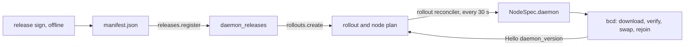
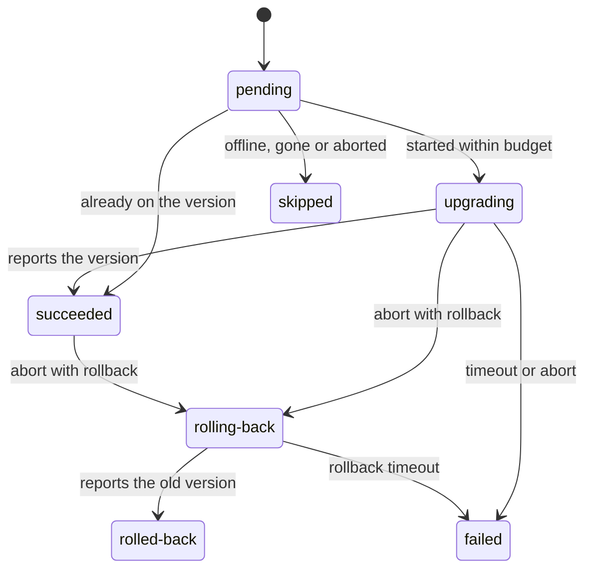

Upgrading the agent on every machine is one of the riskiest things a platform does. A bad build that crashes on one
kernel, or loses its session under load, can take a fleet offline faster than anyone can react. A
<Term id="rollout">rollout</Term> moves one signed `bcd` version through the fleet in waves (1%, 10%, 50%, 100% by
default), never disrupts more of a pool than its budget allows, pauses by itself when too many nodes of a wave fail,
waits between waves, and can send upgraded nodes back.

Nodes learn their target version through their <Term id="nodespec">NodeSpec</Term> (`daemon`), which is desired
state rather than a command: a node that was offline during the rollout converges on the right version when it
returns.

<Callout type="warn" title="Both halves written; bcd is not released">
  The control plane is shipped in `@better-compute/rollout`: releases, rollouts, the controller, `NodeSpec.daemon`
  and the `daemon.upgrade` command kind. bcd implements the node side (de9f380): it takes only a release manifest
  signed by the release keys pinned in its `[update] release_pins` (and refuses every update without pins), checks
  the sequence against its release floor, the expiry and the binary's SHA-256, stages it in the other of two slots,
  swaps with `upgrade.json` and a 120-second deadline, confirms on the new binary's first `Welcome`, and swaps back
  when none comes. `tests/e2e/bcd.test.ts` runs a real `daemon.upgrade` to a second signed build. No bcd release has
  been cut, so no fleet has self-updated yet. Install nodes with `--release-pins` so they can; see
  [self-update](/docs/daemon/install#self-update). The FakeDaemon's opt-in `selfUpdate` plays the node side in the
  simulator.
</Callout>

Nodes that run `bcd node` unprivileged beside [`bcd helper`](/docs/daemon#privilege-separation) (installed with
`daemon install-script --unprivileged`) take part in rollouts like any other: the node downloads the release, and the
root helper verifies the manifest under its own release pins, swaps root's slots and confirms on the node's
`Welcome` (2d67b25; see [self-update through the helper](/docs/daemon#self-update-through-the-helper)). Their helper
must be a build with the `update.*` operations; an older one refuses them.



## Sign a release

A <Term id="release">release</Term> is a manifest of one version's files, signed offline by keys that the control
plane knows only by their `sha256/...` pins. Nothing on a server can sign one.

<Steps>
<Step>

### Create the signing keys, once

Each release manager creates a key on their own machine and hands out only its pin:

```bash
better-compute release keygen --out ~/keys/release-alice.pem   # prints the pin
```

The public half is written to `<out>.pub.pem`, for whoever builds manifests that you cosign.

</Step>
<Step>

### Build

goreleaser in `daemon/` produces `bcd_<version>_linux_amd64` and `_arm64` as archives and as bare binaries. The
bare binary is what a node installs.

</Step>
<Step>

### Sign, and cosign up to the threshold

```bash
better-compute release sign dist --product bcd --version 1.4.0 --sequence 14 \
  --key ~/keys/release-alice.pem --cosigners ~/keys/release-bob.pub.pem
better-compute release cosign dist/manifest.json --key ~/keys/release-bob.pem
better-compute release verify dist/manifest.json --pins sha256/...,sha256/... --threshold 2 --dir dist
```

`release sign` hashes the files at the top of the directory (skipping `.sha256` files, `manifest.json` and
signature files), takes each platform from goreleaser names (`_linux_amd64`), and writes `manifest.json`. `--sequence` is the rollback counter and must grow with every release; the manifest is
valid for 365 days unless you pass `--validity-days`.

</Step>
</Steps>

The manifest body (`type: bettercompute.release`, `spec: 1`) lists `product`, `version`, `sequence`, `issuedAt`,
`expiresAt`, the signing `keys` (`kid`, `alg: ES256`, `spki`) and the `artifacts` (`name`, `platform`, `sha256`,
`size`), sorted by name. The published form is `{ manifest, signatures }`: the canonical body in base64 and one
`{ kid, sig }` per signer.

## Turn the module on

```ts title="compute.ts"
import { rolloutModule } from 'better-compute/rollout';

export const compute = betterCompute({
  // database, secret, iam, baseURL ...
  modules: [
    rolloutModule({
      release: { pins: ['sha256/...', 'sha256/...'], threshold: 2 },
      downloadsUrl: 'https://downloads.example.com',
    }),
  ],
});
```

<TypeTable
  type={{
    'release.pins': {
      type: 'string[]',
      description: 'The sha256/... SPKI pins of the release keys. Without any, rolloutModule throws INVALID_CONFIG.',
      required: true,
    },
    'release.threshold': {
      type: 'number',
      description: 'How many distinct pinned keys must have signed a manifest.',
      default: '1',
    },
    downloadsUrl: {
      type: 'string',
      description: 'An https URL; nodes download {downloadsUrl}/bcd/{version}/linux-{arch}.',
      required: true,
    },
    every: { type: 'Duration', description: 'How often active rollouts advance.', default: "'30s'" },
  }}
/>

The module only builds download URLs; it does not serve files. Put each release's bare binaries at
`{downloadsUrl}/bcd/{version}/linux-amd64` and `linux-arm64`. The api can serve them itself: with
`betterCompute({ downloads: { dir } })` (or `{ blob }`), set `downloadsUrl` to `{baseURL}{basePath}/downloads`; see
[installing bcd](/docs/daemon/install#serving-the-binaries).

The module adds the migration `rollout/0001_rollouts` (tables `daemon_releases`, `rollouts`, `rollout_nodes`), the
`rollout` reconciler and the `daemon.upgrade` command kind. Every method decides `compute:fleet:admin` on
`compute-fleet/global`, which exists only in the root tenant, so rollouts are for platform operators. See
[the releases reference](/docs/reference/api/releases) and [the rollouts reference](/docs/reference/api/rollouts).

## Register a release

`releases.register { tenantId, manifest }` verifies the signed manifest and records it:

- a threshold of distinct pinned keys signed it, its body is canonical, its product is `bcd`, and it has not
  expired. A failure is `INVALID_INPUT` with `details.reason`: `malformed`, `threshold`, `not-canonical`, `product`
  or `expired`;
- its `sequence` is above every registered release's. An older one is `INVALID_INPUT` with reason `rollback`, so the
  release channel never moves backwards;
- it lists at most one bare binary per platform, and at least one for Linux. A bare binary is an artifact with a
  platform that is not an archive, checksum, signature or metadata file. Several candidates for one platform, or no
  Linux binary, is `INVALID_INPUT`.

Registering the same manifest again returns the stored release; the same version with another sequence is
`CONFLICT`. `releases.list` returns every release, highest sequence first.

```bash
better-compute api releases.register tenantId=root manifest:=@dist/manifest.json
```

## Start a rollout

<TypeTable
  type={{
    tenantId: { type: 'string', description: 'The root tenant.', required: true },
    version: { type: 'string', description: 'A registered release (semver, a leading v is ignored).', required: true },
    poolIds: { type: 'string[]', description: '1 to 1000 pools. Default: every pool the tenant owns.' },
    waves: {
      type: 'number[]',
      description: 'Cumulative percentages: 1 to 10 increasing integers ending at 100.',
      default: '[1, 10, 50, 100]',
    },
    maxFailureRatio: {
      type: 'number',
      description: "Pause when a wave's failed / (succeeded + failed) exceeds this, 0 to 1.",
      default: '0.05',
    },
    soakSeconds: { type: 'number', description: 'Wait after a wave finishes, 0 to 604800.', default: '600' },
    upgradeTimeoutSeconds: {
      type: 'number',
      description: 'A node that has not reported the version by then failed, 60 to 86400.',
      default: '900',
    },
    idempotencyKey: { type: 'string', description: 'A retried create with the same key returns the same rollout.' },
  }}
/>

```bash
better-compute api rollouts.create tenantId=root version=1.4.0 \
  'waves:=[1,10,50,100]' soakSeconds:=600 idempotencyKey=bcd-1.4.0
```

`rollouts.create` snapshots every node with desired state (generation above 0) in the pools in scope, shuffled by
a hash of the rollout id so the canaries spread across pools, and assigns each to a wave. Every wave holds at least
one more node than the one before while nodes remain: 20 nodes with `[10, 50, 100]` make waves of 2, 8 and 10.
Nodes that already report the version start as succeeded. It publishes `rollout.started`.

| Situation | Error |
| --- | --- |
| The version is not registered, or a pool is unknown | `NOT_FOUND` |
| No node in scope runs bcd yet | `INVALID_STATE` |
| A node is already in a running or paused rollout (one writer per node) | `CONFLICT`, with `details.rolloutId` |
| The idempotency key was used for another version | `CONFLICT` |
| Waves, ratios or times out of range | `INVALID_INPUT` |

## How the controller advances

The `rollout` reconciler wakes every 30 seconds and queues each running or paused rollout, and each aborted one
that is still rolling nodes back; `resume` and `abort` queue theirs at once. One pass locks the rollout and does
this:

<Steps>
<Step>

### Settle nodes in flight

A node succeeds (or finishes rolling back) when it rejoins and reports the target version in its `Hello`
(`node_sessions.daemon_version`). One that has not after `upgradeTimeoutSeconds` fails (`timeout` or
`rollback-timeout`), and its NodeSpec goes back to the version it ran before. This step runs even while the rollout
is paused.

</Step>
<Step>

### Apply the failure gate

If `failed / (succeeded + failed)` in the current wave exceeds `maxFailureRatio`, the rollout pauses with a reason
such as `failure gate: 4 of 6 node(s) in wave 2 failed` and publishes `rollout.paused`.

</Step>
<Step>

### Soak, then advance

When no node of the wave is pending or upgrading, the controller waits `soakSeconds` from the last node's finish.
Then the next wave starts (`rollout.wave`, with the wave and its percentage), or, after the last wave, the rollout
completes (`rollout.completed`).

</Step>
<Step>

### Start nodes within the budget

Pending nodes of the current wave start in order. A node that no longer exists is skipped (`node-gone`), a node that
is not connected is skipped (`offline`), and a node already on the version succeeds. Any other starts only if its
pool's disruption budget has room; otherwise it waits for the next pass.

</Step>
</Steps>



A rollout itself is `running`, `paused`, `completed` or `aborted`.

### The disruption budget

A pool's `policy.disruptionBudget` (a fraction from 0 to 1, default 0.05) is shared with
[health remediation](/docs/guides/nodes/inventory-and-health): a node counts as disrupted while it has a pending, running or
paused workflow, or an upgrade or rollback in flight. At most `max(1, floor(nodes × budget))` nodes of a pool are
disrupted at once, so a pool of fewer than 40 nodes upgrades one node at a time under the default, and a pool of 10
with a budget of 0.2 upgrades two.

## What a node is told

When a node starts, the controller marks it `upgrading`, records the version it reported as `fromVersion`, and
invalidates its desired state. Its NodeSpec then carries:

```json title="NodeSpec daemon section"
{
  "version": "1.4.0",
  "url": "https://downloads.example.com/bcd/1.4.0/linux-amd64",
  "sha256": "9f2c...e41a",
  "signature": "eyJtYW5pZmVzdCI6..."
}
```

- **The version** is the node's row in the latest rollout that touched it: the rollout's version while upgrading or
  after success, its previous version after a failure or a rollback. A node no rollout touched gets the version of
  the latest completed rollout that covered its pool, so skipped offline nodes and nodes that join later converge on
  it. A node with neither gets no `daemon` section, and bcd is left alone.
- **The platform** comes from the node's `cpu.arch` label (`x86_64` and `amd64` are `linux-amd64`; `aarch64` and
  `arm64` are `linux-arm64`). Without the label, or without a binary for the platform, there is no section.
- **The digest** is the bare binary's SHA-256 from the verified manifest.
- **The signature** is the release's signed manifest as registered (`{ manifest, signatures }`, the `manifest.json`
  of `release sign`), its UTF-8 JSON as the section's bytes (`releaseSignature`, ecf7cd0). bcd verifies it against its
  own `[update] release_pins`, so a compromised control plane cannot push a binary of its own. `daemon.upgrade`
  carries the same field.

### daemon.upgrade for restricted sessions

A daemon older than the server's minimum protocol gets `Welcome.upgrade_required`, and its session then accepts only
`daemon.upgrade`, so it would never apply a NodeSpec. When the controller starts such a node (its
`node_sessions.proto_max` is below the minimum), it also enqueues a `daemon.upgrade` command with the same target,
idempotency key `rollout:<rolloutId>:<nodeId>`, expiring after the upgrade timeout. The kind runs on the `control`
lane, is retry-safe and self-terminating, times out after 15 minutes, and takes the `DaemonSection` as its payload.
The gateway dispatches only that kind to an upgrade-only session (and replays an in-flight one at `Hello`); the node's
other commands stay `pending` until it rejoins at a supported version. See [command kinds](/docs/reference/command-kinds)
and [sessions](/docs/daemon/sessions).

## Pause, resume, abort

| Method | Effect |
| --- | --- |
| `rollouts.pause { reason? }` | `paused` (reason default `paused by an operator`); nodes in flight still settle |
| `rollouts.resume` | `running` again, with a pass at once |
| `rollouts.abort { reason?, rollback? }` | `aborted`; pending nodes are skipped (`aborted`) |

Reasons are at most 500 characters. Only a running or paused rollout changes; anything else is `INVALID_STATE`.

Without `rollback`, an abort marks nodes still upgrading as failed, and their NodeSpec points back at the version
they reported before (or drops the `daemon` section when that version was unknown); nodes that already succeeded
keep the new version. With `rollback: true`, every node that is
upgrading or succeeded, and whose previous version is a registered release, moves to `rolling-back`, gets that
version as its target, and finishes as `rolled-back` when it reports it.

```bash
better-compute api rollouts.pause tenantId=root rolloutId=rollout_01jzq3v0m6y8x7w5t4s3r2p1n0 reason='XID spike in wave 2'
better-compute api rollouts.abort tenantId=root rolloutId=rollout_01jzq3v0m6y8x7w5t4s3r2p1n0 rollback:=true
```

## Watch progress

`rollouts.list` returns the tenant's latest 100 rollouts. `rollouts.get` adds `nodeList`: every node's pool, wave,
state, `fromVersion`, start and finish times, and error.

```json title="rollouts.get (excerpt)"
{
  "id": "rollout_01jzq3v0m6y8x7w5t4s3r2p1n0",
  "version": "1.4.0",
  "state": "running",
  "waves": [1, 10, 50, 100],
  "wave": 1,
  "maxFailureRatio": 0.05,
  "soakSeconds": 600,
  "upgradeTimeoutSeconds": 900,
  "nodes": {
    "pending": 180,
    "upgrading": 8,
    "succeeded": 12,
    "failed": 0,
    "skipped": 0,
    "rolling-back": 0,
    "rolled-back": 0
  }
}
```

`wave` counts from zero. The console's **Rollouts** page (platform administrators) shows each wave's progress,
lists failures, and has pause, resume and abort buttons.

| Event | When |
| --- | --- |
| `rollout.started` | Created, with the node count and waves |
| `rollout.wave` | A wave started, with its index and percentage |
| `rollout.paused` | Paused by hand or by the failure gate |
| `rollout.resumed` | Resumed |
| `rollout.aborted` | Aborted |
| `rollout.completed` | The last wave finished and soaked |

All have the subject `rollout/<id>` and reach [webhooks](/docs/guides/events/webhooks) and
[watch](/docs/guides/events/watch).

## Defaults

| Setting | Default |
| --- | --- |
| Waves | 1%, 10%, 50%, 100% |
| Failure gate | Pause when more than 5% of a wave's finished nodes failed |
| Soak | 600 s after each wave, the last one included |
| Upgrade timeout | 900 s per node |
| Disruption budget | 5% of a pool, at least one node |
| Controller interval | 30 s |
| `daemon.upgrade` timeout | 15 min |
| Manifest validity | 365 days |
