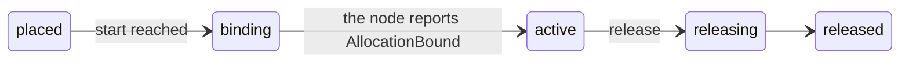

This tutorial builds a small GPU cluster with the commands that exist today: a site and a pool, a join token, a GPU
server joined with `bcd`, its adoption, a reservation of four GPUs, the <Term id="cdi">CDI</Term> device names on
the node, the release, and the events each step publishes. Every command below is in the `better-compute help`
manifest or in `bcd`'s own flags. The pages linked from each step explain the parts in depth; this page puts them in
order.

The [quickstart](/docs/guides/quickstart) does the second half (reserve, bind, release) with simulated machines on a
laptop. This tutorial adds the first half, the part a real server goes through.

<Callout type="warn" title="What runs where today">
The control plane and the CLI are released on npm. `bcd`, the Go daemon, is built and tested but not released, so you
build it from `daemon/` yourself (step 4). The whole path in this tutorial (join, adoption after `diag.nvml`, a GPU
hold bound with a node-signed `AllocationBound`, release) runs in `tests/e2e/bcd.test.ts` against a real gateway, with
bcd on fake hardware. `tests/e2e/bcd-host-real.test.ts` runs a host build of bcd on one real machine with an RTX 5090
in WSL 2 (8e9602c, 898a23c): it joins, is adopted and exports the GPU's metrics. The GPU model table knows that card since
223022b, but that run's bcd is an ordinary user without `[helper]`, so it binds no GPUs: it claims no binding
capability and a reservation never reaches `binding` there (see [step 4](#4-join-the-server-with-bcd)). No test has yet bound a
reservation on a data-center GPU server.
</Callout>

## What you need

| Piece | Why | See |
| --- | --- | --- |
| A control plane with a gateway | `bcd` only dials out, to a gateway over mTLS on port 443 (8443 in the examples) | [deployment](/docs/operations/deployment), `examples/postgres` |
| The machine PKI | JoinService's keys and the gateway's serving CA, whose pins the node carries | [PKI](/docs/operations/pki) |
| Better IAM wired in, and a root administrator's token | Every command below is decided by IAM as the token | [Better IAM](/docs/guides/iam) |
| A Linux server with NVIDIA GPUs, the driver and `nvidia-smi` | bcd reads GPUs through `nvidia-smi` | [host configuration](/docs/daemon/host-config#nvidia-driver) |
| Go 1.26 or later | To build bcd | [installing bcd](/docs/daemon/install#release-artifacts) |

`examples/postgres/README.md` is the reference for the control plane: `pki init`, `pki issue-gateway`, `migrate`,
and `serve` with the `api`, worker and `gateway` roles from one configuration, which also mounts `GET /watch` for
step 9. Its IAM section shows the bridge to wire; until it is wired no credential authenticates.

<Callout type="info" title="Following along on a laptop">
`better-compute dev` cannot take a real bcd: its gateway (`dev --sim`) speaks cleartext HTTP/2 on loopback and admits
only the simulated machines it joined itself (`packages/cli/src/dev-sim.ts`). On a laptop, run
`cd examples/dev && better-compute dev --memory --sim 2`, which prints a root token and tenant for step 1 and serves
`/watch`. Steps 1 to 3 then work as written. In step 4 the two simulated machines stand in for your server: from step
5 on, use the pool `dev` printed (`Joined 2 simulated hgx-h100 node(s) into pool_…`) as `$POOL`. To join a real bcd
on a laptop, use the dev stack in code with its mTLS listener, as the end-to-end tests do (see
[a real bcd](/docs/operations/local-development#a-real-bcd)).
</Callout>

<Steps>
<Step>

### 1. Act as the platform operator

Point the CLI at the API and give it the token of a root administrator. With `BETTER_COMPUTE_URL` set, every command
is an HTTP call to that server (plain `http` is allowed only for loopback addresses); `BETTER_COMPUTE_TENANT` is the
default `--tenant` of every token command.

```bash
export BETTER_COMPUTE_URL=https://compute.example.com
export BETTER_COMPUTE_TOKEN='biam_…'      # a root administrator's token
export BETTER_COMPUTE_TENANT=root         # the root tenant's id

better-compute api system.whoami
```

`better-compute help` lists every command, and `better-compute help <command>` shows one; see
[the CLI](/docs/guides/clients/cli) for credentials, output formats and `--query`.

</Step>
<Step>

### 2. Create a site and a pool

A <Term id="site">site</Term> is where machines live; a <Term id="pool">pool</Term> is a set of machines of one GPU
model with one policy. A platform site is `shared` (offered to tenants) or `dedicated`, and only the root tenant
creates those ([sites](/docs/guides/bare-metal/sites#sites)).

```bash
export SITE=$(better-compute sites create --kind shared --region eu-1 --key site-eu-1 --query id)
```

The pool's policy decides what a joining machine must pass before it takes work. Write it to a file:

```json title="pool-policy.json"
{
  "acceptance": [{ "kind": "diag.nvml" }],
  "expect": { "gpuCount": 8 }
}
```

```bash
export POOL=$(better-compute pools create --site $SITE --class metal-host --gpu-model H100 \
  --policy-file pool-policy.json --key pool-eu-1-h100 --query id)
better-compute pools get $POOL
```

- `--class metal-host` makes joining machines `host` nodes, whose GPUs are reserved as holds
  ([classes](/docs/guides/capacity/pools#classes)). The agent defaults to `bcd`, which join tokens require.
- `--gpu-model` is the GPU family inventory derives from the card's name, such as `H100` for `H100-SXM5-80GB`. A pool
  holds one model ([one GPU model](/docs/guides/capacity/pools#one-gpu-model)).
- `diag.nvml` with `expect.gpuCount` adopts a machine only when it shows 8 healthy GPUs (see
  [acceptance checks](/docs/guides/nodes/inventory-and-health#acceptance-checks)). Set the count to what your server
  has.
- `--key` makes the call retry-safe: the same key returns the same site or pool.

The pool's owner, here the root tenant, gets an effectively unlimited `gpu` quota on it. To let a customer tenant
reserve from it, offer it with a quota. The resource is `gpu` (singular): a quota row for any other name grants
nothing.

```bash
better-compute pools offer $POOL --to acme --quota gpu=16
```

See [offerings](/docs/guides/capacity/pools#offerings).

</Step>
<Step>

### 3. Mint a join token

A <Term id="join-token">join token</Term> lets a limited number of machines join one pool for a limited time. Bind it
to the machine you mean when you know one of its identifiers, and write it to a file instead of the terminal:

```bash
better-compute join-tokens create --pool $POOL --ttl 2h --max-uses 1 \
  --expect-serial SN-7701 --key join-sn-7701 --out ./join-token
```

`--out` writes a new file with mode 0600 and never overwrites one. The token is shown once; the control plane keeps
only a hash of its secret. `--ttl` takes `1m` to `24h`. A machine whose firmware reports no product UUID or serial (WSL
2 and many VMs) has no trusted hardware key, and a token without an `expect` binding is refused for it; bind such a
token with `--expect-mac` instead, as `tests/e2e/bcd-host-real.test.ts` does. See
[binding a token to one machine](/docs/guides/nodes/joining#binding-a-token-to-one-machine).

</Step>
<Step>

### 4. Join the server with bcd

Build bcd for the server. The default build reads GPUs through `nvidia-smi` and needs no cgo:

```bash
cd daemon
CGO_ENABLED=0 GOOS=linux GOARCH=amd64 go build -o bin/bcd ./cmd/bcd
```

There are two ways to install it.

**With the install script.** Serve the binary from the API (`downloads`, which the examples set from
`BETTER_COMPUTE_DOWNLOADS_DIR`; see [serving the binaries](/docs/daemon/install#serving-the-binaries)) under
goreleaser's file name `bcd_<version>_linux_amd64`, then generate a script that pins its digest and the PKI's keys:

```bash
better-compute daemon install-script --pool $POOL --site $SITE \
  --gateway-url https://gw.eu-1.example.com:8443 --base-url https://compute.example.com \
  --bcd-version 0.1.0 --sha256 amd64=$(sha256sum bin/bcd | cut -d' ' -f1) --out install-bcd.sh
```

Copy `install-bcd.sh` and `join-token` to the server and run the script as root, with the token on standard input:

```bash
sudo sh install-bcd.sh < join-token
```

It checks the host, downloads and verifies bcd, writes `/etc/bcd/config.toml` with the pins, runs `bcd doctor`, pipes
the token into `bcd join` and enables `bcd.service`. See [what the script does](/docs/daemon/install#what-the-script-does).

**By hand, from the well-known document.** When the control plane publishes its gateway
(`BETTER_COMPUTE_GATEWAY_URL` in the examples), a machine with no `config.toml` can join with the control plane's URL
and three pins. Print the pins on the control plane, from the sealed bundle:

```bash
better-compute pki show --query servingCaSpkiPin
better-compute pki show --query joinSigningKeyPin
better-compute pki show --query joinEncryptionKeyPin
```

Then, on the server, as root, with bcd copied to `/usr/local/bin/bcd`:

```bash
bcd join --server https://compute.example.com/api/compute \
  --serving-ca-pin 'sha256/…' --join-signing-pin 'sha256/…' --join-encryption-pin 'sha256/…' \
  --token-file ./join-token
bcd node --config /etc/bcd/config.toml
```

`bcd join` reads `<server>/.well-known/better-compute`, refuses it when a published pin differs from yours, joins,
and only then writes `/etc/bcd/config.toml` and `join-encryption.jwk`. `--token-file` takes only a regular file its
owner alone can read (0600 or 0400), and deletes it after the join. The token is never an argument: bcd reads it from
`BCD_JOIN_TOKEN`, standard input or `--token-file`, and refuses positional arguments. On success it prints
`joined as node_… (site site_…, role node); certificate valid until …`, and a second run prints
`already joined as node_…` without spending a token. Run `bcd node` under systemd in production; the install script's
unit is in [the systemd unit](/docs/daemon/install#the-systemd-unit). See
[joining from the well-known document](/docs/daemon/install#joining-from-the-well-known-document).

<Callout type="warn" title="Run bcd node as root, or beside bcd helper">
A GPU hold writes `/etc/cdi/bcd-<allocation>.json` and creates a cgroup slice, which only root can do. Since da60bbd
a host build of `bcd node` running as an ordinary user without a `[helper]` section advertises no `cdi`,
`devices.limits` or `binding.kubernetes` capability, so capacity places no GPU reservation on it, and a hold that
arrives anyway fails at once as `node-unprivileged`; `bcd doctor` warns about it. Run it as root (the install
script's default) or unprivileged beside a root `bcd helper` (`--unprivileged`; see
[running bcd node unprivileged](/docs/daemon/install#running-bcd-node-unprivileged)).
</Callout>

What happens inside the join (the sealed token, the signed `JoinResponse`, the node certificate) is in
[the join flow](/docs/guides/nodes/joining#the-join-flow).

</Step>
<Step>

### 5. Watch the node get adopted

The node is created in `adopting`. Once its session is up, the NodeLifecycle controller sends the pool's acceptance
checks; when `diag.nvml` passes, the node becomes `adopted`, gets desired-state generation 1, and the placer starts
to consider it.

```bash
better-compute nodes list --pool $POOL
export NODE=node_…   # the id nodes list printed (or bcd join)
better-compute nodes get $NODE --query provisionState
better-compute nodes get $NODE --query conditions
better-compute nodes events $NODE
```

`nodes events` shows `node.joined`, `node.connected`, `node.acceptance.started` and `node.adopted` in that order. On
the server, `bcd status` reads the running agent over its unix socket (`/run/bcd/bcd.sock` by default):

```bash
sudo bcd status            # session, spec generations, sections, GPUs
sudo bcd status --json
```

The text form shows the node, its session (`connected (epoch …)`), the applied and observed spec generations, one
line per section, and one line per GPU with its utilization, temperature, power and memory, and `held by
<allocation>` once a hold has it. See [bcd status](/docs/daemon#bcd-status) and
[telemetry and status](/docs/daemon/telemetry).

When the node stays `adopting`:

| What you see | Cause | Fix |
| --- | --- | --- |
| `AcceptanceFailed` true, reason `diag.nvml:<check>` | A GPU failed a check (`nvml.init`, `ecc.uncorrectable`, `row-remap.pending`, `pcie.link`, `xid.recent`, …) or the count is not `expect.gpuCount` | Fix the machine, then re-run acceptance (below) |
| `AcceptanceFailed` true, reason `Expired` | The check did not finish within its 10 minutes | Check the session (`bcd status`), then re-run |
| `GpuModelUnknown` true | The card's name is not in inventory's GPU model table; the node is NoSchedule | See [GPU naming](/docs/guides/nodes/inventory-and-health#gpu-naming) |
| No node at all | The join was refused: the agent only ever sees `Join refused` | Read the pool owner's `security.join.refused` events ([refusals](/docs/guides/nodes/joining#refusals)) |

A failed acceptance is sticky. Fix the cause and start a new attempt with `nodes.adopt`, which has no command of its
own; call it through `api`:

```bash
better-compute api nodes.adopt tenantId=$BETTER_COMPUTE_TENANT nodeId=$NODE reason='GPU 3 reseated'
```

</Step>
<Step>

### 6. Check capacity

```bash
better-compute capacity --pool $POOL
better-compute capacity --preview --pool $POOL --gpus 4 --for 2h
```

The rollup reports, per resource, `total`, `allocatable`, `allocated`, `reserved` and `available`, plus the GPUs that
are `provisioning`, `unhealthy`, in `maintenance` or `unreachable`. One adopted 8-GPU server gives 8 allocatable GPUs.
A preview books nothing; it answers whether the request would fit now, with the host CPUs and memory it would book.

</Step>
<Step>

### 7. Reserve GPUs

```bash
better-compute reserve --pool $POOL --gpus 4 --for 2h
```

`reserve` calls [`reservations.create`](/docs/reference/api/reservations#create) with a new idempotency key, which it
prints on standard error; run it again with `--key <that key>` to retry without booking twice. It waits up to
`--wait` seconds (default 20) for the placement. With the default placer the answer is already `placed`: the placer
picked the node, locked its GPUs and booked four of them, together with the pool's per-GPU share of the host's CPUs
and memory (see [host resources](/docs/guides/capacity/reservations#host-resources)). Other flags narrow the choice:
`--model`, `--product`, `--selector "vramGiB >= 80"`, `--nvlink` for one NVLink domain, `--start +2h` for a later
start. See [reservations](/docs/guides/capacity/reservations).

The reservation then binds on its own:



At the start, the node's desired state gains a device assignment for the allocation. bcd writes the hold's CDI spec
and env file, then journals an `AllocationBound` signed with its node key; once the control plane verified it, the
reservation is `active`.

```bash
export RSV=rsv_…   # the id reserve printed
better-compute reservations get $RSV --query state
better-compute reservations get $RSV --query binding
```

```json
{
  "nodeId": "node_…",
  "cdiDevices": ["bcd.dev/gpu=GPU-…", "bcd.dev/gpu=GPU-…", "bcd.dev/gpu=GPU-…", "bcd.dev/gpu=GPU-…"],
  "envFile": "/run/bcd/allocations/alloc_….env",
  "cgroupParent": "bcd-alloc-alloc_….slice"
}
```

`tests/e2e/spine.test.ts` checks this end to end (3c3a53f): the CDI device names `reservations.get` returns are
exactly the GPU UUIDs the database booked, and the node's CDI spec lists exactly those GPUs. A hold that fails on the
node (`overlap`, `device-missing`, `resources-exhausted`) is placed again, at most twice; no report within 5 minutes
counts as a failure ([bindings](/docs/guides/capacity/reservations#bindings)).

</Step>
<Step>

### 8. Use the GPUs on the node

The binding is a hold: the GPUs are set aside for the reservation, and a workload manager on the node uses them by
their CDI names. On the server:

```bash
ls /etc/cdi/                                  # bcd-alloc_….json beside nvidia.json
cat /etc/cdi/bcd-alloc_….json
cat /run/bcd/allocations/alloc_….env
```

| Where | What it holds |
| --- | --- |
| `/etc/cdi/bcd-<allocation>.json` | A CDI spec of kind `bcd.dev/gpu` with one device per held GPU, named by its UUID, and the annotations `bcd.dev/device-id` and `bcd.dev/reservation-id` |
| `/run/bcd/allocations/<allocation>.env` | `NVIDIA_VISIBLE_DEVICES` (the held GPUs' UUIDs), `BCD_ALLOCATION_ID` and, with host limits, `BCD_CGROUP_PARENT` |
| `bcd.slice/bcd-alloc.slice/bcd-alloc-<allocation>.slice` | The cgroup slice with the booked CPUs, memory and huge pages, when the hold has limits |

Since 6ecb860 a hold's spec also carries the device nodes, mounts and hooks of exactly the held GPUs, copied from
NVIDIA's own CDI spec, `/etc/cdi/nvidia.json`. So the name `bcd.dev/gpu=<uuid>` alone gives a container its GPUs and
nothing else. bcd writes that vendor spec with the [`container-toolkit` unit](/docs/daemon/host-config#container-toolkit)
when a profile names it; on a server you adopted, install the NVIDIA container toolkit and generate the same spec once,
as the unit does:

```bash
nvidia-ctk cdi generate --format=json --device-name-strategy=uuid > /etc/cdi/nvidia.json
```

Without a vendor spec a hold carries only `NVIDIA_VISIBLE_DEVICES`. Any CDI-aware runtime then takes the names as
devices. For example, with Podman, placing the container in the hold's slice:

```bash
set -a; . /run/bcd/allocations/alloc_….env; set +a
podman run --rm --device bcd.dev/gpu=GPU-… --device bcd.dev/gpu=GPU-… \
  --cgroup-parent "$BCD_CGROUP_PARENT" nvidia/cuda:12.4.1-base-ubuntu22.04 nvidia-smi -L
```

bcd does not move processes into the slice and never drops a hold on its own, not even while disconnected; the
workload manager (containerd, Slurm, a wrapper) places the workload. For Kubernetes, reserve with `--kubernetes` on a
pool with `policy.kubernetes`, and bcd's device plugin hands the held GPUs to the kubelet as `bcd.dev/gpu` (see
[Kubernetes workers](/docs/guides/capacity/kubernetes)). The node side is described in
[device assignments](/docs/daemon/delivery#device-assignments).

</Step>
<Step>

### 9. Follow the events

Every step above published events through the transactional outbox. With a host that mounts the events module's
`GET /watch` (the examples do), follow them live, one JSON line each:

```bash
better-compute events watch --types 'node.*,reservation.*'
```

Run it in a second terminal before step 7 to see the reservation move: `reservation.placed`, `reservation.binding`,
`reservation.active`, and after step 10 `reservation.released`. Each line carries a `sequence`; `--since <sequence>`
resumes after it. Without a `/watch` route, page through the same events with `better-compute events list` or
`better-compute nodes events $NODE`. See [watch](/docs/guides/events/watch) and the
[event reference](/docs/reference/events).

</Step>
<Step>

### 10. Release

```bash
better-compute release $RSV
better-compute capacity --pool $POOL
```

`release` calls [`reservations.release`](/docs/reference/api/reservations#release): the bookings end at the current
database time, the quota is refunded, and the device assignment leaves the node's desired state. bcd removes the CDI
spec and the env file, reports `AllocationReleased` signed with its node key, and stops the hold's slice once it is
empty, so a release never kills a running workload: stop it first. `available` goes back up. A reservation that has
not started is withdrawn with `release --cancel`; one that should run longer is extended with
`better-compute extend $RSV --by 2h` ([start, lease, extend and release](/docs/guides/capacity/reservations#start-lease-extend-and-release)).

</Step>
</Steps>

## Commands used

| Step | Command | API method |
| --- | --- | --- |
| 1 | [`api system.whoami`](/docs/reference/cli#api) | `system.whoami` |
| 2 | [`sites create`](/docs/reference/cli#sites-create), [`pools create`](/docs/reference/cli#pools-create), [`pools offer`](/docs/reference/cli#pools-offer) | `sites.create`, `pools.create`, `pools.offer` |
| 3 | [`join-tokens create`](/docs/reference/cli#join-tokens-create) | `joinTokens.create` |
| 4 | [`daemon install-script`](/docs/reference/cli#daemon-install-script), `pki show`; `bcd join`, `bcd node` | none (local), then JoinService's `Join` RPC |
| 5 | [`nodes get`](/docs/reference/cli#nodes-get), `nodes list`, `nodes events`, `api nodes.adopt`; `bcd status` | `nodes.get`, `nodes.list`, `nodes.events`, `nodes.adopt` |
| 6 | [`capacity`](/docs/reference/cli#capacity) | `capacity.*` |
| 7 | [`reserve`](/docs/reference/cli#reserve), `reservations get` | `reservations.create`, `reservations.get` |
| 9 | [`events watch`](/docs/reference/cli#events-watch), `events list` | `GET /watch`, `events.list` |
| 10 | [`release`](/docs/reference/cli#release), `extend` | `reservations.release`, `reservations.extend` |

## Cleaning up

To take the server out again, cordon it so nothing new places on it, let its reservations end, then delete the
node, which revokes its certificate and frees its hardware key for a later join:

```bash
better-compute nodes cordon $NODE --reason 'tutorial done'
better-compute nodes delete $NODE --yes
```

Then stop and disable `bcd.service` on the server and remove `/etc/bcd` and `/var/lib/bcd`; bcd has no uninstall step
([removing bcd](/docs/daemon/install#removing-bcd)). `better-compute pools archive $POOL` retires the pool. See
[removing an adopted host](/docs/guides/nodes/operating-nodes#removing-an-adopted-host).

## Next steps

<Cards>
  <Card title="Bare metal" href="/docs/guides/bare-metal">
    Enroll servers by their BMCs and let metal wipe and image them instead of adopting them by hand.
  </Card>
  <Card title="Fractional GPUs" href="/docs/guides/capacity/fractional-gpus">
    MIG instances and time-sliced or MPS slots in place of whole GPUs.
  </Card>
  <Card title="Host configuration" href="/docs/daemon/host-config">
    Have bcd install the driver, the container toolkit and the GPU settings for every machine of the pool.
  </Card>
  <Card title="Quotas and usage" href="/docs/guides/capacity/quotas-and-usage">
    Cap what each tenant may book and bill what it used.
  </Card>
</Cards>
