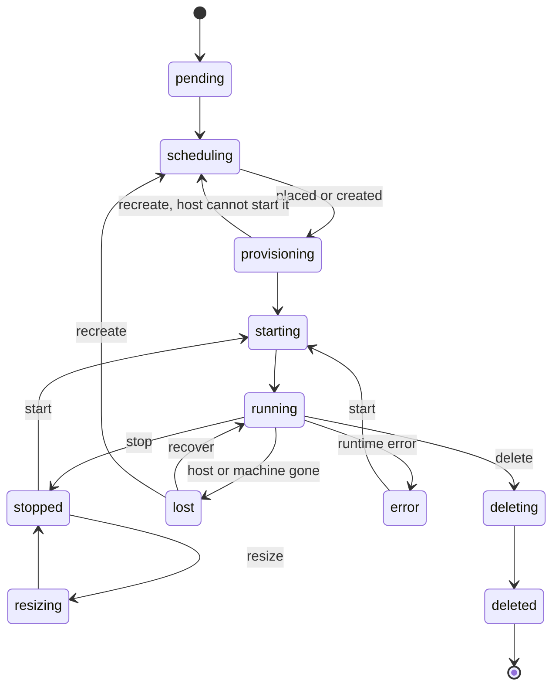

import { Box, Cloud, Network, Server, SlidersHorizontal } from '@/lib/icons';

Some of your capacity is best sold as whole machines, and some as virtual machines: a tenant wants a 2 vCPU box with
an SSH key for a build agent, or an 8 vCPU VM with one L40S passed through, without renting a whole server. Other
times you want to burst onto a cloud you do not run, and still keep one API, one quota system and one audit trail.

The `vps()` module does both. It adds <Term id="instance">instances</Term>: VMs described by a
<Term id="flavor">flavor</Term>, an <Term id="image">image</Term> and SSH keys, created in a
<Term id="pool">pool</Term>. Where the VM runs depends on the pool:

- A **hosted pool** runs VMs on your own servers. Capacity places each instance on a host, and the host's
  <Term id="bcd">bcd</Term> converges it.
- A **provider pool** creates each instance on an external cloud, through a <Term id="provider">provider</Term>
  such as Hetzner Cloud or your own Proxmox VE cluster.

Either way, the API only records what you want. A <Term id="reconciler">reconciler</Term> does the work, and nothing
in a request ever calls a hypervisor or a cloud API.

## Register the module

`vps()` is an injected module: the server never imports it, so you add it to `modules`. It requires the built-in
`capacity` module, which every server has.

```ts title="compute.ts"
import { betterCompute } from 'better-compute/server';
import { vps } from 'better-compute/vps';
import { hetznerCloud } from '@better-compute/provider-hetzner';
import { images } from './images';

export const compute = betterCompute({
  // database, secret, iam, …
  modules: [
    vps({
      runtimes: ['libvirt-kvm'], // hosted pools: the runtime driver bcd uses
      providers: [hetznerCloud], // provider pools: the providers accounts may use
      images, // hosted pools: resolves imageId for a tenant
    }),
  ],
});
```

None of these packages is on npm yet: Better Compute depends on Better IAM through vendored tarballs until Better IAM
publishes. Use them from the workspace. The provider packages sit outside the `better-compute` umbrella, so you
import them by their own names.

<TypeTable
  type={{
    runtimes: {
      type: 'string[]',
      description: "Runtime driver ids that hosted pools run, such as 'libvirt-kvm' or 'cloud-hypervisor'. Every new hosted instance records the first one. Ids are lower-case letters, digits and hyphens; an empty list is INVALID_CONFIG.",
      default: "['libvirt-kvm']",
    },
    providers: {
      type: 'ProviderDefinition[]',
      description: 'The defineProvider() definitions that provider accounts may name. Anything else, or the same id twice, is INVALID_CONFIG.',
      default: '[]',
    },
    images: {
      type: 'ImageResolver',
      description: 'resolve(tx, tenantId, imageId) returns the image a hosted VM boots, or undefined when the tenant cannot see it. Required for hosted pools: without it, instances.create in a hosted pool is INVALID_CONFIG.',
    },
    secrets: {
      type: 'SecretResolver',
      description: "Resolves the SecretRefs in provider account configs. Defaults to the server's secret broker.",
    },
    hostNetwork: {
      type: 'string',
      description: "The host bridge a hosted instance's NIC attaches to (InstanceSpec.nics). An interface name of 1 to 15 letters, digits, _ . -; anything else is INVALID_CONFIG.",
      default: "'br0'",
    },
  }}
/>

vps ships no image resolver: Better Compute checks image visibility itself, and you decide where images come from.
This one serves hosted VMs the images registered through the `images` group of `provisionModule`, when the tenant
owns them or they are public:

```ts title="images.ts"
import type { ImageResolver } from '@better-compute/vps';

export const images: ImageResolver = {
  async resolve(tx, tenantId, imageId) {
    const { rows } = await tx.query<{
      source: string;
      sha256: string;
      format: 'raw' | 'qcow2' | 'iso';
      verified: boolean;
    }>(
      `SELECT source, sha256, format, verified FROM images
        WHERE id = $1 AND deleted_at IS NULL AND (tenant_id = $2 OR visibility = 'public')`,
      [imageId, tenantId],
    );
    const image = rows[0];
    // undefined: the tenant cannot see it, and instances.create answers NOT_FOUND.
    return image && { url: image.source, sha256: image.sha256, format: image.format, verified: image.verified };
  },
};
```

`verified` becomes the instance's `imageVerified` attribute, which policies can require.

Registering the module adds:

- the `instances`, `flavors` and `providerAccounts` API groups
  ([instances](/docs/reference/api/instances), [flavors](/docs/reference/api/flavors),
  [providerAccounts](/docs/reference/api/provider-accounts)), and the v0.5 `sandboxes`, `sandboxTemplates` and `sandboxSnapshots` groups
  ([sandboxes](/docs/reference/api/sandboxes), [sandboxTemplates](/docs/reference/api/sandbox-templates),
  [sandboxSnapshots](/docs/reference/api/sandbox-snapshots)) for
  [sandboxes](/docs/guides/vps/sandboxes) on hosted pools;
- the migrations `vps/0001_instances`, with the tables `flavors`, `provider_accounts`, `instances`, `ip_pools` and
  `ip_leases`, `vps/0002_sealed_user_data` (`instances.user_data_sealed`), `vps/0003_provider_bootstraps`
  (`provider_bootstraps`, for [bootstrapping provider machines](/docs/extending/providers#bootstrapping-machines))
  and, for sandboxes, `vps/0004_sandboxes` (the tables `sandbox_templates` and `sandboxes`, the columns
  `instances.sandbox_id` and `instances.warm_template_id`, and `paused` as a desired state),
  `vps/0005_sandbox_snapshots` (`sandbox_snapshots`, `instances.restore_from`, `sandboxes.from_snapshot`),
  `vps/0006_warm_claims` (`instances.claimed_at`), `vps/0007_template_env` (`sandbox_templates.env`) and
  `vps/0008_template_network` (`sandbox_templates.network` and `instance_version`, `instances.network_policy` and
  `warm_template_version`), `vps/0009_snapshot_fixes` (`sandbox_snapshots.principal_instance_id` and `purged`),
  `vps/0010_sandbox_metric_indexes` (partial indexes for the sandbox metrics), `vps/0011_host_certificates`
  (`instances.host_certified`, `sandbox_snapshots.host_certified`) and `vps/0012_host_cert_validity`
  (`host_cert_valid_before` on both);
- the `vps.instances` reconciler, woken through the <Term id="work-queue">work queue</Term> by every change, the
  `vps.sandboxes` reconciler (every 15 seconds: sandbox expiry, sandbox events, warm pools and settling snapshots),
  and the `vps.usage` job, which meters hosted instances every 5 minutes;
- the `instance.snapshot` command kind (lane `bulk`, timeout 1 h) for sandbox snapshots;
- a `tenantDeleted` hook that deletes every instance of a deleted IAM tenant, sandboxes' and warm ones included;
- an `instances` section in the <Term id="nodespec">NodeSpec</Term> of each hosted node;
- the `runtime` driver kind, merged into `DriverKinds` of `@better-compute/core` when you import the package;
- `doctor` findings for hosted pools: `vps.pools.runtime` (a runtime the deployment does not list),
  `vps.pools.single-tenant` (a container pool without `policy.singleTenant`), `vps.pools.ipam` (no IP range) and
  `vps.hosts.capacity` (adopted hosts without capacity rows); see [doctor](/docs/operations/observability#doctor).

Hosted pools also need the <Term id="gateway">gateway</Term> to feed each host's runtime report to vps. Pass
`instanceStatusHandler` as a status handler. It runs next to the built-in XID health handler, each under its own
savepoint:

```ts title="better-compute.config.ts"
import { defineHost } from '@better-compute/cli';
import { instanceStatusHandler } from '@better-compute/vps';

export const host = defineHost(async ({ compute }) => ({
  gateway: {
    // region, listen, tls, …
    options: { reports: { status: instanceStatusHandler({ events: compute.context.events }) } },
  },
}));
```

## Hosted pools and provider pools

A VPS pool is a pool of class `vps-host` or `provider`, created with
[pools.create](/docs/reference/api/pools#create) like any other. Instances in pools of other classes are refused
with `INVALID_INPUT`.

|                          | Hosted pool                                                                                | Provider pool                                                                          |
| ------------------------ | ------------------------------------------------------------------------------------------ | -------------------------------------------------------------------------------------- |
| Pool                     | `class: 'vps-host'`, `agent: 'bcd'`                                                        | `class: 'provider'`, `agent: 'none'`, `providerAccountId`                              |
| Where the VM runs        | A node of the pool, running bcd                                                            | The provider's cloud; there is no `nodes` row                                          |
| Placement                | Capacity claims vCPU, memory, disk and whole GPUs on one host, in the create request       | None: the provider decides; the reconciler calls `ProviderImpl.create`                 |
| Quota                    | Charged by the placement                                                                   | Charged at admission from the flavor's shape                                           |
| Who converges            | The host's runtime, from the `instances` section of its NodeSpec                           | The `vps.instances` reconciler, polling the provider                                   |
| State comes from         | The host's `StatusReport.instances`                                                        | `ProviderImpl.get`                                                                     |
| Addresses                | A lease from the pool's IPv4 range, plus what the runtime reports                          | What the provider reports                                                              |
| Resize                   | In place, while stopped, same GPU count                                                    | `UNSUPPORTED`                                                                          |
| Metering                 | `vps.vcpu.hours`, `vps.memory.gib.hours`, `gpu.<model>.hours`                              | None: the provider bills you                                                           |

No platform agent ever runs inside a tenant VM, and no <Term id="join-token">join token</Term> ever goes into
tenant-readable user data. A provider machine that should become a host of your own (a Hetzner Robot server that
runs bcd) is a different thing: see [bare metal](/docs/guides/bare-metal).

## The instance model

An instance has two states. `desiredState` is what you asked for: `running`, `stopped` or `deleted`. `state` is where
the instance actually is. `instances.create` sets `desiredState` (default `running`); `start`, `stop` and `delete`
change only `desiredState` and wake the reconciler. The reconciler moves `state` toward it, one guarded transition at
a time, from what the host or the provider reports.



Every state except `deleted` and `deleting` can move to `deleting`, and most can move to `error` and `lost`. The
full table is `instanceStateTable` in `@better-compute/core`; since 564f543 it also allows `recreate` from
`provisioning` and `stopped`, for an instance whose host cannot start it (see
[hosts that cannot start an instance](/docs/guides/vps/instances#hosts-that-cannot-start-an-instance)). `rebooting` is in the table, but no API method enters
it in this release. `paused` (v0.5: `running` to `paused` by `pause`, back by `resume`) is used only by the warm
pools of [sandboxes](/docs/guides/vps/sandboxes#warm-pools); see [paused instances](/docs/guides/vps/instances#paused-instances).

The API returns the `Instance` view:

<TypeTable
  type={{
    id: { type: 'string', description: 'inst_ followed by 52 characters, derived from the tenant, the caller and the idempotency key.', required: true },
    state: { type: 'InstanceState', description: 'pending, scheduling, provisioning, starting, running, stopped, rebooting, resizing, deleting, deleted, error, lost or (warm sandbox instances) paused.', required: true },
    desiredState: { type: "'running' | 'stopped' | 'paused' | 'deleted'", description: "What the reconciler converges toward. Only sandbox warm pools ask for 'paused'.", required: true },
    flavor: { type: 'string', description: 'The flavor name the instance was admitted with.', required: true },
    imageId: { type: 'string', description: 'The image as the caller named it.', required: true },
    sshKeys: { type: 'string[]', description: 'The OpenSSH public keys from the request.', required: true },
    addresses: { type: 'string[]', description: 'IP addresses: the IPAM lease and what the runtime or provider reports.', required: true },
    conditions: { type: 'Condition[]', description: 'Why the instance is not where it should be: Unschedulable, RuntimeError or ProviderError.', required: true },
    nodeId: { type: 'string', description: 'Hosted pools: the node it is placed on.' },
    allocationId: { type: 'string', description: 'Hosted pools: the capacity allocation that holds its resources.' },
    externalId: { type: 'string', description: "Provider pools: the provider's machine id." },
    poolId: { type: 'string', description: 'The pool.', required: true },
    projectId: { type: 'string', description: 'The project, when the request named one.' },
    ownerIdentityId: { type: 'string', description: 'Who created it; list defaults to these.', required: true },
    idempotencyKey: { type: 'string', description: 'The key of the create request.', required: true },
    version: { type: 'number', description: 'Increases with every change.', required: true },
  }}
/>

[Instances](/docs/guides/vps/instances) covers each operation and how the reconciler turns reports into
transitions.

## What ships in v0.3

The control plane is complete and tested: the three API groups, admission, the reconciler for both pool kinds,
pool IPAM, the report seam and metering run against PGlite in `tests/vps-instances.test.ts`, and
`tests/vps-churn.test.ts` runs the v0.3 acceptance shape (200 instances churned on 3 emulated hosts with no leaked
allocation, IP lease, scalar claim or quota). What runs the VMs on a host is written but not yet proven: bcd's
`libvirt-kvm` and `cloud-hypervisor` runtimes have been tested against fake tools only.

| Part                                                        | Status in this release                                                                                                                                                                                                  |
| ----------------------------------------------------------- | ----------------------------------------------------------------------------------------------------------------------------------------------------------------------------------------------------------------------- |
| `instances`, `flavors`, `providerAccounts` groups           | Served (v0.3).                                                                                                                                                                                                          |
| `vps.instances` reconciler, IPAM, `vps.usage` metering      | Shipped.                                                                                                                                                                                                                |
| `hetzner-cloud` provider                                    | Shipped in `@better-compute/provider-hetzner`, tested against an in-memory emulator of the Hetzner Cloud API.                                                                                                           |
| `proxmox` provider                                          | Shipped in `@better-compute/provider-proxmox` (PLAN.md scheduled it for v0.5), tested against an in-memory PVE emulator.                                                                                                |
| Host runtimes `libvirt-kvm` and `cloud-hypervisor`          | bcd (v0.3), built but not released. A host build with `virsh` runs `libvirt-kvm` (362317c) under the `instances` converger: qcow2 overlays on sha256-verified https base images, NoCloud seeds, VFIO GPUs, pause and resume, snapshots and restores. A host build with the `cloud-hypervisor` binary runs `cloud-hypervisor` (2598f0a): one VMM per instance as a confined systemd transient unit, over its REST API, with the same overlays and seeds, VFIO GPUs, pause and resume, memory snapshots and restores. Security review 12's two high-severity findings are fixed (933c51b): taps are bridged before the VMM starts and an `inet bcd_taps` backstop drops a tap off its bridge, and both runtimes refuse a tenant image or restored snapshot that names a backing file or an external data file. Both have been tested only against fake tools, never on a real KVM host. A host with neither and without a runtime plugin fails a non-empty `instances` section; fakehw builds run a file-backed runtime. See [the runtimes](/docs/daemon/delivery#the-runtimes). |
| Runtimes as out-of-process plugins (Kata, and others)       | v0.5: bcd serves a bcx plugin of kind `runtime` as an instances runtime (`list`, `apply`, `remove`; no snapshots), Go unit tests only. No Kata plugin is written. See [walkthrough 4](/docs/extending/walkthroughs#walkthrough-4-a-kata-runtime-over-bcx). |
| Single-tenant container runtimes                            | Planned for v0.3; the `RuntimeTraits` contract describes them, nothing enforces single tenancy yet.                                                                                                                     |
| Interactive access (exec, SSH, TCP through a tunnel)        | `tunnels.open` with an `instanceId`, decided as `compute:instances:exec`: hosted instances only, and only when the deployment configures tunnels. The API reference lists it as planned. See [tunnels](/docs/guides/access/tunnels). |
| Sandboxes (`sandboxes`, `sandboxTemplates`, `sandboxSnapshots`) | v0.5: served, all 15 methods. Templates with `env` and `network`, TTL expiry, warm pools of paused instances and their `vps.sandbox.warm` meter, snapshots, restores and snapshot management, `sandboxes.exec` (from the tunnels module), the instance guard, tenant teardown (`tests/vps-sandboxes.test.ts`, `tests/e2e/sandboxes.test.ts`). bcd enforces a template's `network` with host nftables rules. Like every hosted instance, a sandbox needs a host runtime. See [sandboxes](/docs/guides/vps/sandboxes). |
| Per-instance metadata service and workload identity         | v0.5, optional. The control plane half (the workload broker, the session frames, the issuer and its published JWKS) is built and tested against the FakeDaemon's metadata service; bcd serves the same contract on `[imds] listen`, for the instances of whichever runtime it runs (end to end only with a fakehw build's file-backed runtime so far). See [workload identity](/docs/guides/vps/instances#workload-identity). |

The TypeScript `FakeDaemon` in `@better-compute/testing` speaks the real protocol for the simulator and
`better-compute dev --sim N`. As a VPS host it runs a `FakeHypervisor` (domains, overlays, NoCloud seeds, pause and
resume), which is how `tests/e2e/vps.test.ts` runs hosted instances through the real server and gateway. The unit
suites, `tests/vps-sandboxes.test.ts` among them, emulate hosts by calling `reportInstances` directly.

<Cards>
  <Card title="Instances" href="/docs/guides/vps/instances" icon={<Server />}>
    Create, start, stop, resize and delete; the reconciler, host reports, orphans and lost hosts.
  </Card>
  <Card title="Sandboxes" href="/docs/guides/vps/sandboxes" icon={<Box />}>
    Templates, a time-to-live, warm pools of paused instances, and the instance each sandbox drives.
  </Card>
  <Card title="Flavors" href="/docs/guides/vps/flavors" icon={<SlidersHorizontal />}>
    Named shapes per pool, and how they become claims, quota and provider offers.
  </Card>
  <Card title="Providers" href="/docs/guides/vps/providers" icon={<Cloud />}>
    Provider accounts, defineProvider, Hetzner Cloud, Proxmox VE and the conformance cases.
  </Card>
  <Card title="Networking" href="/docs/guides/vps/networking" icon={<Network />}>
    Pool IPAM: one IPv4 range per hosted pool, one lease per instance.
  </Card>
</Cards>
